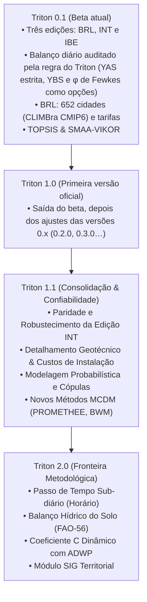

# Roadmap Estratégico Oficial do Triton

Este documento consolida o planejamento evolutivo de **todas as edições do Triton** (Brasil, International e Ibérica, hoje com dados de Portugal), a partir das evidências da revisão sistemática de literatura sobre simulação de aproveitamento de água de chuva e das diretrizes de governança, robustecimento metodológico e expansão da plataforma. As edições compartilham o mesmo motor de cálculo e a mesma numeração de versões: uma versão sai ao mesmo tempo nas três pastas (`triton_brl/`, `triton_int/`, `triton_ibe/`), e cada item abaixo vale para todas, salvo onde indicado.

---

## 🎯 Visão Geral da Arquitetura e Fases Evolutivas

---

## 🏛️ Eixos Estratégicos de Desenvolvimento

### 1. Robustecimento e Paridade da Versão Internacional (INT)
Atualmente a confiança do usuário está concentrada na Edição Brasil (BRL). Para conferir paridade técnica e confiabilidade internacional:
- **Provedores Climáticos Globais Integrados:**
  - Conexão nativa com reanálises climáticas globais de alta resolução: **ERA5-Land (ECMWF)** e **NOAA GHCN-Daily / WorldClim**, permitindo ao usuário selecionar qualquer coordenada geográfica global para compor séries pluviométricas diárias com preenchimento auditado de falhas.
- **Estruturas Tarifárias Internacionais:**
  - Suporte a modelos tarifários não lineares comuns no exterior: tarifas sazonais por blocos (*tiered block pricing*), tarifas com taxa de seca/escassez (*drought surcharges*) e modelos de cobrança por capacidade instalada e esgoto separado.
- **Motor com Suporte Completo a Unidades Imperiais e Métricas:**
  - Conversão bidirecional sem perda de precisão entre Sistema Internacional (litros, $\text{m}^3$, $\text{m}^2$, mm) e Sistema Imperial (US gallons, ccf, $\text{sq ft}$, inches).
  - Verificação de conservação de massa estrita ($\Delta V + Y + O - Q = 0$) operando com invariantes adimensionais independentemente do sistema de unidades exibido na interface.

---

### 2. Expansão da Tomada de Decisão Multicritério (MCDM / MCDA)
Além dos métodos já consolidados no Triton (**TOPSIS** determinístico e **SMAA-VIKOR** sob incerteza de pesos), incorporar métodos adequados a diferentes posturas de decisão:
- **PROMETHEE II (Outranking Completo):**
  - Implementação de fluxos líquidos de superação ($\Phi = \Phi^+ - \Phi^-$) com funções de preferência típicas (linear, nível, gaussiana), viabilizando o plano visual GAIA para análise de conflito entre critérios (economia de água potável vs. CAPEX vs. pegada de carbono).
- **ELECTRE Tri / IS (Classificação e Limiares de Veto):**
  - Definição de categorias de viabilidade (Recomendado, Viável sob Condições, Inviável) com limiares de indiferença, preferência e **veto estrito** (ex.: desqualificar alternativas com tempo de retorno superior à vida útil ou custo por $\text{m}^3$ superior à tarifa da rede).
- **BWM (Best-Worst Method) e AHP Hierárquico Auditado:**
  - Algoritmo BWM de consistência linear para determinar os vetores de pesos dos critérios através de comparações estruturadas (Melhor critério sobre os demais e todos os demais sobre o Pior), reduzindo inconsistências humanas e eliminando matrizes redundantes do AHP tradicional.
  - Relatório de consistência matemática integrada nos laudos técnicos.

---

### 3. Expansão da Modelagem Probabilística e Estocástica
Superar estimativas pontuais e fornecer distribuições completas de risco hidrológico e financeiro:
- **Modelagem de Dependência Climático-Demanda por Cópulas:**
  - Ajuste de famílias de cópulas (Gumbel, Clayton, Frank, Gaussiana) para modelar a correlação inversa entre chuva e demanda (dias secos aumentam o consumo de rega de jardins e arrefecimento, enquanto dias chuvosos suprimem a irrigação).
- **Análise Global de Sensibilidade (GSA - Sobol):**
  - Decomposição de variância por índices de sensibilidade de primeira ordem ($S_i$) e ordem total ($S_{Ti}$), informando ao projetista exatamente quais variáveis governam o desempenho do sistema (área de captação, demanda per capita, runoff, ou tarifa futura).
- **Gerador de Séries Sintéticas e Confiabilidade de Abastecimento:**
  - Bootstrap em blocos com preservação do índice de dias secos consecutivos (CDD).
  - Curvas de excedência de economia de água ($P_5$, $P_{50}$, $P_{95}$) e cálculo do Valor em Risco Hídrico (Water-at-Risk).

---

### 4. Engenharia de Custos, Detalhamento de Instalação e OPEX
Tornar o módulo econômico executável e aderente aos desafios reais de canteiro de obras:
- **Modelos Paramétricos de CAPEX por Tecnologia Construtiva:**
  - Diferenciação detalhada entre:
    - Tanques modulares em PEAD rotomoldado;
    - Reservatórios em Fibra de Vidro (PRFV);
    - Cisternas em Concreto Armado moldado *in loco*;
    - Alvenaria estrutural armada impermeabilizada.
- **Custos Geotécnicos de Implantação para Reservatórios Enterrados:**
  - Orçamentação paramétrica de serviços de terraplenagem: escavação manual vs. mecânica, escoramento de valas, reaterro compactado, remoção de bota-fora e laje de fundo contra empuxo freático, classificados por tipo de solo (solo arenoso comum, argila compacta, solo com presença de nível freático alto, rocha com necessidade de desmonte).
- **Desagregação Detalhada do OPEX e Ciclo de Vida:**
  - Custos reais de substituição de elementos filtrantes (refis de polipropileno melt-blown, leito de areia, blocos de carvão ativado, lâmpadas ultravioleta UV-C).
  - Consumo de insumos de desinfecção (dosadores automáticos de cloro por pastilha vs. dosagem líquida).
  - Curva de degradação da eficiência hidráulica da motobomba ao longo dos 20-30 anos de projeto.

---

## 📅 Matriz de Planejamento Detalhada

| Eixo / Funcionalidade | Requisito Técnico | Método / Algoritmo | Versão |
|---|---|---|:---:|
| **Internacional (INT)** | Provedores globais de chuva | Reanálise ERA5-Land & NOAA GHCN | 1.1 |
| **Internacional (INT)** | Sistema unificado métrico/imperial | Conversão dimensional sem resíduo | 1.1 |
| **Internacional (INT)** | Tarifas sazonais e de escassez | Estruturas tarifárias por blocos dinâmicos | 1.1 |
| **Decisão Multicritério** | Ordenação completa com GAIA | PROMETHEE II | 1.1 |
| **Decisão Multicritério** | Limiares de veto e classificação | ELECTRE Tri / IS | 1.1 |
| **Decisão Multicritério** | Ponderação robusta de pesos | Best-Worst Method (BWM) | 1.1 |
| **Probabilidade & Risco** | Dependência não linear chuva-demanda | Cópulas bivariadas (Clayton/Gumbel) | 1.1 |
| **Probabilidade & Risco** | Análise de sensibilidade de variância | Índices de Sobol ($S_i, S_{Ti}$) | 1.1 |
| **Probabilidade & Risco** | Chuva sintética | Bootstrap em blocos + Markov | 1.1 |
| **Custos & Engenharia** | CAPEX por material e escavação | Curvas paramétricas por classe de solo | 1.1 |
| **Custos & Engenharia** | OPEX detalhado com consumíveis | Filtros, desinfecção e reposição de bomba | 1.1 |
| **Física do Sistema** | Passo de tempo sub-diário | Modelo horário com dados de pluviógrafo | 2.0 |
| **Física do Sistema** | Balanço hídrico na zona radicular | FAO-56 Penman-Monteith (irrigação) | 2.0 |
| **Física do Sistema** | Coeficiente $C$ dependente de ADWP | Runoff variável com lâmina e estiagem | 2.0 |
| **Territorial** | Integração SIG urbana | Vetores GeoJSON e análise em escala de bacia | 2.0 |
