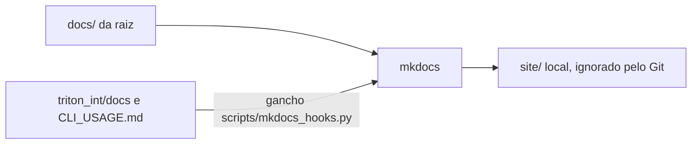

# Triton: documentação técnica

Este site reúne a documentação **técnica** do monorepo Triton para quem desenvolve ou audita o código. Ele é uma
ferramenta só de desenvolvimento: não vai no instalador, não tem deploy e não substitui o manual do usuário
(PDF e site offline em `manual/`).

## Por onde começar

| Quero | Leia |
| :-- | :-- |
| entender o modelo e suas equações | [Modelo](int/en/model.md), [Equações do balanço](int/equacoes_balanco.md) |
| saber o que foi verificado | [Verificação](int/en/verification.md) |
| usar a linha de comando | [Linha de comando](int/CLI_USAGE.md) |
| ver quem importa quem no código | [Grafo de dependências](grafo_de_dependencias.md) |
| comparar a grade do Triton com a busca bayesiana (optuna) | [Experimento grade x optuna](experimento_optuna.md) |
| gerar este site | [Este site (mkdocs)](documentacao_mkdocs.md) |

Os documentos da pasta «Edição Internacional» vêm de `triton_int/docs/`. As edições Brasil e Ibérica têm os seus em
`triton_brl/docs/` e `triton_ibe/docs/` (não incluídos aqui, para a navegação ficar enxuta).

Equações escritas em LaTeX (`$$ ... $$`) são desenhadas pelo MathJax, e diagramas Mermaid em blocos «mermaid» são
desenhados no navegador. Os dois dependem de scripts carregados da internet (o MathJax vem de um CDN); sem rede o
texto aparece, mas as equações e os diagramas não.
