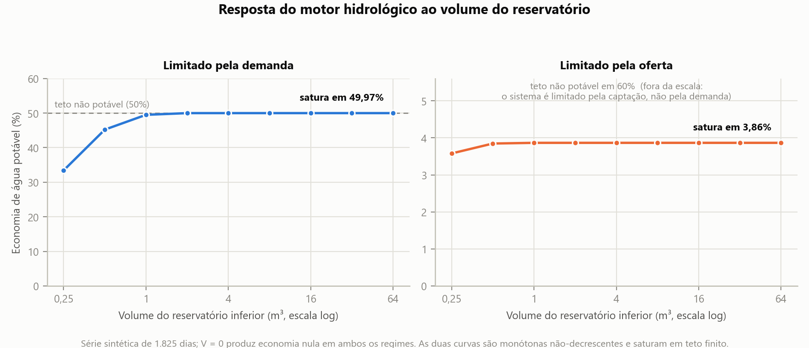
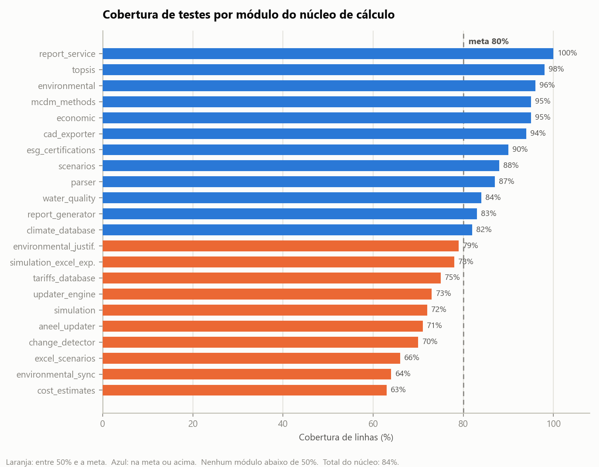
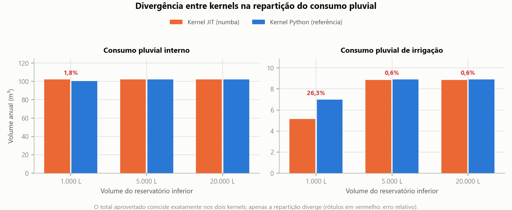

# Relatório de Verificação e Validação — Netuno 5

**Data da apuração:** 7–8 de setembro de 2026
**Escopo:** núcleo de cálculo (`netuno.core`), com ênfase no motor de balanço hídrico diário
**Ambiente:** Python 3.13.1, Windows 11. Os dois kernels foram exercitados: o de referência
na instalação principal e o acelerado num ambiente isolado com `numba` 0.67.0.

---

## Nota terminológica

Este documento reporta **verificação**, não validação externa. Seguindo a distinção usual
em modelagem computacional:

- **Verificação** responde *"as equações foram implementadas corretamente?"* — é uma
  pergunta interna ao software, respondida por testes, invariantes e comparação entre
  implementações.
- **Validação** responde *"as equações representam o fenômeno real?"* — exige comparação
  com medições de campo, e não é objeto deste relatório.

Todas as evidências abaixo são de verificação. O software não substitui medição,
certificação, projeto executivo nem revisão profissional das premissas locais.

---

## 1. Sumário executivo

| Dimensão | Resultado |
| :--- | :--- |
| Suíte de testes | 423 testes, 0 falhas (mais 5 de replicação sob demanda) |
| Cobertura do núcleo de cálculo | 85% das linhas, nenhum módulo abaixo de 50% |
| Propriedades científicas verificadas | 9 de 9 aprovadas, em 2 regimes hidrológicos |
| Conservação de massa | fecha exatamente (erro máximo 0,000 L) |
| Defeitos abertos | 0 — o defeito da repartição interno/irrigação foi corrigido (§4) |
| Aderência ao Netuno 4 | o balanço hídrico replica a referência com MAE de **0,25 pp** quando neutralizadas as duas diferenças de projeto (§5.4) |
| Banco tarifário | 465 cidades divergentes reconciliadas; insensíveis ao consumo: 43 → 7 (§6) |
| Diferença metodológica declarada | o descarte de primeira chuva subtrai a lâmina, ao contrário do Netuno 4 (§5.5) |

O motor hidrológico está **correto nos dois caminhos de execução**. O defeito detectado no
kernel acelerado foi corrigido e a paridade entre as duas implementações passou a ser
verificada automaticamente (§4).

---

## 2. Propriedades científicas do motor hidrológico

Um teste de caso pontual verifica um número; uma **propriedade** verifica uma afirmação
válida para toda a família de parametrizações. Uma violação indica erro estrutural no
balanço, não divergência numérica de um cenário isolado.

As nove propriedades abaixo estão implementadas em
[`tests/invariants/test_scientific_properties.py`](../tests/invariants/test_scientific_properties.py)
e executam a cada rodada da suíte.

| # | Propriedade | Formulação | Resultado |
| :-- | :--- | :--- | :--- |
| P1 | Monotonicidade no volume | `V₁ ≤ V₂ ⟹ economia(V₁) ≤ economia(V₂)` | aprovada |
| P2 | Limites físicos | `0 ≤ economia ≤ fração não potável ≤ 100%` | aprovada |
| P2b | Volume nulo | `V = 0 ⟹ economia = 0` | aprovada |
| P3 | Saturação | `economia(V)` converge para teto finito | aprovada |
| P4 | Determinismo | mesma entrada ⟹ saída bit a bit idêntica | aprovada |
| P5 | Monotonicidade na área | `A₁ ≤ A₂ ⟹ economia(A₁) ≤ economia(A₂)` | aprovada |
| P6 | Monotonicidade inversa no descarte | descarte maior ⟹ economia não maior | aprovada |
| P7 | Extravasamento | `V` maior ⟹ extravasamento não maior | aprovada |
| P8 | Conservação de massa em grade | fecha em 12 combinações de `V × A × descarte` | aprovada |
| P9 | Série sem chuva | precipitação nula ⟹ captação, economia e extravasamento nulos | aprovada |

### 2.1 Por que dois regimes hidrológicos

A sensibilidade do modelo depende do regime, e um teste conduzido no regime errado pode
passar sem discriminar nada:

- **Limitado pela demanda** (captação abundante): a economia satura na fração não potável.
  A amplitude de resposta entre o menor e o maior reservatório é de apenas **0,02 pontos
  percentuais** — o regime é quase insensível aos parâmetros.
- **Limitado pela oferta** (captação escassa): a economia satura muito abaixo do teto não
  potável, e a amplitude de resposta é de **3,80 pontos percentuais**, cerca de 190 vezes
  maior.

Cada propriedade é, portanto, executada nos dois regimes. Um erro de balanço que
permanecesse invisível no primeiro regime seria detectado no segundo.



*Figura 1 — Resposta do motor ao volume do reservatório inferior nos dois regimes. À
esquerda, o sistema satura em 49,97%, encostando no teto de 50% imposto pela fração não
potável: o fator limitante é a demanda. À direita, satura em 3,86% com o teto em 60% muito
distante: o fator limitante é a captação. Ambas as curvas são monótonas não-decrescentes e
convergem, como exigem P1 e P3.*

### 2.2 Conservação de massa

A conservação é verificada dia a dia, e não apenas no agregado anual:

```
estoque(t−1) + captado(t) = estoque(t) + consumido(t) + extravasado(t)
```

Em 12 combinações de volume, área de captação e lâmina de descarte, ao longo de 1.825 dias
cada, o **erro máximo de fechamento foi 0,000 L** — igualdade exata em ponto flutuante, não
apenas dentro de tolerância. O recalque para o reservatório superior é transferência
interna e cancela no balanço combinado.

---

## 3. Cobertura de testes



*Figura 2 — Cobertura de linhas por módulo do núcleo. A cobertura total é de 84% e
nenhum módulo está abaixo de 50%.*

A cobertura agregada é de **85%**, e a distribuição deixou de ter concentrações de risco:

| Faixa | Módulos | Leitura |
| :--- | :--- | :--- |
| ≥ 90% | `report_service`, `topsis`, `environmental`, `mcdm_methods`, `economic`, `cad_exporter`, `esg_certifications` | núcleo decisório e financeiro bem cobertos |
| 63–88% | `scenarios`, `parser`, `water_quality`, `report_generator`, `climate_database`, `simulation`, `excel_scenarios`, `change_detector`, `cost_estimates` | lacunas concentradas em ramos de exceção |
| < 50% | nenhum | — |

Três módulos saíram da faixa crítica nesta apuração:

| Módulo | Antes | Depois | Como |
| :--- | ---: | ---: | :--- |
| `scenarios` | 33% | **88%** | matriz fatorial em modo sequencial e exportação no formato do Netuno 4 |
| `change_detector` | 24% | **70%** | transições de estado com a sessão HTTP substituída por dublê |
| `excel_scenarios` | 14% | **66%** | ida e volta entre o modelo gerado e o leitor do próprio programa |

Com isso o portão de cobertura do `qa_runner` deixou de ter isenções: os três módulos
respondem ao piso como os demais.

Os 72% de `simulation.py` são artefato de medição, não lacuna: 167 linhas correspondem
aos kernels JIT, que a ferramenta de cobertura não instrumenta mesmo quando estão
ativos. A verificação desses kernels é feita por comparação com o kernel de referência
(§4), e não por cobertura.

---

## 4. Defeito corrigido: repartição interno/irrigação no kernel JIT

### 4.1 Contexto

`netuno.core.simulation` mantém **duas implementações independentes** do balanço diário. A
seleção é implícita e ocorre em tempo de importação:

```python
if HAS_NUMBA and not store_daily_details:   # kernel JIT compilado
else:                                       # kernel Python de referência
```

Três circunstâncias tornam isso frágil:

1. `numba` **não está declarado** em `pyproject.toml` nem em `requirements.txt`. Qual kernel
   roda depende do que houver instalado na máquina — dois usuários podem obter resultados
   diferentes do mesmo projeto sem nenhum aviso.
2. Os kernels usam `@numba.njit(fastmath=True)`. `fastmath` autoriza reassociação de
   operações de ponto flutuante, dispensando o compilador da aritmética IEEE estrita.
3. `test_mass_conservation.py` usa `store_daily_details=True`, condição que **força o kernel
   Python**. O invariante mais forte do sistema, portanto, nunca alcançava o caminho JIT.

### 4.2 O defeito

Em ambiente isolado com `numba` 0.67.0 e `numpy` 2.5.3, os dois kernels foram comparados
em 3 cenários × 3 volumes × 8 indicadores. **Sem irrigação configurada, concordam em todos
os 72 pontos** dentro de tolerância relativa de 1×10⁻⁹.

Com irrigação configurada, divergem na repartição do consumo:



*Figura 3 — Repartição do consumo pluvial entre uso interno e irrigação. O total aproveitado
é idêntico nos dois kernels; apenas a divisão entre as duas parcelas diverge, em até 26,3%
na componente de irrigação.*

**Causa raiz.** O kernel Python acumula o mínimo dia a dia
([`simulation.py:788-791`](../netuno/core/simulation.py)):

```python
c_pluv_in  = min(v_c, non_pot_in_day)                  # por dia
c_pluv_irr = min(max(0.0, v_c - c_pluv_in), irr_day)   # por dia
total_pluvial_indoor_consumed += c_pluv_in             # acumula
```

O kernel JIT aplica o mesmo `min()` sobre os **totais anuais**
([`simulation.py:638-639`](../netuno/core/simulation.py)):

```python
pluv_in_est  = min(tot_pluv, tot_non_pot_demand)       # sobre o total!
pluv_irr_est = min(tot_pluv - pluv_in_est, sum(irr_arr))
```

Como `Σᵢ min(aᵢ, bᵢ) ≤ min(Σᵢ aᵢ, Σᵢ bᵢ)`, o erro tem **direção constante**: o kernel JIT
superestima sistematicamente o consumo interno e subestima a irrigação. Não é ruído de
arredondamento nem efeito de `fastmath` — é uma diferença algorítmica.

### 4.3 Severidade

O total de água aproveitada e a economia de água potável — os indicadores principais —
permanecem **exatos**. O erro afeta apenas a repartição. Contudo, a repartição não é
cosmética: **LEED v4 pontua uso externo (WEc1) e uso interno (WEc2) em créditos separados**,
de modo que um erro de 26% na componente de irrigação pode alterar o enquadramento em
certificação ainda que a economia total esteja correta.

### 4.4 A correção

Os kernels JIT passaram a acumular a repartição **dia a dia**, exatamente como o kernel
Python de referência, em vez de derivá-la dos totais anuais. Os vetores de demanda interna
e de irrigação passaram a ser argumentos dos kernels, e a estimativa enviesada foi removida
do local de chamada.

Quando a edificação não define irrigação, o local de chamada passa a própria demanda pluvial
como teto do uso interno. Isso reproduz exatamente o caso sem repartição: como
`v_c = min(demanda_pluvial, disponível) ≤ demanda_pluvial`, o mínimo diário devolve `v_c`
inteiro ao uso interno e zero à irrigação — sem necessidade de um caminho condicional dentro
do kernel compilado.

**Verificação da correção**, em ambiente isolado com `numba` 0.67.0:

| Indicador (V = 1.000 L) | Antes — JIT | Antes — Python | Depois — ambos |
| :--- | ---: | ---: | ---: |
| Consumo pluvial interno (m³/ano) | 102,270 | 100,430 | **100,429885** |
| Consumo pluvial de irrigação (m³/ano) | 5,156 | 6,996 | **6,995885** |
| Divergência relativa máxima | 26,3% | — | **0,00 × 10⁰** |

O kernel JIT convergiu para os valores do kernel de referência — foi corrigido na direção
certa. Os 25 testes de paridade, antes ignorados, passam agora integralmente: a suíte de
invariantes executa **73 testes sob `numba`** contra 48 sem ele.

**O desempenho foi preservado:** 189× a 239× de ganho nas varreduras após a correção,
contra 199× a 267× antes — diferença dentro do ruído de medição.

### 4.4.1 Rastreamento

A regressão está travada em
[`tests/invariants/test_numba_python_parity.py`](../tests/invariants/test_numba_python_parity.py),
que compara os dois kernels em 3 cenários × 3 volumes × 8 indicadores, incluindo a
repartição interno/irrigação. Em ambiente sem `numba` os testes são ignorados; onde ele
existir, qualquer retorno do viés reprova a suíte.

### 4.5 Quanto custa remover o caminho acelerado

Medição em ambiente isolado (`numba` 0.67.0), alternando `HAS_NUMBA` no mesmo processo e
no mesmo hardware, com aquecimento prévio do JIT para excluir o tempo de compilação:

| Carga | Kernel JIT | Kernel Python | Razão |
| :--- | ---: | ---: | ---: |
| Simulação única, série de 10 anos | 0,04 ms | 4,1 ms | 107× |
| Simulação única, série de 100 anos | 0,3 ms | 41,1 ms | 159× |
| Varredura, 10 anos × 201 volumes | 0,5 ms | 0,10 s | 218× |
| Varredura, 30 anos × 201 volumes | 1,8 ms | **0,48 s** | 267× |

A compilação JIT custa **0,56 s**, paga uma vez por sessão, na primeira simulação.

**Leitura em duas partes, porque a resposta difere conforme o uso:**

*Uso interativo no desktop.* A varredura mais pesada leva **0,48 s** em Python puro — abaixo
do limiar de percepção para uma interação de clique-e-resultado. E como a compilação JIT
custa 0,56 s por sessão, o caminho acelerado só se paga a partir da segunda varredura
pesada. Para o uso interativo, remover o `numba` seria imperceptível.

*Estudos em lote.* Aqui a conta se inverte. O estudo internacional roda, conforme o próprio
`run_simulation_global.py`, **255 cidades × 11 tipologias × 12 volumes = 33.660 simulações**.
Com séries de 30 anos isso significa cerca de **7 minutos** em Python puro contra
**~3 segundos** com JIT. Em estudos climáticos sobre as 652 cidades, com múltiplos modelos
GCM e cenários SSP, o fator 267× é a diferença entre horas e minutos.

### 4.6 A decisão tomada

Esta medição **inverteu a recomendação preliminar** deste relatório. A hipótese inicial era
remover os kernels JIT, por não estarem declarados, não serem testados e já terem divergido.
Os números não sustentaram a escolha: o ganho de duas ordens de grandeza é real e incide
exatamente sobre a carga de trabalho que a pesquisa executa.

Optou-se por **corrigir a repartição dentro dos kernels JIT** (§4.4), preservando o
desempenho, e por declarar `numba` como dependência opcional documentada, com os testes de
paridade como guarda permanente. As alternativas descartadas ficam registradas:

| Opção | Efeito | Por que não |
| :--- | :--- | :--- |
| **Remover os kernels JIT** | eliminaria a classe inteira de risco; −167 linhas | custaria ~7 min por estudo internacional e horas nos estudos climáticos das 652 cidades |
| **Manter o defeito documentado** | nenhum trabalho | erro de 26% na componente que o LEED v4 pontua em crédito separado |

---

## 5. O Netuno 4 como instrumento de verificação

### 5.0 O papel da comparação

O Netuno 4 **não é alvo de fidelidade**. O Netuno 5 adota deliberadamente decisões de
modelagem distintas — a mais relevante delas no tratamento do descarte de primeira chuva
(§5.5) — e espera-se que os resultados difiram.

O que o Netuno 4 oferece é algo mais valioso e mais escasso: **um conjunto independente
de 4.050 resultados**, produzidos por outra implementação do mesmo modelo conceitual, com
o qual verificar se o balanço hídrico do Netuno 5 calcula o que deveria. Sem essa
referência externa, a verificação do motor se limitaria a propriedades internas
(§2) — necessárias, porém insuficientes para detectar um erro sistemático que
respeitasse todas elas.

Daí a importância da decomposição (§5.4): a métrica que interessa não é a distância
total entre os dois programas, e sim **o resíduo depois de neutralizadas as diferenças
de projeto conhecidas**. Esse resíduo — 0,25 pp — é o resultado de verificação. A
distância total é apenas a soma dele com escolhas deliberadas.

Até esta apuração a comparação era a única **não automatizada**:
`compare_netuno4_netuno5.py` existia desde o início, mas não seguia o padrão
`test_*.py`, de modo que o pytest coletava zero testes do diretório e a função só era
chamada pelo seu próprio bloco `__main__`.

### 5.1 Dados de referência

`data/simulation_outputs/**/Planilha.csv` reúne **4.050 casos** exportados do Netuno 4,
versionados e preservados byte a byte:

| Conjunto | Casos | Cidades |
| :--- | ---: | :--- |
| `SimulacaoFloripaBrasilia` | 1.458 | Florianópolis, Brasília |
| `SimulacaoManausSaoPaulo` | 2.592 | Manaus, São Paulo |

### 5.2 Resultado

Medição de 8 de setembro de 2026, excluindo os casos de referência nula (§5.3):

| Conjunto | MAE | RMSE | Viés | Erro máx. | ≤ 5 pp | ≤ 10 pp |
| :--- | ---: | ---: | ---: | ---: | ---: | ---: |
| Floripa/Brasília | 2,29 pp | 2,72 pp | −2,29 pp | 7,43 pp | 97,4% | 100,0% |
| Manaus/São Paulo | 2,71 pp | 3,33 pp | −2,71 pp | 10,60 pp | 88,6% | 99,9% |

### 5.3 Casos de referência nula

Em parte das linhas o Netuno 4 exportou `0,00` enquanto o Netuno 5 calcula valor
positivo. A incidência difere muito entre os conjuntos — **0,35% em Manaus/São Paulo
contra 34,98% em Floripa/Brasília** — o que aponta para característica dos dados de
referência (o Netuno 4 provavelmente não encontrou volume ótimo sob o seu próprio
critério) e não para erro do Netuno 5, que nunca devolve zero nesses casos. São
segregados das estatísticas para não dominá-las.

### 5.4 Decomposição da divergência

Comparar o resultado ótimo de um programa com o do outro mistura três diferenças
distintas: o balanço hídrico, o critério que escolhe o volume ótimo e o tratamento do
descarte de primeira chuva. Uma métrica agregada sobre essa mistura **não permite dizer
se o motor replica o Netuno 4** — apenas que os dois programas, como um todo, diferem.

`tests/benchmarking/decomposicao_divergencia.py` separa as parcelas, comparando em três
configurações sucessivamente mais controladas sobre os 2.583 casos de Manaus/São Paulo:

| Configuração | MAE | Viés | ≤ 5 pp |
| :--- | ---: | ---: | ---: |
| 1. Ótimo do Netuno 5 contra ótimo do Netuno 4 | 2,81 pp | −2,71 pp | 88,6% |
| 2. Avaliado no volume que o Netuno 4 declarou ótimo | 1,60 pp | −1,60 pp | 96,4% |
| 3. Idem, adotando o descarte por limiar do Netuno 4 | **0,25 pp** | **−0,25 pp** | **100,0%** |

A atribuição resultante:

| Fonte da divergência | Contribuição | Natureza |
| :--- | ---: | :--- |
| Critério de escolha do volume ótimo | 1,11 pp (41%) | diferença de projeto |
| Tratamento do descarte de primeira chuva | 1,36 pp (50%) | diferença metodológica deliberada (§5.5) |
| Resíduo do balanço hídrico | 0,25 pp (9%) | — |

**Neutralizadas as duas diferenças conhecidas, o motor do Netuno 5 reproduz o Netuno 4
com erro médio absoluto de 0,25 pp e 100% dos casos dentro de 5 pontos percentuais.**
O resíduo é compatível com a precisão de duas casas decimais da própria planilha de
referência, o que significa que o balanço hídrico diário calcula, dentro do que os dados
permitem distinguir, o mesmo que uma implementação independente do modelo.

**É este número que verifica o motor.** A divergência total de 2,81 pp da configuração 1
não mede erro: mede a soma de duas decisões de projeto do Netuno 5, ambas deliberadas e
documentadas.

#### Como a semântica de limiar foi medida sem alterar o motor

O Netuno 5 calcula `Pef = max(0, Pt − df)`. Para medir a regra do Netuno 4
(`Pef = Pt se Pt ≥ df`) sem tocar no código do balanço, transforma-se a série de entrada:

```text
P′ = Pt + df   quando Pt ≥ df
P′ = 0         caso contrário
```

Assim `max(0, P′ − df)` devolve exatamente `Pt` nos eventos aceitos e `0` nos
descartados. A medição não depende de uma versão modificada do motor, e portanto não
corre o risco de comparar contra código que não é o distribuído.

### 5.4.1 A divergência é sistemática, não dispersa

Na configuração 1, o erro médio **com sinal** coincide em módulo com o erro médio
absoluto, nos dois conjuntos independentes:

```
Floripa/Brasília:  viés = −2,29 pp    MAE = 2,29 pp    |viés| / MAE = 1,00
Manaus/São Paulo:  viés = −2,71 pp    MAE = 2,71 pp    |viés| / MAE = 1,00
```

Praticamente todos os desvios têm a mesma direção: o Netuno 5 estima consistentemente
menos economia que o Netuno 4. Era esse padrão — deslocamento, e não dispersão — que
indicava causa estrutural e não ruído numérico, e que levou à decomposição acima.

### 5.5 Origem da divergência: o descarte de primeira chuva

A investigação identificou a causa principal e, no curso desta apuração, ela foi
**resolvida como defeito de documentação** — não de código.

**O que o código faz.** As três implementações do balanço subtraem a lâmina de descarte
da precipitação do evento:

```python
p_eff = p_i - discard_mm if p_i > discard_mm else 0.0   # max(0, Pt − df)
```

**O que a documentação afirmava.** Até esta apuração, `docs/metodologia.md` descrevia o
descarte como *limiar do evento* — aproveitando `Pt` integralmente sempre que `Pt ≥ df` —
e negava explicitamente a subtração. Essa descrição estava **errada**.

**Resolução.** O comportamento implementado é o pretendido e é fisicamente mais fiel: a
água desviada para o dispositivo de descarte não chega à cisterna, logo não fica
disponível para consumo. O que varia entre os modos de descarte não é a fórmula, mas em
quais dias ela é acionada — todos os eventos, primeiro evento após estiagem, ou
periodicidade de manutenção. A documentação foi corrigida; o código permanece inalterado.

### 5.5.1 Consequência para publicações

A quantificação desta diferença está em §5.4: ela responde por **1,36 pp (50%)** da
divergência total em relação ao Netuno 4. Neutralizada junto com o critério de volume
ótimo, o resíduo cai a 0,25 pp — ou seja, esta é a maior das duas causas conhecidas, e
não sobra terceira causa relevante.

O Netuno 5 estima sistematicamente menos economia de água potável que o Netuno 4, por
uma razão conhecida e defensável: a água desviada para o dispositivo de descarte não
chega à cisterna. Estudos que comparem resultados entre as duas versões, ou que
reaproveitem números publicados com o Netuno 4, **devem declarar esta diferença**.

A semântica está travada por teste de regressão em
`tests/invariants/test_scientific_properties.py` (P10), para que não seja revertida por
engano como se fosse defeito, e a sua contribuição para a divergência é monitorada por
`tests/benchmarking/test_replicacao_netuno4.py`.

### 5.6 Automação

A comparação passou a ser executável e verificada:

```bash
python scripts/qa_runner.py --layer replicacao   # 4.050 casos
pytest -m replicacao                             # equivalente
```

A execução completa leva cerca de 40 s com os kernels acelerados e mais de dez minutos
sem eles, e por isso fica fora da suíte padrão, que roda uma amostra determinística de
15 casos apenas para detectar quebra do arranjo de comparação.

---

## 6. Correção do banco tarifário

### 6.1 O defeito

Existiam **duas cópias divergentes** de `brazil_cities_tariffs.json` — uma em
`data/tarifas/` e outra em `netuno/data/` — e o carregador preferia a primeira. Elas
discordavam em **465 das 652 cidades**.

A divergência estava sempre na **primeira faixa progressiva**:

- na cópia carregada, 464 cidades tinham essa faixa com tarifa **zerada**;
- na cópia do pacote, nenhuma tinha, mas 324 guardavam ali o valor `taxa fixa ÷ largura
  da faixa`, que somado à própria taxa fixa **cobrava o consumo inicial duas vezes**.

Nenhuma das duas estava certa, porque a primeira faixa tem dois significados distintos
conforme o prestador: pode ser consumo já coberto pela tarifa mínima (aí a tarifa por m³
deve ser zero) ou pode ter tarifa volumétrica própria (aí zerar perde cobrança real).

### 6.2 Consequência

Onde a faixa zerada era a única, a conta ficava **totalmente insensível ao consumo**:
economizar água não reduzia a fatura, e o Netuno calculava retorno econômico nulo para
qualquer sistema, por melhor que fosse o desempenho hídrico. Isso ocorria em 43
municípios (6,6%).

Nos demais, o efeito era mais discreto e mais insidioso: a conta continuava crescendo
pelas faixas superiores, mas **subestimava** o custo do consumo inicial — justamente a
faixa onde se concentra o consumo residencial típico.

### 6.3 A correção

`scripts/reconciliar_tarifas.py` reconstrói a primeira faixa a partir de
`tarifas/tarifas_detalhadas_auditadas.csv`, a base auditada com procedência e grau de
confiança por município. O critério é documental, não aritmético:

- a base registra tarifa por m³ para a menor faixa → tarifa genuína, restaurada;
- a base registra apenas tarifa mínima → faixa coberta pelo fixo, mantida em zero.

Três particularidades exigiram tratamento explícito:

| Situação | Municípios | Tratamento |
| :--- | ---: | :--- |
| A primeira linha do CSV é o rótulo `Tarifa fixa`, não a menor faixa | 65 | seleção pela menor faixa, e não pela ordem do arquivo |
| Faixa inicial descrita como `Até N m³` (SANEPAR) | 34 | interpretada como faixa de 0 a N |
| Duas tabelas concorrentes para a mesma faixa (ES/Aracruz, «SAAE / CESAN conforme área») | 1 | **não alterada** — escolher uma seria arbitrar qual concessionária atende o imóvel |

Corrigiu-se também a parcela fixa de quatro municípios do Piauí, que declaravam
R$ 52,89 inexistentes na base auditada, duplicando a cobrança da primeira faixa.

### 6.4 Resultado

| Indicador | Antes | Depois |
| :--- | ---: | ---: |
| Municípios com conta insensível ao consumo | 43 (6,6%) | **7 (1,1%)** |
| Cidades com faixas divergentes entre as duas cópias | 465 | **1** (a ambígua) |
| Cidades com tarifa alterada | — | 140 |

Entre as 140 cidades alteradas, a conta de 15 m³ **subiu em 136 e não caiu em nenhuma**,
com variação mediana de **+74,7%**. A leitura é direta: as contas estavam subestimadas, e
com elas a economia atribuída ao aproveitamento de água de chuva. **Estudos econômicos
executados antes desta correção subestimam o retorno nesses municípios.**

### 6.5 Ressalva sobre a CORSAN

Trinta e seis dos municípios corrigidos são atendidos pela CORSAN, cuja estrutura
tarifária é **exponencial**: a base auditada registra que «o faturamento de água usa
PB×Cⁿ acrescido do serviço básico». O expoente `n` **não consta** da base auditada, que
resume a tarifa como «R$ 9,15/m³ + R$ 43,39/mês» — uma aproximação linear feita pelos
próprios auditores.

A correção adota essa aproximação, o que é inequivocamente melhor que a tarifa nula
anterior, mas **não é exato**: se `n < 1`, a forma linear superestima a conta em consumos
altos. Antes de publicar resultados econômicos para municípios da CORSAN, convém
confrontar a conta calculada com uma fatura real.

### 6.6 Os sete municípios remanescentes

Em MG (Mariana, Sete Lagoas, Viçosa) e SP (Bauru, Bebedouro, Pirassununga, São José do
Rio Pardo) a própria base auditada registra apenas a tarifa mínima, sem parcela
volumétrica. Não é erro de conversão: é lacuna de fonte primária. Ficam registrados em
`tests/unit/test_tariffs_structure.py`, num teste que falha tanto se a lista crescer
quanto se um deles for corrigido sem atualizar o registro.

---

## 7. Correção aplicada nesta apuração

`tests/unit/test_tariffs_database.py` rejeitava a faixa tarifária `[0.0, 6.0, 14.3, −2]` de
**SP/Americana (DAE Americana)**, por asseverar `is_fix ∈ [−1, 1]`.

A investigação mostrou que `−2` é semântica **deliberada e suportada**: `economic.py:149`
a documenta como *"franquia de consumo mínimo com taxa fixa inclusa"* e o comentário cita
literalmente o caso da DAE Americana. Os dados tarifários são de 26–31/08/2026, anteriores
à apuração. **O dado estava correto; a asserção é que não fora atualizada** quando `−2` foi
introduzido. A asserção passou a `[−2, −1, 1]`, com comentário explicativo.

Distribuição no catálogo das 652 cidades: `is_fix = 1` em 3.510 faixas, `−1` em 486, `−2` em 1.

---

## 8. Limitações desta verificação

Registradas explicitamente para que o relatório não seja lido além do que sustenta:

1. **Séries sintéticas.** As propriedades usam chuva exponencial pseudoaleatória, não séries
   observadas. Elas verificam coerência estrutural, não realismo hidrológico.
2. **Sem validação de campo.** Nenhuma comparação com medições de sistemas reais.
3. **Kernel JIT parcialmente verificado.** A paridade foi medida em 3 cenários; cenários com
   modulação semanal/mensal de demanda e com reservatório superior sob irrigação não foram
   comparados.
4. **Cobertura ≠ correção.** 81% de linhas executadas não implica 81% do comportamento
   verificado; ramos de exceção em `scenarios` e `excel_scenarios` permanecem pouco exercitados.
5. **Módulos econômicos e ambientais** foram verificados por testes de caso e invariantes
   financeiros, mas não pelo método de propriedades aplicado ao motor hidrológico.

---

## 9. Como reproduzir

```bash
# suíte completa com cobertura
python -m pytest --cov=netuno.core --cov-report=term-missing

# apenas as propriedades científicas
python -m pytest tests/invariants/ -v

# regerar as figuras deste relatório
python docs/gerar_figuras.py
```

Para exercitar o kernel JIT é necessário um ambiente com `numba`, preferencialmente
isolado, para não alterar as versões de `numpy` da instalação principal:

```bash
python -m venv venv_numba
venv_numba/Scripts/pip install numba pytest matplotlib
venv_numba/Scripts/python -m pytest tests/invariants/test_numba_python_parity.py -v
```
