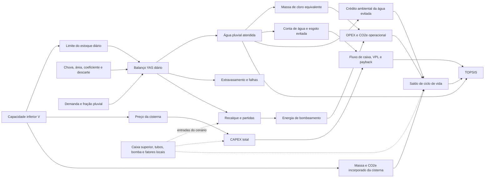

# Detalhamento completo dos três modelos — Netuno 5.0.0

> Documento gerado por `python scripts/generate_reference_case_studies.py`. Entradas e resultados vêm dos mesmos objetos usados no estudo de verificação; não edite as tabelas à mão.

Este relatório preserva a visão comparativa dos três modelos. O [`ESTUDO_DE_CASO_TRES_MODELOS_REFERENCIA.md`](ESTUDO_DE_CASO_TRES_MODELOS_REFERENCIA.md) faz a conta manual e mede resíduos; este arquivo fornece todos os dados de entrada e compara os resultados item a item, tanto entre os casos quanto entre os volumes de cada varredura.

O [`atlas de fluxogramas metodológicos`](../netuno/docs/fluxogramas_metodologicos.md) detalha a sequência das equações hidráulicas, econômicas, ambientais, multicritério e de verificação.

## 1. Diagrama de influência do volume da cisterna

O diagrama continua sendo parte da metodologia. Ele impede atribuir causalidade direta a parâmetros que são entradas independentes ou consequências endógenas da simulação.

| Classe de relação com `V` | Itens | Interpretação |
| --- | --- | --- |
| Direta | preço, massa e CO2e incorporado da cisterna inferior | função explícita da capacidade e do material |
| Endógena | atendimento, extravasamento, falhas, recalque, energia, cloro, receita evitada e O&M variável por consumo | resultado do balanço repetido para cada `V` |
| Independente | caixa superior, tubos, bomba, tarifas e fatores ambientais | entrada mantida fixa na varredura, salvo cenário explicitamente alterado |
| Derivada | VPL, paybacks, ACV, ótimos e TOPSIS | combinação das três classes anteriores |

## 2. Entradas dos três modelos — comparação item a item

### 2.1. Edificação, clima e demanda

| Item | Caso 1 — Residência Unifamiliar Sustentável | Caso 2 — Edifício Corporativo EcoOffice | Caso 3 — Escola Pública de Tempo Integral Amazonas |
| --- | --- | --- | --- |
| Tipologia | Residencial Unifamiliar | Comercial / Escritórios | Institucional / Escolar |
| Clima / série | Florianopolis1 / `Florianopolis1.csv` | Brasilia2 / `Brasilia2.csv` | Manaus3 / `Manaus3.csv` |
| Dias e anos simulados | 31411 dias / 85,9986 anos | 12419 dias / 34,0014 anos | 31410 dias / 85,9959 anos |
| Precipitação média anual | 1.800,53 mm/a | 1.501,03 mm/a | 1.802,57 mm/a |
| Área de captação | 180,0 m² | 650,0 m² | 1.400,0 m² |
| Coeficiente de escoamento | 0,850 | 0,900 | 0,800 |
| Limiar de descarte | 2,00 mm | 2,00 mm | 1,50 mm |
| Modo / intervalo de descarte | modo 1 / 7 dias | modo 2 / 7 dias | modo 3 / 3 dias |
| Ocupantes | 4 | 80 | 350 |
| Demanda unitária | 180,0 L/pessoa·dia | 50,0 L/pessoa·dia | 40,0 L/pessoa·dia |
| Demanda total | 720,0 L/dia | 4.000,0 L/dia | 14.000,0 L/dia |
| Fração pluvial | 40,0% | 65,0% | 50,0% |
| Demanda pluvial-alvo | 288,0 L/dia | 2.600,0 L/dia | 7.000,0 L/dia |

Séries pluviométricas verificadas por SHA-256:

- Caso 1: `c2efedd93b596b29f1b72c4fd1e6c9a251248d89cf68698a625a8296b1f36842`
- Caso 2: `fb121ac5e308c6a009111ba20408d0a7e27363bddeca5404b29cae3cf864d54d`
- Caso 3: `6f91aa11c06482fc8708bccd953900d091f636abe23874d51bffc510d1a0d153`

### 2.2. Reservatórios, rede e bombeamento

| Item | Caso 1 — Residência Unifamiliar Sustentável | Caso 2 — Edifício Corporativo EcoOffice | Caso 3 — Escola Pública de Tempo Integral Amazonas |
| --- | --- | --- | --- |
| Varredura inferior | 0–10.000 L; passo 500 L | 0–50.000 L; passo 2.500 L | 0–60.000 L; passo 3.000 L |
| Limiar técnico marginal | 5,000 %/m³ | 3,000 %/m³ | 3,500 %/m³ |
| Reservatório superior | 500 L | 3.000 L | 5.000 L |
| Gatilho de recalque | 50,0 L | 450,0 L | 1.000,0 L |
| Materiais inferior / superior | PEAD / PEAD | CONCRETO / PRFV | PRFV / PRFV |
| Tubulações | DN 100 (25.0m) + DN 50 (15.0m) | DN 150 (40.0m) + DN 75 (35.0m) | DN 150 (60.0m) + DN 75 (25.0m) |
| Potência da bomba | 0,368 kW | 1,100 kW | 0,735 kW |
| Vazão / eficiência / quantidade | 2.280 L/h / 55,0% / 1 un. | 7.200 L/h / 65,0% / 2 un. | 5.400 L/h / 60,0% / 2 un. |
| Tempo equivalente por partida | 0,0300 h | 0,0400 h | 0,0300 h |

### 2.3. Premissas econômicas, operacionais e de tratamento

| Item | Caso 1 — Residência Unifamiliar Sustentável | Caso 2 — Edifício Corporativo EcoOffice | Caso 3 — Escola Pública de Tempo Integral Amazonas |
| --- | --- | --- | --- |
| Tarifa de energia | R$ 0,95/kWh | R$ 1,05/kWh | R$ 1,15/kWh |
| Dose / preço / fator do cloro | 2,00 mg/L / R$ 25,00/kg / 25,00 kg CO2e/kg | 3,00 mg/L / R$ 20,00/kg / 25,00 kg CO2e/kg | 2,50 mg/L / R$ 22,00/kg / 25,00 kg CO2e/kg |
| Esgoto | modo 1; 100,0% | modo 1; 100,0% | modo 1; 80,0% |
| TMA / inflação | 10,00% a.a. / 4,00% a.a. | 12,00% a.a. / 4,50% a.a. | 10,00% a.a. / 4,50% a.a. |
| Horizonte | 20 anos | 20 anos | 20 anos |

### 2.4. Tarifas de água por caso

#### Caso 1 — Residência Unifamiliar Sustentável

| Início (m³/mês) | Fim (m³/mês) | Valor (R$) | Regra |
| ---: | ---: | ---: | --- |
| 0 | 0 | 46,34 | parcela fixa |
| 0 | 10 | 3,08 | faixa progressiva |
| 10 | 25 | 14,31 | faixa progressiva |
| 25 | 50 | 19,14 | faixa progressiva |
| 50 | 999.999 | 24,08 | faixa progressiva |

#### Caso 2 — Edifício Corporativo EcoOffice

| Início (m³/mês) | Fim (m³/mês) | Valor (R$) | Regra |
| ---: | ---: | ---: | --- |
| 0 | 10 | 7,80 | faixa progressiva |
| 10 | 25 | 15,60 | faixa progressiva |
| 25 | 50 | 22,40 | faixa progressiva |
| 50 | 999.999 | 28,90 | faixa progressiva |

#### Caso 3 — Escola Pública de Tempo Integral Amazonas

| Início (m³/mês) | Fim (m³/mês) | Valor (R$) | Regra |
| ---: | ---: | ---: | --- |
| 0 | 20 | 6,50 | faixa progressiva |
| 20 | 50 | 11,20 | faixa progressiva |
| 50 | 100 | 18,50 | faixa progressiva |
| 100 | 999.999 | 25,30 | faixa progressiva |

### 2.5. O&M por caso

#### Caso 1 — Residência Unifamiliar Sustentável

| Item | Periodicidade (meses) | Parcela fixa (R$) | Variável (R$/m³ consumido no mês) |
| --- | ---: | ---: | ---: |
| Inspeção e limpeza de calhas/pré-filtro | 12 | 240,00 | 0,00 |
| Limpeza e inspeção do reservatório | 12 | 320,00 | 0,00 |
| Manutenção preventiva da motobomba | 12 | 180,00 | 0,00 |

#### Caso 2 — Edifício Corporativo EcoOffice

| Item | Periodicidade (meses) | Parcela fixa (R$) | Variável (R$/m³ consumido no mês) |
| --- | ---: | ---: | ---: |
| Inspeção e limpeza de calhas/pré-filtro | 12 | 240,00 | 0,00 |
| Limpeza e inspeção do reservatório | 12 | 320,00 | 0,00 |
| Manutenção preventiva da motobomba | 12 | 180,00 | 0,00 |

#### Caso 3 — Escola Pública de Tempo Integral Amazonas

| Item | Periodicidade (meses) | Parcela fixa (R$) | Variável (R$/m³ consumido no mês) |
| --- | ---: | ---: | ---: |
| Inspeção e limpeza de calhas/pré-filtro | 12 | 240,00 | 0,00 |
| Limpeza e inspeção do reservatório | 12 | 320,00 | 0,00 |
| Manutenção preventiva da motobomba | 12 | 180,00 | 0,00 |

## 3. Síntese comparativa dos ótimos

`T` = técnico; `E` = econômico; `A` = ambiental; `M` = multicritério TOPSIS.

### Volumes selecionados

| Caso | T (L) | E (L) | A (L) | M (L) |
| --- | ---: | ---: | ---: | ---: |
| Caso 1 | 2.000 | 5.500 | 1.500 | 4.000 |
| Caso 2 | 5.000 | 27.500 | 2.500 | 20.000 |
| Caso 3 | 3.000 | 60.000 | 18.000 | 30.000 |

### Diagnóstico da alternativa TOPSIS

| Caso | Score M | Gap técnico M | Gap econômico M | Gap ambiental M |
| --- | ---: | ---: | ---: | ---: |
| Caso 1 | 0,892458 | 9,09% | 0,00% | 2,25% |
| Caso 2 | 0,819936 | 13,99% | 0,00% | 1,13% |
| Caso 3 | 0,892497 | 11,86% | 0,00% | 8,71% |

## 4.1. Caso 1 — Residência Unifamiliar Sustentável

### Comparação direta das quatro decisões

Volumes coincidentes aparecem uma única vez com mais de um marcador. Esta tabela mostra diretamente o custo da concessão: quanto cada decisão entrega nos outros eixos.

#### Desempenho hídrico e econômico

| Marcador | V (L) | Água (m³/a) | Economia (%) | Extravasamento (m³/a) | CAPEX (R$) | VPL (R$) |
| --- | ---: | ---: | ---: | ---: | ---: | ---: |
| A | 1.500 | 72,422 | 27,539 | 154,945 | 5.097,68 | 11.363,99 |
| T | 2.000 | 78,455 | 29,833 | 148,912 | 5.314,04 | 13.213,24 |
| M | 4.000 | 90,596 | 34,450 | 136,755 | 6.551,41 | 16.132,48 |
| E | 5.500 | 94,472 | 35,924 | 132,863 | 7.506,52 | 16.504,22 |

#### Operação e desempenho ambiental

| Marcador | V (L) | Energia (kWh/a) | Cloro (kg/a) | CO2e líquido de vida (kg) |
| --- | ---: | ---: | ---: | ---: |
| A | 1.500 | 24,866 | 0,1448 | 121,16 |
| T | 2.000 | 26,799 | 0,1569 | 121,07 |
| M | 4.000 | 30,740 | 0,1812 | 55,22 |
| E | 5.500 | 32,017 | 0,1889 | -22,70 |

#### Diagnóstico TOPSIS

| Marcador | V (L) | Score | Gap T | Gap E | Gap A | Rank |
| --- | ---: | ---: | ---: | ---: | ---: | ---: |
| A | 1.500 | 0,764327 | 27,33% | 0,00% | 31,14% | 12 |
| T | 2.000 | 0,816234 | 21,27% | 0,00% | 19,94% | 9 |
| M | 4.000 | 0,892458 | 9,09% | 0,00% | 2,25% | 1 |
| E | 5.500 | 0,843080 | 5,20% | 0,00% | 0,00% | 7 |

### Varredura técnica completa

#### Balanço e economia de água

| Ótimo | V (L) | Água pluvial (m³/a) | Água potável (m³/a) | Extravasamento (m³/a) | Economia (%) | Ganho marginal (%/m³) |
| --- | ---: | ---: | ---: | ---: | ---: | ---: |
| — | 0 | 0,000 | 262,980 | 227,367 | 0,000 | 0,0000 |
| — | 500 | 49,435 | 213,545 | 177,932 | 18,798 | 37,5961 |
| — | 1.000 | 63,458 | 199,522 | 163,909 | 24,130 | 10,6644 |
| A | 1.500 | 72,422 | 190,558 | 154,945 | 27,539 | 6,8174 |
| T | 2.000 | 78,455 | 184,525 | 148,912 | 29,833 | 4,5880 |
| — | 2.500 | 82,851 | 180,129 | 144,516 | 31,504 | 3,3431 |
| — | 3.000 | 86,111 | 176,869 | 141,253 | 32,744 | 2,4793 |
| — | 3.500 | 88,655 | 174,325 | 138,702 | 33,712 | 1,9354 |
| M | 4.000 | 90,596 | 172,384 | 136,755 | 34,450 | 1,4759 |
| — | 4.500 | 92,150 | 170,830 | 135,195 | 35,041 | 1,1815 |
| — | 5.000 | 93,403 | 169,577 | 133,938 | 35,517 | 0,9532 |
| E | 5.500 | 94,472 | 168,508 | 132,863 | 35,924 | 0,8133 |
| — | 6.000 | 95,397 | 167,583 | 131,932 | 36,276 | 0,7035 |
| — | 6.500 | 96,179 | 166,801 | 131,145 | 36,573 | 0,5942 |
| — | 7.000 | 96,826 | 166,154 | 130,491 | 36,819 | 0,4923 |
| — | 7.500 | 97,416 | 165,564 | 129,895 | 37,043 | 0,4487 |
| — | 8.000 | 97,945 | 165,035 | 129,361 | 37,244 | 0,4020 |
| — | 8.500 | 98,416 | 164,564 | 128,883 | 37,424 | 0,3588 |
| — | 9.000 | 98,859 | 164,121 | 128,435 | 37,592 | 0,3368 |
| — | 9.500 | 99,269 | 163,711 | 128,020 | 37,748 | 0,3112 |
| — | 10.000 | 99,656 | 163,324 | 127,627 | 37,895 | 0,2943 |

#### Atendimento e recalque

| Ótimo | V (L) | Pleno (%) | Parcial (%) | Nulo (%) | Recalque (m³/a) | Partidas/a |
| --- | ---: | ---: | ---: | ---: | ---: | ---: |
| — | 0 | 0,00 | 0,00 | 100,00 | 0,000 | 0,00 |
| — | 500 | 39,94 | 14,74 | 45,32 | 49,435 | 144,58 |
| — | 1.000 | 54,99 | 10,72 | 34,29 | 63,458 | 167,93 |
| A | 1.500 | 64,75 | 8,02 | 27,23 | 72,422 | 179,98 |
| T | 2.000 | 71,59 | 6,18 | 22,23 | 78,455 | 188,12 |
| — | 2.500 | 76,35 | 4,91 | 18,74 | 82,851 | 194,48 |
| — | 3.000 | 79,86 | 4,05 | 16,09 | 86,114 | 199,56 |
| — | 3.500 | 82,64 | 3,34 | 14,02 | 88,660 | 203,77 |
| M | 4.000 | 84,79 | 2,81 | 12,40 | 90,601 | 206,86 |
| — | 4.500 | 86,42 | 2,46 | 11,12 | 92,155 | 209,81 |
| — | 5.000 | 87,73 | 2,13 | 10,14 | 93,404 | 212,15 |
| E | 5.500 | 88,90 | 1,88 | 9,22 | 94,474 | 213,86 |
| — | 6.000 | 89,90 | 1,67 | 8,43 | 95,399 | 215,52 |
| — | 6.500 | 90,74 | 1,46 | 7,80 | 96,180 | 216,70 |
| — | 7.000 | 91,38 | 1,33 | 7,29 | 96,828 | 217,88 |
| — | 7.500 | 92,01 | 1,24 | 6,75 | 97,418 | 218,97 |
| — | 8.000 | 92,59 | 1,14 | 6,27 | 97,946 | 219,96 |
| — | 8.500 | 93,05 | 1,06 | 5,89 | 98,418 | 220,84 |
| — | 9.000 | 93,49 | 0,98 | 5,53 | 98,861 | 221,63 |
| — | 9.500 | 93,93 | 0,91 | 5,15 | 99,270 | 222,42 |
| — | 10.000 | 94,33 | 0,87 | 4,80 | 99,657 | 223,21 |

### Varredura econômica completa

#### CAPEX — reservatórios, bombas e tubos

| Ótimo | V (L) | Cisterna (R$) | Superior (R$) | Bombas (R$) | Tubos (R$) |
| --- | ---: | ---: | ---: | ---: | ---: |
| — | 0 | 0,00 | 0,00 | 0,00 | 0,00 |
| — | 500 | 289,90 | 289,90 | 300,14 | 1.525,00 |
| — | 1.000 | 449,90 | 289,90 | 300,14 | 1.525,00 |
| A | 1.500 | 1.082,63 | 289,90 | 300,14 | 1.525,00 |
| T | 2.000 | 1.299,00 | 289,90 | 300,14 | 1.525,00 |
| — | 2.500 | 1.624,50 | 289,90 | 300,14 | 1.525,00 |
| — | 3.000 | 1.950,00 | 289,90 | 300,14 | 1.525,00 |
| — | 3.500 | 2.187,25 | 289,90 | 300,14 | 1.525,00 |
| M | 4.000 | 2.424,50 | 289,90 | 300,14 | 1.525,00 |
| — | 4.500 | 2.661,75 | 289,90 | 300,14 | 1.525,00 |
| — | 5.000 | 2.899,00 | 289,90 | 300,14 | 1.525,00 |
| E | 5.500 | 3.159,20 | 289,90 | 300,14 | 1.525,00 |
| — | 6.000 | 3.419,40 | 289,90 | 300,14 | 1.525,00 |
| — | 6.500 | 3.679,60 | 289,90 | 300,14 | 1.525,00 |
| — | 7.000 | 3.939,80 | 289,90 | 300,14 | 1.525,00 |
| — | 7.500 | 4.200,00 | 289,90 | 300,14 | 1.525,00 |
| — | 8.000 | 4.439,80 | 289,90 | 300,14 | 1.525,00 |
| — | 8.500 | 4.679,60 | 289,90 | 300,14 | 1.525,00 |
| — | 9.000 | 4.919,40 | 289,90 | 300,14 | 1.525,00 |
| — | 9.500 | 5.159,20 | 289,90 | 300,14 | 1.525,00 |
| — | 10.000 | 5.399,00 | 289,90 | 300,14 | 1.525,00 |

#### CAPEX — complementos e total

| Ótimo | V (L) | Acessórios (R$) | Mão de obra (R$) | CAPEX total (R$) |
| --- | ---: | ---: | ---: | ---: |
| — | 0 | 0,00 | 0,00 | 0,00 |
| — | 500 | 500,00 | 1.400,00 | 4.304,94 |
| — | 1.000 | 500,00 | 1.400,00 | 4.464,94 |
| A | 1.500 | 500,00 | 1.400,00 | 5.097,68 |
| T | 2.000 | 500,00 | 1.400,00 | 5.314,04 |
| — | 2.500 | 500,00 | 1.400,00 | 5.639,54 |
| — | 3.000 | 500,00 | 1.400,00 | 5.965,04 |
| — | 3.500 | 500,00 | 1.440,69 | 6.242,98 |
| M | 4.000 | 500,00 | 1.511,86 | 6.551,41 |
| — | 4.500 | 500,00 | 1.583,04 | 6.859,83 |
| — | 5.000 | 500,00 | 1.654,21 | 7.168,26 |
| E | 5.500 | 500,00 | 1.732,27 | 7.506,52 |
| — | 6.000 | 500,00 | 1.810,33 | 7.844,78 |
| — | 6.500 | 500,00 | 1.888,39 | 8.183,04 |
| — | 7.000 | 500,00 | 1.966,45 | 8.521,30 |
| — | 7.500 | 509,19 | 2.047,27 | 8.871,51 |
| — | 8.000 | 528,38 | 2.124,97 | 9.208,18 |
| — | 8.500 | 547,56 | 2.202,66 | 9.544,86 |
| — | 9.000 | 566,74 | 2.280,36 | 9.881,54 |
| — | 9.500 | 585,93 | 2.358,05 | 10.218,22 |
| — | 10.000 | 605,11 | 2.435,75 | 10.554,90 |

#### Operação e tarifas efetivas

| Ótimo | V (L) | Energia (kWh/a) | Cloro (kg/a) | O&M (R$/a) | T água (R$/m³) | T esgoto (R$/m³) |
| --- | ---: | ---: | ---: | ---: | ---: | ---: |
| — | 0 | 0,000 | 0,0000 | 740,00 | 0,0000 | 0,0000 |
| — | 500 | 17,409 | 0,0989 | 740,00 | 14,3100 | 14,3100 |
| — | 1.000 | 21,993 | 0,1269 | 740,00 | 14,3100 | 14,3100 |
| A | 1.500 | 24,866 | 0,1448 | 740,00 | 14,3100 | 14,3100 |
| T | 2.000 | 26,799 | 0,1569 | 740,00 | 14,3100 | 14,3100 |
| — | 2.500 | 28,217 | 0,1657 | 740,00 | 14,3100 | 14,3100 |
| — | 3.000 | 29,277 | 0,1722 | 740,00 | 14,3100 | 14,3100 |
| — | 3.500 | 30,108 | 0,1773 | 740,00 | 14,3100 | 14,3100 |
| M | 4.000 | 30,740 | 0,1812 | 740,00 | 14,3100 | 14,3100 |
| — | 4.500 | 31,255 | 0,1843 | 740,00 | 14,3100 | 14,3100 |
| — | 5.000 | 31,669 | 0,1868 | 740,00 | 14,3100 | 14,3100 |
| E | 5.500 | 32,017 | 0,1889 | 740,00 | 14,3100 | 14,3100 |
| — | 6.000 | 32,322 | 0,1908 | 740,00 | 14,3100 | 14,3100 |
| — | 6.500 | 32,575 | 0,1924 | 740,00 | 14,3100 | 14,3100 |
| — | 7.000 | 32,789 | 0,1937 | 740,00 | 14,3100 | 14,3100 |
| — | 7.500 | 32,984 | 0,1948 | 740,00 | 14,3100 | 14,3100 |
| — | 8.000 | 33,159 | 0,1959 | 740,00 | 14,3100 | 14,3100 |
| — | 8.500 | 33,315 | 0,1968 | 740,00 | 14,3100 | 14,3100 |
| — | 9.000 | 33,461 | 0,1977 | 740,00 | 14,3100 | 14,3100 |
| — | 9.500 | 33,597 | 0,1985 | 740,00 | 14,3100 | 14,3100 |
| — | 10.000 | 33,726 | 0,1993 | 740,00 | 14,3100 | 14,3100 |

#### Indicadores financeiros

| Ótimo | V (L) | VPL (R$) | TIR (%) | PB simples (a) | PB descontado (a) |
| --- | ---: | ---: | ---: | ---: | ---: |
| — | 0 | 0,00 | 0,000 | 0 | 0 |
| — | 500 | 4.287,14 | 19,986 | 6 | 8 |
| — | 1.000 | 8.927,41 | 28,780 | 4 | 5 |
| A | 1.500 | 11.363,99 | 30,800 | 4 | 4 |
| T | 2.000 | 13.213,24 | 32,987 | 3 | 4 |
| — | 2.500 | 14.392,76 | 33,569 | 3 | 4 |
| — | 3.000 | 15.183,31 | 33,542 | 3 | 4 |
| — | 3.500 | 15.776,56 | 33,411 | 3 | 4 |
| M | 4.000 | 16.132,48 | 32,890 | 3 | 4 |
| — | 4.500 | 16.355,80 | 32,252 | 3 | 4 |
| — | 5.000 | 16.476,37 | 31,546 | 4 | 4 |
| E | 5.500 | 16.504,22 | 30,718 | 4 | 4 |
| — | 6.000 | 16.482,61 | 29,904 | 4 | 5 |
| — | 6.500 | 16.411,86 | 29,103 | 4 | 5 |
| — | 7.000 | 16.295,15 | 28,316 | 4 | 5 |
| — | 7.500 | 16.146,89 | 27,534 | 4 | 5 |
| — | 8.000 | 15.991,11 | 26,822 | 4 | 5 |
| — | 8.500 | 15.815,93 | 26,139 | 4 | 5 |
| — | 9.000 | 15.630,85 | 25,490 | 4 | 6 |
| — | 9.500 | 15.434,23 | 24,871 | 5 | 6 |
| — | 10.000 | 15.229,99 | 24,281 | 5 | 6 |

### Varredura ambiental e multicritério completa

#### Inventário e operação anual

| Ótimo | V (L) | Massa inferior (kg) | CO2e incorporado (kg) | CO2e bomba (kg/a) | CO2e cloro (kg/a) | CO2e água evitada (kg/a) | CO2e líquido (kg/a) |
| --- | ---: | ---: | ---: | ---: | ---: | ---: | ---: |
| — | 0 | 0,00 | 0,00 | 0,000 | 0,000 | 0,000 | 0,000 |
| — | 500 | 11,00 | 205,10 | 1,480 | 2,472 | 17,302 | 13,351 |
| — | 1.000 | 22,00 | 238,10 | 1,869 | 3,173 | 22,210 | 17,168 |
| A | 1.500 | 33,00 | 271,10 | 2,114 | 3,621 | 25,348 | 19,613 |
| T | 2.000 | 44,00 | 304,10 | 2,278 | 3,923 | 27,459 | 21,258 |
| — | 2.500 | 55,00 | 337,10 | 2,398 | 4,143 | 28,998 | 22,457 |
| — | 3.000 | 66,00 | 370,10 | 2,489 | 4,306 | 30,139 | 23,345 |
| — | 3.500 | 77,00 | 403,10 | 2,559 | 4,433 | 31,029 | 24,037 |
| M | 4.000 | 88,00 | 436,10 | 2,613 | 4,530 | 31,709 | 24,566 |
| — | 4.500 | 99,00 | 469,10 | 2,657 | 4,607 | 32,252 | 24,988 |
| — | 5.000 | 110,00 | 502,10 | 2,692 | 4,670 | 32,691 | 25,329 |
| E | 5.500 | 121,00 | 535,10 | 2,721 | 4,724 | 33,065 | 25,620 |
| — | 6.000 | 132,00 | 568,10 | 2,747 | 4,770 | 33,389 | 25,872 |
| — | 6.500 | 143,00 | 601,10 | 2,769 | 4,809 | 33,663 | 26,085 |
| — | 7.000 | 154,00 | 634,10 | 2,787 | 4,841 | 33,889 | 26,261 |
| — | 7.500 | 165,00 | 667,10 | 2,804 | 4,871 | 34,096 | 26,421 |
| — | 8.000 | 176,00 | 700,10 | 2,818 | 4,897 | 34,281 | 26,565 |
| — | 8.500 | 187,00 | 733,10 | 2,832 | 4,921 | 34,446 | 26,693 |
| — | 9.000 | 198,00 | 766,10 | 2,844 | 4,943 | 34,601 | 26,814 |
| — | 9.500 | 209,00 | 799,10 | 2,856 | 4,963 | 34,744 | 26,925 |
| — | 10.000 | 220,00 | 832,10 | 2,867 | 4,983 | 34,879 | 27,030 |

#### Ciclo de vida e decisão TOPSIS

| Ótimo | V (L) | CO2e líquido de vida (kg) | PB ambiental (a) | D+ | D− | Score | Rank |
| --- | ---: | ---: | ---: | ---: | ---: | ---: | ---: |
| — | 0 | 0,00 | 0,000 | 0,142840 | 0,051673 | 0,265654 | 21 |
| — | 500 | 61,91 | 15,362 | 0,073464 | 0,093258 | 0,559362 | 20 |
| — | 1.000 | 105,26 | 13,869 | 0,051948 | 0,113786 | 0,686558 | 17 |
| A | 1.500 | 121,16 | 13,822 | 0,038809 | 0,125865 | 0,764327 | 12 |
| T | 2.000 | 121,07 | 14,305 | 0,029973 | 0,133132 | 0,816234 | 9 |
| — | 2.500 | 112,03 | 15,011 | 0,023676 | 0,137669 | 0,853257 | 6 |
| — | 3.000 | 96,79 | 15,854 | 0,019441 | 0,140365 | 0,878349 | 4 |
| — | 3.500 | 77,65 | 16,770 | 0,017167 | 0,141975 | 0,892126 | 2 |
| M | 4.000 | 55,22 | 17,752 | 0,017192 | 0,142674 | 0,892458 | 1 |
| — | 4.500 | 30,66 | 18,773 | 0,019137 | 0,142858 | 0,881865 | 3 |
| — | 5.000 | 4,48 | 19,823 | 0,022435 | 0,142689 | 0,864133 | 5 |
| E | 5.500 | -22,70 | 20,886 | 0,026499 | 0,142368 | 0,843080 | 7 |
| — | 6.000 | -50,66 | 21,958 | 0,031028 | 0,141979 | 0,820656 | 8 |
| — | 6.500 | -79,40 | 23,044 | 0,035880 | 0,141533 | 0,797759 | 10 |
| — | 7.000 | -108,88 | 24,146 | 0,040969 | 0,141056 | 0,774925 | 11 |
| — | 7.500 | -138,68 | 25,249 | 0,046169 | 0,140680 | 0,752909 | 13 |
| — | 8.000 | -168,80 | 26,354 | 0,051462 | 0,140412 | 0,731792 | 14 |
| — | 8.500 | -199,24 | 27,464 | 0,056833 | 0,140262 | 0,711648 | 15 |
| — | 9.000 | -229,83 | 28,571 | 0,062245 | 0,140279 | 0,692655 | 16 |
| — | 9.500 | -260,60 | 29,679 | 0,067699 | 0,140458 | 0,674769 | 18 |
| — | 10.000 | -291,50 | 30,784 | 0,073181 | 0,140818 | 0,658030 | 19 |

#### Distância relativa ao melhor por critério

| Ótimo | V (L) | Gap técnico | Gap econômico | Gap ambiental |
| --- | ---: | ---: | ---: | ---: |
| — | 0 | 100,00% | 0,00% | 100,00% |
| — | 500 | 50,39% | 0,00% | 74,02% |
| — | 1.000 | 36,32% | 0,00% | 45,91% |
| A | 1.500 | 27,33% | 0,00% | 31,14% |
| T | 2.000 | 21,27% | 0,00% | 19,94% |
| — | 2.500 | 16,86% | 0,00% | 12,79% |
| — | 3.000 | 13,59% | 0,00% | 8,00% |
| — | 3.500 | 11,04% | 0,00% | 4,41% |
| M | 4.000 | 9,09% | 0,00% | 2,25% |
| — | 4.500 | 7,53% | 0,00% | 0,90% |
| — | 5.000 | 6,27% | 0,00% | 0,17% |
| E | 5.500 | 5,20% | 0,00% | 0,00% |
| — | 6.000 | 4,27% | 0,00% | 0,13% |
| — | 6.500 | 3,49% | 0,00% | 0,56% |
| — | 7.000 | 2,84% | 0,00% | 1,27% |
| — | 7.500 | 2,25% | 0,00% | 2,17% |
| — | 8.000 | 1,72% | 0,00% | 3,11% |
| — | 8.500 | 1,24% | 0,00% | 4,17% |
| — | 9.000 | 0,80% | 0,00% | 5,29% |
| — | 9.500 | 0,39% | 0,00% | 6,48% |
| — | 10.000 | 0,00% | 0,00% | 7,72% |

## 4.2. Caso 2 — Edifício Corporativo EcoOffice

### Comparação direta das quatro decisões

Volumes coincidentes aparecem uma única vez com mais de um marcador. Esta tabela mostra diretamente o custo da concessão: quanto cada decisão entrega nos outros eixos.

#### Desempenho hídrico e econômico

| Marcador | V (L) | Água (m³/a) | Economia (%) | Extravasamento (m³/a) | CAPEX (R$) | VPL (R$) |
| --- | ---: | ---: | ---: | ---: | ---: | ---: |
| A | 2.500 | 272,301 | 18,638 | 579,143 | 16.827,72 | 137.815,10 |
| T | 5.000 | 324,501 | 22,211 | 526,942 | 20.585,45 | 165.130,42 |
| M | 20.000 | 435,173 | 29,786 | 415,997 | 45.944,64 | 205.642,32 |
| E | 27.500 | 461,415 | 31,582 | 389,534 | 59.212,44 | 207.993,83 |

#### Operação e desempenho ambiental

| Marcador | V (L) | Energia (kWh/a) | Cloro (kg/a) | CO2e líquido de vida (kg) |
| --- | ---: | ---: | ---: | ---: |
| A | 2.500 | 72,800 | 0,8169 | 208,19 |
| T | 5.000 | 85,917 | 0,9735 | 53,00 |
| M | 20.000 | 114,413 | 1,3055 | -1.906,75 |
| E | 27.500 | 121,153 | 1,3842 | -3.033,88 |

#### Diagnóstico TOPSIS

| Marcador | V (L) | Score | Gap T | Gap E | Gap A | Rank |
| --- | ---: | ---: | ---: | ---: | ---: | ---: |
| A | 2.500 | 0,613344 | 46,18% | 0,00% | 33,74% | 20 |
| T | 5.000 | 0,693180 | 35,87% | 0,00% | 20,61% | 17 |
| M | 20.000 | 0,819936 | 13,99% | 0,00% | 1,13% | 1 |
| E | 27.500 | 0,794336 | 8,81% | 0,00% | 0,00% | 6 |

### Varredura técnica completa

#### Balanço e economia de água

| Ótimo | V (L) | Água pluvial (m³/a) | Água potável (m³/a) | Extravasamento (m³/a) | Economia (%) | Ganho marginal (%/m³) |
| --- | ---: | ---: | ---: | ---: | ---: | ---: |
| — | 0 | 0,000 | 1.461,000 | 851,444 | 0,000 | 0,0000 |
| A | 2.500 | 272,301 | 1.188,699 | 579,143 | 18,638 | 7,4552 |
| T | 5.000 | 324,501 | 1.136,499 | 526,942 | 22,211 | 1,4292 |
| — | 7.500 | 352,803 | 1.108,197 | 498,640 | 24,148 | 0,7749 |
| — | 10.000 | 375,697 | 1.085,303 | 475,747 | 25,715 | 0,6268 |
| — | 12.500 | 394,528 | 1.066,472 | 456,862 | 27,004 | 0,5156 |
| — | 15.000 | 410,318 | 1.050,682 | 440,998 | 28,085 | 0,4323 |
| — | 17.500 | 423,718 | 1.037,282 | 427,526 | 29,002 | 0,3669 |
| M | 20.000 | 435,173 | 1.025,827 | 415,997 | 29,786 | 0,3136 |
| — | 22.500 | 444,949 | 1.016,051 | 406,147 | 30,455 | 0,2676 |
| — | 25.000 | 453,624 | 1.007,376 | 397,398 | 31,049 | 0,2375 |
| E | 27.500 | 461,415 | 999,585 | 389,534 | 31,582 | 0,2133 |
| — | 30.000 | 468,298 | 992,702 | 382,578 | 32,053 | 0,1884 |
| — | 32.500 | 474,381 | 986,619 | 376,429 | 32,470 | 0,1665 |
| — | 35.000 | 480,049 | 980,951 | 370,761 | 32,858 | 0,1552 |
| — | 37.500 | 485,214 | 975,786 | 365,597 | 33,211 | 0,1414 |
| — | 40.000 | 489,954 | 971,046 | 360,856 | 33,536 | 0,1298 |
| — | 42.500 | 494,336 | 966,664 | 356,474 | 33,835 | 0,1200 |
| — | 45.000 | 498,425 | 962,575 | 352,385 | 34,115 | 0,1119 |
| — | 47.500 | 502,370 | 958,630 | 348,440 | 34,385 | 0,1080 |
| — | 50.000 | 505,978 | 955,022 | 344,832 | 34,632 | 0,0988 |

#### Atendimento e recalque

| Ótimo | V (L) | Pleno (%) | Parcial (%) | Nulo (%) | Recalque (m³/a) | Partidas/a |
| --- | ---: | ---: | ---: | ---: | ---: | ---: |
| — | 0 | 0,00 | 0,00 | 100,00 | 0,000 | 0,00 |
| A | 2.500 | 0,00 | 35,58 | 64,42 | 272,301 | 129,97 |
| T | 5.000 | 28,94 | 11,40 | 59,66 | 324,501 | 142,49 |
| — | 7.500 | 32,52 | 10,35 | 57,13 | 352,803 | 152,26 |
| — | 10.000 | 35,32 | 8,87 | 55,82 | 375,697 | 160,11 |
| — | 12.500 | 37,14 | 8,78 | 54,07 | 394,540 | 166,43 |
| — | 15.000 | 39,14 | 8,16 | 52,69 | 410,330 | 171,38 |
| — | 17.500 | 40,88 | 7,54 | 51,58 | 423,729 | 175,58 |
| M | 20.000 | 42,48 | 6,94 | 50,58 | 435,185 | 179,14 |
| — | 22.500 | 43,78 | 6,51 | 49,71 | 444,961 | 182,32 |
| — | 25.000 | 44,85 | 6,16 | 48,99 | 453,636 | 185,11 |
| E | 27.500 | 45,82 | 5,85 | 48,33 | 461,427 | 187,58 |
| — | 30.000 | 46,73 | 5,52 | 47,76 | 468,310 | 189,73 |
| — | 32.500 | 47,50 | 5,30 | 47,20 | 474,393 | 191,82 |
| — | 35.000 | 48,15 | 5,20 | 46,65 | 480,061 | 193,90 |
| — | 37.500 | 48,77 | 5,03 | 46,20 | 485,225 | 195,40 |
| — | 40.000 | 49,38 | 4,80 | 45,82 | 489,966 | 196,93 |
| — | 42.500 | 49,95 | 4,60 | 45,45 | 494,348 | 198,17 |
| — | 45.000 | 50,50 | 4,42 | 45,08 | 498,437 | 199,49 |
| — | 47.500 | 50,95 | 4,29 | 44,75 | 502,382 | 200,79 |
| — | 50.000 | 51,42 | 4,12 | 44,46 | 505,990 | 201,90 |

### Varredura econômica completa

#### CAPEX — reservatórios, bombas e tubos

| Ótimo | V (L) | Cisterna (R$) | Superior (R$) | Bombas (R$) | Tubos (R$) |
| --- | ---: | ---: | ---: | ---: | ---: |
| — | 0 | 0,00 | 0,00 | 0,00 | 0,00 |
| A | 2.500 | 3.411,45 | 2.632,50 | 1.291,93 | 4.975,00 |
| T | 5.000 | 6.087,90 | 2.632,50 | 1.291,93 | 4.975,00 |
| — | 7.500 | 8.820,00 | 2.632,50 | 1.291,93 | 4.975,00 |
| — | 10.000 | 11.337,90 | 2.632,50 | 1.291,93 | 4.975,00 |
| — | 12.500 | 14.593,95 | 2.632,50 | 1.291,93 | 4.975,00 |
| — | 15.000 | 17.850,00 | 2.632,50 | 1.291,93 | 4.975,00 |
| — | 17.500 | 21.000,00 | 2.632,50 | 1.291,93 | 4.975,00 |
| M | 20.000 | 24.150,00 | 2.632,50 | 1.291,93 | 4.975,00 |
| — | 22.500 | 27.300,00 | 2.632,50 | 1.291,93 | 4.975,00 |
| — | 25.000 | 30.450,00 | 2.632,50 | 1.291,93 | 4.975,00 |
| E | 27.500 | 33.600,00 | 2.632,50 | 1.291,93 | 4.975,00 |
| — | 30.000 | 36.750,00 | 2.632,50 | 1.291,93 | 4.975,00 |
| — | 32.500 | 39.637,50 | 2.632,50 | 1.291,93 | 4.975,00 |
| — | 35.000 | 42.525,00 | 2.632,50 | 1.291,93 | 4.975,00 |
| — | 37.500 | 45.412,50 | 2.632,50 | 1.291,93 | 4.975,00 |
| — | 40.000 | 48.300,00 | 2.632,50 | 1.291,93 | 4.975,00 |
| — | 42.500 | 51.187,50 | 2.632,50 | 1.291,93 | 4.975,00 |
| — | 45.000 | 54.075,00 | 2.632,50 | 1.291,93 | 4.975,00 |
| — | 47.500 | 56.962,50 | 2.632,50 | 1.291,93 | 4.975,00 |
| — | 50.000 | 59.850,00 | 2.632,50 | 1.291,93 | 4.975,00 |

#### CAPEX — complementos e total

| Ótimo | V (L) | Acessórios (R$) | Mão de obra (R$) | CAPEX total (R$) |
| --- | ---: | ---: | ---: | ---: |
| — | 0 | 0,00 | 0,00 | 0,00 |
| A | 2.500 | 633,52 | 3.883,32 | 16.827,72 |
| T | 5.000 | 847,63 | 4.750,49 | 20.585,45 |
| — | 7.500 | 1.066,20 | 5.635,69 | 24.421,32 |
| — | 10.000 | 1.267,63 | 6.451,49 | 27.956,45 |
| — | 12.500 | 1.528,12 | 7.506,45 | 32.527,95 |
| — | 15.000 | 1.788,60 | 8.561,41 | 37.099,44 |
| — | 17.500 | 2.040,60 | 9.582,01 | 41.522,04 |
| M | 20.000 | 2.292,60 | 10.602,61 | 45.944,64 |
| — | 22.500 | 2.544,60 | 11.623,21 | 50.367,24 |
| — | 25.000 | 2.796,60 | 12.643,81 | 54.789,84 |
| E | 27.500 | 3.048,60 | 13.664,41 | 59.212,44 |
| — | 30.000 | 3.300,60 | 14.685,01 | 63.635,04 |
| — | 32.500 | 3.531,60 | 15.620,56 | 67.689,09 |
| — | 35.000 | 3.762,60 | 16.556,11 | 71.743,14 |
| — | 37.500 | 3.993,60 | 17.491,66 | 75.797,19 |
| — | 40.000 | 4.224,60 | 18.427,21 | 79.851,24 |
| — | 42.500 | 4.455,60 | 19.362,76 | 83.905,29 |
| — | 45.000 | 4.686,60 | 20.298,31 | 87.959,34 |
| — | 47.500 | 4.917,60 | 21.233,86 | 92.013,39 |
| — | 50.000 | 5.148,60 | 22.169,41 | 96.067,44 |

#### Operação e tarifas efetivas

| Ótimo | V (L) | Energia (kWh/a) | Cloro (kg/a) | O&M (R$/a) | T água (R$/m³) | T esgoto (R$/m³) |
| --- | ---: | ---: | ---: | ---: | ---: | ---: |
| — | 0 | 0,000 | 0,0000 | 740,00 | 0,0000 | 0,0000 |
| A | 2.500 | 72,800 | 0,8169 | 740,00 | 28,9000 | 28,9000 |
| T | 5.000 | 85,917 | 0,9735 | 740,00 | 28,9000 | 28,9000 |
| — | 7.500 | 93,231 | 1,0584 | 740,00 | 28,9000 | 28,9000 |
| — | 10.000 | 99,143 | 1,1271 | 740,00 | 28,9000 | 28,9000 |
| — | 12.500 | 104,000 | 1,1836 | 740,00 | 28,9000 | 28,9000 |
| — | 15.000 | 108,046 | 1,2310 | 740,00 | 28,9000 | 28,9000 |
| — | 17.500 | 111,480 | 1,2712 | 740,00 | 28,9000 | 28,9000 |
| M | 20.000 | 114,413 | 1,3055 | 740,00 | 28,9000 | 28,9000 |
| — | 22.500 | 116,926 | 1,3348 | 740,00 | 28,9000 | 28,9000 |
| — | 25.000 | 119,154 | 1,3609 | 740,00 | 28,9000 | 28,9000 |
| E | 27.500 | 121,153 | 1,3842 | 740,00 | 28,9000 | 28,9000 |
| — | 30.000 | 122,916 | 1,4049 | 740,00 | 28,9000 | 28,9000 |
| — | 32.500 | 124,487 | 1,4231 | 740,00 | 28,9000 | 28,9000 |
| — | 35.000 | 125,961 | 1,4401 | 740,00 | 28,9000 | 28,9000 |
| — | 37.500 | 127,276 | 1,4556 | 740,00 | 28,9000 | 28,9000 |
| — | 40.000 | 128,494 | 1,4699 | 740,00 | 28,9000 | 28,9000 |
| — | 42.500 | 129,607 | 1,4830 | 740,00 | 28,9000 | 28,9000 |
| — | 45.000 | 130,658 | 1,4953 | 740,00 | 28,9000 | 28,9000 |
| — | 47.500 | 131,673 | 1,5071 | 740,00 | 28,9000 | 28,9000 |
| — | 50.000 | 132,597 | 1,5179 | 740,00 | 28,9000 | 28,9000 |

#### Indicadores financeiros

| Ótimo | V (L) | VPL (R$) | TIR (%) | PB simples (a) | PB descontado (a) |
| --- | ---: | ---: | ---: | ---: | ---: |
| — | 0 | 0,00 | 0,000 | 0 | 0 |
| A | 2.500 | 137.815,10 | 93,606 | 1 | 1 |
| T | 5.000 | 165.130,42 | 92,007 | 1 | 1 |
| — | 7.500 | 178.139,44 | 85,002 | 1 | 1 |
| — | 10.000 | 188.230,18 | 79,592 | 1 | 1 |
| — | 12.500 | 194.867,06 | 72,436 | 1 | 2 |
| — | 15.000 | 199.693,88 | 66,570 | 2 | 2 |
| — | 17.500 | 203.246,59 | 61,864 | 2 | 2 |
| M | 20.000 | 205.642,32 | 57,818 | 2 | 2 |
| — | 22.500 | 207.038,28 | 54,288 | 2 | 2 |
| — | 25.000 | 207.779,42 | 51,209 | 2 | 2 |
| E | 27.500 | 207.993,83 | 48,502 | 2 | 3 |
| — | 30.000 | 207.668,02 | 46,085 | 2 | 3 |
| — | 32.500 | 207.234,46 | 44,124 | 2 | 3 |
| — | 35.000 | 206.554,15 | 42,348 | 3 | 3 |
| — | 37.500 | 205.573,97 | 40,721 | 3 | 3 |
| — | 40.000 | 204.341,33 | 39,224 | 3 | 3 |
| — | 42.500 | 202.895,65 | 37,845 | 3 | 3 |
| — | 45.000 | 201.275,30 | 36,569 | 3 | 4 |
| — | 47.500 | 199.569,62 | 35,394 | 3 | 4 |
| — | 50.000 | 197.662,85 | 34,294 | 3 | 4 |

### Varredura ambiental e multicritério completa

#### Inventário e operação anual

| Ótimo | V (L) | Massa inferior (kg) | CO2e incorporado (kg) | CO2e bomba (kg/a) | CO2e cloro (kg/a) | CO2e água evitada (kg/a) | CO2e líquido (kg/a) |
| --- | ---: | ---: | ---: | ---: | ---: | ---: | ---: |
| — | 0 | 0,00 | 0,00 | 0,000 | 0,000 | 0,000 | 0,000 |
| A | 2.500 | 3.000,00 | 1.165,70 | 6,188 | 20,423 | 95,305 | 68,695 |
| T | 5.000 | 6.000,00 | 1.585,70 | 7,303 | 24,338 | 113,575 | 81,935 |
| — | 7.500 | 9.000,00 | 2.005,70 | 7,925 | 26,460 | 123,481 | 89,096 |
| — | 10.000 | 12.000,00 | 2.425,70 | 8,427 | 28,177 | 131,494 | 94,889 |
| — | 12.500 | 15.000,00 | 2.845,70 | 8,840 | 29,590 | 138,085 | 99,655 |
| — | 15.000 | 18.000,00 | 3.265,70 | 9,184 | 30,774 | 143,611 | 103,654 |
| — | 17.500 | 21.000,00 | 3.685,70 | 9,476 | 31,779 | 148,301 | 107,047 |
| M | 20.000 | 24.000,00 | 4.105,70 | 9,725 | 32,638 | 152,311 | 109,947 |
| — | 22.500 | 27.000,00 | 4.525,70 | 9,939 | 33,371 | 155,732 | 112,422 |
| — | 25.000 | 30.000,00 | 4.945,70 | 10,128 | 34,022 | 158,769 | 114,619 |
| E | 27.500 | 33.000,00 | 5.365,70 | 10,298 | 34,606 | 161,495 | 116,591 |
| — | 30.000 | 36.000,00 | 5.785,70 | 10,448 | 35,122 | 163,904 | 118,334 |
| — | 32.500 | 39.000,00 | 6.205,70 | 10,581 | 35,579 | 166,033 | 119,873 |
| — | 35.000 | 42.000,00 | 6.625,70 | 10,707 | 36,004 | 168,017 | 121,307 |
| — | 37.500 | 45.000,00 | 7.045,70 | 10,818 | 36,391 | 169,825 | 122,615 |
| — | 40.000 | 48.000,00 | 7.465,70 | 10,922 | 36,747 | 171,484 | 123,815 |
| — | 42.500 | 51.000,00 | 7.885,70 | 11,017 | 37,075 | 173,018 | 124,926 |
| — | 45.000 | 54.000,00 | 8.305,70 | 11,106 | 37,382 | 174,449 | 125,961 |
| — | 47.500 | 57.000,00 | 8.725,70 | 11,192 | 37,678 | 175,830 | 126,960 |
| — | 50.000 | 60.000,00 | 9.145,70 | 11,271 | 37,948 | 177,092 | 127,873 |

#### Ciclo de vida e decisão TOPSIS

| Ótimo | V (L) | CO2e líquido de vida (kg) | PB ambiental (a) | D+ | D− | Score | Rank |
| --- | ---: | ---: | ---: | ---: | ---: | ---: | ---: |
| — | 0 | 0,00 | 0,000 | 0,138053 | 0,064544 | 0,318581 | 21 |
| A | 2.500 | 208,19 | 16,969 | 0,063213 | 0,100273 | 0,613344 | 20 |
| T | 5.000 | 53,00 | 19,353 | 0,048932 | 0,110548 | 0,693180 | 17 |
| — | 7.500 | -223,77 | 22,512 | 0,041417 | 0,115419 | 0,735922 | 13 |
| — | 10.000 | -527,91 | 25,563 | 0,035720 | 0,119223 | 0,769462 | 9 |
| — | 12.500 | -852,59 | 28,555 | 0,031652 | 0,122179 | 0,794239 | 7 |
| — | 15.000 | -1.192,63 | 31,506 | 0,029085 | 0,124524 | 0,810655 | 4 |
| — | 17.500 | -1.544,77 | 34,431 | 0,027942 | 0,126404 | 0,818965 | 2 |
| M | 20.000 | -1.906,75 | 37,342 | 0,028090 | 0,127913 | 0,819936 | 1 |
| — | 22.500 | -2.277,26 | 40,256 | 0,029328 | 0,129106 | 0,814888 | 3 |
| — | 25.000 | -2.653,33 | 43,149 | 0,031345 | 0,130134 | 0,805886 | 5 |
| E | 27.500 | -3.033,88 | 46,022 | 0,033931 | 0,131050 | 0,794336 | 6 |
| — | 30.000 | -3.419,02 | 48,893 | 0,036941 | 0,131843 | 0,781137 | 8 |
| — | 32.500 | -3.808,23 | 51,769 | 0,040248 | 0,132548 | 0,767077 | 10 |
| — | 35.000 | -4.199,56 | 54,619 | 0,043737 | 0,133261 | 0,752895 | 11 |
| — | 37.500 | -4.593,39 | 57,462 | 0,047369 | 0,133955 | 0,738761 | 12 |
| — | 40.000 | -4.989,39 | 60,297 | 0,051102 | 0,134651 | 0,724892 | 14 |
| — | 42.500 | -5.387,18 | 63,123 | 0,054909 | 0,135367 | 0,711424 | 15 |
| — | 45.000 | -5.786,48 | 65,939 | 0,058770 | 0,136119 | 0,698445 | 16 |
| — | 47.500 | -6.186,51 | 68,728 | 0,062664 | 0,136947 | 0,686070 | 18 |
| — | 50.000 | -6.588,23 | 71,522 | 0,066596 | 0,137797 | 0,674177 | 19 |

#### Distância relativa ao melhor por critério

| Ótimo | V (L) | Gap técnico | Gap econômico | Gap ambiental |
| --- | ---: | ---: | ---: | ---: |
| — | 0 | 100,00% | 0,00% | 100,00% |
| A | 2.500 | 46,18% | 0,00% | 33,74% |
| T | 5.000 | 35,87% | 0,00% | 20,61% |
| — | 7.500 | 30,27% | 0,00% | 14,35% |
| — | 10.000 | 25,75% | 0,00% | 9,50% |
| — | 12.500 | 22,03% | 0,00% | 6,31% |
| — | 15.000 | 18,91% | 0,00% | 3,99% |
| — | 17.500 | 16,26% | 0,00% | 2,28% |
| M | 20.000 | 13,99% | 0,00% | 1,13% |
| — | 22.500 | 12,06% | 0,00% | 0,46% |
| — | 25.000 | 10,35% | 0,00% | 0,10% |
| E | 27.500 | 8,81% | 0,00% | 0,00% |
| — | 30.000 | 7,45% | 0,00% | 0,16% |
| — | 32.500 | 6,24% | 0,00% | 0,37% |
| — | 35.000 | 5,12% | 0,00% | 0,69% |
| — | 37.500 | 4,10% | 0,00% | 1,16% |
| — | 40.000 | 3,17% | 0,00% | 1,76% |
| — | 42.500 | 2,30% | 0,00% | 2,45% |
| — | 45.000 | 1,49% | 0,00% | 3,23% |
| — | 47.500 | 0,71% | 0,00% | 4,05% |
| — | 50.000 | 0,00% | 0,00% | 4,97% |

## 4.3. Caso 3 — Escola Pública de Tempo Integral Amazonas

### Comparação direta das quatro decisões

Volumes coincidentes aparecem uma única vez com mais de um marcador. Esta tabela mostra diretamente o custo da concessão: quanto cada decisão entrega nos outros eixos.

#### Desempenho hídrico e econômico

| Marcador | V (L) | Água (m³/a) | Economia (%) | Extravasamento (m³/a) | CAPEX (R$) | VPL (R$) |
| --- | ---: | ---: | ---: | ---: | ---: | ---: |
| T | 3.000 | 400,955 | 7,841 | 1.500,440 | 19.102,31 | 191.824,12 |
| A | 18.000 | 1.065,152 | 20,830 | 836,243 | 34.928,90 | 539.775,82 |
| M | 30.000 | 1.203,843 | 23,542 | 697,552 | 48.575,78 | 602.089,29 |
| E | 60.000 | 1.365,847 | 26,711 | 535,548 | 79.849,88 | 659.543,85 |

#### Operação e desempenho ambiental

| Marcador | V (L) | Energia (kWh/a) | Cloro (kg/a) | CO2e líquido de vida (kg) |
| --- | ---: | ---: | ---: | ---: |
| T | 3.000 | 96,619 | 1,0024 | 864,34 |
| A | 18.000 | 251,399 | 2,6629 | 3.145,34 |
| M | 30.000 | 283,757 | 3,0096 | 2.867,81 |
| E | 60.000 | 321,526 | 3,4146 | 1.185,12 |

#### Diagnóstico TOPSIS

| Marcador | V (L) | Score | Gap T | Gap E | Gap A | Rank |
| --- | ---: | ---: | ---: | ---: | ---: | ---: |
| T | 3.000 | 0,286790 | 70,64% | 0,00% | 70,92% | 20 |
| A | 18.000 | 0,832375 | 22,02% | 0,00% | 18,16% | 9 |
| M | 30.000 | 0,892497 | 11,86% | 0,00% | 8,71% | 1 |
| E | 60.000 | 0,689608 | 0,00% | 0,00% | 0,00% | 18 |

### Varredura técnica completa

#### Balanço e economia de água

| Ótimo | V (L) | Água pluvial (m³/a) | Água potável (m³/a) | Extravasamento (m³/a) | Economia (%) | Ganho marginal (%/m³) |
| --- | ---: | ---: | ---: | ---: | ---: | ---: |
| — | 0 | 0,000 | 5.113,500 | 1.901,395 | 0,000 | 0,0000 |
| T | 3.000 | 400,955 | 4.712,545 | 1.500,440 | 7,841 | 2,6137 |
| — | 6.000 | 683,822 | 4.429,678 | 1.217,573 | 13,373 | 1,8439 |
| — | 9.000 | 868,602 | 4.244,898 | 1.032,793 | 16,986 | 1,2045 |
| — | 12.000 | 948,208 | 4.165,292 | 953,188 | 18,543 | 0,5189 |
| — | 15.000 | 1.012,660 | 4.100,840 | 888,735 | 19,804 | 0,4201 |
| A | 18.000 | 1.065,152 | 4.048,348 | 836,243 | 20,830 | 0,3422 |
| — | 21.000 | 1.108,797 | 4.004,703 | 792,598 | 21,684 | 0,2845 |
| — | 24.000 | 1.145,039 | 3.968,461 | 756,356 | 22,392 | 0,2363 |
| — | 27.000 | 1.176,618 | 3.936,882 | 724,777 | 23,010 | 0,2059 |
| M | 30.000 | 1.203,843 | 3.909,657 | 697,552 | 23,542 | 0,1775 |
| — | 33.000 | 1.227,805 | 3.885,695 | 673,591 | 24,011 | 0,1562 |
| — | 36.000 | 1.249,004 | 3.864,496 | 652,391 | 24,426 | 0,1382 |
| — | 39.000 | 1.268,340 | 3.845,160 | 633,055 | 24,804 | 0,1260 |
| — | 42.000 | 1.285,867 | 3.827,633 | 615,528 | 25,147 | 0,1143 |
| — | 45.000 | 1.301,708 | 3.811,792 | 599,687 | 25,456 | 0,1033 |
| — | 48.000 | 1.316,169 | 3.797,331 | 585,227 | 25,739 | 0,0943 |
| — | 51.000 | 1.329,966 | 3.783,534 | 571,429 | 26,009 | 0,0899 |
| — | 54.000 | 1.342,564 | 3.770,936 | 558,831 | 26,255 | 0,0821 |
| — | 57.000 | 1.354,485 | 3.759,015 | 546,910 | 26,488 | 0,0777 |
| E | 60.000 | 1.365,847 | 3.747,653 | 535,548 | 26,711 | 0,0741 |

#### Atendimento e recalque

| Ótimo | V (L) | Pleno (%) | Parcial (%) | Nulo (%) | Recalque (m³/a) | Partidas/a |
| --- | ---: | ---: | ---: | ---: | ---: | ---: |
| — | 0 | 0,00 | 0,00 | 100,00 | 0,000 | 0,00 |
| T | 3.000 | 0,00 | 42,18 | 57,82 | 400,955 | 154,07 |
| — | 6.000 | 0,00 | 42,18 | 57,82 | 683,822 | 242,93 |
| — | 9.000 | 23,07 | 24,49 | 52,44 | 868,602 | 239,66 |
| — | 12.000 | 26,70 | 22,28 | 51,02 | 948,208 | 247,93 |
| — | 15.000 | 31,00 | 20,11 | 48,89 | 1.012,660 | 259,36 |
| A | 18.000 | 33,35 | 18,58 | 48,07 | 1.065,152 | 265,78 |
| — | 21.000 | 35,95 | 17,12 | 46,93 | 1.108,797 | 274,19 |
| — | 24.000 | 37,20 | 17,01 | 45,79 | 1.145,039 | 279,09 |
| — | 27.000 | 38,87 | 16,23 | 44,90 | 1.176,618 | 284,86 |
| M | 30.000 | 40,26 | 15,64 | 44,10 | 1.203,843 | 290,14 |
| — | 33.000 | 41,45 | 15,07 | 43,47 | 1.227,805 | 293,85 |
| — | 36.000 | 42,54 | 14,59 | 42,87 | 1.249,004 | 297,30 |
| — | 39.000 | 43,49 | 14,08 | 42,43 | 1.268,340 | 300,85 |
| — | 42.000 | 44,40 | 13,67 | 41,93 | 1.285,867 | 303,46 |
| — | 45.000 | 45,07 | 13,46 | 41,47 | 1.301,708 | 306,43 |
| — | 48.000 | 45,81 | 13,16 | 41,03 | 1.316,169 | 309,03 |
| — | 51.000 | 46,48 | 12,88 | 40,64 | 1.329,966 | 311,41 |
| — | 54.000 | 47,08 | 12,68 | 40,24 | 1.342,564 | 313,71 |
| — | 57.000 | 47,63 | 12,48 | 39,88 | 1.354,485 | 315,85 |
| E | 60.000 | 48,15 | 12,24 | 39,61 | 1.365,847 | 317,86 |

### Varredura econômica completa

#### CAPEX — reservatórios, bombas e tubos

| Ótimo | V (L) | Cisterna (R$) | Superior (R$) | Bombas (R$) | Tubos (R$) |
| --- | ---: | ---: | ---: | ---: | ---: |
| — | 0 | 0,00 | 0,00 | 0,00 | 0,00 |
| T | 3.000 | 2.632,50 | 3.913,65 | 974,24 | 6.500,00 |
| — | 6.000 | 4.616,19 | 3.913,65 | 974,24 | 6.500,00 |
| — | 9.000 | 6.641,19 | 3.913,65 | 974,24 | 6.500,00 |
| — | 12.000 | 8.963,19 | 3.913,65 | 974,24 | 6.500,00 |
| — | 15.000 | 11.475,00 | 3.913,65 | 974,24 | 6.500,00 |
| A | 18.000 | 13.905,00 | 3.913,65 | 974,24 | 6.500,00 |
| — | 21.000 | 16.335,00 | 3.913,65 | 974,24 | 6.500,00 |
| — | 24.000 | 18.765,00 | 3.913,65 | 974,24 | 6.500,00 |
| — | 27.000 | 21.195,00 | 3.913,65 | 974,24 | 6.500,00 |
| M | 30.000 | 23.625,00 | 3.913,65 | 974,24 | 6.500,00 |
| — | 33.000 | 25.852,50 | 3.913,65 | 974,24 | 6.500,00 |
| — | 36.000 | 28.080,00 | 3.913,65 | 974,24 | 6.500,00 |
| — | 39.000 | 30.307,50 | 3.913,65 | 974,24 | 6.500,00 |
| — | 42.000 | 32.535,00 | 3.913,65 | 974,24 | 6.500,00 |
| — | 45.000 | 34.762,50 | 3.913,65 | 974,24 | 6.500,00 |
| — | 48.000 | 36.990,00 | 3.913,65 | 974,24 | 6.500,00 |
| — | 51.000 | 39.217,50 | 3.913,65 | 974,24 | 6.500,00 |
| — | 54.000 | 41.445,00 | 3.913,65 | 974,24 | 6.500,00 |
| — | 57.000 | 43.672,50 | 3.913,65 | 974,24 | 6.500,00 |
| E | 60.000 | 45.900,00 | 3.913,65 | 974,24 | 6.500,00 |

#### CAPEX — complementos e total

| Ótimo | V (L) | Acessórios (R$) | Mão de obra (R$) | CAPEX total (R$) |
| --- | ---: | ---: | ---: | ---: |
| — | 0 | 0,00 | 0,00 | 0,00 |
| T | 3.000 | 673,69 | 4.408,22 | 19.102,31 |
| — | 6.000 | 832,39 | 5.050,94 | 21.887,41 |
| — | 9.000 | 994,39 | 5.707,04 | 24.730,51 |
| — | 12.000 | 1.180,15 | 6.459,37 | 27.990,59 |
| — | 15.000 | 1.381,09 | 7.273,19 | 31.517,18 |
| A | 18.000 | 1.575,49 | 8.060,51 | 34.928,90 |
| — | 21.000 | 1.769,89 | 8.847,83 | 38.340,62 |
| — | 24.000 | 1.964,29 | 9.635,15 | 41.752,34 |
| — | 27.000 | 2.158,69 | 10.422,47 | 45.164,06 |
| M | 30.000 | 2.353,09 | 11.209,79 | 48.575,78 |
| — | 33.000 | 2.531,29 | 11.931,50 | 51.703,19 |
| — | 36.000 | 2.709,49 | 12.653,21 | 54.830,60 |
| — | 39.000 | 2.887,69 | 13.374,92 | 57.958,01 |
| — | 42.000 | 3.065,89 | 14.096,63 | 61.085,42 |
| — | 45.000 | 3.244,09 | 14.818,34 | 64.212,83 |
| — | 48.000 | 3.422,29 | 15.540,05 | 67.340,24 |
| — | 51.000 | 3.600,49 | 16.261,76 | 70.467,65 |
| — | 54.000 | 3.778,69 | 16.983,47 | 73.595,06 |
| — | 57.000 | 3.956,89 | 17.705,18 | 76.722,47 |
| E | 60.000 | 4.135,09 | 18.426,89 | 79.849,88 |

#### Operação e tarifas efetivas

| Ótimo | V (L) | Energia (kWh/a) | Cloro (kg/a) | O&M (R$/a) | T água (R$/m³) | T esgoto (R$/m³) |
| --- | ---: | ---: | ---: | ---: | ---: | ---: |
| — | 0 | 0,000 | 0,0000 | 740,00 | 0,0000 | 0,0000 |
| T | 3.000 | 96,619 | 1,0024 | 740,00 | 25,3000 | 20,2400 |
| — | 6.000 | 164,054 | 1,7096 | 740,00 | 25,3000 | 20,2400 |
| — | 9.000 | 205,852 | 2,1715 | 740,00 | 25,3000 | 20,2400 |
| — | 12.000 | 224,214 | 2,3705 | 740,00 | 25,3000 | 20,2400 |
| — | 15.000 | 239,255 | 2,5316 | 740,00 | 25,3000 | 20,2400 |
| A | 18.000 | 251,399 | 2,6629 | 740,00 | 25,3000 | 20,2400 |
| — | 21.000 | 261,609 | 2,7720 | 740,00 | 25,3000 | 20,2400 |
| — | 24.000 | 270,011 | 2,8626 | 740,00 | 25,3000 | 20,2400 |
| — | 27.000 | 277,387 | 2,9415 | 740,00 | 25,3000 | 20,2400 |
| M | 30.000 | 283,757 | 3,0096 | 740,00 | 25,3000 | 20,2400 |
| — | 33.000 | 289,329 | 3,0695 | 740,00 | 25,3000 | 20,2400 |
| — | 36.000 | 294,265 | 3,1225 | 740,00 | 25,3000 | 20,2400 |
| — | 39.000 | 298,782 | 3,1708 | 740,00 | 25,3000 | 20,2400 |
| — | 42.000 | 302,853 | 3,2147 | 740,00 | 25,3000 | 20,2400 |
| — | 45.000 | 306,556 | 3,2543 | 740,00 | 25,3000 | 20,2400 |
| — | 48.000 | 309,932 | 3,2904 | 740,00 | 25,3000 | 20,2400 |
| — | 51.000 | 313,150 | 3,3249 | 740,00 | 25,3000 | 20,2400 |
| — | 54.000 | 316,092 | 3,3564 | 740,00 | 25,3000 | 20,2400 |
| — | 57.000 | 318,875 | 3,3862 | 740,00 | 25,3000 | 20,2400 |
| E | 60.000 | 321,526 | 3,4146 | 740,00 | 25,3000 | 20,2400 |

#### Indicadores financeiros

| Ótimo | V (L) | VPL (R$) | TIR (%) | PB simples (a) | PB descontado (a) |
| --- | ---: | ---: | ---: | ---: | ---: |
| — | 0 | 0,00 | 0,000 | 0 | 0 |
| T | 3.000 | 191.824,12 | 96,038 | 1 | 1 |
| — | 6.000 | 343.943,22 | 142,877 | 1 | 1 |
| — | 9.000 | 442.320,90 | 160,816 | 1 | 1 |
| — | 12.000 | 482.663,23 | 155,529 | 1 | 1 |
| — | 15.000 | 514.436,69 | 147,933 | 1 | 1 |
| A | 18.000 | 539.775,82 | 140,768 | 1 | 1 |
| — | 21.000 | 560.267,85 | 133,834 | 1 | 1 |
| — | 24.000 | 576.706,67 | 127,232 | 1 | 1 |
| — | 27.000 | 590.590,31 | 121,161 | 1 | 1 |
| M | 30.000 | 602.089,29 | 115,537 | 1 | 1 |
| — | 33.000 | 612.085,59 | 110,946 | 1 | 1 |
| — | 36.000 | 620.569,05 | 106,652 | 1 | 1 |
| — | 39.000 | 628.031,66 | 102,676 | 1 | 1 |
| — | 42.000 | 634.504,26 | 98,973 | 1 | 1 |
| — | 45.000 | 640.052,42 | 95,511 | 1 | 1 |
| — | 48.000 | 644.845,05 | 92,279 | 1 | 1 |
| — | 51.000 | 649.274,63 | 89,291 | 1 | 1 |
| — | 54.000 | 653.046,93 | 86,483 | 1 | 1 |
| — | 57.000 | 656.448,59 | 83,864 | 1 | 1 |
| E | 60.000 | 659.543,85 | 81,418 | 1 | 1 |

### Varredura ambiental e multicritério completa

#### Inventário e operação anual

| Ótimo | V (L) | Massa inferior (kg) | CO2e incorporado (kg) | CO2e bomba (kg/a) | CO2e cloro (kg/a) | CO2e água evitada (kg/a) | CO2e líquido (kg/a) |
| --- | ---: | ---: | ---: | ---: | ---: | ---: | ---: |
| — | 0 | 0,00 | 0,00 | 0,000 | 0,000 | 0,000 | 0,000 |
| T | 3.000 | 60,00 | 1.276,90 | 8,213 | 25,060 | 140,334 | 107,062 |
| — | 6.000 | 120,00 | 1.531,90 | 13,945 | 42,739 | 239,338 | 182,654 |
| — | 9.000 | 180,00 | 1.786,90 | 17,497 | 54,288 | 304,011 | 232,226 |
| — | 12.000 | 240,00 | 2.041,90 | 19,058 | 59,263 | 331,873 | 253,551 |
| — | 15.000 | 300,00 | 2.296,90 | 20,337 | 63,291 | 354,431 | 270,803 |
| A | 18.000 | 360,00 | 2.551,90 | 21,369 | 66,572 | 372,803 | 284,862 |
| — | 21.000 | 420,00 | 2.806,90 | 22,237 | 69,300 | 388,079 | 296,542 |
| — | 24.000 | 480,00 | 3.061,90 | 22,951 | 71,565 | 400,764 | 306,248 |
| — | 27.000 | 540,00 | 3.316,90 | 23,578 | 73,539 | 411,816 | 314,700 |
| M | 30.000 | 600,00 | 3.571,90 | 24,119 | 75,240 | 421,345 | 321,986 |
| — | 33.000 | 660,00 | 3.826,90 | 24,593 | 76,738 | 429,732 | 328,401 |
| — | 36.000 | 720,00 | 4.081,90 | 25,013 | 78,063 | 437,151 | 334,076 |
| — | 39.000 | 780,00 | 4.336,90 | 25,396 | 79,271 | 443,919 | 339,251 |
| — | 42.000 | 840,00 | 4.591,90 | 25,743 | 80,367 | 450,054 | 343,944 |
| — | 45.000 | 900,00 | 4.846,90 | 26,057 | 81,357 | 455,598 | 348,184 |
| — | 48.000 | 960,00 | 5.101,90 | 26,344 | 82,261 | 460,659 | 352,054 |
| — | 51.000 | 1.020,00 | 5.356,90 | 26,618 | 83,123 | 465,488 | 355,748 |
| — | 54.000 | 1.080,00 | 5.611,90 | 26,868 | 83,910 | 469,897 | 359,119 |
| — | 57.000 | 1.140,00 | 5.866,90 | 27,104 | 84,655 | 474,070 | 362,310 |
| E | 60.000 | 1.200,00 | 6.121,90 | 27,330 | 85,365 | 478,046 | 365,351 |

#### Ciclo de vida e decisão TOPSIS

| Ótimo | V (L) | CO2e líquido de vida (kg) | PB ambiental (a) | D+ | D− | Score | Rank |
| --- | ---: | ---: | ---: | ---: | ---: | ---: | ---: |
| — | 0 | 0,00 | 0,000 | 0,154578 | 0,000000 | 0,000000 | 21 |
| T | 3.000 | 864,34 | 11,927 | 0,110268 | 0,044340 | 0,286790 | 20 |
| — | 6.000 | 2.121,19 | 8,387 | 0,068610 | 0,088116 | 0,562229 | 19 |
| — | 9.000 | 2.857,61 | 7,695 | 0,045587 | 0,115434 | 0,716888 | 16 |
| — | 12.000 | 3.029,13 | 8,053 | 0,037726 | 0,124079 | 0,766843 | 13 |
| — | 15.000 | 3.119,16 | 8,482 | 0,031742 | 0,130065 | 0,803827 | 11 |
| A | 18.000 | 3.145,34 | 8,958 | 0,026985 | 0,133998 | 0,832375 | 9 |
| — | 21.000 | 3.123,95 | 9,465 | 0,023051 | 0,136444 | 0,855474 | 7 |
| — | 24.000 | 3.063,06 | 9,998 | 0,019923 | 0,137687 | 0,873595 | 5 |
| — | 27.000 | 2.977,10 | 10,540 | 0,017643 | 0,138220 | 0,886804 | 3 |
| M | 30.000 | 2.867,81 | 11,093 | 0,016637 | 0,138121 | 0,892497 | 1 |
| — | 33.000 | 2.741,12 | 11,653 | 0,017153 | 0,137599 | 0,889158 | 2 |
| — | 36.000 | 2.599,62 | 12,218 | 0,019181 | 0,136758 | 0,876995 | 4 |
| — | 39.000 | 2.448,12 | 12,784 | 0,022331 | 0,135765 | 0,858751 | 6 |
| — | 42.000 | 2.286,99 | 13,351 | 0,026306 | 0,134650 | 0,836564 | 8 |
| — | 45.000 | 2.116,77 | 13,921 | 0,030876 | 0,133452 | 0,812105 | 10 |
| — | 48.000 | 1.939,18 | 14,492 | 0,035856 | 0,132241 | 0,786694 | 12 |
| — | 51.000 | 1.758,05 | 15,058 | 0,041050 | 0,131144 | 0,761605 | 14 |
| — | 54.000 | 1.570,49 | 15,627 | 0,046506 | 0,130099 | 0,736669 | 15 |
| — | 57.000 | 1.379,30 | 16,193 | 0,052109 | 0,129200 | 0,712595 | 17 |
| E | 60.000 | 1.185,12 | 16,756 | 0,057828 | 0,128479 | 0,689608 | 18 |

#### Distância relativa ao melhor por critério

| Ótimo | V (L) | Gap técnico | Gap econômico | Gap ambiental |
| --- | ---: | ---: | ---: | ---: |
| — | 0 | 100,00% | 0,00% | 100,00% |
| T | 3.000 | 70,64% | 0,00% | 70,92% |
| — | 6.000 | 49,93% | 0,00% | 47,85% |
| — | 9.000 | 36,41% | 0,00% | 32,94% |
| — | 12.000 | 30,58% | 0,00% | 26,82% |
| — | 15.000 | 25,86% | 0,00% | 22,00% |
| A | 18.000 | 22,02% | 0,00% | 18,16% |
| — | 21.000 | 18,82% | 0,00% | 15,05% |
| — | 24.000 | 16,17% | 0,00% | 12,56% |
| — | 27.000 | 13,85% | 0,00% | 10,45% |
| M | 30.000 | 11,86% | 0,00% | 8,71% |
| — | 33.000 | 10,11% | 0,00% | 7,20% |
| — | 36.000 | 8,55% | 0,00% | 5,91% |
| — | 39.000 | 7,14% | 0,00% | 4,78% |
| — | 42.000 | 5,86% | 0,00% | 3,80% |
| — | 45.000 | 4,70% | 0,00% | 2,96% |
| — | 48.000 | 3,64% | 0,00% | 2,23% |
| — | 51.000 | 2,63% | 0,00% | 1,56% |
| — | 54.000 | 1,70% | 0,00% | 0,99% |
| — | 57.000 | 0,83% | 0,00% | 0,47% |
| E | 60.000 | 0,00% | 0,00% | 0,00% |

## 5. Cobertura e rastreabilidade

| Grupo | Fornecido neste documento | Comparação manual × sistema |
| --- | --- | --- |
| Entradas hidrológicas e de demanda | comparação lado a lado dos três casos | seção 7 de cada caso no estudo de verificação |
| Balanço e indicadores técnicos | todas as alternativas da varredura | captação, massa, consumos, extravasamento, economia, atendimento e ganho marginal |
| CAPEX e OPEX | seis componentes de CAPEX, energia, cloro, O&M e tarifas em todos os volumes | componentes, totais e fluxo anual termo a termo |
| ACV | massas, impactos incorporados e operacionais, crédito, saldo e payback em todos os volumes | inventário elementar, saldo anual e saldo de vida |
| TOPSIS | D+, D−, score, três gaps e ranking em todos os volumes | distâncias, score e gaps recalculados |

A concordância numérica verifica a implementação das equações escolhidas. Ela não transforma premissas de triagem em dados medidos nem substitui validação externa, cotações, EPDs, ensaios ou projeto executivo.

Documentos associados:

- [`ESTUDO_DE_CASO_TRES_MODELOS_REFERENCIA.md`](ESTUDO_DE_CASO_TRES_MODELOS_REFERENCIA.md): conta manual e resíduos.
- [`PARAMETROS_DEPENDENTES_DO_VOLUME_RESERVATORIO.md`](PARAMETROS_DEPENDENTES_DO_VOLUME_RESERVATORIO.md): justificativa causal e equações.
- [`../scripts/generate_reference_case_studies.py`](../scripts/generate_reference_case_studies.py): geração reprodutível.
