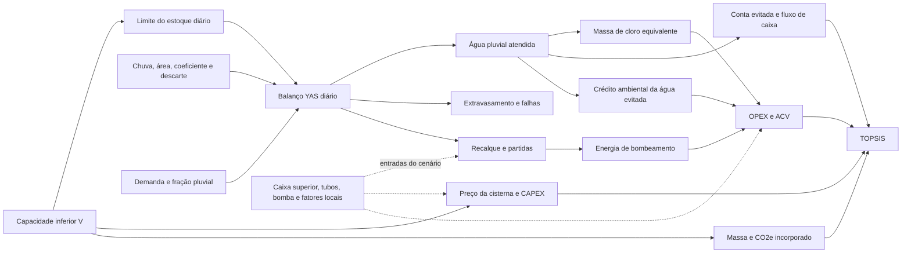

# Parâmetros dependentes do volume e premissas científicas — Netuno 5.0.0

Este documento separa três relações que não devem ser confundidas: dependência **direta** da capacidade da cisterna, dependência **endógena** obtida pela simulação e entradas **independentes** que só mudam se o pesquisador definir outro cenário físico. Essa distinção evita relações espúrias, como supor que todo custo de manutenção, tubo ou bomba cresce automaticamente com os litros armazenáveis.

O [atlas de fluxogramas metodológicos](../netuno/docs/fluxogramas_metodologicos.md) apresenta a cadeia completa e os diagramas específicos de captação, YAS, recalque, varredura, economia, cloração, ACV, TOPSIS e verificação.

## 1. Mapa causal adotado

| Classe | Grandezas | Mecanismo |
| --- | --- | --- |
| Direta | preço da cisterna; massa e CO2e incorporado do reservatório inferior | função explícita da capacidade `V` e do material |
| Endógena | água consumida, falhas, extravasamento, volume recalcado, partidas, energia, massa de cloro, conta evitada, ACV operacional e O&M variável por consumo | consequência do balanço diário repetido para cada `V` |
| Independente | volume superior, comprimentos/diâmetros de tubos, potência, vazão e quantidade de bombas, acessórios | entrada do projeto; não é inferida de `V` |
| Decisão | ótimo técnico, econômico, ambiental e TOPSIS | comparação dos resultados calculados para a grade discreta |

A seta causal usada no programa é mantida também no detalhamento comparativo:



Representação textual de compatibilidade:

```text
V ──► estoque diário ──► água atendida/extravasamento
│                         │
│                         ├──► recalque/partidas ──► energia
│                         ├──► volume tratado ─────► cloro
│                         ├──► conta evitada ──────► fluxo de caixa
│                         └──► crédito de água ────► ACV operacional
├──► preço da cisterna ───────────────────────────► CAPEX
└──► massa do material ───────────────────────────► CO2 incorporado
```

## 2. Hidrologia: relação endógena fundamental

Nos dias em que a regra de descarte estiver ativa, a chuva efetiva compatível com o Netuno 4 é:

```text
Pef,t = 0 se Pt < df; caso contrário, Pef,t = Pt
Vcap,t = Pef,t × A × C
```

O descarte é um limiar numérico, não `Pt − df`. Para o reservatório inferior de capacidade `V`, o YAS limita e extravasa antes da demanda:

```text
Aprov,t = St−1 + Vcap,t
Santes,t = min(V, Aprov,t)
Qt,extr = max(0, Aprov,t − V)
Qt,pluvial = min(Dt,pluvial, Santes,t)
St = Santes,t − Qt,pluvial
```

Assim, `Qt,pluvial(V)`, `Qt,extr(V)`, dias de falha e estados de reservatório são resultados, não coeficientes escolhidos. Com reservatório superior, o motor ainda simula a transferência interna; a conservação de massa dos dois estoques permanece verificável.

O ganho marginal técnico entre alternativas adjacentes é:

```text
gi = [potencial(Vi) − potencial(Vi−1)] / [(Vi − Vi−1)/1000]   [% por m³]
```

O volume técnico é o primeiro ponto discreto com `gi ≤ limiar`. Não se presume monotonicidade estrita do ganho; os resultados são ordenados por volume e avaliados como produzidos pela simulação.

## 3. CAPEX diretamente dependente de `V`

### 3.1 Tabela interna de triagem

Para PEAD, os pontos atuais da cisterna inferior são:

| Volume (L) | Preço-base (R$) |
| ---: | ---: |
| 500 | 800 |
| 1.000 | 1.200 |
| 2.000 | 2.000 |
| 3.000 | 2.800 |
| 5.000 | 4.000 |
| 7.500 | 5.900 |
| 10.000 | 7.600 |
| 15.000 | 10.800 |
| 20.000 | 14.000 |
| 30.000 | 20.000 |
| 50.000 | 32.000 |

Entre dois pontos `(V1,P1)` e `(V2,P2)`:

```text
P(V) = P1 + (V − V1) × (P2 − P1)/(V2 − V1)
Ptanque(V,material) = P(V) × μmaterial
```

Abaixo de 500 L aplica-se proporcionalidade até a origem; acima de 50.000 L extrapola-se pela última inclinação. Os multiplicadores internos são PEAD 1,00; PRFV 1,35; concreto 2,10; aço inox 3,60. Eles são **hipóteses de cenário**, não propriedades universais dos materiais. A equação histórica `0,5577V + 7,47` foi retirada da rotina porque não reproduzia a tabela explícita.

Os outros componentes usam entradas físicas. Quando há tubos informados, `Ctubos = 1,25 × Σ Li × preço(DNi)`, onde 25% representa conexões no cenário preliminar. Caixa superior e bomba só entram se habilitadas. Acessórios e mão de obra têm regras internas de triagem descritas no código; devem ser substituídos por orçamento analítico no estudo definitivo. Para `V=0`, todos os componentes são zero: é a referência sem sistema.

### 3.2 Requisito de qualidade para um orçamento publicável

Para cada componente, registre fabricante/serviço, quantidade, especificação, local, moeda, tributos, frete, data-base e validade. Trate dispersão entre fornecedores e contingência em análise de sensibilidade. Não apresente a tabela interna como preço de mercado atual.

## 4. Impacto incorporado diretamente dependente de `V`

Para a cisterna inferior:

```text
M(V) = (V/1000) × ρmat                         [kg]
CO2inc,cisterna(V) = M(V) × EFmat             [kg CO2e]
```

Os cenários internos atualmente usados são:

| Material | `ρmat` (kg de material/m³ útil) | `EFmat` (kg CO2e/kg) | produto (kg CO2e/m³ útil) |
| --- | ---: | ---: | ---: |
| PEAD | 22,0 | 3,00 | 66,0 |
| PRFV/FIBRA | 20,0 | 4,25 | 85,0 |
| concreto | 1.200,0 | 0,14 | 168,0 |
| aço inox | 38,0 | 2,89 | 109,82 |

Esses valores são aproximações de triagem. Uma cisterna real não possui massa necessariamente linear com o volume: geometria, espessura, armadura, enterramento e classe estrutural importam. Use a massa da ficha técnica e uma EPD/inventário compatível sempre que possível. O programa normaliza `PRFV` para `FIBRA`, eliminando o antigo fallback silencioso para PEAD.

Tubos, reservatório superior e bombas são impactos fixos dentro da mesma varredura porque seus quantitativos são entradas. Para comparar redes ou bombas redimensionadas, crie cenários separados.

## 5. Bombeamento: dependência simulada, não proporcional à capacidade

Para cada `V`, a simulação fornece o volume anual recalcado e o número anual de partidas:

```text
trecalque(V) = Vrecalcado(V) / Qbomba
tpartidas(V) = Npartidas(V) × tduração_partida
E(V) = Pnominal × [trecalque(V) + tpartidas(V)] / η
Cenergia(V) = E(V) × tarifa_elétrica
CO2bomba(V) = E(V) × EFgrid
```

As unidades coerentes são L e L/h para o primeiro quociente, horas para os tempos, kW para potência e rendimento em fração. Uma cisterna maior pode permitir mais água pluvial e mais recalque, mas a relação não é linear: depende da chuva, demanda e controle dos estoques. Sem reservatório superior, a energia de recalque é zero.

O valor interno `0,085 kg CO2e/kWh` é somente uma hipótese editável. Para estudo brasileiro, selecione o fator do MCTI/SIRENE correspondente ao ano e à finalidade do inventário, registrando arquivo, versão, período e se o fator é médio ou marginal.

## 6. Cloro: derivação dimensional e limitação sanitária

O motor calcula a massa **aplicada em Cl2 equivalente** a partir do volume pluvial efetivamente utilizado:

```text
m = V × 1.000 L/m³ × dose mg/L × (1 kg/1.000.000 mg)
mCl2,eq(V) = Vpluvial(V) × dose / 1000          [kg/ano]
Ccloro(V) = mCl2,eq(V) × preçoCl2               [R$/ano]
CO2cloro(V) = mCl2,eq(V) × EFCl2                [kg CO2e/ano]
```

Exemplo dimensional: 100 m³/ano com 2 mg/L implica `100 × 2 / 1000 = 0,200 kg Cl2-eq/ano`.

Isso **não é uma estimativa da demanda de cloro**. Em tratamento de água, demanda de cloro corresponde, de forma operacional, à dose consumida até restar o residual definido após o tempo de contato. Sua determinação exige ensaio com a água local e depende de pH, temperatura, turbidez, matéria orgânica, amônia, forma do produto, tempo de contato e residual-alvo. Também é preciso converter teor de cloro ativo do produto comercial. A dose, o preço e o fator de emissão padrão são cenários editáveis e não constituem recomendação sanitária.

## 7. Por que a manutenção padrão não depende da capacidade

O formato herdado do Netuno 4 representa cada item como:

```text
(descrição, periodicidade_meses, custo_fixo_por_ocorrência,
 coeficiente_R$/m³_consumido_no_mês)
```

Na projeção anual preliminar:

```text
n = 12 / periodicidade
Vmês = Vpluvial,anual(V) / 12
CO&M(V) = Σ n × [Cfixo + cvariável × Vmês]
```

Logo, o campo variável depende do **throughput de água pluvial**, não dos m³ de capacidade. Não há base científica transferível para o antigo valor de R$ 15/m³ de cisterna, que foi removido do padrão. Os estudos de referência usam custos fixos por ocorrência.

Se uma equipe obtiver evidência de custo dependente da capacidade, deve formular e calibrar um novo modelo explicitamente. Um procedimento defensável seria coletar ordens de serviço comparáveis, separar deslocamento/mobilização (fixo) de horas, reagentes e descarte (variáveis), testar modelos candidatos por área interna, volume limpo ou tempo de serviço, reportar amostra, erro e intervalo de validade e só então implementar a relação. Não se deve converter uma justificativa intuitiva em coeficiente numérico sem dados.

## 8. Receita evitada e indicadores financeiros

Para cada volume, a tarifa marginal é obtida comparando duas contas mensais sob a mesma estrutura tarifária:

```text
tarifa_efetiva = [conta(Dtotal) − conta(Dtotal − Veconomizado)] / Veconomizado
FCt(V) = economia_água,t(V) + economia_esgoto,t(V)
          − energia,t(V) − O&Mt(V) − cloro,t(V)
VPL(V) = −CAPEX(V) + Σt FCt(V)/(1+TMA)^t
```

Isso preserva tarifas mínimas e blocos de consumo. O cálculo usa a demanda total simulada, não uma base artificial derivada da economia. O maior VPL define o ótimo econômico na grade. TIR e paybacks são indicadores complementares; não substituem análise de incerteza, horizonte, reposições, financiamento ou valor residual.

## 9. ACV de triagem

O saldo usado como benefício ambiental no TOPSIS é:

```text
CO2líquido,vida(V) = anos × [Vpluvial(V) × EFágua
                             − E(V) × EFgrid
                             − mCl2,eq(V) × EFCl2]
                      − CO2incorporado(V)
```

O ótimo ambiental maximiza esse saldo. `EFágua=0,35 kg CO2e/m³`, os fatores de tubos/bombas e os fatores de materiais são premissas internas de triagem, não valores normativos. Para ACV publicável, defina unidade funcional, fronteira, vida útil/reposições, mix geográfico/temporal, alocação, qualidade dos dados e incerteza; substitua fatores por EPDs e inventários rastreáveis.

## 10. TOPSIS e proximidade de cada ótimo

Os critérios de benefício são água pluvial consumida, VPL e CO2e líquido evitado. Para cada coluna:

```text
zij = xij − min(xj)
rij = zij / sqrt(Σi zij²)
vij = wj × rij
D+i = sqrt[Σj (vij − max(vj))²]
D−i = sqrt[Σj (vij − min(vj))²]
Ci = D−i/(D+i + D−i)
```

Todos os pesos devem ser finitos, não negativos e ter soma positiva. A translação sistemática torna o tratamento de valores negativos explícito e invariante a uma constante adicionada à coluna.

O diagnóstico adicional não usa os pesos. Para cada eixo:

```text
gapij = [max(xj) − xij]/[max(xj) − min(xj)]
proximidadeij = 1 − gapij
```

O motor guarda `gap` para auditoria, enquanto o gráfico apresenta proximidade: `100%` é o ótimo observado e `0%` o pior ponto. Se o vencedor tiver três proximidades altas, está próximo das três frentes; se uma ou mais forem baixas, a seleção é uma concessão. A conclusão depende da grade de volumes: adicionar/remover alternativas pode mudar normalizações e ranking.

## 11. Níveis de evidência e rastreabilidade mínima

Use esta ordem de preferência:

1. dados medidos no edifício e série diária local com controle de qualidade;
2. cotações, contas, fichas técnicas e EPDs específicas do projeto;
3. bases públicas/versionadas e literatura revisada por pares compatível com a fronteira;
4. cenários internos do software, sempre identificados como triagem e submetidos à sensibilidade.

Para cada entrada externa, guarde fonte, URL/DOI, autor/organização, versão, data de acesso, unidade original, transformação aplicada, geografia, período, incerteza e responsável. A comparação completa, inclusive o diagrama acima, está em [DETALHAMENTO_COMPLETO_TRES_MODELOS.md](DETALHAMENTO_COMPLETO_TRES_MODELOS.md); as contas e resíduos estão em [ESTUDO_DE_CASO_TRES_MODELOS_REFERENCIA.md](ESTUDO_DE_CASO_TRES_MODELOS_REFERENCIA.md). Os dois relatórios são regenerados por [`scripts/generate_reference_case_studies.py`](../scripts/generate_reference_case_studies.py).

## 12. Referências metodológicas

- GHISI, E.; CORDOVA, M. M. *Netuno 4 — Manual do Usuário*. UFSC, 2014. [Cópia local](../Additional_Material/Documentation/Manual-Netuno-4_Junho2014.pdf).
- ROCHA, V. L. *Validação do algoritmo do programa Netuno para avaliação do potencial de economia de água potável e dimensionamento de reservatórios de sistemas de aproveitamento de água pluvial em edificações*. UFSC, 2009. [Registro institucional](https://repositorio.ufsc.br/handle/123456789/92966).
- HWANG, C.-L.; YOON, K. *Multiple Attribute Decision Making: Methods and Applications*. Springer, 1981. [DOI](https://doi.org/10.1007/978-3-642-48318-9).
- MCTI/SIRENE. *Fatores médios de emissão de CO2 do Sistema Interligado Nacional do Brasil*. [Série oficial e arquivos por ano](https://www.gov.br/mcti/pt-br/acompanhe-o-mcti/sirene/dados-e-ferramentas/fatores-de-emissao).
