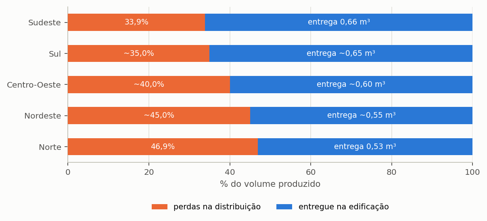

# Fatores de emissão

Todo fator usado pela avaliação de ciclo de vida, com procedência, fronteira e grau
de confiança. O detalhamento completo, com as fontes item a item, está em
`docs/procedencia_fatores_co2.md`.

---

## Materiais de reservatório

<!-- tabela: Fatores de emissão dos materiais de reservatório, com massa e fronteira -->
| Material | Massa por m³ útil | Fator | Fronteira |
| :--- | ---: | ---: | :--- |
| polietileno de alta densidade | 22 kg/m³ | 1,612 kg CO₂e/kg | berço ao portão |
| concreto armado | 1.200 kg/m³ | 0,140 kg CO₂e/kg | berço ao portão |
| fibra de vidro | 15 kg/m³ | 3,250 kg CO₂e/kg | berço ao portão |
| aço inoxidável AISI 304 | 38 kg/m³ | 3,700 kg CO₂e/kg | berço ao portão |

A massa por metro cúbico útil é a que converte volume de reservatório em massa de
material. É ela, e não o fator, que faz o concreto dominar o inventário: 1.200 kg
por metro cúbico contra 22 do polietileno.

> **Consequência prática, demonstrada na seção {{n:11}}:** o material decide o **sinal**
> do resultado ambiental. Com concreto e vida útil de vinte anos, o sistema do
> tutorial não paga a dívida de carbono.

---

## Água potável de rede

Dezenove rotas de produção disponíveis, por macrorregião e tipo de manancial.

**A fronteira é por metro cúbico entregue na edificação**, e não por metro cúbico
produzido na estação. A conversão usa as perdas de distribuição de cada macrorregião ({{fig:fig43_perdas}}):

*Figura 99 — Quanto de cada metro cúbico produzido chega efetivamente à edificação, por macrorregião. É essa fração que converte um fator de emissão de saída de estação em fator por metro cúbico entregue, e ignorá-la subestima a emissão evitada em até um terço.*

---

## Rede elétrica

O fator da matriz elétrica brasileira muda **todo ano**, e um estudo sem o ano
declarado é irreprodutível. O programa traz cinco bases de referência e registra qual
foi usada.

---

## Insumos de tratamento

<!-- tabela: Fatores de emissão dos insumos de tratamento -->
| Insumo | Fator |
| :--- | ---: |
| hipoclorito de cálcio, produto | conforme cadeia única de cloração |
| lâmpada ultravioleta | energia da rede |
| gerador de ozônio | energia da rede |

A massa é de **produto**, e não de cloro ativo. Pastilhas têm cerca de 65% de cloro
ativo.

---

## Motobomba

Não existe Declaração Ambiental de Produto de motobomba residencial brasileira. O
programa compõe o valor com duas fontes lidas: a massa de cada potência, do catálogo da
Dancor, e a intensidade de 4,77 kg CO₂e por quilo de bomba, da EPD da Grundfos
EPD-GRU-20250340-CBA1-EN (2025, módulos A1 a A3).

<!-- tabela: Emissão de fabricação da motobomba por potência, com a massa de catálogo -->
| Potência | Massa | Emissão de fabricação |
| ---: | ---: | ---: |
| 1/4 CV | 6,1 kg | 29,1 kg CO₂e |
| 1/2 CV | 6,4 kg | 30,5 kg CO₂e |
| 3/4 CV | 13,5 kg | 64,4 kg CO₂e |
| 1 CV | 15,3 kg | 73,0 kg CO₂e |
| 1 1/2 CV | 17,5 kg | 83,5 kg CO₂e |
| 2 CV | 20,7 kg | 98,8 kg CO₂e |

> **Declare no estudo.** A EPD é de um circulador europeu com eletrônica embarcada, e a
> massa de referência inclui a embalagem. A intensidade por quilo é aproximação de ordem
> de grandeza, e não inventário da bomba instalada; havendo EPD do fabricante empregado,
> ela prevalece. Os valores anteriores, de 12 a 55 kg CO₂e, ficavam de 1,7 a 2,7 vezes
> abaixo destes, e quatro deles eram extrapolação aritmética.

---

## Fatores com rótulo de triagem

Nem todo fator tem fonte primária. Os que não têm são marcados, e o relatório exibe a
marca.

<!-- tabela: Fatores que carregam rótulo de triagem, por ausência de fonte primária -->
| Fator | Situação |
| :--- | :--- |
| **hipoclorito, por quilo de produto** | citado como Ecoinvent v3.8 sem o processo nem o identificador; nenhum artigo de acesso aberto publica o fator por quilo |

> **Num estudo publicado, declare quais fatores carregam rótulo de triagem.** Um
> inventário que apresenta todos os fatores com o mesmo grau de confiança esconde
> onde está a fragilidade.

---

## O que consultar antes de publicar

1. `docs/procedencia_fatores_co2.md`, para a fonte item a item;
2. a aba de Documentação, capítulo de avaliação de ciclo de vida, para as
   justificativas exibidas ao usuário;
3. o inventário do relatório ambiental, que lista cada item com o fator aplicado.
