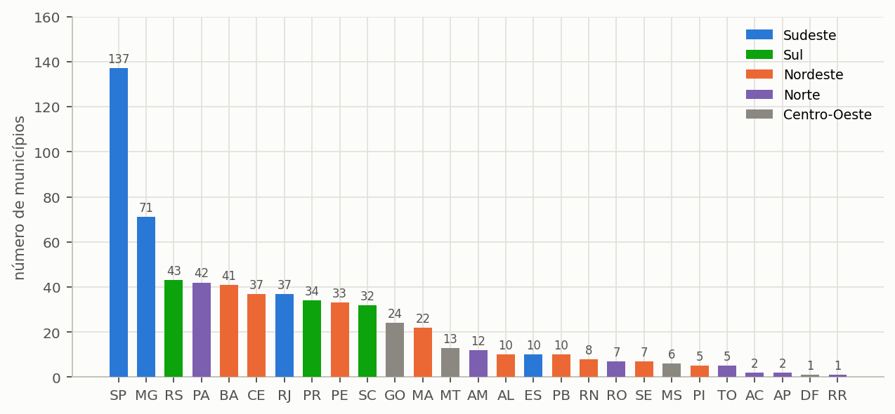

# Regimes tarifários

A base traz **652 municípios** com estrutura tarifária, percentual
de esgoto, regime de mínimo, data de vigência e fonte. Esta lista é extraída
da própria base do programa, e não transcrita.

## Os códigos de faixa

Cada linha da tabela tarifária é uma quádrupla `(mínimo, máximo, valor, código)`:

Os quatro códigos e o efeito de cada um sobre a fatura estão desenhados na seção {{n:29}}, e não se repetem aqui.

## Os cinco regimes

<!-- tabela: Distribuição dos municípios do catálogo pelos cinco regimes de mínimo -->
| Regime | Municípios | O que acontece ao economizar |
| :--- | ---: | :--- |
| **Sem mínimo** | 165 | Cada m³ economizado reduz a fatura. |
| **Disponibilidade** | 156 | Valor fixo que **soma** por cima do consumo medido. Cada m³ economizado desconta. |
| **Franquia no mínimo** | 329 | O valor fixo já inclui um volume. Economizar **abaixo** da franquia não desconta nada. |
| **Franquia retroativa** | 2 | Até a franquia paga-se o fixo; passando dela, tarifa-se **tudo desde zero**. |
| **Piso de pagamento** | 0 | A fatura **não fica** abaixo do piso. Não soma: limita. |

> O piso de pagamento está implementado e nenhum município da base foi
> classificado nele até esta versão.

## Distribuição por unidade da federação

A cobertura do catálogo acompanha a população, e não o território: as capitais e as regiões metropolitanas estão quase todas cadastradas, e o interior das regiões Norte e Centro-Oeste concentra os municípios ainda ausentes ({{fig:fig42_uf}}).

*Figura 99 — A distribuição dos 652 municípios catalogados pelas unidades da federação, com as cores identificando a macrorregião. São Paulo e Minas Gerais respondem sozinhos por quase um terço do catálogo.*

## Atualização e auditoria da base

A base tarifária é mantida pelo grupo com uma rotina de atualização executada fora da interface, antes de cada versão. A rotina tem três componentes.

**Energia elétrica.** As tarifas residenciais do subgrupo B1 são lidas da base aberta de tarifas homologadas das distribuidoras, publicada pela Agência Nacional de Energia Elétrica (ANEEL), e associadas à distribuidora de cada município do catálogo.

**Água e esgoto.** Um registro de evidências primárias associa cada prestador à agência reguladora, à página oficial de tarifas e ao tipo de ato que as publica. Os prestadores com portal padronizado têm leitura automática; os demais são marcados para conferência manual do decreto ou da resolução, e a estrutura resultante é submetida à mesma validação de regime descrita neste apêndice.

**Detecção de alterações.** Cada página oficial monitorada é registrada com a assinatura SHA-256 do conteúdo e os cabeçalhos `ETag` e `Last-Modified`. Uma nova verificação compara as assinaturas e aponta as páginas alteradas desde a última coleta, que são as candidatas a revisão tarifária.

A rotina pode simular a atualização sem gravar a base, executar apenas a detecção de alterações, restringir-se a uma unidade da federação ou a um município e separar energia de saneamento. Cada execução grava um relatório de auditoria em Markdown e um painel HTML com a situação de cada município.

## Grau de confiança

Cada registro traz o grau de confiança da coleta:

<!-- tabela: Grau de confiança dos registros tarifários do catálogo -->
| Grau | Registros |
| :--- | ---: |
| A — alta | 580 |
| B — boa | 63 |
| C — estrutura a conferir | 5 |
| D — estrutura incompleta | 4 |

> **Confira sempre a data de vigência** do registro do seu município contra a
> resolução da concessionária. Tarifas são reajustadas anualmente, e a seção {{n:16}}
> ensina o teste que identifica estrutura errada.

