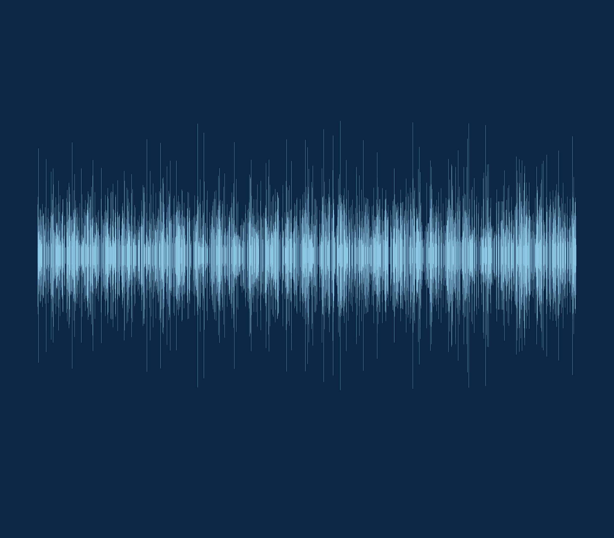
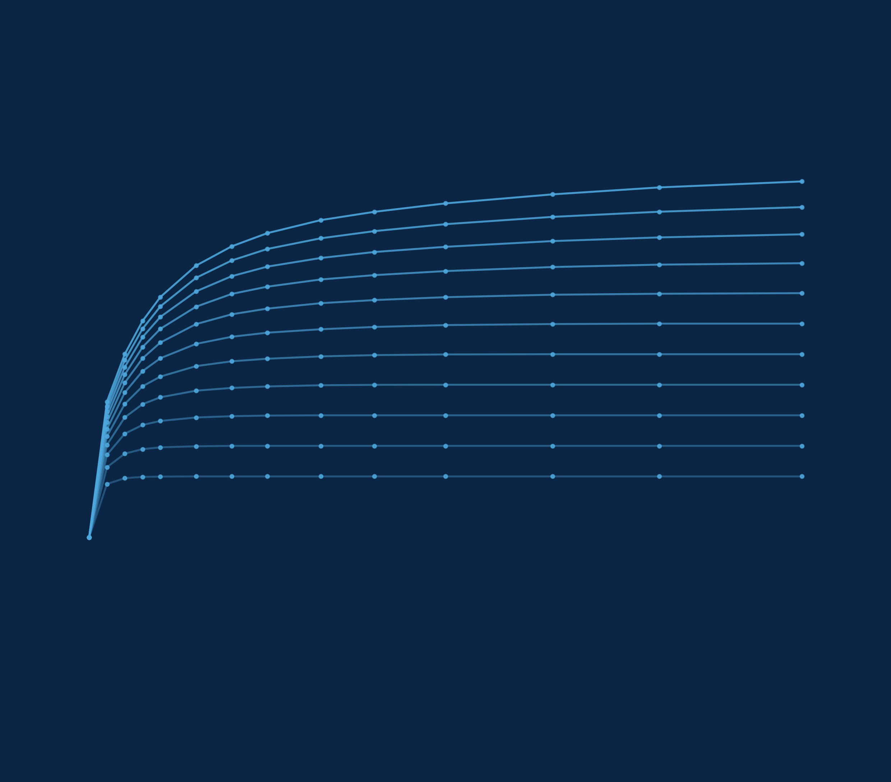

# Glossário

Termos técnicos e siglas, com o equivalente em inglês quando ele é usado na
literatura, acompanhados das diretrizes de padronização terminológica do Netuno 5.

---

**AAC** (*aproveitamento de água de chuva*). Emprego de água precipitada sobre coberturas
para usos não potáveis em edificações, regulamentado no Brasil pela ABNT NBR 15527:2019.
Deve-se preferir o termo «aproveitamento» a «reúso», uma vez que a água de chuva captada
na cobertura é um recurso primário e não um efluente gerado por uso antrópico anterior.

**ABNT**. Associação Brasileira de Normas Técnicas, o organismo que publica as normas
brasileiras. Uma norma é identificada pela sigla NBR seguida do número e do ano da
edição, como em ABNT NBR 15527:2019.

**ACV** (*life cycle assessment*). Avaliação de ciclo de vida. Método que contabiliza os
impactos ambientais de um produto ao longo de toda a sua existência, da extração das
matérias-primas ao descarte. A do programa é de **triagem**, e não um inventário completo
conforme a ISO 14040.

**Água de chuva** (*rainwater*). Precipitação atmosférica coletada diretamente em
superfícies impermeáveis de cobertura (telhados e lajes impermeabilizadas), antes de atingir
o solo ou galerias públicas. É o termo técnico-normativo oficial consagrado pela ABNT NBR
15527:2019. Deve-se utilizar rigorosamente «água de chuva» para designar o recurso natural
e a fonte hídrica captada, evitando a forma coloquial «água da chuva».

**Água não potável** (*non-potable water*). Água que não se destina ao consumo humano direto,
mas atende aos padrões de qualidade física, química e microbiológica estabelecidos por
normas específicas (como a Tabela 1 da ABNT NBR 15527:2019 e a ABNT NBR 16783:2019) para
usos admitidos: descargas em bacias sanitárias e mictórios, lavagem de veículos, calçadas e
pisos, irrigação paisagística, lavagem de roupas e torres de resfriamento.

**Água pluvial** (*stormwater*, *pluvial water*). Água de chuva que escoa superficialmente
por superfícies urbanas ou é conduzida por canalizações e sistemas prediais de drenagem
(ABNT NBR 10844). No Netuno, o termo aplica-se preferencialmente à infraestrutura predial
e aos componentes de engenharia: *sistema de aproveitamento de água pluvial (SAAP)*, *rede
pluvial*, *demanda pluvial*, *consumo de água pluvial* e *extravasamento pluvial*.

**Água potável** (*potable water*, *drinking water*). Água que atende integralmente aos
padrões de potabilidade definidos pela Portaria GM/MS nº 888/2021 do Ministério da Saúde,
destinada à ingestão direta, preparação de alimentos e higiene pessoal.

**ANEEL**. Agência Nacional de Energia Elétrica, que homologa as tarifas das
distribuidoras de energia. O Netuno lê delas o preço da energia do bombeamento, e a
atualização das tarifas é feita a partir dos dados abertos da agência.

**AQUA-HQE**. Referencial de certificação ambiental de edificações, adaptação brasileira
do francês HQE conduzida pela Fundação Vanzolini. No referencial residencial de 2024, a
água é tratada no tema «Consumo de água», em itens classificados nos níveis PR, HQE,
HQE 2 e HQE 3.

**Área de captação** (*catchment area*). Área projetada na **horizontal** da superfície
impermeável da cobertura onde a água é captada, conforme o item 3.6 da NBR 15527:2019.
Não é a área inclinada do telhado, nem a área de contribuição da NBR 10844, que serve
ao dimensionamento de calhas.

**Bandeira tarifária**. Acréscimo ou desconto sobre a tarifa de energia elétrica,
conforme as condições de geração. Verde, amarela, vermelha 1, vermelha 2, e a
modalidade branca.

**BD+C** (*Building Design and Construction*). Família de referenciais do LEED
para projeto e construção de edificações novas ou em grande reforma. É a família
tratada neste manual, nas versões 4, 4.1 e 5.

**BIM** (*building information modeling*). Modelagem da informação da construção.
Representação digital da edificação em que cada componente carrega propriedades além da
geometria, o que permite compatibilizar projetos de disciplinas diferentes.

**CAD** (*computer-aided design*). Desenho assistido por computador. O programa exporta o
esquema hidráulico em DXF, formato de intercâmbio aceito pelos programas de CAD.

**CAPEX** (*capital expenditure*). Investimento inicial.

**CASAN**. Companhia Catarinense de Águas e Saneamento, a concessionária de água e esgoto
de Florianópolis e de boa parte de Santa Catarina. A estrutura tarifária dela é a adotada
no tutorial deste manual.

**CDD** (*consecutive dry days*). Maior sequência de dias consecutivos com chuva
abaixo de 1 mm.

**CMIP6**. Sexta fase do *Coupled Model Intercomparison Project*, o exercício
internacional coordenado que produz as projeções climáticas usadas pelos relatórios do
IPCC. A base climática do programa deriva dele.

**CLIMBra** (*Climate Change Dataset for Brazil*). Conjunto de dados meteorológicos diários em grade de alta resolução (0,25° × 0,25°, ~28 km) para todo o Brasil, cobrindo 19 modelos climáticos globais do CMIP6 e cenários de emissões SSP2-4.5 e SSP5-8.5. Desenvolvido por Ballarin et al. (2023) na revista [*Scientific Data* (Nature)](https://www.nature.com/articles/s41597-023-01956-z) ([doi:10.1038/s41597-023-01956-z](https://doi.org/10.1038/s41597-023-01956-z)) e disponibilizado publicamente no [*Science Data Bank*](https://doi.org/10.57760/sciencedb.02316) ([doi:10.57760/sciencedb.02316](https://doi.org/10.57760/sciencedb.02316)). As projeções brutas foram corrigidas de viés pelo método *Quantile Delta Mapping* (QDM) utilizando como referência observacional a base de Xavier, King e Scanlon (2016). No Netuno 5, o CLIMBra constitui a Base de dados CLIMBra para 652 cidades brasileiras (série histórica de 1980 a 2013 e projeções futuras contínuas de 2015 a 2100).

**Coeficiente de escoamento** (*runoff coefficient*). Fração da chuva que
efetivamente chega ao reservatório, descontadas perdas por absorção, evaporação e
molhamento inicial da cobertura.

**Comprimento representativo de série de precipitação** (*representative rainfall time series length*, $N_{rep}$).
Menor período contínuo em anos de dados diários de chuva necessário para estabilizar
estatisticamente o dimensionamento e o desempenho do sistema (reproduzindo o volume ideal
e o potencial de economia da série completa sob confiança $\ge 90\%$), segundo a
metodologia de Geraldi e Ghisi (2017, 2018, 2019). O comprimento necessário não é uma
constante geográfica fixa: cresce com a fração atendível e com o nível de demanda da edificação.

**Confiabilidade temporal** ($C_t$). Percentual de dias em que o sistema atendeu
plenamente ($V_{con,t} = D_{pl,t}$), parcialmente ou não atendeu a demanda pluvial.

**Confiabilidade volumétrica** ($C_v$). Fração da demanda **pluvial** que o sistema atendeu
($C_v = \sum V_{con} / \sum D_{pl} = E_{pot} / f$). Não confundir com o potencial de economia,
que tem no denominador a demanda total da edificação.

**CSV** (*comma-separated values*). Formato de arquivo de texto em que cada linha é um
registro e as colunas são separadas por um caractere, tipicamente vírgula ou ponto e
vírgula. É o formato das séries de precipitação.

**CV**. Cavalo-vapor, unidade de potência equivalente a 0,7355 kW, corrente no comércio
de motobombas no Brasil. Uma motobomba de meio CV tem 0,37 kW de potência de eixo.

**CWD** (*consecutive wet days*). Maior sequência de dias consecutivos com chuva
igual ou superior a 1 mm.

**Demanda estocástica** (*stochastic water demand*). Modelagem do consumo diário de água como
variável probabilística que varia dia a dia e entre realizações (Silva e Ghisi, 2016),
permitindo avaliar a faixa de incerteza do dimensionamento e dos indicadores de desempenho
sob variabilidade real de uso.

**Demanda pluvial** (*pluvial demand*, $D_{pl}$). Parcela da demanda diária de água da
edificação que pode ser suprida pelo sistema de aproveitamento ($D_{pl,t} = D_{tot,t} \times f$).
Corresponde aos pontos de consumo não potável interligados à rede pluvial.

**Descarte de primeiras águas** (*first flush*). Lâmina inicial de chuva desviada do
sistema, que carrega a sujeira depositada na cobertura (mínimo de 2 mm conforme a NBR
15527:2019). No Netuno 5 é **subtraída** da chuva do dia; no Netuno 4 era tratada como
limiar do evento.

**Disponibilidade**. Regime tarifário em que um valor fixo **soma** por cima do
consumo medido. Cada metro cúbico economizado desconta.

**DN** (*diâmetro nominal*). Designação comercial do diâmetro de um tubo ou conexão, em
milímetros. Não corresponde exatamente ao diâmetro interno nem ao externo: é um número de
referência do qual decorrem as dimensões reais, tabeladas por norma.

**DXF** (*drawing exchange format*). Formato de intercâmbio de desenhos técnicos, lido
por praticamente todos os programas de CAD.

**EAU**. Prefixo dos itens do tema «Consumo de água» no referencial AQUA-HQE, do francês
*eau*, água. Os itens ligados ao aproveitamento pluvial são o EAU.1.2, o EAU.1.3 e o
EAU.1.5.

**EDGE** (*excellence in design for greater efficiencies*). Referencial de certificação
da International Finance Corporation, do Banco Mundial. Mede economia percentual contra
um caso-base local em três dimensões independentes e exige que cada uma cruze o limiar.

**EN** (*Europäische Norm*, norma europeia). Norma publicada pelo Comitê Europeu de
Normalização. Neste manual, a EN 15978, que define os módulos do ciclo de vida da
edificação, e a EN 15804, que rege as declarações ambientais de produtos de construção.

**EPD** (*Environmental Product Declaration*). Declaração ambiental de produto: documento
verificado por terceiros, conforme a ISO 14025 e, na construção, a EN 15804, que publica
os impactos do ciclo de vida de um produto por unidade declarada. É a fonte preferida para
fatores de emissão de materiais e equipamentos.

**ESG** (*environmental, social and governance*). Conjunto de critérios ambientais,
sociais e de governança usado na avaliação de empresas e de empreendimentos. O programa
alimenta indicadores ambientais desse conjunto.

**ETAP**. Estação de tratamento de água pluvial. No programa, o conjunto de filtro
de entrada, desinfecção e filtro de polimento.

**ETCCDI** (*Expert Team on Climate Change Detection and Indices*). Grupo de trabalho
internacional que padronizou os índices de extremos climáticos, dos quais o programa
calcula oito.

**Extravasamento** (*spillage*, *overflow*). Volume que excede a capacidade do reservatório
e é conduzido pelo extravasor quando ele já está cheio.

**Fração atendível por água pluvial** (*non-potable demand share*, $f$). Percentual da demanda
total de água da edificação ($D_{tot}$) passível de suprimento por água de chuva ($f = D_{pl} / D_{tot}$).
Representa o **teto assintótico intransponível** do potencial de economia de água potável
($E_{pot} \le f$): mesmo sob capacidade infinita de armazenamento e precipitação ilimitada,
a economia de potável nunca ultrapassa a fração atendível, pois o restante ($1 - f$) é
reservado aos usos nobres e potáveis. Distingue-se da confiabilidade volumétrica ($C_v = E_{pot} / f$),
que avalia o atendimento da parcela pluvial.

**Franquia no mínimo**. Regime tarifário em que o valor fixo já inclui um volume de
consumo. Economizar **abaixo** da franquia não reduz a fatura.

**Ganho marginal**. Variação do potencial de economia por metro cúbico acrescentado
ao reservatório, em %/m³ ($\Delta E_{pot} / \Delta V$). Critério de escolha do volume ideal.

**GRI** (*Global Reporting Initiative*). Padrão internacional de divulgação corporativa
de desempenho socioambiental. Sua série 303 trata de água e efluentes.

**HQE** (*Haute Qualité Environnementale*). Referencial francês de alta qualidade
ambiental, base do AQUA-HQE. Designa também os níveis dos itens do referencial: HQE,
HQE 2 e HQE 3, em ordem crescente de exigência, acima do pré-requisito (PR).

**IFC**. A sigla designa duas coisas distintas. Em certificação, é a *International
Finance Corporation*, do Banco Mundial, que desenvolve o EDGE. No contexto BIM, é o
*Industry Foundation Classes*, formato aberto de intercâmbio que o programa **não**
exporta: a exportação BIM do programa é um arquivo JSON de propriedades.

**IPCC** (*Intergovernmental Panel on Climate Change*). Painel intergovernamental que
sintetiza o conhecimento científico sobre mudança do clima e organiza os relatórios de
avaliação a que as projeções climáticas se referem.

**IPTU verde**. Desconto no imposto predial concedido por alguns municípios a edificações
que adotam medidas de sustentabilidade, entre elas o aproveitamento de água pluvial. O
percentual e as condições variam por legislação municipal.

**ISO 14040**. Norma internacional que estabelece os princípios e a estrutura da
avaliação de ciclo de vida. Um inventário conforme a ISO 14040 exige rastreabilidade de
cada fluxo e revisão crítica externa, requisitos que uma avaliação de triagem não cumpre.

**JSON** (*JavaScript object notation*). Formato de arquivo de texto estruturado, legível
por pessoas e por programas. É o formato interno do arquivo `.netuno`.

**LCOW** (*levelized cost of water*). Custo nivelado da água: razão entre o valor presente
de todos os custos do ciclo de vida do sistema (CAPEX, substituições, O&M, energia e
produtos químicos) e o volume descontado de água pluvial consumida ao longo do horizonte
de análise, em R$/m³. Permite confrontar a viabilidade econômica do sistema diretamente
com a tarifa da concessionária.

**LEED** (*leadership in energy and environmental design*). Referencial de certificação
ambiental de edificações do *U.S. Green Building Council*, o mais difundido
internacionalmente. Trata eficiência hídrica na categoria *Water Efficiency*: na versão 4,
pelos créditos WEc1 e WEc2; na versão 5, pelo crédito WEc2, *Enhanced Water Efficiency*.

**m.c.a.** Metro de coluna d'água, unidade de pressão equivalente à exercida por uma
coluna de água de um metro de altura, cerca de 9,81 kPa. É a unidade usual em instalações
prediais.

**Micromedição**. Medição individualizada por unidade habitacional em edifício
multifamiliar. Informada ao programa como número de economias.

**Manuais do Netuno 5** (*Netuno 5 Manual Suite*). Conjunto bibliográfico oficial e modular de documentação técnica do Netuno 5, concebido para fornecer fundamentação metodológica transparente, reprodutibilidade científica e orientação prática de engenharia. O acervo compõe-se de **1 Manual Geral Completo** e **7 Mini-Manuais Temáticos Independentes**, possibilitando tanto a consulta integral quanto a consulta ou envio fracionado por disciplina e fase do projeto:

1. **Manual Completo (Geral):** Volume unificado abrangente (266 páginas) contendo a íntegra dos métodos analíticos, tutoriais de caso prático, equações de balanço diário, justificativas de ACV, certificações sustentáveis e todos os apêndices de engenharia.
   
   * Link para download: [Manual Completo do Netuno 5 (PDF)](URL_DO_MANUAL_COMPLETO)

2. **Volume 1 — Comece Aqui:** Guia rápido de instalação, configuração, primeiros passos, conceitos elementares e apresentação das funcionalidades centrais do programa.
   
   * Link para download: [Volume 1 — Comece Aqui (PDF)](URL_DO_MANUAL_VOL_1)

3. **Volume 2 — O Método de Simulação:** Equações detalhadas do balanço hídrico diário *Yield-After-Spill* (YAS), modelos de escoamento superficial em coberturas, regras de descarte de primeira chuva (*first flush*), hidráulica de bombeamento e formulações matemáticas rigorosas.
   
   * Link para download: [Volume 2 — O Método de Simulação (PDF)](URL_DO_MANUAL_VOL_2)

4. **Volume 3 — Guias Práticos e Aplicações:** Diretrizes de projeto para diferentes tipologias prediais (escolas, hospitais, residências unifamiliares, edifícios comerciais), modulação de demandas sazonais e estudos com séries pluviométricas de capitais brasileiras.
   
   * Link para download: [Volume 3 — Guias Práticos e Aplicações (PDF)](URL_DO_MANUAL_VOL_3)

5. **Volume 4 — Tutorial Passo a Passo:** Caso prático completo guiado passo a passo, desde a entrada de dados pluviométricos e arquitetônicos até o dimensionamento do reservatório ideal, análise de fluxo de caixa (VPL, TIR, Payback) e balanço de carbono.
   
   * Link para download: [Volume 4 — Tutorial Passo a Passo (PDF)](URL_DO_MANUAL_VOL_4)

6. **Volume 5 — Análise de Confiabilidade e Incerteza:** Confiabilidade temporal e volumétrica, curvas de permanência de nível de reservatório, análise de sensibilidade e estabilidade estatística do comprimento representativo de séries pluviométricas.
   
   * Link para download: [Volume 5 — Análise de Confiabilidade (PDF)](URL_DO_MANUAL_VOL_5)

7. **Volume 6 — Histórico de Versões e Validação:** Evolução histórica do Netuno 1 ao 5, protocolo de replicação e auditoria contra o Netuno 4, verificação analítica dos algoritmos e matriz de testes unitários.
   
   * Link para download: [Volume 6 — Histórico de Versões (PDF)](URL_DO_MANUAL_VOL_6)

8. **Volume 7 — Apêndices Técnicos e Dados:** Coletânea exaustiva de parâmetros de projeto, coeficientes de escoamento por material de telhado (artigo MIX 2020), fatores de emissão de carbono (ACV), estruturas tarifárias de saneamento, glossário terminológico e referências bibliográficas conferidas.
   
   * Link para download: [Volume 7 — Apêndices Técnicos e Dados (PDF)](URL_DO_MANUAL_VOL_7)

- **Manual Interativo & Portal Web Oficial:**
  * Link para consulta online: [Página Web Oficial com Explicações e Manual Interativo](https://www.google.com)

**NBR**. Norma Brasileira, publicada pela ABNT. As mais citadas neste manual são a NBR
15527, de aproveitamento de água de chuva, a NBR 10844, de instalações prediais de águas
pluviais, a NBR 5626, de sistemas prediais de água fria e quente, e a NBR 17094-2, de
motores de indução.

**Payback de carbono**. Tempo para a economia anual líquida de emissões pagar o
carbono incorporado na fabricação do sistema.

**Payback descontado**. Tempo para o fluxo de caixa descontado acumulado cruzar zero.

**PEAD**. Polietileno de alta densidade, material dos reservatórios plásticos mais
comuns no mercado brasileiro.

**Piso de pagamento**. Regime tarifário em que a fatura **não fica** abaixo de um
valor. Diferente de disponibilidade: o piso limita por baixo, a disponibilidade soma
por cima.

**Potencial de economia de água potável** (*potable water saving potential*, $E_{pot}$).
Fração da demanda **total** da edificação suprida por água pluvial ($E_{pot} = \sum V_{con} / \sum D_{tot} \times 100\%$).
É o indicador central do programa, limitado superiormente pela fração atendível ($E_{pot} \le f$).

**pp**. Pontos percentuais. Usado para exprimir a diferença entre dois percentuais: de
35% para 37% vão dois pontos percentuais, e não dois por cento.

**PR**. Pré-requisito: no AQUA-HQE, o nível de item de atendimento obrigatório, abaixo
dos níveis HQE, HQE 2 e HQE 3.

**PRCPTOT**. Precipitação total anual em dias úmidos.

**PRFV**. Plástico reforçado com fibra de vidro, material de reservatórios de médio e
grande porte. Aparece no programa sob a designação «fibra».

**PVC**. Policloreto de vinila, material das tubulações prediais de água fria e das
colunas de desvio do descarte inicial. As dimensões dos tubos soldáveis seguem a ABNT NBR 5648.

**R95p**. Soma da precipitação dos dias acima do percentil 95 dos dias úmidos.

**Rendimento da bomba**. Razão entre a potência hidráulica entregue à água e a
potência mecânica no eixo. Não inclui o motor.

**Rendimento do motor**. Razão entre a potência mecânica no eixo e a potência
elétrica consumida da rede. A ABNT NBR 17094-2 manda marcá-lo na placa.

**RX1day**, **RX5day**. Maior precipitação em um e em cinco dias consecutivos, no
ano.

**SAAP**. Sistema de aproveitamento de água pluvial. Conjunto integrado de componentes
prediais — área de captação, condutores, descarte inicial (first flush), estação de
tratamento (ETAP), cisterna inferior, reservatório superior, grupo motobomba ou pressurizador
e rede de distribuição independente — concebido para coletar, tratar, armazenar e fornecer
água não potável em conformidade com a ABNT NBR 15527 e a ABNT NBR 5626.

**SDII** (*simple daily intensity index*). Precipitação média dos dias úmidos.

**SI** (*seasonality index*). Índice de sazonalidade de Walsh e Lawler. Zero quando a
chuva é uniforme ao longo do ano.

**SMAA** (*stochastic multicriteria acceptability analysis*). Método que sorteia
pesos e devolve a probabilidade de cada alternativa vencer.

**SNIS**. Sistema Nacional de Informações sobre Saneamento, base oficial brasileira de
indicadores do setor, mantida pelo governo federal. É a origem dos indicadores de
consumo energético do saneamento usados na avaliação ambiental.

**SSP** (*shared socioeconomic pathways*). Trajetórias socioeconômicas compartilhadas,
que descrevem hipóteses coerentes de desenvolvimento global e as emissões correspondentes.
Combinam-se com os modelos climáticos para produzir projeções.

**TFDI**. Tarifa fixa de disponibilidade da infraestrutura, nome que algumas
concessionárias dão à parcela da fatura cobrada independentemente do consumo. Ver
*Disponibilidade*.

**TIR**. Taxa interna de retorno. A taxa de desconto que zera o valor presente
líquido.

**TMA**. Taxa mínima de atratividade. A taxa de desconto adotada.

**TOPSIS** (*technique for order of preference by similarity to ideal solution*).
Método de ordenação multicritério de Hwang e Yoon.

**UV**. Radiação ultravioleta, empregada na desinfecção de água por inativação de
microrganismos. Atua apenas no instante da passagem pelo reator e não deixa residual, ao
contrário da cloração.

**VIKOR**. Método de decisão multicritério proposto por Opricovic, que busca uma solução
de compromisso entre critérios conflitantes. Ver também *SMAA*.

**Volume ideal** (*optimal tank volume*). Menor volume de reservatório da grade de simulação
a partir do qual o ganho marginal de economia de água potável ($\Delta E_{pot} / \Delta V$)
cai abaixo de um limiar declarado (tipicamente $1,0\%/\text{m}^3$ ou $0,5\%/\text{m}^3$).
Evita o superdimensionamento de reservatórios, assegurando a melhor relação custo-benefício.

**VPL**. Valor presente líquido.

**WEM**. Codificação das medidas de eficiência hídrica do EDGE. A WEM14 é o sistema
de aproveitamento de água pluvial.

**XLSX**. Formato de pasta de trabalho do Microsoft Excel, baseado em XML compactado. É um
dos formatos de exportação de planilhas e de resultados da linha de comando.

**YAS** (*yield after spillage*). Regra de operação em que o extravasamento é
calculado **antes** da retirada da demanda. É o modelo adotado pelo programa.

**YBS** (*yield before spillage*). Regra de operação em que a demanda é retirada **antes**
do cálculo do extravasamento. Supõe consumo anterior à chuva do dia e superestima o
aproveitamento; não é o modelo adotado pelo programa.

---

## Diretrizes de Padronização e Nomenclatura no Netuno

A padronização terminológica é indispensável para assegurar a consistência e o rigor técnico
em artigos científicos, relatórios técnicos, na interface gráfica e na documentação do Netuno.
As convenções a seguir detalham a distinção de termos correlatos frequentemente confundidos:

### 1. Água de Chuva versus Água Pluvial versus «Água da Chuva»

<!-- tabela: Padronização terminológica de água de chuva e água pluvial -->
| Termo | Definição e Contexto de Aplicação | Situação no Netuno | Referência |
| :--- | :--- | :--- | :--- |
| **Água de chuva** (*rainwater*) | Precipitação atmosférica coletada diretamente na cobertura (telhado/laje impermeabilizada), antes de atingir o solo ou galerias. Refere-se à **fonte hídrica** e ao recurso ambiental. | **Canônico e preferencial** para o recurso captado («aproveitamento de água de chuva», «precipitação de água de chuva»). | ABNT NBR 15527:2019, título e item 3.1. |
| **Água pluvial** (*stormwater* / *pluvial water*) | Água de chuva após escoamento superficial urbano ou quando conduzida por canalizações e sistemas prediais de drenagem e armazenamento. Aplica-se à **infraestrutura física** e aos componentes de engenharia. | **Canônico e preferencial** para sistemas, redes e balanço («sistema predial de água pluvial - SAAP», «rede pluvial», «demanda pluvial», «extravasamento pluvial»). | ABNT NBR 10844:1989; ABNT NBR 5626:2020. |
| **«Água da chuva»** | Expressão coloquial e informal. | **Desaconselhada**. Não deve ser empregada em publicações, textos normativos, relatórios do Netuno ou código. | Prática de redação técnica e científica. |

### 2. Fração Atendível, Demanda Pluvial, Potencial e Confiabilidade

Para evitar ambiguidades matemáticas e conceituais frequentemente encontradas na literatura:

<!-- tabela: Grandezas fundamentais do balanço hídrico e relações entre fração e potencial -->
| Grandeza | Símbolo / Código | Definição | Fórmula | Relação / Teto |
| :--- | :--- | :--- | :--- | :--- |
| **Fração atendível por água pluvial** | $f$ / `rainwater_share` | Proporção da demanda total da edificação correspondente a pontos de consumo não potável conectáveis ao SAAP. | $f = D_{pl} / D_{tot}$ | Parâmetro de projeto ($0 \le f \le 1$). Constitui o **teto assintótico** de $E_{pot}$. |
| **Demanda pluvial** | $D_{pl}$ / `rainwater_demand` | Volume de água requerido pelos pontos não potáveis da edificação em um intervalo de tempo. | $D_{pl,t} = D_{tot,t} \times f$ | Em L/dia ou m³/ano. |
| **Volume de água pluvial consumido** | $V_{con}$ / `pluvial_consumed` | Volume de água não potável efetivamente suprido pelo reservatório pluvial aos pontos de consumo. | Determinado pelo balanço diário (YAS) | $V_{con,t} \le D_{pl,t}$ e $V_{con,t} \le S_{t-1} + C_t$. |
| **Potencial de economia de água potável** | $E_{pot}$ / `potential_potable_savings_pct` | Percentual da demanda **total** da edificação economizado pelo aproveitamento pluvial. | $E_{pot} = \frac{\sum V_{con}}{\sum D_{tot}} \times 100\%$ | **Indicador central**. Sempre $E_{pot} \le f$. |
| **Confiabilidade volumétrica** | $C_v$ / `volumetric_reliability_pct` | Percentual da demanda **pluvial** suprido pela água de chuva armazenada. | $C_v = \frac{\sum V_{con}}{\sum D_{pl}} \times 100\%$ | $C_v = \frac{E_{pot}}{f}$. Pode atingir 100% mesmo quando $E_{pot} < 100\%$. |
| **Confiabilidade temporal** | $C_t$ / `temporal_reliability_pct` | Percentual de dias da série em que a demanda pluvial foi 100% atendida ($V_{con,t} = D_{pl,t}$). | $C_t = \frac{N_{dias\_plenos}}{N_{total}} \times 100\%$ | Mede a segurança de abastecimento diário sem suplementação potável. |

### 3. Síntese de Nomenclatura Recomendada para Artigos e Relatórios

- Utilize **«aproveitamento de água de chuva»** (e não «reúso de água da chuva» — água de chuva não é efluente; seu uso é *aproveitamento*, não *reúso*).
- Utilize **«área de captação»** para o plano horizontal da cobertura (NBR 15527) e reserve **«área de contribuição»** exclusivamente para o dimensionamento hidráulico de calhas sob vento (NBR 10844).
- Utilize **«descarte de primeiras águas»** ou *first flush* para a lâmina inicial desviada (mínimo de 2 mm conforme NBR 15527), e não «limiar de descarte».
- Utilize **«fração atendível»** (e não «demanda relativa» ou «fração de economia») para expressar a partição de usos não potáveis no consumo total.
- Utilize **«comprimento representativo de série»** para a extensão mínima em anos necessária para estabilização estatística da simulação (método Geraldi & Ghisi).
- Utilize **«LCOW»** ou **«custo nivelado da água»** para a métrica de custo unitário ao longo do ciclo de vida descontado à TMA.
