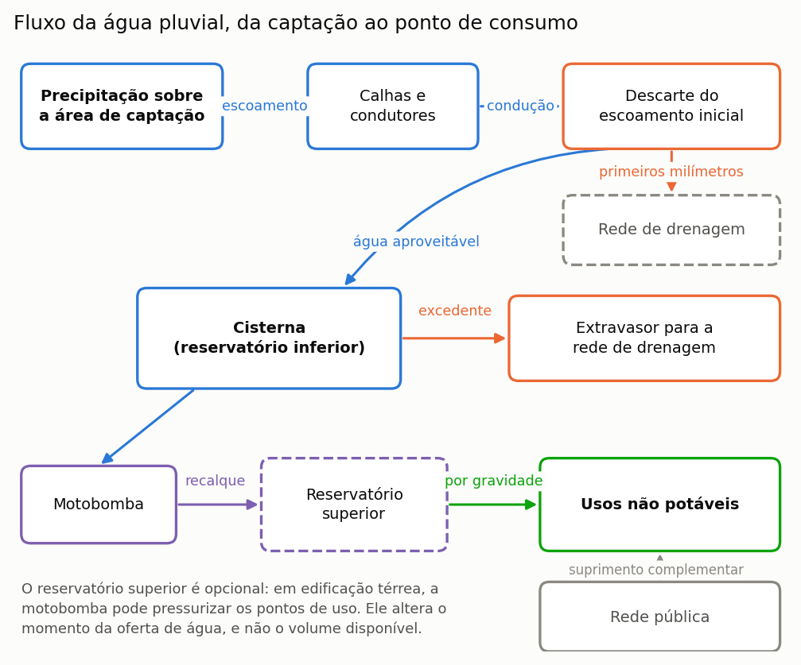
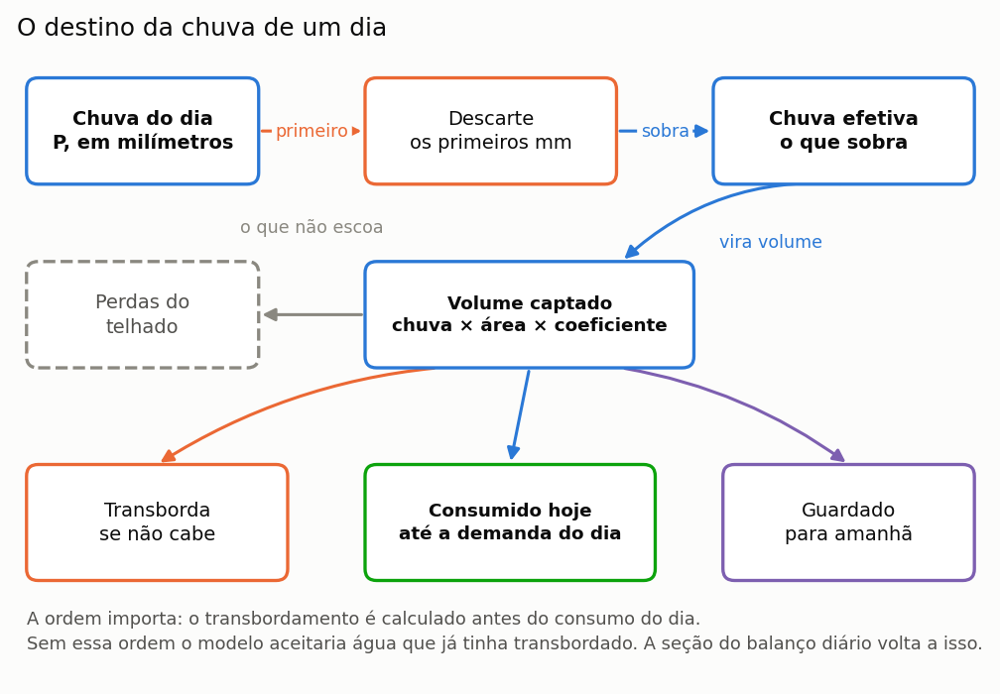
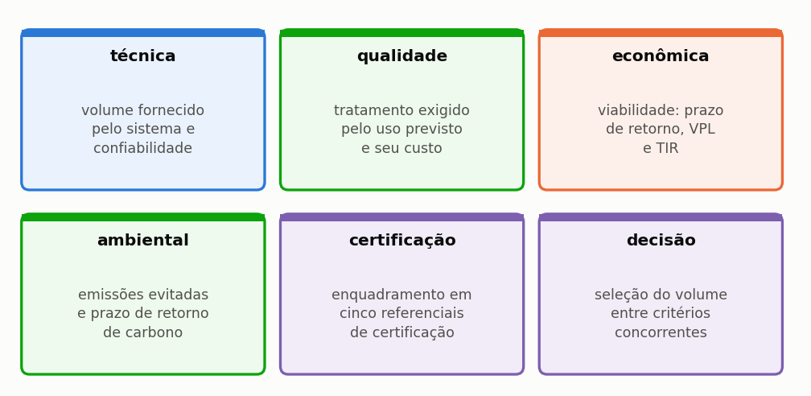
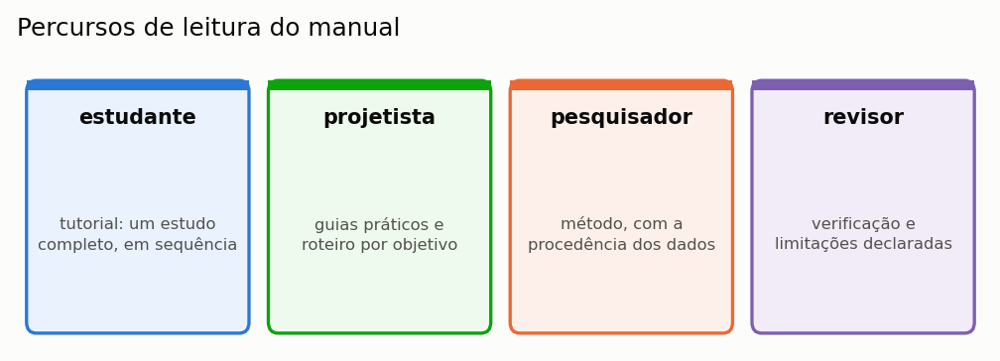
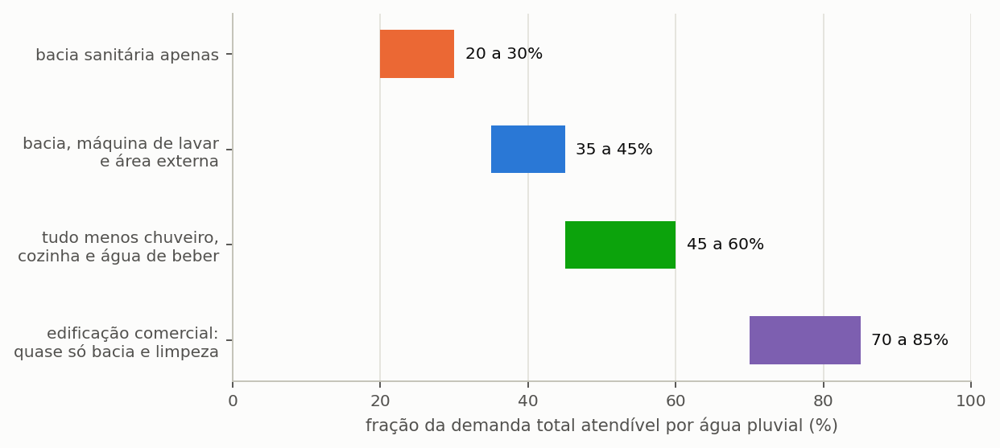

# Netuno 5

## Manual do Usuário — Comece aqui

Igor Catão Martins Vaz e Enedir Ghisi

Grupo de Pesquisa Gestão do Espaço Sustentável
Universidade Federal de Santa Catarina

Florianópolis, 2026

---

### Sobre este volume

Este é um dos sete volumes em que o manual do Netuno 5 pode ser distribuído, e
reúne o capítulo 1 (Comece aqui) e o apêndice G do manual completo. Serve para mandar
só a parte que interessa: o método a um revisor, o tutorial a uma turma, os guias
a quem já usa o programa.

A numeração das seções e das equações é a mesma do manual completo, de modo que
uma remissão vale nos dois. Quando o texto remete a uma seção que está em outro
volume, o nome do volume vem entre parênteses.

| Volume | Conteúdo |
| :--- | :--- |
| **Comece aqui** | o capítulo 1 (Comece aqui) e o apêndice G |
| O método | o capítulo 2 (O método) e os apêndices A, B, C, E, G e H |
| Guias de uso | o capítulo 3 (Guias disponíveis no programa) e os apêndices D, F e G |
| Tutorial | o capítulo 4 (Tutorial: um exemplo do começo ao fim) e os apêndices G, I e J |
| Enganos, limitações e confiabilidade | o capítulo 5 (Enganos, limitações e confiabilidade) e os apêndices G e H |
| Correções, bugs e versionamento | o capítulo 6 (Correções, bugs e versionamento) |
| Apêndices | os apêndices |

### Como citar

> VAZ, Igor Catão Martins; GHISI, Enedir. **Netuno 5: manual do usuário**.
> Comece aqui. Versão 5.0.0. Florianópolis: Universidade Federal de Santa
> Catarina, 2026.

---

## Sumário

**1 Comece aqui**

1.1 O que o Netuno faz, e o que ele não faz

1.2 Instalação e primeira execução

1.3 Por onde começar, conforme o seu objetivo

**Apêndices**

Apêndice G — Glossário

## Lista de figuras

Figura 1 — Componentes de um sistema predial de aproveitamento de água pluvial e percurso da água, da captação ao ponto de consumo

Figura 2 — O mesmo sistema visto em corte

Figura 3 — Destino da precipitação de um dia

Figura 4 — Sequência de operações do balanço diário, na ordem em que o programa as executa, na notação das equações da seção do balanço diário

Figura 5 — As seis dimensões de análise e a questão avaliada em cada uma

Figura 6 — Os quatro percursos de leitura do manual

Figura 7 — Que parte do consumo total a água de chuva pode atender, conforme os usos que o projeto prevê. É o teto do potencial de economia: nenhum reservatório, por maior que seja, ultrapassa essa fração

Figura 8 — As doze etapas do programa, agrupadas por natureza

---

## Lista de tabelas

Tabela 1 — Requisitos de sistema para instalar e executar o programa

Tabela 2 — Formatos de arquivo que o programa grava e o conteúdo de cada um

Tabela 3 — Arquivos de exemplo distribuídos com o programa

Tabela 4 — Percurso de leitura recomendado conforme o objetivo do leitor

Tabela 5 — Escolha entre volume fixo e varredura conforme a pergunta do estudo

Tabela 6 — Critérios hidráulicos para decidir sobre o reservatório superior

Tabela 7 — Padronização terminológica de água de chuva e água pluvial

Tabela 8 — Grandezas fundamentais do balanço hídrico e relações entre fração e potencial

---

---
# 1. Comece aqui

---

## 1.1. O que o Netuno faz, e o que ele não faz

O Netuno simula sistemas de aproveitamento de água pluvial em edificações. Dado o
regime de chuva de um lugar, a cobertura de um edifício e o consumo de quem o ocupa,
ele responde **quanto de água potável o sistema substitui**, e a que custo, com que
qualidade e com que impacto de carbono.

Esta seção começa do começo, e por isso as duas subseções iniciais tratam do próprio
objeto antes de tratarem do programa. Quem já projeta sistemas prediais de água as
achará elementares e pode ir direto às seis dimensões de análise, que é onde o Netuno
aparece; quem está chegando agora ao assunto encontrará ali o vocabulário que o
restante do manual usa sem explicar de novo.

---

### 1.1.1. O que é um sistema de aproveitamento de água pluvial

É um sistema que **coleta a chuva que cai no telhado e a usa no lugar da água da
rede**, nos usos que não precisam de água potável.

A ideia é velha e simples. O que ela tem de difícil é uma coisa só: a chuva não cai
quando você precisa dela. Por isso o sistema precisa de um reservatório, e por isso o
tamanho desse reservatório é a pergunta central de todo projeto — e deste manual. A Figura 1 apresenta os componentes do sistema e o percurso da água, da captação ao ponto de consumo.

*Figura 1 — Componentes de um sistema predial de aproveitamento de água pluvial e percurso da água, da captação ao ponto de consumo. O reservatório superior aparece tracejado porque é opcional: em edificação térrea, a motobomba pode pressurizar diretamente os pontos de uso, e o reservatório superior altera o momento da oferta de água, e não o volume disponível.*

Seguindo o desenho, da esquerda para a direita:

**A cobertura** é a área de captação. Vale a **projeção horizontal** do telhado, e não
a área inclinada, como define o item 3.6 da ABNT NBR 15527:2019 — é a sombra do telhado
no chão que recebe a chuva. Errar isso é o
primeiro dos dez enganos da seção 5.1 (volume Enganos, limitações e confiabilidade).

**As calhas e os condutores** levam a água até a cisterna. O programa não os
dimensiona; isso é projeto hidráulico, e segue a ABNT NBR 10844.

**O dispositivo de descarte da primeira chuva** desvia os primeiros milímetros de
cada evento, que carreiam a poeira, as folhas e os excrementos de aves acumulados
na cobertura. É a medida de controle de qualidade de menor custo, e a seção 4.6 (volume Tutorial)
mostra o quanto ela muda a água que chega ao reservatório.

**A cisterna**, ou reservatório inferior, armazena a água captada. Quando o volume
afluente excede a capacidade, o excedente **extravasa** para a rede de drenagem. Esse
extravasamento não é desperdício por descuido: é a consequência inevitável de guardar
um recurso que chega concentrado.

**A motobomba e o reservatório superior** distribuem a água. Em edificação térrea, a
motobomba pode pressurizar diretamente os pontos de uso. Em edificações de dois ou mais
pavimentos, adota-se usualmente reservatório elevado: a água é recalcada até ele e
distribuída por gravidade.

**Os usos não potáveis** são o destino: bacia sanitária e mictório, lavagem de piso e
de veículos, irrigação paisagística. Quando a água pluvial não é suficiente, a
**rede pública** supre o complemento, e o abastecimento não é interrompido.

O diagrama da Figura 1 mostra o encadeamento das peças, que é o que interessa para
acompanhar o cálculo. Falta a ele, porém, a informação que decide metade das
dúvidas de projeto: onde cada peça fica em relação às outras, e a que altura. O corte da Figura 2 repõe essa geometria, porque desnível é o que determina se a água
desce por gravidade ou precisa de bomba, e porque a posição da cisterna em
relação ao terreno é uma decisão de obra, não de cálculo.

*Figura 2 — O mesmo sistema visto em corte. A área de captação é a projeção horizontal da cobertura, e não a área inclinada do telhado. A caixa elevada recebe a água recalcada da cisterna e a devolve aos pontos de uso por gravidade; a rede pública a alimenta, com separação atmosférica, suprindo o volume que a água pluvial não atende. O extravasor da cisterna conduz o excedente à rede de drenagem.*

> **Vocabulário que o manual usa o tempo todo.** *Cisterna* e *reservatório inferior*
> designam o mesmo componente. *Extravasamento* é o volume excedente que o extravasor
> conduz à rede de drenagem. *Demanda pluvial* é a parte
> do consumo que a água de chuva pode atender; *demanda total* é o consumo inteiro da
> edificação. O apêndice G traz o glossário completo.

---

### 1.1.2. O que o programa calcula, em um dia

O programa faz uma conta de entrada e saída, todo dia, para cada dia da série de
chuva. A Figura 3 mostra como a precipitação de um dia se reparte, e a conta é esta:

*Figura 3 — Destino da precipitação de um dia. Cada caixa é uma parcela do balanço, e a soma do volume extravasado, do volume consumido e do volume armazenado é igual ao volume captado. O extravasamento é calculado antes do consumo do dia, conforme a regra YAS.*

Lendo o desenho:

1. **Desconta-se o descarte.** Com precipitação de 12 mm e descarte de 2 mm, restam 10 mm de precipitação efetiva.
2. **Converte-se em volume.** Dez milímetros sobre 100 m² de telhado, com coeficiente
   de escoamento de 0,85, dão 850 litros. A conta é `mm × m² × coeficiente`, e sai
   direto em litros, porque um milímetro sobre um metro quadrado é exatamente um
   litro.
3. **Soma-se ao volume armazenado na cisterna**, e o excedente à capacidade **extravasa**
   para a rede de drenagem.
4. **Retira-se o consumo do dia**, até o limite da demanda pluvial.
5. **O volume remanescente é transferido ao dia seguinte** — e é essa dependência entre
   dias consecutivos que torna necessária a simulação diária.

Os cinco passos formam um ciclo, e não uma lista: o volume remanescente ao fim do
quinto passo é exatamente o volume de que o terceiro passo parte no dia seguinte. Essa
ligação entre um dia e o outro é a única coisa que uma conta feita sobre a média anual
não consegue reproduzir, e é a razão de a simulação ser diária. A Figura 4 representa essa sequência na notação das equações do balanço diário.

*Figura 4 — Sequência de operações do balanço diário, na ordem em que o programa as executa, na notação das equações da seção do balanço diário. A ligação em roxo, que contorna o desenho, representa a dependência entre dias consecutivos: o volume remanescente V_res,t é o volume inicial do dia seguinte.*

> **Aprofundamento: por que não basta a média anual.** É tentador dividir a chuva
> anual por 365 e fazer a conta de uma vez. O resultado é sempre otimista, e às vezes
> muito. A razão é que a chuva chega **concentrada**: enche a cisterna num dia,
> extravasa, e depois falta por duas semanas. A média não representa nem o
> extravasamento nem o déficit, e ambos reduzem o aproveitamento. A seção 2.1 (volume O método)
> mostra isso acontecendo numa tabela de dez dias que você pode refazer na planilha,
> e a seção 4.4 (volume Tutorial) mostra o tamanho do erro.

Repetida ao longo de trinta anos de série, essa conta produz a resposta central do
programa: o **potencial de economia de água potável**, a fração do consumo total da
edificação que a chuva conseguiu substituir.

---

### 1.1.3. As seis dimensões

O volume de água fornecido é a primeira questão de um projeto, mas não a única. O
programa avalia o sistema em seis dimensões, que em geral conduzem a volumes ótimos distintos (Figura 5).

*Figura 5 — As seis dimensões de análise e a questão avaliada em cada uma. O programa as percorre nessa ordem, e cada uma é tratada numa seção própria do capítulo do método.*

Cada dimensão tem tratamento próprio no capítulo do método: a técnica nas seções 2.1 (volume O método) a 2.4 (volume O método), a qualidade na 2.5 (volume O método), a econômica na 2.7 (volume O método), a ambiental na 2.8 (volume O método), a certificação na 2.9 (volume O método) e a decisão na 2.10 (volume O método).

A sexta dimensão é a que distingue o programa de uma planilha de cálculo. As cinco
primeiras produzem resultados **divergentes**: o volume de maior economia de água
raramente é o de maior retorno financeiro, e nenhum dos dois costuma ser o de melhor
desempenho ambiental. A decisão multicritério torna explícitos os pesos atribuídos a
cada critério.

---

### 1.1.4. O que o programa **não** faz

Começar pelos limites é incomum, e é deliberado. Poupa o tempo de quem abriu o
programa esperando outra coisa.

**Não dimensiona a instalação hidráulica.** Não calcula traçado, diâmetro por trecho nem declividade da rede. O assistente de motobomba estima o diâmetro e a perda de carga do recalque para selecionar o equipamento, mas não substitui o projeto da instalação; o esquema exportado em DXF é um esquema, e o projeto executivo é do projetista.

**Não detalha o dispositivo de descarte.** O programa calcula o volume do reservatório de descarte, igual à área de captação vezes a lâmina, e o orça com o separador de folhas; o arranjo das conexões, a purga e a ligação à drenagem são projeto hidráulico à parte.

**Não substitui ensaio de qualidade de água.** Ele dimensiona equipamento de
tratamento a partir de premissas. As constantes do modelo de lavagem da cobertura não
são calibradas contra medição, e a qualidade resultante é premissa, não resultado.

**Não modela sub-passo horário.** Uma chuva de 40 mm em duas horas e a mesma lâmina
em vinte e quatro horas dão o mesmo resultado.

**Não faz inventário completo de ciclo de vida.** A avaliação é de **triagem**, numa
única categoria de impacto — carbono. Não há eutrofização, acidificação, uso do solo
nem toxicidade.

**Não certifica.** Ele mostra onde o projeto se enquadraria. A certificação é
decidida pelo organismo certificador, com a documentação completa do empreendimento.

**Não conhece o sítio.** Não sabe se o volume cabe no terreno, se há lençol freático
alto, nem se a estrutura suporta a caixa elevada.

A seção 5.2 (volume Enganos, limitações e confiabilidade) traz a lista completa de limitações conhecidas, com as consequências de
cada uma.

---

### 1.1.5. Para quem serve

O manual atende a quatro perfis de leitor, com percursos de leitura independentes entre si (Figura 6).

*Figura 6 — Os quatro percursos de leitura do manual. São independentes entre si, e o manual foi organizado para que cada um possa ser seguido isoladamente.*

Em números de seção: o estudante segue o capítulo 4, que é o tutorial do começo ao fim; o projetista usa os guias do capítulo 3 e o roteiro da seção 1.3; o pesquisador vai ao método do capítulo 2; e o revisor encontra no capítulo 5 a verificação e os limites declarados.

Quem está começando agora deve percorrer o capítulo 4 inteiro, na ordem em que
está escrito. Ele constrói um projeto do zero e o acompanha até a decisão final, e cada
seção encerra mostrando onde o projeto chegou, de modo que o leitor veja o estudo se
formando em vez de recebê-lo concluído.

---

### 1.1.6. O que mudou do Netuno 4

O Netuno 4 é o antecessor, publicado em 2014 pelo mesmo grupo. O Netuno 5 mantém o
modelo conceitual — balanço comportamental diário — e acrescenta seis dimensões de
análise que não existiam.

> **Aprofundamento: as duas diferenças deliberadas de método.** Quem comparar
> resultados das duas versões precisa declará-las.
>
> **O tratamento do descarte.** O Netuno 4 trata a lâmina como **limiar do evento**:
> abaixo dela nada é captado, acima dela capta-se a chuva inteira. O Netuno 5
> **subtrai** a lâmina, o que é fisicamente mais fiel.
>
> **O critério de volume ótimo.** As implementações e as grades de busca diferem.
>
> Juntas, as duas respondem por 91% da divergência medida entre os programas. Sobre
> 4.050 casos de referência, o Netuno 5 estima de 2,3 a 2,7 pontos percentuais menos
> economia. **Neutralizadas as duas, o motor reproduz o Netuno 4 com erro médio de
> 0,25 ponto percentual e 100% dos casos dentro de 5 pontos.** A seção 6.1 (volume Correções, bugs e versionamento) traz a
> decomposição completa.

---

### 1.1.7. Uma palavra sobre resultados

Todo número que o programa produz é **condicional às premissas declaradas**. Ele não
descobre verdades; ele calcula consequências.

Por isso o manual insiste tanto em declaração. A seção 4.10 (volume Tutorial) traz a lista do que
precisa constar num artigo, a seção 5.1 (volume Enganos, limitações e confiabilidade) traz os dez enganos que o programa não
impede, e a seção 5.2 (volume Enganos, limitações e confiabilidade) traz o que ele não cobre.

Um estudo que declara suas premissas e seus limites é mais útil — e mais defensável —
que um que apresenta um número sozinho.

---

## 1.2. Instalação e primeira execução

> Ao terminar esta seção você terá o programa instalado, aberto, e uma simulação
> concluída com um resultado que dá para conferir contra este manual.

---

### 1.2.1. O que você precisa

<!-- tabela: **Tabela 1** — Requisitos de sistema para instalar e executar o programa -->
| Requisito | O que é preciso |
| :--- | :--- |
| sistema | Windows 10 ou 11, 64 bits |
| espaço em disco | cerca de 600 MB para o programa |
| memória | 4 GB bastam; 8 GB deixam a varredura mais confortável |
| privilégios | de administrador para instalar para todos os usuários; sem eles, a instalação vai para a pasta do usuário |
| base climática, opcional | mais cerca de 6,5 GB |

Nada além disso precisa ser instalado. O programa é distribuído já montado, com todos os
componentes de que depende para calcular, e não requer instalação prévia de
interpretadores, bibliotecas ou pacotes auxiliares. Também não requer conexão com a
internet para funcionar: tudo o que ele consulta durante uma simulação está no próprio
computador.

---

### 1.2.2. A instalação

1. Execute **`Netuno_Setup_5_0_0.exe`**. O instalador pergunta se a instalação é para
   todos os usuários, o que exige administrador, ou só para você.
2. Escolha o idioma da instalação e aceite a licença, a GPL versão 3.
3. Escolha o tipo de instalação. A **padrão** traz o programa, o manual, os casos e os
   exemplos, em português e inglês. A **completa** acrescenta os pacotes de idioma
   espanhol e chinês e a base climática nacional, se ela estiver disponível (veja
   adiante). A **personalizada** permite marcar cada um.
4. Aceite a pasta sugerida, `C:\Program Files\Netuno 5`, ou escolha outra.
5. Marque, se quiser, **criar ícone na área de trabalho**. A opção **abrir arquivos
   .netuno com o Netuno 5** vem marcada: com ela, um duplo clique num projeto o abre
   diretamente no programa.
6. Ao terminar, o instalador oferece abrir o programa.

Depois disso, o menu Iniciar traz dois atalhos: **Netuno 5**, o programa, e **Manual do
Netuno 5**, este documento em PDF. Para desinstalar, use *Aplicativos e recursos* do
Windows, como em qualquer programa; os seus projetos ficam onde foram salvos.

> **O que o instalador coloca no computador.** O programa, as quatro séries
> históricas de chuva que acompanham a instalação, a base de tarifas dos 652
> municípios e os arquivos de exemplo. Nada é baixado durante o uso: o Netuno
> funciona sem conexão com a internet.

---

### 1.2.3. Onde ficam os seus arquivos

O programa nunca decide por você onde salvar. Cada vez que você grava um projeto, um
relatório ou uma exportação, ele pergunta a pasta.

<!-- tabela: **Tabela 2** — Formatos de arquivo que o programa grava e o conteúdo de cada um -->
| O que você grava | Extensão | Contém |
| :--- | :--- | :--- |
| projeto | `.netuno` | todos os dados de entrada **e a série de chuva** |
| relatório | `.pdf` | o documento completo do estudo |
| resultados | `.xlsx`, `.csv` | as tabelas, para planilha |
| esquema | `.dxf` | o desenho esquemático, para CAD |

Entre esses formatos, o `.netuno` é o que realmente importa guardar. Ele é autocontido:
leva a série de chuva inteira dentro de si, e por isso abre em qualquer outro computador
mesmo na ausência dos arquivos que lhe deram origem. ==É também o arquivo que se anexa a
um artigo para que outra pessoa reproduza o estudo,== e essa propriedade é o que separa
um trabalho verificável de um trabalho apenas relatado.

---

### 1.2.4. A base climática

O programa traz quatro séries históricas longas prontas para uso — Florianópolis,
Brasília, Manaus e São Paulo — e aceita qualquer série própria em CSV.

Existe além disso uma **base climática nacional**, com 652 cidades, 19 modelos
climáticos do CMIP6 e 2 cenários futuros, SSP2-4.5 e SSP5-8.5, extraída do conjunto CLIMBra. São cerca de 6,5 GB, distribuídos à parte
justamente por causa do tamanho. Instalada, ela aparece na primeira tela como uma
lista de cidades; ausente, a tela oferece apenas o carregamento de arquivo próprio, e
todo o resto do programa funciona igual.

Há duas maneiras de instalá-la. A mais simples é pelo próprio instalador: copie a pasta
`Netuno future files for 652 cities` para o mesmo diretório do `Netuno_Setup_5_0_0.exe`
e escolha a instalação completa, ou marque o componente da base na personalizada; o
instalador a copia para a pasta do programa. A outra é copiá-la à mão para a pasta do
programa, ao lado do `Netuno.exe`, ou para qualquer lugar do disco, indicando o caminho
na variável de ambiente `NETUNO_CLIMATE_DATA_DIR`.

O apêndice E (volume Apêndices) descreve a base, e a seção 3.2 (volume Guias de uso) mostra como usar um cenário futuro.

---

### 1.2.5. Os arquivos de exemplo

O manual vem acompanhado de projetos prontos, que reproduzem os resultados impressos
aqui.

<!-- tabela: **Tabela 3** — Arquivos de exemplo distribuídos com o programa -->
| Arquivo | Para que serve |
| :--- | :--- |
| `casos\01_tutorial_florianopolis.netuno` | o projeto que o capítulo 4 constrói, pronto |
| `casos\03_dez_dias.netuno` | o caso didático de dez dias da seção 2.1 (volume O método) |
| `casos\05_manaus.netuno` e os seguintes | o mesmo projeto em outras capitais |
| `exemplos\*.netuno` | três estudos completos: residência, escritório e escola |

Eles ficam na pasta do programa. O apêndice J (volume Apêndices) lista os nove casos do manual, com o
capítulo de cada um e o resultado que produzem.

Convém começar pelo caso de dez dias. Abra-o, execute a simulação e compare o resultado
com a tabela impressa na seção 2.1 (volume O método). A coincidência entre os dois confirma que a
instalação corresponde exatamente a este manual; a divergência indica que manual e
programa são de versões diferentes, e a seção 6.3 (volume Correções, bugs e versionamento) explica como proceder nesse caso.

---

### 1.2.6. A primeira simulação, em cinco minutos

O programa é organizado em **etapas**, na barra lateral esquerda, na ordem em que se
trabalha. Para a primeira simulação bastam quatro delas.

1. **Projeto e Chuva.** Escolha a cidade na base climática, ou carregue o arquivo
   `Florianopolis1.csv` que acompanha o programa. Informe a área de captação de
   150 m², o coeficiente de escoamento de 0,85 e o descarte de 2,0 mm.
2. **Edificação e Consumo.** Escolha residencial unifamiliar, 4 moradores, 150 litros
   por habitante e dia, e fração atendível de 28%.
3. **Reservatório & Custos.** Informe volume fixo de 4.000 L.
4. Rode, e vá a **Resultados Técnicos**.

Você deve obter potencial de economia próximo de **27%**.

A seção 4.3 (volume Tutorial) explica o que esse número significa, e a seção 4.4 (volume Tutorial) faz a pergunta
seguinte: 4.000 L é o volume certo?

---

### 1.2.7. Se alguma coisa der errado

**O programa não abre.** Verifique se a instalação terminou sem erro e reinstale por
cima; a reinstalação preserva os seus arquivos, porque eles não ficam na pasta do
programa.

**A lista de cidades está vazia.** A base climática nacional não está instalada. Use
um arquivo de chuva próprio, ou instale a base — o apêndice E (volume Apêndices) diz como.

**O resultado não bate com o manual.** Confira, nesta ordem: a série de chuva
carregada, a área, o coeficiente, a lâmina de descarte, a demanda e a fração
atendível. Uma divergência de resultado quase sempre é uma divergência de entrada, e a seção 5.1 (volume Enganos, limitações e confiabilidade) lista os enganos mais comuns.

**Uma mensagem de erro apareceu.** A seção 6.2 (volume Correções, bugs e versionamento) traz as mensagens do programa, o que
cada uma significa e o que fazer.

---

## 1.3. Por onde começar, conforme o seu objetivo

Este manual reúne quarenta e nove seções distribuídas em sete capítulos, e não foi
concebido para ser lido do começo ao fim. Ele funciona melhor como obra de consulta, em
que cada leitor entra pelo ponto que corresponde ao que precisa fazer, e esta seção
existe justamente para indicar esse ponto de entrada.

---

### 1.3.1. Roteiro por objetivo

A tabela abaixo relaciona os cinco propósitos mais comuns de quem abre o programa, com o
percurso de leitura correspondente a cada um deles.

<!-- tabela: **Tabela 4** — Percurso de leitura recomendado conforme o objetivo do leitor -->
| Você quer | Leia |
| :--- | :--- |
| **aprender a usar** o programa | o capítulo 4 inteiro, seções 4.1 (volume Tutorial) a 4.10 (volume Tutorial), na ordem |
| **resolver um caso** hoje | as três perguntas abaixo, e depois o guia do capítulo 3 que couber |
| **publicar** um estudo | o capítulo 2, que traz o método, e a seção 4.10 (volume Tutorial), com a lista de declaração |
| **revisar** um estudo alheio | o capítulo 5, e os apêndices A (volume Apêndices) e B (volume Apêndices) |
| **migrar** do Netuno 4 | as seções 3.8 (volume Guias de uso) e 6.1 (volume Correções, bugs e versionamento) |
| **não errar** | a seção 5.1 (volume Enganos, limitações e confiabilidade), com os dez enganos mais comuns |

Quem dispõe de uma hora e nenhuma familiaridade prévia deve ler o tutorial do capítulo
4. Ele constrói um estudo completo em torno de um único projeto, e cada seção
encerra mostrando onde esse projeto chegou, de modo que o leitor acompanha a construção
em vez de receber o resultado pronto.

---

### 1.3.2. As três perguntas que definem um estudo

Antes mesmo de abrir o programa, convém responder a três perguntas, porque elas
determinam boa parte das decisões subsequentes e porque respondê-las depois costuma
implicar refazer trabalho.

#### 1.3.2.1. Que usos a água pluvial vai atender?

A resposta define a **fração atendível**, e a fração atendível é o teto de todo o resto:
um sistema cuja fração é de 28% jamais economizará mais que 28% do consumo total, por
maior que seja a cisterna e por mais que chova. Nenhuma decisão posterior de projeto
altera esse limite, razão pela qual ele merece ser estabelecido antes de qualquer outra coisa. A Figura 7 reúne as faixas usuais da fração atendível conforme os usos previstos.

*Figura 7 — Que parte do consumo total a água de chuva pode atender, conforme os usos que o projeto prevê. É o teto do potencial de economia: nenhum reservatório, por maior que seja, ultrapassa essa fração.*

Os casos residenciais são tratados na seção 4.2 (volume Tutorial), e o caso comercial na seção 3.5 (volume Guias de uso). A linha tracejada marca os 28% do tutorial, que ficam nos usos que o item 4.1.7 da ABNT NBR 15527:2019 admite.

#### 1.3.2.2. Vai comparar volumes ou avaliar um só?

A distinção entre avaliar um volume conhecido e procurar o volume adequado determina o
modo de simulação e, com ele, o tempo de máquina e a riqueza do resultado.

<!-- tabela: **Tabela 5** — Escolha entre volume fixo e varredura conforme a pergunta do estudo -->
| Se você quer | Use | Onde se trata |
| :--- | :--- | :--- |
| avaliar uma cisterna que já existe | volume fixo | seção 4.3 (volume Tutorial) |
| descobrir o volume a comprar | **varredura** | seções 4.4 (volume Tutorial) e 2.2 (volume O método) |
| escolher entre critérios que discordam | varredura e multicritério | seções 4.9 (volume Tutorial) e 2.10 (volume O método) |

==A varredura é quase sempre a resposta certa.== Ela custa mais tempo de máquina, na
ordem de segundos, e produz a curva de retorno decrescente, que é o argumento mais forte
de que qualquer estudo pode dispor ao justificar um volume.

#### 1.3.2.3. Precisa de reservatório superior?

A terceira pergunta é hidráulica, e a resposta depende da altura da edificação e da
pressão exigida nos pontos de consumo.

<!-- tabela: **Tabela 6** — Critérios hidráulicos para decidir sobre o reservatório superior -->
| Se a edificação | Então | Onde se trata |
| :--- | :--- | :--- |
| é térrea e os pontos ficam próximos da cisterna | pressurização direta, sem caixa | seção 4.5 (volume Tutorial) |
| é sobrado ou prédio | caixa elevada, por **pressão** | seção 4.5 (volume Tutorial) |
| precisa de reserva contra falta de energia | caixa elevada | seção 4.5 (volume Tutorial) |

> A caixa elevada **não aumenta** a economia de água. Mantido o mesmo armazenamento
> total, ela entrega ligeiramente menos e consome energia de recalque. A decisão de
> adotá-la deve ser hidráulica, e nunca fundada na expectativa de maior aproveitamento.

---

### 1.3.3. A ordem de trabalho no programa

A barra lateral do programa está numerada, e a numeração corresponde à ordem em que se
trabalha. As quatro primeiras etapas são de entrada de dados, as quatro seguintes apresentam resultados, e as quatro últimas produzem saídas ou dão apoio ao estudo (Figura 8).

*Figura 8 — As doze etapas do programa, agrupadas por natureza. As quatro primeiras são de entrada e precisam ser preenchidas em ordem, porque cada uma consome o que a anterior definiu; as quatro seguintes são leitura de resultados; as últimas quatro produzem saídas ou dão apoio, e podem ser acionadas a qualquer momento.*

Onde este manual trata cada uma: a etapa 1 na seção 4.1 (volume Tutorial), a 2 na 4.2 (volume Tutorial), a 3 na 4.6 (volume Tutorial), a 4 nas seções 4.3 (volume Tutorial), 4.4 (volume Tutorial) e 4.7 (volume Tutorial), a 5 na 4.3 (volume Tutorial), a 6 na 4.7 (volume Tutorial), a 7 na 4.8 (volume Tutorial), a 8 na 4.9 (volume Tutorial), a 9 na 4.10 (volume Tutorial), a 10 na 3.9 (volume Guias de uso) e a 12 na 3.3 (volume Guias de uso). A etapa 11 é a própria documentação embutida no programa, e não tem seção correspondente aqui.

Convém salvar o projeto ao concluir cada etapa. Os 104 parâmetros são gravados e
relidos integralmente, e o arquivo resultante é a evidência documental do estudo, tanto
para quem o refará no futuro quanto para quem o avaliará.

---

### 1.3.4. Antes de publicar

Três leituras são obrigatórias para quem pretende publicar resultados, e nenhuma delas é
longa. A seção 4.10 (volume Tutorial) traz a lista do que declarar num artigo, acompanhada de um
parágrafo de método pronto para adaptação. A seção 5.1 (volume Enganos, limitações e confiabilidade) reúne os dez enganos de
projeto que o programa não tem como impedir. E a seção 5.2 (volume Enganos, limitações e confiabilidade) relaciona as limitações
conhecidas — das quais interessa ler não todas, mas as que afetam o caso em mãos.

O apêndice I (volume Apêndices) condensa as três em fichas de uma página, para consulta rápida.

---

# Apêndices

---

## Apêndice G — Glossário

Termos técnicos e siglas, com o equivalente em inglês quando ele é usado na
literatura, acompanhados das diretrizes de padronização terminológica do Netuno 5.

---

**AAC** (*aproveitamento de água de chuva*). Emprego de água precipitada sobre coberturas
para usos não potáveis em edificações, regulamentado no Brasil pela ABNT NBR 15527:2019.
Deve-se preferir o termo «aproveitamento» a «reúso», uma vez que a água de chuva captada
na cobertura é um recurso primário e não um efluente gerado por uso antrópico anterior.

**ABNT**. Associação Brasileira de Normas Técnicas, o organismo que publica as normas
brasileiras. Uma norma é identificada pela sigla NBR seguida do número e do ano da
edição, como em ABNT NBR 15527:2019.

**ACV** (*life cycle assessment*). Avaliação de ciclo de vida. Método que contabiliza os
impactos ambientais de um produto ao longo de toda a sua existência, da extração das
matérias-primas ao descarte. A do programa é de **triagem**, e não um inventário completo
conforme a ISO 14040.

**Água de chuva** (*rainwater*). Precipitação atmosférica coletada diretamente em
superfícies impermeáveis de cobertura (telhados e lajes impermeabilizadas), antes de atingir
o solo ou galerias públicas. É o termo técnico-normativo oficial consagrado pela ABNT NBR
15527:2019. Deve-se utilizar rigorosamente «água de chuva» para designar o recurso natural
e a fonte hídrica captada, evitando a forma coloquial «água da chuva».

**Água não potável** (*non-potable water*). Água que não se destina ao consumo humano direto,
mas atende aos padrões de qualidade física, química e microbiológica estabelecidos por
normas específicas (como a Tabela 1 da ABNT NBR 15527:2019 e a ABNT NBR 16783:2019) para
usos admitidos: descargas em bacias sanitárias e mictórios, lavagem de veículos, calçadas e
pisos, irrigação paisagística, lavagem de roupas e torres de resfriamento.

**Água pluvial** (*stormwater*, *pluvial water*). Água de chuva que escoa superficialmente
por superfícies urbanas ou é conduzida por canalizações e sistemas prediais de drenagem
(ABNT NBR 10844). No Netuno, o termo aplica-se preferencialmente à infraestrutura predial
e aos componentes de engenharia: *sistema de aproveitamento de água pluvial (SAAP)*, *rede
pluvial*, *demanda pluvial*, *consumo de água pluvial* e *extravasamento pluvial*.

**Água potável** (*potable water*, *drinking water*). Água que atende integralmente aos
padrões de potabilidade definidos pela Portaria GM/MS nº 888/2021 do Ministério da Saúde,
destinada à ingestão direta, preparação de alimentos e higiene pessoal.

**AQUA-HQE**. Referencial de certificação ambiental de edificações, adaptação brasileira
do francês HQE conduzida pela Fundação Vanzolini. No referencial residencial de 2024, a
água é tratada no tema «Consumo de água», em itens classificados nos níveis PR, HQE,
HQE 2 e HQE 3.

**Área de captação** (*catchment area*). Área projetada na **horizontal** da superfície
impermeável da cobertura onde a água é captada, conforme o item 3.6 da NBR 15527:2019.
Não é a área inclinada do telhado, nem a área de contribuição da NBR 10844, que serve
ao dimensionamento de calhas.

**Bandeira tarifária**. Acréscimo ou desconto sobre a tarifa de energia elétrica,
conforme as condições de geração. Verde, amarela, vermelha 1, vermelha 2, e a
modalidade branca.

**BD+C** (*Building Design and Construction*). Família de referenciais do LEED
para projeto e construção de edificações novas ou em grande reforma. É a família
tratada neste manual, nas versões 4, 4.1 e 5.

**BIM** (*building information modeling*). Modelagem da informação da construção.
Representação digital da edificação em que cada componente carrega propriedades além da
geometria, o que permite compatibilizar projetos de disciplinas diferentes.

**CAD** (*computer-aided design*). Desenho assistido por computador. O programa exporta o
esquema hidráulico em DXF, formato de intercâmbio aceito pelos programas de CAD.

**CAPEX** (*capital expenditure*). Investimento inicial.

**CASAN**. Companhia Catarinense de Águas e Saneamento, a concessionária de água e esgoto
de Florianópolis e de boa parte de Santa Catarina. A estrutura tarifária dela é a adotada
no tutorial deste manual.

**CDD** (*consecutive dry days*). Maior sequência de dias consecutivos com chuva
abaixo de 1 mm.

**CMIP6**. Sexta fase do *Coupled Model Intercomparison Project*, o exercício
internacional coordenado que produz as projeções climáticas usadas pelos relatórios do
IPCC. A base climática do programa deriva dele.

**Coeficiente de escoamento** (*runoff coefficient*). Fração da chuva que
efetivamente chega ao reservatório, descontadas perdas por absorção, evaporação e
molhamento inicial da cobertura.

**Comprimento representativo de série de precipitação** (*representative rainfall time series length*, $N_{rep}$).
Menor período contínuo em anos de dados diários de chuva necessário para estabilizar
estatisticamente o dimensionamento e o desempenho do sistema (reproduzindo o volume ideal
e o potencial de economia da série completa sob confiança $\ge 90\%$), segundo a
metodologia de Geraldi e Ghisi (2017, 2018, 2019). O comprimento necessário não é uma
constante geográfica fixa: cresce com a fração atendível e com o nível de demanda da edificação.

**Confiabilidade temporal** ($C_t$). Percentual de dias em que o sistema atendeu
plenamente ($V_{con,t} = D_{pl,t}$), parcialmente ou não atendeu a demanda pluvial.

**Confiabilidade volumétrica** ($C_v$). Fração da demanda **pluvial** que o sistema atendeu
($C_v = \sum V_{con} / \sum D_{pl} = E_{pot} / f$). Não confundir com o potencial de economia,
que tem no denominador a demanda total da edificação.

**CSV** (*comma-separated values*). Formato de arquivo de texto em que cada linha é um
registro e as colunas são separadas por um caractere, tipicamente vírgula ou ponto e
vírgula. É o formato das séries de precipitação.

**CV**. Cavalo-vapor, unidade de potência equivalente a 0,7355 kW, corrente no comércio
de motobombas no Brasil. Uma motobomba de meio CV tem 0,37 kW de potência de eixo.

**CWD** (*consecutive wet days*). Maior sequência de dias consecutivos com chuva
igual ou superior a 1 mm.

**Demanda estocástica** (*stochastic water demand*). Modelagem do consumo diário de água como
variável probabilística que varia dia a dia e entre realizações (Silva e Ghisi, 2016),
permitindo avaliar a faixa de incerteza do dimensionamento e dos indicadores de desempenho
sob variabilidade real de uso.

**Demanda pluvial** (*pluvial demand*, $D_{pl}$). Parcela da demanda diária de água da
edificação que pode ser suprida pelo sistema de aproveitamento ($D_{pl,t} = D_{tot,t} \times f$).
Corresponde aos pontos de consumo não potável interligados à rede pluvial.

**Descarte de primeiras águas** (*first flush*). Lâmina inicial de chuva desviada do
sistema, que carrega a sujeira depositada na cobertura (mínimo de 2 mm conforme a NBR
15527:2019). No Netuno 5 é **subtraída** da chuva do dia; no Netuno 4 era tratada como
limiar do evento.

**Disponibilidade**. Regime tarifário em que um valor fixo **soma** por cima do
consumo medido. Cada metro cúbico economizado desconta.

**DN** (*diâmetro nominal*). Designação comercial do diâmetro de um tubo ou conexão, em
milímetros. Não corresponde exatamente ao diâmetro interno nem ao externo: é um número de
referência do qual decorrem as dimensões reais, tabeladas por norma.

**DXF** (*drawing exchange format*). Formato de intercâmbio de desenhos técnicos, lido
por praticamente todos os programas de CAD.

**EAU**. Prefixo dos itens do tema «Consumo de água» no referencial AQUA-HQE, do francês
*eau*, água. Os itens ligados ao aproveitamento pluvial são o EAU.1.2, o EAU.1.3 e o
EAU.1.5.

**EDGE** (*excellence in design for greater efficiencies*). Referencial de certificação
da International Finance Corporation, do Banco Mundial. Mede economia percentual contra
um caso-base local em três dimensões independentes e exige que cada uma cruze o limiar.

**EN** (*Europäische Norm*, norma europeia). Norma publicada pelo Comitê Europeu de
Normalização. Neste manual, a EN 15978, que define os módulos do ciclo de vida da
edificação, e a EN 15804, que rege as declarações ambientais de produtos de construção.

**EPD** (*Environmental Product Declaration*). Declaração ambiental de produto: documento
verificado por terceiros, conforme a ISO 14025 e, na construção, a EN 15804, que publica
os impactos do ciclo de vida de um produto por unidade declarada. É a fonte preferida para
fatores de emissão de materiais e equipamentos.

**ESG** (*environmental, social and governance*). Conjunto de critérios ambientais,
sociais e de governança usado na avaliação de empresas e de empreendimentos. O programa
alimenta indicadores ambientais desse conjunto.

**ETAP**. Estação de tratamento de água pluvial. No programa, o conjunto de filtro
de entrada, desinfecção e filtro de polimento.

**ETCCDI** (*Expert Team on Climate Change Detection and Indices*). Grupo de trabalho
internacional que padronizou os índices de extremos climáticos, dos quais o programa
calcula oito.

**Extravasamento** (*spillage*, *overflow*). Volume que excede a capacidade do reservatório
e é conduzido pelo extravasor quando ele já está cheio.

**Fração atendível por água pluvial** (*non-potable demand share*, $f$). Percentual da demanda
total de água da edificação ($D_{tot}$) passível de suprimento por água de chuva ($f = D_{pl} / D_{tot}$).
Representa o **teto assintótico intransponível** do potencial de economia de água potável
($E_{pot} \le f$): mesmo sob capacidade infinita de armazenamento e precipitação ilimitada,
a economia de potável nunca ultrapassa a fração atendível, pois o restante ($1 - f$) é
reservado aos usos nobres e potáveis. Distingue-se da confiabilidade volumétrica ($C_v = E_{pot} / f$),
que avalia o atendimento da parcela pluvial.

**Franquia no mínimo**. Regime tarifário em que o valor fixo já inclui um volume de
consumo. Economizar **abaixo** da franquia não reduz a fatura.

**Ganho marginal**. Variação do potencial de economia por metro cúbico acrescentado
ao reservatório, em %/m³ ($\Delta E_{pot} / \Delta V$). Critério de escolha do volume ideal.

**GRI** (*Global Reporting Initiative*). Padrão internacional de divulgação corporativa
de desempenho socioambiental. Sua série 303 trata de água e efluentes.

**HQE** (*Haute Qualité Environnementale*). Referencial francês de alta qualidade
ambiental, base do AQUA-HQE. Designa também os níveis dos itens do referencial: HQE,
HQE 2 e HQE 3, em ordem crescente de exigência, acima do pré-requisito (PR).

**IFC**. A sigla designa duas coisas distintas. Em certificação, é a *International
Finance Corporation*, do Banco Mundial, que desenvolve o EDGE. No contexto BIM, é o
*Industry Foundation Classes*, formato aberto de intercâmbio que o programa **não**
exporta: a exportação BIM do programa é um arquivo JSON de propriedades.

**IPCC** (*Intergovernmental Panel on Climate Change*). Painel intergovernamental que
sintetiza o conhecimento científico sobre mudança do clima e organiza os relatórios de
avaliação a que as projeções climáticas se referem.

**IPTU verde**. Desconto no imposto predial concedido por alguns municípios a edificações
que adotam medidas de sustentabilidade, entre elas o aproveitamento de água pluvial. O
percentual e as condições variam por legislação municipal.

**ISO 14040**. Norma internacional que estabelece os princípios e a estrutura da
avaliação de ciclo de vida. Um inventário conforme a ISO 14040 exige rastreabilidade de
cada fluxo e revisão crítica externa, requisitos que uma avaliação de triagem não cumpre.

**JSON** (*JavaScript object notation*). Formato de arquivo de texto estruturado, legível
por pessoas e por programas. É o formato interno do arquivo `.netuno`.

**LCOW** (*levelized cost of water*). Custo nivelado da água: razão entre o valor presente
de todos os custos do ciclo de vida do sistema (CAPEX, substituições, O&M, energia e
produtos químicos) e o volume descontado de água pluvial consumida ao longo do horizonte
de análise, em R$/m³. Permite confrontar a viabilidade econômica do sistema diretamente
com a tarifa da concessionária.

**LEED** (*leadership in energy and environmental design*). Referencial de certificação
ambiental de edificações do *U.S. Green Building Council*, o mais difundido
internacionalmente. Trata eficiência hídrica na categoria *Water Efficiency*: na versão 4,
pelos créditos WEc1 e WEc2; na versão 5, pelo crédito WEc2, *Enhanced Water Efficiency*.

**m.c.a.** Metro de coluna d'água, unidade de pressão equivalente à exercida por uma
coluna de água de um metro de altura, cerca de 9,81 kPa. É a unidade usual em instalações
prediais.

**Micromedição**. Medição individualizada por unidade habitacional em edifício
multifamiliar. Informada ao programa como número de economias.

**NBR**. Norma Brasileira, publicada pela ABNT. As mais citadas neste manual são a NBR
15527, de aproveitamento de água de chuva, a NBR 10844, de instalações prediais de águas
pluviais, a NBR 5626, de sistemas prediais de água fria e quente, e a NBR 17094-2, de
motores de indução.

**Payback de carbono**. Tempo para a economia anual líquida de emissões pagar o
carbono incorporado na fabricação do sistema.

**Payback descontado**. Tempo para o fluxo de caixa descontado acumulado cruzar zero.

**PEAD**. Polietileno de alta densidade, material dos reservatórios plásticos mais
comuns no mercado brasileiro.

**Piso de pagamento**. Regime tarifário em que a fatura **não fica** abaixo de um
valor. Diferente de disponibilidade: o piso limita por baixo, a disponibilidade soma
por cima.

**Potencial de economia de água potável** (*potable water saving potential*, $E_{pot}$).
Fração da demanda **total** da edificação suprida por água pluvial ($E_{pot} = \sum V_{con} / \sum D_{tot} \times 100\%$).
É o indicador central do programa, limitado superiormente pela fração atendível ($E_{pot} \le f$).

**pp**. Pontos percentuais. Usado para exprimir a diferença entre dois percentuais: de
35% para 37% vão dois pontos percentuais, e não dois por cento.

**PR**. Pré-requisito: no AQUA-HQE, o nível de item de atendimento obrigatório, abaixo
dos níveis HQE, HQE 2 e HQE 3.

**PRCPTOT**. Precipitação total anual em dias úmidos.

**PRFV**. Plástico reforçado com fibra de vidro, material de reservatórios de médio e
grande porte. Aparece no programa sob a designação «fibra».

**PVC**. Policloreto de vinila, material das tubulações prediais de água fria e das
colunas de desvio do descarte inicial. As dimensões dos tubos soldáveis seguem a ABNT NBR 5648.

**R95p**. Soma da precipitação dos dias acima do percentil 95 dos dias úmidos.

**Rendimento da bomba**. Razão entre a potência hidráulica entregue à água e a
potência mecânica no eixo. Não inclui o motor.

**Rendimento do motor**. Razão entre a potência mecânica no eixo e a potência
elétrica consumida da rede. A ABNT NBR 17094-2 manda marcá-lo na placa.

**RX1day**, **RX5day**. Maior precipitação em um e em cinco dias consecutivos, no
ano.

**SAAP**. Sistema de aproveitamento de água pluvial. Conjunto integrado de componentes
prediais — área de captação, condutores, descarte inicial (first flush), estação de
tratamento (ETAP), cisterna inferior, reservatório superior, grupo motobomba ou pressurizador
e rede de distribuição independente — concebido para coletar, tratar, armazenar e fornecer
água não potável em conformidade com a ABNT NBR 15527 e a ABNT NBR 5626.

**SDII** (*simple daily intensity index*). Precipitação média dos dias úmidos.

**SI** (*seasonality index*). Índice de sazonalidade de Walsh e Lawler. Zero quando a
chuva é uniforme ao longo do ano.

**SMAA** (*stochastic multicriteria acceptability analysis*). Método que sorteia
pesos e devolve a probabilidade de cada alternativa vencer.

**SNIS**. Sistema Nacional de Informações sobre Saneamento, base oficial brasileira de
indicadores do setor, mantida pelo governo federal. É a origem dos indicadores de
consumo energético do saneamento usados na avaliação ambiental.

**SSP** (*shared socioeconomic pathways*). Trajetórias socioeconômicas compartilhadas,
que descrevem hipóteses coerentes de desenvolvimento global e as emissões correspondentes.
Combinam-se com os modelos climáticos para produzir projeções.

**TFDI**. Tarifa fixa de disponibilidade da infraestrutura, nome que algumas
concessionárias dão à parcela da fatura cobrada independentemente do consumo. Ver
*Disponibilidade*.

**TIR**. Taxa interna de retorno. A taxa de desconto que zera o valor presente
líquido.

**TMA**. Taxa mínima de atratividade. A taxa de desconto adotada.

**TOPSIS** (*technique for order of preference by similarity to ideal solution*).
Método de ordenação multicritério de Hwang e Yoon.

**UV**. Radiação ultravioleta, empregada na desinfecção de água por inativação de
microrganismos. Atua apenas no instante da passagem pelo reator e não deixa residual, ao
contrário da cloração.

**VIKOR**. Método de decisão multicritério proposto por Opricovic, que busca uma solução
de compromisso entre critérios conflitantes. Ver também *SMAA*.

**Volume ideal** (*optimal tank volume*). Menor volume de reservatório da grade de simulação
a partir do qual o ganho marginal de economia de água potável ($\Delta E_{pot} / \Delta V$)
cai abaixo de um limiar declarado (tipicamente $1,0\%/\text{m}^3$ ou $0,5\%/\text{m}^3$).
Evita o superdimensionamento de reservatórios, assegurando a melhor relação custo-benefício.

**VPL**. Valor presente líquido.

**WEM**. Codificação das medidas de eficiência hídrica do EDGE. A WEM14 é o sistema
de aproveitamento de água pluvial.

**XLSX**. Formato de pasta de trabalho do Microsoft Excel, baseado em XML compactado. É um
dos formatos de exportação de planilhas e de resultados da linha de comando.

**YAS** (*yield after spillage*). Regra de operação em que o extravasamento é
calculado **antes** da retirada da demanda. É o modelo adotado pelo programa.

**YBS** (*yield before spillage*). Regra de operação em que a demanda é retirada **antes**
do cálculo do extravasamento. Supõe consumo anterior à chuva do dia e superestima o
aproveitamento; não é o modelo adotado pelo programa.

---

### G.1. Diretrizes de Padronização e Nomenclatura no Netuno

A padronização terminológica é indispensável para assegurar a consistência e o rigor técnico
em artigos científicos, relatórios técnicos, na interface gráfica e na documentação do Netuno.
As convenções a seguir detalham a distinção de termos correlatos frequentemente confundidos:

#### G.1.1. 1. Água de Chuva versus Água Pluvial versus «Água da Chuva»

<!-- tabela: **Tabela 7** — Padronização terminológica de água de chuva e água pluvial -->
| Termo | Definição e Contexto de Aplicação | Situação no Netuno | Referência |
| :--- | :--- | :--- | :--- |
| **Água de chuva** (*rainwater*) | Precipitação atmosférica coletada diretamente na cobertura (telhado/laje impermeabilizada), antes de atingir o solo ou galerias. Refere-se à **fonte hídrica** e ao recurso ambiental. | **Canônico e preferencial** para o recurso captado («aproveitamento de água de chuva», «precipitação de água de chuva»). | ABNT NBR 15527:2019, título e item 3.1. |
| **Água pluvial** (*stormwater* / *pluvial water*) | Água de chuva após escoamento superficial urbano ou quando conduzida por canalizações e sistemas prediais de drenagem e armazenamento. Aplica-se à **infraestrutura física** e aos componentes de engenharia. | **Canônico e preferencial** para sistemas, redes e balanço («sistema predial de água pluvial - SAAP», «rede pluvial», «demanda pluvial», «extravasamento pluvial»). | ABNT NBR 10844:1989; ABNT NBR 5626:2020. |
| **«Água da chuva»** | Expressão coloquial e informal. | **Desaconselhada**. Não deve ser empregada em publicações, textos normativos, relatórios do Netuno ou código. | Prática de redação técnica e científica. |

#### G.1.2. 2. Fração Atendível, Demanda Pluvial, Potencial e Confiabilidade

Para evitar ambiguidades matemáticas e conceituais frequentemente encontradas na literatura:

<!-- tabela: **Tabela 8** — Grandezas fundamentais do balanço hídrico e relações entre fração e potencial -->
| Grandeza | Símbolo / Código | Definição | Fórmula | Relação / Teto |
| :--- | :--- | :--- | :--- | :--- |
| **Fração atendível por água pluvial** | $f$ / `rainwater_share` | Proporção da demanda total da edificação correspondente a pontos de consumo não potável conectáveis ao SAAP. | $f = D_{pl} / D_{tot}$ | Parâmetro de projeto ($0 \le f \le 1$). Constitui o **teto assintótico** de $E_{pot}$. |
| **Demanda pluvial** | $D_{pl}$ / `rainwater_demand` | Volume de água requerido pelos pontos não potáveis da edificação em um intervalo de tempo. | $D_{pl,t} = D_{tot,t} \times f$ | Em L/dia ou m³/ano. |
| **Volume de água pluvial consumido** | $V_{con}$ / `pluvial_consumed` | Volume de água não potável efetivamente suprido pelo reservatório pluvial aos pontos de consumo. | Determinado pelo balanço diário (YAS) | $V_{con,t} \le D_{pl,t}$ e $V_{con,t} \le S_{t-1} + C_t$. |
| **Potencial de economia de água potável** | $E_{pot}$ / `potential_potable_savings_pct` | Percentual da demanda **total** da edificação economizado pelo aproveitamento pluvial. | $E_{pot} = \frac{\sum V_{con}}{\sum D_{tot}} \times 100\%$ | **Indicador central**. Sempre $E_{pot} \le f$. |
| **Confiabilidade volumétrica** | $C_v$ / `volumetric_reliability_pct` | Percentual da demanda **pluvial** suprido pela água de chuva armazenada. | $C_v = \frac{\sum V_{con}}{\sum D_{pl}} \times 100\%$ | $C_v = \frac{E_{pot}}{f}$. Pode atingir 100% mesmo quando $E_{pot} < 100\%$. |
| **Confiabilidade temporal** | $C_t$ / `temporal_reliability_pct` | Percentual de dias da série em que a demanda pluvial foi 100% atendida ($V_{con,t} = D_{pl,t}$). | $C_t = \frac{N_{dias\_plenos}}{N_{total}} \times 100\%$ | Mede a segurança de abastecimento diário sem suplementação potável. |

#### G.1.3. 3. Síntese de Nomenclatura Recomendada para Artigos e Relatórios

- Utilize **«aproveitamento de água de chuva»** (e não «reúso de água da chuva» — água de chuva não é efluente; seu uso é *aproveitamento*, não *reúso*).
- Utilize **«área de captação»** para o plano horizontal da cobertura (NBR 15527) e reserve **«área de contribuição»** exclusivamente para o dimensionamento hidráulico de calhas sob vento (NBR 10844).
- Utilize **«descarte de primeiras águas»** ou *first flush* para a lâmina inicial desviada (mínimo de 2 mm conforme NBR 15527), e não «limiar de descarte».
- Utilize **«fração atendível»** (e não «demanda relativa» ou «fração de economia») para expressar a partição de usos não potáveis no consumo total.
- Utilize **«comprimento representativo de série»** para a extensão mínima em anos necessária para estabilização estatística da simulação (método Geraldi & Ghisi).
- Utilize **«LCOW»** ou **«custo nivelado da água»** para a métrica de custo unitário ao longo do ciclo de vida descontado à TMA.
