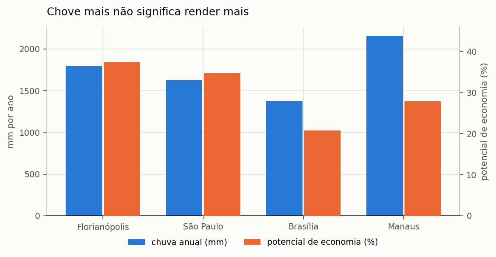
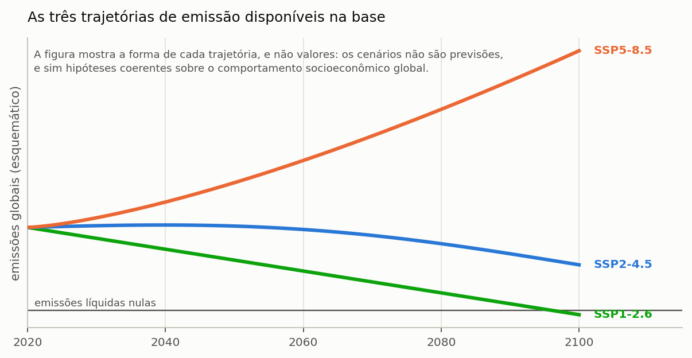
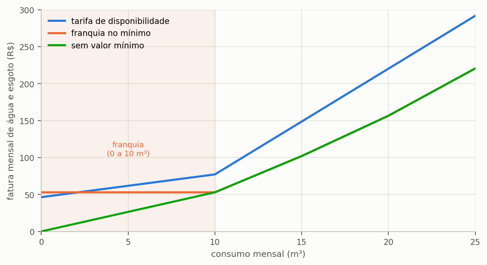
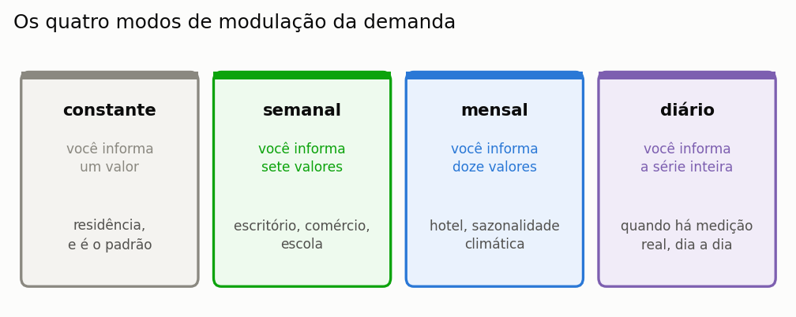
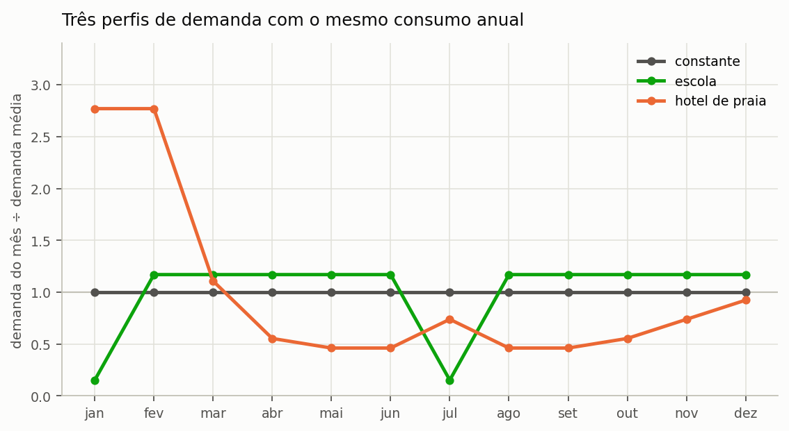
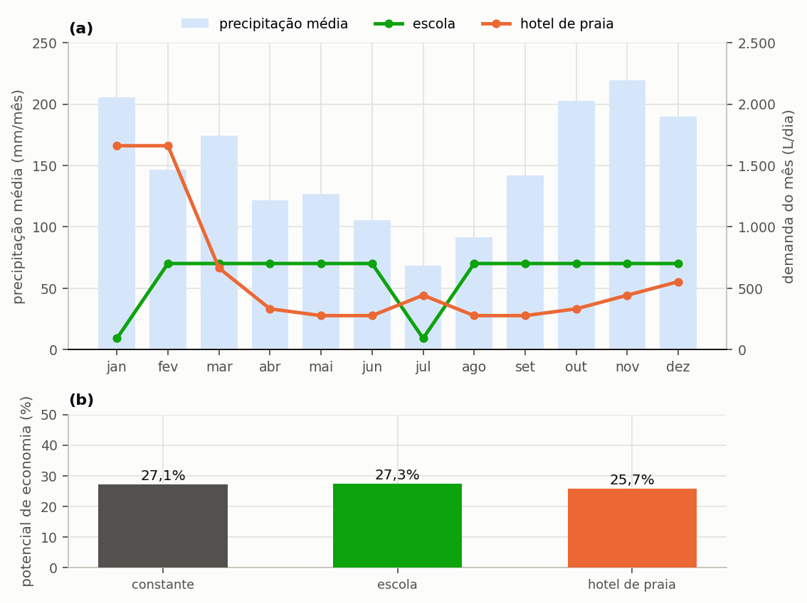
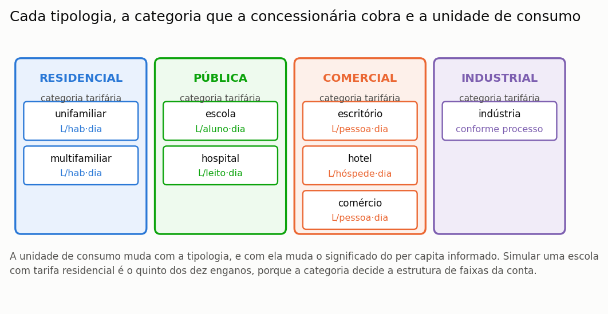
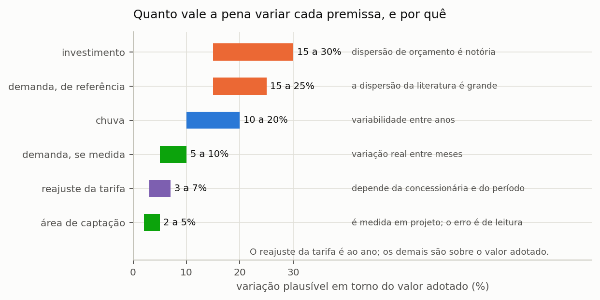
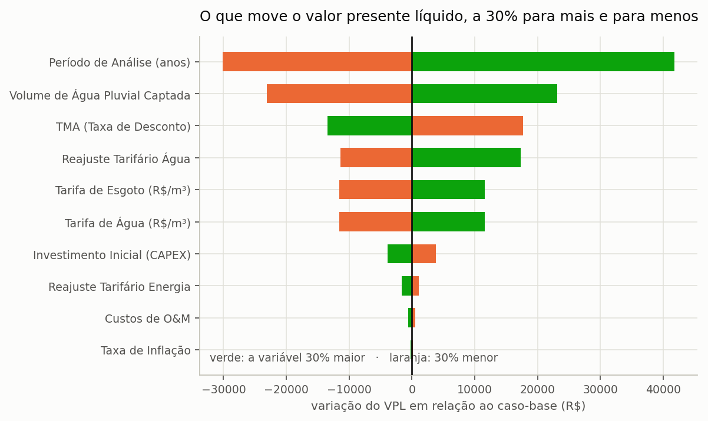

# Netuno 5

## Manual do Usuário — Guias de uso

Igor Catão Martins Vaz e Enedir Ghisi

Grupo de Pesquisa em Ambientes Sustentáveis
Universidade Federal de Santa Catarina

Florianópolis, 2026

---

### Sobre este volume

Este é um dos sete volumes em que o manual do Netuno 5 pode ser distribuído, e
reúne o capítulo 3 (Guias disponíveis no programa) e os apêndices D, F e G do manual completo. Serve para mandar
só a parte que interessa: o método a um revisor, o tutorial a uma turma, os guias
a quem já usa o programa.

A numeração das seções e das equações é a mesma do manual completo, de modo que
uma remissão vale nos dois. Quando o texto remete a uma seção que está em outro
volume, o nome do volume vem entre parênteses.

| Volume | Conteúdo |
| :--- | :--- |
| Comece aqui | o capítulo 1 (Comece aqui) e o apêndice G |
| O método | o capítulo 2 (O método) e os apêndices A, B, C, E, G e H |
| **Guias de uso** | o capítulo 3 (Guias disponíveis no programa) e os apêndices D, F e G |
| Tutorial | o capítulo 4 (Tutorial: um exemplo do começo ao fim) e os apêndices G, I e J |
| Enganos, limitações e confiabilidade | o capítulo 5 (Enganos, limitações e confiabilidade) e os apêndices G e H |
| Correções, bugs e versionamento | o capítulo 6 (Correções, bugs e versionamento) |
| Apêndices | os apêndices |

### Como citar

> VAZ, Igor Catão Martins; GHISI, Enedir. **Netuno 5: manual do usuário**.
> Guias de uso. Versão 5.0.0. Florianópolis: Universidade Federal de Santa
> Catarina, 2026.

---

## Sumário

**3 Guias disponíveis no programa**

3.1 Comparar cidades

3.2 Usar cenário climático futuro

3.3 Ajustar a tarifa do seu município

3.4 Modular a demanda por calendário

3.5 Simular escola, hospital e comércio

3.6 Comparar muitos casos de uma vez

3.7 Análise de sensibilidade

3.8 Importar um projeto do Netuno 4

3.9 Exportar para CAD, BIM e planilha


**Apêndices**

Apêndice D — Regimes tarifários

Apêndice F — Arquivos, pastas e formatos

Apêndice G — Glossário


## Lista de figuras

Figura 1 — (a) Precipitação média anual e (b) potencial de economia de água potável do projeto do tutorial, com 150 m² de captação, 600 L/dia de demanda, fração atendível de 28% e cisterna de 4.000 L, em quatro capitais

Figura 2 — Precipitação média mensal em (a) Florianópolis, (b) São Paulo, (c) Brasília e (d) Manaus, na mesma escala; a linha tracejada é a média mensal de cada série

Figura 3 — A forma das duas trajetórias de emissão disponíveis na base

Figura 4 — Parcela de água da fatura mensal em função do consumo, em três regimes de valor mínimo

Figura 5 — Os quatro modos de modulação, o que cada um pede ao usuário e a situação em que cada um se justifica

Figura 6 — Os três perfis de demanda usados na comparação, expressos como a razão entre a demanda do mês e a demanda média

Figura 7 — (a) Perfis mensais de demanda da escola e do hotel de praia sobre a precipitação média mensal de Florianópolis; (b) potencial de economia de cada perfil com o mesmo reservatório de 4.000 L. O perfil de hotel concentra em dois meses quase um terço do consumo anual, e é essa concentração, e não a fase, que lhe custa quase um ponto e meio percentual

Figura 8 — As oito tipologias disponíveis, agrupadas pela categoria tarifária que a concessionária cobra

Figura 9 — Faixa de variação plausível de cada premissa numa análise de sensibilidade, com a origem da incerteza

Figura 10 — A variação do valor presente líquido quando cada premissa é alterada em 30% para mais e para menos, mantidas as demais

Figura 11 — A distribuição dos 652 municípios catalogados pelas unidades da federação, com as cores identificando a macrorregião

---

## Lista de tabelas

Tabela 1 — O mesmo projeto do tutorial simulado em quatro capitais brasileiras

Tabela 2 — Razão entre o mês mais chuvoso e o menos chuvoso nas quatro capitais

Tabela 3 — Conteúdo da base climática nacional distribuída com o programa

Tabela 4 — Os seis códigos de faixa tarifária e o efeito de cada um na fatura

Tabela 5 — Os seis regimes tarifários e o que acontece ao economizar em cada um

Tabela 6 — Efeito da economia de água na fatura em dois regimes tarifários opostos

Tabela 7 — As três formas de comparar alternativas conforme o que varia entre elas

Tabela 8 — Subcomandos da linha de comando e finalidade de cada um

Tabela 9 — Potencial, valor presente líquido e retorno do projeto fechado do tutorial com cada premissa variada sozinha, do valor baixo ao alto

Tabela 10 — Leitura da aceitabilidade SMAA-VIKOR do volume vencedor

Tabela 11 — Dados do Netuno 4 recuperados pela importação

Tabela 12 — Formatos de exportação e finalidade de cada um

Tabela 13 — Opções da exportação de planilha e quando usar cada uma

Tabela 14 — Distribuição dos municípios do catálogo pelos seis regimes tarifários

Tabela 15 — Grau de confiança dos registros tarifários do catálogo

Tabela 16 — Formatos que o programa lê e onde cada um é carregado

Tabela 17 — Formatos que o programa escreve e onde cada um é gerado

Tabela 18 — As sete seções do arquivo de projeto e o que cada uma guarda

Tabela 19 — Localização dos arquivos do programa e dos arquivos do usuário

Tabela 20 — Compatibilidade entre versões do arquivo de projeto

Tabela 21 — Padronização terminológica de água de chuva e água pluvial

Tabela 22 — Grandezas fundamentais do balanço hídrico e relações entre fração e potencial

---


---
# 3. Guias disponíveis no programa

---

## 3.1. Comparar cidades

> **Pergunta que este guia responde:** o mesmo projeto renderia o mesmo em outra cidade?

Não renderia, e a diferença não segue a direção que a intuição sugere. A expectativa
corrente é a de que mais chuva implique mais aproveitamento, e essa expectativa está
errada com frequência suficiente para merecer uma seção inteira.

---

### 3.1.1. Como fazer a comparação

O procedimento é simples e consiste em manter todos os parâmetros do projeto e trocar
apenas a série de precipitação. Na etapa **1. Projeto e Chuva**, escolha outra cidade da
base climática nacional ou carregue um arquivo próprio, e execute novamente a simulação.
Para comparar várias cidades sem refazer o projeto a cada uma, salve um arquivo por
cidade, conforme a seção 3.6 recomenda.

---

### 3.1.2. O resultado

O projeto do tutorial — 150 m² de captação, 600 L/dia de demanda, 28% de fração
atendível e cisterna de 4.000 L — levado a quatro capitais brasileiras produz a tabela
abaixo.

<!-- tabela: **Tabela 1** — O mesmo projeto do tutorial simulado em quatro capitais brasileiras -->
| Cidade | Chuva anual | Dias com chuva | Razão entre o mês mais e o menos chuvoso | Potencial com 4.000 L | Volume ideal |
| :--- | ---: | ---: | ---: | ---: | ---: |
| Florianópolis | 1 795 mm | 46% | 3,2× | 27,12% | 4 000 L |
| São Paulo | 1 624 mm | 42% | 4,0× | 25,74% | 5 000 L |
| Brasília | 1 376 mm | 35% | 1 191,7× | 15,45% | 4 000 L |
| Manaus | 2 155 mm | 51% | 17,3× | 20,96% | 5 000 L |

A Figura 1 separa as duas grandezas, cada uma na sua escala.



*Figura 1 — (a) Precipitação média anual e (b) potencial de economia de água potável do projeto do tutorial, com 150 m² de captação, 600 L/dia de demanda, fração atendível de 28% e cisterna de 4.000 L, em quatro capitais. Manaus tem a maior precipitação anual e não tem o maior potencial de economia.*

---

### 3.1.3. O regime manda mais que a lâmina

Lidas lado a lado, as colunas de chuva anual e de potencial de economia não andam
juntas, e os dois casos extremos da tabela mostram por quê. Manaus recebe 20% mais chuva
que Florianópolis — 2.155 mm anuais contra 1.795 mm — e ainda assim rende 23% menos:
20,96% contra 27,12% de potencial. Brasília, no extremo oposto, recebe 23% menos chuva
que Florianópolis e rende pouco mais da metade, com 15,45%.

A explicação está na razão entre o mês mais chuvoso e o mês menos chuvoso de cada
cidade, que mede o quanto a chuva se concentra ao longo do ano.

<!-- tabela: **Tabela 2** — Razão entre o mês mais chuvoso e o menos chuvoso nas quatro capitais -->
| Cidade | Razão | O que significa |
| :--- | ---: | :--- |
| Florianópolis | 3,2× | chove o ano inteiro, com estação mais úmida |
| São Paulo | 4,0× | idem, um pouco mais marcado |
| Manaus | 17,3× | seca amazônica curta mas real |
| Brasília | 1.192× | **o mês mais seco é seco de verdade** |

Em Brasília, os meses de junho, julho e agosto praticamente não registram chuva. Um
reservatório dimensionado para atravessar noventa dias de estiagem precisaria armazenar
noventa dias de demanda pluvial, o que neste projeto corresponderia a 15.120 litros —
volume que nenhuma cisterna residencial comporta. A consequência é que o sistema
permanece ocioso durante um trimestre inteiro por ano, e o potencial anual reflete essa
ociosidade.

> **A conclusão prática.** ==O aproveitamento pluvial rende mais onde a chuva é
> frequente do que onde ela é abundante.== Cidades de clima subtropical úmido com chuva
> bem distribuída constituem o melhor caso brasileiro; cidades de clima tropical com
> estação seca marcada constituem o pior, por mais intensa que seja a chuva da estação
> úmida.

---

A Figura 2 apresenta o regime mensal das quatro capitais na mesma escala.


*Figura 2 — Precipitação média mensal em (a) Florianópolis, (b) São Paulo, (c) Brasília e (d) Manaus, na mesma escala; a linha tracejada é a média mensal de cada série. Florianópolis e São Paulo distribuem a chuva ao longo de todo o ano; Manaus tem estação seca curta, de julho a outubro; e Brasília praticamente não recebe chuva de maio a setembro. É essa distribuição, e não o total anual, que decide o desempenho do reservatório.*

---

### 3.1.4. O que a literatura já tinha encontrado

O resultado das quatro capitais não é peculiaridade deste tutorial. Ghisi e Souza (2012)
simularam casas em treze cidades de países diferentes, com o próprio Netuno, e chegaram à
mesma conclusão por outro caminho: o maior potencial de economia aparece onde a chuva é
constante, o que nem sempre coincide com a maior lâmina anual, e as cidades com
estiagem bem definida exigem reservatórios maiores para o mesmo desempenho.

No Brasil, dois levantamentos mostram a amplitude da variação dentro de um só estado ou
de uma só cidade. Ghisi, Lopes e Rupp (2016) fizeram 2.700 simulações para casas em 60
cidades de Santa Catarina, com séries diárias longas, e obtiveram reservatórios ideais de
1.000 a 16.000 L e economias médias de 75 a 461 litros por dia por casa. Ghisi e Custódio
(2019), com 33.720 cenários para o setor residencial de Joinville, encontraram potencial
médio de 18,5% com água de chuva só nas bacias sanitárias, e de 40,8% quando a máquina de
lavar roupa também a recebe — a mesma escolha de uso que a seção 4.2 (volume Tutorial) discute.

A lição para quem compara cidades é a mesma dos dois estudos: a série local decide, e um
volume ou um potencial trazido de outra cidade, mesmo vizinha, não substitui a simulação.

#### 3.1.4.1. Muitas cidades de uma vez

Para comparar mais de três ou quatro cidades, trocar a série à mão deixa de ser prático.
A base climática nacional traz séries para 652 municípios, e a planilha de cenários da
seção 3.6 roda o mesmo projeto contra várias delas numa única execução, gravando um
resultado por linha. Mantenha na planilha os mesmos parâmetros de edificação e de
reservatório em todas as linhas, e varie só a cidade: é o que isola o efeito do clima.

---

### 3.1.5. O que mais muda entre cidades

A precipitação não é a única grandeza que varia entre municípios, e as outras duas podem
inverter a conclusão econômica de um estudo comparativo.

A primeira é a **tarifa**. O preço do metro cúbico varia consideravelmente pelo país, e o
regime de mínimo varia ainda mais. Um potencial de 15% em município de tarifa elevada e
regime de disponibilidade pode render mais dinheiro que um potencial de 27% em município
que pratique franquia sobre o consumo mínimo, e a seção 3.3 trata dessa mecânica em
detalhe.

A segunda é o **fator de emissão da rede elétrica**, que altera simultaneamente a
emissão evitada por metro cúbico de água substituída e o custo ambiental do bombeamento.
O programa traz o fator discriminado por região.

> **Ao comparar cidades num estudo, deixe claro o que variou.** Comparar apenas a
> precipitação, mantendo tarifa e fator de emissão fixos, isola o efeito climático e
> constitui comparação legítima, desde que declarada como tal. Variar todas as grandezas
> simultaneamente produz um número que não se consegue explicar, porque nele se somam
> efeitos de sinais possivelmente opostos.

---

### 3.1.6. O volume ideal também muda, mas pouco

A última coluna da tabela reserva uma surpresa: o volume ideal varia de 4.000 a 5.000 L
entre as quatro capitais, uma amplitude modesta diante da diferença de regime que as
separa.

A explicação está na natureza do critério. O volume ideal pelo ganho marginal localiza o
joelho da curva de aproveitamento, e a posição desse joelho é governada pelo **tamanho
típico dos eventos de chuva**, que é razoavelmente parecido entre as quatro cidades. O
que varia fortemente é o **patamar** que a curva atinge depois do joelho, e não o ponto
em que ela dobra.

Dito de outro modo: em Brasília acerta-se o mesmo volume que em Florianópolis e colhe-se
consideravelmente menos água com ele.

---

## 3.2. Usar cenário climático futuro

> **Pergunta que este guia responde:** o sistema que dimensiono hoje ainda serve em
> 2060?

Um reservatório de água pluvial dura trinta anos ou mais, e a chuva que cairá sobre a
edificação ao longo desse período não será a mesma que caiu no passado recente. Dimensionar
um sistema de vida longa exclusivamente sobre a série histórica supõe, implicitamente, um
clima estacionário — suposição que as projeções disponíveis não sustentam. O Netuno traz
uma base de projeções climáticas justamente para que o dimensionamento possa incorporar
essa questão de forma explícita.

---

### 3.2.1. O que a base tem

<!-- tabela: **Tabela 3** — Conteúdo da base climática nacional distribuída com o programa -->
| O que a base traz | Quantidade |
| :--- | ---: |
| cidades brasileiras | 652 |
| modelos climáticos do CMIP6 | 19 |
| cenários de emissão | 2, SSP2-4.5 e SSP5-8.5 |
| simulação histórica | 1980 a 2013 |
| simulação futura | 2015 a 2100 |

O CMIP6 é a sexta fase do *Coupled Model Intercomparison Project*, o exercício
coordenado internacionalmente que alimenta os relatórios do IPCC. Cada modelo é um
modelo climático global de um centro de pesquisa diferente.

### 3.2.2. De onde vêm as séries


*Figura — Logotipo oficial do CLIMbra (Climate Change Dataset for Brazil), desenvolvido para estudos hidroclimáticos e impactos das mudanças climáticas no Brasil.*

A base do programa é extraída do **CLIMBra** (*Climate Change Dataset for Brazil*), conjunto de dados de referência publicado por Ballarin et al. (2023) na revista [*Scientific Data* (Nature)](https://www.nature.com/articles/s41597-023-01956-z) ([doi:10.1038/s41597-023-01956-z](https://doi.org/10.1038/s41597-023-01956-z)), com dados públicos disponibilizados no [*Science Data Bank*](https://doi.org/10.57760/sciencedb.02316) ([doi:10.57760/sciencedb.02316](https://doi.org/10.57760/sciencedb.02316)) sob licença aberta CC0. Três características definem o que as séries representam, e convém conhecê-las antes de usá-las:

**São projeções corrigidas de viés.** Modelos globais têm resolução de dezenas a
centenas de quilômetros e reproduzem mal a chuva local: costumam errar a frequência de
dias chuvosos, a intensidade e os extremos. O CLIMBra corrigiu as séries diárias dos 19
modelos pelo método *Quantile Delta Mapping* (QDM), que ajusta a distribuição simulada à
observada e, ao mesmo tempo, preserva as variações relativas dos quantis entre o período
histórico e o futuro. A referência observada foi a grade diária de Xavier, King e
Scanlon (2016), construída com milhares de pluviômetros e estações do Brasil, com
resolução de 0,25°, isto é, cerca de 28 km.

**São células de grade, e não estações.** A série de uma cidade é a da célula de 0,25°
que a contém. Ela representa a chuva média de uma área da ordem de 700 km², e não a de
um pluviômetro. Em relevo acidentado ou no litoral, a diferença entre a chuva da célula e
a do lote pode ser grande.

**O histórico da base é simulado.** A série de 1980 a 2013 não é a chuva observada, e sim
a simulação de cada modelo para aquele período, corrigida para ter a mesma **estatística**
da observação. A cronologia não coincide: um dia chuvoso na série do modelo não
corresponde a um dia chuvoso real. Por isso, a comparação correta de um cenário futuro é
com o **histórico do mesmo modelo**, e não com a série observada que acompanha o
programa. Misturar as duas atribuiria ao clima futuro a diferença entre observação e
modelo.

Maraun (2016), numa revisão crítica sobre correção de viés, alerta para o limite do
procedimento: ele pressupõe que o modelo representa de forma plausível os processos e a
mudança do clima, e não consegue corrigir uma tendência implausível. A correção melhora a
estatística; não transforma um modelo ruim num modelo bom.

> **Base compactada e embarcada no programa:** os 37.164 arquivos de texto do CLIMBra
> (que originalmente ocupam cerca de 6,5 GB em formato CSV descompactado) foram consolidados
> e comprimidos pelo Netuno 5 em um banco de dados SQLite binário de alta performance
> (`climbra.db`). Esse banco fica integrado ao executável e ao instalador, permitindo consultas
> instantâneas (< 1 ms por série) e execução imediata para qualquer uma das 652 cidades
> sem a necessidade de downloads externos volumosos. Caso o usuário disponha da pasta com os
> CSVs originais, o programa mantém total compatibilidade e suporte alternativo de carregamento.

---

### 3.2.3. Escolher modelo, cenário e janela

O **cenário** representa a trajetória futura de emissões de gases de efeito estufa, e os
dois disponíveis seguem as *Shared Socioeconomic Pathways* adotadas pelo IPCC. Eles não
são previsões, e sim hipóteses coerentes sobre o comportamento socioeconômico global ao
longo do século (Figura 3). O nome combina a trajetória socioeconômica, de 1
a 5, com o forçamento radiativo aproximado em 2100, em watts por metro quadrado: o
SSP2-4.5 é o caminho intermediário, com forçamento de 4,5 W/m², e o SSP5-8.5 é o de
desenvolvimento intensivo em combustíveis fósseis, com 8,5 W/m². Os cenários de mitigação
forte, como o SSP1-2.6, não fazem parte do CLIMBra.



*Figura 3 — A forma das duas trajetórias de emissão disponíveis na base. O SSP2-4.5 é a trajetória intermediária, com emissões que se estabilizam e depois caem; o SSP5-8.5 supõe emissões altas e crescentes, sem mitigação efetiva. A figura mostra o formato de cada uma, e não valores projetados.*

A **janela temporal** é o recorte da série futura, de 2015 a 2100, sobre o qual o estudo
é feito. O programa permite recortar qualquer período, nas datas inicial e final da
etapa **1. Projeto e Chuva**. A convenção mais usada é tomar janelas de trinta anos, a
mesma duração das normais climatológicas, e o campo **Atalho de recorte** preenche as
datas com três delas: 2021–2050, 2041–2070 e 2071–2100, além da série completa. O atalho
só preenche as datas, que continuam editáveis, e a etapa avisa quando o recorte tem menos
de dez anos. A escolha da janela deve guardar relação com a vida útil
pretendida do sistema: avaliar um reservatório de vinte anos, instalado agora, contra o
fim do século avalia um período em que ele já terá sido substituído.

A escolha do **modelo climático** é a decisão mais delicada das três, e a ela se dedica
uma subseção própria adiante.

---

### 3.2.4. Como conduzir o estudo

O procedimento correto consiste em executar o mesmo projeto em cada combinação de
interesse e comparar os resultados entre si, em vez de dimensionar diretamente sobre a
série projetada. Quatro passos o resumem.

1. Feche o dimensionamento com a série **histórica**. É a referência.
2. Rode o mesmo projeto na série **histórica simulada** de cada modelo que for usar, de
   1980 a 2013. É contra ela, e não contra a observada, que o futuro se compara.
3. Mantenha todos os demais parâmetros e troque só a série, para cada cenário e janela.
4. Compare **potencial de economia** e **dias de atendimento pleno**, sempre como
   diferença entre o futuro e o histórico do mesmo modelo. O segundo costuma se degradar
   mais que o primeiro, porque o que muda primeiro é a distribuição, não o total.

> **Um exemplo de leitura.** Suponha que, com um modelo, o potencial seja de 36% no
> histórico simulado e de 33% no SSP5-8.5 de 2041 a 2070, e que a série observada dê 37%.
> A mudança atribuível ao clima é de três pontos, e não de quatro: o ponto restante é a
> diferença entre o modelo e a observação, que existe também no passado.

> **O que não fazer.** Dimensionar direto na série futura e apresentar o resultado
> como projeto. A série futura é uma projeção com incerteza grande; ela serve para
> testar a **robustez** de um dimensionamento feito no histórico, não para substituí-lo.

---

### 3.2.5. A escolha do modelo, e por que ela importa tanto

Dezenove modelos climáticos projetam dezenove futuros distintos para a mesma cidade sob
o mesmo cenário de emissões, e essa dispersão não é ruído a ser eliminado: ela é a
expressão honesta da incerteza física do problema. ==Para a chuva, a dispersão entre
modelos costuma superar a diferença entre cenários de emissão,== o que significa que a
escolha do modelo pesa mais sobre o resultado do que a escolha do futuro socioeconômico.

Hawkins e Sutton (2011) decompuseram a incerteza das projeções de precipitação para
regiões da ordem de 2.500 km, com os modelos da fase anterior do exercício, o CMIP3, em
três fontes: a variabilidade interna do clima, a diferença entre modelos e a diferença
entre cenários. Para a precipitação, ao contrário da temperatura, a variabilidade interna
responde por 50% a 90% da incerteza na primeira década e continua dominante, em muitas
regiões, até a terceira; a incerteza entre modelos passa a dominar nos horizontes mais
longos; e a incerteza de cenário é pequena ou desprezível em todas as regiões e
horizontes, salvo perto dos polos no fim do século. Os autores mostram ainda que a razão
entre o sinal da mudança e o ruído é menor que um em quase todo o planeta, e concluem que
as decisões de adaptação terão de ser tomadas com incerteza alta sobre a chuva regional. A
consequência para o projeto é direta: rodar os dois cenários com um só modelo informa
menos do que rodar um cenário com vários modelos.

Três condutas são defensáveis diante dessa dispersão, apresentadas aqui em ordem
decrescente de rigor.

**Ensemble.** Rode todos os modelos disponíveis e reporte a faixa de resultados, com
mediana. É o mais rigoroso e o mais caro em tempo de máquina. A seção 3.6 mostra como
fazer em lote.

**Subconjunto justificado.** Escolha três a cinco modelos com bom desempenho
documentado para a América do Sul, e declare o critério de escolha e a fonte.

**Modelo único, declarado como tal.** Aceitável para uma análise exploratória, desde
que o texto não apresente o resultado como projeção robusta.

> **O que jamais fazer:** rodar vários modelos, escolher o que dá o resultado mais
> conveniente, e reportar só ele.

---

### 3.2.6. O que a literatura mostra sobre o reservatório no clima futuro

Os estudos que simulam sistemas de aproveitamento pluvial sob projeções climáticas
convergem num ponto: a mudança no total anual de chuva importa menos que a mudança na
**distribuição**. Kisakye et al. (2018), com seis modelos para um distrito de Uganda,
encontraram projeções conflitantes entre modelos, mas concordância quanto à estação: a
economia e a segurança hídrica cairiam nas estações que já eram secas e subiriam nas
chuvosas, com redução de mais de 50% numa das estações no fim do século. Lash et al.
(2014), ao dimensionar um reservatório para um edifício universitário no Reino Unido com
3.000 séries de chuva equiprováveis das projeções climáticas britânicas, concluíram que,
para ser provável atender em 2080 a mesma demanda de hoje, o reservatório precisaria ser
112% maior, e 225% maior para que isso fosse muito provável.

Os dois estudos ilustram o que a seção 3.1 mostrou para cidades brasileiras de hoje:
cidades com estação seca marcada exigem reservatórios muito maiores para o mesmo
desempenho. Um clima futuro com estiagens mais longas se comporta, para o reservatório,
como uma mudança de cidade.

---

### 3.2.7. O que declarar

Um estudo com cenário climático precisa trazer, no método:

- **modelo ou modelos**, pelo nome, e o critério de seleção;
- **cenário** SSP;
- **janela temporal**, com os anos;
- a **série histórica** usada como referência;
- se houve *downscaling* ou correção de viés, e qual; na base do programa, a do CLIMBra,
  por *Quantile Delta Mapping* contra a grade de Xavier et al. (2016);
- a **procedência da base**, com versão: Ballarin et al. (2023);
- que o futuro foi comparado com o **histórico simulado do mesmo modelo**.

Sem isso, o resultado não é reproduzível. O apêndice E (volume Apêndices) traz a procedência da base do
programa.

---

### 3.2.8. Uma ressalva de método

Projeções climáticas carregam duas incertezas empilhadas, de naturezas distintas: a do
cenário, que é socioeconômica e diz respeito a escolhas humanas futuras, e a do modelo,
que é física e diz respeito à representação do sistema climático. Nenhuma das duas se
reduz executando mais simulações com o mesmo material, porque não se trata de incerteza
amostral.

Um estudo conduzido com honestidade apresenta o resultado como faixa, e não como número
único, e evita conclusões que dependam da terceira casa decimal de uma projeção para
2060.

---

## 3.3. Ajustar a tarifa do seu município

> **Pergunta que este guia responde:** a tarifa do meu município está na base, e está
> certa?

Este é o guia que mais altera resultados. A estrutura tarifária decide a viabilidade
econômica de um sistema pluvial mais do que qualquer parâmetro de projeto, e é também o
dado que mais frequentemente aparece errado nos estudos publicados sobre o tema.

---

### 3.3.1. Como é composta a fatura de água e esgoto no Brasil

Antes de conferir a tarifa do município, convém entender o que se está conferindo. A
fatura de água no Brasil não é o produto do consumo por um preço único, e cinco
características a distinguem da fatura de energia elétrica, que é a referência mais familiar para
a maioria dos leitores.

**A prestação é local, e o preço também.** Cada município é atendido por uma companhia
estadual, por uma autarquia municipal ou por uma concessionária privada, e cada prestador
tem tabela própria, homologada por uma agência reguladora — estadual, municipal ou
intermunicipal. Não existe tarifa nacional de água, e a diferença entre dois municípios
vizinhos pode ultrapassar o dobro.

**A tarifa é progressiva por faixas de consumo.** O metro cúbico não custa o mesmo em
qualquer quantidade: o consumo é dividido em faixas, e cada faixa tem preço próprio,
crescente. Na tabela da CASAN vigente em Florianópolis, os primeiros dez metros cúbicos
custam R$ 3,08 cada e os quinze seguintes custam R$ 14,31 cada. ==A progressividade é o
que torna a economia de água mais valiosa do que parece:== o metro cúbico que se deixa de
consumir é sempre o da faixa mais alta da fatura, que é o mais caro.

**Existe uma parcela que independe do consumo.** Quase toda concessionária cobra algo
mesmo de quem não consome nada, e o nome e a natureza dessa parcela variam de um lugar
para outro. É o assunto da subseção sobre os seis regimes, adiante, e é o ponto que mais
decide se um sistema pluvial se paga.

**O esgoto é cobrado como percentual da água.** A maior parte dos prestadores fatura o
esgoto aplicando um percentual sobre a parcela de água, comumente de 80% ou 100%, sob o
argumento de que o volume esgotado é proporcional ao consumido. Quando esse percentual é
de 100%, a parcela de esgoto iguala a de água, e o esgoto responde por metade da fatura —
o que significa que cada metro cúbico economizado vale o dobro do preço da água.

**Há categorias distintas de consumidor.** Toda concessionária publica tabelas separadas
para as categorias residencial, comercial, industrial e pública, com preços que
frequentemente são o dobro ou mais da residencial. Na tabela da CASAN, a primeira faixa
custa R$ 3,08/m³ no residencial e R$ 6,81/m³ no comercial.

> **O que o programa traz, e o que você precisa lançar.** O catálogo de 652 municípios do
> programa registra a **categoria residencial** de cada um deles. As demais categorias
> existem, são públicas e estão nas resoluções das agências reguladoras — o que não há é
> um catálogo nacional delas, que seria um levantamento de porte próprio. Para estudar
> uma escola, um comércio ou uma indústria, lance a estrutura da categoria correta no
> modo personalizado desta mesma tela: o programa aceita qualquer tabela de faixas, com
> qualquer regime de mínimo, e a seção 3.5 mostra o procedimento.

---

### 3.3.2. Comece conferindo o que já está na base

O programa acompanha um catálogo de 652 municípios brasileiros, e cada registro traz a
estrutura tarifária completa, o percentual de esgoto praticado, o regime de mínimo
adotado, a data de vigência da tabela e a fonte documental de onde o dado foi extraído.
O catálogo cobre a categoria residencial, conforme a subseção anterior esclarece.

Na etapa **12. Gestor de Tarifas**, escolha o estado e o município. Além da estrutura, o
programa exibe o **grau de confiança** atribuído ao registro, que sintetiza a qualidade da
fonte e a data do levantamento. Três itens merecem conferência contra a resolução vigente
da sua concessionária, e a ordem importa porque o primeiro invalida os demais.

1. **a data de vigência** — tarifas são reajustadas anualmente;
2. **os valores das faixas**;
3. **o regime de mínimo**, que é o item 3.3.4.

Havendo divergência em qualquer dos três, edite o registro. A edição vale para o seu
projeto, não altera o catálogo dos demais usuários, e fica gravada dentro do arquivo
`.netuno` — o que significa que quem receber o seu projeto reproduzirá a mesma conta, com
a mesma tabela.

---

### 3.3.3. Como a tabela é montada

Cada linha da estrutura tarifária é representada no programa por uma quádrupla de
valores: o volume mínimo da faixa, o volume máximo, um valor monetário e um código. O
código é o elemento decisivo, porque é ele que informa o que aquele valor significa — e
estruturas visualmente parecidas cobram de maneiras muito diferentes conforme o código de
cada linha.

<!-- tabela: **Tabela 4** — Os seis códigos de faixa tarifária e o efeito de cada um na fatura -->
| Código | O que é | Como entra na fatura |
| ---: | :--- | :--- |
| 1 ou 0 | faixa de consumo | é cobrado o preço por volume que está alocado **dentro** de cada faixa de consumo |
| −1 | tarifa de disponibilidade | valor fixo **somado** à parcela de consumo |
| −2 | franquia retroativa | até o volume da franquia, paga-se o fixo; passando dele, tarifa-se **tudo desde zero** |
| −3 | piso de pagamento | a fatura **não fica** abaixo deste valor |
| 2 | preço-base exponencial | `PB` da fórmula `PB × Cⁿ`, válida até o máximo da linha |
| 3 | expoente da tabela exponencial | o `n` aplicado ao consumo **do mês inteiro** que cai na linha |

A estrutura de Florianópolis, tomada como exemplo, tem cinco linhas: uma de
disponibilidade e quatro faixas progressivas.

```
(0,00 ; 0,00 ; 46,34 ; -1)     disponibilidade, soma sempre
(0,00 ; 10,00 ;  3,08 ;  1)    primeira faixa
(10,00 ; 25,00 ; 14,31 ; 1)    segunda faixa
(25,00 ; 50,00 ; 19,14 ; 1)    terceira
(50,00 ; 999999 ; 24,08 ; 1)   última
```

---

### 3.3.4. Os seis regimes, e por que isso decide projetos

O «consumo mínimo» aparece na conta de quase todo município brasileiro, e significa
coisas **diferentes** em cada um. O programa distingue seis regimes:

<!-- tabela: **Tabela 5** — Os seis regimes tarifários e o que acontece ao economizar em cada um -->
| Regime | O que acontece ao economizar | Municípios na base |
| :--- | :--- | ---: |
| **sem mínimo** | cada m³ economizado desconta | 165 |
| **disponibilidade** | idem; a taxa fixa continua, mas não impede a economia | 122 |
| **fórmula exponencial** | idem; o m³ poupado vale pelo preço-base elevado ao expoente | 34 |
| **franquia no mínimo** | abaixo da franquia, economizar **não desconta nada** | 329 |
| **franquia retroativa** | passando da franquia, tarifa-se tudo desde zero | 2 |
| **piso de pagamento** | a fatura não fica abaixo do piso | 0 |

**O caso que derruba estudo.** Compare duas estruturas reais da base, lado a lado,
para o mesmo consumo:

<!-- tabela: **Tabela 6** — Efeito da economia de água na fatura em dois regimes tarifários opostos -->
| Consumo | Floriano (PI), franquia no mínimo | Florianópolis (SC), disponibilidade |
| ---: | ---: | ---: |
| 14 m³ | R$ 92,15 | R$ 134,38 |
| 12 m³ | R$ 72,52 | R$ 105,76 |
| 10 m³ | R$ 52,89 | R$ 77,14 |
| 8 m³ | **R$ 52,89** | R$ 70,98 |
| 5 m³ | **R$ 52,89** | R$ 61,74 |

Em Floriano, a fatura **para de cair em 10 m³**. Uma residência que consome 12 m³ e
instala um sistema que poupa 4 desce para 8, e economiza R$ 19,63 — e não os R$ 24,17 que a tarifa média de R$ 6,04/m³ sugeriria. Se poupasse 7, desceria para 5 e economizaria os
**mesmos** R$ 19,63: os três metros cúbicos adicionais não valem nada.

Em Florianópolis, cada metro cúbico economizado reduz a fatura, até o primeiro.

> Rodar o caso de Floriano com a estrutura de Florianópolis produz um payback que
> não existe. Trezentos e vinte e nove dos 652 municípios da base estão no regime de
> franquia. É a maioria, e é o cenário mais comum do país.

A Figura 4 mostra as três respostas lado a lado. O que distingue os regimes não é
o preço praticado, e sim o formato da curva: ==onde a curva é horizontal, economizar água
não reduz a fatura em nada.==



*Figura 4 — Parcela de água da fatura mensal em função do consumo, em três regimes de valor mínimo. O esgoto não entra no gráfico porque é cobrado como percentual desta parcela e apenas multiplica a curva, sem mudar-lhe o formato. Na tarifa de disponibilidade e sem valor mínimo, cada metro cúbico economizado reduz a fatura desde o primeiro; na franquia no mínimo, o trecho horizontal marca a faixa de consumo em que a economia de água não reduz a fatura.*

---

### 3.3.5. A fórmula exponencial da CORSAN

Os 34 municípios gaúchos da base atendidos pela CORSAN não cobram a água por faixas.
A parcela de água da fatura é dada por uma fórmula:

```
Água = PB × Cⁿ + SB
```

em que `PB` é o preço-base do município, em R$/m³; `C` é o consumo do mês, em m³; `n` é
o expoente que a **tabela exponencial** da concessionária atribui àquele consumo; e `SB` é
o serviço básico, cobrado mesmo sem consumo. A fórmula vale até 1.000 m³ por economia;
acima disso, o excedente é cobrado pelo preço do m³. O esgoto é 70% do valor da água.

Duas diferenças em relação às faixas decidem o cálculo:

- **O expoente vale para o consumo inteiro.** Nas faixas, cada metro cúbico é cobrado
  pelo preço da faixa em que cai; na fórmula, o `n` da linha em que o consumo total cai
  se aplica a todo o volume. Mudar de linha muda a conta inteira, e não só o último m³.
- **Não há degrau de preço, há curva.** O preço médio do metro cúbico é `PB × Cⁿ⁻¹`: com
  `n` acima de 1 ele cresce com o consumo, com `n` igual a 1 é constante.

Para o aproveitamento pluvial, a consequência é simples: **toda economia desconta desde o
primeiro metro cúbico**, e o que se poupa vale `PB × (C₁ⁿ¹ − C₂ⁿ²)`, a diferença entre as
duas contas — é assim que o programa calcula, com a fórmula e não com uma reta.

No programa, a fórmula entra na mesma tabela de quádruplas, com dois códigos próprios. A
estrutura de Alegrete, vigente desde 1º de julho de 2026, é:

```
(0,00 ; 0,00    ; 43,39 ; -1)   serviço básico, soma sempre
(0,00 ; 1000,00 ;  9,15 ;  2)   preço-base PB, fórmula válida até 1.000 m³
(0,00 ; 1000,00 ;  1,00 ;  3)   tabela exponencial: n para o consumo em (0, 1.000]
(1000,00 ; 999999 ; 9,15 ; 1)   excedente acima de 1.000 m³
```

A tabela exponencial pode ter tantas linhas de código 3 quantas a concessionária
publicar, cada uma com o seu intervalo de consumo e o seu `n`. No **Gestor de Tarifas**, a
estrutura aparece com o rótulo «Fórmula exponencial», o simulador mostra o cálculo
`PB × Cⁿ` do consumo escolhido, e o gráfico de cima traz o preço médio `PB × Cⁿ⁻¹` em vez
dos degraus.

> **O estado da tabela exponencial nesta versão.** A tabela homologada pela AGERGS para a
> vigência de 2026 não pôde ser transcrita da fonte primária a tempo desta versão. A base
> grava, por isso, `n = 1` de 0 a 1.000 m³ e marca a tabela como **não conferida**: a conta
> sai igual a `PB × C + SB`, e o Gestor de Tarifas exibe o aviso. Para usar a tabela
> vigente, edite as linhas «Expoente n» no Gestor, uma por intervalo de consumo, e aplique
> ao projeto. A tabela é a mesma para todos os municípios da CORSAN: quando a homologada
> for transcrita na base, os 34 passam a usá-la de uma vez, e o aviso desaparece.

---

### 3.3.6. Quando o mínimo é diluído na tarifa

Um erro frequente nas bases públicas: a concessionária informa «tarifa mínima de
R$ 52,89 para 10 m³», e quem cadastra grava isso como R$ 5,289 por m³ até 10 m³.

A diferença é enorme. Na primeira leitura, quem consome 4 m³ paga R$ 52,89; na
segunda, paga R$ 21,16. E, pior para um estudo pluvial, na segunda leitura
economizar abaixo de 10 m³ **desconta**, quando na realidade não desconta.

O programa audita a base atrás desse padrão e recodifica os casos encontrados, com o
registro da correção. Se você cadastrar um município novo, **verifique isso**.

---

### 3.3.7. O esgoto

O percentual de esgoto incide sobre a **parcela de água** da fatura, e não sobre a fatura total.

Cem por cento, como em Florianópolis, significa que a parcela de esgoto iguala a de
água — e portanto o esgoto é **metade da fatura**. Economizar água economiza as duas
parcelas, e é por isso que o valor efetivo do metro cúbico poupado quase dobra.

Alguns municípios cobram esgoto por faixas próprias, e não por percentual único.
Nesses casos o percentual único é uma aproximação, e o programa registra a
limitação.

---

### 3.3.8. Onde encontrar o dado

Em ordem de confiabilidade:

1. **Resolução tarifária** da agência reguladora estadual ou municipal. É o documento
   oficial, e traz a data de vigência.
2. **Tabela publicada pela concessionária**, geralmente em «tarifas» no sítio.
3. **Simulador de fatura** da concessionária, quando existir. Bom para conferir:
   simule dois consumos e veja se a sua tabela reproduz os dois valores.
4. **Fatura de água e esgoto real**, do próprio imóvel. É a melhor evidência, e permite
   conferir a estrutura inteira.

> **Sempre registre a data de vigência e a fonte.** Um estudo que não diz de quando
> é a tarifa não pode ser reproduzido daqui a dois anos.

---

### 3.3.9. Confira antes de confiar

Depois de montar a tabela, faça o teste que o item 3.3.7 sugere: simule dois
consumos, um dentro e um fora da faixa mínima, e compare com a fatura real ou com o
simulador da concessionária.

Se os dois baterem, a estrutura está certa. Se só um bater, o regime de mínimo está
errado — e é exatamente esse o erro que mais compromete estudo pluvial.

---

## 3.4. Modular a demanda por calendário

> **Pergunta que este guia responde:** e quando o consumo não é o mesmo todo dia?

Escolas fecham em janeiro e julho, hotéis de praia enchem no verão e escritórios esvaziam
nos fins de semana. Tratar qualquer uma dessas edificações como se tivesse consumo
uniforme erra nos dois sentidos simultaneamente: superestima a demanda nos períodos
vazios e a subestima nos períodos de pico. ==O erro não se compensa ao longo do ano,
porque o que importa ao sistema pluvial não é o total consumido e sim o encontro entre o
consumo e a chuva disponível naquele dia.==

---

### 3.4.1. Os quatro modos

O programa oferece quatro modos de modulação da demanda, que diferem no número de valores que o usuário informa e na situação em que cada um se justifica (Figura 5).




*Figura 5 — Os quatro modos de modulação, o que cada um pede ao usuário e a situação em que cada um se justifica. O modo diário só faz sentido quando existe medição real, porque inventar uma série diária acrescenta precisão aparente sem acrescentar informação.*


Em qualquer um deles você pode modular três coisas de forma independente: a
**demanda per capita**, o **número de ocupantes** e a **fração atendível por água
pluvial**.

Modular a ocupação costuma ser mais fiel que modular a demanda: numa escola em
férias não é o aluno que bebe menos água, é que não há aluno.

---

### 3.4.2. Como preencher

Na etapa **2. Edificação e Consumo**, escolha o modo. Abre-se a tabela do período.

- Célula vazia ou zerada **cai para o valor constante**. Isso é deliberado: permite
  modular só os meses que interessam e deixar o resto no padrão.
- Os valores podem ser digitados ou carregados de CSV.
- No modo diário, o primeiro dia da série de demanda alinha com o primeiro dia da
  **série de chuva**. Se as duas tiverem tamanhos diferentes, a de demanda é
  reciclada ciclicamente.

---

### 3.4.3. Por que isso muda o resultado

Modular a demanda não altera apenas o total anual consumido; altera o casamento temporal
entre oferta e demanda, que é precisamente o problema que o reservatório existe para
resolver. Dois casos opostos ilustram o alcance desse efeito, e ambos são comuns no
Brasil.

**A favor.** Uma escola que fecha em julho, no sul do país, fecha justamente quando
chove menos. A cisterna atravessa a estiagem sem ser solicitada e chega cheia em
agosto. O sistema rende **mais** do que a média anual sugeriria.

**Contra.** Um hotel de praia enche em janeiro e fevereiro, quando chove mais no
litoral sul. Parece bom, mas a demanda concentrada esvazia a cisterna em dias, e o
resto do ano ela fica ociosa. O sistema rende **menos**.

Os dois casos parecem opostos e não o são, e convém enunciar a regra com cuidado,
porque a formulação intuitiva — «demanda em fase com a chuva rende mais» — não
sobrevive ao segundo exemplo. O hotel tem demanda **em fase** com a chuva, já que
ambas culminam no verão, e ainda assim rende menos. O que separa os dois casos não é a
fase, é a **concentração**.

==Uma demanda distribuída ao longo do ano aproveita melhor um mesmo reservatório;
uma demanda concentrada em poucos meses o esvazia em dias e o deixa ocioso no resto do
ano, ainda que esses meses sejam os mais chuvosos.== A escola se beneficia porque o seu
período ocioso coincide com a estiagem, e não porque esteja em fase com a chuva.

Rodadas com a série de Florianópolis, o mesmo consumo anual e o mesmo reservatório de
4.000 L, as três hipóteses se separam: demanda constante rende 27,1%, o perfil escolar
rende 27,3% e o perfil de hotel de praia rende 25,7%. A diferença de quase um ponto e
meio percentual, num teto de 28%, é grande para uma mudança que não altera um único litro do consumo anual, e
é inteiramente invisível a qualquer cálculo feito sobre médias — que é justamente por que o Netuno simula dia a dia. Os três perfis estão na Figura 6, e o rendimento de cada um, na Figura 7.



*Figura 6 — Os três perfis de demanda usados na comparação, expressos como a razão entre a demanda do mês e a demanda média. Os três têm exatamente o mesmo consumo anual; o que muda é a distribuição dele ao longo dos doze meses.*



*Figura 7 — (a) Perfis mensais de demanda da escola e do hotel de praia sobre a precipitação média mensal de Florianópolis; (b) potencial de economia de cada perfil com o mesmo reservatório de 4.000 L. O perfil de hotel concentra em dois meses quase um terço do consumo anual, e é essa concentração, e não a fase, que lhe custa quase um ponto e meio percentual.*

---

### 3.4.4. A fração atendível também pode variar

Menos óbvio e às vezes mais importante. Numa escola, o percentual de uso não potável
muda entre período letivo e férias: em férias permanecem a lavagem de piso e a rega de
jardim, que são usos **integralmente** atendíveis por chuva.

Modular a fração captura isso. Manter fração constante subestima o aproveitamento no
período de baixa ocupação.

Na tabela, a coluna «Não-Potável Interno (%)» é percentual, como todo campo digitado:
28 significa 28%. No arquivo de projeto, a mesma coluna é gravada como fração, 0,28,
e a seção 4.2 (volume Tutorial) explica por quê. Uma célula com valor entre 0 e 1 fica laranja.

---

### 3.4.5. Cuidados

**Não module o que você não mediu.** Uma modulação inventada acrescenta precisão
aparente sem acrescentar informação alguma, e transfere ao leitor a impressão de um rigor
que o dado não tem. Na dúvida, demanda constante explicitamente declarada é mais honesta
que um perfil mensal arbitrado.

**Declare a origem do perfil.** Ele pode vir de medição própria, de doze faturas de água e esgoto
mensais, de referência bibliográfica ou de estimativa, e essas quatro origens não têm o
mesmo peso probatório num estudo publicado.

**Confira o total anual depois de modular.** O programa exibe a demanda média diária
resultante da modulação, e a divergência entre esse valor e o que se esperava é o
indicador mais rápido de erro de preenchimento da tabela.

---

### 3.4.6. O caminho mais simples, quando existe

Se você tem **doze faturas de água e esgoto** da edificação, tem o perfil mensal medido,
que é a melhor fonte possível. Divida o consumo de cada mês pelo número de dias e
pelo número de ocupantes, e use o modo mensal.

Doze faturas valem mais que qualquer referência de literatura.

---

## 3.5. Simular escola, hospital e comércio

> **Pergunta que este guia responde:** o programa serve para edificação não
> residencial?

Serve, e serve bem para a parte hídrica. Há, porém, uma ressalva de peso relativa à
parte econômica, e ela precisa ser conhecida antes de o estudo começar, e não depois de
ele estar concluído.

---

### 3.5.1. A ressalva: a categoria tarifária

As concessionárias brasileiras cobram tarifas distintas conforme a categoria do
consumidor — residencial, comercial, industrial e pública —, e as categorias não
residenciais costumam custar o dobro ou mais da residencial. Na tabela da CASAN vigente
em abril de 2026, por exemplo, a primeira faixa custa R$ 3,08/m³ para uma residência e
R$ 6,81/m³ para um estabelecimento comercial.

==Essas tabelas existem e são públicas:== estão nas resoluções das agências reguladoras e
nos sítios das próprias concessionárias. O que o catálogo do programa registra, para os
652 municípios, é a categoria residencial de cada um, porque levantar as quatro
categorias de cada prestador seria um trabalho de outra ordem de grandeza. ==A tarifa não
residencial não falta ao programa: ela falta ao catálogo, e você pode lançá-la.==

Quando você escolhe uma tipologia não residencial, o programa **avisa** e diz o
sentido do erro:

> A tipologia escolhida é «Escola», que a concessionária fatura na categoria
> Pública. O catálogo do programa tem apenas a categoria Residencial, de modo que a
> fatura de água e esgoto está sendo calculada com a tarifa errada. O erro tem sentido
> conhecido: as categorias não residenciais são mais caras, e portanto a economia e
> o retorno estão **subestimados**.

> **O que fazer, em cinco minutos.** Procure a resolução tarifária vigente da sua
> concessionária, que costuma estar no sítio dela sob «tarifas» ou «estrutura tarifária».
> Localize a tabela da categoria que interessa. Lance as faixas no modo personalizado da
> etapa **12. Gestor de Tarifas**, com o regime de mínimo correspondente. A seção
> 3.3 descreve cada campo. Feito isso, o resultado econômico passa a ser o do seu
> caso, e não uma aproximação residencial.

Há um consolo nessa limitação, e ele é metodológico: ==o erro tem sentido conhecido e é
conservador.== As categorias não residenciais são mais caras que a residencial, de modo
que o projeto real rende mais do que o programa indica, e nunca menos. Um estudo que
declare a limitação apresenta, portanto, um piso de viabilidade — o que é uma posição
defensável, ao contrário do inverso.

---

### 3.5.2. As tipologias disponíveis

As oito tipologias do programa agrupam-se pela categoria tarifária em que a concessionária as enquadra, e cada uma tem unidade de consumo própria (Figura 8). A unidade de consumo muda o significado do per capita informado, e a categoria decide a estrutura de faixas da fatura: simular uma escola com tarifa residencial é um dos enganos descritos na seção 5.1 (volume Enganos, limitações e confiabilidade).




*Figura 8 — As oito tipologias disponíveis, agrupadas pela categoria tarifária que a concessionária cobra. A unidade de consumo muda com a tipologia, e é ela que dá sentido ao valor per capita informado.*


---

### 3.5.3. O que muda em cada tipologia

**Escola.** É um dos casos mais favoráveis ao aproveitamento pluvial no Brasil, por
duas razões que se somam. A fração não potável do consumo é alta, porque a bacia
sanitária domina o uso e muitas unidades não têm chuveiro nem cozinha. E a área de
cobertura por aluno costuma ser grande, de modo que a oferta raramente é o fator
limitante.

A modulação por calendário, porém, tem um efeito que depende da região, e convém
simulá-la em vez de supor o resultado. No Sudeste e no Centro-Oeste, as chuvas se
concentram de outubro a março e a estiagem vai de junho a agosto. O recesso de julho
coincide com a estiagem, e a cisterna atravessa o período seco sem ser solicitada; as
férias longas de dezembro a fevereiro, ao contrário, coincidem com o auge das chuvas, e
nesse período a cisterna enche e extravasa sem uso. No Sul, onde a chuva é mais bem
distribuída ao longo do ano, o calendário escolar pesa menos. A seção 3.4 mostra
como representar os dias letivos, e a seção 3.1 mostra como a distribuição da chuva
muda de uma capital para outra.

**Hospital.** O caso mais delicado. Consumo alto e contínuo, sem sazonalidade
relevante, o que é bom para o aproveitamento. Mas a **exigência de qualidade** é
outra: há usos que não admitem água pluvial em hipótese alguma, e a torre de
resfriamento, que seria um uso ideal, exige controle microbiológico contra
legionela. Trate a classe de qualidade com cuidado, e não use as classes adaptadas
2 a 4 como se fossem requisito normativo.

**Escritório e comércio.** Demanda concentrada em dias úteis, cinco dias em sete.
Module por semana. A fração não potável é alta porque quase todo o consumo é bacia
sanitária, mictório e limpeza: Proença e Ghisi (2010), que estimaram os usos finais de
dez edifícios de escritórios em Florianópolis por entrevistas com os ocupantes e medição
de vazões, encontraram de 56% a 86% do consumo em usos não potáveis, e concluíram que a
bacia sanitária deve ser o primeiro alvo de qualquer programa de economia nesses
edifícios. A amplitude da faixa é ela própria uma advertência: dois escritórios da mesma
cidade podem diferir em trinta pontos percentuais, e a fração atendível de um estudo
deve vir do edifício estudado sempre que possível.

**Hotel.** Sazonalidade forte, e é o caso em que modular por mês mais importa. Veja
a advertência da seção 3.4 sobre demanda concentrada: um hotel de litoral lota
justamente nos meses mais chuvosos e ainda assim rende menos que a demanda constante,
porque esvazia o reservatório em poucos dias e o deixa ocioso no resto do ano.

---

### 3.5.4. De onde tirar a fração não potável

A fração atendível é o teto do potencial de economia, como a seção 2.3 (volume O método) mostra, e é
por isso o parâmetro que mais pesa no resultado de uma tipologia não residencial. Há três
caminhos para obtê-la, em ordem decrescente de confiabilidade.

**Medição dos usos finais.** Hidrômetros setoriais ou registradores de vazão nos ramais,
durante algumas semanas representativas. É o único caminho que produz um número do
edifício, e não de uma média.

**Levantamento por entrevista e vazão.** O método de Proença e Ghisi (2010): perguntar aos
ocupantes a frequência e a duração de cada uso e multiplicar pelas vazões medidas dos
aparelhos. Custa pouco e captura o comportamento real do edifício, mas depende da
memória dos entrevistados.

**Valor de referência da literatura.** Aceitável em estudo preliminar, desde que a
referência seja da mesma tipologia, do mesmo país e, idealmente, da mesma região. Evite
transpor frações residenciais para outras tipologias, e mesmo entre residências a
variação é grande: num edifício residencial multifamiliar de Florianópolis, Maykot e
Ghisi (2020) encontraram a bacia sanitária com apenas 9,2% do consumo e a máquina de
lavar com 21,3%, muito abaixo das frações de escritórios e escolas.

> **Declare o caminho.** «Fração atendível de 60%, medida» e «fração atendível de 60%,
> de referência» são estudos diferentes, e o leitor precisa saber qual dos dois está
> lendo.

---

### 3.5.5. Micromedição e o número de economias

Em edifício multifamiliar com medição individualizada, informe o **número de
economias**. O programa avalia o consumo no patamar de **uma** unidade e multiplica
pelo número de economias.

Isso importa por causa das faixas progressivas: um prédio de vinte apartamentos com
medição individual paga vinte faturas na primeira faixa, e não uma fatura que soma
todo o consumo e cai na faixa mais cara. Tratar o prédio como uma unidade só
superestimaria a economia de forma grosseira.

---

### 3.5.6. O que declarar

Além do que a seção 4.10 (volume Tutorial) já pede:

- a **tipologia** e a unidade de consumo adotada;
- a **origem** do consumo per capita — medição, referência ou norma;
- se a **categoria tarifária** foi corrigida ou se ficou a residencial do catálogo,
  e neste caso que o resultado econômico está subestimado;
- o **perfil de modulação** e sua origem;
- para hospital, a classe de qualidade adotada e o que ela cobre.

---

## 3.6. Comparar muitos casos de uma vez

> **Pergunta que este guia responde:** como comparar dezenas de alternativas sem
> refazer o projeto inteiro a cada uma?

O programa foi construído para comparar alternativas, e oferece três formas distintas de
fazê-lo. A escolha entre elas não é questão de preferência: cada forma responde a uma
pergunta diferente, e usar a errada custa tempo sem produzir a informação desejada.

---

### 3.6.1. As três formas

<!-- tabela: **Tabela 7** — As três formas de comparar alternativas conforme o que varia entre elas -->
| Se o que muda é | Use | Onde |
| :--- | :--- | :--- |
| **só o volume da cisterna** | a varredura | etapa 4. Reservatório & Custos |
| **o volume, e você quer decidir** | a tabela multicritério | etapa 8. Decisão Multicritério |
| **qualquer outra premissa** | projetos salvos, um por caso | arquivo `.netuno` |

A primeira é automática, a segunda também, e a terceira exige organização.

---

### 3.6.2. A varredura: dezenas de volumes numa passada

Na etapa **4. Reservatório & Custos**, escolha o modo **varredura** e informe o volume
máximo e o passo. O programa simula todos os volumes da grade e desenha a curva.

A varredura é o caminho normal de trabalho, e não uma função avançada reservada a casos
especiais: ela é quase sempre a resposta certa, porque «qual volume adotar?» é a pergunta
central de todo projeto de aproveitamento pluvial. A seção 4.4 (volume Tutorial) percorre uma varredura
completa passo a passo, e a seção 2.2 (volume O método) formaliza como a grade de volumes é montada.

O custo computacional é modesto e não justifica hesitação: uma varredura de 0 a 20.000 L
com passo de 1.000 L corresponde a vinte e uma simulações de trinta anos cada, e é
concluída em poucos segundos numa máquina comum.

---

### 3.6.3. A tabela multicritério: todos os volumes, todas as dimensões

A etapa **8. Decisão Multicritério** mostra, numa tabela só, cada volume da varredura com:

- a economia de água e os dias de atendimento;
- o valor presente líquido, o retorno descontado e a taxa interna de retorno;
- o carbono líquido ao fim da vida útil e o retorno ambiental;
- a pontuação TOPSIS e a aceitabilidade SMAA-VIKOR.

É a forma mais densa de comparar alternativas que o programa oferece: dez colunas de
resposta para cada linha de volume. O **perfil de decisão** troca os pesos das
dimensões e reordena a tabela na hora. A seção 2.10 (volume O método) explica os métodos por trás.

---

### 3.6.4. Quando muda outra coisa que não o volume

Cidade, tarifa, demanda, material do reservatório e tipologia da edificação são
parâmetros que a varredura não percorre, e para variar qualquer um deles o caminho é
manter um projeto salvo por caso. O procedimento abaixo parece burocrático à primeira
vista e economiza horas de retrabalho, sobretudo quando o estudo é retomado semanas
depois.

1. Monte o projeto completo uma vez, com todo o detalhe.
2. Salve com um nome que descreva o caso: `escola_florianopolis_5000.netuno`.
3. Mude **uma** coisa, e salve com outro nome.
4. Rode cada um, e anote o resultado numa planilha sua.

Os arquivos de exemplo do manual foram feitos assim: `05_manaus.netuno`,
`06_brasilia.netuno` e `07_saopaulo.netuno` são o mesmo projeto, com a série de chuva
trocada. É o que a seção 3.1 compara.

> **Mude uma coisa de cada vez.** Se você trocar a cidade e a tarifa juntas, o
> resultado muda e não há como saber qual das duas o moveu. Parece óbvio, e é o erro
> mais comum em estudos comparativos.

---

### 3.6.5. Como organizar os arquivos

Uma convenção de nomes poupa mais tempo do que parece:

```
estudo_escola/
   base.netuno
   cidade_florianopolis.netuno
   cidade_manaus.netuno
   tarifa_comercial.netuno
   demanda_medida.netuno
   resultados.xlsx
```

E três hábitos que evitam retrabalho:

**Guarde o projeto, não só o resultado.** O `.netuno` tem a chuva dentro dele e
reproduz o estudo inteiro; a planilha de resultados, não.

**Anote o que muda no nome do arquivo.** Seis meses depois, `teste3.netuno` não
significa nada.

**Exporte para planilha ao fim de cada rodada.** A etapa **10. Exportação**
grava as tabelas em `.xlsx`, e é lá que a comparação entre casos é montada.

---

### 3.6.6. Quantos casos cabem

O programa não impõe limite ao número de casos comparados, e o limite real é de paciência
do analista: cada simulação de trinta anos leva frações de segundo, mas montar e conferir
cada projeto leva minutos, e é a conferência que consome o tempo.

Na prática, um estudo comparativo bem conduzido reúne entre cinco e vinte casos. Quando o
número cresce muito além disso, costuma ser sinal de que a pergunta de pesquisa não foi
suficientemente delimitada — ou de que o trabalho é um estudo de larga escala, que exige
outro instrumental.

Para estudos de larga escala — matrizes fatoriais de cidade, área, demanda e volume, ou propagação de incerteza — o programa oferece uma interface de linha de comando, descrita a seguir.

---

### 3.6.7. A linha de comando

A instalação do programa como pacote Python registra o comando `netuno`, que executa as mesmas rotinas de cálculo da interface gráfica sem abrir a janela; o instalador de Windows com interface gráfica não o inclui. A linha de comando lê arquivos `.netuno`, projetos em JSON estruturado e o formato CSV do Netuno 4, e grava os resultados em texto, JSON, CSV, HTML ou XLSX. É a interface indicada para estudos reprodutíveis, porque o próprio comando documenta as premissas alteradas.

<!-- tabela: **Tabela 8** — Subcomandos da linha de comando e finalidade de cada um -->
| Subcomando | Finalidade |
| :--- | :--- |
| `validate` | confere a estrutura do projeto, a série de chuva e as premissas essenciais, sem simular |
| `run` | simula o projeto; por padrão, apenas a análise técnica |
| `analyze` | executa a cadeia completa: técnica, econômica, ambiental e TOPSIS |
| `econ` | executa a análise econômica |
| `init` | cria um projeto `.netuno` modelo, editável, com a série de chuva referenciada ou incorporada |
| `init-catalog` | cria um catálogo JSON modelo de premissas de edificação ou de climas |
| `matrix` | combina um catálogo de premissas com um catálogo de climas e simula todas as combinações |
| `matrix-projects` | executa uma lista de projetos, uma pasta de séries de chuva ou a matriz fatorial declarada no projeto |
| `batch` | executa os cenários de uma planilha CSV ou XLSX, a partir de um projeto-base |
| `uncertainty` | propaga incertezas por Monte Carlo para um volume de reservatório |
| `series-length` | responde de quantos anos de chuva o projeto precisa, pelo método de Geraldi e Ghisi |
| `stochastic-demand` | sorteia o consumo diário e devolve o desempenho como faixa, e não como número único |

Os subcomandos `run`, `analyze` e `econ` aceitam as mesmas opções: `--analysis` escolhe a análise (`technical`, `economic`, `environmental`, `topsis` ou `all`); `--volume` fixa o volume do reservatório inferior, em litros; `--rainfall` substitui a série de chuva do projeto; `--set CAMPO=VALOR` altera um campo do projeto e pode ser repetido; `--weights` informa os pesos técnico, econômico e ambiental do TOPSIS; `--weight-sensitivity N` sorteia N vetores de pesos e informa a frequência com que cada volume vence; `--format` e `--output` definem o formato e o arquivo de saída; e `--seed` fixa a semente das análises estocásticas, para que o resultado seja reprodutível.

Aplicados ao projeto do tutorial, `validate` e `run` produzem:

```
netuno validate 01_tutorial_florianopolis.netuno
Projeto válido: estrutura, chuva e premissas essenciais verificadas.

netuno run 01_tutorial_florianopolis.netuno --volume 4000 --format json --output r.json
```

O arquivo `r.json` registra a procedência — projeto de origem, número de dias da série e data inicial — e, para o volume de 4.000 L, o potencial de economia de 27,30%, o volume pluvial consumido de 59,8 m³/ano, o extravasamento de 127,5 m³/ano e a classificação dos dias em 97,3% plenos, 0,5% parciais e 2,2% nulos.

O subcomando `uncertainty` sorteia, em cada amostra, a precipitação, a área de captação, a demanda e o investimento com distribuição de coeficiente de variação declarado — por padrão, 10% para a precipitação, 0% para a área, 10% para a demanda e 15% para o investimento, em 200 amostras — e informa os percentis de 5%, 50% e 95% do potencial de economia e do valor presente líquido, com a probabilidade de o valor presente líquido ser positivo. No tutorial, com 50 amostras e 4.000 L, o potencial de economia fica entre 26,8% e 27,6%, com mediana de 27,3%. A faixa é estreita porque o sistema já opera perto do teto de 28%: uma variação de 10% na chuva ou na demanda pouco muda um reservatório que quase nunca seca.

O subcomando `series-length` faz, sem limite de tempo de tela, a análise que a etapa de varredura oferece no botão «a série de chuva é longa o bastante?», descrita na seção 2.2 (volume O método). Sem `--windows`, ele percorre **todas** as janelas possíveis, que é o modo exaustivo dos artigos; com `--windows N`, sorteia N janelas por comprimento, com a semente declarada. As opções `--max-volume`, `--step` e `--threshold` definem a grade e o limiar de ganho marginal, e `--confidence` e `--tolerance` definem o critério de semelhança.

O subcomando `stochastic-demand` sorteia o consumo **dia a dia** e roda a simulação muitas vezes, devolvendo o potencial de economia, os dias plenamente atendidos e o extravasamento como faixa entre os percentis de 5% e 95%. São dois parâmetros de variação, e a diferença entre eles é o que o subcomando tem a ensinar: `--daily-cv` é a variação de um dia para o outro, e `--level-uncertainty` é a incerteza de quanto a edificação consome em média. ==A primeira quase não move o resultado — sorteada de forma independente a cada dia, ela se cancela ao longo de uma série de trinta anos —, e a segunda move.== Com `--absence` declara-se a probabilidade de um dia sem consumo nenhum, como uma viagem, e com `--ideal-volume` o programa apura também o volume ideal de cada realização, que é o que mede se a decisão de projeto resiste à incerteza do consumo.

Esse subcomando não tem equivalente na interface gráfica, e é decisão de projeto: são muitos parâmetros, a leitura exige cuidado, e na tela eles confundiriam mais do que ajudariam.

> Os subcomandos `compare-mass` e `run-vaz-study` executam estudos de pesquisa do grupo sobre bases climáticas de dezenas de milhares de séries, e exigem os arquivos dessas bases; não fazem parte do uso corrente do programa.

---

## 3.7. Análise de sensibilidade

> **Pergunta que este guia responde:** qual premissa mais move o meu resultado, e o
> quanto ele aguenta?

Todo estudo de aproveitamento pluvial repousa sobre premissas incertas, e as três mais
influentes costumam ser justamente as menos verificáveis: a tarifa realmente subirá 5% ao
ano durante vinte anos? A demanda é de fato 150 litros por pessoa e dia? A cisterna
custará o que o orçamento prevê?

A análise de sensibilidade mede quanto dessas dúvidas chega ao resultado final. ==Ela não
elimina a incerteza, e não se propõe a isso; ela mede o tamanho da incerteza,== que é
exatamente a informação de que o leitor precisa para decidir o quanto confiar no número
apresentado.

---

### 3.7.1. O procedimento, em três passos

O procedimento não exige ferramenta especializada, e é o mesmo que se emprega em qualquer
análise de engenharia diante de um parâmetro mal conhecido: varia-se uma coisa de cada
vez e observa-se o efeito.

1. **Escolha a premissa** que você suspeita ser a mais influente.
2. **Rode o projeto três vezes**: com o valor provável, com um valor baixo e com um
   alto.
3. **Anote o resultado das três** e compare.

Repita o procedimento para cada premissa duvidosa. Ao final, você terá identificado
quais delas efetivamente movem o resultado e quais são irrelevantes — e essa separação
vale mais que qualquer refinamento do valor central, porque orienta onde investir esforço
de levantamento de dados. A seção 3.6 mostra como organizar os arquivos para que o
conjunto de rodadas não se transforme em confusão.

---

### 3.7.2. Que faixa adotar para cada premissa

A faixa de variação a adotar para cada premissa não é matéria de palpite: ela decorre do
que se sabe sobre a origem do dado, e um dado medido admite faixa muito mais estreita que um dado tomado da literatura (Figura 9). O reajuste tarifário é expresso em pontos percentuais ao ano; as demais faixas, em percentual do valor adotado.



*Figura 9 — Faixa de variação plausível de cada premissa numa análise de sensibilidade, com a origem da incerteza. As faixas maiores correspondem às premissas adotadas de referência, e não medidas no projeto.*


> **Não perturbe o que você conhece.** Se a área foi medida em levantamento, a faixa é
> estreita; alargá-la produz uma incerteza artificial que dilui o resultado e esconde
> a premissa que realmente importa.

---

### 3.7.3. As premissas que dominam o resultado econômico

Em estudos econômicos de aproveitamento pluvial, as premissas que mais movem o resultado são as que atuam ao longo de todo o horizonte de análise: o próprio período de análise, o volume de água pluvial efetivamente consumido, a taxa mínima de atratividade e o **reajuste tarifário**. O reajuste merece atenção particular porque é o menos verificável e atua de forma composta: cinco por cento ao ano durante vinte anos multiplicam a tarifa por 2,65; três por cento, por 1,81; e sete por cento, por 3,87. A economia dos últimos anos acompanha esse fator, e a escolha da taxa de reajuste pode decidir boa parte da conclusão econômica do estudo.

Faça o teste no seu caso: na etapa **6. Resultados Econômicos**, mude o reajuste anual
para 3%, anote o VPL, repita com 5% e com 7%. Três rodadas, três minutos, e uma faixa
em vez de um número.

> **Num artigo, mostre essa faixa.** Um valor presente líquido único, calculado com
> reajuste de 5% ao ano e apresentado sem sensibilidade, sugere uma precisão que a
> premissa não tem.

#### 3.7.3.1. O tutorial, premissa por premissa

A tabela a seguir aplica o procedimento ao projeto fechado do tutorial — 4.000 L em
polietileno, recalque para caixa de 1.000 L, VPL provável de R$ 5.524 — e varia cinco
premissas, uma de cada vez, entre um valor baixo e um alto.

<!-- tabela: **Tabela 9** — Potencial, valor presente líquido e retorno do projeto fechado do tutorial com cada premissa variada sozinha, do valor baixo ao alto -->
| Premissa | Baixa | Provável | Alta | Potencial | VPL em 20 anos | Payback descontado |
| :--- | ---: | ---: | ---: | ---: | ---: | ---: |
| reajuste das tarifas de água e esgoto, % ao ano | 3,0 | 5,0 | 7,0 | 27,30% a 27,30% | R$ 860 a R$ 11 360 | 16,8 anos a 10,8 anos |
| taxa mínima de atratividade, % ao mês | 0,3 | 0,5 | 0,7 | 27,30% a 27,30% | R$ 10 014 a R$ 2 241 | 10,9 anos a 15,5 anos |
| consumo per capita, L/hab·dia | 120,0 | 150,0 | 180,0 | 27,73% a 26,72% | R$ -51 a R$ 10 723 | 19,6 anos a 9,6 anos |
| fração atendível, % | 20,0 | 28,0 | 40,0 | 19,91% a 36,96% | R$ -2 532 a R$ 16 058 | não retorna a 7,7 anos |
| preço da cisterna, % do orçamento | 70,0 | 100,0 | 130,0 | 27,30% a 27,30% | R$ 6 282 a R$ 4 766 | 11,8 anos a 13,7 anos |

A leitura separa as premissas em três grupos.

**A que decide o projeto é a fração atendível.** De 20% a 40%, o VPL vai de negativo a
quase o triplo do provável, e o retorno de «não retorna» a menos de oito anos. É a
premissa que a seção 4.2 (volume Tutorial) fixou e que depende da decisão de uso, e não de medição:
incluir ou não a máquina de lavar roupa, com o critério de qualidade que o item 4.1.8 da
NBR 15527:2019 exige, move o resultado mais que qualquer parâmetro econômico.

**As que o mercado decide pesam em seguida.** O reajuste tarifário e a taxa mínima de
atratividade deslocam o VPL em milhares de reais cada um, mas não mexem no potencial. O
consumo per capita move os dois: com menos consumo, a fração atendível pesa sobre uma
demanda menor, a cisterna quase nunca falta, e o potencial sobe um pouco enquanto a
economia em reais cai.

**A que parecia importante quase não pesa.** Trinta por cento a mais ou a menos no preço
da cisterna mudam o VPL em R$ 760 e o retorno em um ano. A cisterna de polietileno é uma
parcela pequena do investimento, e a mão de obra, a tubulação e os acessórios, que não
variam com o volume, dominam a conta.

O resultado inverte a intuição de quem orça antes de simular: gastar tempo cotando a
cisterna vale menos que gastar tempo definindo os usos.

---

### 3.7.4. A sensibilidade que o programa faz sozinho

Há um caso em que a análise de sensibilidade já vem pronta e não exige rodadas
adicionais, e ele diz respeito à decisão final do estudo: a escolha do volume em função
dos pesos atribuídos aos critérios.

Na etapa **8. Decisão Multicritério**, a coluna de **aceitabilidade SMAA-VIKOR** já é uma
análise de sensibilidade pronta. Ela responde: se os pesos das dimensões fossem
sorteados em vez de fixados, com que frequência cada volume ficaria em primeiro lugar?

Leia assim:

<!-- tabela: **Tabela 10** — Leitura da aceitabilidade SMAA-VIKOR do volume vencedor -->
| Aceitabilidade do volume vencedor | O que significa |
| :--- | :--- |
| acima de 70% | recomendação robusta; os pesos quase não importam |
| entre 40 e 70% | recomendação razoável, e vale declarar a segunda opção |
| abaixo de 40% | a escolha depende dos pesos, e o texto precisa dizer isso |

A distinção que essa coluna permite é de natureza epistemológica, e não apenas
estatística: um volume que vence em 80% dos sorteios de pesos constitui uma recomendação,
ao passo que um volume que vence em 30% constitui uma preferência do analista, legítima
desde que apresentada como tal. A seção 2.10 (volume O método) expõe o método que produz esse número.

---

O gráfico de tornado (Figura 10) é a forma consagrada de apresentar esse conjunto: uma barra por
premissa, ordenada pela amplitude, com as duas variações em cores distintas. Lido de
cima para baixo, ele responde à pergunta que o revisor fará primeiro, que é de qual
premissa o resultado depende.



*Figura 10 — A variação do valor presente líquido quando cada premissa é alterada em 30% para mais e para menos, mantidas as demais. A cor identifica a variação aplicada, e não o sinal do efeito: é o que permite ver que elevar a taxa mínima de atratividade reduz o valor presente, ao passo que elevar a tarifa o aumenta. O caso-base desta figura sai do modelo econômico simplificado do programa, que desconta um fluxo anual com tarifa marginal única e reajuste declarado; por isso o valor presente do caso-base não coincide com o do fluxo de caixa mensal do tutorial. O que o tornado mede é a sensibilidade relativa, e não o valor absoluto.*

---

### 3.7.5. Como apresentar

Três formas, da mais simples à mais completa:

**Tabela de cenários.** Pessimista, provável e otimista, com as premissas de cada um
declaradas. Simples, honesta e suficiente para a maior parte dos trabalhos.

**Gráfico de tornado.** Uma barra por premissa, mostrando o quanto o resultado varia
quando ela varia sozinha. Ordena as premissas por importância e é a apresentação mais
informativa por área de página.

**Distribuição.** A faixa completa do resultado, quando todas as premissas variam
juntas. Exige declarar as distribuições adotadas, e não só as faixas.

> **Aprofundamento: propagação por Monte Carlo.** A terceira forma é feita sorteando milhares de combinações de premissas e acumulando a distribuição do resultado. O programa faz essa propagação pelo subcomando `uncertainty` da linha de comando, descrito na seção 3.6. Para um estudo de curso
> ou de projeto, a tabela de cenários do primeiro item responde a mesma pergunta com
> uma fração do esforço — e é mais fácil de defender, porque cada cenário tem
> premissas que se pode ler.

---

### 3.7.6. O que declarar

- as **faixas** adotadas e a origem de cada uma;
- quantas rodadas foram feitas, e com que valores;
- para a escolha do volume, a **aceitabilidade** do vencedor;
- **quais premissas não foram perturbadas**, e por quê.

A última é a que mais se esquece, e a que um revisor mais cobra.

---

## 3.8. Importar um projeto do Netuno 4

> **Pergunta que este guia responde:** meus estudos antigos abrem no Netuno 5?

Abrem, e a maior parte dos dados atravessa a conversão sem perda. O cuidado que esta
seção pede decorre de dois fatos que convivem mal: alguns campos não atravessam, e a
importação não avisa quais foram. Um estudo reaproveitado sem conferência pode, por isso,
continuar parecendo o estudo original enquanto simula outra coisa.

---

### 3.8.1. Como importar

Basta abrir o arquivo antigo pelo menu de abertura de projetos. O programa reconhece o
formato legado, que é texto separado por ponto e vírgula, e o converte para a estrutura
interna da versão atual. Feita a conversão, salve o projeto: ele passa a ser gravado no
formato JSON do Netuno 5, com os 104 campos descritos no apêndice A (volume Apêndices), e o arquivo
original permanece intacto no disco, o que convém preservar como evidência do estudo
anterior.

---

### 3.8.2. O que vem na conversão

Praticamente todo o núcleo de entrada do Netuno 4 tem correspondente direto na versão
atual, e é convertido sem intervenção do usuário. A tabela abaixo relaciona o que a
importação recupera.

<!-- tabela: **Tabela 11** — Dados do Netuno 4 recuperados pela importação -->
| Dado | Vem? |
| :--- | :---: |
| arquivo e data inicial da chuva | sim |
| área de captação, coeficiente de escoamento | sim |
| descarte de primeiras águas e modo | sim |
| demanda total e número de moradores | sim |
| percentual atendível por água pluvial | sim |
| reservatório superior, limiar de recalque | sim |
| reservatório inferior, faixa e passo | sim |
| diferença entre potenciais | sim |
| tarifas de água e esgoto, impostos | sim |
| custos iniciais: mão de obra, tubulação, acessórios | sim |
| motobomba: potência, rendimento, vazão, tempo de partida, custo | sim |
| tarifa de energia e impostos | sim |
| inflação, reajuste, período de análise, TMA | sim |
| custos operacionais | sim |

---

### 3.8.3. O que não vem

> **Atenção, e confira sempre.** O leitor de arquivos antigos **não reconhece nenhuma
> chave de demanda variável**. Um projeto do Netuno 4 que utilizasse demanda mensal ou
> diária é importado como demanda **constante**, sem aviso algum.

A consequência dessa limitação merece ser explicitada, porque ela altera resultados sem
alterar a aparência do projeto. Se o estudo original modulava a demanda por calendário —
uma escola em férias, um hotel de temporada — a importação o degrada a consumo uniforme,
e o descasamento entre oferta e demanda que a modulação representava desaparece do
cálculo. Confira o modo de demanda logo após importar, e relance o perfil manualmente se
ele estiver em «constante» quando não deveria estar. A seção 3.4 mostra como.

Há ainda um conjunto de parâmetros que não vêm por razão diversa: eles simplesmente não
existiam no Netuno 4. São a irrigação e a supressão de rega por chuva, a classe de
qualidade da água e a linha de tratamento, os materiais dos reservatórios e os
comprimentos de tubulação por diâmetro, os parâmetros de avaliação de ciclo de vida, os
incentivos fiscais de IPTU verde, a tipologia da edificação e o número de economias.
Todos assumem o valor padrão da versão 5, e todos merecem revisão antes que o projeto
importado seja considerado pronto.

---

### 3.8.4. Por que o resultado muda

Ainda que a importação recupere perfeitamente todos os dados de entrada, o resultado da
simulação não será idêntico ao da versão anterior. A diferença é deliberada, tem causa
conhecida e está quantificada.

A causa principal está no **tratamento do descarte de primeiras águas**. O Netuno 4 trata
a lâmina de descarte como limiar do evento: quando a chuva do dia não atinge a lâmina,
nada é captado; quando a ultrapassa, capta-se a chuva inteira, sem subtração. O Netuno 5
subtrai a lâmina da precipitação do dia, o que é fisicamente mais fiel, porque a água
desviada para o dispositivo de autolimpeza efetivamente não chega à cisterna.

Sobre 4.050 casos de referência, o Netuno 5 estima em média de **2,3 a 2,7 pontos
percentuais menos** economia de água potável que o Netuno 4. ==Metade dessa divergência
vem do tratamento do descarte:== 1,36 ponto percentual dos 2,71 medidos no conjunto de
Manaus e São Paulo. As demais causas estão decompostas na seção 6.1 (volume Correções, bugs e versionamento).

---

### 3.8.5. Comparar as duas versões corretamente

Quando o trabalho compara explicitamente as duas versões, existe um procedimento simples
que isola o comportamento do balanço hídrico da divergência metodológica deliberada, e
ele não exige recurso algum do programa: **rode ambas as versões com descarte igual a
zero**. Sem descarte, as duas regras coincidem por construção, e qualquer diferença
remanescente é atribuível à implementação, e não ao método.

Feita essa comparação, repita-a com o descarte real do projeto para medir a diferença
total. Os dois números tomados em conjunto separam o que é mudança deliberada de método
do que seria eventual divergência de implementação, e essa separação é justamente o que
um revisor pede.

> O protocolo de verificação interno menciona uma opção para emular automaticamente a
> regra antiga de descarte. **Essa opção não está implementada.** Use o caminho do
> descarte zero, que produz o mesmo resultado com um pouco mais de trabalho e nenhuma
> surpresa.

---

### 3.8.6. Depois de importar

Sete conferências bastam para transformar um projeto importado num projeto confiável, e
elas devem ser feitas na ordem abaixo, porque as primeiras afetam o resultado das
seguintes.

1. **Modo de demanda** — foi degradado para constante?
2. **Tipologia** da edificação — está na correta?
3. **Materiais** dos reservatórios — o padrão adotado é polietileno.
4. **Classe de qualidade** da água e tecnologia de desinfecção.
5. **Regime tarifário** do município — o Netuno 4 não distinguia os regimes, e a
   seção 3.3 mostra o que isso muda.
6. **Rendimento do motor** da motobomba, que o Netuno 4 não tinha.
7. **Rode o projeto e confira o potencial** contra o resultado antigo antes de confiar
   no arquivo importado.

E guarde o arquivo original: ele é a evidência documental do estudo anterior, e nenhuma
conversão o substitui.

---

## 3.9. Exportar para CAD, BIM e planilha

> **Pergunta que este guia responde:** como levar o resultado para o projeto
> executivo e para a análise própria?

---

### 3.9.1. O que cada formato leva

<!-- tabela: **Tabela 12** — Formatos de exportação e finalidade de cada um -->
| Formato | Extensão | O que leva | Para quê |
| :--- | :--- | :--- | :--- |
| relatório | HTML, PDF | resultado completo e premissas | entregar |
| planilha | XLSX | série diária e varredura | reanalisar |
| desenho | DXF | esquema hidráulico dimensionado | projeto executivo |
| manifesto BIM | JSON | componentes com tipo, posição, nível e parâmetros | importação no Revit |
| projeto | NETUNO | todas as etapas e a série de chuva | reabrir e auditar |

---

### 3.9.2. O arquivo de projeto

O formato `.netuno` é o único que guarda o estudo inteiro: as nove etapas, os pesos do
multicritério, as rotas de ACV e a **série diária de chuva**, incorporada ao próprio
arquivo. Um `.netuno` reabre em outra máquina sem o CSV de origem e reproduz o mesmo
número; é com ele que os casos do apêndice J (volume Apêndices) são distribuídos. O CSV do Netuno 4 continua
disponível na exportação, marcado como legado, porque não preserva as etapas acrescentadas
desde então.

---

### 3.9.3. Planilha

A exportação para planilha é o caminho de quem pretende fazer análise própria sobre os
resultados, seja para construir um gráfico que o programa não oferece, seja para
combinar os números do Netuno com dados de outra origem. Dois conjuntos de dados estão
disponíveis, e eles respondem a perguntas diferentes.

A **série diária** traz uma linha por dia simulado, com a chuva registrada, a chuva
efetiva depois do descarte, o volume captado, a demanda do dia, o consumo pluvial, o
consumo de rede, o extravasamento, o volume armazenado nos dois reservatórios, o volume
recalcado e a classe de atendimento. É a base de qualquer gráfico ou estatística que o
programa não ofereça pronta, e é o que se usa quando a análise pretendida difere da que o
programa faz.

A **varredura** traz uma linha por volume simulado, com todos os indicadores calculados
para cada um. É a base da curva de retorno decrescente apresentada na seção 4.4 (volume Tutorial), e o
formato adequado para quem queira redesenhá-la com outra apresentação.

A etapa **10. Exportação** monta a planilha a partir de seis conjuntos, que se marcam
um a um: o resumo executivo com os metadados do projeto, o balanço hídrico diário, a
curva da varredura com a confiabilidade, o fluxo de caixa ano a ano, o inventário de
ciclo de vida e a matriz de decisão multicritério. Três escolhas completam a exportação:

<!-- tabela: **Tabela 13** — Opções da exportação de planilha e quando usar cada uma -->
| Opção | Escolhas | Quando usar |
| :--- | :--- | :--- |
| formato | XLSX, CSV ou JSON | XLSX para abrir no Excel; CSV para R, Python ou outro programa; JSON para integração |
| separador do CSV | ponto e vírgula ou vírgula | ponto e vírgula no Excel em português; vírgula no R e na maior parte das ferramentas internacionais |
| filtro temporal | primeiro ano típico ou série completa | o ano para ilustrar; a série completa para qualquer estatística |
| horizonte econômico | 10, 20, 25 ou 30 anos | 20 anos, a vida útil de projeto mínima do sistema hidrossanitário (ABNT NBR 15575-1:2025, Tabela 25), salvo justificativa |

> **Um aviso de tamanho.** Trinta anos de série diária são 10.950 linhas por
> simulação. Uma varredura de doze volumes com série detalhada gera cento e trinta
> mil linhas. Exporte a série detalhada só do volume que interessa.

---

### 3.9.4. Desenho em DXF

O programa gera o esquema hidráulico do sistema dimensionado: cisterna, filtro,
descarte, bomba quando houver, reservatório superior, e a tubulação com os diâmetros
adotados.

O que o programa produz é um **esquema**, e não um projeto executivo. Ele representa os
componentes do sistema e as conexões lógicas entre eles, com os diâmetros adotados, e
serve de base para que o projetista desenhe a instalação em planta, com as cotas, o
traçado e as interferências reais da edificação. ==Um esquema não substitui projeto
hidráulico, e entregá-lo como tal seria erro de responsabilidade técnica.==

O esquema também não carrega, e o projeto executivo precisa acrescentar, os requisitos
de instalação predial da ABNT NBR 15527:2019 para água não potável:

- tubulação de água de chuva pintada ou identificada em **roxo** (Munsell 2.5RP 3/10 ou
  similar), com a inscrição «ÁGUA NÃO POTÁVEL» a cada 3 m nas aparentes (item 4.5.5);
- sistema de distribuição independente do de água potável, sem conexão cruzada
  (4.5.8), com separação atmosférica na alimentação de reserva pela rede, conforme a
  ABNT NBR 5626:2020 (6.15.2);
- pontos de consumo de uso restrito, como a torneira de jardim, com placa «ÁGUA NÃO
  POTÁVEL» (4.5.9);
- reservatórios de água potável e não potável separados, com no mínimo 60 cm entre as
  faces externas quando lado a lado, e o não potável embaixo quando sobrepostos (4.5.10
  e 4.5.11);
- bombeamento conforme a ABNT NBR 5626 (4.5.2), o que inclui as duas bombas do item
  6.5.11.2 daquela norma.

O que o programa **não** dimensiona:

- traçado e declividade da tubulação;
- perda de carga real da instalação;
- arranjo hidráulico do dispositivo de descarte, do qual o programa calcula apenas o volume, `A × d_f`, e o custo;
- extravasor e ligação à drenagem;
- fundação e impermeabilização da cisterna.

---

### 3.9.5. Biblioteca de blocos e manifesto BIM

Na etapa **10. Exportação**, o modo *Biblioteca de Blocos para Plantas + BIM JSON* grava os blocos DXF dos componentes em escala 1:1, em milímetros, e, ao lado deles, o arquivo `*_netuno-bim.json`. O programa não exporta IFC. O manifesto JSON é o contrato entre o dimensionamento e o modelo: cada instância declara o tipo do componente, o nível, a posição local em milímetros, a rotação e os parâmetros dimensionados, como a capacidade e o diâmetro, e a estrutura é validada antes da gravação.

A integração com o Autodesk Revit é feita por um importador distribuído com o programa, executado no motor CPython 3 do pyRevit, com um documento aberto no Revit 2022 ou posterior, e insere as instâncias do manifesto usando as famílias indicadas em `family_mapping.json`, que associa cada tipo do programa — cisterna, reservatório superior, filtro, descarte inicial, motobomba, registros, válvula de retenção, separação atmosférica, extravasor, ponto de consumo não potável, freio d'água, sucção flutuante, chave de nível, válvula solenoide, hidrômetro, válvula de pé com crivo, respiro e quadro de comando — a uma família e a um tipo do escritório.

Sem organização salva, o programa pré-preenche o arranjo usual dessas instalações, a partir do estudo: captação do telhado, filtro e descarte inicial; cisterna com entrada calma pelo freio d'água, captação pela sucção flutuante com válvula de pé e crivo, chave de nível contra marcha a seco, respiro com tela e extravasor com ladrão sifonado e retenção antirrefluxo para a rede pluvial; registros de manutenção dos dois lados da motobomba, válvula de retenção no recalque e quadro de comando; caixa superior com chave de nível, respiro com tela, extravasor com descarga visível, limpeza com registro junto à saída e distribuição com registro até um ponto de utilização identificado; e o abastecimento potável de reserva — hidrômetro, registro e válvula solenoide — que só abre quando falta água de chuva e descarrega na caixa superior por separação atmosférica, como pede a ABNT NBR 5626:2020. Quem decide é o quadro de comando: com a caixa superior no nível de partida e água na cisterna, liga a motobomba; com a cisterna no mínimo, bloqueia a motobomba e abre a solenoide, que enche a caixa só até a boia de backup, mais baixa, para sobrar volume para a próxima chuva. Motobomba e solenoide nunca funcionam juntas. Na volumetria, os cabos de comando — das chaves de nível ao quadro e dele à motobomba e à solenoide — aparecem tracejados, e a lógica completa está na ficha do quadro. O arranjo é um ponto de partida: posições, percursos e peças são do projetista.

Com esses dados o programa monta também a prancha do esquema 3D, fora de escala e em folha A3 deitada. Só os níveis que organizam a instalação — cisterna, reservatório superior, motobomba, filtro e descarte — ganham plano de cota; as peças pequenas aparecem no desenho pelo código, e o tipo e a cota de cada uma estão na tabela «Peças e acessórios», ao lado da sequência de montagem e do quantitativo por diâmetro.

O importador não cria famílias nem substitui componentes por aproximação: instância sem família ou sem nível correspondente é listada como pendente ao fim da importação. As coordenadas são locais, e a amarração ao ponto-base e ao norte do projeto é feita no Revit, pelo projetista. O manifesto serve à coordenação e ao levantamento de quantitativos, e não substitui a modelagem da instalação hidráulica.

---

### 3.9.6. Relatórios

Os três da seção 4.10 (volume Tutorial): executivo, ambiental com ESG, e científico. Em HTML para
consulta e em PDF para entrega.

> O programa tem dois geradores de PDF e usa o mais completo que a máquina permitir.
> Quando cai para o alternativo, o documento sai mais simples, com o mesmo conteúdo e
> os mesmos números.

---

### 3.9.7. Um conselho de arquivo

Ao fechar um estudo, guarde junto, na mesma pasta:

1. o arquivo `.netuno`;
2. a **série de chuva** usada, ou sua identificação exata na base;
3. o relatório científico em PDF;
4. a planilha da varredura;
5. se houve lote, o **script** com os comandos;
6. um arquivo de texto com a **versão do programa**.

São seis itens que tornam o estudo reproduzível daqui a cinco anos. Sem eles, o
relatório em PDF é só uma afirmação.

---

# Apêndices

---

## Apêndice D — Regimes tarifários

A base traz **652 municípios** com estrutura tarifária, percentual
de esgoto, regime de mínimo, data de vigência e fonte. Esta lista é extraída
da própria base do programa, e não transcrita.

### D.1. Os códigos de faixa

Cada linha da tabela tarifária é uma quádrupla `(mínimo, máximo, valor, código)`.

Os seis códigos e o efeito de cada um sobre a fatura estão desenhados na seção 2.7 (volume O método), e não se repetem aqui.


### D.2. Os seis regimes

<!-- tabela: **Tabela 14** — Distribuição dos municípios do catálogo pelos seis regimes tarifários -->
| Regime | Municípios | O que acontece ao economizar |
| :--- | ---: | :--- |
| **Sem mínimo** | 165 | Cada m³ economizado reduz a fatura. |
| **Disponibilidade** | 122 | Valor fixo que **soma** por cima do consumo medido. Cada m³ economizado desconta. |
| **Franquia no mínimo** | 329 | O valor fixo já inclui um volume. Economizar **abaixo** da franquia não desconta nada. |
| **Franquia retroativa** | 2 | Até a franquia paga-se o fixo; passando dela, tarifa-se **tudo desde zero**. |
| **Piso de pagamento** | 0 | A fatura **não fica** abaixo do piso. Não soma: limita. |
| **Fórmula exponencial** | 34 | Serviço básico mais `PB × Cⁿ`, com `n` pelo consumo do mês (CORSAN). Cada m³ economizado desconta. |

> O piso de pagamento está implementado e nenhum município da base foi
> classificado nele até esta versão.

### D.3. Distribuição por unidade da federação

A cobertura do catálogo acompanha a população, e não o território: as capitais e as regiões metropolitanas estão quase todas cadastradas, e o interior das regiões Norte e Centro-Oeste concentra os municípios ainda ausentes (Figura 11).


*Figura 11 — A distribuição dos 652 municípios catalogados pelas unidades da federação, com as cores identificando a macrorregião. São Paulo e Minas Gerais respondem sozinhos por quase um terço do catálogo.*


### D.4. Atualização e auditoria da base

A base tarifária é mantida pelo grupo com uma rotina de atualização executada fora da interface, antes de cada versão. A rotina tem três componentes.

**Energia elétrica.** As tarifas residenciais do subgrupo B1 são lidas da base aberta de tarifas homologadas das distribuidoras, publicada pela Agência Nacional de Energia Elétrica (ANEEL), e associadas à distribuidora de cada município do catálogo.

**Água e esgoto.** Um registro de evidências primárias associa cada prestador à agência reguladora, à página oficial de tarifas e ao tipo de ato que as publica. Os prestadores com portal padronizado têm leitura automática; os demais são marcados para conferência manual do decreto ou da resolução, e a estrutura resultante é submetida à mesma validação de regime descrita neste apêndice.

**Detecção de alterações.** Cada página oficial monitorada é registrada com a assinatura SHA-256 do conteúdo e os cabeçalhos `ETag` e `Last-Modified`. Uma nova verificação compara as assinaturas e aponta as páginas alteradas desde a última coleta, que são as candidatas a revisão tarifária.

A rotina pode simular a atualização sem gravar a base, executar apenas a detecção de alterações, restringir-se a uma unidade da federação ou a um município e separar energia de saneamento. Cada execução grava um relatório de auditoria em Markdown e um painel HTML com a situação de cada município.

### D.5. Grau de confiança

Cada registro traz o grau de confiança da coleta:

<!-- tabela: **Tabela 15** — Grau de confiança dos registros tarifários do catálogo -->
| Grau | Registros |
| :--- | ---: |
| A — alta | 580 |
| B — boa | 63 |
| C — estrutura a conferir | 5 |
| D — estrutura incompleta | 4 |

> **Confira sempre a data de vigência** do registro do seu município contra a
> resolução da concessionária. Tarifas são reajustadas anualmente, e a seção 3.3
> ensina o teste que identifica estrutura errada.

---

## Apêndice F — Arquivos, pastas e formatos

Tudo o que o programa lê e escreve, e onde cada coisa fica.

---

### F.1. O que o programa lê

<!-- tabela: **Tabela 16** — Formatos que o programa lê e onde cada um é carregado -->
| Formato | Extensão | O que é | Onde se carrega |
| :--- | :--- | :--- | :--- |
| projeto | `.netuno` | um estudo completo, com a chuva dentro | Abrir projeto |
| projeto antigo | `.json` | projeto de versão anterior, mesmo conteúdo | Abrir projeto |
| projeto legado | `.csv` | projeto do Netuno 4 ou da série 5.0 inicial | Abrir projeto |
| série de chuva | `.csv` | uma coluna de milímetros por dia | etapa 1. Projeto e Chuva |
| demanda diária | `.csv` | consumo medido, dia a dia | etapa 2. Edificação e Consumo |
| cenários | `.xlsx` | uma linha por cenário | menu Cenários & Ferramentas |

**A série de chuva em CSV** é o formato mais simples possível: uma linha por dia, com
a lâmina em milímetros. O programa aceita ponto ou vírgula como separador decimal, e
ignora uma linha de cabeçalho se houver. Ano incompleto é descartado na leitura, para
não enviesar os totais anuais.

> **Projeto legado em CSV.** O formato antigo não guarda tudo o que a versão atual
> usa: modulação de demanda, materiais, pesos do multicritério e a série de chuva
> ficam de fora. Ao abrir um arquivo desses, o programa avisa e adota os valores
> padrão para o que falta. A seção 3.8 mostra o que conferir depois de importar.

---

### F.2. O que o programa escreve

<!-- tabela: **Tabela 17** — Formatos que o programa escreve e onde cada um é gerado -->
| Formato | Extensão | O que leva | Onde se gera |
| :--- | :--- | :--- | :--- |
| projeto | `.netuno` | todos os parâmetros e a série de chuva | Salvar projeto |
| relatório | `.pdf` | o estudo completo, pronto para entregar | etapa 9. Relatórios PDF |
| planilha | `.xlsx` | série diária, varredura e indicadores | etapa 10. Exportação |
| tabela | `.csv` | os mesmos dados, em texto delimitado | etapa 10. Exportação |
| dados | `.json` | os resultados, para reprocessar | etapa 10. Exportação |
| desenho | `.dxf` | o esquema hidráulico, para CAD | etapa 10. Exportação |
| desenho | `.svg` | o mesmo esquema, como imagem vetorial | etapa 10. Exportação |

Na exportação em CSV você escolhe o separador: **ponto e vírgula** para abrir no Excel
em português, **vírgula** para o padrão internacional. Escolher errado faz a planilha
abrir tudo numa coluna só.

O desenho sai em três apresentações: **prancha técnica A3**, **esquemático simples** e
**biblioteca de blocos**, esta última acompanhada de um arquivo JSON com as
propriedades dos componentes, para compatibilização BIM. A seção 3.9 trata de todos.

---

### F.3. O arquivo de projeto, por dentro

O `.netuno` é um arquivo de texto no formato JSON. Pode ser aberto em qualquer editor
de texto, e isso é deliberado: um estudo publicado precisa ser inspecionável sem o
programa.

Ele tem sete seções:

<!-- tabela: **Tabela 18** — As sete seções do arquivo de projeto e o que cada uma guarda -->
| Seção | O que guarda |
| :--- | :--- |
| `metadata` | nome do projeto, identificador e datas |
| `rainfall` | a cidade, o período e a **série diária inteira** |
| `building_and_demand` | área, coeficiente, ocupantes, consumo e fração |
| `demand_modulation` | os perfis semanal, mensal e diário, quando houver |
| `reservoirs_and_pumping` | volumes, limiares e a motobomba |
| `water_quality_and_etap` | classe-alvo, desinfecção e tratamento |
| `financial_and_economic` | tarifas, impostos, reajustes e prazo |

O apêndice A (volume Apêndices) lista os 104 parâmetros, com o nome exato de cada campo.

> **A série de chuva vai dentro do arquivo.** É o que torna o projeto reproduzível:
> quem receber o arquivo obtém exatamente os seus números, mesmo sem ter a base
> climática instalada. Em compensação, um projeto com trinta anos de série ocupa
> cerca de 160 kB — o que é pouco para um arquivo e muito para um anexo de e-mail com
> vinte deles.

---

### F.4. Onde ficam as coisas

<!-- tabela: **Tabela 19** — Localização dos arquivos do programa e dos arquivos do usuário -->
| O que | Onde |
| :--- | :--- |
| o programa | `C:\Program Files\Netuno 5` |
| as séries de chuva que acompanham | na pasta do programa, em `data\rainfall` |
| a base de tarifas dos 652 municípios | dentro do programa |
| os casos do manual | na pasta do programa, em `casos` |
| os três estudos de referência | na pasta do programa, em `exemplos` |
| a base climática nacional, se instalada | onde o instalador dela indicar |
| **os seus projetos e relatórios** | **onde você escolher ao salvar** |

O programa não cria pasta de trabalho nem guarda arquivos escondidos. Cada gravação
pergunta o destino, e nada do que você produz fica dentro da pasta de instalação — o
que significa que reinstalar ou atualizar o programa não apaga nada seu.

---

### F.5. Compatibilidade entre versões

<!-- tabela: **Tabela 20** — Compatibilidade entre versões do arquivo de projeto -->
| Situação | O que acontece |
| :--- | :--- |
| projeto de versão anterior | abre; campos novos assumem o padrão |
| projeto desta versão em versão anterior | pode não abrir, ou perder campos |
| projeto do Netuno 4 em CSV | abre com aviso; confira o que a seção 3.8 lista |
| arquivo JSON de outro programa | **recusado**, com mensagem própria |

A última linha merece explicação. Um arquivo JSON que não seja um projeto do Netuno
poderia, em princípio, ser aceito e preenchido com valores padrão — e o usuário
simularia 100 m² acreditando simular os 180 m² que o arquivo descreve. O programa
prefere interromper a abertura com mensagem própria, o que é incômodo e é correto: um
projeto aberto errado produz um estudo inteiro errado.

---

## Apêndice G — Glossário

Termos técnicos e siglas, com o equivalente em inglês quando ele é usado na
literatura, acompanhados das diretrizes de padronização terminológica do Netuno 5.

---

**AAC** (*aproveitamento de água de chuva*). Emprego de água precipitada sobre coberturas
para usos não potáveis em edificações, regulamentado no Brasil pela ABNT NBR 15527:2019.
Deve-se preferir o termo «aproveitamento» a «reúso», uma vez que a água de chuva captada
na cobertura é um recurso primário e não um efluente gerado por uso antrópico anterior.

**ABNT**. Associação Brasileira de Normas Técnicas, o organismo que publica as normas
brasileiras. Uma norma é identificada pela sigla NBR seguida do número e do ano da
edição, como em ABNT NBR 15527:2019.

**ACV** (*life cycle assessment*). Avaliação de ciclo de vida. Método que contabiliza os
impactos ambientais de um produto ao longo de toda a sua existência, da extração das
matérias-primas ao descarte. A do programa é de **triagem**, e não um inventário completo
conforme a ISO 14040.

**Água de chuva** (*rainwater*). Precipitação atmosférica coletada diretamente em
superfícies impermeáveis de cobertura (telhados e lajes impermeabilizadas), antes de atingir
o solo ou galerias públicas. É o termo técnico-normativo oficial consagrado pela ABNT NBR
15527:2019. Deve-se utilizar rigorosamente «água de chuva» para designar o recurso natural
e a fonte hídrica captada, evitando a forma coloquial «água da chuva».

**Água não potável** (*non-potable water*). Água que não se destina ao consumo humano direto,
mas atende aos padrões de qualidade física, química e microbiológica estabelecidos por
normas específicas (como a Tabela 1 da ABNT NBR 15527:2019 e a ABNT NBR 16783:2019) para
usos admitidos: descargas em bacias sanitárias e mictórios, lavagem de veículos, calçadas e
pisos, irrigação paisagística, lavagem de roupas e torres de resfriamento.

**Água pluvial** (*stormwater*, *pluvial water*). Água de chuva que escoa superficialmente
por superfícies urbanas ou é conduzida por canalizações e sistemas prediais de drenagem
(ABNT NBR 10844). No Netuno, o termo aplica-se preferencialmente à infraestrutura predial
e aos componentes de engenharia: *sistema de aproveitamento de água pluvial (SAAP)*, *rede
pluvial*, *demanda pluvial*, *consumo de água pluvial* e *extravasamento pluvial*.

**Água potável** (*potable water*, *drinking water*). Água que atende integralmente aos
padrões de potabilidade definidos pela Portaria GM/MS nº 888/2021 do Ministério da Saúde,
destinada à ingestão direta, preparação de alimentos e higiene pessoal.

**ANEEL**. Agência Nacional de Energia Elétrica, que homologa as tarifas das
distribuidoras de energia. O Netuno lê delas o preço da energia do bombeamento, e a
atualização das tarifas é feita a partir dos dados abertos da agência.

**AQUA-HQE**. Referencial de certificação ambiental de edificações, adaptação brasileira
do francês HQE conduzida pela Fundação Vanzolini. No referencial residencial de 2024, a
água é tratada no tema «Consumo de água», em itens classificados nos níveis PR, HQE,
HQE 2 e HQE 3.

**Área de captação** (*catchment area*). Área projetada na **horizontal** da superfície
impermeável da cobertura onde a água é captada, conforme o item 3.6 da NBR 15527:2019.
Não é a área inclinada do telhado, nem a área de contribuição da NBR 10844, que serve
ao dimensionamento de calhas.

**Bandeira tarifária**. Acréscimo ou desconto sobre a tarifa de energia elétrica,
conforme as condições de geração. Verde, amarela, vermelha 1, vermelha 2, e a
modalidade branca.

**BD+C** (*Building Design and Construction*). Família de referenciais do LEED
para projeto e construção de edificações novas ou em grande reforma. É a família
tratada neste manual, nas versões 4, 4.1 e 5.

**BIM** (*building information modeling*). Modelagem da informação da construção.
Representação digital da edificação em que cada componente carrega propriedades além da
geometria, o que permite compatibilizar projetos de disciplinas diferentes.

**CAD** (*computer-aided design*). Desenho assistido por computador. O programa exporta o
esquema hidráulico em DXF, formato de intercâmbio aceito pelos programas de CAD.

**CAPEX** (*capital expenditure*). Investimento inicial.

**CASAN**. Companhia Catarinense de Águas e Saneamento, a concessionária de água e esgoto
de Florianópolis e de boa parte de Santa Catarina. A estrutura tarifária dela é a adotada
no tutorial deste manual.

**CDD** (*consecutive dry days*). Maior sequência de dias consecutivos com chuva
abaixo de 1 mm.

**CMIP6**. Sexta fase do *Coupled Model Intercomparison Project*, o exercício
internacional coordenado que produz as projeções climáticas usadas pelos relatórios do
IPCC. A base climática do programa deriva dele.

**CLIMBra** (*Climate Change Dataset for Brazil*). Conjunto de dados meteorológicos diários em grade de alta resolução (0,25° × 0,25°, ~28 km) para todo o Brasil, cobrindo 19 modelos climáticos globais do CMIP6 e cenários de emissões SSP2-4.5 e SSP5-8.5. Desenvolvido por Ballarin et al. (2023) na revista [*Scientific Data* (Nature)](https://www.nature.com/articles/s41597-023-01956-z) ([doi:10.1038/s41597-023-01956-z](https://doi.org/10.1038/s41597-023-01956-z)) e disponibilizado publicamente no [*Science Data Bank*](https://doi.org/10.57760/sciencedb.02316) ([doi:10.57760/sciencedb.02316](https://doi.org/10.57760/sciencedb.02316)). As projeções brutas foram corrigidas de viés pelo método *Quantile Delta Mapping* (QDM) utilizando como referência observacional a base de Xavier, King e Scanlon (2016). No Netuno 5, o CLIMBra constitui a Base de dados CLIMBra para 652 cidades brasileiras (série histórica de 1980 a 2013 e projeções futuras contínuas de 2015 a 2100).

**Coeficiente de escoamento** (*runoff coefficient*). Fração da chuva que
efetivamente chega ao reservatório, descontadas perdas por absorção, evaporação e
molhamento inicial da cobertura.

**Comprimento representativo de série de precipitação** (*representative rainfall time series length*, $N_{rep}$).
Menor período contínuo em anos de dados diários de chuva necessário para estabilizar
estatisticamente o dimensionamento e o desempenho do sistema (reproduzindo o volume ideal
e o potencial de economia da série completa sob confiança $\ge 90\%$), segundo a
metodologia de Geraldi e Ghisi (2017, 2018, 2019). O comprimento necessário não é uma
constante geográfica fixa: cresce com a fração atendível e com o nível de demanda da edificação.

**Confiabilidade temporal** ($C_t$). Percentual de dias em que o sistema atendeu
plenamente ($V_{con,t} = D_{pl,t}$), parcialmente ou não atendeu a demanda pluvial.

**Confiabilidade volumétrica** ($C_v$). Fração da demanda **pluvial** que o sistema atendeu
($C_v = \sum V_{con} / \sum D_{pl} = E_{pot} / f$). Não confundir com o potencial de economia,
que tem no denominador a demanda total da edificação.

**CSV** (*comma-separated values*). Formato de arquivo de texto em que cada linha é um
registro e as colunas são separadas por um caractere, tipicamente vírgula ou ponto e
vírgula. É o formato das séries de precipitação.

**CV**. Cavalo-vapor, unidade de potência equivalente a 0,7355 kW, corrente no comércio
de motobombas no Brasil. Uma motobomba de meio CV tem 0,37 kW de potência de eixo.

**CWD** (*consecutive wet days*). Maior sequência de dias consecutivos com chuva
igual ou superior a 1 mm.

**Demanda estocástica** (*stochastic water demand*). Modelagem do consumo diário de água como
variável probabilística que varia dia a dia e entre realizações (Silva e Ghisi, 2016),
permitindo avaliar a faixa de incerteza do dimensionamento e dos indicadores de desempenho
sob variabilidade real de uso.

**Demanda pluvial** (*pluvial demand*, $D_{pl}$). Parcela da demanda diária de água da
edificação que pode ser suprida pelo sistema de aproveitamento ($D_{pl,t} = D_{tot,t} \times f$).
Corresponde aos pontos de consumo não potável interligados à rede pluvial.

**Descarte de primeiras águas** (*first flush*). Lâmina inicial de chuva desviada do
sistema, que carrega a sujeira depositada na cobertura (mínimo de 2 mm conforme a NBR
15527:2019). No Netuno 5 é **subtraída** da chuva do dia; no Netuno 4 era tratada como
limiar do evento.

**Disponibilidade**. Regime tarifário em que um valor fixo **soma** por cima do
consumo medido. Cada metro cúbico economizado desconta.

**DN** (*diâmetro nominal*). Designação comercial do diâmetro de um tubo ou conexão, em
milímetros. Não corresponde exatamente ao diâmetro interno nem ao externo: é um número de
referência do qual decorrem as dimensões reais, tabeladas por norma.

**DXF** (*drawing exchange format*). Formato de intercâmbio de desenhos técnicos, lido
por praticamente todos os programas de CAD.

**EAU**. Prefixo dos itens do tema «Consumo de água» no referencial AQUA-HQE, do francês
*eau*, água. Os itens ligados ao aproveitamento pluvial são o EAU.1.2, o EAU.1.3 e o
EAU.1.5.

**EDGE** (*excellence in design for greater efficiencies*). Referencial de certificação
da International Finance Corporation, do Banco Mundial. Mede economia percentual contra
um caso-base local em três dimensões independentes e exige que cada uma cruze o limiar.

**EN** (*Europäische Norm*, norma europeia). Norma publicada pelo Comitê Europeu de
Normalização. Neste manual, a EN 15978, que define os módulos do ciclo de vida da
edificação, e a EN 15804, que rege as declarações ambientais de produtos de construção.

**EPD** (*Environmental Product Declaration*). Declaração ambiental de produto: documento
verificado por terceiros, conforme a ISO 14025 e, na construção, a EN 15804, que publica
os impactos do ciclo de vida de um produto por unidade declarada. É a fonte preferida para
fatores de emissão de materiais e equipamentos.

**ESG** (*environmental, social and governance*). Conjunto de critérios ambientais,
sociais e de governança usado na avaliação de empresas e de empreendimentos. O programa
alimenta indicadores ambientais desse conjunto.

**ETAP**. Estação de tratamento de água pluvial. No programa, o conjunto de filtro
de entrada, desinfecção e filtro de polimento.

**ETCCDI** (*Expert Team on Climate Change Detection and Indices*). Grupo de trabalho
internacional que padronizou os índices de extremos climáticos, dos quais o programa
calcula oito.

**Extravasamento** (*spillage*, *overflow*). Volume que excede a capacidade do reservatório
e é conduzido pelo extravasor quando ele já está cheio.

**Fração atendível por água pluvial** (*non-potable demand share*, $f$). Percentual da demanda
total de água da edificação ($D_{tot}$) passível de suprimento por água de chuva ($f = D_{pl} / D_{tot}$).
Representa o **teto assintótico intransponível** do potencial de economia de água potável
($E_{pot} \le f$): mesmo sob capacidade infinita de armazenamento e precipitação ilimitada,
a economia de potável nunca ultrapassa a fração atendível, pois o restante ($1 - f$) é
reservado aos usos nobres e potáveis. Distingue-se da confiabilidade volumétrica ($C_v = E_{pot} / f$),
que avalia o atendimento da parcela pluvial.

**Franquia no mínimo**. Regime tarifário em que o valor fixo já inclui um volume de
consumo. Economizar **abaixo** da franquia não reduz a fatura.

**Ganho marginal**. Variação do potencial de economia por metro cúbico acrescentado
ao reservatório, em %/m³ ($\Delta E_{pot} / \Delta V$). Critério de escolha do volume ideal.

**GRI** (*Global Reporting Initiative*). Padrão internacional de divulgação corporativa
de desempenho socioambiental. Sua série 303 trata de água e efluentes.

**HQE** (*Haute Qualité Environnementale*). Referencial francês de alta qualidade
ambiental, base do AQUA-HQE. Designa também os níveis dos itens do referencial: HQE,
HQE 2 e HQE 3, em ordem crescente de exigência, acima do pré-requisito (PR).

**IFC**. A sigla designa duas coisas distintas. Em certificação, é a *International
Finance Corporation*, do Banco Mundial, que desenvolve o EDGE. No contexto BIM, é o
*Industry Foundation Classes*, formato aberto de intercâmbio que o programa **não**
exporta: a exportação BIM do programa é um arquivo JSON de propriedades.

**IPCC** (*Intergovernmental Panel on Climate Change*). Painel intergovernamental que
sintetiza o conhecimento científico sobre mudança do clima e organiza os relatórios de
avaliação a que as projeções climáticas se referem.

**IPTU verde**. Desconto no imposto predial concedido por alguns municípios a edificações
que adotam medidas de sustentabilidade, entre elas o aproveitamento de água pluvial. O
percentual e as condições variam por legislação municipal.

**ISO 14040**. Norma internacional que estabelece os princípios e a estrutura da
avaliação de ciclo de vida. Um inventário conforme a ISO 14040 exige rastreabilidade de
cada fluxo e revisão crítica externa, requisitos que uma avaliação de triagem não cumpre.

**JSON** (*JavaScript object notation*). Formato de arquivo de texto estruturado, legível
por pessoas e por programas. É o formato interno do arquivo `.netuno`.

**LCOW** (*levelized cost of water*). Custo nivelado da água: razão entre o valor presente
de todos os custos do ciclo de vida do sistema (CAPEX, substituições, O&M, energia e
produtos químicos) e o volume descontado de água pluvial consumida ao longo do horizonte
de análise, em R$/m³. Permite confrontar a viabilidade econômica do sistema diretamente
com a tarifa da concessionária.

**LEED** (*leadership in energy and environmental design*). Referencial de certificação
ambiental de edificações do *U.S. Green Building Council*, o mais difundido
internacionalmente. Trata eficiência hídrica na categoria *Water Efficiency*: na versão 4,
pelos créditos WEc1 e WEc2; na versão 5, pelo crédito WEc2, *Enhanced Water Efficiency*.

**m.c.a.** Metro de coluna d'água, unidade de pressão equivalente à exercida por uma
coluna de água de um metro de altura, cerca de 9,81 kPa. É a unidade usual em instalações
prediais.

**Micromedição**. Medição individualizada por unidade habitacional em edifício
multifamiliar. Informada ao programa como número de economias.

**Manuais do Netuno 5** (*Netuno 5 Manual Suite*). Conjunto bibliográfico oficial e modular de documentação técnica do Netuno 5, concebido para fornecer fundamentação metodológica transparente, reprodutibilidade científica e orientação prática de engenharia. O acervo compõe-se de **1 Manual Geral Completo** e **7 Mini-Manuais Temáticos Independentes**, possibilitando tanto a consulta integral quanto a consulta ou envio fracionado por disciplina e fase do projeto:

1. **Manual Completo (Geral):** Volume unificado abrangente (266 páginas) contendo a íntegra dos métodos analíticos, tutoriais de caso prático, equações de balanço diário, justificativas de ACV, certificações sustentáveis e todos os apêndices de engenharia.
   
   * Link para download: [Manual Completo do Netuno 5 (PDF)](URL_DO_MANUAL_COMPLETO)

2. **Volume 1 — Comece Aqui:** Guia rápido de instalação, configuração, primeiros passos, conceitos elementares e apresentação das funcionalidades centrais do programa.
   
   * Link para download: [Volume 1 — Comece Aqui (PDF)](URL_DO_MANUAL_VOL_1)

3. **Volume 2 — O Método de Simulação:** Equações detalhadas do balanço hídrico diário *Yield-After-Spill* (YAS), modelos de escoamento superficial em coberturas, regras de descarte de primeira chuva (*first flush*), hidráulica de bombeamento e formulações matemáticas rigorosas.
   
   * Link para download: [Volume 2 — O Método de Simulação (PDF)](URL_DO_MANUAL_VOL_2)

4. **Volume 3 — Guias Práticos e Aplicações:** Diretrizes de projeto para diferentes tipologias prediais (escolas, hospitais, residências unifamiliares, edifícios comerciais), modulação de demandas sazonais e estudos com séries pluviométricas de capitais brasileiras.
   
   * Link para download: [Volume 3 — Guias Práticos e Aplicações (PDF)](URL_DO_MANUAL_VOL_3)

5. **Volume 4 — Tutorial Passo a Passo:** Caso prático completo guiado passo a passo, desde a entrada de dados pluviométricos e arquitetônicos até o dimensionamento do reservatório ideal, análise de fluxo de caixa (VPL, TIR, Payback) e balanço de carbono.
   
   * Link para download: [Volume 4 — Tutorial Passo a Passo (PDF)](URL_DO_MANUAL_VOL_4)

6. **Volume 5 — Análise de Confiabilidade e Incerteza:** Confiabilidade temporal e volumétrica, curvas de permanência de nível de reservatório, análise de sensibilidade e estabilidade estatística do comprimento representativo de séries pluviométricas.
   
   * Link para download: [Volume 5 — Análise de Confiabilidade (PDF)](URL_DO_MANUAL_VOL_5)

7. **Volume 6 — Histórico de Versões e Validação:** Evolução histórica do Netuno 1 ao 5, protocolo de replicação e auditoria contra o Netuno 4, verificação analítica dos algoritmos e matriz de testes unitários.
   
   * Link para download: [Volume 6 — Histórico de Versões (PDF)](URL_DO_MANUAL_VOL_6)

8. **Volume 7 — Apêndices Técnicos e Dados:** Coletânea exaustiva de parâmetros de projeto, coeficientes de escoamento por material de telhado (artigo MIX 2020), fatores de emissão de carbono (ACV), estruturas tarifárias de saneamento, glossário terminológico e referências bibliográficas conferidas.
   
   * Link para download: [Volume 7 — Apêndices Técnicos e Dados (PDF)](URL_DO_MANUAL_VOL_7)

- **Manual Interativo & Portal Web Oficial:**
  * Link para consulta online: [Página Web Oficial com Explicações e Manual Interativo](https://www.google.com)

**NBR**. Norma Brasileira, publicada pela ABNT. As mais citadas neste manual são a NBR
15527, de aproveitamento de água de chuva, a NBR 10844, de instalações prediais de águas
pluviais, a NBR 5626, de sistemas prediais de água fria e quente, e a NBR 17094-2, de
motores de indução.

**Payback de carbono**. Tempo para a economia anual líquida de emissões pagar o
carbono incorporado na fabricação do sistema.

**Payback descontado**. Tempo para o fluxo de caixa descontado acumulado cruzar zero.

**PEAD**. Polietileno de alta densidade, material dos reservatórios plásticos mais
comuns no mercado brasileiro.

**Piso de pagamento**. Regime tarifário em que a fatura **não fica** abaixo de um
valor. Diferente de disponibilidade: o piso limita por baixo, a disponibilidade soma
por cima.

**Potencial de economia de água potável** (*potable water saving potential*, $E_{pot}$).
Fração da demanda **total** da edificação suprida por água pluvial ($E_{pot} = \sum V_{con} / \sum D_{tot} \times 100\%$).
É o indicador central do programa, limitado superiormente pela fração atendível ($E_{pot} \le f$).

**pp**. Pontos percentuais. Usado para exprimir a diferença entre dois percentuais: de
35% para 37% vão dois pontos percentuais, e não dois por cento.

**PR**. Pré-requisito: no AQUA-HQE, o nível de item de atendimento obrigatório, abaixo
dos níveis HQE, HQE 2 e HQE 3.

**PRCPTOT**. Precipitação total anual em dias úmidos.

**PRFV**. Plástico reforçado com fibra de vidro, material de reservatórios de médio e
grande porte. Aparece no programa sob a designação «fibra».

**PVC**. Policloreto de vinila, material das tubulações prediais de água fria e das
colunas de desvio do descarte inicial. As dimensões dos tubos soldáveis seguem a ABNT NBR 5648.

**R95p**. Soma da precipitação dos dias acima do percentil 95 dos dias úmidos.

**Rendimento da bomba**. Razão entre a potência hidráulica entregue à água e a
potência mecânica no eixo. Não inclui o motor.

**Rendimento do motor**. Razão entre a potência mecânica no eixo e a potência
elétrica consumida da rede. A ABNT NBR 17094-2 manda marcá-lo na placa.

**RX1day**, **RX5day**. Maior precipitação em um e em cinco dias consecutivos, no
ano.

**SAAP**. Sistema de aproveitamento de água pluvial. Conjunto integrado de componentes
prediais — área de captação, condutores, descarte inicial (first flush), estação de
tratamento (ETAP), cisterna inferior, reservatório superior, grupo motobomba ou pressurizador
e rede de distribuição independente — concebido para coletar, tratar, armazenar e fornecer
água não potável em conformidade com a ABNT NBR 15527 e a ABNT NBR 5626.

**SDII** (*simple daily intensity index*). Precipitação média dos dias úmidos.

**SI** (*seasonality index*). Índice de sazonalidade de Walsh e Lawler. Zero quando a
chuva é uniforme ao longo do ano.

**SMAA** (*stochastic multicriteria acceptability analysis*). Método que sorteia
pesos e devolve a probabilidade de cada alternativa vencer.

**SNIS**. Sistema Nacional de Informações sobre Saneamento, base oficial brasileira de
indicadores do setor, mantida pelo governo federal. É a origem dos indicadores de
consumo energético do saneamento usados na avaliação ambiental.

**SSP** (*shared socioeconomic pathways*). Trajetórias socioeconômicas compartilhadas,
que descrevem hipóteses coerentes de desenvolvimento global e as emissões correspondentes.
Combinam-se com os modelos climáticos para produzir projeções.

**TFDI**. Tarifa fixa de disponibilidade da infraestrutura, nome que algumas
concessionárias dão à parcela da fatura cobrada independentemente do consumo. Ver
*Disponibilidade*.

**TIR**. Taxa interna de retorno. A taxa de desconto que zera o valor presente
líquido.

**TMA**. Taxa mínima de atratividade. A taxa de desconto adotada.

**TOPSIS** (*technique for order of preference by similarity to ideal solution*).
Método de ordenação multicritério de Hwang e Yoon.

**UV**. Radiação ultravioleta, empregada na desinfecção de água por inativação de
microrganismos. Atua apenas no instante da passagem pelo reator e não deixa residual, ao
contrário da cloração.

**VIKOR**. Método de decisão multicritério proposto por Opricovic, que busca uma solução
de compromisso entre critérios conflitantes. Ver também *SMAA*.

**Volume ideal** (*optimal tank volume*). Menor volume de reservatório da grade de simulação
a partir do qual o ganho marginal de economia de água potável ($\Delta E_{pot} / \Delta V$)
cai abaixo de um limiar declarado (tipicamente $1,0\%/\text{m}^3$ ou $0,5\%/\text{m}^3$).
Evita o superdimensionamento de reservatórios, assegurando a melhor relação custo-benefício.

**VPL**. Valor presente líquido.

**WEM**. Codificação das medidas de eficiência hídrica do EDGE. A WEM14 é o sistema
de aproveitamento de água pluvial.

**XLSX**. Formato de pasta de trabalho do Microsoft Excel, baseado em XML compactado. É um
dos formatos de exportação de planilhas e de resultados da linha de comando.

**YAS** (*yield after spillage*). Regra de operação em que o extravasamento é
calculado **antes** da retirada da demanda. É o modelo adotado pelo programa.

**YBS** (*yield before spillage*). Regra de operação em que a demanda é retirada **antes**
do cálculo do extravasamento. Supõe consumo anterior à chuva do dia e superestima o
aproveitamento; não é o modelo adotado pelo programa.

---

### G.1. Diretrizes de Padronização e Nomenclatura no Netuno

A padronização terminológica é indispensável para assegurar a consistência e o rigor técnico
em artigos científicos, relatórios técnicos, na interface gráfica e na documentação do Netuno.
As convenções a seguir detalham a distinção de termos correlatos frequentemente confundidos:

#### G.1.1. 1. Água de Chuva versus Água Pluvial versus «Água da Chuva»

<!-- tabela: **Tabela 21** — Padronização terminológica de água de chuva e água pluvial -->
| Termo | Definição e Contexto de Aplicação | Situação no Netuno | Referência |
| :--- | :--- | :--- | :--- |
| **Água de chuva** (*rainwater*) | Precipitação atmosférica coletada diretamente na cobertura (telhado/laje impermeabilizada), antes de atingir o solo ou galerias. Refere-se à **fonte hídrica** e ao recurso ambiental. | **Canônico e preferencial** para o recurso captado («aproveitamento de água de chuva», «precipitação de água de chuva»). | ABNT NBR 15527:2019, título e item 3.1. |
| **Água pluvial** (*stormwater* / *pluvial water*) | Água de chuva após escoamento superficial urbano ou quando conduzida por canalizações e sistemas prediais de drenagem e armazenamento. Aplica-se à **infraestrutura física** e aos componentes de engenharia. | **Canônico e preferencial** para sistemas, redes e balanço («sistema predial de água pluvial - SAAP», «rede pluvial», «demanda pluvial», «extravasamento pluvial»). | ABNT NBR 10844:1989; ABNT NBR 5626:2020. |
| **«Água da chuva»** | Expressão coloquial e informal. | **Desaconselhada**. Não deve ser empregada em publicações, textos normativos, relatórios do Netuno ou código. | Prática de redação técnica e científica. |

#### G.1.2. 2. Fração Atendível, Demanda Pluvial, Potencial e Confiabilidade

Para evitar ambiguidades matemáticas e conceituais frequentemente encontradas na literatura:

<!-- tabela: **Tabela 22** — Grandezas fundamentais do balanço hídrico e relações entre fração e potencial -->
| Grandeza | Símbolo / Código | Definição | Fórmula | Relação / Teto |
| :--- | :--- | :--- | :--- | :--- |
| **Fração atendível por água pluvial** | $f$ / `rainwater_share` | Proporção da demanda total da edificação correspondente a pontos de consumo não potável conectáveis ao SAAP. | $f = D_{pl} / D_{tot}$ | Parâmetro de projeto ($0 \le f \le 1$). Constitui o **teto assintótico** de $E_{pot}$. |
| **Demanda pluvial** | $D_{pl}$ / `rainwater_demand` | Volume de água requerido pelos pontos não potáveis da edificação em um intervalo de tempo. | $D_{pl,t} = D_{tot,t} \times f$ | Em L/dia ou m³/ano. |
| **Volume de água pluvial consumido** | $V_{con}$ / `pluvial_consumed` | Volume de água não potável efetivamente suprido pelo reservatório pluvial aos pontos de consumo. | Determinado pelo balanço diário (YAS) | $V_{con,t} \le D_{pl,t}$ e $V_{con,t} \le S_{t-1} + C_t$. |
| **Potencial de economia de água potável** | $E_{pot}$ / `potential_potable_savings_pct` | Percentual da demanda **total** da edificação economizado pelo aproveitamento pluvial. | $E_{pot} = \frac{\sum V_{con}}{\sum D_{tot}} \times 100\%$ | **Indicador central**. Sempre $E_{pot} \le f$. |
| **Confiabilidade volumétrica** | $C_v$ / `volumetric_reliability_pct` | Percentual da demanda **pluvial** suprido pela água de chuva armazenada. | $C_v = \frac{\sum V_{con}}{\sum D_{pl}} \times 100\%$ | $C_v = \frac{E_{pot}}{f}$. Pode atingir 100% mesmo quando $E_{pot} < 100\%$. |
| **Confiabilidade temporal** | $C_t$ / `temporal_reliability_pct` | Percentual de dias da série em que a demanda pluvial foi 100% atendida ($V_{con,t} = D_{pl,t}$). | $C_t = \frac{N_{dias\_plenos}}{N_{total}} \times 100\%$ | Mede a segurança de abastecimento diário sem suplementação potável. |

#### G.1.3. 3. Síntese de Nomenclatura Recomendada para Artigos e Relatórios

- Utilize **«aproveitamento de água de chuva»** (e não «reúso de água da chuva» — água de chuva não é efluente; seu uso é *aproveitamento*, não *reúso*).
- Utilize **«área de captação»** para o plano horizontal da cobertura (NBR 15527) e reserve **«área de contribuição»** exclusivamente para o dimensionamento hidráulico de calhas sob vento (NBR 10844).
- Utilize **«descarte de primeiras águas»** ou *first flush* para a lâmina inicial desviada (mínimo de 2 mm conforme NBR 15527), e não «limiar de descarte».
- Utilize **«fração atendível»** (e não «demanda relativa» ou «fração de economia») para expressar a partição de usos não potáveis no consumo total.
- Utilize **«comprimento representativo de série»** para a extensão mínima em anos necessária para estabilização estatística da simulação (método Geraldi & Ghisi).
- Utilize **«LCOW»** ou **«custo nivelado da água»** para a métrica de custo unitário ao longo do ciclo de vida descontado à TMA.
