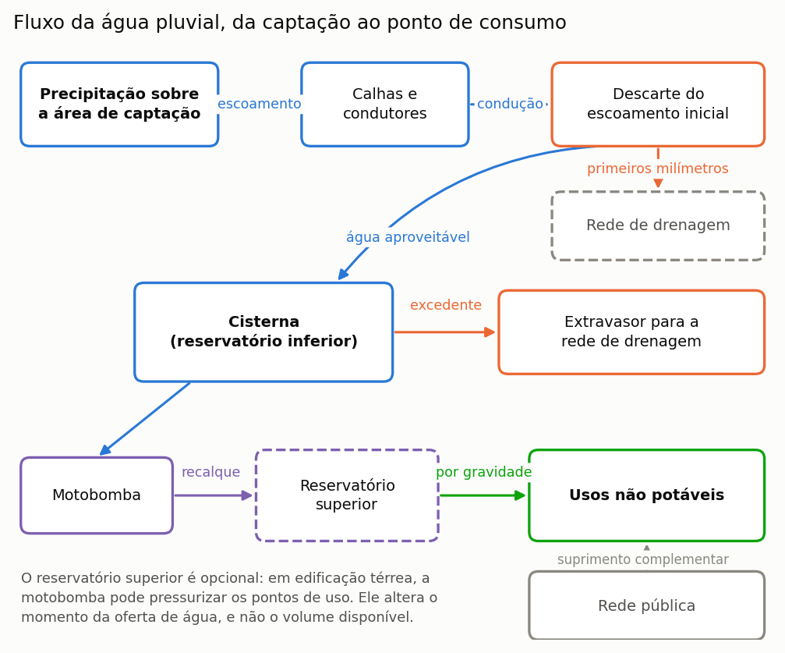
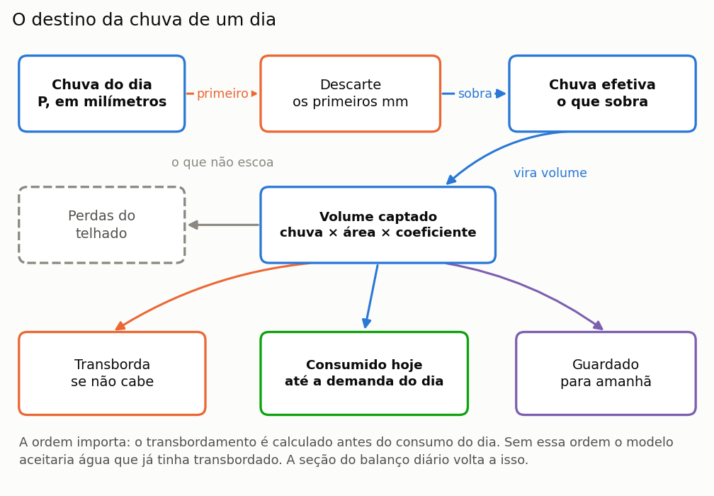
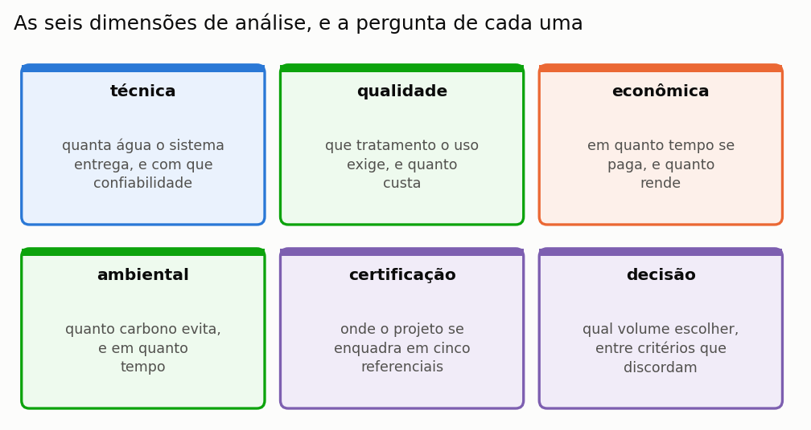
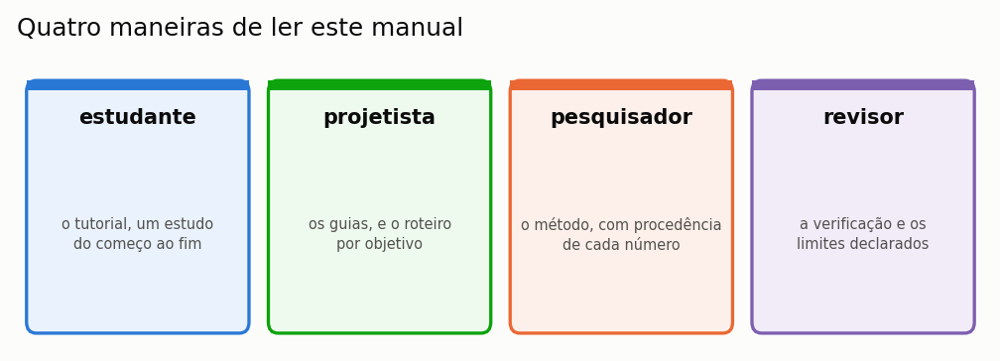

# O que o Netuno faz, e o que ele não faz

O Netuno simula sistemas de aproveitamento de água pluvial em edificações. Dado o
regime de chuva de um lugar, a cobertura de um edifício e o consumo de quem o ocupa,
ele responde **quanto de água potável o sistema substitui**, e a que custo, com que
qualidade e com que impacto de carbono.

Esta seção começa do começo, e por isso as duas subseções iniciais tratam do próprio
objeto antes de tratarem do programa. Quem já projeta sistemas prediais de água as
achará elementares e pode ir direto às seis dimensões de análise, que é onde o Netuno
aparece; quem está chegando agora ao assunto encontrará ali o vocabulário que o
restante do manual usa sem explicar de novo.

---

## O que é um sistema de aproveitamento de água pluvial

É um sistema que **coleta a chuva que cai no telhado e a usa no lugar da água da
rede**, nos usos que não precisam de água potável.

A ideia é velha e simples. O que ela tem de difícil é uma coisa só: a chuva não cai
quando você precisa dela. Por isso o sistema precisa de um reservatório, e por isso o
tamanho desse reservatório é a pergunta central de todo projeto — e deste manual.

*Figura 1 — Os componentes de um sistema predial de aproveitamento de água pluvial. O reservatório superior e a motobomba aparecem tracejados porque são opcionais: dependem da altura da edificação e da pressão exigida nos pontos de uso.*

Seguindo o desenho, da esquerda para a direita:

**A cobertura** é a área de captação. Vale a **projeção horizontal** do telhado, e não
a área inclinada — é a sombra do telhado no chão que recebe a chuva. Errar isso é o
primeiro dos dez enganos da seção {{n:33}}.

**As calhas e os condutores** levam a água até a cisterna. O programa não os
dimensiona; isso é projeto hidráulico, e segue a ABNT NBR 10844.

**O dispositivo de descarte da primeira chuva** joga fora os primeiros milímetros de
cada evento, que são os que lavam a poeira, as folhas e os dejetos de pássaros
acumulados no telhado. É a medida de qualidade mais barata que existe, e a seção {{n:9}}
mostra o quanto ela muda a água que chega ao reservatório.

**A cisterna**, ou reservatório inferior, é onde a água fica guardada. Quando chove
mais do que ela comporta, o excedente **extravasa** para a drenagem. Esse
extravasamento não é desperdício por descuido: é a consequência inevitável de guardar
um recurso que chega concentrado.

**A motobomba e o reservatório superior** distribuem a água. Numa casa térrea, a bomba
pode alimentar os pontos de uso diretamente. Num sobrado ou num prédio, é preciso uma
caixa elevada, e aí a água sobe uma vez e desce por gravidade.

**Os usos não potáveis** são o destino: bacia sanitária, máquina de lavar, lavagem de
piso e de carro, rega de jardim. Quando a chuva não basta, a **rede pública** completa
— o sistema nunca deixa a edificação sem água.

O diagrama acima mostra o encadeamento das peças, que é o que interessa para
acompanhar o cálculo. Falta a ele, porém, a informação que decide metade das
dúvidas de projeto: onde cada peça fica em relação às outras, e a que altura. O
corte a seguir repõe essa geometria, porque desnível é o que determina se a água
desce por gravidade ou precisa de bomba, e porque a posição da cisterna em
relação ao terreno é uma decisão de obra, não de cálculo.

*Figura 2 — O mesmo sistema visto em corte. A área de captação é a projeção horizontal da cobertura, e não a área inclinada do telhado. A caixa elevada recebe a água recalcada da cisterna e a devolve aos pontos de uso por gravidade; a rede pública entra por ela, completando o que a chuva não atendeu.*

> **Vocabulário que o manual usa o tempo todo.** *Cisterna* e *reservatório inferior*
> são a mesma coisa. *Extravasar* e *transbordar* também. *Demanda pluvial* é a parte
> do consumo que a água de chuva pode atender; *demanda total* é o consumo inteiro da
> edificação. A seção {{n:G}} traz o glossário completo.

---

## O que o programa calcula, em um dia

O programa faz uma conta de entrada e saída, todo dia, para cada dia da série de
chuva. A conta é esta:

*Figura 2 — A chuva de um dia até o seu destino final. Cada caixa é uma parcela do balanço, e a soma das três de baixo é igual ao volume captado.*

Lendo o desenho:

1. **Desconta-se o descarte.** Se choveu 12 mm e o descarte é de 2 mm, sobram 10 mm.
2. **Converte-se em volume.** Dez milímetros sobre 100 m² de telhado, com coeficiente
   de escoamento de 0,85, dão 850 litros. A conta é `mm × m² × coeficiente`, e sai
   direto em litros, porque um milímetro sobre um metro quadrado é exatamente um
   litro.
3. **Soma-se ao que havia na cisterna**, e o que não couber **transborda**.
4. **Retira-se o consumo do dia**, até o limite da demanda pluvial.
5. **O que sobra fica para amanhã** — e é essa memória entre um dia e o seguinte que
   torna a simulação diária necessária.

Os cinco passos formam um ciclo, e não uma lista: o volume que sobra ao fim do
quinto passo é exatamente o volume de que o terceiro passo parte no dia seguinte. Essa
ligação entre um dia e o outro é a única coisa que uma conta feita sobre a média anual
não consegue reproduzir, e é a razão de a simulação ser diária.

*Figura 3 — Os cinco passos do balanço diário, na ordem em que o programa os executa. A ligação em roxo, que contorna o desenho, é a memória entre um dia e o seguinte: o volume que sobra ao fim de um dia é o volume inicial do próximo.*

> **Aprofundamento: por que não basta a média anual.** É tentador dividir a chuva
> anual por 365 e fazer a conta de uma vez. O resultado é sempre otimista, e às vezes
> muito. A razão é que a chuva chega **concentrada**: enche a cisterna num dia,
> transborda, e depois falta por duas semanas. A média não enxerga nem o
> transbordamento nem a falta, e as duas reduzem o aproveitamento. A seção {{n:23}}
> mostra isso acontecendo numa tabela de dez dias que você pode refazer na planilha,
> e a seção {{n:7}} mostra o tamanho do erro.

Repetida ao longo de trinta anos de série, essa conta produz a resposta central do
programa: o **potencial de economia de água potável**, a fração do consumo total da
edificação que a chuva conseguiu substituir.

---

## As seis dimensões

Quanta água o sistema entrega é a primeira pergunta, não a única. O programa responde
seis, e elas costumam apontar para volumes diferentes.

*Figura 99 — As seis dimensões de análise e a pergunta que cada uma responde. O programa percorre as seis na mesma ordem em que aparecem, e cada uma tem uma seção própria no capítulo do método.*

Cada dimensão tem tratamento próprio no capítulo do método: a técnica nas seções {{n:23}} a {{n:26}}, a qualidade na {{n:27}}, a econômica na {{n:29}}, a ambiental na {{n:30}}, a certificação na {{n:31}} e a decisão na {{n:32}}.

A última é a que distingue o programa de uma planilha. As outras cinco produzem
respostas que **discordam entre si** — a maior economia de água quase nunca é o melhor
negócio, e nenhuma das duas costuma ser a melhor escolha ambiental. A sexta dimensão
existe para escolher com os pesos declarados, em vez de escondidos.

---

## O que o programa **não** faz

Começar pelos limites é incomum, e é deliberado. Poupa o tempo de quem abriu o
programa esperando outra coisa.

**Não dimensiona a instalação hidráulica.** Não calcula traçado, diâmetro por trecho,
perda de carga nem declividade. O esquema exportado em DXF é um esquema, e o projeto
executivo é do projetista.

**Não dimensiona o dispositivo de descarte.** A lâmina de descarte é um parâmetro do
balanço; o reservatório de autolimpeza que a materializa, de volume igual à área vezes
a lâmina, exige dimensionamento hidráulico à parte.

**Não substitui ensaio de qualidade de água.** Ele dimensiona equipamento de
tratamento a partir de premissas. As constantes do modelo de lavagem da cobertura não
são calibradas contra medição, e a qualidade resultante é premissa, não resultado.

**Não modela sub-passo horário.** Uma chuva de 40 mm em duas horas e a mesma lâmina
em vinte e quatro horas dão o mesmo resultado.

**Não faz inventário completo de ciclo de vida.** A avaliação é de **triagem**, numa
única categoria de impacto — carbono. Não há eutrofização, acidificação, uso do solo
nem toxicidade.

**Não certifica.** Ele mostra onde o projeto se enquadraria. A certificação é
decidida pelo organismo certificador, com a documentação completa do empreendimento.

**Não conhece o sítio.** Não sabe se o volume cabe no terreno, se há lençol freático
alto, nem se a estrutura suporta a caixa elevada.

A seção {{n:36}} traz a lista completa de limitações conhecidas, com as consequências de
cada uma.

---

## Para quem serve

*Figura 99 — Quatro percursos de leitura possíveis. Nenhum deles exige os demais, e o manual foi montado para que cada um possa ser feito isoladamente.*

Em números de seção: o estudante segue o capítulo {{c:2}}, que é o tutorial do começo ao fim; o projetista usa os guias do capítulo {{c:3}} e o roteiro da seção {{n:3}}; o pesquisador vai ao método do capítulo {{c:4}}; e o revisor encontra no capítulo {{c:6}} a verificação e os limites declarados.

Quem está começando agora deve percorrer o capítulo {{c:2}} inteiro, na ordem em que
está escrito. Ele constrói um projeto do zero e o acompanha até a decisão final, e cada
seção encerra mostrando onde o projeto chegou, de modo que o leitor veja o estudo se
formando em vez de recebê-lo concluído.

---

## O que mudou do Netuno 4

O Netuno 4 é o antecessor, publicado em 2014 pelo mesmo grupo. O Netuno 5 mantém o
modelo conceitual — balanço comportamental diário — e acrescenta seis dimensões de
análise que não existiam.

> **Aprofundamento: as duas diferenças deliberadas de método.** Quem comparar
> resultados das duas versões precisa declará-las.
>
> **O tratamento do descarte.** O Netuno 4 trata a lâmina como **limiar do evento**:
> abaixo dela nada é captado, acima dela capta-se a chuva inteira. O Netuno 5
> **subtrai** a lâmina, o que é fisicamente mais fiel.
>
> **O critério de volume ótimo.** As implementações e as grades de busca diferem.
>
> Juntas, as duas respondem por 91% da divergência medida entre os programas. Sobre
> 4.050 casos de referência, o Netuno 5 estima de 2,3 a 2,7 pontos percentuais menos
> economia. **Neutralizadas as duas, o motor reproduz o Netuno 4 com erro médio de
> 0,25 ponto percentual e 100% dos casos dentro de 5 pontos.** A seção {{n:35}} traz a
> decomposição completa.

---

## Uma palavra sobre resultados

Todo número que o programa produz é **condicional às premissas declaradas**. Ele não
descobre verdades; ele calcula consequências.

Por isso o manual insiste tanto em declaração. A seção {{n:13}} traz a lista do que
precisa constar num artigo, a seção {{n:33}} traz os dez enganos que o programa não
impede, e o 36 traz o que ele não cobre.

Um estudo que declara suas premissas e seus limites é mais útil — e mais defensável —
que um que apresenta um número sozinho.
