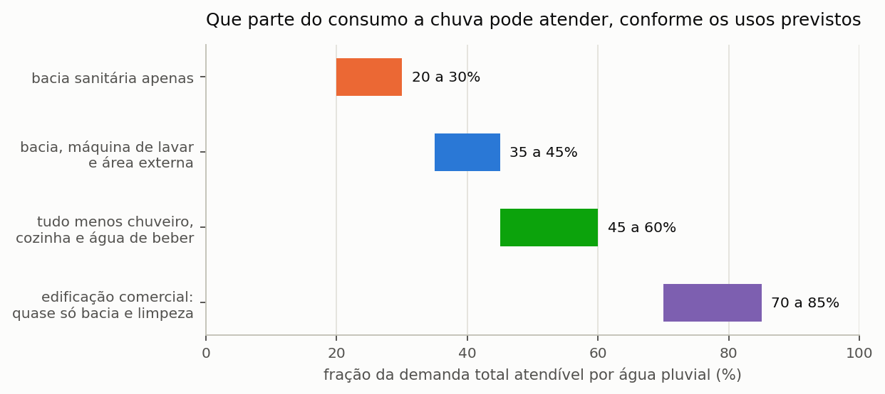

# Por onde começar, conforme o seu objetivo

Este manual reúne quarenta e nove seções distribuídas em sete capítulos, e não foi
concebido para ser lido do começo ao fim. Ele funciona melhor como obra de consulta, em
que cada leitor entra pelo ponto que corresponde ao que precisa fazer, e esta seção
existe justamente para indicar esse ponto de entrada.

---

## Roteiro por objetivo

A tabela abaixo relaciona os cinco propósitos mais comuns de quem abre o programa, com o
percurso de leitura correspondente a cada um deles.

<!-- tabela: Percurso de leitura recomendado conforme o objetivo do leitor -->
| Você quer | Leia |
| :--- | :--- |
| **aprender a usar** o programa | o capítulo {{c:2}} inteiro, seções {{n:4}} a {{n:13}}, na ordem |
| **resolver um caso** hoje | as três perguntas abaixo, e depois o guia do capítulo {{c:3}} que couber |
| **publicar** um estudo | o capítulo {{c:4}}, que traz o método, e a seção {{n:13}}, com a lista de declaração |
| **revisar** um estudo alheio | o capítulo {{c:6}}, e as seções {{n:A}} e {{n:B}} |
| **migrar** do Netuno 4 | as seções {{n:21}} e {{n:35}} |
| **não errar** | a seção {{n:33}}, com os dez enganos mais comuns |

Quem dispõe de uma hora e nenhuma familiaridade prévia deve ler o tutorial do capítulo
{{c:2}}. Ele constrói um estudo completo em torno de um único projeto, e cada seção
encerra mostrando onde esse projeto chegou, de modo que o leitor acompanha a construção
em vez de receber o resultado pronto.

---

## As três perguntas que definem um estudo

Antes mesmo de abrir o programa, convém responder a três perguntas, porque elas
determinam boa parte das decisões subsequentes e porque respondê-las depois costuma
implicar refazer trabalho.

### Que usos a água pluvial vai atender?

A resposta define a **fração atendível**, e a fração atendível é o teto de todo o resto:
um sistema cuja fração é de 40% jamais economizará mais que 40% do consumo total, por
maior que seja a cisterna e por mais que chova. Nenhuma decisão posterior de projeto
altera esse limite, razão pela qual ele merece ser estabelecido antes de qualquer outra
coisa.

*Figura 99 — Que parte do consumo total a água de chuva pode atender, conforme os usos que o projeto prevê. É o teto do potencial de economia: nenhum reservatório, por maior que seja, ultrapassa essa fração.*

Os três primeiros casos são tratados na seção {{n:5}}, e o caso comercial na seção {{n:18}}.

### Vai comparar volumes ou avaliar um só?

A distinção entre avaliar um volume conhecido e procurar o volume adequado determina o
modo de simulação e, com ele, o tempo de máquina e a riqueza do resultado.

<!-- tabela: Escolha entre volume fixo e varredura conforme a pergunta do estudo -->
| Se você quer | Use | Onde se trata |
| :--- | :--- | :--- |
| avaliar uma cisterna que já existe | volume fixo | seção {{n:6}} |
| descobrir o volume a comprar | **varredura** | seções {{n:7}} e {{n:24}} |
| escolher entre critérios que discordam | varredura e multicritério | seções {{n:12}} e {{n:32}} |

==A varredura é quase sempre a resposta certa.== Ela custa mais tempo de máquina, na
ordem de segundos, e produz a curva de retorno decrescente, que é o argumento mais forte
de que qualquer estudo pode dispor ao justificar um volume.

### Precisa de reservatório superior?

A terceira pergunta é hidráulica, e a resposta depende da altura da edificação e da
pressão exigida nos pontos de consumo.

<!-- tabela: Critérios hidráulicos para decidir sobre o reservatório superior -->
| Se a edificação | Então | Onde se trata |
| :--- | :--- | :--- |
| é térrea e os pontos ficam próximos da cisterna | pressurização direta, sem caixa | seção {{n:8}} |
| é sobrado ou prédio | caixa elevada, por **pressão** | seção {{n:8}} |
| precisa de reserva contra falta de energia | caixa elevada | seção {{n:8}} |

> A caixa elevada **não aumenta** a economia de água. Mantido o mesmo armazenamento
> total, ela entrega ligeiramente menos e consome energia de recalque. A decisão de
> adotá-la deve ser hidráulica, e nunca fundada na expectativa de maior aproveitamento.

---

## A ordem de trabalho no programa

A barra lateral do programa está numerada, e a numeração corresponde à ordem em que se
trabalha. As quatro primeiras etapas são de entrada de dados, as cinco seguintes
apresentam resultados, e as três últimas reúnem ferramentas auxiliares.

*Figura 99 — As doze etapas do programa, agrupadas por natureza. As quatro primeiras são de entrada e precisam ser preenchidas em ordem, porque cada uma consome o que a anterior definiu; as quatro seguintes são leitura de resultados; as últimas quatro produzem saídas ou dão apoio, e podem ser acionadas a qualquer momento.*

Onde este manual trata cada uma: a etapa 1 na seção {{n:4}}, a 2 na {{n:5}}, a 3 na {{n:9}}, a 4 nas seções {{n:6}}, {{n:7}} e {{n:10}}, a 5 na {{n:6}}, a 6 na {{n:10}}, a 7 na {{n:11}}, a 8 na {{n:12}}, a 9 na {{n:13}}, a 10 na {{n:22}} e a 12 na {{n:16}}. A etapa 11 é a própria documentação embutida no programa, e não tem seção correspondente aqui.

Convém salvar o projeto ao concluir cada etapa. Os 104 parâmetros são gravados e
relidos integralmente, e o arquivo resultante é a evidência documental do estudo, tanto
para quem o refará no futuro quanto para quem o avaliará.

---

## Antes de publicar

Três leituras são obrigatórias para quem pretende publicar resultados, e nenhuma delas é
longa. A seção {{n:13}} traz a lista do que declarar num artigo, acompanhada de um
parágrafo de método pronto para adaptação. A seção {{n:33}} reúne os dez enganos de
projeto que o programa não tem como impedir. E a seção {{n:36}} relaciona as limitações
conhecidas — das quais interessa ler não todas, mas as que afetam o caso em mãos.

A seção {{n:I}} condensa as três em fichas de uma página, para consulta rápida.
