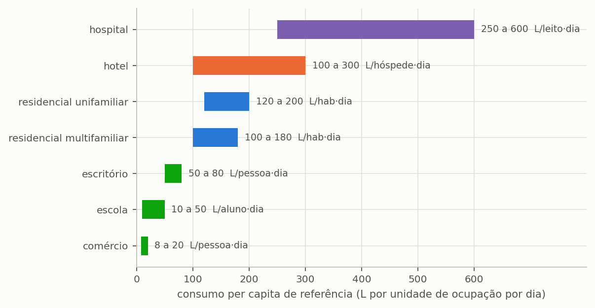
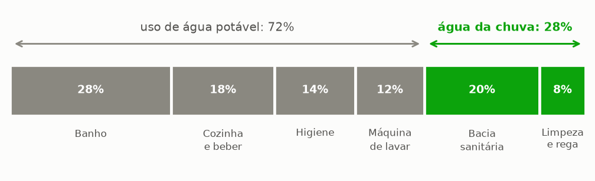
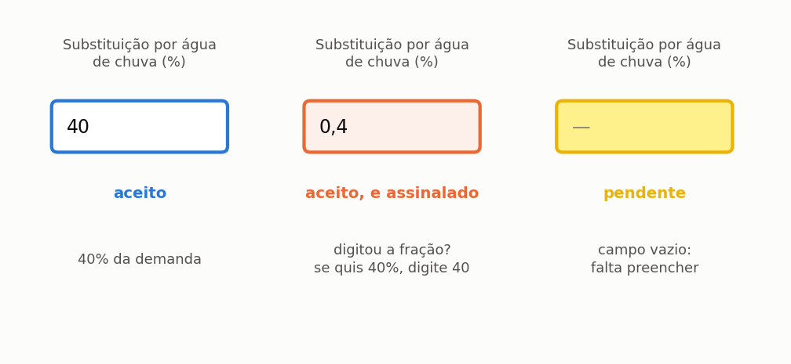

# A edificação e a demanda

> Ao terminar esta seção o programa saberá **quanta água sai** e, mais importante,
> **qual parte dela a chuva pode atender**. Essa fração é o teto de tudo o que vem
> depois.

A seção {{n:4}} definiu a oferta. Esta define a demanda. E há uma assimetria que
convém entender desde já: **a chuva não pode atender toda a demanda**, por mais
água que haja. Existe um teto, ele é definido aqui, e nenhum reservatório o
ultrapassa.

---

## A tipologia

Na etapa **2. Edificação e Consumo**, escolha *Residencial unifamiliar*. O programa traz oito
tipologias, cada uma com o consumo per capita de referência ({{fig:fig38_per_capita}}) e a repartição usual dos usos finais. A indústria não tem faixa de referência, porque o consumo depende do processo produtivo, e não da ocupação: nesse caso, o valor deve vir de medição.



*Figura 99 — As faixas usuais de consumo per capita por tipologia de edificação. A amplitude de cada faixa é grande de propósito: são valores de referência para quem ainda não mediu, e a medição, quando existe, sempre prevalece.*


A tipologia serve de ponto de partida, não de imposição: o valor continua editável.
A seção {{n:18}} trata dos casos não residenciais, que têm uma armadilha própria na tarifa.

---

## Os moradores e o consumo

**Quatro moradores, 150 L/hab·dia.** Total de **600 L/dia**.

O valor de 150 L/hab·dia é o consumo de uma residência de classe média com
abastecimento regular. Se você tem a fatura de água e esgoto da edificação, use-a: divida o
consumo mensal em litros por trinta e pelo número de moradores. O número medido vale
mais que qualquer referência.

O programa aceita demanda **constante** ou modulada por semana, mês ou dia. O
tutorial usa constante; a seção {{n:17}} mostra a modulação, que importa em escola, hotel e
qualquer edificação com sazonalidade.

---

## A fração que a chuva pode atender

**28%.** É o número mais importante desta seção.

Água de chuva não vai para o chuveiro, para a pia da cozinha nem para beber. Numa
residência, vai para a bacia sanitária, a lavagem de piso, a rega de jardim e a lavagem
de veículo. A fração desses usos no consumo total é o **teto do potencial de economia**.

A repartição adotada no tutorial está representada na {{fig:fig00c_fracao}}, com a
marcação dos usos que a chuva atende. A bacia sanitária responde por 20% do consumo e a
limpeza e a rega por 8%; chuveiro, pia de cozinha, lavatório e máquina de lavar roupa,
que respondem pelo restante, ficam com a água potável.

Somando os dois que a chuva atende, chega-se aos 28% do tutorial. É um valor
conservador para residência unifamiliar sem jardim grande, e é conservador de
propósito: ele se limita aos usos que a norma admite.

> **A máquina de lavar roupa não está na lista da norma.** A ABNT NBR 15527:2019, no item
> 4.1.7, admite sete usos não potáveis para a água de chuva: sistemas de resfriamento,
> descarga de bacias sanitárias e mictórios, lavagem de veículos, lavagem de pisos,
> reserva técnica de incêndio, uso ornamental e irrigação paisagística. A ABNT NBR
> 16783:2019, que trata das fontes alternativas em geral, também não inclui a lavagem de
> roupa no item 4.2.1. Para qualquer outro uso, o item 4.1.8 da NBR 15527 exige que o
> profissional responsável estude os parâmetros de qualidade e o tratamento específicos.
> O uso na máquina de lavar é comum na literatura e na prática, e por isso muitos
> estudos trabalham com frações atendíveis maiores que a deste tutorial. Em Joinville,
> Ghisi e Custódio (2019) obtiveram potencial médio de 18,5% com água de chuva só nas
> bacias sanitárias, e de 40,8% com as bacias e a máquina de lavar. O tutorial **não** o adota: a máquina fica com
> a água potável, e a fração atendível cai para os 28% da bacia sanitária e dos usos
> externos. Um projeto que inclua a lavagem de roupa precisa declarar que ela está fora
> da lista normativa e qual critério de qualidade foi adotado para ela.



*Figura 99 — Repartição típica do consumo de uma residência por uso final. Em cinza, os usos que exigem água potável; em verde, os de possível uso de água da chuva, cuja soma é a fração atendível e o teto do potencial de economia: nenhum reservatório, por maior que seja, economiza mais do que essa fração.*

> **Este número é o teto.** Com 28% de fração atendível, o potencial de economia
> **jamais** passa de 28%, por maior que seja o reservatório e por mais que chova.
> A tabela da seção {{n:7}} mostra a curva se aproximando exatamente desse limite e
> nunca o cruzando.
>
> Quem quer passar de 28% precisa mudar o **uso**, não o reservatório: acrescentar um
> uso, como a lavagem de roupa, com o critério de qualidade declarado que o item 4.1.8 da
> norma exige, ou reduzir o consumo potável.

### Percentual na tela, fração no arquivo

A mesma grandeza aparece com duas grafias, e cada uma tem o seu lugar. Em todo campo em
que se digita — as frações da tela de edificação, as tabelas semanal e mensal, as tabelas
de cenários, a planilha de lote e o argumento `--share` da linha de comando — a fração é
um **percentual, de 0 a 100**: 28 significa 28%. No arquivo de projeto, no arquivo de
parâmetros e em `rainwater_share` e `non_potable_indoor_share`, ela é uma **fração, de 0
a 1**: 0,28.

A divisão não é arbitrária. O percentual é a forma em que a grandeza circula entre
projetistas, normas e faturas de água e esgoto, e é a forma que menos se erra ao digitar. A
fração é a forma em que ela entra na equação do balanço, multiplicando a demanda
interna (seção {{n:23}}), e é a forma que não exige conversão a quem lê o arquivo com
outro programa.

O que não se admite é a mistura. Até esta versão, doze pontos do programa aceitavam as
duas grafias e decidiam pela regra «acima de 1 é percentual». A regra erra justamente
nos valores pequenos, onde o erro não se vê: 1 virava 100%, e não 1%; 0,5 digitado numa
coluna em percentual virava 50%. ==Agora a unidade é fixada pelo lugar, e nunca
adivinhada pelo valor.== Um percentual acima de 100 é recusado; uma fração acima de 1 é recusada com a indicação de que parece percentual. A {{fig:fig46b_percentual}} mostra os três estados do campo na interface.



*Figura 99 — Estados do campo de fração atendível na interface. O campo recebe percentual de 0 a 100; no arquivo de projeto e nos parâmetros de cálculo a grandeza é armazenada como fração de 0 a 1. Um valor entre 0 e 1 digitado no campo fica assinalado em laranja, sem bloquear o cálculo, porque 0,4% é possível, embora raro.*

> **O marcador laranja.** Um valor entre 0 e 1 num campo em percentual é aceito, porque
> menos de 1% de substituição é possível, mas o campo fica laranja e a dica explica o
> que foi entendido. Nas tabelas de cenários e na planilha de lote, o programa pergunta
> antes de simular.

---

## Discretizar os usos, ou não

O programa aceita dois níveis de detalhe na descrição da demanda, e a escolha entre eles
depende do que o estudo pretende responder.

No **modo simplificado**, informam-se duas coisas: a fração não potável do consumo
interno — bacias sanitárias e lavagem de roupa — e, se houver, a demanda externa em litros
por dia. A fração atendível **total** sai das duas,

```text
f = (fração interna × demanda interna + demanda externa) ÷ (demanda interna + demanda externa)
```

e aparece num campo que não se edita, porque é resultado e não dado. Sem demanda externa,
a total é a própria fração interna: os 28% deste tutorial. É o modo adotado aqui e é
suficiente para a maior parte dos estudos.

> **Por que a total não se digita.** Até a versão 5.0.0 o campo da fração total era
> editável, mas a simulação usava a fração interna; e, ao abrir um projeto, a tela voltava
> a interna para 35% e a externa para zero, quaisquer que fossem as gravadas. Um projeto
> que declarava 28% era simulado com 35%. Hoje a tela restaura as duas, a total é
> calculada, e um arquivo antigo cujas frações discordem é aberto com a total que ele
> declara, com um aviso.

No **modo discretizado**, a demanda é separada em três parcelas: a potável interna, que a
chuva nunca atende; a não potável interna, que é a prioridade do sistema; e a irrigação,
atendida por último. A separação muda duas coisas. Altera a ordem de atendimento nos dias
de escassez, em que o uso interno tem precedência sobre o jardim; e permite distinguir uso
interno de uso externo nos créditos de certificação, distinção que o LEED exige em
créditos separados, conforme a seção {{n:31}} descreve.

Vale discretizar quando há jardim de área relevante, quando a certificação está no
horizonte do projeto, ou quando a irrigação pode ser suprimida em dias de chuva — situação
que o item seguinte trata.

---

## A irrigação e a supressão por chuva

Declarado um volume de irrigação, o programa oferece um limiar de supressão por chuva:
nos dias em que a precipitação supera esse limiar, o jardim não é regado. O comportamento
reproduz o de qualquer controlador de irrigação dotado de sensor de chuva, equipamento
corrente e barato, e ignorá-lo superestimaria a demanda externa ao longo do ano inteiro. O
limiar adotado por padrão é de 2 mm diários.

> **A série de chuva é lida duas vezes.** Uma leitura é convertida em volume captado,
> após o descarte. A outra decide se o jardim é regado. As duas são independentes: um dia
> pode suprimir a irrigação **e** render captação.

Resta uma escolha que merece atenção particular, porque altera o resultado econômico e
não é neutra: o **suprimento de reserva** da irrigação. Com ele ligado, a rede pública
rega o jardim nos dias secos em que a cisterna não dá conta, e esse volume entra na fatura de água e esgoto como consumo potável. Com ele desligado, o jardim simplesmente não é regado
naquele dia, a edificação não compra essa água, e o volume correspondente aparece no
balanço como *demanda não atendida* — a terceira parcela tratada na seção {{n:23}}.

==A distinção entre as duas configurações é conceitual antes de ser numérica.== Um jardim
que precisa ser regado todos os dias representa uma demanda real, que alguém pagará; um
jardim que aceita não ser regado num dia seco representa uma conveniência, e tratá-lo como
demanda infla tanto o consumo quanto a economia aparente do sistema.

---

## O que temos até aqui

<!-- tabela: Estado do projeto do tutorial ao fim da definição da demanda -->
| Dado | Valor |
| :--- | ---: |
| tipologia | residencial unifamiliar |
| moradores | 4 |
| consumo per capita | 150 L/hab·dia |
| demanda total | 600 L/dia |
| fração atendível por chuva | 28% |
| **demanda pluvial** | **168 L/dia** |

O programa agora sabe a oferta e a demanda. Antes de simular, um confronto que vale
guardar:

<!-- tabela: Confronto entre a oferta anual de água pluvial e a demanda atendível -->
| | m³/ano |
| :--- | ---: |
| precipitação incidente na área de captação | 229 |
| volume remanescente após o descarte | 187 |
| **demanda pluvial do ano** | **61** |

A oferta excede a demanda: o volume disponível é **o triplo** do que se pretende usar. Se
o único limite fosse a oferta, o sistema atenderia 100% da demanda pluvial e chegaria aos 28% de teto.

Ele não chega, e a seção {{n:6}} mostra por quê.
