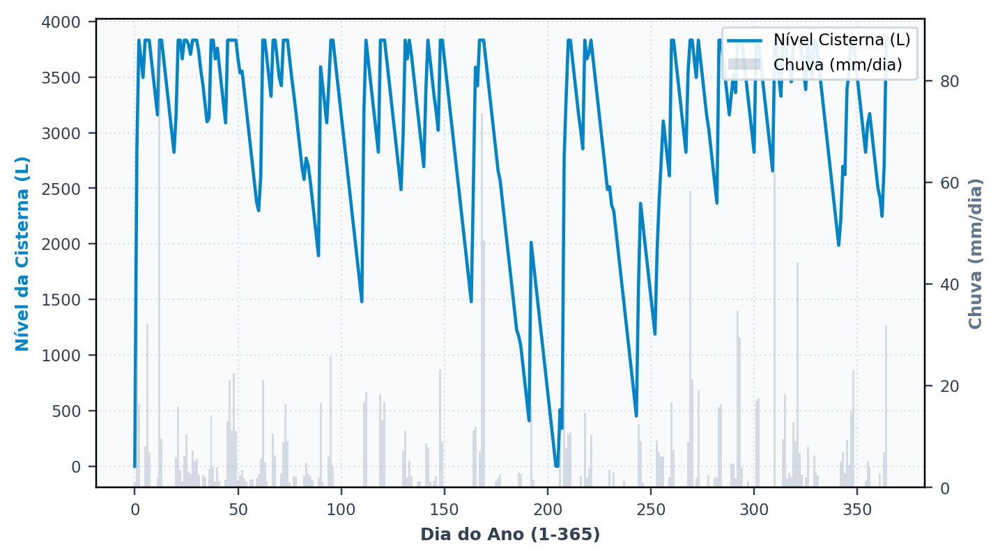

# A primeira simulação

> Ao terminar esta seção você terá o primeiro resultado na tela e saberá **ler**
> os quatro números que importam. Ler é a parte difícil: o programa entrega muitos
> números, e três deles respondem perguntas diferentes.

Falta um dado para simular: o volume do reservatório. Vamos chutar.

**3.000 litros.** Uma cisterna de concreto de 3 m³ é um tamanho comum de quintal,
cabe no orçamento e é o que um projetista proporia sem pensar muito. A seção {{n:7}}
vai perguntar se é o volume certo. Aqui só queremos ver o programa rodar.

Na etapa **4. Reservatório & Custos**, escolha volume fixo, informe 3.000 L, deixe o reservatório
superior desmarcado, e rode.

---

## O resultado

<!-- inclui: _tabelas/cap06_primeira_simulacao.md -->

A tela devolve várias dezenas de valores, e quatro deles bastam para julgar o projeto
nesta etapa. Cada um responde a uma pergunta distinta, e é precisamente por responderem
a perguntas distintas que eles não se substituem: um projeto pode ser bom pelo primeiro
e ruim pelo terceiro, e a leitura conjunta é o que evita conclusão apressada.

---

## O potencial de economia: 34,92%

Este indicador responde à pergunta que motiva a maior parte dos projetos: quanto da
conta de água se deixa de pagar. É o valor central produzido pelo programa e o que
figura no resumo de qualquer estudo, e corresponde à razão entre a água pluvial
consumida e a demanda total da edificação ao longo de toda a série, conforme a Equação
{{eq:potencial}}.

O denominador merece atenção, porque dele decorre todo o resto: trata-se da demanda
**total**, e não da demanda pluvial. É essa escolha que fixa o teto do indicador em 40%,
que é a fração atendível definida na seção {{n:5}}, e não em cem por cento.

O sistema alcançou 34,92% contra um teto de 40%, o que significa que ele entrega 87% do
que se propunha a entregar. Os 13% restantes correspondem aos dias em que a cisterna não
dispunha de água suficiente para atender à demanda pluvial daquele dia.

> **Não confunda os dois percentuais.** «Economia de 35%» e «atendimento de 87% da
> demanda pluvial» descrevem o mesmo sistema e são números diferentes. Estudos
> publicados às vezes trocam um pelo outro. Declare qual está usando.

---

## O extravasamento: 303 L/dia

**Responde: o reservatório é grande o bastante?**

Trezentos e três litros por dia, em média ao longo dos trinta anos, extravasam da
cisterna e seguem para a rede de drenagem. ==O volume extravasado supera os 240 L/dia
que o sistema pretende consumir,== o que significa que o reservatório escolhido deixa
passar mais água do que aproveita.

Esse é o argumento mais forte a favor de aumentar o reservatório, e é exatamente o que a
seção {{n:7}} fará em seguida, de modo sistemático.

> Um extravasamento alto não é defeito do programa nem do projeto. É a assinatura do
> descasamento entre a chuva, que chega concentrada em poucos dias, e a demanda, que
> é constante. O reservatório existe para amortecer isso, e todo reservatório
> finito falha em algum evento.

---

## Os dias de atendimento: 85,7% plenos

**Responde: com que frequência posso contar com o sistema?**

Trata-se da confiabilidade **temporal** do sistema, e ela responde a uma pergunta que o
potencial de economia não alcança: com que frequência se pode contar com a água pluvial.
Cada dia da simulação recebe uma de três classificações, segundo o grau de atendimento
alcançado.

<!-- tabela: Classificação de cada dia da simulação quanto ao grau de atendimento -->
| Classe | O que significa |
| :--- | :--- |
| pleno | a chuva atendeu **toda** a demanda pluvial do dia |
| parcial | atendeu parte, e a rede completou |
| nulo | a cisterna estava vazia; tudo veio da rede |

Em 85,7% dos dias o sistema deu conta sozinho da demanda pluvial, e nos 14,3% restantes
a rede pública entrou, integral ou parcialmente. A distinção tem consequência direta
sobre o projeto hidráulico: um sistema com muitos dias de atendimento nulo exige
alimentação automática de reserva bem dimensionada, e o usuário percebe a alternância
entre as duas fontes ao longo do ano. Um sistema com 99% de dias plenos é, na prática,
independente da rede para os usos que atende.

> **Potencial e confiabilidade não andam juntos.** É possível ter potencial alto com
> confiabilidade baixa: um reservatório que se enche na estação chuvosa e seca na
> estiagem entrega muito volume no ano e falha metade dos dias. A tabela do
> seção {{n:7}} mostra as duas colunas divergindo.

---

## O volume anual poupado

**Responde: quanto vale isso em dinheiro e em carbono?**

Este é o valor que atravessa para as seções {{n:10}} e {{n:11}}, porque tanto a economia
na conta de água quanto a emissão de carbono evitada são calculadas a partir dele. Ele
é sensivelmente menor que os 187 m³/ano que a cobertura disponibiliza depois do
descarte, e a diferença inteira corresponde ao que extravasou.

---

Antes de discutir por que o potencial não chega aos 40%, convém ver o reservatório trabalhando. A aba de resultados traz a série diária do nível da cisterna, e é nela que se enxergam de uma vez os dois regimes que limitam o aproveitamento: o transbordamento e a falta.

*Figura 99 — O nível da cisterna ao longo do primeiro ano da série, com a chuva diária ao fundo. Os platôs no alto são os dias em que o reservatório está cheio e extravasa; os vales no zero são os dias em que ele secou e a rede atendeu tudo. Figura gerada pelo próprio programa.*

---
## Por que não chegamos aos 40%

A seção {{n:5}} encerrou com um confronto aparentemente favorável: 187 m³ anuais de
oferta contra 88 m³ de demanda pluvial, isto é, mais que o dobro do necessário. Diante
desse excedente, seria razoável esperar atendimento integral, e ainda assim o sistema
entrega 87% do pretendido.

A explicação está inteiramente no **tempo**. O excedente não ocorre no momento em que a água é
necessária: a precipitação chega concentrada, enche a cisterna de 3.000 L num único dia
de chuva intensa, extravasa no mesmo dia, e falta duas semanas depois. O excedente anual e o
atendimento diário são grandezas que não se comunicam, e é justamente essa
incomunicabilidade que torna a simulação diária indispensável.

O reservatório de 3.000 L armazena o equivalente a doze dias e meio de demanda pluvial.
Qualquer estiagem mais longa que isso o esvazia, e a partir daí o sistema passa a
depender integralmente da rede até a chuva seguinte.

É por isso que aumentar o reservatório funciona — e é por isso que aumentar tem
limite. A seção {{n:7}} mede exatamente onde fica esse limite.

---

## O que temos até aqui

<!-- tabela: Estado do projeto do tutorial após a primeira simulação -->
| Resultado com 3.000 L | |
| :--- | ---: |
| potencial de economia | 34,92% |
| de um teto de | 40% |
| extravasamento | 303 L/dia |
| dias de atendimento pleno | 85,7% |

Um resultado defensável. Mas escolhemos 3.000 L por palpite, e o extravasamento
sugere que é pouco.

Quanto seria o certo?
