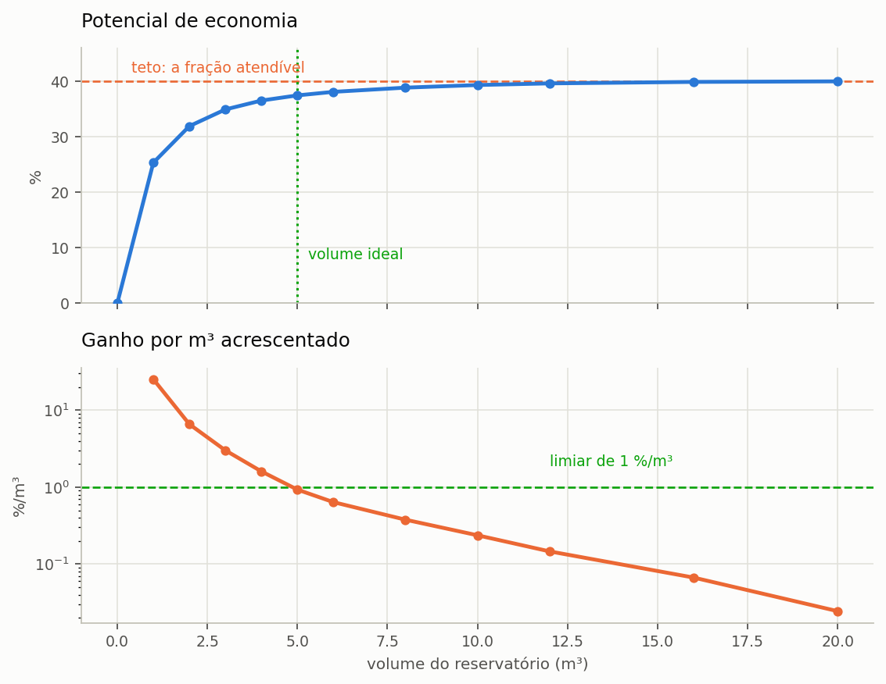

# Escolher o volume

> Ao terminar esta seção você terá a curva de retorno do reservatório, saberá
> onde ela deixa de compensar, e entenderá por que **não existe** um volume ótimo
> absoluto — existe um volume ótimo para um critério declarado.

A seção {{n:6}} adotou 3.000 L como primeiro palpite e encontrou 303 L/dia
transbordando, o que equivale a metade de tudo o que a cobertura capta. Diante de um
desperdício dessa ordem, a pergunta que se impõe é quanto reservatório vale a pena
acrescentar, e ela não se responde por tentativa isolada: responde-se simulando o mesmo
projeto para muitos volumes e observando como o resultado evolui. É o que o programa
chama de **varredura**.

---

## Rodar a varredura

Na etapa **4. Reservatório & Custos**, escolha o modo varredura e informe o
volume máximo e o passo. Para o nosso projeto:
máximo de 20.000 L, passo de 1.000 L.

Duas particularidades da montagem da grade convêm ser conhecidas antes de interpretar o
resultado. A primeira é que o passo informado é arredondado para cima até o múltiplo de
250 L, valor que corresponde ao quantum comercial de reservatórios — não se compra
cisterna de 1.300 L, e um ótimo apontado nesse volume seria inexequível. Quando o passo
pedido não é múltiplo de 250, o programa o ajusta e registra o ajuste, de modo que o
relatório possa declarar o passo efetivamente utilizado.

A segunda é que a grade se limita a quarenta volumes positivos. Uma varredura de 0 a
50.000 L com passo de 100 L exigiria quinhentas simulações de trinta anos cada, e o ganho
de informação não compensa o tempo de máquina, porque a curva é suave e quarenta pontos
já a descrevem com folga. O volume máximo informado é sempre preservado como último
ponto da grade, de modo que apenas o último intervalo pode ser menor que o passo efetivo.

O volume zero integra a grade como alternativa de referência: ele representa o cenário
sem sistema, contra o qual todos os demais se comparam.

---

## A curva

<!-- inclui: _tabelas/cap07_varredura.md -->

*Figura 2 — À esquerda, o potencial se aproximando do teto de 40% e nunca o cruzando. À direita, o ganho marginal em escala logarítmica: três ordens de grandeza entre o primeiro metro cúbico e o vigésimo.*

A coluna decisiva da tabela é a de **ganho por metro cúbico acrescentado**, que é a
derivada discreta da curva de potencial e expressa quanto cada metro cúbico adicional de
reservatório acrescenta de economia. A tabela abaixo destaca alguns intervalos, e o
padrão que ela revela é o argumento central desta seção.

<!-- tabela: Ganho marginal de economia a cada metro cúbico acrescentado ao reservatório -->
| De → para | Ganho por m³ |
| :--- | ---: |
| 0 → 1.000 L | 25,32 %/m³ |
| 1.000 → 2.000 L | 6,59 %/m³ |
| 2.000 → 3.000 L | 3,01 %/m³ |
| 3.000 → 4.000 L | 1,61 %/m³ |
| 5.000 → 6.000 L | 0,64 %/m³ |
| 10.000 → 12.000 L | 0,15 %/m³ |
| 16.000 → 20.000 L | 0,02 %/m³ |

==O primeiro metro cúbico de reservatório entrega 25 pontos percentuais de economia; o
décimo sexto entrega dois centésimos de ponto.== A diferença é de três ordens de
grandeza, e os dois metros cúbicos custam o mesmo concreto, a mesma escavação e a mesma
mão de obra.

Esse comportamento não é peculiaridade do regime de chuva de Florianópolis. É a forma
característica de toda curva de aproveitamento pluvial, e decorre de dois fatos que
atuam em conjunto. Os primeiros litros de armazenamento capturam os eventos pequenos e
frequentes, que constituem a maioria das chuvas em qualquer regime; e o teto imposto pela
fração atendível, de 40% neste projeto, puxa a curva para a horizontal à medida que o
sistema dele se aproxima, de modo que o espaço restante para ganho vai se esgotando.

---

## O volume ideal

Diante de uma curva cujo rendimento decai dessa forma, a pergunta «qual o volume ideal?»
só admite resposta depois que se estabeleça o que significa deixar de compensar. O
Netuno adota para isso o critério do ganho marginal: o volume ideal é o menor volume cujo
ganho por metro cúbico acrescentado já tenha caído abaixo de um limiar declarado pelo
usuário, conforme a formulação da seção {{n:24}}.

O limiar padrão do programa é de 1 %/m³. Na varredura deste projeto, o primeiro volume a
cair abaixo dele é o de 5.000 L, com ganho marginal de 0,93 %/m³.

<!-- tabela: Indicadores do volume ideal obtido com o limiar padrão de 1 %/m³ -->
| | |
| :--- | ---: |
<!-- tabela: Indicadores do volume ideal obtido com o limiar padrão de 1 %/m³ -->
| volume ideal, limiar de 1 %/m³ | 5.000 L |
| potencial nesse volume | 37,46% |
| de um teto de | 40% |
| dias de atendimento pleno | 92,9% |

O limiar, contudo, é uma escolha do analista, e ela decide o resultado tanto quanto os
dados de entrada. A tabela abaixo mostra o volume ideal que cada limiar plausível
produziria para este mesmo projeto.

<!-- inclui: _tabelas/cap07_limiar_e_custo.md -->

O programa não emite opinião sobre qual limiar seria o correto, e não poderia fazê-lo:
a escolha depende do custo do reservatório, do valor da água no município e da
disponibilidade de espaço no terreno, nenhum dos quais é dado hidrológico. O que o
programa faz é aplicar fielmente o limiar declarado e registrá-lo no relatório.

> **Num estudo publicado, declare o limiar.** Dois artigos com «volume ideal» de
> limiares diferentes não são comparáveis, e a diferença aqui é de 3.000 L e dois
> pontos percentuais.

---

## Por que o critério do ganho marginal não basta

O critério do ganho marginal é puramente hidráulico: ele observa a curva de
aproveitamento e nada mais. Desconhece quanto custa o reservatório, quanto vale o metro
cúbico de água no município em questão e quanto carbono o material escolhido carrega
consigo. Três consequências decorrem dessa cegueira, e cada uma delas pode deslocar a
recomendação em sentido diferente.

- Se a água for muito cara, o ganho de 0,64 %/m³ do sexto metro cúbico pode se pagar
  bem, e o volume econômico será **maior** que o hidráulico.
- Se a cisterna for cara ou o espaço for escasso, o inverso.
- Uma cisterna de concreto de 20 m³ pesa vinte e quatro toneladas e carrega, com o
  resto do sistema, cerca de **3,5 toneladas de CO₂e** incorporado, contra menos de
  uma tonelada na de 5 m³. O ganho ambiental de 0,02 %/m³ do último metro cúbico não
  chega perto de compensar a diferença.

São três critérios e três respostas distintas para a mesma pergunta, e nenhuma delas é
mais legítima que as outras em abstrato. É por essa razão que o tutorial não se encerra
aqui: as seções {{n:10}} e {{n:11}} acrescentam respectivamente o dinheiro e o carbono à
análise, e a seção {{n:12}} põe as três dimensões na mesma mesa, com pesos declarados,
para chegar a um volume de compromisso que se possa defender.

> **O engano mais comum, e está na seção {{n:33}}.** Publicar o volume de maior economia
> de água como se fosse o volume recomendado. Pela tabela, 20.000 L dão o maior
> potencial, 39,98%. Também custam **3,3 vezes mais** que os 5.000 L, e carregam
> **3,6 vezes mais carbono incorporado**, para entregar 2,53 pontos percentuais a
> mais.

---

## Duas leituras a mais da tabela

**O extravasamento nunca chega a zero.** Ele parte de 513 L/dia na ausência de
reservatório, cai para 272 L/dia com vinte metros cúbicos e estaciona nesse patamar. Mais
da metade da água que cai sobre a cobertura continuará indo para a drenagem, por uma
razão que nenhum aumento de reservatório resolve: a demanda simplesmente não a consome.
Sistemas de aproveitamento pluvial não retêm água por retê-la, e quem busca amortecimento
de cheia precisa de reservatório de detenção, que é outro projeto, com outro critério de
dimensionamento.

**A confiabilidade cresce mais depressa que o potencial.** Ao passar de 3.000 para
5.000 L, o potencial de economia ganha 2,5 pontos percentuais, ao passo que os dias de
atendimento pleno saltam de 85,7% para 92,9%. Quando o critério de projeto é o conforto
de uso — não faltar água pluvial nos pontos que a utilizam — e não a economia na conta,
a leitura da mesma tabela conduz a outra escolha.

---

## O que temos até aqui

O tutorial adota 5.000 L e segue. Trata-se do volume ideal pelo critério hidráulico com
o limiar padrão, e é o valor que o projeto carrega até a seção {{n:12}}, onde será
questionado outra vez, então com o dinheiro e o carbono incorporados à análise.

<!-- tabela: Estado do projeto do tutorial após a escolha do volume -->
| Projeto até aqui | |
| :--- | ---: |
| série | Florianópolis, 30 anos |
| área de captação | 150 m² |
| demanda total | 600 L/dia |
| fração atendível | 40% |
| **volume do reservatório** | **5.000 L** |
| potencial de economia | 37,46% |
| dias de atendimento pleno | 92,9% |

Resta uma decisão hidráulica antes que se possa falar de dinheiro: essa água precisa
subir para uma caixa elevada, ou pode ser pressurizada diretamente da cisterna? É o
assunto da seção {{n:8}}.
