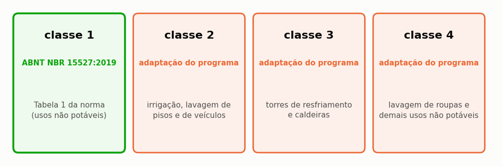

# Que qualidade o uso exige

> Ao terminar esta seção o projeto terá uma linha de tratamento definida, e você
> saberá distinguir o que a norma exige do que o programa recomenda.

Até este ponto o tutorial tratou a água pluvial exclusivamente como volume: quanto se
capta, quanto se armazena, quanto se consome. A água, porém, é também uma qualidade, e a
qualidade custa dinheiro — em equipamento na instalação e em insumo todos os meses. Esta
seção define a classe de qualidade do projeto e dimensiona a linha de tratamento
correspondente.

---

## O que a norma diz, e o que ela não diz

A ABNT NBR 15527 é a norma brasileira que trata do aproveitamento de água de chuva em
usos não potáveis. Ela fixa limites para quatro parâmetros — turbidez, cor aparente,
coliformes totais e cloro residual livre — e disciplina o descarte de primeiras águas e o
regime de manutenção do sistema.

O que a norma vigente **não** faz é dividir os usos não potáveis em classes com exigências
distintas entre si. Essa divisão existiu na versão de 2007 e não sobreviveu à revisão de
2019, que optou por um conjunto único de parâmetros aplicável a todos os usos não
potáveis.

O programa, por sua vez, oferece quatro classes, e a razão é prática: lavar roupa e regar
jardim não impõem a mesma exigência à água, ainda que a norma não os distinga ({{fig:fig36_classes}}).

*Figura 99 — As quatro classes de qualidade do programa e a situação normativa de cada uma. Apenas a classe 1 corresponde aos parâmetros da ABNT NBR 15527:2019; as classes 2 a 4 são adaptações do programa, adequadas à comparação de tratamentos e impróprias para apresentação como requisito normativo.*

> **As classes 2 a 4 são adaptações do programa, e não da norma.** O próprio Netuno
> declara isso na tela e no relatório. Num estudo publicado, não as apresente como
> requisito normativo: apresente-as como critério adotado, e cite a origem.

---

## A classe recomenda, você decide

Escolher uma classe não impõe equipamento algum ao projeto. A classe expressa uma
recomendação do programa, fundada na exigência típica do uso pretendido, e a decisão sobre
adotá-la ou não permanece com quem assina o projeto.

<!-- inclui: _tabelas/cap09_etap.md -->

A segunda tabela revela o ponto: sem o filtro de polimento, as quatro classes custam
exatamente o mesmo. A classe alvo altera uma única coisa, que é se o programa recomenda ou
não a filtração fina, e o filtro correspondente só entra no orçamento quando o usuário o
marca explicitamente.

Quando a classe recomenda o polimento e o usuário o recusa, o programa registra a recusa
no relatório, em vez de impor o equipamento em silêncio ou de deixar a decisão passar sem
registro. ==É a conduta correta em qualquer programa de projeto: quem assina decide, e a
decisão fica documentada para quem vier depois.==

---

## A desinfecção

A desinfecção é o estágio de que depende a segurança microbiológica da água armazenada, e
o programa oferece três tecnologias. A diferença entre elas é grande, tanto em custo
quanto em comportamento, e o critério que as separa não é a eficácia de desinfecção — as
três desinfetam — e sim a permanência do efeito.

**Cloração por pastilhas.** Um dosador com pastilhas de hipoclorito de cálcio na
linha. É a opção padrão. Para os 82 m³ do nosso projeto, a linha de tratamento com cloração custa R$ 1.547 de investimento e R$ 47 por ano de custeio, valores que incluem o descarte inicial dimensionado na mesma etapa — R$ 617 de investimento e R$ 40 por ano, como detalha a seção {{n:27}} — e as pastilhas. Deixa **residual** na água, o que protege o
reservatório e a rede interna contra recontaminação.

**Ultravioleta.** Um reator com lâmpada UV. A linha passa a R$ 2.747 de investimento e R$ 263 por ano de custeio, com a lâmpada e a energia do reator. **Não deixa residual**: desinfeta o que
passa por ele, e nada protege a água depois.

**Ozonização.** A linha passa a R$ 5.047 de investimento e R$ 247 por ano de custeio. Também sem
residual.

> **Atenção.** No programa, ultravioleta e ozônio entram como barreira **adicional**
> à cloração, e não como substitutas. É a prática correta: sem residual, a água
> tratada volta a se contaminar no percurso até o ponto de uso.
>
> Por isso as linhas de UV e ozônio somam o custo do cloro. Quem esperava que trocar
> cloro por UV **reduzisse** custo verá o contrário.

O impacto de carbono acompanha a mesma ordem: 0,4 kg CO₂e por ano com cloração, 6,5 com
ultravioleta e 15,4 com ozonização, para o volume tratado neste projeto. A diferença
inteira está na energia elétrica consumida pela lâmpada e pelo gerador de ozônio, já que o
insumo químico da cloração tem emissão de fabricação modesta frente a isso.

---

## O filtro de entrada

Antes de qualquer desinfecção vem o filtro mecânico de entrada, que retira folhas e
sólidos grosseiros da água antes que ela alcance o reservatório. O programa o dimensiona
pela área de cobertura, e não pela classe de qualidade pretendida, porque o que esse
filtro precisa vencer é a vazão de pico da cobertura — grandeza que independe do destino
final da água.

<!-- tabela: Filtro mecânico de entrada dimensionado pela área de cobertura -->
| Cobertura | Filtro | Malha |
| :--- | :--- | ---: |
| até 200 m² | vórtex autolimpante DN 100 | 350 µm |
| até 500 m² | vórtex autolimpante DN 150 | 400 µm |
| acima | cesto ou ciclônico DN 200 | 500 µm |

Nossa cobertura de 150 m² fica na primeira faixa.

---

## A regra incremental do custo

O investimento da linha de tratamento não é somado por inteiro ao investimento total do
sistema, e a razão é evitar dupla contagem. O orçamento de um sistema pluvial já reserva
uma verba genérica de tratamento dentro da rubrica de acessórios, porque nenhum projetista
orça um sistema sem prever alguma filtragem; somar a linha detalhada por cima dessa verba
cobraria o tratamento duas vezes. O programa desconta a verba genérica e soma apenas o
incremento, conforme a Equação {{eq:capex_etap}} formaliza na seção {{n:27}}.

O mesmo vale para o custeio: a cloração já é paga na linha de insumos químicos do
fluxo de caixa, e a linha de tratamento desconta essa parcela para não cobrar o
hipoclorito duas vezes.

E na avaliação de ciclo de vida, a linha de tratamento **substitui** o termo de
cloração em vez de somar a ele. A seção {{n:27}} detalha a regra.

---

## A decisão do tutorial

**Classe 1, cloração por pastilhas, sem filtro de polimento.**

A água vai para bacia sanitária, máquina de lavar e área externa. A classe 1, que
reproduz a Tabela 1 da ABNT NBR 15527:2019 (*E. coli* abaixo de 200 por 100 mL,
turbidez abaixo de 5,0 uT e pH entre 6,0 e 9,0), atende a bacia sanitária e os usos
externos, que estão na lista do item 4.1.7 da norma; a máquina de lavar roupa não está,
e o item 4.1.8 pede que o responsável pelo projeto defina e declare o critério de
qualidade para ela, como a seção {{n:5}} registra. A cloração deixa residual, e o custo é
o menor dos três. Investimento incremental de R$ 1.197 sobre a verba já prevista, dos quais R$ 617 são o descarte inicial, e R$ 44,77 por ano de custeio: R$ 4,77 de pastilha e R$ 40 de manutenção do descarte.

<!-- tabela: Estado do projeto do tutorial após a definição da classe de qualidade -->
| Projeto até aqui | |
| :--- | ---: |
| volume | 5.000 L |
| classe de qualidade | 1, normativa |
| desinfecção | cloração por pastilhas |
| filtro de polimento | não |
| investimento incremental do tratamento, com o descarte inicial | R$ 1.197 |

Temos volume, arranjo e qualidade. Agora a pergunta que decide se o projeto sai do
papel.
