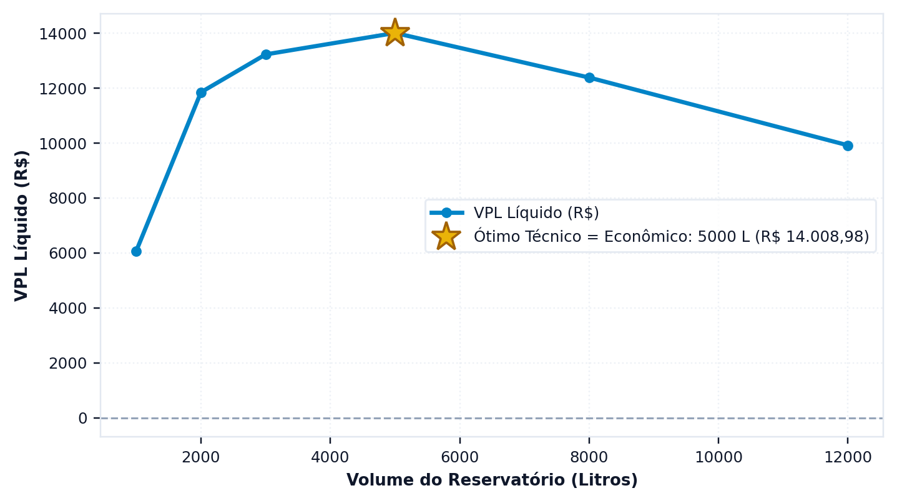

# Quanto custa e em quanto se paga

> Ao terminar esta seção você terá o fluxo de caixa de vinte anos, e saberá por
> que o **regime tarifário do seu município** decide a viabilidade mais do que
> qualquer parâmetro do projeto.

---

## A economia é a diferença entre duas faturas

O erro mais comum na análise econômica de sistemas pluviais consiste em multiplicar o
volume poupado por uma tarifa média. O resultado quase nunca é correto, e a razão está na
estrutura das tarifas brasileiras, que são progressivas por faixa de consumo, conforme a
seção {{n:16}} detalha: ==o metro cúbico que se deixa de consumir é o último da fatura,
que é o mais caro, e não o médio.==

O Netuno evita o problema calculando duas faturas completas — a que a edificação pagaria
sem o sistema e a que ela paga com ele — e tomando a diferença entre as duas.

<!-- inclui: _tabelas/cap10_economico.md -->

O resultado merece atenção. O sistema poupa 6,84 m³ por mês e a fatura cai R$ 195,77, o
que equivale a R$ 28,62 por metro cúbico economizado — valor bem acima dos R$ 14,31 da
faixa em que o consumo se situava. A diferença tem duas origens que atuam juntas: a
progressividade, que faz o metro cúbico economizado valer o preço da faixa mais alta, e o
esgoto, que em Florianópolis é cobrado a 100% do valor da água e portanto dobra o valor
de cada metro cúbico poupado.

> **O esgoto é percentual da parcela de água, não da fatura total.** Cem por cento da água
> significa que a parcela de esgoto iguala a de água, e portanto o esgoto é metade
> da fatura. Economizar água economiza as duas parcelas, e é por isso que o valor
> efetivo do metro cúbico poupado quase dobra.

---

## O regime tarifário da CASAN

Florianópolis pratica o regime de disponibilidade, no qual a concessionária cobra uma
taxa fixa mensal de R$ 46,34 que se soma ao consumo medido, e tarifa as faixas
progressivas a partir do primeiro metro cúbico consumido.

Para um projeto de aproveitamento pluvial, essa é a configuração mais favorável que
existe: cada metro cúbico economizado gera desconto desde o primeiro, porque a taxa fixa
é cobrada por disponibilizar a rede, e não por um volume incluído. Ela continua sendo
paga, e não impede a economia sobre o consumo.

Nem todo município adota esse regime, e a diferença entre eles decide a viabilidade de
projetos inteiros. O programa distingue cinco.

<!-- tabela: Os cinco regimes de mínimo tarifário e o efeito de cada um sobre a economia -->
| Regime | O que acontece ao economizar | Municípios na base |
| :--- | :--- | ---: |
| disponibilidade | cada m³ economizado desconta | 156 |
| sem mínimo | idem | 165 |
| franquia no mínimo | economizar abaixo da franquia **não desconta nada** | 329 |
| franquia retroativa | passando da franquia, tarifa-se tudo desde zero | 2 |
| piso de pagamento | a fatura não fica abaixo do piso | 0 |

> **Atenção, e é o ponto que mais derruba estudo.** Em município com **franquia no
> mínimo** — a maioria da base, 329 dos 652 — a concessionária cobra um valor fixo
> que já inclui, digamos, 10 m³. Uma residência que consome 12 m³ e economiza 3
> desce para 9, entra na franquia, e **a fatura para de cair**. O sistema economiza
> água e não economiza dinheiro.
>
> Rodar esse caso com a tarifa de Florianópolis produziria um payback que não existe.
> A seção {{n:16}} ensina a montar a estrutura do seu município corretamente.

---

## O investimento

R$ 13.996,69, assim distribuídos:

<!-- tabela: Composição do investimento inicial do projeto do tutorial -->
| Rubrica | Valor |
| :--- | ---: |
| cisterna de concreto de 5.000 L | R$ 6.300 |
| mão de obra e escavação | R$ 3.500 |
| tubulação | R$ 1.200 |
| acessórios | R$ 1.800 |
| linha de tratamento, incremento | R$ 580 |
| descarte inicial: reservatório de 300 L e separador de folhas | R$ 617 |

Os preços de reservatório vêm da base do programa, que traz valores por volume e por
material, com procedência declarada. Para volumes fora da tabela, o programa
interpola; para extrapolar além dela, só o faz se a regressão tiver R² acima de
0,90, e avisa quando não tem.

**O reservatório de descarte inicial.** O descarte de primeiras águas não é só a lâmina subtraída da chuva: é um componente físico, com custo. A etapa **3. Qualidade & ETAP** o dimensiona por padrão, e no tutorial a lâmina de 2 mm sobre 150 m² exige reservatório de 300 L, que com o separador de folhas custa R$ 616,90 de investimento e R$ 40 por ano de custeio. Sem ele, o investimento seria de R$ 13.379,79, o valor presente líquido de R$ 15.295 e o payback descontado de 8,7 anos: omitir o descarte adianta o retorno em nove meses. A seção {{n:27}} detalha o dimensionamento.

---

## O resultado

<!-- tabela: Indicadores econômicos do projeto do tutorial em vinte anos -->
| Indicador | Valor |
| :--- | ---: |
| valor presente líquido | R$ 14.009 |
| taxa interna de retorno | 14,10% ao ano |
| payback descontado | 9,4 anos |

Um projeto que devolve o investimento em menos de dez anos e rende 14% ao ano, bem acima da taxa mínima, é, financeiramente, muito bom. Boa parte disso vem da tarifa de
Florianópolis, que é alta, e do esgoto a 100%.

**O custeio é pequeno:** R$ 44,74 por ano, dos quais R$ 4,74 de pastilha de cloro e R$ 40 de manutenção do descarte. Sem caixa superior, o programa não calcula energia de bombeamento. É uma limitação a declarar: se os pontos de uso forem abastecidos por pressurizador, a energia dele existe e não entra no custeio; com a vazão do tutorial, a ordem de grandeza é a da seção {{n:8}}, cerca de R$ 7 a R$ 10 por ano, e não altera a conclusão.

---

O resultado de um volume isolado diz pouco sem os vizinhos. A aba econômica repete a conta para todos os volumes da varredura e traça a curva, e é nela que se vê se o ótimo técnico e o ótimo econômico caem no mesmo lugar ({{fig:fig49_programa_vpl}}).

*Figura 99 — O gráfico da aba econômica: o valor presente líquido de cada volume da varredura, com cisterna de concreto, com o máximo econômico e o ótimo técnico marcados. Quando os dois coincidem, o programa os marca com um único símbolo. Figura gerada pelo próprio programa.*

---
## O que a projeção assume

Vinte anos são muito tempo, e a projeção depende de premissas que convém declarar:

<!-- tabela: Premissas da projeção econômica e o peso de cada uma no resultado -->
| Premissa | Valor adotado | Onde ela pesa |
| :--- | ---: | :--- |
| taxa mínima de atratividade | 0,5% ao mês | desconta o fluxo; quanto maior, pior o VPL |
| inflação dos custos | 0,35% ao mês | incide só sobre o custeio |
| reajuste da tarifa de água | 5% ao ano | incide sobre a economia |
| reajuste da tarifa de esgoto | 5% ao ano | idem, e é indexado à parte |
| intervalo de reajuste | 12 meses | em degraus, não continuamente |
| período de análise | 20 anos | vida útil adotada |

> **Os reajustes de água e de esgoto são separados**, e não um índice único sobre a
> fatura agregada. As duas parcelas são reajustadas por atos diferentes da
> concessionária, e tratá-las juntas indexa metade da conta pelo índice errado.

O reajuste tarifário é a premissa mais frágil da lista. Cinco por cento ao ano por
vinte anos multiplica a tarifa por 2,65. Se a tarifa real subir mais que isso, o
projeto rende mais; se subir menos, rende menos. Um estudo sério declara o valor
adotado e mostra a sensibilidade — a seção {{n:20}} ensina como.

---

## O que temos até aqui

<!-- tabela: Estado do projeto do tutorial após a análise econômica -->
| Projeto até aqui | |
| :--- | ---: |
| volume | 5.000 L, concreto |
| investimento | R$ 13.997 |
| economia anual | R$ 2.349 |
| VPL em 20 anos | R$ 14.009 |
| payback | 9,4 anos |

O dinheiro diz sim, com folga.

Falta ouvir o carbono. E ele vai discordar.
