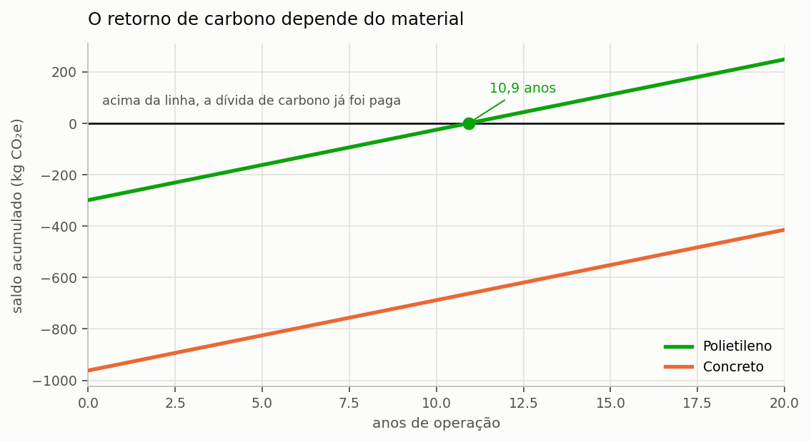
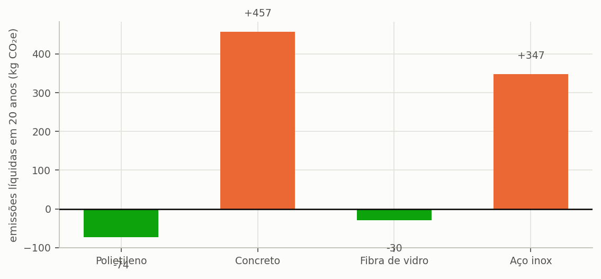

# Quanto carbono evita

> Ao terminar esta seção você terá o balanço de carbono do sistema e uma
> surpresa: com a cisterna que escolhemos, o projeto **emite mais do que evita** ao
> longo da vida útil.

---

## A conta

Um sistema de aproveitamento pluvial evita emissões porque cada metro cúbico que ele
entrega deixa de ser captado, tratado e bombeado pela concessionária, e essas três
operações consomem energia. O mesmo sistema, porém, emite carbono em três frentes
próprias: a fabricação dos seus componentes, a energia consumida no bombeamento interno e
os insumos de tratamento aplicados à água.

O saldo ambiental do sistema é a diferença entre o que ele evita e o que ele emite, e a
pergunta que organiza esta seção é em quantos anos o crédito anual líquido amortiza a
dívida contraída na fabricação. Esse prazo é o **payback de carbono**, e ele desempenha
na dimensão ambiental o mesmo papel que o tempo de retorno desempenha na dimensão
econômica.

Para o nosso projeto, cisterna de concreto de 5.000 L:

<!-- tabela: Balanço de carbono do projeto do tutorial com cisterna de concreto -->
| | |
| :--- | ---: |
| carbono incorporado no sistema | 962 kg CO₂e |
| emissão evitada por ano | 28,7 kg CO₂e |
| emissão do bombeamento e tratamento | 1,3 kg CO₂e |
| saldo líquido anual | 27,4 kg CO₂e |
| **payback de carbono** | **35,1 anos** |
| saldo ao fim de 20 anos | **−414 kg CO₂e** |

São trinta e cinco anos para amortizar a dívida de carbono, contra uma vida útil adotada
de vinte anos. ==O sistema, portanto, não chega a se pagar ambientalmente:== ao ser
desativado, terá emitido 414 kg CO₂e a mais do que evitou ao longo de toda a sua
operação.

E esse é o resultado de um projeto que, do ponto de vista financeiro, é excelente — o
que ilustra com clareza incômoda por que as dimensões de análise precisam ser mantidas
separadas até o momento da decisão.

---

## Por que a economia de carbono é tão pequena

Vinte e oito quilogramas de CO₂e por ano parecem pouco para 82 metros cúbicos de água
poupada, e de fato são: o resultado equivale a 0,35 kg CO₂e por metro cúbico
substituído.

A explicação está na natureza do produto substituído. Água tratada não é um bem
intensivo em carbono. Captar, tratar e distribuir um metro cúbico custa, no Brasil,
entre 0,24 e 0,46 kg CO₂e conforme a região e a composição da matriz elétrica local, e
essa faixa é modesta quando comparada à de concreto, aço ou combustíveis. Substituir um
produto de baixa intensidade de carbono por outro que exige fabricação de reservatório
não produz, portanto, o ganho ambiental que a intuição sugere.

> **A fronteira importa.** O fator do programa é por metro cúbico **entregue** na
> edificação, e não por metro cúbico produzido na estação. As perdas de distribuição
> no Brasil vão de 33,9% no Sudeste a 46,9% no Norte: produzir um metro cúbico
> entrega entre 0,53 e 0,66. Usar o fator de saída de estação subestimaria a
> emissão evitada em até um terço. A seção {{n:30}} detalha.

---

## O material decide o sinal

A dívida de carbono está quase toda na cisterna. E cisterna de 5.000 L pode pesar
110 kg ou 6.000 kg, conforme o material.

<!-- inclui: _tabelas/cap11_materiais.md -->

*Figura 6 — O saldo parte negativo, no valor do carbono incorporado na fabricação, e sobe ano a ano com o crédito da água substituída. O polietileno cruza o zero aos 10,9 anos; o concreto não chega a cruzá-lo dentro dos vinte anos de vida útil adotados.*

*Figura 4 — Verde é saldo positivo, laranja é negativo. Dois dos quatro materiais fecham a vida útil devendo carbono.*

**A escolha do material inverte o resultado.**

Polietileno paga a dívida em 10,9 anos e termina os vinte anos com saldo positivo de
248 kg. Concreto leva 35,1 anos e termina negativo em 414 kg. Aço inoxidável,
pior ainda.

E a segunda tabela mostra o outro lado da mesma moeda: em concreto, **quanto maior a
cisterna, pior o carbono**. A de 2.000 L quase empata em vinte anos; a de 8.000 L
fecha 898 kg no vermelho. Cada metro cúbico de concreto acrescenta 168 kg CO₂e e
rende cada vez menos água.

> **O mais barato também é o melhor para o carbono.** Polietileno custa R$ 3.000
> contra R$ 6.300 do concreto, pesa cinquenta e cinco vezes menos, e é o único
> material da tabela que fecha os vinte anos com folga positiva.
>
> Isso não é sorte. Massa é carbono, e concreto armado é o material mais massivo da
> lista por larga margem.

---

## Quando o concreto ainda faz sentido

A tabela não condena o concreto. Ela diz que ele precisa de justificativa.

- **Vida útil maior.** O programa adota 20 anos para todos os materiais. Uma cisterna
  de concreto bem executada dura 40 ou 50 anos, e nesse horizonte o payback de 35
  anos é pago com folga. Se você adotar vida útil diferente, **declare**.
- **Volumes grandes.** Acima de 20 m³, polietileno deixa de ser prático e o concreto
  moldado no local passa a ser a única opção viável.
- **Restrição de espaço.** Cisterna enterrada de concreto se conforma ao terreno; a
  de polietileno vem em formatos fixos.
- **Estrutura já existente.** Reservatório de concreto aproveitado de outra
  finalidade tem carbono incorporado **zero** para efeito deste projeto.

---

## A decisão do tutorial

**Trocamos para polietileno.**

É o que um projetista faria diante desta tabela, e é o que faz este tutorial ser
honesto: um estudo muda de rumo quando a análise mostra que o rumo estava errado.

A troca melhora as três dimensões ao mesmo tempo, o que é raro:

<!-- tabela: Efeito da troca de concreto por polietileno nas três dimensões de análise -->
| | Concreto | Polietileno |
| :--- | ---: | ---: |
| preço da cisterna | R$ 6.300 | R$ 3.000 |
| investimento total | R$ 13.380 | R$ 10.080 |
| payback financeiro | 8,7 anos | 6,5 anos |
| VPL em 20 anos | R$ 15.295 | R$ 18.595 |
| payback de carbono | 35,1 anos | 10,9 anos |
| saldo de carbono em 20 anos | −414 kg | +248 kg |

<!-- tabela: Estado do projeto do tutorial após a análise ambiental -->
| Projeto até aqui | |
| :--- | ---: |
| volume | 5.000 L |
| **material** | **polietileno** |
| investimento | R$ 10.080 |
| VPL | R$ 18.595 |
| payback financeiro | 6,5 anos |
| payback de carbono | 10,9 anos |

---

## O que declarar

A avaliação de ciclo de vida do Netuno é de **triagem**, não de inventário completo.
Alguns fatores têm fonte primária declarada; outros carregam rótulo de triagem, que
o programa exibe. Num estudo publicado:

- declare a **fronteira** adotada, água entregue e não produzida;
- declare a **vida útil** e a justifique;
- declare quais fatores estão com rótulo de triagem;
- declare a **base da rede elétrica** e o ano.

A seção {{n:C}} traz a procedência de cada fator, e a seção {{n:30}} explica as sete
etapas do inventário.

Temos três respostas agora. O potencial diz um volume, o dinheiro diz outro, o
carbono diz um terceiro. É hora de escolher.
