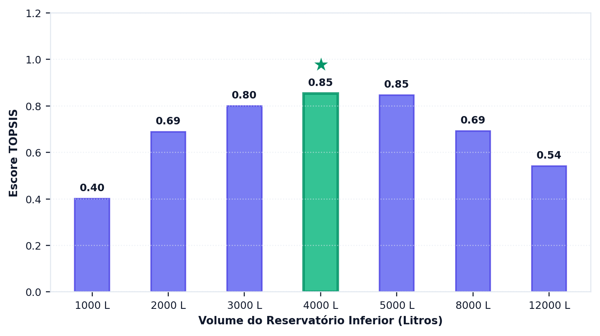
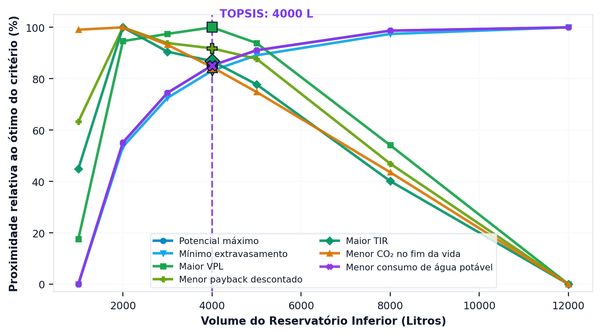

# Qual volume escolher, afinal

> Ao terminar esta seção você terá um volume recomendado, e saberá que ele
> depende de pesos que **você** declarou — não de uma verdade que o programa
> descobriu.

---

## Três critérios, três respostas

As seções anteriores deste tutorial formularam três perguntas distintas ao mesmo projeto
— quanta água ele entrega, quanto dinheiro ele rende e quanto carbono ele evita — e
receberam três respostas que não coincidem. Essa discordância não é defeito da análise
nem inconsistência dos dados: é a manifestação de que os três critérios medem coisas
diferentes e têm comportamentos diferentes em relação ao volume do reservatório.

<!-- inclui: _tabelas/cap12_multicriterio.md -->

A primeira tabela é o retrato do problema. Repare em como as colunas discordam:

- O **potencial** cresce monotonicamente: quanto maior a cisterna, mais água.
  Máximo em 12.000 L.
- O **VPL** sobe, achata e começa a cair: máximo em 4.000 L, praticamente empatado
  com 2.000 e 3.000 L, e caindo desde 5.000 L, porque o investimento adicional deixa de
  se pagar.
- O **carbono** sobe e cai bem antes: máximo em 2.000 L, praticamente empatado com
  1.000 L. Depois disso, cada metro cúbico de polietileno acrescenta mais dívida do
  que crédito.

==Não existe volume que vença nos três critérios simultaneamente.== Cada um deles tem
ótimo em posição distinta da curva, e a escolha entre eles não é uma questão técnica que
admita resposta única: é uma questão de prioridade, que precisa ser declarada por quem
decide e não pode ser descoberta pelo programa. É exatamente essa a lacuna que os
métodos multicritério vêm preencher.

---

## Como o TOPSIS resolve

O programa usa TOPSIS sobre **sete critérios**:

<!-- tabela: Os sete critérios do multicritério e a direção de preferência de cada um -->
| Critério | Direção |
| :--- | :--- |
| potencial de economia | maximizar |
| extravasamento | minimizar |
| valor presente líquido | maximizar |
| payback descontado | minimizar |
| taxa interna de retorno | maximizar |
| CO₂e no fim da vida | minimizar |
| consumo de água potável | minimizar |

O método opera em quatro etapas encadeadas. Primeiro normaliza a matriz de decisão, de
modo que critérios medidos em unidades incomparáveis — pontos percentuais, reais,
quilogramas de dióxido de carbono equivalente e anos — passem a ocupar a mesma escala.
Em seguida aplica os pesos declarados. Calcula então, para cada alternativa de volume, a
distância euclidiana até a solução ideal, composta pelos melhores valores de cada
critério, e até a solução anti-ideal, composta pelos piores. Ordena, por fim, as
alternativas pela proximidade relativa ao ideal, conforme a formulação apresentada na
seção {{n:32}}.

Aplicado ao projeto do tutorial com pesos iguais entre as três dimensões, repartidos
igualmente entre os critérios de cada uma, o método indica o volume de 4.000 L.

> **Três declarações que um estudo publicado precisa fazer.**
>
> A normalização do programa é uma **variante** de Hwang e Yoon: ela translada por
> `x − min(x)` antes da normalização vetorial, para admitir VPL negativo. É uma
> escolha deliberada, e apresentá-la como TOPSIS canônico seria incorreto.
>
> O SMAA-VIKOR, disponível ao lado, sorteia pesos e devolve a probabilidade de cada
> volume ocupar cada posição. É a resposta certa quando não há consenso sobre os
> pesos.
>
> As condições C1 e C2 de Opricovic, de vantagem aceitável e de estabilidade, **não
> estão implementadas**. A seção {{n:32}} detalha.

---

A aba de decisão apresenta o escore de cada volume candidato ({{fig:fig51_programa_topsis}}).

*Figura 99 — O gráfico da aba de decisão: o escore de proximidade ao ideal de cada volume candidato, com o vencedor destacado. Escores próximos entre si significam alternativas tecnicamente equivalentes, e nesse caso a escolha passa a depender do peso declarado. Figura gerada pelo próprio programa.*

---
## O peso muda a resposta

A tabela a seguir mostra o que acontece ao deslocar o peso.

<!-- inclui: _tabelas/cap12_pesos.md -->

Privilegiar o critério técnico desloca a recomendação para 5.000 L, o que era
esperado: o potencial de economia cresce monotonicamente com o volume, e um peso
dominante nessa dimensão empurra a escolha para cima. O deslocamento é pequeno porque o
potencial já está perto do teto, e o metro cúbico a mais rende pouco. Os critérios
econômico e ambiental, por sua vez, convergem ambos para 4.000 L.

Essa convergência, contudo, não constitui regra geral, e interpretá-la como tal seria
generalizar indevidamente um caso particular. Ela ocorre aqui porque o volume de 4.000 L
está no máximo, pouco pronunciado, da curva de valor presente líquido e ainda conserva
saldo de carbono positivo. Em município de tarifa mais baixa, o ótimo econômico se deslocaria
para baixo e a divergência entre os dois critérios apareceria com clareza.

> **Declare os pesos.** «Volume ótimo pelo TOPSIS» sem os pesos é uma afirmação
> impossível de reproduzir. Dois artigos com pesos diferentes chegam a volumes
> diferentes e ambos estão certos.

---

Uma solução de compromisso cede em alguma coisa, e convém saber em quê. O programa desdobra o escore único em sete, um por critério, e mostra a distância que separa a alternativa escolhida do melhor valor alcançado em cada um deles ({{fig:fig52_programa_proximidade}}).

*Figura 99 — O segundo gráfico da aba de decisão: quanto o volume escolhido se aproxima do melhor valor possível em cada um dos sete critérios. É a figura que mostra o que a solução de compromisso está cedendo, e em qual dimensão. Figura gerada pelo próprio programa.*

---
## A recomendação do tutorial

A recomendação do tutorial é o reservatório de **4.000 L em polietileno**, e a razão de
adotá-la não é apenas o fato de ele vencer sob pesos iguais. Ele vence também sob peso
econômico dominante e sob peso ambiental dominante, e fica em segundo lugar por margem
estreita sob peso técnico dominante. ==Uma recomendação que sobrevive a quatro
ponderações diferentes é robusta precisamente porque não depende de nenhuma delas.==

Vale registrar ainda que esse é o mesmo volume que o critério hidráulico da seção
{{n:7}} havia indicado, com limiar de ganho marginal de 1 %/m³. Duas rotas
metodologicamente independentes — uma que olha apenas para a curva de aproveitamento e
outra que pondera sete critérios de três dimensões — chegaram ao mesmo resultado, e essa
concordância aumenta a confiança na recomendação.

A concordância, porém, não é garantida em nenhum outro caso, e é por isso que o tutorial
percorreu o caminho longo em vez de parar na seção {{n:7}}. O propósito não era chegar
mais depressa ao volume, e sim saber que as duas rotas concordam **neste** projeto, em
vez de supor que concordem sempre.

---

## O projeto, fechado

<!-- tabela: Resumo do projeto do tutorial, com todos os parâmetros e resultados -->
| Netuno 5 · residência unifamiliar em Florianópolis | |
| :--- | ---: |
| série de precipitação | Florianópolis, 30 anos, 1.795 mm/ano |
| área de captação | 150 m² |
| coeficiente de escoamento | 0,85 |
| descarte de primeiras águas | 2,0 mm, todo evento |
| moradores | 4 |
| demanda total | 600 L/dia |
| fração atendível por chuva | 28% |
| reservatório inferior | 4.000 L, polietileno |
| arranjo de abastecimento | recalque para caixa superior |
| reservatório superior | 1.000 L, limiar de acionamento de 100 L |
| classe de qualidade | 1, cloração por pastilhas |
| descarte inicial | reservatório de 300 L |
| **potencial de economia de água potável** | **27,30%** |
| dias de atendimento pleno | 97,3% |
| água poupada | 59,8 m³/ano |
| energia do recalque | 7,7 kWh/ano |
| investimento | R$ 11.283 |
| **valor presente líquido em 20 anos** | **R$ 5.524** |
| payback descontado | 12,8 anos |
| **saldo de carbono em 20 anos** | **+74 kg CO₂e** |
| payback de carbono | 16,3 anos |

Resta uma etapa, que é a de comunicar o resultado: um estudo que não é relatado de modo
verificável não se distingue, para quem o lê, de um palpite bem apresentado. É o assunto
da seção seguinte.
