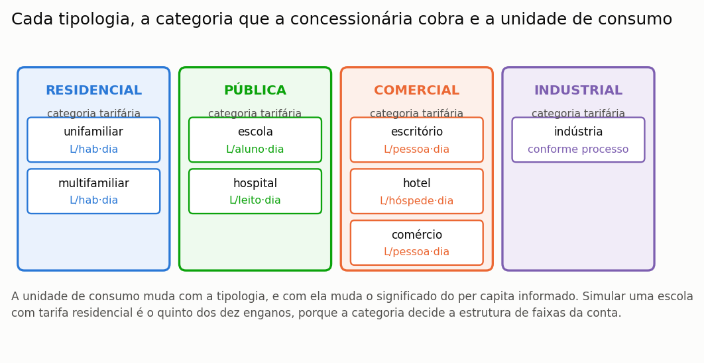

# Simular escola, hospital e comércio

> **Pergunta que este guia responde:** o programa serve para edificação não
> residencial?

Serve, e serve bem para a parte hídrica. Há, porém, uma ressalva de peso relativa à
parte econômica, e ela precisa ser conhecida antes de o estudo começar, e não depois de
ele estar concluído.

---

## A ressalva: a categoria tarifária

As concessionárias brasileiras cobram tarifas distintas conforme a categoria do
consumidor — residencial, comercial, industrial e pública —, e as categorias não
residenciais costumam custar o dobro ou mais da residencial. Na tabela da CASAN vigente
em abril de 2026, por exemplo, a primeira faixa custa R$ 3,08/m³ para uma residência e
R$ 6,81/m³ para um estabelecimento comercial.

==Essas tabelas existem e são públicas:== estão nas resoluções das agências reguladoras e
nos sítios das próprias concessionárias. O que o catálogo do programa registra, para os
652 municípios, é a categoria residencial de cada um, porque levantar as quatro
categorias de cada prestador seria um trabalho de outra ordem de grandeza. ==A tarifa não
residencial não falta ao programa: ela falta ao catálogo, e você pode lançá-la.==

Quando você escolhe uma tipologia não residencial, o programa **avisa** e diz o
sentido do erro:

> A tipologia escolhida é «Escola», que a concessionária fatura na categoria
> Pública. O catálogo do programa tem apenas a categoria Residencial, de modo que a
> fatura de água e esgoto está sendo calculada com a tarifa errada. O erro tem sentido
> conhecido: as categorias não residenciais são mais caras, e portanto a economia e
> o retorno estão **subestimados**.

> **O que fazer, em cinco minutos.** Procure a resolução tarifária vigente da sua
> concessionária, que costuma estar no sítio dela sob «tarifas» ou «estrutura tarifária».
> Localize a tabela da categoria que interessa. Lance as faixas no modo personalizado da
> etapa **12. Gestor de Tarifas**, com o regime de mínimo correspondente. A seção
> {{n:16}} descreve cada campo. Feito isso, o resultado econômico passa a ser o do seu
> caso, e não uma aproximação residencial.

Há um consolo nessa limitação, e ele é metodológico: ==o erro tem sentido conhecido e é
conservador.== As categorias não residenciais são mais caras que a residencial, de modo
que o projeto real rende mais do que o programa indica, e nunca menos. Um estudo que
declare a limitação apresenta, portanto, um piso de viabilidade — o que é uma posição
defensável, ao contrário do inverso.

---

## As tipologias disponíveis

As oito tipologias do programa agrupam-se pela categoria tarifária em que a concessionária as enquadra, e cada uma tem unidade de consumo própria ({{fig:fig39_tipologias}}). A unidade de consumo muda o significado do per capita informado, e a categoria decide a estrutura de faixas da fatura: simular uma escola com tarifa residencial é um dos enganos descritos na seção {{n:33}}.

*Figura 99 — As oito tipologias disponíveis, agrupadas pela categoria tarifária que a concessionária cobra. A unidade de consumo muda com a tipologia, e é ela que dá sentido ao valor per capita informado.*

---

## O que muda em cada tipologia

**Escola.** É provavelmente o caso mais favorável ao aproveitamento pluvial no Brasil,
por três razões que se somam. A fração não potável do consumo é alta, porque a bacia
sanitária domina o uso e muitas unidades não têm chuveiro nem cozinha. A demanda é
fortemente modulada por calendário, e a seção {{n:17}} mostra como representá-la. E o
fechamento das férias escolares coincide, no Sul e no Sudeste, com o período de menor
precipitação, de modo que a cisterna atravessa a estiagem sem ser solicitada e chega
cheia ao reinício das aulas.

**Hospital.** O caso mais delicado. Consumo alto e contínuo, sem sazonalidade
relevante, o que é bom para o aproveitamento. Mas a **exigência de qualidade** é
outra: há usos que não admitem água pluvial em hipótese alguma, e a torre de
resfriamento, que seria um uso ideal, exige controle microbiológico contra
legionela. Trate a classe de qualidade com cuidado, e não use as classes adaptadas
2 a 4 como se fossem requisito normativo.

**Escritório e comércio.** Demanda concentrada em dias úteis, cinco dias em sete.
Module por semana. A fração não potável é alta, tipicamente de 70% a 85%, porque quase todo o consumo é bacia sanitária e limpeza.

**Hotel.** Sazonalidade forte, e é o caso em que modular por mês mais importa. Veja
a advertência da seção {{n:17}} sobre demanda concentrada: um hotel de litoral lota
justamente nos meses mais chuvosos e ainda assim rende menos que a demanda constante,
porque esvazia o reservatório em poucos dias e o deixa ocioso no resto do ano.

---

## Micromedição e o número de economias

Em edifício multifamiliar com medição individualizada, informe o **número de
economias**. O programa avalia o consumo no patamar de **uma** unidade e multiplica
pelo número de economias.

Isso importa por causa das faixas progressivas: um prédio de vinte apartamentos com
medição individual paga vinte faturas na primeira faixa, e não uma fatura que soma
todo o consumo e cai na faixa mais cara. Tratar o prédio como uma unidade só
superestimaria a economia de forma grosseira.

---

## O que declarar

Além do que a seção {{n:13}} já pede:

- a **tipologia** e a unidade de consumo adotada;
- a **origem** do consumo per capita — medição, referência ou norma;
- se a **categoria tarifária** foi corrigida ou se ficou a residencial do catálogo,
  e neste caso que o resultado econômico está subestimado;
- o **perfil de modulação** e sua origem;
- para hospital, a classe de qualidade adotada e o que ela cobre.
