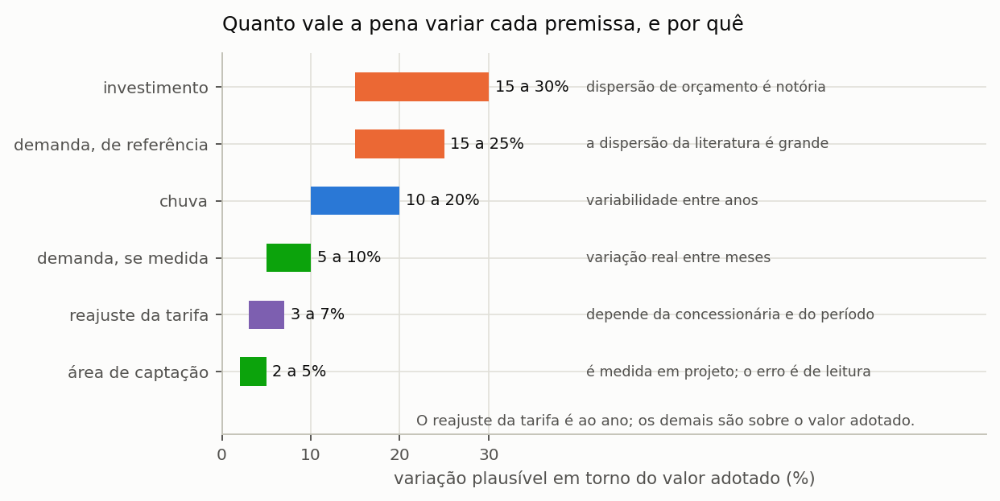
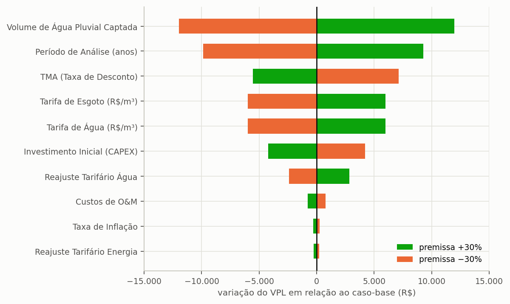

# Análise de sensibilidade

> **Pergunta que este guia responde:** qual premissa mais move o meu resultado, e o
> quanto ele aguenta?

Todo estudo de aproveitamento pluvial repousa sobre premissas incertas, e as três mais
influentes costumam ser justamente as menos verificáveis: a tarifa realmente subirá 5% ao
ano durante vinte anos? A demanda é de fato 150 litros por pessoa e dia? A cisterna
custará o que o orçamento prevê?

A análise de sensibilidade mede quanto dessas dúvidas chega ao resultado final. ==Ela não
elimina a incerteza, e não se propõe a isso; ela mede o tamanho da incerteza,== que é
exatamente a informação de que o leitor precisa para decidir o quanto confiar no número
apresentado.

---

## O procedimento, em três passos

O procedimento não exige ferramenta especializada, e é o mesmo que se emprega em qualquer
análise de engenharia diante de um parâmetro mal conhecido: varia-se uma coisa de cada
vez e observa-se o efeito.

1. **Escolha a premissa** que você suspeita ser a mais influente.
2. **Rode o projeto três vezes**: com o valor provável, com um valor baixo e com um
   alto.
3. **Anote o resultado das três** e compare.

Repita o procedimento para cada premissa duvidosa. Ao final, você terá identificado
quais delas efetivamente movem o resultado e quais são irrelevantes — e essa separação
vale mais que qualquer refinamento do valor central, porque orienta onde investir esforço
de levantamento de dados. A seção {{n:19}} mostra como organizar os arquivos para que o
conjunto de rodadas não se transforme em confusão.

---

## Que faixa adotar para cada premissa

A faixa de variação a adotar para cada premissa não é matéria de palpite: ela decorre do
que se sabe sobre a origem do dado, e um dado medido admite faixa muito mais estreita que um dado tomado da literatura ({{fig:fig41_premissas}}). O reajuste tarifário é expresso em pontos percentuais ao ano; as demais faixas, em percentual do valor adotado.

*Figura 99 — Faixa de variação plausível de cada premissa numa análise de sensibilidade, com a origem da incerteza. As faixas maiores correspondem às premissas adotadas de referência, e não medidas no projeto.*

> **Não perturbe o que você conhece.** Se a área foi medida em levantamento, a faixa é
> estreita; alargá-la produz uma incerteza artificial que dilui o resultado e esconde
> a premissa que realmente importa.

---

## As premissas que dominam o resultado econômico

Em estudos econômicos de aproveitamento pluvial, as premissas que mais movem o resultado são as que atuam ao longo de todo o horizonte de análise: o próprio período de análise, o volume de água pluvial efetivamente consumido, a taxa mínima de atratividade e o **reajuste tarifário**. O reajuste merece atenção particular porque é o menos verificável e atua de forma composta: cinco por cento ao ano durante vinte anos multiplicam a tarifa por 2,65; três por cento, por 1,81; e sete por cento, por 3,87. A economia dos últimos anos acompanha esse fator, e a escolha da taxa de reajuste pode decidir boa parte da conclusão econômica do estudo.

Faça o teste no seu caso: na etapa **6. Resultados Econômicos**, mude o reajuste anual
para 3%, anote o VPL, repita com 5% e com 7%. Três rodadas, três minutos, e uma faixa
em vez de um número.

> **Num artigo, mostre essa faixa.** Um valor presente líquido único, calculado com
> reajuste de 5% ao ano e apresentado sem sensibilidade, sugere uma precisão que a
> premissa não tem.

---

## A sensibilidade que o programa faz sozinho

Há um caso em que a análise de sensibilidade já vem pronta e não exige rodadas
adicionais, e ele diz respeito à decisão final do estudo: a escolha do volume em função
dos pesos atribuídos aos critérios.

Na etapa **8. Decisão Multicritério**, a coluna de **aceitabilidade SMAA-VIKOR** já é uma
análise de sensibilidade pronta. Ela responde: se os pesos das dimensões fossem
sorteados em vez de fixados, com que frequência cada volume ficaria em primeiro lugar?

Leia assim:

<!-- tabela: Leitura da aceitabilidade SMAA-VIKOR do volume vencedor -->
| Aceitabilidade do volume vencedor | O que significa |
| :--- | :--- |
| acima de 70% | recomendação robusta; os pesos quase não importam |
| entre 40 e 70% | recomendação razoável, e vale declarar a segunda opção |
| abaixo de 40% | a escolha depende dos pesos, e o texto precisa dizer isso |

A distinção que essa coluna permite é de natureza epistemológica, e não apenas
estatística: um volume que vence em 80% dos sorteios de pesos constitui uma recomendação,
ao passo que um volume que vence em 30% constitui uma preferência do analista, legítima
desde que apresentada como tal. A seção {{n:32}} expõe o método que produz esse número.

---

O gráfico de tornado ({{fig:fig24_tornado}}) é a forma consagrada de apresentar esse conjunto: uma barra por
premissa, ordenada pela amplitude, com as duas variações em cores distintas. Lido de
cima para baixo, ele responde à pergunta que o revisor fará primeiro, que é de qual
premissa o resultado depende.

*Figura 41 — A variação do valor presente líquido quando cada premissa é alterada em 30% para mais e para menos, mantidas as demais. A cor identifica a variação aplicada, e não o sinal do efeito: é o que permite ver que elevar a taxa mínima de atratividade reduz o valor presente, ao passo que elevar a tarifa o aumenta.*

---

## Como apresentar

Três formas, da mais simples à mais completa:

**Tabela de cenários.** Pessimista, provável e otimista, com as premissas de cada um
declaradas. Simples, honesta e suficiente para a maior parte dos trabalhos.

**Gráfico de tornado.** Uma barra por premissa, mostrando o quanto o resultado varia
quando ela varia sozinha. Ordena as premissas por importância e é a apresentação mais
informativa por área de página.

**Distribuição.** A faixa completa do resultado, quando todas as premissas variam
juntas. Exige declarar as distribuições adotadas, e não só as faixas.

> **Aprofundamento: propagação por Monte Carlo.** A terceira forma é feita sorteando milhares de combinações de premissas e acumulando a distribuição do resultado. O programa faz essa propagação pelo subcomando `uncertainty` da linha de comando, descrito na seção {{n:19}}. Para um estudo de curso
> ou de projeto, a tabela de cenários do primeiro item responde a mesma pergunta com
> uma fração do esforço — e é mais fácil de defender, porque cada cenário tem
> premissas que se pode ler.

---

## O que declarar

- as **faixas** adotadas e a origem de cada uma;
- quantas rodadas foram feitas, e com que valores;
- para a escolha do volume, a **aceitabilidade** do vencedor;
- **quais premissas não foram perturbadas**, e por quê.

A última é a que mais se esquece, e a que um revisor mais cobra.
