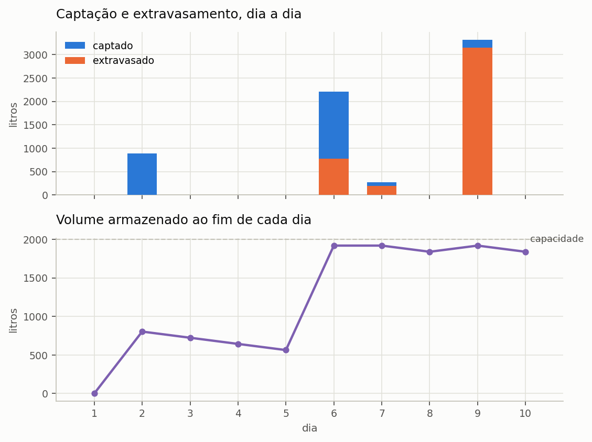

# 23. O balanço hídrico diário

> Ao terminar este capítulo você saberá refazer, numa planilha, exatamente o que o
> Netuno faz em cada dia da série, e saberá dizer por que o programa chegou ao
> número que chegou.

Este é o capítulo do qual todos os outros dependem. O potencial de economia, o fluxo
de caixa, a emissão evitada e a ordenação multicritério saem, todos, dos números que
o balanço diário produz. Quem entende este capítulo entende o programa.

O Netuno usa um **modelo comportamental de base diária**: para cada dia da série de
precipitação, o programa resolve o que entra no reservatório, o que sai, o que
transborda e o que sobra. Não há distribuição de probabilidade nem valor médio
anual. Há a série, dia após dia, e a mesma conta repetida.

---

## 23.1. A ordem das operações

O programa executa, para cada dia `t`, sempre nesta ordem:

1. **decide se descarta** a primeira chuva, conforme o modo escolhido;
2. **converte a lâmina em volume** captado, com a área e o coeficiente;
3. **soma ao que sobrou de ontem** e verifica o extravasamento;
4. **atende a demanda pluvial** com o que está armazenado;
5. **reparte** o atendimento entre uso interno e irrigação;
6. **completa com água da rede** o que a chuva não atendeu;
7. **classifica** o dia como de atendimento pleno, parcial ou nulo.

A ordem não é arbitrária, e trocar dois passos muda o resultado. O item 23.4 volta a
isso.

---

## 23.2. O caso resolvido

Dez dias, uma residência, sem reservatório superior. Os números foram escolhidos
para caber numa planilha.

<!-- inclui: _tabelas/cap23_entrada.md -->

A demanda pluvial diária é a demanda total vezes a fração atendível:
200 × 0,40 = **80 L/dia**. É esse o volume que o sistema tenta entregar todo dia.

### A tabela, dia a dia

<!-- inclui: _tabelas/cap23_dez_dias.md -->

---

## 23.3. Lendo a tabela

Cinco coisas acontecem nesses dez dias, e cada uma ensina uma regra do programa.

### O dia 1: reservatório vazio

A simulação começa com o reservatório **vazio**. Não há chuva no dia 1, não há nada
armazenado, e a demanda pluvial de 80 L não é atendida por gota nenhuma: o dia é de
atendimento **nulo**, e os 200 L do dia inteiro vêm da rede.

Isso não é um defeito da série escolhida. É a condição inicial do modelo, e ela
importa: em séries curtas, os primeiros dias penalizam o resultado. Com dez anos de
série o efeito desaparece; com dez dias, ele responde por todo o desvio entre o
potencial obtido, 36,0%, e a fração atendível de 40%.

### O dia 3: a chuva que se perde inteira

Choveu 1,6 mm. A lâmina de descarte é 2,0 mm. O programa não desconta 1,6 e capta
zero: ele **descarta o dia inteiro**.

> **Atenção.** Quando a regra de descarte se aplica e a chuva do dia não supera a
> lâmina, perde-se o dia **inteiro**, e não a diferença. A conta é
> `P_ef = P − d_f` quando `P > d_f`, e **zero** caso contrário.

A razão é física: o dispositivo de descarte precisa encher antes de a água chegar à
cisterna. Se a chuva não enche o dispositivo, nada passa. Em climas de chuva fraca e
frequente, isso pesa muito mais do que a intuição sugere, e é por isso que o modo de
descarte merece atenção no capítulo 4.

> **Diferença em relação ao Netuno 4.** O Netuno 4 trata `d_f` como **limiar do
> evento**: abaixo dele nada é captado, acima dele capta-se a chuva **inteira**, sem
> subtrair. O Netuno 5 subtrai a lâmina. A diferença é deliberada e está quantificada
> no capítulo 35: o Netuno 5 estima, em média, de 2,3 a 2,7 pontos percentuais menos
> economia sobre 4.050 casos de referência, e **metade** dessa diferença vem daqui.
> Estudos que comparem as duas versões precisam declarar isso.

### O dia 6: o extravasamento vem antes do consumo

Choveu 28 mm. Descontados os 2 mm de descarte, sobram 26 mm efetivos, que sobre
100 m² a 0,85 de coeficiente dão 2.210 L captados.

O reservatório tinha 564 L. Somados, 2.774 L. O reservatório guarda 2.000 L, então
**774 L extravasam**. Só depois disso o programa retira os 80 L da demanda, deixando
1.920 L para o dia seguinte.

> **Atenção.** Esta ordem define o modelo, e tem nome: **YAS**, de *yield after
> spillage*. O extravasamento é calculado **antes** da retirada da demanda.
>
> Se a ordem fosse invertida, o reservatório aceitaria água que fisicamente já teria
> transbordado, e o programa superestimaria o aproveitamento. A diferença aparece
> justamente nos dias de chuva forte, que são os que mais pesam no total anual.

### O dia 9: o reservatório pequeno demais para o evento

Choveu 41 mm, e o sistema captou 3.315 L. O reservatório estava com 1.840 L e guarda
2.000. **Extravasaram 3.155 L** — mais do que o reservatório inteiro comporta.

Num único dia, o sistema jogou fora o equivalente a trinta e nove dias de demanda
pluvial.
É o retrato do descasamento entre a chuva, que chega concentrada, e a demanda, que é
constante. Aumentar o reservatório recupera parte disso, e é exatamente essa a
pergunta que a varredura de volumes do capítulo 24 responde.



*Figura 1 — Os dez dias do caso resolvido. Em cima, o captado em azul e o extravasado em laranja: repare no dia 9, em que o extravasado quase iguala o captado. Embaixo, o nível do reservatório, que encosta na capacidade três vezes.*

### A soma: o balanço fecha

A última linha da tabela e o quadro de verificação mostram o fechamento:

```
captado = extravasado + consumido + o que ficou no reservatório
6.681 L = 4.121 L     + 720 L     + 1.840 L
```

Resíduo zero. O programa não cria nem perde água, e essa verificação é feita
automaticamente pela suíte de testes a cada alteração do código, sobre séries de dez
anos, com resíduo da ordem de 10⁻¹⁴ por cento do captado.

---

## 23.4. As equações

Com a notação do capítulo 4 para a captação:

**Volume captado no dia `t`:**

```
V_cap,t = P_ef,t × A × C
```

em que `P_ef,t` é a chuva efetiva em milímetros, `A` a área de captação em metros
quadrados e `C` o coeficiente de escoamento. O resultado sai em litros, porque
1 mm sobre 1 m² é 1 litro.

**Extravasamento e armazenamento, na ordem YAS:**

```
D_t  = V_res,t−1 + V_cap,t                  disponível antes do consumo
V_ext,t = max(0, D_t − V_max)               extravasado
V_arm,t = min(D_t, V_max)                   armazenado antes do consumo
```

**Atendimento:**

```
V_con,t = min(D_pl,t, V_arm,t)              consumido de água pluvial
V_res,t = V_arm,t − V_con,t                 sobra para amanhã
```

em que `D_pl,t` é a demanda pluvial do dia, montada no capítulo 5.

**Complemento de rede:**

```
V_pot,t = D_pot,t + déficit interno + déficit de irrigação*
```

O asterisco importa: o déficit de irrigação só vira consumo de rede se o
**suprimento de reserva** estiver ligado. Desligado, o jardim não é regado no dia
seco, a edificação não compra essa água, e o volume aparece como **demanda não
atendida** — a terceira parcela do balanço. Veja o capítulo 5.

**Classificação do dia:**

```
pleno    se V_con,t = D_pl,t        (com tolerância de 10⁻⁵ L)
parcial  se 0 < V_con,t < D_pl,t
nulo     se V_con,t = 0
```

---

## 23.5. O balanço de demanda tem três parcelas

A demanda total de um dia se reparte em três, e não em duas:

```
D_t = V_con,t + V_pot,t + V_nao,t
```

consumo de chuva, consumo de rede e **demanda não atendida**. A terceira é zero na
configuração padrão, em que a rede socorre a irrigação nos dias secos. Ela deixa de
ser zero quando o usuário desliga esse socorro, e aí o programa precisa mostrá-la:
sem ela, o balanço fecharia por construção, escondendo a água que ninguém forneceu.

---

## 23.6. Com reservatório superior

Quando o projeto tem caixa d'água superior, o passo 4 muda. Em vez de consumir
direto do reservatório inferior, o programa:

1. consome da caixa superior o que estiver **acima do limiar de acionamento**;
2. se ainda falta e há água embaixo, **aciona a motobomba**: transfere o menor valor
   entre o que há no inferior e o espaço livre em cima, e conta **um ciclo**;
3. consome de novo do que acabou de chegar;
4. repete até atender a demanda ou acabar a água.

O limiar de acionamento é o volume de reserva que não se consome, e serve para a
bomba não ligar a cada litro. Ele é limitado ao volume da caixa superior: informar um
limiar maior que a caixa não faz o programa recusar, faz ele adotar a caixa cheia.

> **O reservatório superior não aumenta a economia de água.** Ele muda **quando** a
> água é entregue, não **quanta**. O que ele acrescenta é custo: o investimento na
> caixa e na bomba, a energia do recalque e a emissão associada. O capítulo 8 do tutorial
> mostra isso com números.

O número de ciclos e o volume recalcado saem daqui e alimentam o cálculo de energia
do capítulo 28.

---

## 23.7. O que o modelo não representa

- **Não há sub-passo horário.** Uma chuva de 40 mm concentrada em duas horas e a
  mesma lâmina distribuída em vinte e quatro horas produzem o mesmo resultado. Para
  reservatórios muito pequenos em relação à área de captação, isso subestima o
  extravasamento.
- **Não há perda por evaporação ou vazamento** no reservatório.
- **A condição inicial é reservatório vazio.** Em séries de menos de um ano, isso
  penaliza o resultado de forma sensível.
- **O coeficiente de escoamento é único e constante.** Não varia com a intensidade da
  chuva nem com o tempo desde o último evento.
- **O descarte é uma lâmina, não um dispositivo.** O volume hidráulico do reservatório
  de autolimpeza, `A × d_f`, exige dimensionamento à parte.

O capítulo 36 reúne estas e as demais limitações conhecidas.

---

## 23.8. Para conferir

O caso resolvido deste capítulo está em `manual/casos/cap23_dez_dias.netuno`. Abra,
rode, e compare com a tabela impressa. Se algum número divergir, o manual está
desatualizado em relação ao programa — e nesse caso a suíte de testes já terá
avisado, porque cada número desta tabela tem asserção correspondente em
`tests/unit/test_manual_confere_com_o_programa.py`.
