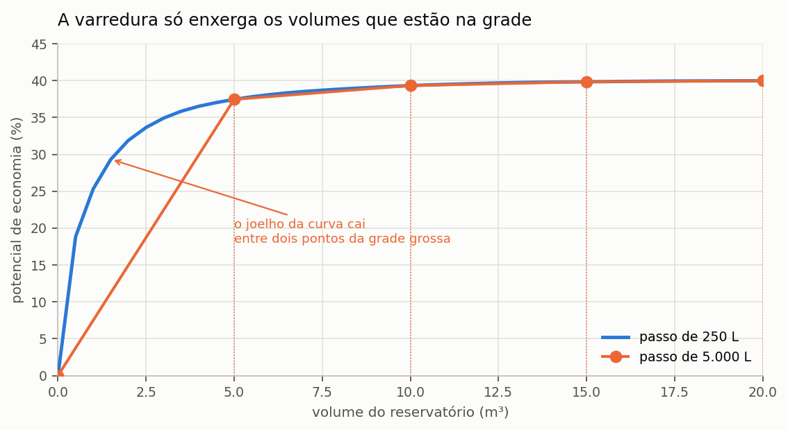
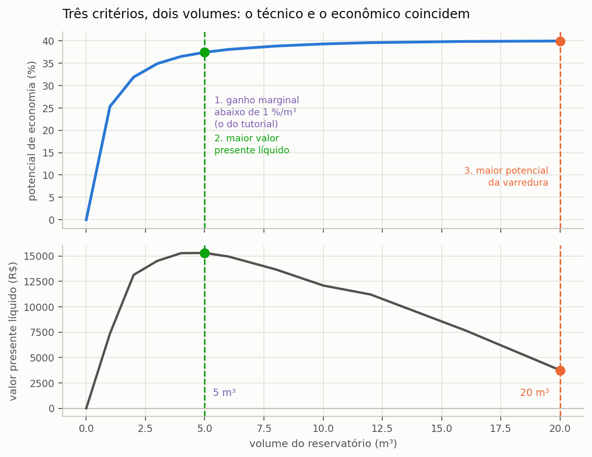

# Volume ideal e a varredura

> Esta seção formaliza o que a seção {{n:7}} fez na prática: como o programa monta a
> grade de volumes e como aplica o critério de volume ideal.

---

## A grade discreta

A varredura simula um conjunto **finito** de volumes, e a montagem desse conjunto
tem três regras.

**O passo é arredondado para cima até o múltiplo de 250 litros.** É o quantum
comercial: reservatórios são vendidos em volumes padronizados, e um ótimo em 1.300 L
não é comprável. Quando o passo pedido não é múltiplo de 250, o programa ajusta e
registra o ajuste em `step_adjusted`, de modo que o relatório possa declarar o passo
efetivo.

**O número de volumes positivos é limitado a 40.** Uma varredura de 0 a 50.000 L com
passo de 100 L seriam 500 simulações de trinta anos, e o ganho de informação não paga
o custo. Quando o limite é atingido, o passo efetivo cresce.

**O volume máximo informado é sempre preservado** como último ponto da grade. Só o
último intervalo pode, portanto, ser menor que o passo efetivo.

O volume **zero** entra na grade como alternativa de referência: é o cenário sem
sistema, contra o qual os demais se comparam.

---

A consequência prática aparece na {{fig:fig14_grade}}. Com passo fino, a curva mostra o
joelho onde o retorno começa a decair; com passo grosseiro, o joelho cai entre dois
pontos da grade e o critério elege o primeiro volume tabulado depois dele, que pode estar
vários metros cúbicos adiante do volume que de fato interessa.



*Figura 99 — Curva de potencial de economia da mesma edificação, varrida com passo de 250 L e com passo de 5.000 L. A grade grossa calcula corretamente cada ponto que contém, mas não contém o trecho de maior curvatura, entre 1 e 5 m³.*

---

## O ganho marginal

A curva de potencial de economia contra volume é monotônica e côncava: cada metro
cúbico acrescentado ao reservatório rende menos que o anterior, e o rendimento tende a
zero à medida que o sistema se aproxima do teto imposto pela fração atendível. O
programa quantifica esse rendimento decrescente pela derivada discreta da curva,
calculada para cada volume da grade a partir do segundo.

```equacao:ganho_marginal
Δ(V_i) = [ Epot(V_i) − Epot(V_i−1) ] ÷ [ (V_i − V_i−1) ÷ 1000 ]
```

| Símbolo | Significado | Unidade |
| :--- | :--- | :--- |
| `Δ(V_i)` | ganho marginal do volume `V_i` em relação ao anterior | %/m³ |
| `Epot(V_i)` | potencial de economia de água potável obtido com o volume `V_i` | % |
| `Epot(V_i−1)` | potencial de economia obtido com o volume imediatamente menor | % |
| `V_i` | volume do reservatório na posição `i` da grade | L |
| `V_i−1` | volume imediatamente menor da grade | L |
| `1000` | conversão de litros para metros cúbicos | L/m³ |

A divisão por mil no denominador da Equação {{eq:ganho_marginal}} existe para que o
resultado saia em pontos percentuais por metro cúbico acrescentado, que é a unidade em
que a decisão é tomada — reservatórios são comprados e orçados em metros cúbicos, não
em litros.

==Por ser uma derivada discreta, o ganho marginal depende do passo da grade.== Uma
grade fina produz um valor mais local, próximo da derivada verdadeira naquele ponto;
uma grade grossa produz a média do rendimento ao longo de um intervalo maior. A
subseção sobre sensibilidade ao passo, adiante, mede o tamanho desse efeito.

---

## O critério de volume ideal

O volume ideal é definido como o menor volume positivo da grade cujo ganho marginal já
tenha caído abaixo de um limiar declarado pelo usuário.

```equacao:volume_ideal
V_ideal = min { V_i > 0 : Δ(V_i) ≤ Δ_lim }
```

| Símbolo | Significado | Unidade |
| :--- | :--- | :--- |
| `V_ideal` | volume ideal pelo critério de ganho marginal | L |
| `V_i` | volume do reservatório na posição `i` da grade | L |
| `Δ(V_i)` | ganho marginal do volume `V_i`, da Equação {{eq:ganho_marginal}} | %/m³ |
| `Δ_lim` | limiar de ganho marginal declarado pelo usuário; o programa abre com 5,0, e o tutorial adota 1,0 | %/m³ |

Quando nenhum volume da grade satisfaz a condição da Equação {{eq:volume_ideal}} —
situação que ocorre quando a faixa varrida termina antes de a curva achatar — o
programa adota o maior volume da grade e registra essa circunstância no relatório, de
modo que o leitor saiba que o ótimo encontrado é um limite da busca e não um ponto de
inflexão da curva. O Manual do Netuno 4 trata o mesmo caso no sétimo capítulo, e a conduta
adotada aqui é a mesma.

### Um exemplo, passo a passo

A tabela da varredura do tutorial, na seção {{n:7}}, permite refazer a conta à mão.
Entre 3.000 L e 4.000 L o potencial sobe de 26,48% para 27,12%, isto é, 0,64 ponto
percentual por um metro cúbico a mais. Como 0,64 é menor que o limiar de 1,0 %/m³, e o
ganho anterior, entre 2.000 L e 3.000 L, foi de 1,45 %/m³, o primeiro volume a cruzar o
limiar é 4.000 L, e é ele o volume ideal.

Repare no que acontece logo depois. Entre 6.000 L e 8.000 L o potencial sobe 0,23
ponto, o mesmo que no intervalo anterior, de 5.000 para 6.000 L, e no entanto o ganho
**por metro cúbico** cai à metade, de 0,23 para 0,11 %/m³, porque o intervalo tem dois
metros cúbicos. É por
isso que o critério usa o ganho por metro cúbico, e não o ganho entre pontos
consecutivos da grade: o segundo depende do passo, e o primeiro, muito menos.

> **O critério é hidráulico e só hidráulico.** Ele ignora custo, tarifa e carbono. Um
> volume ideal por este critério não é uma recomendação de projeto; é o ponto em que a
> curva de aproveitamento deixa de compensar **em água**. A seção {{n:32}} trata da
> escolha com os demais critérios, que frequentemente apontam para volumes diferentes.

---

Este é um critério entre outros igualmente defensáveis, e convém deixar isso
explícito. Um projetista que queira o máximo desempenho hídrico escolherá o maior volume
da varredura; um que responda por um orçamento escolherá o volume de maior valor
presente líquido; o critério de ganho marginal fica entre os dois, por ser o que identifica
onde a curva deixa de compensar. Os três leem a mesma varredura e não precisam coincidir:
neste projeto eles apontam três volumes diferentes, e o de máximo desempenho é o maior
dos três. Nenhum dos três está errado — errado é não dizer qual deles foi usado. A {{fig:fig09_criterios}} marca o volume eleito por cada critério, com o valor anotado na legenda do gráfico.



*Figura 99 — Varredura do projeto do tutorial lida por três critérios: (a) potencial de economia e (b) valor presente líquido do mesmo conjunto de volumes. As linhas verticais marcam o volume eleito pelo ganho marginal abaixo de 1 %/m³, pelo VPL máximo e pelo potencial máximo; o volume de cada um vai anotado na legenda, porque depende da grade varrida e das premissas econômicas em vigor.*

---

## Por que o programa simula: os métodos empíricos da norma

A primeira edição da norma brasileira de aproveitamento de água de chuva, a ABNT NBR
15527:2007, trazia no Anexo A, de caráter informativo, seis métodos para dimensionar o
reservatório: o de Rippl, o da simulação, o de Azevedo Neto e três métodos práticos, o
alemão, o inglês e o australiano. Eles continuam em uso corrente em projetos e em
trabalhos acadêmicos, e convém entender o que cada um responde antes de compará-los
com a varredura do programa.

**O método de Rippl** é o diagrama de massas aplicado ao reservatório: acumula, período
a período, a diferença entre a demanda e a chuva aproveitável, e adota como volume o
maior déficit acumulado da série. O volume resultante é o que atenderia **toda** a
demanda mesmo na pior estiagem registrada, e por isso cresce com o comprimento da série
e com a resolução dela: com dados diários, as sequências secas aparecem inteiras; com
dados mensais, parte delas se dilui na média do mês.

**O método de Azevedo Neto** multiplica a precipitação média anual `P`, em milímetros, a
área de coleta `A`, em metros quadrados, e o número de meses de pouca chuva `T` pelo
coeficiente 0,042, e dá o volume em litros. O resultado depende inteiramente de `T`, e
em cidades sem estação seca definida, como Florianópolis, a escolha de `T` é arbitrária.

**Os métodos práticos** são regras de bolso. O alemão toma 6% do menor valor entre a
chuva aproveitável anual e a demanda anual; o inglês toma 5% do produto `P × A`; o
australiano faz um balanço mensal por tentativas até alcançar a confiança desejada.
Nenhum dos dois primeiros usa a distribuição da chuva no tempo, e o inglês não usa
sequer a demanda.

A tabela a seguir aplica cinco desses métodos ao projeto do tutorial, arredonda cada
volume ao múltiplo de 250 L e simula, no próprio programa, o potencial que ele produz.

<!-- inclui: _tabelas/cap24_metodos.md -->

A primeira tabela mostra o que a curva côncava da seção {{n:7}} já anunciava. Os métodos
que dimensionam para a pior estiagem, como Rippl com série diária, e os que ignoram a
demanda, como o inglês, levam a reservatórios de 7 a 14 m³, que entregam menos de um
ponto percentual a mais que os 4.000 L da simulação ao custo de duas a três vezes o
volume. O método alemão e o de Rippl com série mensal acertam a ordem de grandeza neste
caso, mas por coincidência: ele
não tem como saber que a chuva de Florianópolis é bem distribuída, e daria o mesmo
volume para uma cidade com seis meses secos.

==A diferença essencial é que os métodos empíricos respondem a uma pergunta fixa, e a
simulação responde à pergunta que o projetista declara.== Rippl pergunta qual volume
nunca falha; o método inglês pergunta que fração da chuva guardar; a varredura com ganho
marginal pergunta a partir de qual volume o metro cúbico seguinte deixa de compensar.
Ghisi (2010) mostrou, para três cidades do estado de São Paulo, que o volume adequado
varia muito com a chuva local, a área de cobertura, o número de moradores e as
demandas, e concluiu que dimensionar reservatórios pela tradição local, sem simulação,
pode levar a sistemas de baixa eficiência.

---

## O passo de tempo e a fração de armazenamento

O programa simula dia a dia, e essa escolha tem uma faixa de validade conhecida. Fewkes
e Butler (2000) compararam modelos comportamentais com passos de um minuto, uma hora, um
dia e um mês, tomaram como referência o modelo horário com a regra YAS, descrita na
seção {{n:23}}, e mostraram que o passo adequado depende de uma grandeza adimensional,
a **fração de armazenamento**.

```equacao:fracao_de_armazenamento
F_S = S ÷ (A × R)
```

| Símbolo | Significado | Unidade |
| :--- | :--- | :--- |
| `F_S` | fração de armazenamento | adimensional |
| `S` | capacidade do reservatório | m³ |
| `A` | área de captação em projeção horizontal | m² |
| `R` | precipitação média anual | m |

Pelos resultados daqueles autores, o modelo horário é o indicado para frações de até
0,01; o diário, para frações entre 0,01 e 0,125; e o mensal, só acima de 0,125. A razão
física é simples: quanto menor o reservatório em relação à chuva que recebe, mais ele
enche e extravasa **dentro** de um mesmo dia chuvoso, enquanto a demanda é retirada ao
longo das horas; um passo diário soma numa entrada só o que, hora a hora, teria entrado
e saído aos poucos.

A segunda tabela calcula a fração para os volumes da varredura do tutorial. A cisterna
escolhida, de 4.000 L, tem fração de 0,015, dentro da faixa do modelo diário; os
reservatórios de 1.000 e 2.000 L ficam abaixo de 0,01, e para eles o resultado diário
deve ser lido como aproximação. Campisano e Modica (2015), que simularam um sistema
residencial com passos diários e subdiários a partir de descargas medidas, chegaram a
uma conclusão complementar: o passo diário é confiável para estimar a **economia de
água**, mas passos de no máximo uma hora são necessários quando o objetivo é a
**retenção de águas pluviais**, sobretudo em reservatórios pequenos e com demanda alta.

> **Na prática.** Para economia de água potável em edificações, o passo diário do
> programa é adequado na faixa usual de projeto. Se a fração de armazenamento do seu
> estudo ficar abaixo de 0,01, declare a limitação; e se o objetivo for amortecer vazões
> de pico na drenagem urbana, o programa não é a ferramenta adequada.

---

## O que a literatura diz sobre o volume ideal

Não há definição única de volume ideal, e a revisão sistemática de Semaan et al. (2020)
ajuda a situar o critério do programa. Examinando estudos de otimização de sistemas
domésticos, os autores observaram que o dimensionamento do reservatório é o objetivo de
otimização mais importante, mas que o custo é o critério mais usado; que o
subdimensionamento produz sistemas incapazes de fornecer volume confiável; e que o
superdimensionamento eleva o investimento com benefício marginal pequeno e ainda pode
comprometer a qualidade da água, que fica armazenada por mais tempo.

Campisano et al. (2017), numa revisão ampla sobre sistemas urbanos de aproveitamento
pluvial, reúnem critérios de três famílias: os de **eficiência hídrica**, como o potencial
de economia e a confiabilidade; os **econômicos**, como o valor presente líquido e o tempo
de retorno; e os de **desempenho na drenagem**, como a retenção. O programa cobre as duas
primeiras famílias e declara não cobrir a terceira.

O critério de ganho marginal pertence à primeira família e tem uma vantagem sobre a
confiabilidade fixa, como a de Rippl: não exige que o projetista escolha um nível de
falha aceitável, que raramente tem justificativa técnica, e sim um nível de retorno
decrescente, que se lê diretamente em metros cúbicos de reservatório. A desvantagem é
simétrica: o limiar de 1 %/m³, ou de 5 %/m³, também é uma escolha, e precisa ser
declarado.

---

## A sensibilidade ao passo

O volume ideal depende do passo da varredura, e convém saber quanto.

Um passo grosso salta o joelho da curva: com passo de 5.000 L, o primeiro ponto
avaliado após o zero já tem ganho marginal médio de todo o intervalo, que é alto, e
o segundo pode já estar abaixo do limiar. O ideal sai deslocado para cima.

Um passo fino resolve melhor o joelho, ao custo de tempo.

**Recomendação prática:** passo entre 500 e 1.000 L para reservatórios residenciais,
e entre 2.000 e 5.000 L para edificações de grande porte, sempre declarando o passo
adotado junto do volume ideal.

---

## Por que a curva tem esta forma

A curva de aproveitamento pluvial é côncava e assintótica, sempre. Duas razões:

**Os eventos pequenos são a maioria.** Os primeiros litros de armazenamento capturam
as chuvas frequentes e pequenas, que respondem pela maior parte dos dias. Os últimos
litros só servem para os poucos eventos extremos.

**A fração atendível é um teto.** O potencial não pode ultrapassar a fração da
demanda que a chuva atende, definida na seção {{n:5}}. A curva se aproxima desse teto e
nunca o cruza — invariante que a suíte de testes verifica até volumes de 100 m³.

---

## O que a varredura não responde

- **Qual volume comprar.** Reservatórios existem em volumes comerciais; o ideal
  calculado deve ser arredondado para o volume disponível mais próximo, e a
  varredura já ajuda ao trabalhar em múltiplos de 250 L.
- **Se o sistema vale a pena.** Isso é a seção {{n:29}}.
- **Se o volume cabe no terreno.** O programa não conhece o sítio.
- **Quanto a cisterna amortece a drenagem.** O passo diário não representa as vazões de
  pico, e a retenção exige passo horário ou menor, como mostram Campisano e Modica
  (2015).
