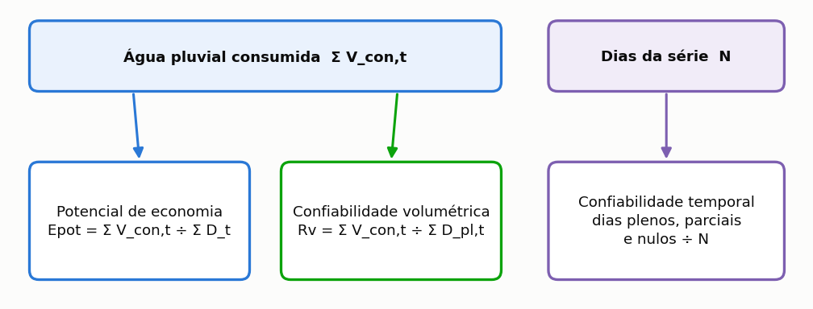
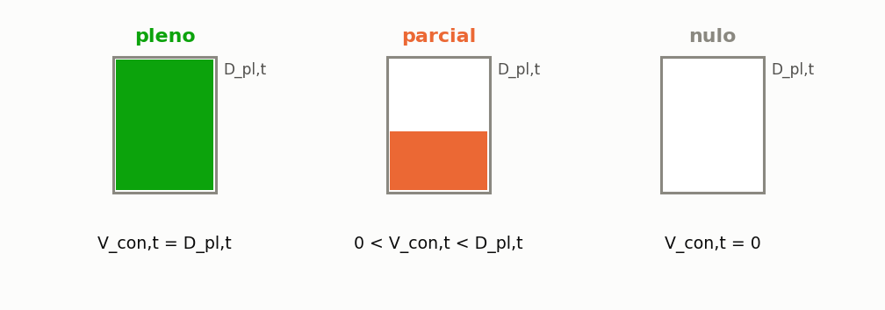

# Indicadores de eficiência

> Esta seção define formalmente cada indicador que o programa reporta, com
> unidade, e diz **o que cada um não mede**.

Um indicador mal interpretado é pior que nenhum, e os desta seção são confundidos com
frequência na literatura. Os dois primeiros partem do mesmo numerador — a água de
chuva efetivamente consumida — e diferem apenas no denominador: uma diferença
aritmética pequena e uma diferença de significado grande, porque cada denominador
formula uma pergunta distinta. O terceiro não é uma razão entre volumes, e sim uma
contagem de dias, e responde a uma pergunta que nenhum dos outros dois alcança: com que frequência se pode contar com o sistema ({{fig:fig00g_indicadores}}).



*Figura 99 — Os três indicadores de eficiência e o que cada um conta. O potencial de economia e a confiabilidade volumétrica compartilham o numerador e se relacionam pela identidade Epot = Rv × f, em que f é a fração atendível; a confiabilidade temporal conta dias, e não litros.*

---

## Potencial de economia de água potável

O potencial de economia de água potável é o indicador central do programa e aquele que
figura no resumo de qualquer estudo. Ele expressa a fração do consumo **total** da
edificação que a água pluvial conseguiu substituir ao longo de toda a série simulada, e
não apenas da parcela que a chuva poderia atender.

```equacao:potencial
Epot = ( Σ V_con,t ÷ Σ D_t ) × 100
```

| Símbolo | Significado | Unidade |
| :--- | :--- | :--- |
| `Epot` | potencial de economia de água potável | % |
| `V_con,t` | volume de água pluvial consumido no dia `t` | L |
| `D_t` | demanda total da edificação no dia `t` | L |
| `Σ` | somatório sobre todos os dias da série simulada | — |

O denominador da Equação {{eq:potencial}} é a demanda **total**, e essa escolha é a
origem da confusão mais comum na leitura de resultados. Um sistema que atendesse
integralmente toda a demanda que lhe cabe, sem falhar um único dia, ainda assim
apresentaria potencial de economia igual à fração atendível declarada, e não a cem por
cento. O teto, portanto, não é uma limitação do sistema: é uma consequência aritmética
da definição do indicador.

---

## Confiabilidade volumétrica

A confiabilidade volumétrica responde a uma pergunta diferente, e complementar: da água
que o sistema **deveria** fornecer, quanto ele de fato forneceu? O denominador aqui é a
demanda pluvial, e não a demanda total.

```equacao:confiabilidade
Rv = ( Σ V_con,t ÷ Σ D_pl,t ) × 100
```

| Símbolo | Significado | Unidade |
| :--- | :--- | :--- |
| `Rv` | confiabilidade volumétrica do sistema | % |
| `V_con,t` | volume de água pluvial consumido no dia `t` | L |
| `D_pl,t` | demanda pluvial do dia `t`, isto é, a parcela atendível por chuva | L |
| `Σ` | somatório sobre todos os dias da série simulada | — |

As Equações {{eq:potencial}} e {{eq:confiabilidade}} diferem apenas no denominador, e
essa diferença basta para que se relacionem por uma identidade exata, útil como
conferência rápida de qualquer resultado.

```equacao:relacao_indicadores
Epot = Rv × f
```

| Símbolo | Significado | Unidade |
| :--- | :--- | :--- |
| `Epot` | potencial de economia de água potável | % |
| `Rv` | confiabilidade volumétrica | % |
| `f` | fração da demanda total atendível por água pluvial | adimensional |

==Um sistema com 97% de confiabilidade e 28% de fração atendível economiza 27,1% do
consumo total, e os três números dizem a mesma coisa de três maneiras.== É exatamente o
caso da cisterna de 4.000 L do tutorial, antes da caixa superior: a confiabilidade
volumétrica é de 96,86%, e 96,86% × 0,28 = 27,12%, o potencial impresso na seção {{n:7}}. Relatar apenas
um deles, sem declarar a fração atendível adotada, torna o resultado impossível de
comparar com o de outro estudo — e é a causa mais frequente de comparações indevidas na
literatura da área.

A literatura usa nomes diferentes para a mesma razão. Fewkes e Butler (2000) chamam de
**eficiência de economia de água** o quociente entre o volume pluvial fornecido e a
demanda que o sistema deveria atender, que é a confiabilidade volumétrica desta seção.
Outros autores chamam de eficiência o que aqui é potencial de economia. Ao comparar com
outro trabalho, confira o denominador, e não o nome.

---

## Confiabilidade temporal

A confiabilidade temporal classifica cada dia da série em uma de três classes mutuamente exclusivas, conforme a relação entre o volume pluvial consumido e a demanda pluvial do dia, definida na Equação {{eq:classificacao}}. O dia é **pleno** quando a água de chuva atende integralmente a demanda pluvial; **parcial**, quando atende parte dela e a rede pública supre o restante; e **nulo**, quando o reservatório está vazio e a rede supre toda a demanda ({{fig:fig29_atendimento}}). Os três percentuais somam 100%. A classificação conta dias, e não volume: um dia em que faltou um litro para atender a demanda é parcial, e não quase pleno, e por isso a confiabilidade temporal não se converte diretamente em volume economizado.



*Figura 99 — Classes de atendimento diário: pleno (V_con,t = D_pl,t), parcial (0 < V_con,t < D_pl,t) e nulo (V_con,t = 0). A altura preenchida representa a fração da demanda pluvial do dia atendida por água pluvial.*

Formalmente, o dia é **pleno** quando `V_con,t = D_pl,t`, com tolerância de 10⁻⁵ L; **parcial** quando `0 < V_con,t < D_pl,t`; e **nulo** quando `V_con,t = 0`.


No tutorial, a cisterna de 4.000 L tem 96,6% de dias plenos, 0,6% de dias parciais e
2,8% de dias nulos. Repare que a confiabilidade temporal, 96,6%, é menor que a
volumétrica, 96,86%. Não há contradição: os dias parciais não contam como plenos, mas
contribuem com volume, e é essa água que a confiabilidade volumétrica soma e a temporal
não. A diferença entre as duas é, por isso, uma medida indireta de quanto os dias de
falha são falhas parciais.

**O que mede:** com que frequência o usuário pode contar com o sistema.

**O que não mede:** o volume. Um sistema pode ter 95% de dias plenos e potencial
baixo se a demanda pluvial for pequena, e o contrário também acontece.

> A confiabilidade temporal é o indicador que mais importa para o **projeto
> hidráulico**. Muitos dias nulos exigem alimentação automática de reserva bem
> dimensionada, e o usuário percebe a alternância entre as duas fontes.

---

## Extravasamento

```equacao:extravasamento_medio
V_ext,med = ( Σ V_ext,t ) ÷ n
```

| Símbolo | Significado | Unidade |
| :--- | :--- | :--- |
| `V_ext,med` | extravasamento médio diário | L/dia |
| `V_ext,t` | volume extravasado no dia `t` | L |
| `n` | número de dias da série simulada | dia |

**O que mede:** o quanto a cisterna é pequena em relação aos eventos de chuva.

**O que não mede:** desperdício. A água que extravasa vai para a drenagem urbana,
como iria sem o sistema. Não há perda em relação ao cenário sem sistema — há apenas
oportunidade não aproveitada.

> O extravasamento **nunca zera** num sistema real. Ele tende a um piso que é a
> diferença entre o que a cobertura capta e o que a demanda consome, e no tutorial
> esse piso é mais da metade da água captada. Quem quer retenção de cheia precisa de
> um reservatório de detenção, que é outro projeto com outra lógica.

---

## Eficiência de uso da captação

O programa não imprime este indicador, mas ele sai diretamente dos anteriores e ajuda a
entender o extravasamento. É a fração da água que chegou à cisterna, já descontado o
descarte de primeiras águas, que acabou consumida.

```equacao:uso_da_captacao
η_cap = ( Σ V_con,t ÷ Σ V_cap,t ) × 100
```

| Símbolo | Significado | Unidade |
| :--- | :--- | :--- |
| `η_cap` | eficiência de uso da água captada | % |
| `V_con,t` | volume de água pluvial consumido no dia `t` | L |
| `V_cap,t` | volume captado no dia `t`, depois do descarte | L |
| `Σ` | somatório sobre todos os dias da série simulada | — |

Na cisterna de 4.000 L do tutorial, a cobertura entrega 187,4 m³ por ano à cisterna; o
sistema consome 59,4 m³ e extravasa 127,9 m³, e as duas parcelas fecham o balanço de
massa. A eficiência de uso da captação é, portanto, de 31,7%. O número explica por que
aumentar a cisterna rende tão pouco a partir de certo ponto: a água não falta na
cobertura, falta **demanda** para consumi-la. Quando a oferta supera largamente a demanda
pluvial, como em Florianópolis, a eficiência de uso da captação é necessariamente baixa,
qualquer que seja o volume.

---

## Duração e intensidade das falhas

Os indicadores anteriores dizem quanto e com que frequência o sistema falha, mas não
**como** falha. Hashimoto, Stedinger e Loucks (1982) propuseram, para sistemas de
recursos hídricos em geral, três critérios complementares que hoje são usados também em
aproveitamento pluvial: a **confiabilidade**, que é a probabilidade de o sistema estar em
estado satisfatório; a **resiliência**, que mede a rapidez com que ele se recupera de uma
falha; e a **vulnerabilidade**, que mede a gravidade das falhas quando elas ocorrem.

O programa reporta a primeira e não reporta as outras duas, mas ambas podem ser calculadas
a partir da série diária detalhada, exportada em planilha. Para a cisterna de 4.000 L do
tutorial, em trinta anos:

- houve 60 sequências de dias não plenos, com duração média de 6,3 dias e máxima de 23
  dias. A resiliência, tomada como o inverso da duração média de uma falha, é de 0,16 por
  dia;
- nos dias de falha, faltaram em média 153 L de uma demanda pluvial de 168 L, isto é,
  cerca de 90%. A falha típica, portanto, não é um pequeno déficit: é a cisterna vazia.

A leitura de projeto é direta. Falhas longas e quase totais significam que a alimentação
de reserva pela rede pública precisa ser automática e dimensionada para a vazão total
dos pontos de uso pluviais, e não apenas para complementar pequenas faltas.

---

## Volume anual poupado

```equacao:volume_poupado
V_poup = ( V_con,med × 365,25 ) ÷ 1000
```

| Símbolo | Significado | Unidade |
| :--- | :--- | :--- |
| `V_poup` | volume de água potável poupado por ano | m³/ano |
| `V_con,med` | consumo médio diário de água pluvial | L/dia |
| `365,25` | duração do ano médio, incluindo os bissextos | dia/ano |
| `1000` | conversão de litros para metros cúbicos | L/m³ |

**O que mede:** a base de cálculo do econômico e da avaliação de ciclo de vida.

> **Aprofundamento: o 365,25 não é descuido.** A conversão usa o ano médio, incluindo bissextos,
> porque séries longas os contêm. Usar 365 introduziria um viés sistemático de
> 0,07% — pequeno, mas gratuito.

---

## Ganho marginal

A definição formal do ganho marginal, com a grade de volumes explicitada, está na
Equação {{eq:ganho_marginal}}, na seção {{n:24}}.

Definido na seção {{n:24}}. É o indicador que decide o volume ideal, e **só existe numa
varredura** — uma simulação de volume único não o produz.

---

## Demanda não atendida

```equacao:nao_atendida
V_nao,med = ( Σ V_nao,t ) ÷ n
```

| Símbolo | Significado | Unidade |
| :--- | :--- | :--- |
| `V_nao,med` | demanda média diária não atendida por nenhuma fonte | L/dia |
| `V_nao,t` | demanda não atendida no dia `t` | L |
| `n` | número de dias da série simulada | dia |

Terceira parcela do balanço de demanda. É zero na
configuração padrão e deixa de ser zero quando o suprimento de reserva da irrigação
está desligado.

**Por que existe:** sem ela, o balanço fecharia por construção, atribuindo à rede
toda a demanda que a chuva não atendeu. A seção {{n:23}} detalha.

---

## Quadro-resumo

<!-- tabela: Quadro-resumo dos indicadores, com denominador e pergunta que cada um responde -->
| Indicador | Unidade | Denominador | Responde |
| :--- | :--- | :--- | :--- |
| potencial de economia | % | demanda total | quanto do consumo de água potável cai |
| confiabilidade volumétrica | % | demanda pluvial | quanto do pretendido se atendeu |
| dias plenos, parciais, nulos | % | dias da série | com que frequência se pode contar |
| extravasamento | L/dia | — | o reservatório é pequeno? |
| volume poupado | m³/ano | — | base do dinheiro e do carbono |
| ganho marginal | %/m³ | — | vale ampliar? |
| demanda não atendida | L/dia | — | o que ninguém forneceu |
