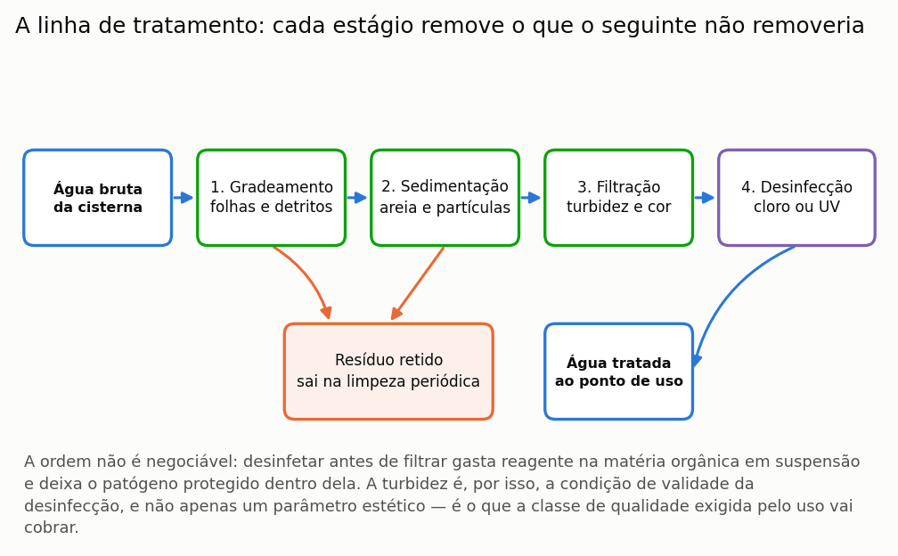
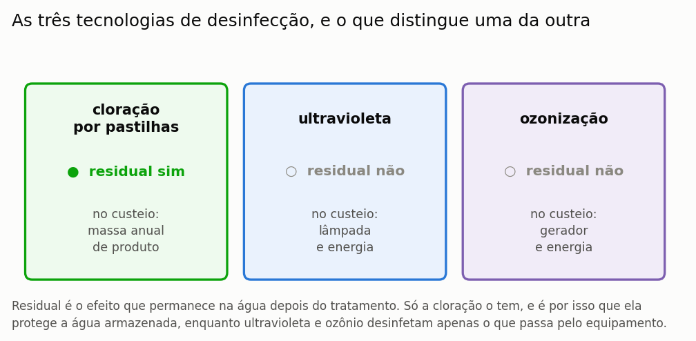

# Dimensionamento da ETAP

> Esta seção formaliza como o programa dimensiona a estação de tratamento de água
> pluvial e explica a **regra incremental**, que impede o tratamento de ser contado
> duas vezes no orçamento e no fluxo de caixa.

A água que escoa de uma cobertura carrega poeira, folhas, fuligem e dejetos de aves, e
nenhum uso — nem mesmo a descarga sanitária — admite que ela chegue ao ponto de consumo
como saiu do telhado. A estação de tratamento de água pluvial, abreviada como ETAP, é o
conjunto de equipamentos que realiza essa adequação, e o programa a dimensiona a partir
de três entradas: a classe de qualidade que o uso exige, a área de cobertura e o volume
pluvial anual efetivamente consumido, este último resultado do balanço diário
apresentado na seção {{n:23}}.

A linha de tratamento compreende três estágios dispostos em série. O **filtro mecânico
de entrada** retira folhas e sólidos grosseiros antes que cheguem ao reservatório; a
**desinfecção** é o estágio obrigatório, do qual depende a segurança microbiológica da
água armazenada; e o **filtro de polimento** é opcional, e se destina aos usos em que a
aparência ou a ausência de resíduo dissolvido importa.

---

A linha de tratamento é uma sequência, e a ordem dos estágios não é arbitrária: cada
um remove aquilo que tornaria o seguinte ineficaz. Convém ter o encadeamento inteiro à
vista antes de discutir cada peça.



*Figura 43 — Os quatro estágios da linha de tratamento e o caminho do resíduo retido. A desinfecção vem por último porque o seu reagente seria consumido pela matéria orgânica em suspensão, que os estágios anteriores removem.*

---

## O filtro de entrada

O filtro de entrada é dimensionado pela área de cobertura, e não pela classe de
qualidade pretendida, porque o que ele precisa vencer é a vazão de pico que a cobertura
produz — grandeza que independe do destino final da água. As três faixas adotadas pelo
programa correspondem às capacidades que os próprios fabricantes declaram para os
equipamentos correntes no mercado brasileiro.

<!-- tabela: Filtro mecânico de entrada dimensionado pela área de cobertura -->
| Cobertura | Equipamento | Malha |
| :--- | :--- | ---: |
| até 200 m² | vórtex autolimpante DN 100 | 350 µm |
| até 500 m² | vórtex autolimpante DN 150 | 400 µm |
| acima de 500 m² | cesto ou ciclônico DN 200 | 500 µm |

> Os limites de faixa acompanham a área que o próprio produto declara atender, e não
> uma folga arbitrada sobre ela. É a razão de um telhado de 180 m² receber o filtro de
> DN 100: o equipamento é declarado suficiente pelo fabricante para até 200 m², e impor
> o da faixa seguinte encareceria a instalação sem fundamento técnico.

---

## A desinfecção

A desinfecção é o estágio que o programa nunca dispensa, e a razão está no conceito de
residual. Entre as três tecnologias disponíveis, apenas a cloração deixa na água um
agente desinfetante que permanece ativo depois do tratamento; a radiação ultravioleta e
a ozonização atuam no instante da passagem e nada deixam atrás de si.



*Figura 99 — As três tecnologias de desinfecção, o residual de cada uma e o que cada uma leva para o custeio anual. O residual é a propriedade que separa a cloração das demais.*


==Ultravioleta e ozônio entram como barreira adicional à cloração, e não como
substitutas dela.== Sem residual, a água tratada volta a se contaminar ao longo do
percurso até o ponto de uso, e a prática correta — alinhada ao item 4.6.5 da ABNT NBR
15527:2019, que trabalha com cloro residual livre — mantém a cloração para proteger o
reservatório e a rede interna. A consequência econômica é direta: as duas opções somam
o custo do cloro ao seu próprio, e escolher qualquer uma delas jamais reduz o custeio.

### A massa de cloro

O insumo de cloração é dimensionado pela massa de produto comercial consumida por metro
cúbico tratado, que decorre da dose aplicada e da pureza do produto adquirido.

```equacao:massa_cloro
m_prod = ( C_Cl ÷ 1000 ) ÷ p
```

| Símbolo | Significado | Unidade |
| :--- | :--- | :--- |
| `m_prod` | massa de produto comercial consumida por metro cúbico tratado | kg/m³ |
| `C_Cl` | dose de cloro ativo aplicada à água | mg Cl₂/L |
| `1000` | conversão de miligramas por litro para quilogramas por metro cúbico | — |
| `p` | pureza do produto, em massa de cloro ativo por massa de produto | adimensional |

> **O que se compra é o produto, e não o cloro puro.** A pastilha de hipoclorito de
> cálcio contém cerca de 65% de cloro ativo, e o preço em reais por quilograma refere-se
> ao produto comercial, não ao princípio ativo. Calcular o custo pela massa de cloro
> ativo o subestimaria pelo inverso da pureza, isto é, em cerca de 35% — e é um engano
> comum em planilhas de orçamento.

---

## O filtro de polimento

O filtro de polimento é opcional e constitui o único ponto do dimensionamento em que a
classe de qualidade alvo interfere na escolha do equipamento. Para as classes mais
exigentes, o programa recomenda sua inclusão, e a recomendação varia também quanto ao
tipo de meio filtrante: a lavagem de roupas, por envolver contato com tecido e pele,
exige carvão ativado em bloco, ao passo que os demais usos se satisfazem com filtro de
areia ou cartucho de vinte micrômetros.

<!-- tabela: Recomendação de filtro de polimento por classe de qualidade alvo -->
| Classe | Recomenda polimento? | Equipamento quando marcado |
| :--- | :---: | :--- |
| 1 — NBR 15527:2019 | não | filtro de areia ou cartucho de 20 µm |
| 2 — irrigação e lavagem | sim | idem |
| 3 — torres e caldeiras | sim | idem |
| 4 — lavagem de roupas | sim | **carvão ativado em bloco** |

A recomendação, contudo, não é imposição: o filtro só entra no dimensionamento se o
usuário efetivamente o marcar. Quando a classe o recomenda e o usuário o recusa, o
programa registra a recusa em campo próprio e o relatório a exibe, de modo que a decisão
fique documentada em vez de desaparecer.

> **As classes 2 a 4 são adaptações do programa, e não da NBR 15527.** A matriz de
> parâmetros por uso final é característica da versão de 2007 da norma e não sobreviveu
> à revisão de 2019. Num estudo publicado, apresente-as como critério adotado pelo
> autor, e nunca como requisito normativo.

---

## A regra incremental

A regra incremental é a parte do cálculo que mais frequentemente se erra em
implementações próprias, e o erro é sempre o mesmo: contar o tratamento duas vezes. Ela
se aplica em três frentes distintas, e em cada uma delas assume forma própria.

**No investimento.** O orçamento de um sistema de aproveitamento pluvial já reserva uma
verba genérica de tratamento dentro da rubrica de acessórios, porque nenhum projetista
orça um sistema sem prever alguma forma de filtragem. Somar a linha detalhada por cima
dessa verba cobraria o tratamento duas vezes, e por isso o programa desconta a verba
genérica e soma apenas o incremento.

```equacao:capex_etap
CAPEX_inc = CAPEX_linha − V_gen
```

| Símbolo | Significado | Unidade |
| :--- | :--- | :--- |
| `CAPEX_inc` | investimento incremental da linha de tratamento | R$ |
| `CAPEX_linha` | investimento total dos equipamentos da linha dimensionada | R$ |
| `V_gen` | verba genérica de tratamento já incluída na rubrica de acessórios | R$ |

**No custeio.** A cloração já é paga na linha de insumos químicos do fluxo de caixa, de
modo que o custeio incremental da ETAP desconta essa parcela e o hipoclorito é pago uma
vez só, e não duas.

**Na avaliação de ciclo de vida.** A linha de tratamento **substitui** o termo de
cloração em vez de somar-se a ele, e a diferença de tratamento entre o fluxo de caixa e
o inventário de emissões decorre de os dois contabilizarem grandezas distintas.

> A regra vive num módulo único, consumido pelos **dois** motores econômicos do
> programa. Duas cópias da mesma regra divergem com o tempo, e a divergência entre elas
> é invisível no resultado: cada motor responde de forma coerente consigo mesmo.

---

## Desligar a ETAP

O dimensionamento da linha de tratamento pode ser inteiramente desativado, e nesse caso
nem o investimento nem o custeio de tratamento entram na análise econômica. A finalidade
da chave é permitir o estudo da hipótese de tratamento já existente na edificação — caso
em que o custo não deve ser atribuído ao sistema pluvial — e comparar cenários com e sem
a linha. ==Desligá-la não significa que a água dispense tratamento:== significa que o
tratamento não está sendo orçado aqui.

---

## O que o programa não dimensiona

O escopo do dimensionamento termina nos equipamentos da linha, e quatro itens
correlatos permanecem a cargo do projetista. O **reservatório de autolimpeza** do
descarte de primeiras águas, cujo volume é o produto da área de captação pela lâmina
descartada, exige dimensionamento hidráulico próprio. A **tubulação** da linha de
tratamento e a perda de carga que ela impõe também não são calculadas. O **regime de
manutenção** — troca de elemento filtrante, limpeza do vórtex, reposição de pastilhas —
não é planejado pelo programa, embora determine boa parte do custeio real. E o
**controle de qualidade** permanece integralmente fora do escopo: o programa dimensiona
equipamento a partir de premissas, e não substitui ensaio laboratorial.

A ABNT NBR 15527 trata do controle e da manutenção, e o plano correspondente é
responsabilidade do projetista.
