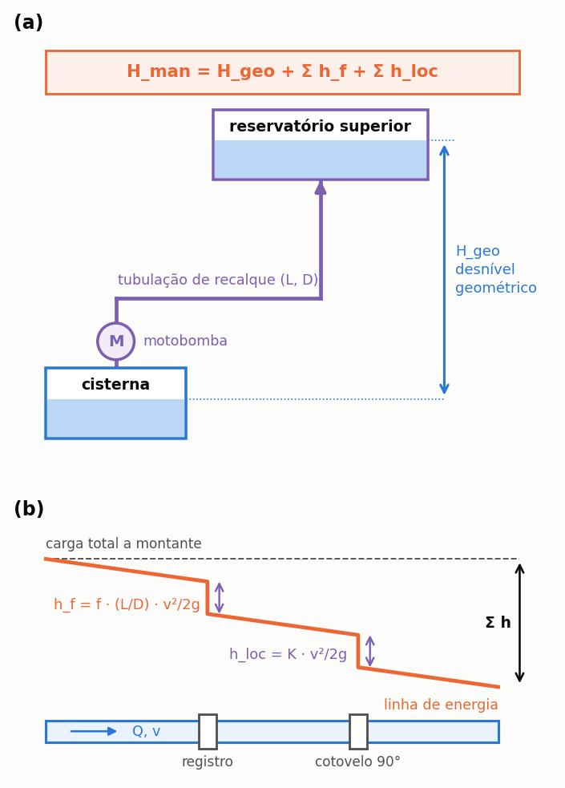

# Energia de bombeamento

> Esta seção traz a cadeia completa do eixo à tomada, e explica por que a
> potência de placa **não** é o que o medidor registra.

Três versões desta conta já existiram no programa, e as duas primeiras estavam
erradas. O capítulo diz quais eram e por quê, porque quem lê um estudo feito numa
versão antiga precisa saber.

---

## A potência de placa é de eixo

A ABNT NBR 17094-2:2016 manda marcar o **rendimento** na placa de identificação do
motor, como grandeza separada da potência. Isso só faz sentido se a potência de
placa for a potência mecânica **no eixo**.

Daí a cadeia ter dois rendimentos, e não um:

<!-- tabela: Os dois rendimentos da cadeia de bombeamento e o que cada um converte -->
| Rendimento | O que converte |
| :--- | :--- |
| **da bomba**, `η_b` | potência de eixo em potência hidráulica entregue à água |
| **do motor**, `η_m` | potência elétrica da tomada em potência mecânica no eixo |

O programa pede os dois, em campos separados.

---

## As equações

**Energia específica do recalque**, por metro cúbico elevado:

```equacao:energia_especifica
e = ( ρ × g × H ) ÷ ( η_b × η_m )
```

| Símbolo | Significado | Unidade |
| :--- | :--- | :--- |
| `e` | consumo específico de energia por volume recalcado | kWh/m³ |
| `ρ` | massa específica da água, adotada como 1.000 | kg/m³ |
| `g` | aceleração da gravidade, adotada como 9,81 | m/s² |
| `H` | altura manométrica total do recalque | m.c.a. |
| `η_b` | rendimento hidráulico da bomba | adimensional |
| `η_m` | rendimento do motor elétrico | adimensional |

==A Equação {{eq:energia_especifica}} não depende da vazão nem da potência instalada.==
Elevar um metro cúbico de água a uma dada altura custa a mesma energia com bomba grande
ou pequena, porque o trabalho realizado é o mesmo; o que muda com a potência é o tempo
gasto para realizá-lo, e não o consumo específico.

**Quando a vazão de operação é declarada**, a forma equivalente:

```equacao:energia_por_vazao
e = P ÷ ( Q × η_m )
```

| Símbolo | Significado | Unidade |
| :--- | :--- | :--- |
| `e` | consumo específico de energia por volume recalcado | kWh/m³ |
| `P` | potência de placa da motobomba, que é potência de eixo | kW |
| `Q` | vazão de recalque informada ou deduzida | m³/h |
| `η_m` | rendimento do motor elétrico | adimensional |

O rendimento hidráulico da bomba não comparece na Equação {{eq:energia_por_vazao}}, e a
ausência é proposital: ele já está embutido no fato de um motor de `P` quilowatts no
eixo fazer a bomba entregar `Q` metros cúbicos por hora naquela altura. Dividir por ele
outra vez contabilizaria a perda hidráulica duas vezes.

**Vazão, quando não declarada:**

```equacao:vazao_deduzida
Q = ( P × η_b ) ÷ ( ρ × g × H )
```

| Símbolo | Significado | Unidade |
| :--- | :--- | :--- |
| `Q` | vazão de recalque deduzida | m³/h |
| `P` | potência de placa da motobomba, que é potência de eixo | kW |
| `η_b` | rendimento hidráulico da bomba | adimensional |
| `ρ` | massa específica da água, adotada como 1.000 | kg/m³ |
| `g` | aceleração da gravidade, adotada como 9,81 | m/s² |
| `H` | altura manométrica total do recalque | m.c.a. |

**Energia das partidas:**

```equacao:energia_partida
E_part = ( P × t_part ) ÷ η_m
```

| Símbolo | Significado | Unidade |
| :--- | :--- | :--- |
| `E_part` | energia consumida no conjunto das partidas do período | kWh |
| `P` | potência de placa da motobomba, que é potência de eixo | kW |
| `t_part` | tempo total de partida acumulado no período | h |
| `η_m` | rendimento do motor elétrico | adimensional |

O rendimento da bomba está ausente da Equação {{eq:energia_partida}} pela razão física
que a distingue das anteriores: durante a partida não há vazão útil, e portanto não há
perda hidráulica a descontar. O motor puxa energia da tomada, e é apenas isso que o
medidor da concessionária registra.

A energia anual da motobomba é a soma das duas parcelas: a do recalque efetivo, que
depende do volume elevado, e a das partidas, que depende do número de acionamentos.

```equacao:energia_anual
E_ano = e × V_rec + ( P × t_part ) ÷ η_m
```

| Símbolo | Significado | Unidade |
| :--- | :--- | :--- |
| `E_ano` | energia elétrica consumida pela motobomba no ano | kWh/ano |
| `e` | consumo específico de energia por volume recalcado | kWh/m³ |
| `V_rec` | volume recalcado no ano | m³/ano |
| `P` | potência de placa da motobomba, que é potência de eixo | kW |
| `t_part` | tempo total de partida acumulado no ano | h/ano |
| `η_m` | rendimento do motor elétrico | adimensional |

---

A potência de placa de uma motobomba é a potência mecânica no eixo, e não a potência elétrica registrada pelo medidor ({{fig:fig00k_energia}}). Uma motobomba de 0,5 CV (0,37 kW) com motor de rendimento 60,5% absorve da rede cerca de 0,61 kW: calcular a energia com a potência de placa subestimaria o consumo em cerca de 40%, e o custeio de energia é justamente a parcela que reduz a economia do sistema.


*Figura 99 — Cadeia de energia do bombeamento. A potência de placa é a potência no eixo, no meio da cadeia: entre ela e o medidor de energia está o rendimento do motor, η_m, e entre ela e a potência hidráulica entregue à água está o rendimento da bomba, η_b.*

A potência hidráulica depende da altura manométrica, que soma ao desnível geométrico entre as lâminas d'água as perdas de carga do escoamento ({{fig:fig00l_manometrica}}). A perda de carga é a energia dissipada por unidade de peso do fluido e tem duas parcelas: a perda contínua, ao longo da tubulação, dada pela equação de Darcy-Weisbach, `h_f = f · (L/D) · v²/2g`, em que `f` é o fator de atrito, `L` o comprimento, `D` o diâmetro interno e `v` a velocidade média; e as perdas localizadas em conexões, registros e válvulas, `h_loc = K · v²/2g`, em que `K` é o coeficiente da singularidade. Em recalques prediais curtos, as perdas somam tipicamente de 10% a 30% do desnível geométrico.



*Figura 99 — (a) Altura manométrica de um recalque predial: desnível geométrico entre as lâminas d'água da cisterna e do reservatório superior, somado às perdas de carga; (b) linha de energia ao longo de um trecho de tubulação, com a perda contínua por atrito (h_f) e as perdas localizadas em registro e cotovelo (h_loc).*

---

## O rendimento do motor, quando não informado

Vale a Tabela 13 da ABNT NBR 17094-2:2016, linha IR1, motores de dois polos — que é o que são as motobombas residenciais, a 3.450 rpm ({{fig:fig31_motores}}):


*Figura 99 — Rendimento mínimo de motores de indução monofásicos de dois polos, conforme a Tabela 13 da ABNT NBR 17094-2:2016. O programa adota a classe IR1 quando o projeto não informa o rendimento, por ser a de menor exigência e, portanto, a hipótese conservadora.*


Os dois valores que mais aparecem em instalação predial são o de meio CV, com
**60,5%** de rendimento na classe IR1, e o de um CV, com **69,3%**. A diferença entre
eles é de quase nove pontos percentuais, e ela se propaga inteira para o custeio de
energia, porque é o rendimento que separa a potência de eixo da potência efetivamente
puxada da rede.

Adota-se a **IR1** por ser o piso normativo e o que se encontra em motobomba de
prateleira. Quem tem motor de alto rendimento informa o valor marcado na placa.

Para potências fora da tabela, a norma manda adotar o maior dos dois rendimentos
vizinhos quando a potência estiver no ponto médio ou acima, e o menor quando estiver
abaixo.

---

## Por que a cadeia completa importa

O consumo específico do caso de referência — meio cavalo, 12 m.c.a. de altura
manométrica, 82 m³ recalcados e 98 acionamentos por ano — é de 0,1080 kWh/m³.
==Ignorar o rendimento do motor, ou descontar o rendimento da bomba duas vezes,
altera esse número em dezenas de pontos percentuais,== e esses são precisamente os dois
enganos mais frequentes em planilhas de dimensionamento.

O primeiro engano consiste em tratar a potência de placa como potência consumida na
tomada; o segundo, em aplicar o rendimento hidráulico numa conta que já parte da vazão
efetivamente entregue, o que o contabiliza duas vezes. A cadeia apresentada nesta seção
é explícita justamente para tornar ambos visíveis.

---

## O assistente de dimensionamento da motobomba

Quando a potência, a vazão e a altura manométrica da motobomba não são conhecidas, o botão *Assistente de Dimensionamento de Motobomba*, na etapa **4. Reservatório & Custos** e no diálogo econômico, estima os três valores e seleciona um modelo comercial. O assistente segue a sequência usual de dimensionamento de um recalque predial:

1. **Vazão de recalque.** `Q = V_sup ÷ t_ench`, com o volume do reservatório superior e o tempo de enchimento desejado, de 45 minutos por padrão.
2. **Diâmetro econômico.** Pela fórmula de Forchheimer, `D = 1,3 · (t_op ÷ 24)^0,25 · √Q`, com `D` em metros, `Q` em m³/s e `t_op` o tempo diário de funcionamento, de 2 h por padrão. O diâmetro adotado é o menor tubo comercial de PVC soldável cujo diâmetro interno atende ao valor calculado, e nunca inferior ao bocal da motobomba selecionada; a sucção recebe uma bitola comercial acima do recalque.
3. **Velocidade.** `v = Q ÷ (π · D_i² ÷ 4)`, destacada quando fica fora do intervalo de 0,6 m/s a 2,5 m/s.
4. **Perda de carga.** Pela fórmula de Hazen-Williams, `J = 10,643 · Q^1,852 · C^−1,852 · D_i^−4,87`, com `C = 140` para PVC, multiplicada pelo comprimento da tubulação e acrescida de 30% para as perdas localizadas.
5. **Altura manométrica e potência.** `H_man = H_geo + h_f` e `P = ρ · g · Q · H_man ÷ η`, com rendimento de conjunto de 55% por padrão.
6. **Seleção.** O primeiro modelo do catálogo interno cuja vazão, altura máxima e potência atendem ao ponto de operação, com a curva da bomba traçada contra o ponto calculado.

A altura manométrica e a perda de carga calculadas retornam ao projeto e passam a alimentar o cálculo de energia desta seção, no lugar do valor de recurso.

---

## Os valores de recurso

Usados quando o projeto não declara:

<!-- tabela: Valores de recurso adotados quando o projeto não os declara -->
| Parâmetro | Valor | Origem |
| :--- | ---: | :--- |
| altura manométrica | 12 m.c.a. | casa de dois pavimentos com cisterna enterrada: ~8 m de desnível geométrico mais ~30% de perda de carga |
| rendimento da bomba | 55% | motobombas residenciais de meio a um CV ficam entre 40% e 60% no ponto de operação |
| tempo de partida | 108 s | ver a ressalva abaixo |

> **Aprofundamento: a altura manométrica é o parâmetro que mais pesa.** Quem conhece o
> desnível do projeto deve informá-lo. Dobrar a altura dobra a energia.

> **Aprofundamento: o tempo de partida de 108 s.** Ele representa o tempo de escorva
> de uma bomba autoaspirante cuja linha de sucção drenou. Numa instalação com válvula
> de pé em ordem, a linha permanece escorvada e as partidas seguintes são imediatas.
> No caso de referência, as partidas respondem por 19% do consumo anual; com um
> transitório de 3 s, responderiam por 0,5%. O valor é conservador e está registrado
> como pendência aberta do programa.

---

## Por que a energia é pequena

Elevar um metro cúbico a doze metros custa cerca de 0,033 kWh de energia hidráulica.
Com os dois rendimentos, chega a 0,11 kWh por metro cúbico entregue.

Água é pesada, mas doze metros é pouco. Por isso o custo energético do aproveitamento
pluvial é desprezível diante da economia na fatura de água e esgoto em edificação de pequeno
porte — e por isso o argumento de que «bombear gasta mais do que economiza» não se
sustenta nessa escala.

Em prédio alto, com trinta metros de recalque, a conta muda, e vale refazê-la.
