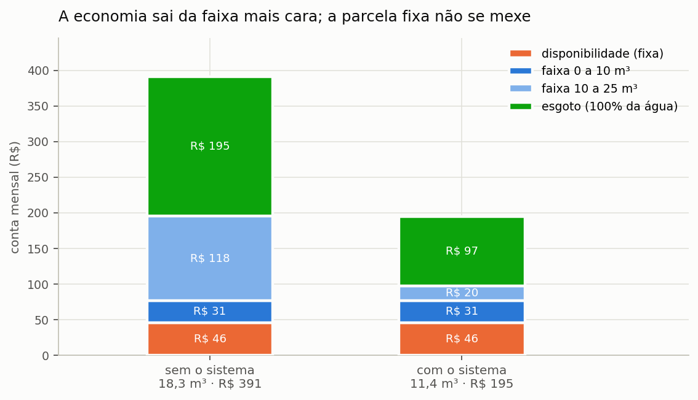
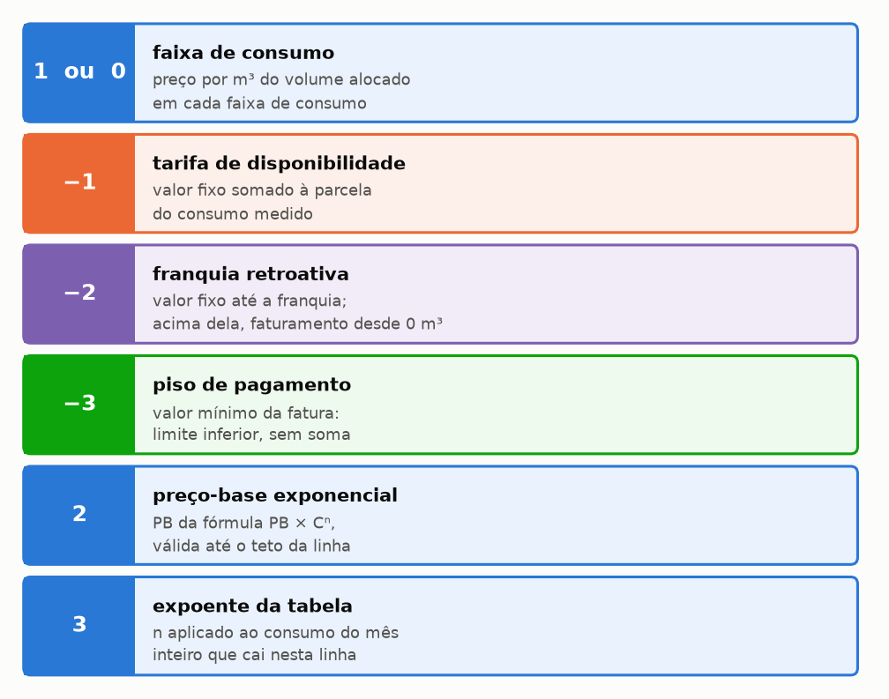
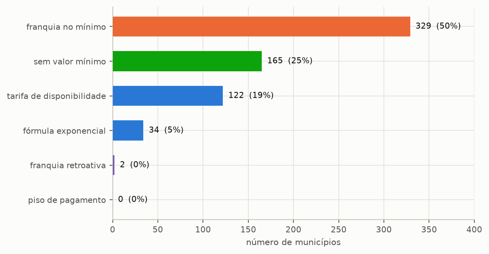
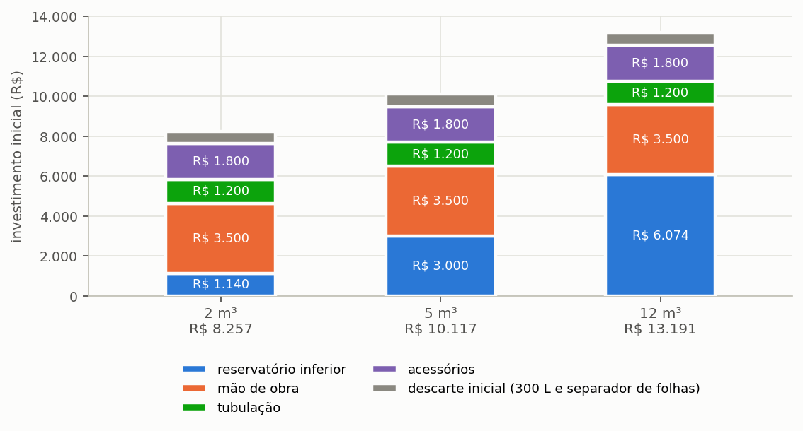
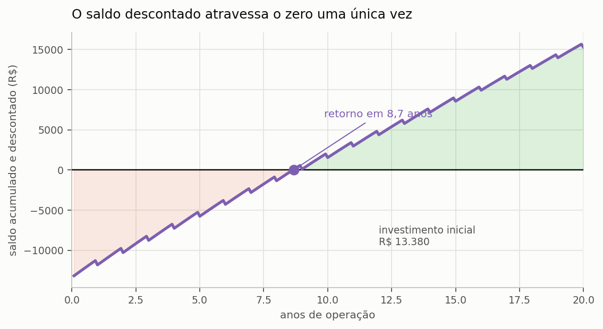

# Análise econômica e os regimes tarifários

> Esta seção formaliza o fluxo de caixa e detalha os seis regimes tarifários
> tarifário — o dado que mais decide a viabilidade de um sistema pluvial no Brasil.

---

## A economia é a diferença entre duas faturas

O programa não calcula a economia multiplicando o volume poupado por uma tarifa média,
e a distinção não é de refinamento: é de ordem de grandeza. Para cada mês da projeção
ele monta duas faturas completas, uma com o consumo que a edificação teria sem o sistema
pluvial e outra com o consumo de água potável efetivamente comprado, e toma a diferença
entre elas.

```equacao:economia_mensal
E_mês = F(V_tot) − F(V_pot)
```

| Símbolo | Significado | Unidade |
| :--- | :--- | :--- |
| `E_mês` | economia obtida no mês | R$ |
| `F(·)` | função que calcula a fatura de água e esgoto para um volume | R$ |
| `V_tot` | volume mensal que a edificação consumiria sem o sistema pluvial | m³ |
| `V_pot` | volume mensal de água potável efetivamente comprado da rede | m³ |

A razão de proceder assim está na progressividade das estruturas tarifárias brasileiras.
==O metro cúbico que se deixa de consumir é sempre o último da fatura, que é o mais
caro, e nunca o médio.== Num município cuja primeira faixa custa R$ 3,08/m³ e cuja
segunda faixa custa R$ 14,31/m³, calcular a economia pela tarifa média a subestima em
mais da metade, e o erro cresce com o consumo da edificação.

---

## A fatura de água e esgoto

A estrutura tarifária de cada município é representada no programa por uma sequência de
faixas, e cada faixa é uma quádrupla composta pelo volume mínimo, pelo volume máximo, por
um valor e por um código. O código é o elemento que dá sentido ao valor, porque
estruturas aparentemente semelhantes cobram de maneiras muito distintas.

Antes dos códigos, convém ver de que a fatura é feita. A fatura mensal de água e esgoto é a soma de parcelas com comportamentos distintos: uma parcela fixa, que não responde ao consumo; uma ou mais faixas de consumo, em que é cobrado o preço por volume que está alocado dentro de cada faixa de consumo; e o esgoto, que em boa parte do Brasil é um percentual do valor da água e portanto acompanha tudo o que ele faz. A
economia de água atinge cada uma dessas parcelas de um jeito diferente, e é essa assimetria que a {{fig:fig07_fatura}} mostra.



*Figura 99 — Fatura mensal de água e esgoto do projeto do tutorial, aberta em parcelas, sem e com o sistema. A tarifa de disponibilidade é idêntica nos dois casos; a redução ocorre nas faixas de consumo superiores, que têm o maior preço por metro cúbico, e se estende ao esgoto, cobrado como percentual do valor da água.*

O código de cada faixa define como o seu valor é aplicado ({{fig:fig32_codigos}}). Nas faixas de consumo, de código 1 ou 0, é cobrado o preço por volume que está alocado dentro de cada faixa de consumo; na tarifa de disponibilidade, de código −1, o valor fixo é somado à parcela de consumo; na franquia retroativa, de código −2, o consumo acima da franquia faz todo o volume ser faturado desde 0 m³; no piso de pagamento, de código −3, o valor declarado é o limite inferior da fatura; e na fórmula exponencial, o código 2 guarda o preço-base e as linhas de código 3 guardam a tabela de expoentes.



*Figura 99 — Os seis códigos de faixa tarifária e o efeito de cada um sobre a fatura mensal de água e esgoto. Duas estruturas com os mesmos valores numéricos resultam em faturas distintas conforme o código de cada faixa.*


Dois desses regimes são frequentemente confundidos entre si, embora produzam efeitos
opostos sobre a viabilidade de um sistema pluvial. Vale examiná-los com números.

- **Disponibilidade soma.** Parcela de consumo de R$ 55 mais R$ 46 de disponibilidade dá fatura de R$ 101,
  e economizar R$ 15 de consumo deixa a fatura em R$ 86.
- **Piso limita por baixo.** Com piso de R$ 40 e consumo tarifado de R$ 55,
  economizar até R$ 15 **não reduz nada**.

A diferença entre os dois regimes decide se cada metro cúbico economizado gera desconto
desde o primeiro ou se a economia só começa a valer depois de vencido um patamar, e um
estudo de viabilidade que os confunda chega a conclusões invertidas. É por essa razão que
o programa codifica o regime de forma explícita, em vez de tratá-lo como detalhe da
tabela.

### A fórmula exponencial

Nos municípios da CORSAN a parcela de água não é soma de faixas, e sim uma potência do
consumo do mês:

```equacao:exponencial
T_agua = PB × C^n + SB
```

| Símbolo | Significado | Unidade |
| :--- | :--- | :--- |
| `T_agua` | parcela de água da fatura | R$ |
| `PB` | preço-base do município | R$/m³ |
| `C` | consumo do mês por economia | m³ |
| `n` | expoente da Tabela de Exponenciais para o consumo `C`: 1,00 até 20 m³, 1,13 entre 101 e 150 m³ | adimensional |
| `SB` | serviço básico | R$ |

O expoente é lido pelo consumo **total** do mês e aplicado a todo o volume. Na categoria
residencial não há teto; só a industrial passa, acima de 1.000 m³, a cobrar o excedente
por preços próprios, e o programa representa esse teto com uma faixa comum a partir dele.
A economia mensal é a
diferença entre as duas contas, `PB × (C₁ⁿ¹ − C₂ⁿ²)`, cada consumo com o seu expoente, e não o produto de um preço
unitário pelo volume poupado; com `n` acima de 1, o metro cúbico poupado vale mais que o
preço-base.

### Micromedição

Em edificações multifamiliares com medição individualizada, o consumo é avaliado no
patamar de uma única unidade habitacional e o resultado é multiplicado pelo número de
economias. O tratamento importa por causa da progressividade: um prédio de vinte
apartamentos tratado como consumidor único cairia inteiro na faixa mais cara da tabela, e
a economia resultante sairia grosseiramente superestimada, porque cada metro cúbico
poupado seria valorado a uma tarifa que nenhuma das vinte unidades efetivamente paga.

### O esgoto

```equacao:esgoto
T_esg = T_agua × s
```

| Símbolo | Significado | Unidade |
| :--- | :--- | :--- |
| `T_esg` | parcela de esgoto da fatura | R$ |
| `T_agua` | parcela de água da fatura, já calculada pelas faixas progressivas | R$ |
| `s` | percentual de esgoto praticado pela concessionária | adimensional |

O percentual de esgoto incide sobre a parcela de água da fatura, e não sobre a fatura
total, e a confusão entre os dois denominadores dobra ou divide pela metade a parcela
calculada. Cem por cento, que é o valor praticado por boa parte das concessionárias
brasileiras, significa que a parcela de esgoto iguala a de água, e portanto que o esgoto
responde por metade da fatura total.

Há um terceiro modo, o da CORSAN: o esgoto cobrado **por metro cúbico consumido**,
`T_esg = C × p_esg`, sem o serviço básico e sem o expoente da água. Aplicar ali o
percentual sobre a parcela de água cobraria esgoto sobre o serviço básico e sobre a
potência, e a conta sairia maior do que a concessionária fatura.

---

## Os seis regimes na base

O catálogo distribui os seus 652 municípios de maneira bastante desigual entre os seis
regimes. A franquia no mínimo responde sozinha por **329** deles, mais da metade;
seguem-se 165 sem mínimo algum, 122 com tarifa de disponibilidade e 34 na fórmula exponencial da CORSAN, ao passo que a franquia retroativa aparece em apenas dois e o piso de pagamento em nenhum ({{fig:fig33_regimes_base}}). A tabela a seguir mostra como cada regime é codificado e aplicado no cálculo da fatura.

<!-- tabela: Codificação e aplicação de cada regime de valor mínimo no cálculo da fatura -->
| Regime | Codificação das faixas | Cálculo da parcela de água | Efeito da redução do consumo |
| :--- | :--- | :--- | :--- |
| sem valor mínimo | apenas faixas de consumo (código 1 ou 0) | soma, em cada faixa, do preço por m³ aplicado ao volume alocado dentro dela | toda redução de consumo reduz a fatura |
| tarifa de disponibilidade | valor fixo (−1) e faixas de consumo a partir de 0 m³, com preço positivo | valor fixo somado à parcela de consumo, faturada desde o primeiro m³ | toda redução de consumo reduz a fatura; o valor fixo permanece |
| franquia no mínimo | valor fixo (−1) e primeira faixa de 0 a N m³ a R$ 0,00/m³ | valor fixo que inclui os N m³ da franquia; acima deles, faixas de consumo | redução abaixo de N m³ não altera a fatura |
| franquia retroativa | franquia (−2) de 0 a N m³ com valor fixo, e faixas de consumo | até N m³, valor fixo; acima, todo o volume faturado desde 0 m³ pelas faixas | reduzir o consumo para até N m³ substitui a parcela de consumo pelo valor fixo |
| piso de pagamento | piso (−3) e faixas de consumo | parcela de consumo pelas faixas, limitada inferiormente ao valor do piso | redução que leva a parcela abaixo do piso não reduz a fatura |
| fórmula exponencial | serviço básico (−1), preço-base (2) e tabela de expoentes (3) cobrindo todo o consumo | serviço básico somado a `PB × Cⁿ`, com `n` pelo consumo do mês inteiro | toda redução de consumo reduz a fatura, pela diferença entre as duas potências |



*Figura 99 — Distribuição dos 652 municípios do catálogo pelos seis regimes tarifários. Metade deles pratica franquia no mínimo, regime em que a redução do consumo abaixo da franquia não reduz a fatura.*


O piso de pagamento está implementado no motor de cálculo e nenhum município da base foi
até agora classificado nele, situação que se registra aqui por transparência: a ausência
de ocorrências não significa que o regime não exista no país, e sim que o levantamento
não o encontrou entre os 652 municípios catalogados.

A seção {{n:16}} apresenta o exemplo numérico que compara Floriano e Florianópolis, do
qual decorre a lição prática mais importante desta seção: em regime de franquia,
economizar água abaixo do volume de franquia não produz desconto algum na fatura.

---

## O investimento

```equacao:capex
CAPEX = C_cist + C_sup + C_mo + C_tub + C_ace + ( C_bomba × n_b ) + CAPEX_inc
```

| Símbolo | Significado | Unidade |
| :--- | :--- | :--- |
| `CAPEX` | investimento inicial total do sistema | R$ |
| `C_cist` | custo do reservatório inferior | R$ |
| `C_sup` | custo do reservatório superior, quando houver | R$ |
| `C_mo` | custo de mão de obra de instalação: no projeto novo, 30% dos materiais, com piso de R$ 1.400 | R$ |
| `C_tub` | custo da tubulação: tubos, curvas e conexões do arranjo 3D | R$ |
| `C_ace` | custo dos acessórios: as peças do arranjo 3D, uma a uma, e os cabos de comando | R$ |
| `C_bomba` | custo unitário da motobomba | R$ |
| `n_b` | número de motobombas, incluindo a reserva quando houver | unidade |
| `CAPEX_inc` | investimento incremental da linha de tratamento, incluído o descarte inicial quando dimensionado | R$ |

No projeto novo, `C_tub` e `C_ace` não são verbas: saem do **quantitativo do arranjo 3D**
(seção {{n:22}}). Cada metro de tubo, cada curva, cada conexão de extremidade, cada peça —
registros, válvulas de retenção e de pé, solenoide, hidrômetro, chaves de nível, quadro de
comando, freio d'água, sucção flutuante, respiros, ladrão, separação atmosférica, ponto de
consumo — e cada metro de cabo de comando tem preço, e a soma é o que entra aqui. Cisterna,
caixa superior e motobomba têm termo próprio; o filtro de entrada e o descarte entram pela
linha de tratamento quando ela os dimensiona. O projetista pode digitar outros valores na
etapa econômica; o projeto passa então a usar os digitados, e a planilha de auditoria
registra a troca. Projetos gravados antes desta regra mantêm os custos que declaram.

A mão de obra do projeto novo também é refeita a cada cálculo: 30% da soma de cisterna,
caixa superior, motobombas, tubulação e acessórios, com piso de R$ 1.400 (chave
`labor_percentage` de `costs_database.json`). Assim, ela cresce com o reservatório: na
varredura de volumes, cada volume tem a sua cisterna, o seu arranjo usual e a sua mão de
obra. Antes, a mão de obra era fixada uma única vez, sobre verbas genéricas de tubulação
e acessórios, e valia igual para todos os volumes. Um valor digitado na etapa econômica
prevalece, como nas outras rubricas.

O último termo segue a regra incremental da seção {{n:27}} e inclui, quando o dimensionamento físico do descarte está habilitado, o reservatório de descarte inicial e o separador de folhas; o custeio anual desse subsistema entra no custeio da linha de tratamento.

Os preços de reservatório provêm da base de custos do programa, com procedência
declarada para cada material. Quando o volume pedido não consta da tabela, o programa
interpola linearmente entre os pontos vizinhos; quando o volume excede o maior valor
tabelado, a extrapolação só é realizada se a regressão sobre os pontos conhecidos
apresentar coeficiente de determinação acima de 0,90, e o programa adverte quando esse
critério não é satisfeito, em vez de extrapolar em silêncio.

---

A composição do investimento surpreende quem chega ao assunto esperando que o
reservatório domine a conta. Em volumes residenciais pequenos ele pesa menos que a mão de obra e a tubulação, e só passa a dominar quando o volume cresce o bastante para que o preço do tanque supere a
soma fixa da instalação. A consequência de projeto é direta: dobrar o reservatório não
dobra o investimento, e essa não linearidade é parte do motivo de a curva de valor presente líquido ter máximo interior ({{fig:fig21_investimento}}).



*Figura 99 — Investimento inicial aberto nas sete rubricas que o programa soma, para três volumes de reservatório de polietileno. Com os custos que o tutorial declara, só o reservatório inferior cresce com o volume; caixa superior, mão de obra, tubulação, acessórios, motobombas e linha de tratamento não mudam. A linha de tratamento entra pelo que acrescenta além da verba de filtração já embutida nos acessórios, para não contar o filtro duas vezes. Num projeto novo, tubulação e acessórios saem do arranjo 3D, que não tem essa verba, e a mão de obra acompanha os materiais de cada volume.*

---

## O custeio anual

<!-- tabela: Parcelas do custeio anual e a origem de cada uma -->
| Parcela | Origem |
| :--- | :--- |
| energia de bombeamento | seção {{n:28}}, com a bandeira tarifária aplicada |
| cloração | massa de **produto**, não de cloro ativo |
| ETAP | custeio incremental, sem contar a cloração duas vezes |
| descarte inicial | manutenção anual do reservatório de descarte e do separador de folhas, quando dimensionados |
| custos operacionais declarados | lista livre do usuário |

A bandeira tarifária ajusta a tarifa de energia conforme a condição de operação do
sistema elétrico nacional, e o programa aceita as quatro modalidades vigentes: amarela,
vermelha patamar 1, vermelha patamar 2 e branca, esta última com desconto nos períodos
fora de ponta.

---

## A projeção mês a mês

A projeção é feita mês a mês ao longo de todo o período de análise, e aplica a cada parcela os fatores de inflação e de reajuste definidos a seguir.

O resultado dessa projeção é uma série mensal de saldos, e o que interessa nela é
o instante em que o saldo acumulado deixa de ser negativo. Esse instante é o tempo de retorno. A {{fig:fig08_fluxo_de_caixa}} agrega a projeção por ano: em colunas, a economia na fatura de água e esgoto e os custos, com o investimento no ano zero; em linha, o saldo acumulado descontado, que cruza o zero no tempo de retorno.



*Figura 99 — Fluxo de caixa do projeto do tutorial em vinte anos: economia anual na fatura de água e esgoto e custos anuais, com o investimento inicial no ano zero, em valores nominais; e saldo acumulado descontado à taxa mínima de atratividade, que cruza o zero no tempo de retorno de 16,3 anos. Cisterna de concreto de 4.000 L com caixa superior, como na seção {{n:10}}.*

**A inflação incide só sobre o custeio:**

```equacao:inflacao
f_inf = ( 1 + i )^( m − 1 )
```

| Símbolo | Significado | Unidade |
| :--- | :--- | :--- |
| `f_inf` | fator acumulado de inflação até o mês `m` | adimensional |
| `i` | taxa de inflação mensal declarada, como fração: 0,35% ao mês entra como 0,0035 | adimensional |
| `m` | mês do fluxo de caixa, contado a partir de 1 | mês |

**Os reajustes tarifários incidem só sobre a fatura, em degraus:**

```equacao:degraus
k = ⌊ ( m − 1 ) ÷ I ⌋
```

```equacao:reajuste
f_j = ( 1 + r_j )^k
```

| Símbolo | Significado | Unidade |
| :--- | :--- | :--- |
| `k` | número de reajustes já aplicados até o mês `m` | adimensional |
| `m` | mês do fluxo de caixa, contado a partir de 1 | mês |
| `I` | intervalo entre reajustes, tipicamente 12 | mês |
| `⌊ ⌋` | parte inteira da divisão | — |
| `f_j` | fator acumulado de reajuste da parcela `j` | adimensional |
| `r_j` | taxa de reajuste da parcela `j`, que pode ser água, esgoto ou energia | adimensional |

A Equação {{eq:reajuste}} é aplicada separadamente a cada uma das três parcelas, com
taxas próprias, e é dessa separação que trata a observação seguinte.

> **Água e esgoto são reajustados por índices separados**, e não por um índice único
> sobre a fatura agregada. As duas parcelas são objeto de atos distintos da
> concessionária, e tratá-las juntas indexa metade da conta pelo índice errado.

O incentivo de IPTU verde, quando o município o oferece e o usuário o habilita, entra no
fluxo de caixa como economia anual dividida por doze, o que o distribui uniformemente
pelos meses do ano. A simplificação é deliberada: o desconto é concedido de uma vez, no
lançamento anual do tributo, mas distribuí-lo evita que o fluxo de caixa apresente um
degrau que nada tem a ver com o desempenho do sistema.

---

## Os indicadores

**Valor presente líquido:**

```equacao:vpl
VPL = − CAPEX + Σ [ FC_m ÷ ( 1 + TMA )^m ]
```

| Símbolo | Significado | Unidade |
| :--- | :--- | :--- |
| `VPL` | valor presente líquido do investimento | R$ |
| `CAPEX` | investimento inicial total, da Equação {{eq:capex}} | R$ |
| `FC_m` | fluxo de caixa líquido do mês `m` | R$ |
| `TMA` | taxa mínima de atratividade mensal, como fração: 0,5% ao mês entra como 0,005 | adimensional |
| `m` | mês do fluxo de caixa, de 1 até o fim do período de análise | mês |

**Taxa interna de retorno:** a taxa que zera o VPL. Quando não há raiz real — o que
acontece quando o fluxo nunca se torna positivo — o programa devolve nulo, em vez de
um número inventado.

**Payback descontado:** o primeiro mês em que o acumulado descontado cruza zero.

---

## As premissas frágeis

Duas merecem sensibilidade, e a seção {{n:20}} mostra como.

**O reajuste tarifário.** Cinco por cento ao ano por vinte anos multiplica a tarifa por 2,65; três por cento, por 1,81; sete por cento, por 3,87. A economia dos últimos anos cresce na mesma proporção, e é por isso que o reajuste está entre as premissas que mais movem o valor presente líquido, como mostra o tornado da seção {{n:20}}; é também uma das mais incertas.

**A vida útil.** Vinte anos é a adoção padrão. Cisterna de concreto dura mais;
componentes de polietileno expostos ao sol duram menos. A vida útil entra tanto no
período de análise quanto no payback de carbono da seção {{n:30}}.
