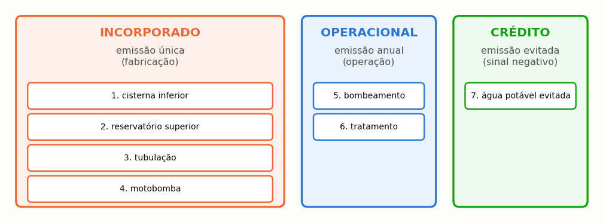

# Avaliação de ciclo de vida

> Esta seção traz as sete etapas do inventário, a fronteira adotada, e declara o
> que é medido e o que é premissa de triagem.

Avaliação de ciclo de vida é o método que contabiliza os impactos ambientais de um
produto ao longo de toda a sua existência, da extração das matérias-primas ao descarte
final. Aplicada a um sistema de aproveitamento pluvial, ela responde se o carbono emitido
para fabricar o reservatório, a tubulação e a motobomba compensa o carbono que se deixa
de emitir ao não consumir água da concessionária.

==A avaliação do Netuno é de triagem, e não um inventário completo.== A distinção é
importante e a norma a reconhece: uma avaliação de triagem ordena alternativas e
identifica o que domina o resultado, ao passo que um inventário conforme a ISO 14040
documenta cada fluxo elementar com procedência rastreável e submete-se a revisão crítica
externa. O primeiro serve para decidir entre polietileno e concreto; o segundo, para
declarar publicamente um desempenho ambiental.

---

## As sete etapas

O inventário é organizado em sete etapas, agrupadas pela natureza da emissão ({{fig:fig34_inventario}}). O saldo de carbono é a soma das emissões das seis primeiras menos o crédito da sétima, único termo com sinal negativo, e é esse crédito que decide se o sistema compensa o carbono incorporado na sua construção.




*Figura 99 — As sete etapas do inventário, agrupadas pela natureza da emissão. As quatro primeiras são incorporadas e ocorrem uma única vez; a quinta e a sexta são operacionais e se repetem todo ano; a sétima é o crédito, e é a única que entra com sinal negativo.*


As quatro primeiras etapas contabilizam o **carbono incorporado**, isto é, as emissões ocorridas na fabricação dos componentes, antes que o sistema entre em operação; quando o descarte físico está dimensionado, o reservatório de descarte e o separador de folhas somam-se a elas. As duas
seguintes contabilizam as emissões operacionais, que se repetem a cada ano de uso. E a
sétima é o **crédito**: a emissão que a concessionária deixou de gerar porque aquela água
não precisou ser captada, tratada e distribuída.

O volume zero sem consumo pluvial representa o cenário sem sistema e, por construção, não
recebe o impacto fixo de reservatório, tubulação ou motobomba — é a referência contra a
qual todas as demais alternativas se comparam.

---

## O carbono incorporado

```equacao:emissao_componente
E_comp = m_comp × FE_mat
```

| Símbolo | Significado | Unidade |
| :--- | :--- | :--- |
| `E_comp` | emissão incorporada do componente | kg CO₂e |
| `m_comp` | massa do componente | kg |
| `FE_mat` | fator de emissão do material, do berço ao portão | kg CO₂e/kg |

A massa de cada componente decorre do seu dimensionamento. No caso do reservatório, ela
é obtida do volume útil multiplicado pela densidade de massa característica do material,
que varia por mais de uma ordem de grandeza entre o polietileno e o concreto armado — e é
dessa variação que decorre boa parte do resultado ambiental do projeto.

<!-- tabela: Massa por metro cúbico útil de cada material de reservatório -->
| Material | Massa por m³ útil | O que isso significa em 5 m³ |
| :--- | ---: | ---: |
| polietileno | 22 kg/m³ | 110 kg |
| fibra de vidro | 15 kg/m³ | 75 kg |
| aço inoxidável | 38 kg/m³ | 190 kg |
| concreto armado | 1.200 kg/m³ | 6.000 kg |

> **Massa é carbono.** Concreto armado é o material mais massivo da lista por
> larga margem, e é por isso que ele domina o inventário quando escolhido. A
> seção {{n:11}} mostra a consequência: com concreto, o sistema do tutorial
> não paga a dívida de carbono dentro da vida útil.

---

## A operação

**Bombeamento:**

```equacao:emissao_energia
E_ener = C_ano × FE_rede
```

| Símbolo | Significado | Unidade |
| :--- | :--- | :--- |
| `E_ener` | emissão anual da energia de bombeamento | kg CO₂e/ano |
| `C_ano` | consumo anual de energia da motobomba | kWh/ano |
| `FE_rede` | fator de emissão da rede elétrica, por região e ano | kg CO₂e/kWh |

O consumo anual de energia provém do cálculo apresentado na seção {{n:28}}, e o fator de
emissão da rede elétrica provém da base do programa, discriminado por região e por ano de
referência. A discriminação regional importa no Brasil mais do que importaria em outros
países, porque a composição da matriz elétrica varia substancialmente entre subsistemas.

**Tratamento:** a linha da ETAP **substitui** o termo de cloração, em vez de somar a
ele. É a mesma regra da seção {{n:27}}, e existe para o hipoclorito não ser contado duas
vezes.

---

## O que a fronteira inclui, e o que ela deixa de fora

Antes de discutir qualquer fator de emissão, convém fixar o recorte. A avaliação do
programa é de **triagem**: serve para ordenar alternativas entre si, e não para
substituir um inventário de ciclo de vida conforme a ISO 14040. O que entra na conta e o
que fica de fora está declarado, porque um saldo ambiental sem fronteira declarada não se pode nem conferir nem contestar ({{fig:fig00h_fronteira}}). A exclusão mais limitante é a das categorias de impacto além do aquecimento global: um sistema com bom desempenho de carbono pode ter desempenho desfavorável em outra categoria, e a avaliação não o registra.


*Figura 99 — Fronteira da avaliação ambiental do programa: (a) processos incluídos — carbono incorporado dos reservatórios, da tubulação e da motobomba, emissões operacionais de recalque e de insumos da ETAP, e crédito da água potável evitada; (b) processos excluídos — obra civil, manutenção e reposição, fim de vida e categorias de impacto além do aquecimento global.*

---

## A fronteira: água entregue, não produzida

O fator de emissão da água potável é por metro cúbico **entregue na edificação**, e
não por metro cúbico produzido na estação de tratamento.

A diferença são as perdas de distribuição, que no Brasil vão de **33,9% no Sudeste a
46,9% no Norte**. Produzir um metro cúbico entrega entre 0,53 e 0,66.

Um fator publicado de saída de estação, aplicado ao volume entregue, **subestima a
emissão evitada em até um terço**. O programa faz a conversão e declara a
macrorregião adotada.

A seção {{n:C}} traz as 19 rotas de produção de água disponíveis, com procedência e
fronteira de cada uma.

---

## Os indicadores

**Saldo líquido anual:**

```equacao:saldo_liquido
E_liq = E_evit − E_ener − E_trat
```

| Símbolo | Significado | Unidade |
| :--- | :--- | :--- |
| `E_liq` | saldo líquido anual de emissões | kg CO₂e/ano |
| `E_evit` | emissão evitada pela água da concessionária que deixou de ser consumida | kg CO₂e/ano |
| `E_ener` | emissão anual da energia de bombeamento | kg CO₂e/ano |
| `E_trat` | emissão anual dos insumos de tratamento | kg CO₂e/ano |

**Payback de carbono:**

```equacao:payback_carbono
PB_amb = E_inc ÷ E_liq
```

| Símbolo | Significado | Unidade |
| :--- | :--- | :--- |
| `PB_amb` | tempo de retorno ambiental do sistema | ano |
| `E_inc` | carbono incorporado na fabricação dos componentes | kg CO₂e |
| `E_liq` | saldo líquido anual de emissões, da Equação {{eq:saldo_liquido}} | kg CO₂e/ano |

Quando o saldo líquido anual não é positivo — situação real, e não hipotética, em
sistemas com reservatório de concreto de grande volume — o retorno ambiental não existe,
porque a dívida nunca é amortizada. O programa devolve 999 anos nesse caso, em vez de
infinito, para que o valor continue ordenável nas comparações; o significado, contudo, é
que o sistema termina a vida útil devendo carbono.

**Saldo no fim da vida:**

```equacao:saldo_vida
S_vida = ( E_liq × n_anos ) − E_inc
```

| Símbolo | Significado | Unidade |
| :--- | :--- | :--- |
| `S_vida` | saldo de carbono ao fim da vida útil adotada | kg CO₂e |
| `E_liq` | saldo líquido anual de emissões, da Equação {{eq:saldo_liquido}} | kg CO₂e/ano |
| `n_anos` | vida útil adotada para o sistema | ano |
| `E_inc` | carbono incorporado na fabricação dos componentes | kg CO₂e |

Negativo significa que o sistema **emitiu mais do que evitou** ao longo da vida
adotada. Não é hipótese teórica: acontece com cisterna de concreto e vida útil de
vinte anos, como a seção {{n:11}} demonstra.

**Emissão específica evitada:**

```equacao:emissao_especifica
E_esp = S_vida ÷ V_vida
```

| Símbolo | Significado | Unidade |
| :--- | :--- | :--- |
| `E_esp` | emissão específica do sistema ao longo da vida útil | g CO₂e/L |
| `S_vida` | saldo de carbono ao fim da vida útil, da Equação {{eq:saldo_vida}} | kg CO₂e |
| `V_vida` | volume total de água pluvial entregue ao longo da vida útil | m³ |

---

## O que carrega rótulo de triagem

Nem todo fator do inventário tem fonte primária. O programa marca os que não têm, e
o relatório exibe a marca.

Carregam o rótulo as massas por metro cúbico útil do polietileno, do concreto e do aço inoxidável, que ainda são cenários geométricos, e qualquer fator digitado sem fonte. Os fatores de emissão padrão têm procedência declarada; o último a recebê-la foi o do **hipoclorito**, que agora vem do Ecoinvent 3.8: como a base não tem hipoclorito de cálcio, o programa usa o de sódio na base de cloro ativo, 2,65 kg CO₂e por kg, o que dá 1,72 kg CO₂e por kg de pastilha a 65%. A emissão de fabricação da motobomba, que até a revisão de setembro de 2026 era extrapolação aritmética em quatro das seis potências, passou a combinar a massa de catálogo com a intensidade de uma declaração ambiental de produto; é aproximação de ordem de grandeza, e a seção {{n:C}} declara a ressalva.

> **Num estudo publicado, declare quais fatores estão com rótulo de triagem.** Um
> inventário que apresenta todos os fatores com o mesmo grau de confiança esconde
> onde está a fragilidade.

---

## O que a avaliação não cobre

- **fim de vida.** Não há crédito por reciclagem nem ônus por disposição. A fronteira
  é do berço ao portão mais a operação.
- **escavação e obra civil.** O movimento de terra da cisterna enterrada não entra.
- **manutenção.** Trocas de componente ao longo da vida útil não entram.
- **impactos além do carbono.** Não há eutrofização, acidificação, uso do solo nem
  toxicidade. É uma avaliação de **uma** categoria de impacto.

O último ponto é o mais importante. Um sistema com bom desempenho de carbono pode ter
desempenho ruim em outra categoria, e esta avaliação não o veria.
