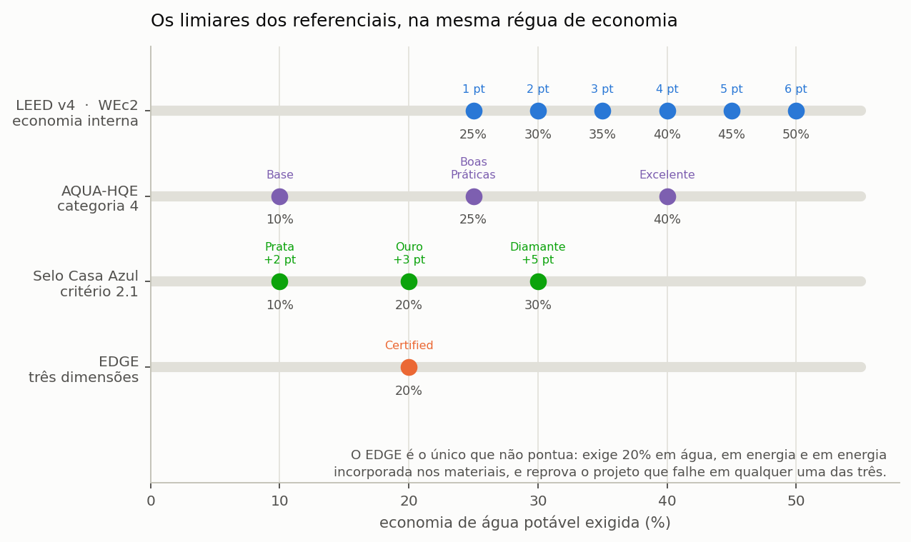

# Certificações

> Esta seção reúne as regras de enquadramento de cinco referenciais de sustentabilidade
> e distingue, em cada um deles, o que é requisito normativo do que é critério adotado
> pelo programa.

Sistemas de aproveitamento de água pluvial aparecem em praticamente todos os
referenciais de certificação ambiental de edificações, e em cada um deles com uma
métrica própria. Uns medem a economia contra o consumo total da edificação, outros
contra um caso-base de referência, e outros ainda exigem a comparação em mais de uma
dimensão simultaneamente. O programa calcula o enquadramento em cinco desses
referenciais a partir dos resultados da simulação, e o faz sempre com a mesma ressalva:
==o programa mostra onde o projeto se enquadraria, e não certifica coisa alguma.== A
certificação é decidida pelo organismo certificador, com a documentação completa do
empreendimento, da qual o desempenho hídrico é apenas uma peça.

Antes de entrar num a um, convém vê-los lado a lado. Os limiares de cada referencial estão em escalas que parecem incomparáveis enquanto ficam em tabelas separadas, e passam a ser comparáveis quando postos sobre a mesma régua de economia ({{fig:fig37_certificacoes}}). O LEED v4 pontua separadamente a redução do uso externo (WEc1: 1 ponto a partir de 50% e 2 pontos com 100%) e a do uso interno (WEc2: de 1 a 6 pontos entre 25% e 50%); o LEED v5 reúne a categoria no crédito WEc2, em que a redução em louças e metais vale de 1 a 3 pontos entre 30% e 40% e a redução do projeto inteiro, de 1 a 8 pontos entre 30% e 65%; o AQUA-HQE Residencial atribui o item EAU.1.2 a partir de 20% e o EAU.1.3 a partir de 40%; e o EDGE exige redução mínima de 20% simultaneamente em água, energia e energia incorporada nos materiais, sem pontuação.

*Figura 99 — Os limiares de redução do consumo de água potável com que o programa enquadra o projeto no LEED v4 (créditos WEc1 e WEc2), no LEED v5 (crédito WEc2, opções 1, 2 e 4), no AQUA-HQE Residencial e no EDGE, na mesma escala. O Selo Casa Azul não entra na régua, porque o seu critério pontua a existência do sistema e a abrangência do uso, e não um percentual. Um mesmo projeto cruza referenciais diferentes em pontos diferentes, e é por isso que declarar a economia obtida vale mais do que declarar a certificação pretendida.*

---

## LEED v4 e v4.1, categoria Water Efficiency

O LEED é o referencial norte-americano mais difundido internacionalmente. A versão 5, lançada em abril de 2025 para edificações comerciais, convive com as versões 4 e 4.1, que aceitam registro de novos projetos comerciais até 30 de junho de 2027 e certificação até 30 de junho de 2033; o programa enquadra o projeto nas duas. Nas versões 4 e 4.1, a eficiência hídrica ocupa uma categoria própria que vale oito pontos distribuídos em dois créditos. A distinção fundamental que ele impõe é entre uso interno e uso externo da
água, e é dessa separação que decorre toda a pontuação.

O crédito WEc1 trata da redução do uso externo, isto é, da irrigação e das demais
demandas de área descoberta, e vale até dois pontos. O programa concede os dois pontos
com 100% de redução do uso externo de água potável e um ponto a partir de 50%, tomando a
água de chuva destinada à irrigação do próprio balanço diário; e um projeto que não tenha
demanda externa cadastrada não pontua, situação em que o programa registra explicitamente
a razão, para que o usuário não interprete o zero como falha de desempenho.

O crédito WEc2 trata da redução do uso interno e vale até seis pontos, distribuídos numa
escala de cinco em cinco pontos percentuais a partir de 25% de economia. Antecede-o um
pré-requisito, o WEp2, que exige 20% de redução interna e é obrigatório: sem ele o
empreendimento não é elegível à certificação, e ele próprio não confere pontuação alguma.

> A separação entre uso interno e externo depende inteiramente da **discretização da
> demanda** descrita na seção {{n:5}}. O programa não inventa essa separação: usa a água
> de chuva que o balanço diário destinou à irrigação, que é atendida depois do uso
> interno. Sem demanda externa discretizada, o crédito WEc1 aparece como não avaliado, e a
> economia interna é tomada, conservadoramente, igual à economia total.

> O rótulo da pontuação informa apenas os pontos da categoria de água. O nível do LEED —
> Certified, Silver, Gold ou Platinum — resulta da soma de todas as categorias, e a água
> sozinha não o define.

---

## LEED v5, crédito WEc2 Enhanced Water Efficiency

Na versão 5, conferida contra o *LEED v5 BD+C Rating System* de novembro de 2025, os
créditos de uso interno e externo foram reunidos no crédito WEc2, *Enhanced Water
Efficiency*, que vale até oito pontos em construção nova e até sete em *Core and Shell*;
o programa avalia só a construção nova. O código WEc1 passou a designar outro crédito,
*Water Metering and Leak Detection*, de medição setorizada e detecção de vazamentos, e
não deve ser confundido com o WEc1 de uso externo do LEED v4. O pré-requisito WEp2 exige,
entre outras condições, redução de 20% no consumo de louças e metais em relação à linha
de base do referencial, e o pré-requisito WEp1 exige que a fonte alternativa de água, como
a cisterna pluvial, tenha medidor próprio, separado do da rede pública. O projeto pontua
por um de dois caminhos: a Opção 1, que mede a redução do uso de água do projeto inteiro,
ou a soma das Opções 2 a 6, que tratam cada parcela separadamente.

<!-- tabela: Opções do crédito WEc2 do LEED v5 às quais o aproveitamento pluvial contribui -->
| Opção | O que mede | Pontuação |
| :--- | :--- | :--- |
| 1. Projeto inteiro | redução do uso de água do projeto contra a linha de base | 30% 1 ponto, e 1 ponto a cada 5%, até 65% 8 pontos; com fonte alternativa de água, cada faixa vale 1 ponto a mais, até 8 |
| 2. Louças e metais | redução calculada contra a linha de base do WEp2, que pode incluir fonte alternativa | 30% 1 ponto, 35% 2 pontos, 40% 3 pontos |
| 4. Uso externo, caminho 2 | redução do requisito teórico de irrigação | 50% 1 ponto, 100% 2 pontos |
| 6. Reúso, caminho 2 | sistema de reúso no lote que atenda a irrigação, descargas, reposição ou processo | 2 pontos |

O programa calcula as duas vias e adota a de maior pontuação: a Opção 1 com a economia
total, e a soma das Opções 2, 4 e 6 com a economia interna, a economia externa e a
existência do sistema, que o programa trata como o sistema de reúso da Opção 6. O teto de
oito pontos vale para as duas. As Opções 3 e 5, de equipamentos e de água de processo, e o
caminho 1 da Opção 4, de paisagismo sem irrigação, não dependem do aproveitamento pluvial e
ficam fora da conta. Como no LEED v4, as
reduções do referencial são medidas contra uma linha de base de vazões de aparelhos e de
irrigação, e não contra a demanda modelada, de modo que o enquadramento é indicativo.

O aproveitamento pluvial também pode contribuir para o crédito SSc3, *Rainwater
Management*. Pela Opção 1, ele concede 1, 2 ou 3 pontos pela retenção no lote do volume
correspondente ao percentil 80, 85 ou 90 das chuvas locais (70, 75 ou 80 em lote sem
recuo), e 1 ponto adicional quando parte desse volume é reusada, sem ultrapassar o teto de
3 pontos; pela Opção 2, concede 3 pontos a quem retém o acréscimo de escoamento em relação
à cobertura natural do terreno. O programa não avalia esse crédito, porque ele depende do escoamento de todo o
terreno, e não só da cobertura; a matriz de critérios o registra como não avaliado.

---

## AQUA-HQE Residencial, tema consumo de água

O AQUA-HQE é a adaptação brasileira, conduzida pela Fundação Vanzolini com a CERQUAL
Qualitel, do referencial francês HQE. No referencial de edifícios residenciais vigente,
versão 00 de 22 de novembro de 2024, a água é tratada no tema «Consumo de água», por
itens, e cada item é classificado num nível: pré-requisito (PR), HQE, HQE 2 ou HQE 3.
Três itens dizem respeito ao aproveitamento pluvial:

<!-- tabela: Itens do tema consumo de água do AQUA-HQE Residencial ligados ao aproveitamento pluvial -->
| Item | Nível | Exigência |
| :--- | :--- | :--- |
| EAU.1.2 | HQE | redução de pelo menos 20% do consumo de água potável em relação ao consumo de referência |
| EAU.1.3 | HQE 3 | economia de 40% de água potável no empreendimento |
| EAU.1.5 | HQE 3 | sistema de recuperação de águas pluviais, conforme as ABNT NBR 15527 e 16783 |

O programa compara a economia de água potável simulada com os limiares de 20% e 40%, e
registra o item EAU.1.5 sempre que há sistema. ==O percentual do programa é indicativo:==
o referencial mede a economia contra um cenário de referência de vazões e usos por
dispositivo, calculado na planilha auxiliar da Fundação Vanzolini, que soma o efeito dos
aparelhos economizadores ao da água não potável.

> **Correção desta versão.** Até a revisão de setembro de 2026 o programa enquadrava o
> projeto em perfis «Base», «Boas Práticas» e «Excelente», a 10, 25 e 40% de economia.
> O referencial de 2024 não tem esses perfis, e o enquadramento foi refeito pelos itens.

---

## Selo Casa Azul + CAIXA, critério 3.6

O Selo Casa Azul é o referencial da Caixa Econômica Federal para habitação. No guia
vigente, versão V023 de 29 de abril de 2026, o aproveitamento pluvial é o critério 3.6,
da categoria «Gestão eficiente da água», e o seu indicador não é um percentual: é a
**existência** de sistema de aproveitamento, com captação, tratamento, reservação e
pontos de uso indicados no projeto. A pontuação depende da abrangência do uso:

<!-- tabela: Pontuação do critério 3.6 do Selo Casa Azul + CAIXA conforme a abrangência do uso -->
| Abrangência do uso da água pluvial | Pontos |
| :--- | ---: |
| áreas comuns do empreendimento | 2 |
| casas em loteamento, com a preparação exigida | 2 |
| unidades habitacionais | 4 |
| unidades habitacionais e áreas comuns | 5 |

O critério é de livre escolha para os níveis Cristal/Bronze, Topázio/Prata e Safira/Ouro,
e obrigatório para o Diamante. Para a unidade isolada vale o Selo Casa Azul Uni, versão
V001 de dezembro de 2025, em que o critério 7, «Aproveitamento de águas pluviais», vale
1 ponto e é obrigatório para o Selo Ouro. O programa registra o critério como atendido
quando há sistema, e atribui os pontos só quando a abrangência é informada.

> **Correção desta versão.** Até a revisão de setembro de 2026 o programa graduava o
> projeto em «Prata», «Ouro» e «Diamante» a 10, 20 e 30% de economia. O guia não liga o
> critério a percentual, e o enquadramento foi refeito pela existência e pela abrangência.

> **Declare no estudo.** O enquadramento só é defensável com a versão vigente do
> referencial em mãos, e o programa não substitui essa conferência.

---

## EDGE, o único que não pontua

O EDGE, desenvolvido pela International Finance Corporation do Banco Mundial, adota uma
lógica distinta de todos os anteriores. Em vez de atribuir pontos a desempenhos
crescentes, ele mede o percentual de economia contra um caso-base local em três
dimensões independentes — energia, água e energia incorporada nos materiais — e exige
que **cada uma** delas cruze o limiar estabelecido. Não há compensação entre dimensões:
um desempenho hídrico excepcional não supre uma deficiência em energia.

O EDGE tem ainda dois níveis acima do primeiro. O **EDGE Advanced** exige, além dos 20% nas três dimensões, economia de energia de pelo menos 40% no local; o **Zero Carbon** exige o anterior mais 100% de energia renovável ou compensação integral das emissões remanescentes.

Vale notar qual barra o nível avançado eleva. ==O EDGE Advanced sobe a exigência de
energia, e não a de água.== A consequência prática para quem projeta sistemas pluviais é
que o sistema garante a barra hídrica com relativa folga, ao passo que o nível de
certificação alcançado se decide inteiramente fora do escopo do projeto de água. O
programa avalia apenas a barra de água, pela medida WEM14, cuja entrada no aplicativo do
IFC é a área de captação em metros quadrados.

> **O limite honesto está no denominador.** O caso-base do EDGE é local, varia conforme
> o país e a tipologia, e é fixado pelo próprio aplicativo do IFC. O programa aceita o
> caso-base declarado pelo usuário; na ausência dele, adota a demanda modelada do
> projeto e adverte que o percentual resultante é um **piso**, e não o valor que a
> certificação reconhecerá.
>
> As barras de energia e de energia incorporada nos materiais estão fora do alcance do
> programa, que declara essa limitação no relatório. Afirmar que um projeto é EDGE
> Certified dispondo de um terço da evidência necessária seria irresponsável.

Os limiares acima foram extraídos do documento *EDGE Certification Process*, do IFC, e
os códigos das medidas de água foram conferidos contra um relatório de avaliação EDGE
v3.0.0 de projeto já certificado.

---

## GRI 303

A Global Reporting Initiative não é um referencial de certificação de edificações, e sim
um padrão de divulgação corporativa de desempenho socioambiental. Sua série 303 trata de
água e efluentes, e dois de seus indicadores são alimentados diretamente pelos resultados
do programa: o GRI 303-3, que reporta a captação evitada em metros cúbicos por ano e
acumulada ao longo do período, e o GRI 303-5, que expressa a taxa de circularidade
hídrica do empreendimento.

---

## O que declarar

Qualquer estudo que reporte enquadramento em referenciais de certificação precisa
explicitar quatro pontos, e a omissão de qualquer um deles compromete a verificabilidade
do resultado. O primeiro é que as classes 2 a 4 de qualidade da água adotadas pelo
programa são adaptações internas, e não classes da ABNT NBR 15527. O segundo diz respeito
ao EDGE, e consiste em declarar que apenas a barra de água foi avaliada, identificando o
caso-base utilizado. O terceiro aplica-se ao LEED, e consiste em declarar a versão do referencial adotada e informar se a partição entre uso interno e externo foi discretizada a partir de dados do projeto ou se, na falta dela, a economia interna foi tomada igual à economia total. O quarto, finalmente, é a ressalva geral: o
enquadramento produzido pelo programa é indicativo, e a certificação é decidida pelo
organismo certificador à luz da documentação completa do empreendimento.
