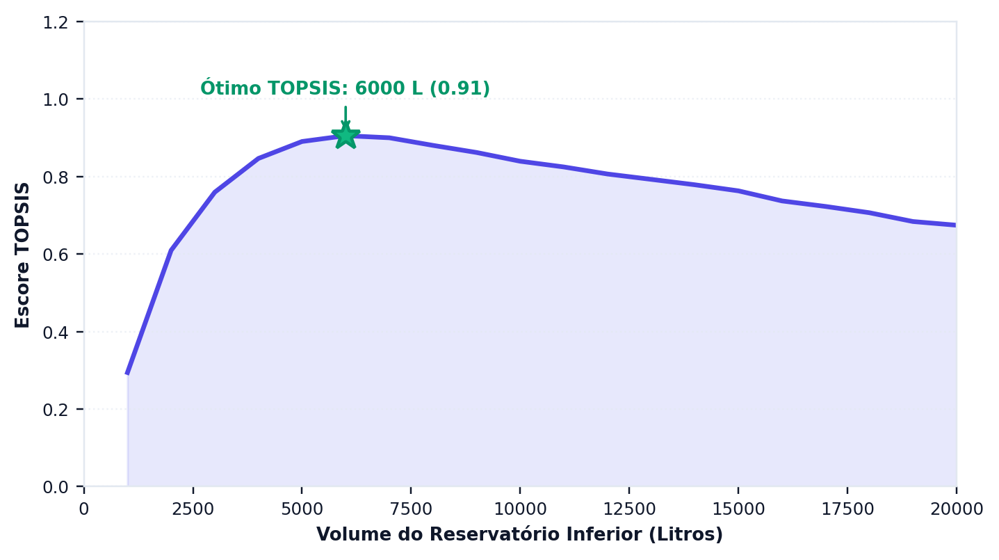
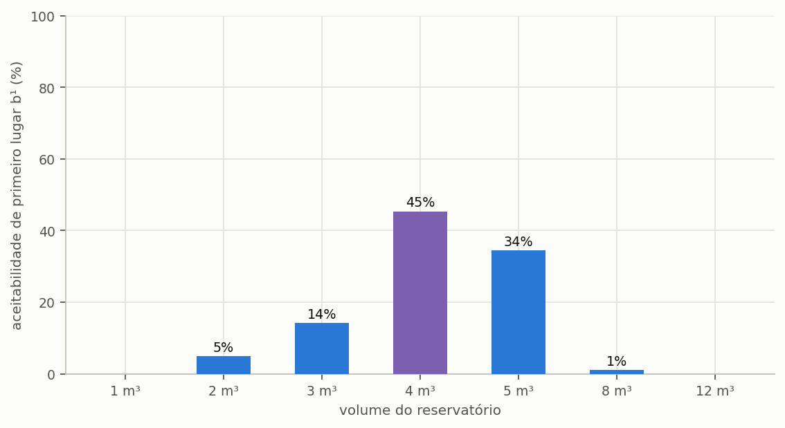

# Decisão multicritério

> Esta seção formaliza os dois métodos de ordenação que o programa oferece e declara
> três desvios em relação à formulação canônica que um estudo publicado precisa citar.

Análise multicritério é o ramo da pesquisa operacional que trata de escolher entre
alternativas quando os critérios de avaliação discordam entre si e não podem ser
reduzidos a um único número sem que alguém declare o que vale mais. É exatamente a
situação de um projeto de aproveitamento pluvial: o volume que entrega mais água não é o
que rende mais dinheiro, e nenhum dos dois costuma ser o de menor impacto de carbono.

O que os métodos desta seção fazem não é descobrir a resposta certa. ==Eles tornam
explícita a ponderação que, de outro modo, ficaria implícita na escolha de quem
decide.== Essa é toda a diferença entre um estudo que declara os seus valores e um que
os esconde atrás de um resultado aparentemente objetivo.

---

## Os sete critérios

O programa avalia cada volume da varredura segundo sete critérios, agrupados em três
dimensões. Cada critério tem uma direção de preferência: em uns, mais é melhor; em
outros, menos.

<!-- tabela: Os sete critérios de decisão, a direção de preferência e o grupo de cada um -->
| # | Critério | Direção | Grupo |
| :-- | :--- | :--- | :--- |
| 1 | potencial de economia | maximizar | técnico |
| 2 | extravasamento | minimizar | técnico |
| 3 | valor presente líquido | maximizar | econômico |
| 4 | payback descontado | minimizar | econômico |
| 5 | taxa interna de retorno | maximizar | econômico |
| 6 | CO₂e no fim da vida | minimizar | ambiental |
| 7 | consumo de água potável | minimizar | ambiental |

As alternativas submetidas à ordenação são os volumes simulados na varredura, e cada uma
delas comparece com os sete valores acima, calculados nas seções {{n:23}}, {{n:29}} e
{{n:30}}. Não há critério inventado nesta etapa: o método apenas ordena o que as
dimensões anteriores já produziram.

---

## TOPSIS

O TOPSIS — *Technique for Order of Preference by Similarity to Ideal Solution*, proposto
por Hwang e Yoon em 1981 — parte de uma ideia geométrica simples. Se cada alternativa é
um ponto num espaço de sete dimensões, uma por critério, então existem dois pontos de
referência: a **solução ideal**, composta pelo melhor valor de cada critério, e a
**solução anti-ideal**, composta pelos piores. Nenhuma alternativa real ocupa qualquer
um dos dois, porque nenhuma vence em tudo nem perde em tudo, e a melhor alternativa é a
que está simultaneamente mais perto do ideal e mais longe do pior caso.

O método executa cinco passos. Monta a matriz de decisão, com as alternativas nas linhas
e os critérios nas colunas; normaliza essa matriz, para que critérios medidos em reais,
em pontos percentuais e em quilogramas passem a ocupar escalas comparáveis; aplica os
pesos declarados; identifica as soluções ideal e anti-ideal; e ordena as alternativas
pela proximidade relativa ao ideal.

```equacao:topsis
C_i = d_i⁻ ÷ ( d_i⁺ + d_i⁻ )
```

| Símbolo | Significado | Unidade |
| :--- | :--- | :--- |
| `C_i` | coeficiente de proximidade da alternativa `i`, entre 0 e 1 | adimensional |
| `d_i⁺` | distância euclidiana da alternativa `i` à solução ideal | adimensional |
| `d_i⁻` | distância euclidiana da alternativa `i` à solução anti-ideal | adimensional |

O coeficiente da Equação {{eq:topsis}} valeria 1 para uma alternativa que coincidisse com
a solução ideal em todos os critérios, e 0 para uma que coincidisse com a anti-ideal.
Como nenhuma alternativa real ocupa esses extremos, o que interessa não é o valor
absoluto do coeficiente, e sim a ordenação que ele produz.

---

Aplicado à varredura completa do projeto do tutorial, de 1 a 20 m³ com passo de 1 m³ e pesos iguais, o escore cresce até um máximo interior e decresce nos volumes maiores, em que o investimento e o carbono incorporado passam a pesar mais que o ganho de água ({{fig:fig22_topsis}}). O máximo, em 7 m³, difere dos 5 m³ obtidos na seção {{n:12}} com seis candidatos, porque o ideal e o anti-ideal são construídos a partir do conjunto avaliado: acrescentar ou retirar alternativas desloca os pontos de referência e pode alterar a ordenação, fenômeno conhecido como inversão de ordem (*rank reversal*).



*Figura 99 — Escore TOPSIS de cada volume da varredura do projeto do tutorial, de 1 a 20 m³, com cisterna de polietileno e pesos iguais entre os sete critérios; a estrela marca o volume de maior escore. Figura gerada pelo próprio programa.*

---

## Três desvios a declarar

A implementação do programa se afasta da formulação canônica em três pontos, todos
deliberados, e um estudo publicado precisa declará-los para não atribuir aos métodos
originais um comportamento que é do programa.

**A normalização é uma variante.** A formulação canônica de Hwang e Yoon emprega
normalização vetorial, que pressupõe valores não negativos em todos os critérios. O valor
presente líquido, porém, é negativo com frequência nos volumes pequenos, em que o
investimento não se paga. O programa contorna a restrição transladando cada critério por
`x − min(x)` antes de normalizar. A escolha é necessária e deliberada, mas apresentar o
resultado como TOPSIS canônico seria incorreto: declare a variante.

**As condições de Opricovic não estão implementadas.** O método VIKOR, na formulação de
Opricovic, exige duas verificações sobre a solução de compromisso encontrada — a de
vantagem aceitável e a de estabilidade aceitável — e, quando qualquer uma delas falha,
devolve um **conjunto** de soluções equivalentes em vez de um único vencedor. O programa
devolve sempre a melhor alternativa, sem realizar o teste. Na prática, isso significa que
a solução de compromisso do VIKOR deve ser lida ao lado da análise de sensibilidade de
pesos, e nunca sozinha.

**A atribuição do código.** A implementação do VIKOR e do SMAA-VIKOR foi escrita de forma
independente e verificada contra a biblioteca `crispyn`, de Aleksandra Bączkiewicz. O
TOPSIS foi verificado contra a formulação original de Hwang e Yoon num caso de valores
todos positivos, em que a translação descrita acima é inócua e as duas formulações
precisam coincidir.

---

## SMAA-VIKOR

O SMAA — *Stochastic Multicriteria Acceptability Analysis* — existe para responder à
pergunta que o TOPSIS não responde: e se os pesos fossem outros? Em vez de exigir um
conjunto de pesos definido de antemão, o método sorteia milhares de combinações de pesos
e devolve, para cada alternativa, a probabilidade de ela ocupar cada posição do ranking.

A leitura do resultado é direta e informativa. Um volume que vence em 80% dos sorteios é
uma recomendação robusta, que não depende de uma ponderação específica para se sustentar.
Um volume que vence em 30% é uma recomendação frágil, e o texto do estudo precisa dizê-lo
em vez de apresentar o vencedor como se fosse consensual.

> É a ferramenta certa quando não há consenso sobre os pesos — que é o caso normal em
> projetos reais, nos quais o cliente, o projetista e o órgão ambiental costumam
> valorizar dimensões diferentes.

---

A leitura mais útil da análise estocástica não é o vencedor, e sim a margem com que
ele vence. Um volume que fica em primeiro lugar em três quartos dos sorteios de pesos é
uma escolha estável, que sobrevive a uma mudança de prioridade do decisor; dois volumes
tecnicamente empatados indicam o contrário, e nesse caso declarar o peso adotado deixa
de ser formalidade e passa a ser a única informação que sustenta a recomendação ({{fig:fig23_smaa}}).



*Figura 99 — Aceitabilidade de primeiro lugar (b¹) de cada volume candidato, obtida com cinco mil vetores de pesos sorteados no simplex. O volume destacado é o que mais vezes fica em primeiro lugar, e os demais repartem o restante.*

### O tutorial, pelos dois métodos

A tabela põe lado a lado o escore TOPSIS, com pesos iguais entre as três dimensões, e a
aceitabilidade de primeiro lugar do SMAA-VIKOR, com cinco mil vetores de pesos
sorteados, para os sete volumes do tutorial em polietileno com caixa superior.

<!-- inclui: _tabelas/cap32_decisao.md -->

Os dois métodos concordam no vencedor, 4.000 L, e discordam na margem. O TOPSIS separa o
primeiro do segundo colocado por sete milésimos de escore, diferença que nenhum dado de
entrada sustenta. O SMAA mede essa fragilidade: 4.000 L vence em 45% dos sorteios e
5.000 L em 35%, e os dois juntos somam quatro de cada cinco sorteios. Pela régua da seção
{{n:20}}, a recomendação é razoável, e o estudo deve declarar os 5.000 L como segunda
opção. Os extremos, 1.000 L e 12.000 L, não vencem em sorteio nenhum: nenhuma ponderação
plausível os recomenda, e isso também é resultado.

---

## Os pesos

O programa aceita um peso por dimensão, técnica, econômica e ambiental, ou um peso por
critério. Com pesos iguais entre as dimensões, cada uma vale um terço, repartido
igualmente entre os seus critérios: os dois técnicos e os dois ambientais valem um sexto
cada, e os três econômicos, um nono cada. A escolha, contudo, não é técnica: é uma declaração de valor, e por isso
precisa aparecer no texto do estudo. ==A afirmação «volume ótimo pelo TOPSIS», sem os
pesos, é impossível de reproduzir,== e dois estudos com pesos diferentes chegam a volumes
diferentes sem que nenhum dos dois esteja errado.

Três condutas são defensáveis, e a escolha entre elas depende de quanto se sabe sobre as
prioridades de quem decide. Pesos iguais, declarados explicitamente como ausência de
preferência, constituem a posição neutra. Pesos justificados, com a razão de cada um,
são preferíveis quando as prioridades são conhecidas. E o SMAA, reportando a faixa de
resultados em vez de um vencedor único, é a conduta mais completa quando não há consenso.

---

## Os melhores por critério isolado

Além da ordenação ponderada, o programa identifica o vencedor de cada grupo de critérios
— técnico, financeiro e ambiental — e reporta os três separadamente. São números que
valem ser publicados em conjunto, porque cada um responde a uma pergunta legítima e
diferente.

Quando os três coincidem, a recomendação é forte e a decisão dispensa ponderação. Quando
divergem, que é o caso comum e é o do tutorial, ==a divergência **é** o resultado:==
escondê-la atrás de um único número ponderado empobrece o estudo e transfere ao leitor
uma conclusão que ele não tem como avaliar.

---

## O que o método não faz

Convém encerrar pelos limites, porque métodos multicritério são frequentemente
apresentados com uma autoridade que não têm.

**Não escolhem os pesos.** A ponderação é do analista, e é uma decisão de valor, não de
técnica. Nenhum procedimento estatístico a substitui.

**Não validam os critérios.** Se o valor presente líquido estiver errado porque o regime
tarifário do município foi mal informado, o TOPSIS ordenará o erro com precisão
impecável. O método ordena o que recebe.

**Não incorporam restrições.** Espaço disponível no terreno, orçamento máximo, exigência
normativa: tudo isso é filtro anterior à ordenação, aplicado pelo projetista ao decidir
quais volumes sequer entram na comparação.
