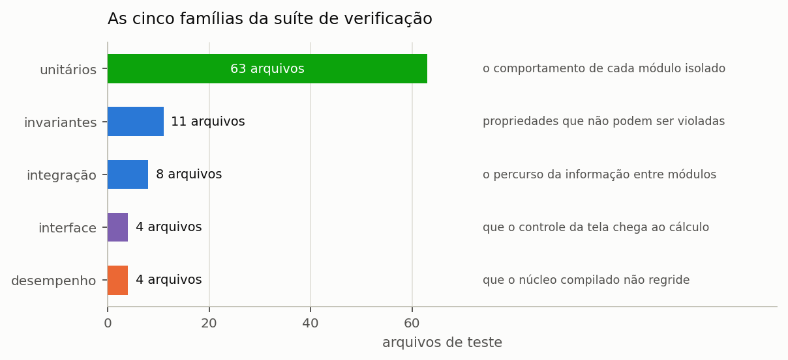
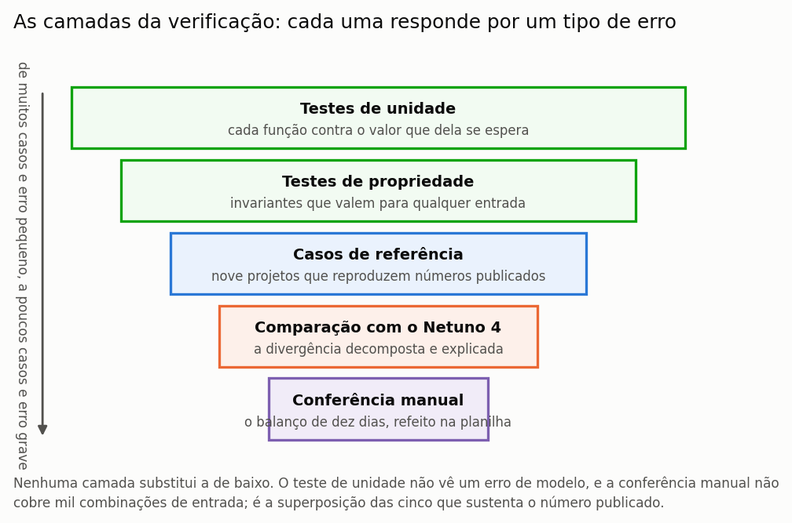

# Como o programa é verificado

> Esta seção descreve a suíte de verificação do Netuno, para que um revisor disponha
> dos elementos necessários para julgar o grau de confiança de um resultado produzido
> pelo programa.

Um programa científico cuja verificação não é declarada equivale a uma afirmação sem
evidência: pode estar correto, mas quem o utiliza não tem como saber, e quem avalia um
trabalho feito com ele não tem como julgar. Esta seção é a evidência que sustenta os
números apresentados no restante do manual, e foi escrita para ser lida por quem precisa
decidir se confia neles.

---

## A suíte

A verificação do programa consiste em 1.072 testes automatizados, distribuídos por 94 arquivos e organizados em cinco famílias que se complementam ({{fig:fig45_suite}}): testes unitários, testes de invariantes, testes de integração, testes da interface gráfica e o teste de replicação dos resultados do Netuno 4. A separação não é meramente organizacional: cada família captura uma
classe distinta de defeito, e a ausência de qualquer uma delas deixaria um flanco
descoberto.

*Figura 99 — Número de testes e de arquivos de cada família da suíte de verificação, conforme a coleta da suíte nesta versão. Os testes unitários respondem por três quartos do total, por serem de execução rápida e localizarem o erro perto da origem.*

A suíte inteira é executada a cada alteração do código, e nenhuma alteração é
incorporada enquanto houver um teste falhando. Essa disciplina é o que permite afirmar
que um defeito corrigido não retorna: a correção acompanha o teste que a vigia.

---

As camadas de verificação do programa formam uma hierarquia, e cada uma responde por
um tipo de erro que as demais não alcançariam. Um teste de unidade não detecta um erro de
modelo, porque confere a função contra o que dela se espera; e uma conferência manual,
que detectaria esse erro, não cobre mil combinações de entrada ({{fig:fig00m_verificacao}}).

*Figura 99 — As cinco camadas de verificação do programa, dos testes de unidade, numerosos e dirigidos a erros locais, à conferência manual, pontual e dirigida a erros de modelo. Nenhuma camada substitui outra: é a superposição das cinco que sustenta o resultado publicado.*

---

## As invariantes

As invariantes constituem a família mais importante da suíte, e a razão está na natureza
do que verificam. Um teste de valor confere se o programa produz um número específico
diante de uma entrada específica; uma invariante confere se uma **propriedade** vale para
qualquer entrada admissível. A primeira detecta que uma conta mudou; a segunda detecta
que o modelo deixou de ser fisicamente consistente.

A **conservação de massa** exige que, sobre séries de dez anos, o volume captado iguale
a soma do extravasado, do consumido e do que permaneceu armazenado. O resíduo medido é
da ordem de 10⁻¹⁴ por cento do captado, isto é, o próprio erro de arredondamento da
aritmética de ponto flutuante. O **fechamento do balanço de demanda** faz o mesmo pelo
lado do consumo: a demanda total precisa ser exatamente a soma de três parcelas, que são
o pluvial consumido, o potável comprado e a demanda não atendida.

A **faixa do potencial** verifica que o potencial de economia permaneça entre zero e cem
por cento para toda combinação de volume, coeficiente de escoamento e área, o que é
conferido sobre sessenta combinações. O **teto da fração atendível** é mais específico e
mais revelador: o potencial nunca pode ultrapassar a fração da demanda atendível por
chuva, e a verificação se estende até volumes de cem metros cúbicos, muito além de
qualquer aplicação predial plausível.

A **paridade entre motores** compara o núcleo compilado com o laço de referência e exige
que ambos devolvam o mesmo número, para reservatório único e duplo, com e sem suprimento
de reserva da irrigação, dentro de tolerância de 10⁻⁹. A **monotonicidade**, por fim,
exige que mais volume nunca reduza o potencial e que mais demanda nunca o aumente — duas
propriedades que qualquer implementação correta satisfaz e que uma implementação
defeituosa viola de modo evidente.

---

## Casos analíticos

Um conjunto à parte reúne casos de **solução fechada**, isto é, situações em que o
resultado correto é conhecido por dedução, sem necessidade de simular: chuva constante,
demanda constante, reservatório de capacidade infinita e reservatório de capacidade
nula. ==São o teste mais forte de que se dispõe, porque não dependem de nenhum valor de
referência produzido pelo próprio programa.== Um teste que compara a saída atual com a
saída de ontem detecta regressão, mas perpetua um erro que já existisse em ambas; um
caso analítico não tem como fazê-lo.

---

## Testes de percurso

Esta família nasceu do defeito mais persistente que este programa apresentou ao longo de
sua história: um valor calculado corretamente que não chega a quem deveria consumi-lo.
Trata-se de uma classe de erro que escapa inteiramente aos testes de fórmula, porque cada
parte isolada está correta — a origem calcula bem, o destino calcularia bem se recebesse,
e o que falha é o trecho entre os dois. Apenas um teste de percurso o captura: alterar a
entrada na tela e verificar que o resultado final efetivamente se move.

Cinco defeitos reais encontrados por essa família, e hoje vigiados por ela, ilustram o
padrão: a escolha de tecnologia de desinfecção não chegava à avaliação de ciclo de vida;
desmarcar o filtro de polimento não surtia efeito nas classes 2 a 4; os quatro campos de
imposto eram zerados pela própria tela ao ser fechada; a opção de suprimento de reserva
da irrigação não alcançava os núcleos compilados; e trinta dos oitenta e sete campos de
então não sobreviviam a salvar e reabrir o projeto.

---

## Os números do manual

Com a redação deste manual criou-se uma família própria de verificação, destinada a
impedir que o documento e o programa divirjam: **cada valor impresso tem asserção
correspondente**. Estão cobertos os números da seção {{n:23}}, os do tutorial inteiro,
cada linha da tabela dos dez dias e ainda a exigência de que determinadas seções
declarem determinadas ressalvas. Quando o programa muda, o teste falha e aponta qual
página corrigir.

É o mecanismo que impede um manual inteiro de envelhecer em silêncio, que é o destino
usual da documentação de programas científicos.

---

## Verificação contra o Netuno 4

A verificação se estende à comparação com a versão anterior do programa, sobre quatro mil
e cinquenta casos de referência, com decomposição da diferença por causa atribuível. A
seção {{n:35}} apresenta o resultado dessa comparação e as duas divergências
metodológicas deliberadas que a explicam.

---

## O que a verificação **não** prova

A distinção entre verificação e validação é cobrada por qualquer revisor competente, e
com inteira razão, porque as duas respondem a perguntas diferentes e apenas uma delas
está ao alcance de uma suíte de testes.

A **verificação** responde se o programa resolve corretamente as equações que implementa,
e é exatamente isso que a suíte descrita nesta seção testa. A **validação** responde se
as equações implementadas representam adequadamente a realidade física, e isso exige
medição em campo: sistemas instalados, monitorados ao longo do tempo e comparados com o
que a simulação previu.

O Netuno é verificado. A validação do modelo comportamental de base diária apoia-se na
literatura da área, e não em medição própria conduzida por este grupo. ==Um estudo que
apresentasse resultados do programa como se fossem medição estaria incorrendo em erro de
método.==

---

## O relatório de verificação na interface

O menu **Ajuda → Relatório de Verificação Técnica e Computacional** abre, dentro do programa, o relatório de verificação da versão: a distinção entre verificação e validação, os kernels exercitados, as invariantes, os casos analíticos e a comparação com o Netuno 4. É a referência a citar quando um estudo precisa declarar como o programa foi verificado.

---

## Quem roda a suíte, e quando

A suíte acompanha o código-fonte do programa, e não a instalação: ela é executada pelo
grupo de pesquisa a cada alteração, antes que qualquer versão seja publicada. O que isso
significa para quem usa o programa instalado é que a versão presente na sua máquina
passou pelos 1.072 testes aqui descritos, incluindo as que conferem cada número
impresso neste manual.

> **Aprofundamento: verificar por conta própria.** O código-fonte é público, sob licença
> GPL v3, e a suíte é executada com um único comando no ambiente de desenvolvimento. Um
> revisor que queira conferir as invariantes — fechamento de massa, monotonicidade,
> paridade entre os dois motores de cálculo — encontra os arquivos de teste organizados
> por tema, e o apêndice {{n:B}} liga cada processo do programa ao que o verifica.
