# Atlas de fluxogramas metodológicos — Netuno 5.0.7

Este atlas representa a sequência efetivamente implementada no motor do Netuno. Os diagramas devem ser lidos em conjunto com as equações e limitações do [README](../../README.md), com as [premissas dependentes do volume](../../examples/PARAMETROS_DEPENDENTES_DO_VOLUME_RESERVATORIO.md) e com a [verificação manual dos três casos](../../examples/ESTUDO_DE_CASO_TRES_MODELOS_REFERENCIA.md).

Os fluxogramas distinguem quatro tipos de elemento:

| Forma | Significado |
| --- | --- |
| Cilindro | dado de entrada, série ou inventário |
| Retângulo | transformação ou equação |
| Losango | decisão lógica |
| Retângulo arredondado | resultado, indicador ou critério de decisão |

As relações representam o software atual. Valores de custos, tarifas, doses e fatores ambientais continuam sendo premissas editáveis; o diagrama não os transforma em valores normativos.

## 1. Visão integrada da metodologia

Este é o encadeamento principal entre entradas, simulação e decisão. A capacidade inferior `V` é varrida; não se transfere automaticamente a ela a geometria de tubos, a potência da bomba ou o reservatório superior.

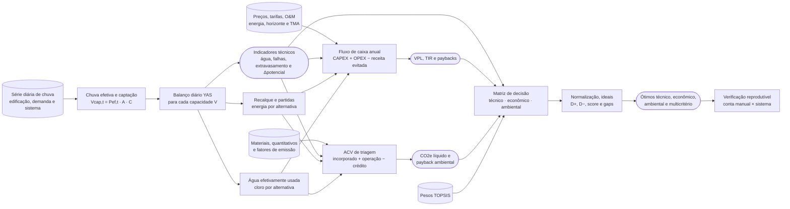

Implementação principal: `simulation.py`, `cost_estimates.py`, `economic.py`, `environmental.py` e `topsis.py`.

## 2. Chuva efetiva e captação

O descarte implementado é um limiar legado. Quando a regra está ativa, chuva abaixo do limiar é zerada; ao atingir o limiar, a precipitação diária entra integralmente. Não se calcula `P − df`.

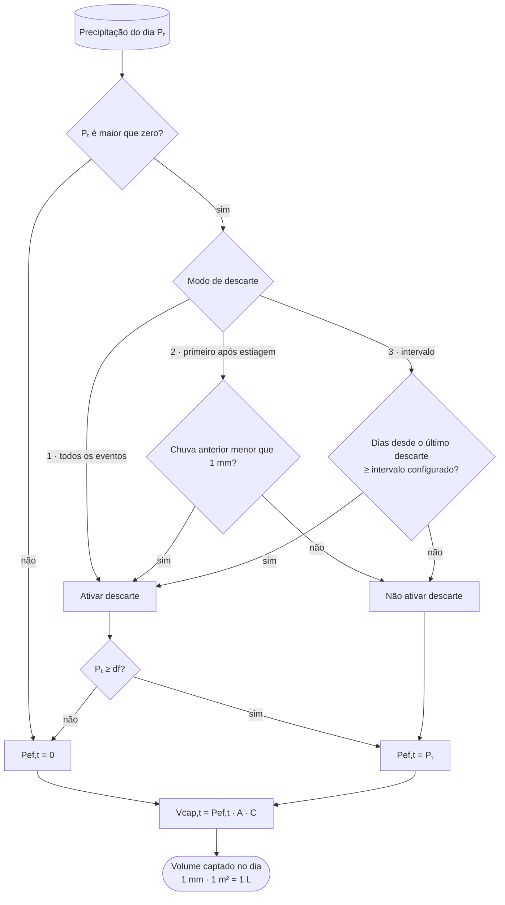

Equações:

```text
Pef,t = 0,  se a regra estiver ativa e Pt < df
Pef,t = Pt, caso contrário
Vcap,t = Pef,t × A × C
```

## 3. Balanço hídrico YAS — reservatório inferior único

No modelo *Yield After Spillage*, o limite do estoque e o extravasamento são calculados antes da retirada da demanda pluvial.

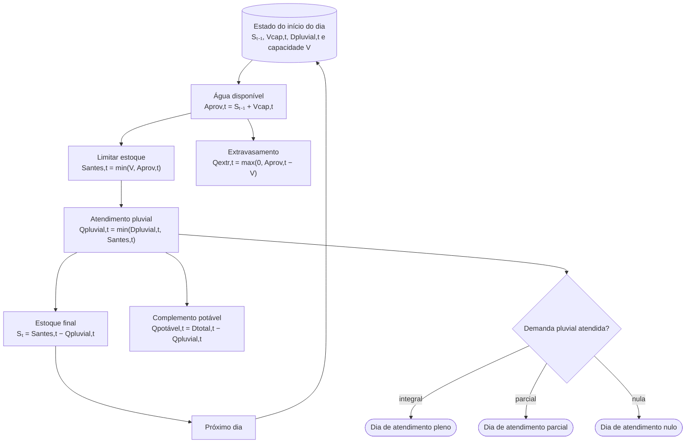

Identidade de conservação verificada diariamente:

```text
estoque inicial + captação
= estoque final + consumo pluvial + extravasamento
```

## 4. Dois reservatórios e ciclo de recalque

O recalque é uma transferência interna: não cria nem remove água do balanço global. A água de chuva é consumida a partir do reservatório superior; quando ele chega ao limiar, o motor tenta transferir água do inferior.

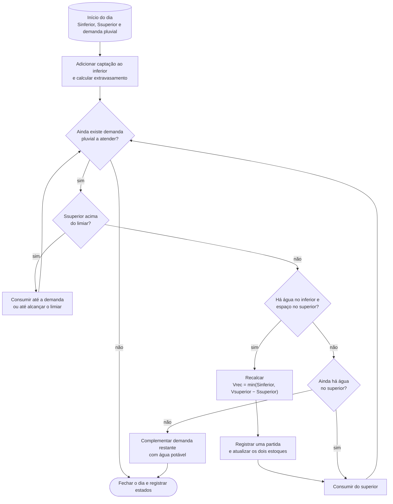

Energia anual associada à alternativa:

```text
trecalque = Vrecalcado,anual / vazão
tpartidas = npartidas,anual × tempo equivalente por partida
Ebomba = potência × (trecalque + tpartidas) / eficiência
```

## 5. Varredura de capacidades e ótimo técnico

Cada capacidade é simulada novamente para toda a série diária. O ótimo técnico não é o maior potencial absoluto: é o primeiro volume positivo cujo ganho marginal fica igual ou abaixo do limiar configurado.

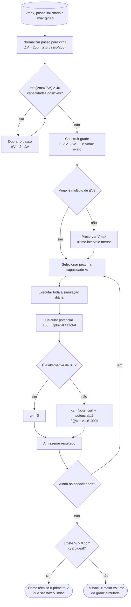

O limite de 40 se refere às capacidades positivas; 0 L é a referência adicional sem cisterna. Como a grade é discreta, mudar o passo pode mudar o volume selecionado. Quando o intervalo terminal é menor, o ganho marginal usa a diferença real `Vᵢ − Vᵢ₋₁`.

## 6. Modelo econômico-financeiro

O modelo calcula custos e receitas para cada capacidade da varredura. A economia na fatura é calculada pela diferença real entre a fatura sem e com o aproveitamento pluvial, considerando as faixas de progressividade tarifária, alíquota de esgoto e parcela fixa homologadas para os 652 municípios brasileiros cadastrados. Todos os valores de tarifas, CAPEX e OPEX consideram tributos e impostos inclusos.

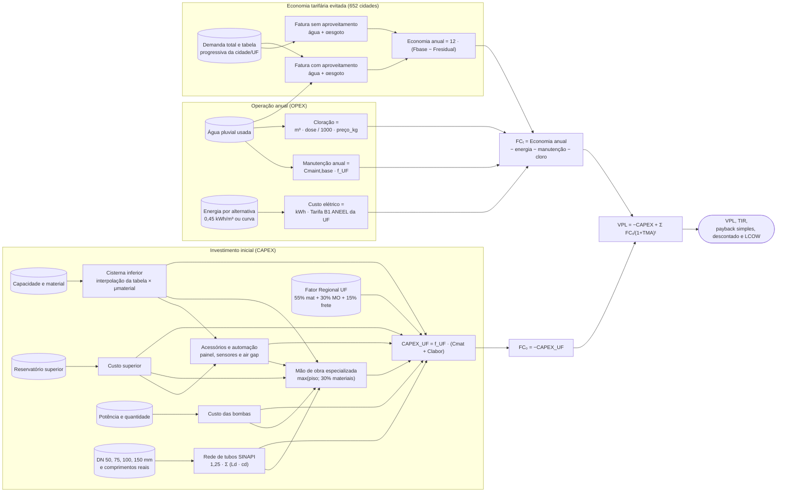

O custo de tubulações é computado diretamente pelas composições oficiais SINAPI para PVC esgoto/água predial (DN 50: R$ 18,50/m; DN 75: R$ 28,00/m; DN 100: R$ 35,00/m; DN 150: R$ 68,00/m + 25% conexões/registros). Os comprimentos informados são automaticamente sincronizados com o módulo de Análise de Ciclo de Vida (ACV/CO2e). Na alternativa de `0 L`, o programa adota a referência sem sistema: CAPEX e OPEX associados são nulos.

## 7. Cloração: cálculo implementado e limite sanitário

O motor calcula a massa aplicada equivalente a Cl2 para custos e inventário ambiental. Ele não estima a demanda química real da água, que requer ensaio e residual medido após tempo de contato.

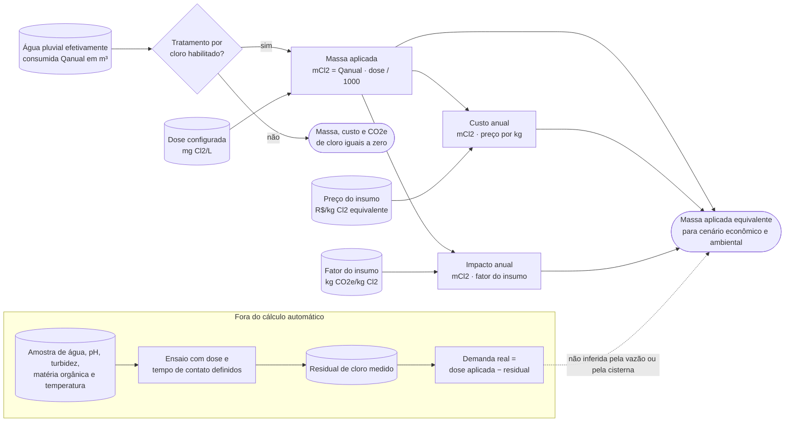

Conversão dimensional:

```text
1 mg/L = 1 g/m³ = 0,001 kg/m³
mCl2 [kg/ano] = Qanual [m³/ano] × dose [mg/L] / 1000
```

## 8. ACV simplificada e fronteira ambiental

A ACV é uma triagem de carbono. Quantitativos e fatores devem ser substituídos por dados locais ou EPDs quando o estudo exigir representatividade de projeto.

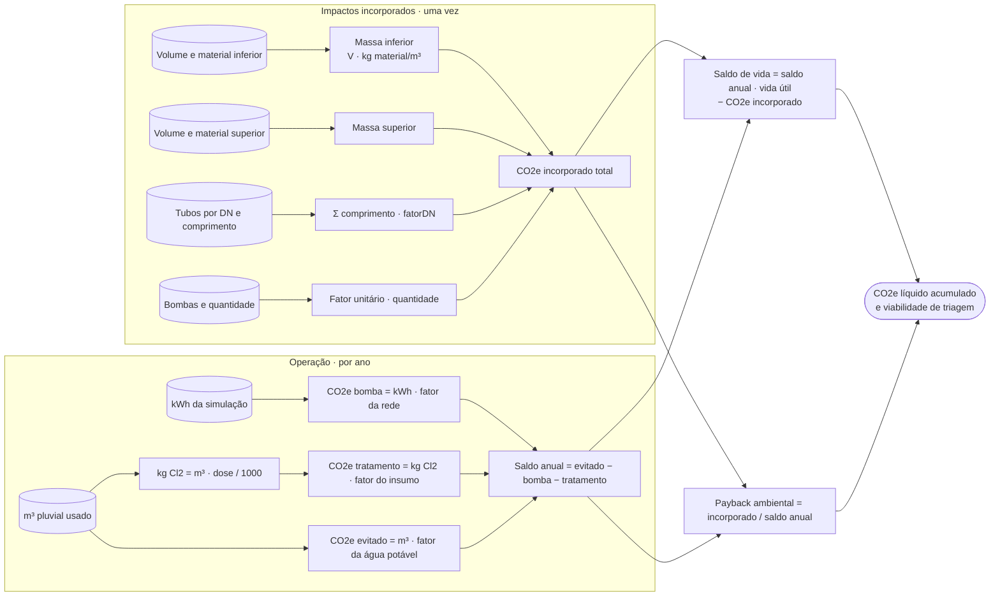

Condição de viabilidade usada: saldo anual positivo e payback ambiental menor ou igual à vida útil configurada. A alternativa de `0 L` é a referência sem sistema e recebe impactos nulos.

## 9. TOPSIS e diagnóstico da concessão

Os três critérios atuais são de benefício: água pluvial usada, VPL e CO2e líquido evitado. A translação de todas as colunas torna o cálculo invariável à origem da escala e permite valores negativos.

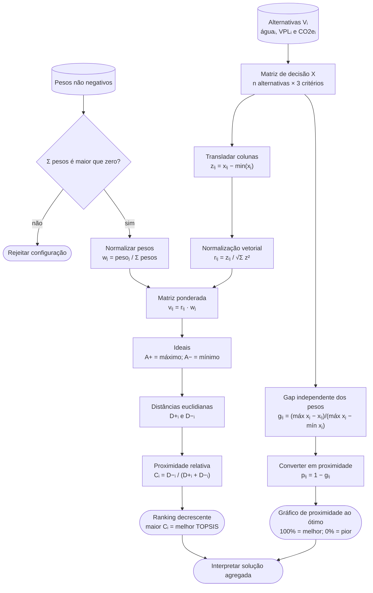

O score responde aos pesos e à geometria normalizada do conjunto. O motor preserva os gaps para auditoria e a interface exibe `1 − gap`, respondendo à pergunta complementar: “quão próxima esta alternativa está do melhor observado em cada eixo, sem aplicar pesos?”.

## 10. Verificação interna e rastreabilidade

O estudo de referência refaz as contas a partir das entradas elementares e compara cada identidade com o campo retornado pelo motor. Isso detecta regressões computacionais, mas não constitui validação externa das premissas.

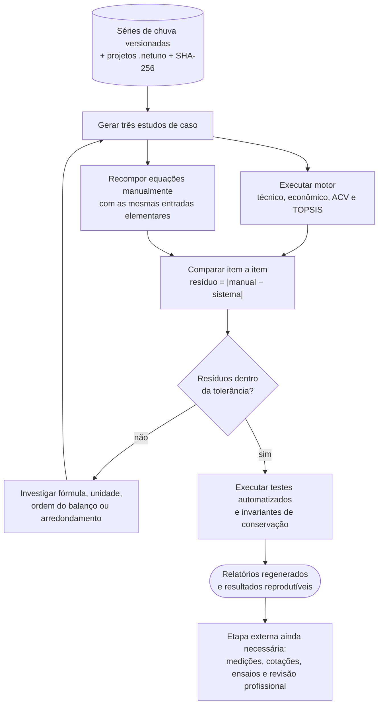

## 11. Matriz de leitura dos resultados

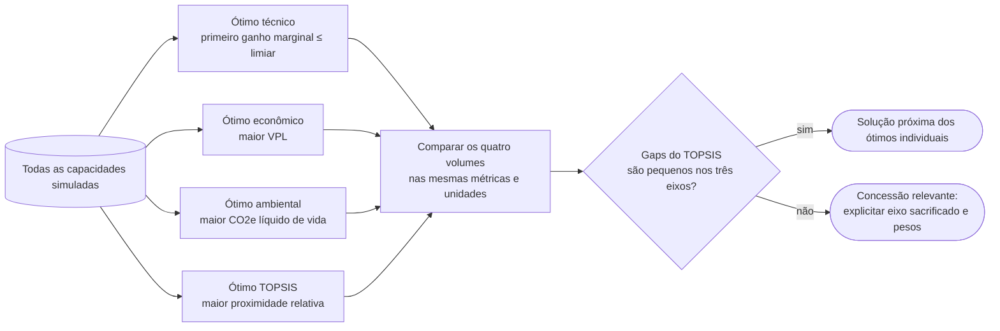

Uma recomendação publicável deve apresentar os quatro ótimos, os pesos, os três gaps da alternativa TOPSIS e uma análise de sensibilidade; não apenas o volume vencedor.
