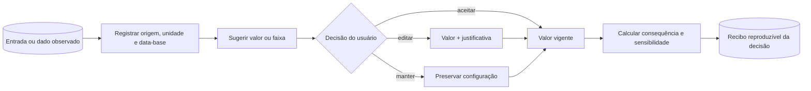
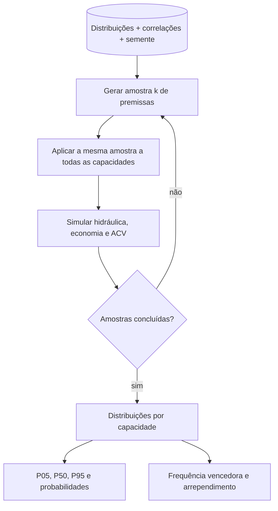

# Próximos passos — decisão robusta sem retirar a autonomia do usuário

## 1. Objetivo

Evoluir o Netuno de um simulador determinístico com comparação multicritério para uma plataforma de decisão robusta, mantendo três compromissos:

1. nenhuma premissa de projeto deve ser escondida como constante universal;
2. o programa pode sugerir e validar, mas o usuário deve poder revisar, substituir e justificar;
3. toda recomendação deve trazer um recibo reproduzível: dados, hipóteses, restrições, método, incerteza e motivo da escolha.

Este documento é um roteiro técnico. Ele não altera a metodologia da versão 5.0.7 por si só.

## 2. Estado atual e lacunas

| Recurso | Situação na 5.0.7 | Limite atual | Próxima maturidade |
| --- | --- | --- | --- |
| Balanço diário | Implementado por alternativa (modelo YAS) | Entradas determinísticas | Propagar incerteza e testar erro estrutural |
| Grade de volumes | Até 40 capacidades positivas; passo múltiplo de 250 L | Grade regular, salvo o máximo terminal | Refinamento adaptativo opcional perto das regiões relevantes |
| Ganho marginal | Implementado com intervalo real entre pontos | Sensível à discretização | Mostrar estabilidade em diferentes passos |
| Tarifas municipais | 652 municípios brasileiros auditados (água, esgoto e energia ANEEL) | Dados regulatórios homologados com impostos inclusos | Atualização automática periódica via API das agências |
| Engenharia de custos | Orçamento paramétrico SINAPI (tubulações PVC DN 50-150 mm) e fatores regionais por UF | 27 fatores estaduais SINAPI/CUB | Orçamentação detalhada por composição local do usuário |
| Economia | Fluxo nominal, VPL, TIR, paybacks e LCOW | Premissas pontuais calibradas | Distribuições, correlações e risco de inviabilidade |
| ACV | Sincronização física de materiais/tubos e inventário paramétrico | Fatores de triagem com fronteira simplificada | Qualidade dos dados, faixas e cenários de fim de vida |
| TOPSIS | Ranking, distâncias e gaps por critério | Compensatório e dependente dos pesos/conjunto | Comparar Pareto, arrependimento e aceitabilidade |
| Pesos | Sensibilidade Dirichlet disponível na CLI | Sem elicitação guiada e sem restrições de preferência | Faixas, ordens e análise de aceitabilidade |
| Monte Carlo | CLI para um volume concreto, com fatores normais independentes | Não compara toda a fronteira; correlações ausentes | Monte Carlo conjunto para todas as alternativas |
| Auditoria | Projetos, relatórios e estudos de caso reproduzíveis com links primários | Proveniência ainda não é um registro formal por premissa | Registro versionado de hipóteses e recibo de decisão |

## 3. Princípio de experiência: sugestão, escolha e consequência

Cada entrada relevante deverá ter quatro camadas visíveis:

| Camada | Pergunta respondida | Exemplo |
| --- | --- | --- |
| Valor vigente | O que será calculado? | Dose de cloro = 1,0 mg/L |
| Origem | De onde veio? | Informado, preset, catálogo, medição ou calibração |
| Justificativa | Por que este valor é aceitável? | Ensaio local, fornecedor, norma ou hipótese de triagem |
| Consequência | Quanto a decisão muda? | Faixa de VPL e frequência vencedora do volume |

Os presets devem ser pontos de partida editáveis, nunca decisões silenciosas. Uma sugestão automática precisa apresentar a equação usada e permitir três ações: **aceitar**, **editar** ou **manter o valor anterior**.



## 4. Arquitetura proposta

### 4.1 Registro de premissas

Criar um `AssumptionRegistry` serializado no projeto. Cada premissa deve conter:

```json
{
  "id": "chlorine.applied_dose_mg_l",
  "value": 1.0,
  "unit": "mg/L",
  "status": "screening",
  "source_type": "user|preset|measurement|catalog|calibration",
  "source_reference": "",
  "geography": "",
  "reference_period": "",
  "distribution": {"type": "triangular", "min": 0.5, "mode": 1.0, "max": 1.5},
  "correlation_group": "water_quality",
  "notes": "Não representa demanda de cloro medida"
}
```

Estados mínimos: `medido`, `documentado`, `estimado`, `screening` e `não informado`. O relatório deve destacar premissas de baixa evidência que tenham alta influência na decisão.

### 4.2 Restrições antes das preferências

Criar um `ConstraintSet` separado dos pesos. Restrições eliminam alternativas inviáveis; pesos apenas ordenam as viáveis.

Exemplos editáveis:

- volume máximo físico;
- orçamento máximo;
- confiabilidade mínima de atendimento;
- VPL mínimo ou probabilidade mínima de `VPL > 0`;
- payback máximo;
- saldo ambiental mínimo;
- limites sanitários e construtivos documentados externamente.

Isso evita que uma pontuação TOPSIS alta compense uma violação que o usuário considera inaceitável.

### 4.3 Motores separados

| Componente | Responsabilidade | Saída principal |
| --- | --- | --- |
| `AssumptionRegistry` | Proveniência e qualidade das entradas | Catálogo de premissas |
| `ConstraintEngine` | Filtrar inviabilidades | Alternativas elegíveis e motivos de exclusão |
| `UncertaintyEngine` | Amostrar distribuições e correlações | Distribuições de saídas por volume |
| `ParetoEngine` | Identificar alternativas não dominadas | Fronteira e relações de dominância |
| `RobustDecisionEngine` | Comparar estabilidade das escolhas | Arrependimento, aceitabilidade e ranking robusto |
| `DecisionReceipt` | Consolidar a decisão | Artefato JSON/HTML/PDF reproduzível |

## 5. Roteiro incremental

### Fase A — consolidar a 5.0.7

Prioridade imediata: estabilidade e transparência, sem ampliar ainda o modelo matemático.

- [x] Permitir 40 capacidades positivas na varredura.
- [x] Normalizar o passo em múltiplos de 250 L e dobrá-lo quando necessário.
- [x] Preservar o volume máximo digitado, inclusive com intervalo terminal menor.
- [x] Mostrar no TOPSIS a distância relativa ao melhor valor de cada critério.
- [x] Manter documentação metodológica, fluxogramas e estudos de caso regeneráveis.
- [ ] Exibir permanentemente na Etapa 3: passo solicitado, passo efetivo, número de alternativas e intervalo terminal.
- [ ] Incluir os metadados da grade nos relatórios PDF/HTML e no CSV legado por comentário compatível.
- [ ] Testar projeto salvo/aberto com ajuste automático do passo.
- [ ] Criar testes de desempenho com 1, 10 e 30 anos de chuva para 41 alternativas totais.

Critério de saída: nenhuma edição válida de `Vmáx` pode bloquear a simulação por causa da grade; toda alteração automática deve ficar visível e persistida.

### Fase B — governança de premissas

- [ ] Implementar o `AssumptionRegistry` no esquema `.netuno` com migração retrocompatível.
- [ ] Classificar os valores existentes como entrada, preset de triagem, cálculo endógeno ou resultado.
- [ ] Permitir fonte, unidade original, transformação, local, período, responsável e observação.
- [ ] Adicionar semáforo de evidência baseado em completude, não em julgamento automático da qualidade científica.
- [ ] Gerar uma tabela “premissas que mais influenciam a decisão”.

Critério de saída: o mesmo projeto deve ser reexecutável e cada número externo relevante deve responder “quem escolheu, com qual fonte e em que unidade?”.

### Fase C — Monte Carlo comparativo

A CLI atual amostra chuva, área, demanda e CAPEX por fatores normais independentes para um volume concreto. A evolução deve simular a mesma realização aleatória em **todas** as capacidades, preservando a comparação pareada.



Itens de implementação:

- [ ] Distribuições normal truncada, lognormal, triangular, uniforme, discreta e empírica.
- [ ] Matriz de correlação validada como semidefinida positiva ou grupos de correlação simples.
- [ ] Reamostragem em blocos da série histórica de chuva para preservar persistência temporal.
- [ ] Separar variabilidade interanual de incerteza epistêmica dos parâmetros.
- [ ] Semente, número de amostras e método registrados no recibo.
- [ ] Convergência progressiva e erro Monte Carlo exibidos ao usuário.
- [ ] Execução cancelável e cache por hash das entradas.

Saídas mínimas por volume: `P(VPL > 0)`, `P(saldo CO2e > 0)`, percentis de atendimento, probabilidade de cumprir todas as restrições e distribuição do custo anual.

### Fase D — fronteira de Pareto

Uma alternativa domina outra se for pelo menos tão boa em todos os critérios e estritamente melhor em pelo menos um. A fronteira de Pareto deve ser calculada antes do TOPSIS e mostrada sem pesos.

- [ ] Fronteira determinística técnico–econômica–ambiental.
- [ ] Visualização 2D por pares e tabela 3D acessível.
- [ ] Motivo de dominância para cada alternativa excluída.
- [ ] Alternar entre todos os volumes, somente viáveis e somente não dominados.
- [ ] Fronteira probabilística: chance de uma alternativa ser não dominada nas amostras.
- [ ] Testar se a filtragem muda o ranking TOPSIS e deixar isso explícito.

O usuário deve poder selecionar qualquer alternativa viável, inclusive uma dominada, mas receber uma explicação objetiva da comparação.

### Fase E — decisão robusta

Executar lado a lado, sem transformar um método em verdade única:

| Método | Pergunta | Limitação a mostrar |
| --- | --- | --- |
| TOPSIS | Qual ponto está mais próximo do ideal ponderado? | Compensatório; depende de pesos e alternativas |
| Pareto | Quais pontos não são superados em todos os critérios? | Pode retornar muitas opções |
| Minimax arrependimento | Qual decisão limita a pior perda relativa? | Conservador e sensível aos cenários |
| Satisficing | Quais opções cumprem todos os limiares? | Depende dos limites informados |
| SMAA/aceitabilidade | Com pesos e saídas incertos, com que frequência cada opção vence? | Exige domínio de pesos bem definido |

- [ ] Calcular arrependimento por critério e agregado.
- [ ] Permitir pesos fixos, intervalos, ordem parcial ou ausência de preferência.
- [ ] Mostrar frequência de primeiro lugar e aceitabilidade por posição.
- [ ] Destacar escolhas frágeis: pequena perturbação muda o vencedor.
- [ ] Permitir escolha final manual e exigir uma justificativa curta quando ela divergir da recomendação selecionada.

### Fase F — validação externa e calibração

- [ ] Importar séries medidas de nível, consumo pluvial, extravasamento, energia e partidas.
- [ ] Separar conjuntos de calibração e validação.
- [ ] Reportar viés, MAE, RMSE, conservação de massa e cobertura dos intervalos.
- [ ] Comparar YAS a formulações alternativas sem misturar estruturas no mesmo resultado.
- [ ] Versionar parâmetros calibrados, local, período e função objetivo.
- [ ] Criar estudos interlaboratoriais ou benchmarks contra ferramentas independentes.

A concordância com as contas manuais internas continua sendo **verificação**. O termo **validação externa** deve ser reservado à comparação com medições ou referência independente.

## 6. Interface proposta

Para oferecer complexidade sem sobrecarregar:

1. **Modo essencial:** entradas obrigatórias, presets transparentes e resultados principais.
2. **Modo avançado:** fontes, distribuições, correlações, restrições e métodos de decisão.
3. **Modo auditoria:** matrizes, amostras, equações intermediárias, hashes e exportação completa.

O resultado final deve separar visualmente:

- **fato calculado:** consequência direta das entradas;
- **premissa:** valor escolhido ou importado;
- **restrição:** condição que elimina alternativas;
- **preferência:** peso ou regra que ordena alternativas;
- **recomendação:** saída de um método específico;
- **decisão:** opção confirmada pelo usuário.

## 7. Recibo de decisão

Cada análise deverá produzir um objeto versionado contendo:

- identificação do projeto e hash das entradas;
- versão do motor e do esquema;
- grade solicitada e grade efetiva;
- premissas, fontes e qualidade declarada;
- restrições e alternativas excluídas;
- métodos, pesos e parâmetros aleatórios;
- fronteira de Pareto;
- ranking e estabilidade;
- alternativa recomendada por método;
- alternativa escolhida pelo usuário e justificativa;
- avisos e limitações aplicáveis.

## 8. Testes necessários

| Camada | Teste mínimo |
| --- | --- |
| Grade | Limite de 40, múltiplos de 250, duplicação, Vmáx terminal e persistência |
| Incerteza | Reprodutibilidade por semente e convergência dos quantis |
| Correlação | Matriz inválida recusada; correlação amostral dentro da tolerância |
| Pareto | Dominância forte, empates, critérios constantes e valores negativos |
| Robustez | Casos sintéticos com vencedor conhecido e empate controlado |
| Migração | Abrir projetos anteriores sem inventar proveniência |
| Relatório | Coerência entre JSON, tabela, gráfico e PDF |
| Desempenho | Tempo e memória definidos para anos × volumes × amostras |

## 9. Ordem recomendada

1. concluir a Fase A e estabilizar a grade da 5.0.7;
2. implementar o registro de premissas antes de ampliar o Monte Carlo;
3. fazer Pareto determinístico, porque é simples, auditável e independente de pesos;
4. ampliar Monte Carlo de um volume para todas as alternativas com amostras pareadas;
5. adicionar arrependimento e aceitabilidade;
6. só então oferecer uma tela unificada de “decisão robusta”.

Essa ordem evita propagar incerteza sobre premissas sem origem e evita apresentar um ranking sofisticado sem explicar primeiro viabilidade e dominância.

## 10. Referências metodológicas para a implementação

- [OECD/JRC — Handbook on Constructing Composite Indicators](https://www.oecd.org/en/publications/handbook-on-constructing-composite-indicators-methodology-and-user-guide_9789264043466-en.html): normalização, ponderação, agregação e análise de robustez de indicadores compostos.
- [JRC — Sensitivity Analysis](https://joint-research-centre.ec.europa.eu/sensitivity-analysis-samo_en): análise de sensibilidade e incerteza para modelos.
- [BIPM/JCGM — Guides in Metrology](https://www.bipm.org/en/committees/jc/jcgm/publications): vocabulário e propagação de incerteza de medição.
- [US EPA — Guidance on the Development, Evaluation, and Application of Environmental Models](https://nepis.epa.gov/Exe/ZyPURL.cgi?Dockey=P1003E4R.TXT): avaliação, documentação e uso responsável de modelos ambientais.

As referências orientam o desenho metodológico; não substituem normas locais de instalações prediais, qualidade da água, orçamento ou licenciamento.
