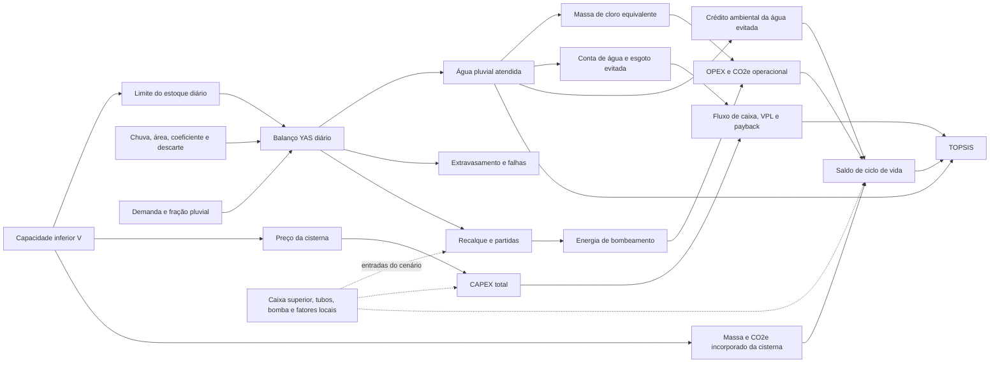

# Detalhamento completo dos três modelos — Triton 0.1.0

> **Versão.** As contas do TOPSIS deste documento são do modelo da 0.1.0 (sete critérios em três eixos). A partir da 0.2.0 o multicritério tem oito critérios em quatro eixos (manual, capítulo 32); o balanço hídrico, o econômico e o ambiental conferidos aqui não mudaram.

> Documento gerado por `python scripts/generate_reference_case_studies.py`. Entradas e resultados vêm dos mesmos objetos usados no estudo de verificação; não edite as tabelas à mão.

Este relatório preserva a visão comparativa dos três modelos. O [`ESTUDO_DE_CASO_TRES_MODELOS_REFERENCIA.md`](ESTUDO_DE_CASO_TRES_MODELOS_REFERENCIA.md) faz a conta manual e mede resíduos; este arquivo fornece todos os dados de entrada e compara os resultados item a item, tanto entre os casos quanto entre os volumes de cada varredura.

O [`atlas de fluxogramas metodológicos`](../triton/docs/fluxogramas_metodologicos.md) detalha a sequência das equações hidráulicas, econômicas, ambientais, multicritério e de verificação.

## 1. Diagrama de influência do volume da cisterna

O diagrama continua sendo parte da metodologia. Ele impede atribuir causalidade direta a parâmetros que são entradas independentes ou consequências endógenas da simulação.

| Classe de relação com `V` | Itens | Interpretação |
| --- | --- | --- |
| Direta | preço, massa e CO2e incorporado da cisterna inferior | função explícita da capacidade e do material |
| Endógena | atendimento, extravasamento, falhas, recalque, energia, cloro, receita evitada e O&M variável por consumo | resultado do balanço repetido para cada `V` |
| Independente | caixa superior, tubos, bomba, tarifas e fatores ambientais | entrada mantida fixa na varredura, salvo cenário explicitamente alterado |
| Derivada | VPL, paybacks, ACV, ótimos e TOPSIS | combinação das três classes anteriores |

## 2. Entradas dos três modelos — comparação item a item

### 2.1. Edificação, clima e demanda

| Item | Caso 1 — Residência Unifamiliar Sustentável | Caso 2 — Edifício Corporativo EcoOffice | Caso 3 — Escola Pública de Tempo Integral Amazonas |
| --- | --- | --- | --- |
| Tipologia | Residencial Unifamiliar | Comercial / Escritórios | Institucional / Escolar |
| Clima / série | Florianopolis1 / `Florianopolis1.csv` | Brasilia2 / `Brasilia2.csv` | Manaus3 / `Manaus3.csv` |
| Dias e anos simulados | 31411 dias / 85,9986 anos | 12419 dias / 34,0014 anos | 31410 dias / 85,9959 anos |
| Precipitação média anual | 1.800,53 mm/a | 1.501,03 mm/a | 1.802,57 mm/a |
| Área de captação | 180,0 m² | 650,0 m² | 1.400,0 m² |
| Coeficiente de escoamento | 0,850 | 0,900 | 0,800 |
| Limiar de descarte | 2,00 mm | 2,00 mm | 1,50 mm |
| Modo / intervalo de descarte | modo 1 / 7 dias | modo 2 / 7 dias | modo 3 / 3 dias |
| Ocupantes | 4 | 80 | 350 |
| Demanda unitária | 180,0 L/pessoa·dia | 50,0 L/pessoa·dia | 40,0 L/pessoa·dia |
| Demanda total | 720,0 L/dia | 4.000,0 L/dia | 14.000,0 L/dia |
| Fração pluvial | 40,0% | 65,0% | 50,0% |
| Demanda pluvial-alvo | 288,0 L/dia | 2.600,0 L/dia | 7.000,0 L/dia |

Séries pluviométricas verificadas por SHA-256:

- Caso 1: `c2efedd93b596b29f1b72c4fd1e6c9a251248d89cf68698a625a8296b1f36842`
- Caso 2: `fb121ac5e308c6a009111ba20408d0a7e27363bddeca5404b29cae3cf864d54d`
- Caso 3: `6f91aa11c06482fc8708bccd953900d091f636abe23874d51bffc510d1a0d153`

### 2.2. Reservatórios, rede e bombeamento

| Item | Caso 1 — Residência Unifamiliar Sustentável | Caso 2 — Edifício Corporativo EcoOffice | Caso 3 — Escola Pública de Tempo Integral Amazonas |
| --- | --- | --- | --- |
| Varredura inferior | 0–10.000 L; passo 500 L | 0–50.000 L; passo 2.500 L | 0–60.000 L; passo 3.000 L |
| Limiar técnico marginal | 5,000 %/m³ | 3,000 %/m³ | 3,500 %/m³ |
| Reservatório superior | 500 L | 3.000 L | 5.000 L |
| Gatilho de recalque | 50,0 L | 450,0 L | 1.000,0 L |
| Materiais inferior / superior | PEAD / PEAD | CONCRETO / PRFV | PRFV / PRFV |
| Tubulações | DN 100 (25.0m) + DN 50 (15.0m) | DN 150 (40.0m) + DN 75 (35.0m) | DN 150 (60.0m) + DN 75 (25.0m) |
| Potência da bomba | 0,368 kW | 1,100 kW | 0,735 kW |
| Vazão / eficiência / quantidade | 2.280 L/h / 55,0% / 1 un. | 7.200 L/h / 65,0% / 2 un. | 5.400 L/h / 60,0% / 2 un. |
| Tempo equivalente por partida | 0,0300 h | 0,0400 h | 0,0300 h |

### 2.3. Premissas econômicas, operacionais e de tratamento

| Item | Caso 1 — Residência Unifamiliar Sustentável | Caso 2 — Edifício Corporativo EcoOffice | Caso 3 — Escola Pública de Tempo Integral Amazonas |
| --- | --- | --- | --- |
| Tarifa de energia | R$ 0,95/kWh | R$ 1,05/kWh | R$ 1,15/kWh |
| Dose / preço / fator do cloro | 2,00 mg/L / R$ 25,00/kg / 25,00 kg CO2e/kg | 3,00 mg/L / R$ 20,00/kg / 25,00 kg CO2e/kg | 2,50 mg/L / R$ 22,00/kg / 25,00 kg CO2e/kg |
| Esgoto | modo 1; 100,0% | modo 1; 100,0% | modo 1; 80,0% |
| TMA / inflação | 10,00% a.a. / 4,00% a.a. | 12,00% a.a. / 4,50% a.a. | 10,00% a.a. / 4,50% a.a. |
| Horizonte | 20 anos | 20 anos | 20 anos |

### 2.4. Tarifas de água por caso

#### Caso 1 — Residência Unifamiliar Sustentável

| Início (m³/mês) | Fim (m³/mês) | Valor (R$) | Regra |
| ---: | ---: | ---: | --- |
| 0 | 0 | 46,34 | parcela fixa |
| 0 | 10 | 3,08 | faixa progressiva |
| 10 | 25 | 14,31 | faixa progressiva |
| 25 | 50 | 19,14 | faixa progressiva |
| 50 | 999.999 | 24,08 | faixa progressiva |

#### Caso 2 — Edifício Corporativo EcoOffice

| Início (m³/mês) | Fim (m³/mês) | Valor (R$) | Regra |
| ---: | ---: | ---: | --- |
| 0 | 10 | 7,80 | faixa progressiva |
| 10 | 25 | 15,60 | faixa progressiva |
| 25 | 50 | 22,40 | faixa progressiva |
| 50 | 999.999 | 28,90 | faixa progressiva |

#### Caso 3 — Escola Pública de Tempo Integral Amazonas

| Início (m³/mês) | Fim (m³/mês) | Valor (R$) | Regra |
| ---: | ---: | ---: | --- |
| 0 | 20 | 6,50 | faixa progressiva |
| 20 | 50 | 11,20 | faixa progressiva |
| 50 | 100 | 18,50 | faixa progressiva |
| 100 | 999.999 | 25,30 | faixa progressiva |

### 2.5. O&M por caso

#### Caso 1 — Residência Unifamiliar Sustentável

| Item | Periodicidade (meses) | Parcela fixa (R$) | Variável (R$/m³ consumido no mês) |
| --- | ---: | ---: | ---: |
| Inspeção e limpeza de calhas/pré-filtro | 12 | 240,00 | 0,00 |
| Limpeza e inspeção do reservatório | 12 | 320,00 | 0,00 |
| Manutenção preventiva da motobomba | 12 | 180,00 | 0,00 |

#### Caso 2 — Edifício Corporativo EcoOffice

| Item | Periodicidade (meses) | Parcela fixa (R$) | Variável (R$/m³ consumido no mês) |
| --- | ---: | ---: | ---: |
| Inspeção e limpeza de calhas/pré-filtro | 12 | 240,00 | 0,00 |
| Limpeza e inspeção do reservatório | 12 | 320,00 | 0,00 |
| Manutenção preventiva da motobomba | 12 | 180,00 | 0,00 |

#### Caso 3 — Escola Pública de Tempo Integral Amazonas

| Item | Periodicidade (meses) | Parcela fixa (R$) | Variável (R$/m³ consumido no mês) |
| --- | ---: | ---: | ---: |
| Inspeção e limpeza de calhas/pré-filtro | 12 | 240,00 | 0,00 |
| Limpeza e inspeção do reservatório | 12 | 320,00 | 0,00 |
| Manutenção preventiva da motobomba | 12 | 180,00 | 0,00 |

## 3. Síntese comparativa dos ótimos

`T` = técnico; `E` = econômico; `A` = ambiental; `M` = multicritério TOPSIS.

### Volumes selecionados

| Caso | T (L) | E (L) | A (L) | M (L) |
| --- | ---: | ---: | ---: | ---: |
| Caso 1 | 2.000 | 4.500 | 1.500 | 2.500 |
| Caso 2 | 5.000 | 25.000 | 2.500 | 10.000 |
| Caso 3 | 3.000 | 60.000 | 18.000 | 30.000 |

### Diagnóstico da alternativa TOPSIS

| Caso | Score M | Gap técnico M | Gap econômico M | Gap ambiental M |
| --- | ---: | ---: | ---: | ---: |
| Caso 1 | 0,926528 | 13,11% | 3,87% | 3,35% |
| Caso 2 | 0,848610 | 24,53% | 8,26% | 10,69% |
| Caso 3 | 0,908461 | 11,29% | 7,82% | 8,07% |

## 4.1. Caso 1 — Residência Unifamiliar Sustentável

### Comparação direta das quatro decisões

Volumes coincidentes aparecem uma única vez com mais de um marcador. Esta tabela mostra diretamente o custo da concessão: quanto cada decisão entrega nos outros eixos.

#### Desempenho hídrico e econômico

| Marcador | V (L) | Água (m³/a) | Economia (%) | Extravasamento (m³/a) | CAPEX (R$) | VPL (R$) |
| --- | ---: | ---: | ---: | ---: | ---: | ---: |
| A | 1.500 | 79,469 | 30,219 | 190,059 | 5.705,14 | 13.169,58 |
| T | 2.000 | 85,064 | 32,346 | 184,463 | 6.116,69 | 14.673,80 |
| M | 2.500 | 88,894 | 33,803 | 180,627 | 6.636,69 | 15.464,83 |
| E | 4.500 | 96,631 | 36,744 | 172,866 | 8.326,69 | 16.423,10 |

#### Operação e desempenho ambiental

| Marcador | V (L) | Energia (kWh/a) | Cloro (kg/a) | CO2e líquido de vida (kg) |
| --- | ---: | ---: | ---: | ---: |
| A | 1.500 | 27,108 | 0,1589 | 159,63 |
| T | 2.000 | 28,915 | 0,1701 | 157,13 |
| M | 2.500 | 30,159 | 0,1778 | 144,99 |
| E | 4.500 | 32,704 | 0,1933 | 55,09 |

#### Diagnóstico TOPSIS

| Marcador | V (L) | Score | Gap T | Gap E | Gap A | Rank |
| --- | ---: | ---: | ---: | ---: | ---: | ---: |
| A | 1.500 | 0,871266 | 22,32% | 13,15% | 0,00% | 6 |
| T | 2.000 | 0,907877 | 16,85% | 7,07% | 0,57% | 3 |
| M | 2.500 | 0,926528 | 13,11% | 3,87% | 3,35% | 1 |
| E | 4.500 | 0,841943 | 5,54% | 0,00% | 23,94% | 7 |

### Varredura técnica completa

#### Balanço e economia de água

| Ótimo | V (L) | Água pluvial (m³/a) | Água potável (m³/a) | Extravasamento (m³/a) | Economia (%) | Ganho marginal (%/m³) |
| --- | ---: | ---: | ---: | ---: | ---: | ---: |
| — | 0 | 0,000 | 262,980 | 269,528 | 0,000 | 0,0000 |
| — | 500 | 56,882 | 206,098 | 212,646 | 21,630 | 43,2596 |
| — | 1.000 | 70,947 | 192,033 | 198,581 | 26,978 | 10,6969 |
| A | 1.500 | 79,469 | 183,511 | 190,059 | 30,219 | 6,4807 |
| T | 2.000 | 85,064 | 177,916 | 184,463 | 32,346 | 4,2556 |
| M | 2.500 | 88,894 | 174,086 | 180,627 | 33,803 | 2,9124 |
| — | 3.000 | 91,677 | 171,303 | 177,837 | 34,861 | 2,1166 |
| — | 3.500 | 93,786 | 169,194 | 175,723 | 35,663 | 1,6035 |
| — | 4.000 | 95,383 | 167,597 | 174,120 | 36,270 | 1,2148 |
| E | 4.500 | 96,631 | 166,349 | 172,866 | 36,744 | 0,9489 |
| — | 5.000 | 97,605 | 165,375 | 171,886 | 37,115 | 0,7411 |
| — | 5.500 | 98,394 | 164,586 | 171,092 | 37,415 | 0,5998 |
| — | 6.000 | 99,031 | 163,949 | 170,453 | 37,657 | 0,4846 |
| — | 6.500 | 99,601 | 163,379 | 169,876 | 37,874 | 0,4332 |
| — | 7.000 | 100,099 | 162,881 | 169,372 | 38,064 | 0,3794 |
| — | 7.500 | 100,564 | 162,416 | 168,901 | 38,240 | 0,3535 |
| — | 8.000 | 100,968 | 162,012 | 168,491 | 38,394 | 0,3074 |
| — | 8.500 | 101,359 | 161,621 | 168,094 | 38,543 | 0,2973 |
| — | 9.000 | 101,712 | 161,268 | 167,736 | 38,677 | 0,2682 |
| — | 9.500 | 102,023 | 160,957 | 167,419 | 38,795 | 0,2366 |
| — | 10.000 | 102,301 | 160,679 | 167,135 | 38,901 | 0,2112 |

#### Atendimento e recalque

| Ótimo | V (L) | Pleno (%) | Parcial (%) | Nulo (%) | Recalque (m³/a) | Partidas/a |
| --- | ---: | ---: | ---: | ---: | ---: | ---: |
| — | 0 | 0,00 | 0,00 | 100,00 | 0,000 | 0,00 |
| — | 500 | 48,94 | 10,83 | 40,23 | 56,882 | 149,58 |
| — | 1.000 | 63,62 | 7,51 | 28,87 | 70,947 | 175,93 |
| A | 1.500 | 72,72 | 5,38 | 21,90 | 79,469 | 188,65 |
| T | 2.000 | 78,91 | 3,95 | 17,14 | 85,065 | 196,89 |
| M | 2.500 | 82,96 | 3,04 | 14,00 | 88,898 | 202,78 |
| — | 3.000 | 85,91 | 2,40 | 11,69 | 91,682 | 207,43 |
| — | 3.500 | 88,23 | 1,85 | 9,92 | 93,791 | 211,13 |
| — | 4.000 | 89,96 | 1,52 | 8,53 | 95,388 | 214,06 |
| E | 4.500 | 91,24 | 1,29 | 7,47 | 96,636 | 216,48 |
| — | 5.000 | 92,23 | 1,13 | 6,64 | 97,610 | 218,89 |
| — | 5.500 | 93,06 | 0,98 | 5,96 | 98,399 | 220,32 |
| — | 6.000 | 93,71 | 0,87 | 5,42 | 99,032 | 221,53 |
| — | 6.500 | 94,32 | 0,78 | 4,90 | 99,602 | 222,62 |
| — | 7.000 | 94,85 | 0,70 | 4,46 | 100,101 | 223,55 |
| — | 7.500 | 95,29 | 0,64 | 4,07 | 100,566 | 224,49 |
| — | 8.000 | 95,71 | 0,60 | 3,70 | 100,970 | 225,25 |
| — | 8.500 | 96,09 | 0,53 | 3,37 | 101,361 | 226,05 |
| — | 9.000 | 96,47 | 0,47 | 3,06 | 101,714 | 226,70 |
| — | 9.500 | 96,78 | 0,44 | 2,78 | 102,025 | 227,40 |
| — | 10.000 | 97,06 | 0,40 | 2,55 | 102,303 | 227,96 |

### Varredura econômica completa

#### CAPEX — reservatórios, bombas e tubos

| Ótimo | V (L) | Cisterna (R$) | Superior (R$) | Bombas (R$) | Tubos (R$) |
| --- | ---: | ---: | ---: | ---: | ---: |
| — | 0 | 0,00 | 0,00 | 0,00 | 0,00 |
| — | 500 | 800,00 | 380,00 | 300,14 | 1.525,00 |
| — | 1.000 | 1.200,00 | 380,00 | 300,14 | 1.525,00 |
| A | 1.500 | 1.600,00 | 380,00 | 300,14 | 1.525,00 |
| T | 2.000 | 2.000,00 | 380,00 | 300,14 | 1.525,00 |
| M | 2.500 | 2.400,00 | 380,00 | 300,14 | 1.525,00 |
| — | 3.000 | 2.800,00 | 380,00 | 300,14 | 1.525,00 |
| — | 3.500 | 3.100,00 | 380,00 | 300,14 | 1.525,00 |
| — | 4.000 | 3.400,00 | 380,00 | 300,14 | 1.525,00 |
| E | 4.500 | 3.700,00 | 380,00 | 300,14 | 1.525,00 |
| — | 5.000 | 4.000,00 | 380,00 | 300,14 | 1.525,00 |
| — | 5.500 | 4.380,00 | 380,00 | 300,14 | 1.525,00 |
| — | 6.000 | 4.760,00 | 380,00 | 300,14 | 1.525,00 |
| — | 6.500 | 5.140,00 | 380,00 | 300,14 | 1.525,00 |
| — | 7.000 | 5.520,00 | 380,00 | 300,14 | 1.525,00 |
| — | 7.500 | 5.900,00 | 380,00 | 300,14 | 1.525,00 |
| — | 8.000 | 6.240,00 | 380,00 | 300,14 | 1.525,00 |
| — | 8.500 | 6.580,00 | 380,00 | 300,14 | 1.525,00 |
| — | 9.000 | 6.920,00 | 380,00 | 300,14 | 1.525,00 |
| — | 9.500 | 7.260,00 | 380,00 | 300,14 | 1.525,00 |
| — | 10.000 | 7.600,00 | 380,00 | 300,14 | 1.525,00 |

#### CAPEX — complementos e total

| Ótimo | V (L) | Acessórios (R$) | Mão de obra (R$) | CAPEX total (R$) |
| --- | ---: | ---: | ---: | ---: |
| — | 0 | 0,00 | 0,00 | 0,00 |
| — | 500 | 500,00 | 1.400,00 | 4.905,14 |
| — | 1.000 | 500,00 | 1.400,00 | 5.305,14 |
| A | 1.500 | 500,00 | 1.400,00 | 5.705,14 |
| T | 2.000 | 500,00 | 1.411,54 | 6.116,69 |
| M | 2.500 | 500,00 | 1.531,54 | 6.636,69 |
| — | 3.000 | 500,00 | 1.651,54 | 7.156,69 |
| — | 3.500 | 500,00 | 1.741,54 | 7.546,69 |
| — | 4.000 | 500,00 | 1.831,54 | 7.936,69 |
| E | 4.500 | 500,00 | 1.921,54 | 8.326,69 |
| — | 5.000 | 500,40 | 2.011,66 | 8.717,21 |
| — | 5.500 | 530,80 | 2.134,78 | 9.250,73 |
| — | 6.000 | 561,20 | 2.257,90 | 9.784,25 |
| — | 6.500 | 591,60 | 2.381,02 | 10.317,77 |
| — | 7.000 | 622,00 | 2.504,14 | 10.851,29 |
| — | 7.500 | 652,40 | 2.627,26 | 11.384,81 |
| — | 8.000 | 679,60 | 2.737,42 | 11.862,17 |
| — | 8.500 | 706,80 | 2.847,58 | 12.339,53 |
| — | 9.000 | 734,00 | 2.957,74 | 12.816,89 |
| — | 9.500 | 761,20 | 3.067,90 | 13.294,25 |
| — | 10.000 | 788,40 | 3.178,06 | 13.771,61 |

#### Operação e tarifas efetivas

| Ótimo | V (L) | Energia (kWh/a) | Cloro (kg/a) | O&M (R$/a) | T água (R$/m³) | T esgoto (R$/m³) |
| --- | ---: | ---: | ---: | ---: | ---: | ---: |
| — | 0 | 0,000 | 0,0000 | 740,00 | 0,0000 | 0,0000 |
| — | 500 | 19,695 | 0,1138 | 740,00 | 14,3100 | 14,3100 |
| — | 1.000 | 24,352 | 0,1419 | 740,00 | 14,3100 | 14,3100 |
| A | 1.500 | 27,108 | 0,1589 | 740,00 | 14,3100 | 14,3100 |
| T | 2.000 | 28,915 | 0,1701 | 740,00 | 14,3100 | 14,3100 |
| M | 2.500 | 30,159 | 0,1778 | 740,00 | 14,3100 | 14,3100 |
| — | 3.000 | 31,069 | 0,1834 | 740,00 | 14,3100 | 14,3100 |
| — | 3.500 | 31,762 | 0,1876 | 740,00 | 14,3100 | 14,3100 |
| — | 4.000 | 32,289 | 0,1908 | 740,00 | 14,3100 | 14,3100 |
| E | 4.500 | 32,704 | 0,1933 | 740,00 | 14,3100 | 14,3100 |
| — | 5.000 | 33,038 | 0,1952 | 740,00 | 14,3100 | 14,3100 |
| — | 5.500 | 33,299 | 0,1968 | 740,00 | 14,3100 | 14,3100 |
| — | 6.000 | 33,509 | 0,1981 | 740,00 | 14,3100 | 14,3100 |
| — | 6.500 | 33,698 | 0,1992 | 740,00 | 14,3100 | 14,3100 |
| — | 7.000 | 33,863 | 0,2002 | 740,00 | 14,3100 | 14,3100 |
| — | 7.500 | 34,018 | 0,2011 | 740,00 | 14,3100 | 14,3100 |
| — | 8.000 | 34,152 | 0,2019 | 740,00 | 14,3100 | 14,3100 |
| — | 8.500 | 34,283 | 0,2027 | 740,00 | 14,3100 | 14,3100 |
| — | 9.000 | 34,400 | 0,2034 | 740,00 | 14,3100 | 14,3100 |
| — | 9.500 | 34,505 | 0,2040 | 740,00 | 14,3100 | 14,3100 |
| — | 10.000 | 34,598 | 0,2046 | 740,00 | 14,3100 | 14,3100 |

#### Indicadores financeiros

| Ótimo | V (L) | VPL (R$) | TIR (%) | PB simples (a) | PB descontado (a) |
| --- | ---: | ---: | ---: | ---: | ---: |
| — | 0 | -8.316,41 | 0,000 | — | — |
| — | 500 | 6.237,92 | 22,523 | 6 | 7 |
| — | 1.000 | 10.652,14 | 28,945 | 4 | 6 |
| A | 1.500 | 13.169,58 | 31,527 | 4 | 5 |
| T | 2.000 | 14.673,80 | 32,324 | 4 | 5 |
| M | 2.500 | 15.464,83 | 31,781 | 4 | 5 |
| — | 3.000 | 15.897,56 | 30,892 | 4 | 5 |
| — | 3.500 | 16.229,31 | 30,311 | 4 | 5 |
| — | 4.000 | 16.386,05 | 29,597 | 4 | 5 |
| E | 4.500 | 16.423,10 | 28,824 | 4 | 6 |
| — | 5.000 | 16.365,98 | 28,023 | 4 | 6 |
| — | 5.500 | 16.102,42 | 26,858 | 5 | 6 |
| — | 6.000 | 15.787,00 | 25,765 | 5 | 6 |
| — | 6.500 | 15.448,43 | 24,757 | 5 | 7 |
| — | 7.000 | 15.085,65 | 23,819 | 5 | 7 |
| — | 7.500 | 14.711,23 | 22,952 | 5 | 7 |
| — | 8.000 | 14.372,22 | 22,233 | 6 | 8 |
| — | 8.500 | 14.028,66 | 21,560 | 6 | 8 |
| — | 9.000 | 13.672,02 | 20,922 | 6 | 8 |
| — | 9.500 | 13.301,10 | 20,315 | 6 | 8 |
| — | 10.000 | 12.918,80 | 19,737 | 6 | 9 |

### Varredura ambiental e multicritério completa

#### Inventário e operação anual

| Ótimo | V (L) | Massa inferior (kg) | CO2e incorporado (kg) | CO2e bomba (kg/a) | CO2e cloro (kg/a) | CO2e água evitada (kg/a) | CO2e líquido (kg/a) |
| --- | ---: | ---: | ---: | ---: | ---: | ---: | ---: |
| — | 0 | 0,00 | 0,00 | 0,000 | 0,000 | 0,000 | 0,000 |
| — | 500 | 11,00 | 205,10 | 1,674 | 2,844 | 19,909 | 15,391 |
| — | 1.000 | 22,00 | 238,10 | 2,070 | 3,547 | 24,832 | 19,214 |
| A | 1.500 | 33,00 | 271,10 | 2,304 | 3,973 | 27,814 | 21,536 |
| T | 2.000 | 44,00 | 304,10 | 2,458 | 4,253 | 29,773 | 23,062 |
| M | 2.500 | 55,00 | 337,10 | 2,563 | 4,445 | 31,113 | 24,105 |
| — | 3.000 | 66,00 | 370,10 | 2,641 | 4,584 | 32,087 | 24,862 |
| — | 3.500 | 77,00 | 403,10 | 2,700 | 4,689 | 32,825 | 25,436 |
| — | 4.000 | 88,00 | 436,10 | 2,745 | 4,769 | 33,384 | 25,870 |
| E | 4.500 | 99,00 | 469,10 | 2,780 | 4,832 | 33,821 | 26,209 |
| — | 5.000 | 110,00 | 502,10 | 2,808 | 4,880 | 34,162 | 26,473 |
| — | 5.500 | 121,00 | 535,10 | 2,830 | 4,920 | 34,438 | 26,688 |
| — | 6.000 | 132,00 | 568,10 | 2,848 | 4,952 | 34,661 | 26,861 |
| — | 6.500 | 143,00 | 601,10 | 2,864 | 4,980 | 34,860 | 27,016 |
| — | 7.000 | 154,00 | 634,10 | 2,878 | 5,005 | 35,035 | 27,151 |
| — | 7.500 | 165,00 | 667,10 | 2,892 | 5,028 | 35,197 | 27,278 |
| — | 8.000 | 176,00 | 700,10 | 2,903 | 5,048 | 35,339 | 27,388 |
| — | 8.500 | 187,00 | 733,10 | 2,914 | 5,068 | 35,476 | 27,494 |
| — | 9.000 | 198,00 | 766,10 | 2,924 | 5,086 | 35,599 | 27,590 |
| — | 9.500 | 209,00 | 799,10 | 2,933 | 5,101 | 35,708 | 27,674 |
| — | 10.000 | 220,00 | 832,10 | 2,941 | 5,115 | 35,805 | 27,749 |

#### Ciclo de vida e decisão TOPSIS

| Ótimo | V (L) | CO2e líquido de vida (kg) | PB ambiental (a) | D+ | D− | Score | Rank |
| --- | ---: | ---: | ---: | ---: | ---: | ---: | ---: |
| — | 0 | 0,00 | 0,000 | 0,121101 | 0,067534 | 0,358015 | 21 |
| — | 500 | 102,71 | 13,326 | 0,051029 | 0,113475 | 0,689800 | 13 |
| — | 1.000 | 146,19 | 12,392 | 0,031422 | 0,132922 | 0,808805 | 8 |
| A | 1.500 | 159,63 | 12,588 | 0,021028 | 0,142314 | 0,871266 | 6 |
| T | 2.000 | 157,13 | 13,186 | 0,014851 | 0,146358 | 0,907877 | 3 |
| M | 2.500 | 144,99 | 13,985 | 0,011660 | 0,147036 | 0,926528 | 1 |
| — | 3.000 | 127,15 | 14,886 | 0,011698 | 0,145887 | 0,925768 | 2 |
| — | 3.500 | 105,62 | 15,848 | 0,014813 | 0,143863 | 0,906648 | 4 |
| — | 4.000 | 81,31 | 16,857 | 0,019864 | 0,141066 | 0,876568 | 5 |
| E | 4.500 | 55,09 | 17,898 | 0,025873 | 0,137822 | 0,841943 | 7 |
| — | 5.000 | 27,37 | 18,966 | 0,032450 | 0,134297 | 0,805396 | 9 |
| — | 5.500 | -1,34 | 20,050 | 0,039368 | 0,130405 | 0,768116 | 10 |
| — | 6.000 | -30,88 | 21,150 | 0,046548 | 0,126512 | 0,731031 | 11 |
| — | 6.500 | -60,78 | 22,250 | 0,053854 | 0,122807 | 0,695157 | 12 |
| — | 7.000 | -91,07 | 23,354 | 0,061279 | 0,119321 | 0,660691 | 14 |
| — | 7.500 | -121,55 | 24,456 | 0,068767 | 0,116156 | 0,628130 | 15 |
| — | 8.000 | -152,35 | 25,563 | 0,076335 | 0,113423 | 0,597726 | 16 |
| — | 8.500 | -183,22 | 26,664 | 0,083926 | 0,111122 | 0,569716 | 17 |
| — | 9.000 | -214,31 | 27,768 | 0,091576 | 0,109247 | 0,543996 | 18 |
| — | 9.500 | -245,62 | 28,875 | 0,099290 | 0,107826 | 0,520607 | 19 |
| — | 10.000 | -277,11 | 29,986 | 0,107053 | 0,106902 | 0,499647 | 20 |

#### Distância relativa ao melhor por critério

| Ótimo | V (L) | Gap técnico | Gap econômico | Gap ambiental |
| --- | ---: | ---: | ---: | ---: |
| — | 0 | 100,00% | 100,00% | 36,55% |
| — | 500 | 44,40% | 41,17% | 13,03% |
| — | 1.000 | 30,65% | 23,33% | 3,08% |
| A | 1.500 | 22,32% | 13,15% | 0,00% |
| T | 2.000 | 16,85% | 7,07% | 0,57% |
| M | 2.500 | 13,11% | 3,87% | 3,35% |
| — | 3.000 | 10,38% | 2,12% | 7,44% |
| — | 3.500 | 8,32% | 0,78% | 12,37% |
| — | 4.000 | 6,76% | 0,15% | 17,93% |
| E | 4.500 | 5,54% | 0,00% | 23,94% |
| — | 5.000 | 4,59% | 0,23% | 30,28% |
| — | 5.500 | 3,82% | 1,30% | 36,86% |
| — | 6.000 | 3,20% | 2,57% | 43,62% |
| — | 6.500 | 2,64% | 3,94% | 50,47% |
| — | 7.000 | 2,15% | 5,41% | 57,40% |
| — | 7.500 | 1,70% | 6,92% | 64,38% |
| — | 8.000 | 1,30% | 8,29% | 71,43% |
| — | 8.500 | 0,92% | 9,68% | 78,50% |
| — | 9.000 | 0,58% | 11,12% | 85,62% |
| — | 9.500 | 0,27% | 12,62% | 92,79% |
| — | 10.000 | 0,00% | 14,16% | 100,00% |

## 4.2. Caso 2 — Edifício Corporativo EcoOffice

### Comparação direta das quatro decisões

Volumes coincidentes aparecem uma única vez com mais de um marcador. Esta tabela mostra diretamente o custo da concessão: quanto cada decisão entrega nos outros eixos.

#### Desempenho hídrico e econômico

| Marcador | V (L) | Água (m³/a) | Economia (%) | Extravasamento (m³/a) | CAPEX (R$) | VPL (R$) |
| --- | ---: | ---: | ---: | ---: | ---: | ---: |
| A | 2.500 | 285,103 | 19,514 | 584,854 | 19.398,51 | 142.867,04 |
| T | 5.000 | 339,102 | 23,210 | 530,855 | 24.115,95 | 170.293,39 |
| M | 10.000 | 390,256 | 26,712 | 479,700 | 34.730,19 | 190.125,02 |
| E | 25.000 | 466,718 | 31,945 | 402,817 | 62.445,15 | 207.919,32 |

#### Operação e desempenho ambiental

| Marcador | V (L) | Energia (kWh/a) | Cloro (kg/a) | CO2e líquido de vida (kg) |
| --- | ---: | ---: | ---: | ---: |
| A | 2.500 | 75,809 | 0,8553 | 273,49 |
| T | 5.000 | 89,373 | 1,0173 | 127,43 |
| M | 10.000 | 102,635 | 1,1708 | -453,77 |
| E | 25.000 | 122,347 | 1,4002 | -2.586,74 |

#### Diagnóstico TOPSIS

| Marcador | V (L) | Score | Gap T | Gap E | Gap A | Rank |
| --- | ---: | ---: | ---: | ---: | ---: | ---: |
| A | 2.500 | 0,749752 | 44,87% | 30,21% | 0,00% | 9 |
| T | 5.000 | 0,812312 | 34,43% | 17,47% | 2,15% | 5 |
| M | 10.000 | 0,848610 | 24,53% | 8,26% | 10,69% | 1 |
| E | 25.000 | 0,725483 | 9,75% | 0,00% | 42,03% | 10 |

### Varredura técnica completa

#### Balanço e economia de água

| Ótimo | V (L) | Água pluvial (m³/a) | Água potável (m³/a) | Extravasamento (m³/a) | Economia (%) | Ganho marginal (%/m³) |
| --- | ---: | ---: | ---: | ---: | ---: | ---: |
| — | 0 | 0,000 | 1.461,000 | 869,956 | 0,000 | 0,0000 |
| A | 2.500 | 285,103 | 1.175,897 | 584,854 | 19,514 | 7,8057 |
| T | 5.000 | 339,102 | 1.121,898 | 530,855 | 23,210 | 1,4784 |
| — | 7.500 | 367,600 | 1.093,400 | 502,357 | 25,161 | 0,7802 |
| M | 10.000 | 390,256 | 1.070,744 | 479,700 | 26,712 | 0,6203 |
| — | 12.500 | 408,690 | 1.052,310 | 461,213 | 27,973 | 0,5047 |
| — | 15.000 | 424,204 | 1.036,796 | 445,626 | 29,035 | 0,4247 |
| — | 17.500 | 437,739 | 1.023,261 | 432,017 | 29,962 | 0,3706 |
| — | 20.000 | 448,806 | 1.012,194 | 420,877 | 30,719 | 0,3030 |
| — | 22.500 | 458,155 | 1.002,845 | 411,454 | 31,359 | 0,2560 |
| E | 25.000 | 466,718 | 994,282 | 402,817 | 31,945 | 0,2344 |
| — | 27.500 | 474,113 | 986,887 | 395,349 | 32,451 | 0,2025 |
| — | 30.000 | 480,687 | 980,313 | 388,702 | 32,901 | 0,1800 |
| — | 32.500 | 486,614 | 974,386 | 382,701 | 33,307 | 0,1623 |
| — | 35.000 | 492,242 | 968,758 | 377,047 | 33,692 | 0,1541 |
| — | 37.500 | 497,215 | 963,785 | 372,074 | 34,032 | 0,1361 |
| — | 40.000 | 501,728 | 959,272 | 367,560 | 34,341 | 0,1236 |
| — | 42.500 | 505,970 | 955,030 | 363,318 | 34,632 | 0,1161 |
| — | 45.000 | 509,983 | 951,017 | 359,306 | 34,906 | 0,1099 |
| — | 47.500 | 513,675 | 947,325 | 355,614 | 35,159 | 0,1011 |
| — | 50.000 | 517,131 | 943,869 | 352,158 | 35,396 | 0,0946 |

#### Atendimento e recalque

| Ótimo | V (L) | Pleno (%) | Parcial (%) | Nulo (%) | Recalque (m³/a) | Partidas/a |
| --- | ---: | ---: | ---: | ---: | ---: | ---: |
| — | 0 | 0,00 | 0,00 | 100,00 | 0,000 | 0,00 |
| A | 2.500 | 0,00 | 35,58 | 64,42 | 285,103 | 129,97 |
| T | 5.000 | 29,87 | 10,68 | 59,45 | 339,102 | 142,85 |
| — | 7.500 | 33,55 | 9,64 | 56,81 | 367,600 | 153,14 |
| M | 10.000 | 36,40 | 8,18 | 55,42 | 390,256 | 161,14 |
| — | 12.500 | 38,26 | 8,08 | 53,65 | 408,702 | 167,64 |
| — | 15.000 | 40,29 | 7,54 | 52,18 | 424,216 | 172,90 |
| — | 17.500 | 42,19 | 6,81 | 51,00 | 437,750 | 177,20 |
| — | 20.000 | 43,72 | 6,24 | 50,04 | 448,817 | 180,82 |
| — | 22.500 | 44,91 | 5,93 | 49,16 | 458,167 | 184,05 |
| E | 25.000 | 45,99 | 5,58 | 48,43 | 466,730 | 186,82 |
| — | 27.500 | 46,98 | 5,26 | 47,76 | 474,125 | 189,46 |
| — | 30.000 | 47,88 | 4,95 | 47,17 | 480,699 | 191,67 |
| — | 32.500 | 48,58 | 4,82 | 46,61 | 486,626 | 193,64 |
| — | 35.000 | 49,30 | 4,60 | 46,11 | 492,254 | 195,49 |
| — | 37.500 | 49,96 | 4,41 | 45,63 | 497,226 | 197,20 |
| — | 40.000 | 50,53 | 4,24 | 45,24 | 501,740 | 198,76 |
| — | 42.500 | 51,04 | 4,07 | 44,88 | 505,982 | 200,14 |
| — | 45.000 | 51,59 | 3,89 | 44,52 | 509,995 | 201,49 |
| — | 47.500 | 52,03 | 3,79 | 44,17 | 513,687 | 202,76 |
| — | 50.000 | 52,45 | 3,72 | 43,83 | 517,142 | 204,05 |

### Varredura econômica completa

#### CAPEX — reservatórios, bombas e tubos

| Ótimo | V (L) | Cisterna (R$) | Superior (R$) | Bombas (R$) | Tubos (R$) |
| --- | ---: | ---: | ---: | ---: | ---: |
| — | 0 | 0,00 | 0,00 | 0,00 | 0,00 |
| A | 2.500 | 5.040,00 | 2.835,00 | 1.291,93 | 4.975,00 |
| T | 5.000 | 8.400,00 | 2.835,00 | 1.291,93 | 4.975,00 |
| — | 7.500 | 12.390,00 | 2.835,00 | 1.291,93 | 4.975,00 |
| M | 10.000 | 15.960,00 | 2.835,00 | 1.291,93 | 4.975,00 |
| — | 12.500 | 19.320,00 | 2.835,00 | 1.291,93 | 4.975,00 |
| — | 15.000 | 22.680,00 | 2.835,00 | 1.291,93 | 4.975,00 |
| — | 17.500 | 26.040,00 | 2.835,00 | 1.291,93 | 4.975,00 |
| — | 20.000 | 29.400,00 | 2.835,00 | 1.291,93 | 4.975,00 |
| — | 22.500 | 32.550,00 | 2.835,00 | 1.291,93 | 4.975,00 |
| E | 25.000 | 35.700,00 | 2.835,00 | 1.291,93 | 4.975,00 |
| — | 27.500 | 38.850,00 | 2.835,00 | 1.291,93 | 4.975,00 |
| — | 30.000 | 42.000,00 | 2.835,00 | 1.291,93 | 4.975,00 |
| — | 32.500 | 45.150,00 | 2.835,00 | 1.291,93 | 4.975,00 |
| — | 35.000 | 48.300,00 | 2.835,00 | 1.291,93 | 4.975,00 |
| — | 37.500 | 51.450,00 | 2.835,00 | 1.291,93 | 4.975,00 |
| — | 40.000 | 54.600,00 | 2.835,00 | 1.291,93 | 4.975,00 |
| — | 42.500 | 57.750,00 | 2.835,00 | 1.291,93 | 4.975,00 |
| — | 45.000 | 60.900,00 | 2.835,00 | 1.291,93 | 4.975,00 |
| — | 47.500 | 64.050,00 | 2.835,00 | 1.291,93 | 4.975,00 |
| — | 50.000 | 67.200,00 | 2.835,00 | 1.291,93 | 4.975,00 |

#### CAPEX — complementos e total

| Ótimo | V (L) | Acessórios (R$) | Mão de obra (R$) | CAPEX total (R$) |
| --- | ---: | ---: | ---: | ---: |
| — | 0 | 0,00 | 0,00 | 0,00 |
| A | 2.500 | 780,00 | 4.476,58 | 19.398,51 |
| T | 5.000 | 1.048,80 | 5.565,22 | 24.115,95 |
| — | 7.500 | 1.368,00 | 6.857,98 | 29.717,91 |
| M | 10.000 | 1.653,60 | 8.014,66 | 34.730,19 |
| — | 12.500 | 1.922,40 | 9.103,30 | 39.447,63 |
| — | 15.000 | 2.191,20 | 10.191,94 | 44.165,07 |
| — | 17.500 | 2.460,00 | 11.280,58 | 48.882,51 |
| — | 20.000 | 2.728,80 | 12.369,22 | 53.599,95 |
| — | 22.500 | 2.980,80 | 13.389,82 | 58.022,55 |
| E | 25.000 | 3.232,80 | 14.410,42 | 62.445,15 |
| — | 27.500 | 3.484,80 | 15.431,02 | 66.867,75 |
| — | 30.000 | 3.736,80 | 16.451,62 | 71.290,35 |
| — | 32.500 | 3.988,80 | 17.472,22 | 75.712,95 |
| — | 35.000 | 4.240,80 | 18.492,82 | 80.135,55 |
| — | 37.500 | 4.492,80 | 19.513,42 | 84.558,15 |
| — | 40.000 | 4.744,80 | 20.534,02 | 88.980,75 |
| — | 42.500 | 4.996,80 | 21.554,62 | 93.403,35 |
| — | 45.000 | 5.248,80 | 22.575,22 | 97.825,95 |
| — | 47.500 | 5.500,80 | 23.595,82 | 102.248,55 |
| — | 50.000 | 5.752,80 | 24.616,42 | 106.671,15 |

#### Operação e tarifas efetivas

| Ótimo | V (L) | Energia (kWh/a) | Cloro (kg/a) | O&M (R$/a) | T água (R$/m³) | T esgoto (R$/m³) |
| --- | ---: | ---: | ---: | ---: | ---: | ---: |
| — | 0 | 0,000 | 0,0000 | 740,00 | 0,0000 | 0,0000 |
| A | 2.500 | 75,809 | 0,8553 | 740,00 | 28,9000 | 28,9000 |
| T | 5.000 | 89,373 | 1,0173 | 740,00 | 28,9000 | 28,9000 |
| — | 7.500 | 96,768 | 1,1028 | 740,00 | 28,9000 | 28,9000 |
| M | 10.000 | 102,635 | 1,1708 | 740,00 | 28,9000 | 28,9000 |
| — | 12.500 | 107,410 | 1,2261 | 740,00 | 28,9000 | 28,9000 |
| — | 15.000 | 111,413 | 1,2726 | 740,00 | 28,9000 | 28,9000 |
| — | 17.500 | 114,885 | 1,3132 | 740,00 | 28,9000 | 28,9000 |
| — | 20.000 | 117,731 | 1,3464 | 740,00 | 28,9000 | 28,9000 |
| — | 22.500 | 120,148 | 1,3745 | 740,00 | 28,9000 | 28,9000 |
| E | 25.000 | 122,347 | 1,4002 | 740,00 | 28,9000 | 28,9000 |
| — | 27.500 | 124,265 | 1,4223 | 740,00 | 28,9000 | 28,9000 |
| — | 30.000 | 125,959 | 1,4421 | 740,00 | 28,9000 | 28,9000 |
| — | 32.500 | 127,486 | 1,4598 | 740,00 | 28,9000 | 28,9000 |
| — | 35.000 | 128,934 | 1,4767 | 740,00 | 28,9000 | 28,9000 |
| — | 37.500 | 130,218 | 1,4916 | 740,00 | 28,9000 | 28,9000 |
| — | 40.000 | 131,385 | 1,5052 | 740,00 | 28,9000 | 28,9000 |
| — | 42.500 | 132,475 | 1,5179 | 740,00 | 28,9000 | 28,9000 |
| — | 45.000 | 133,510 | 1,5299 | 740,00 | 28,9000 | 28,9000 |
| — | 47.500 | 134,463 | 1,5410 | 740,00 | 28,9000 | 28,9000 |
| — | 50.000 | 135,363 | 1,5514 | 740,00 | 28,9000 | 28,9000 |

#### Indicadores financeiros

| Ótimo | V (L) | VPL (R$) | TIR (%) | PB simples (a) | PB descontado (a) |
| --- | ---: | ---: | ---: | ---: | ---: |
| — | 0 | -7.399,86 | 0,000 | — | — |
| A | 2.500 | 142.867,04 | 85,659 | 2 | 2 |
| T | 5.000 | 170.293,39 | 82,751 | 2 | 2 |
| — | 7.500 | 181.652,51 | 73,606 | 2 | 2 |
| M | 10.000 | 190.125,02 | 67,452 | 2 | 2 |
| — | 12.500 | 196.378,87 | 62,666 | 2 | 3 |
| — | 15.000 | 200.895,00 | 58,520 | 2 | 3 |
| — | 17.500 | 204.233,64 | 54,940 | 2 | 3 |
| — | 20.000 | 206.103,18 | 51,721 | 3 | 3 |
| — | 22.500 | 207.245,41 | 49,075 | 3 | 3 |
| E | 25.000 | 207.919,32 | 46,727 | 3 | 3 |
| — | 27.500 | 207.898,08 | 44,586 | 3 | 4 |
| — | 30.000 | 207.388,09 | 42,640 | 3 | 4 |
| — | 32.500 | 206.493,26 | 40,869 | 3 | 4 |
| — | 35.000 | 205.420,61 | 39,268 | 3 | 4 |
| — | 37.500 | 203.957,56 | 37,785 | 3 | 4 |
| — | 40.000 | 202.221,45 | 36,416 | 4 | 4 |
| — | 42.500 | 200.323,68 | 35,155 | 4 | 5 |
| — | 45.000 | 198.289,22 | 33,991 | 4 | 5 |
| — | 47.500 | 196.064,11 | 32,906 | 4 | 5 |
| — | 50.000 | 193.698,24 | 31,893 | 4 | 5 |

### Varredura ambiental e multicritério completa

#### Inventário e operação anual

| Ótimo | V (L) | Massa inferior (kg) | CO2e incorporado (kg) | CO2e bomba (kg/a) | CO2e cloro (kg/a) | CO2e água evitada (kg/a) | CO2e líquido (kg/a) |
| --- | ---: | ---: | ---: | ---: | ---: | ---: | ---: |
| — | 0 | 0,00 | 0,00 | 0,000 | 0,000 | 0,000 | 0,000 |
| A | 2.500 | 3.000,00 | 1.165,70 | 6,444 | 21,383 | 99,786 | 71,959 |
| T | 5.000 | 6.000,00 | 1.585,70 | 7,597 | 25,433 | 118,686 | 85,656 |
| — | 7.500 | 9.000,00 | 2.005,70 | 8,225 | 27,570 | 128,660 | 92,865 |
| M | 10.000 | 12.000,00 | 2.425,70 | 8,724 | 29,269 | 136,590 | 98,597 |
| — | 12.500 | 15.000,00 | 2.845,70 | 9,130 | 30,652 | 143,042 | 103,260 |
| — | 15.000 | 18.000,00 | 3.265,70 | 9,470 | 31,815 | 148,471 | 107,186 |
| — | 17.500 | 21.000,00 | 3.685,70 | 9,765 | 32,830 | 153,209 | 110,613 |
| — | 20.000 | 24.000,00 | 4.105,70 | 10,007 | 33,660 | 157,082 | 113,414 |
| — | 22.500 | 27.000,00 | 4.525,70 | 10,213 | 34,362 | 160,354 | 115,780 |
| E | 25.000 | 30.000,00 | 4.945,70 | 10,400 | 35,004 | 163,351 | 117,948 |
| — | 27.500 | 33.000,00 | 5.365,70 | 10,563 | 35,558 | 165,940 | 119,819 |
| — | 30.000 | 36.000,00 | 5.785,70 | 10,707 | 36,052 | 168,240 | 121,482 |
| — | 32.500 | 39.000,00 | 6.205,70 | 10,836 | 36,496 | 170,315 | 122,983 |
| — | 35.000 | 42.000,00 | 6.625,70 | 10,959 | 36,918 | 172,285 | 124,407 |
| — | 37.500 | 45.000,00 | 7.045,70 | 11,069 | 37,291 | 174,025 | 125,665 |
| — | 40.000 | 48.000,00 | 7.465,70 | 11,168 | 37,630 | 175,605 | 126,808 |
| — | 42.500 | 51.000,00 | 7.885,70 | 11,260 | 37,948 | 177,090 | 127,881 |
| — | 45.000 | 54.000,00 | 8.305,70 | 11,348 | 38,249 | 178,494 | 128,897 |
| — | 47.500 | 57.000,00 | 8.725,70 | 11,429 | 38,526 | 179,786 | 129,831 |
| — | 50.000 | 60.000,00 | 9.145,70 | 11,506 | 38,785 | 180,996 | 130,705 |

#### Ciclo de vida e decisão TOPSIS

| Ótimo | V (L) | CO2e líquido de vida (kg) | PB ambiental (a) | D+ | D− | Score | Rank |
| --- | ---: | ---: | ---: | ---: | ---: | ---: | ---: |
| — | 0 | 0,00 | 0,000 | 0,115638 | 0,108822 | 0,484817 | 21 |
| A | 2.500 | 273,49 | 16,199 | 0,044831 | 0,134316 | 0,749752 | 9 |
| T | 5.000 | 127,43 | 18,512 | 0,032345 | 0,139988 | 0,812312 | 5 |
| — | 7.500 | -148,41 | 21,598 | 0,027244 | 0,140332 | 0,837422 | 3 |
| M | 10.000 | -453,77 | 24,602 | 0,024933 | 0,139763 | 0,848610 | 1 |
| — | 12.500 | -780,50 | 27,559 | 0,025342 | 0,138529 | 0,845354 | 2 |
| — | 15.000 | -1.121,98 | 30,468 | 0,027916 | 0,136847 | 0,830572 | 4 |
| — | 17.500 | -1.473,44 | 33,321 | 0,031912 | 0,134929 | 0,808728 | 6 |
| — | 20.000 | -1.837,41 | 36,201 | 0,036917 | 0,132628 | 0,782260 | 7 |
| — | 22.500 | -2.210,10 | 39,089 | 0,042494 | 0,130194 | 0,753924 | 8 |
| E | 25.000 | -2.586,74 | 41,931 | 0,048365 | 0,127818 | 0,725483 | 10 |
| — | 27.500 | -2.969,33 | 44,782 | 0,054487 | 0,125404 | 0,697113 | 11 |
| — | 30.000 | -3.356,05 | 47,626 | 0,060766 | 0,123055 | 0,669428 | 12 |
| — | 32.500 | -3.746,05 | 50,460 | 0,067158 | 0,120832 | 0,642758 | 13 |
| — | 35.000 | -4.137,56 | 53,258 | 0,073611 | 0,118847 | 0,617524 | 14 |
| — | 37.500 | -4.532,39 | 56,067 | 0,080150 | 0,117017 | 0,593493 | 15 |
| — | 40.000 | -4.929,55 | 58,874 | 0,086749 | 0,115413 | 0,570894 | 16 |
| — | 42.500 | -5.328,07 | 61,664 | 0,093386 | 0,114102 | 0,549923 | 17 |
| — | 45.000 | -5.727,76 | 64,437 | 0,100054 | 0,113113 | 0,530629 | 18 |
| — | 47.500 | -6.129,08 | 67,208 | 0,106761 | 0,112431 | 0,512933 | 19 |
| — | 50.000 | -6.531,60 | 69,972 | 0,113497 | 0,112091 | 0,496883 | 20 |

#### Distância relativa ao melhor por critério

| Ótimo | V (L) | Gap técnico | Gap econômico | Gap ambiental |
| --- | ---: | ---: | ---: | ---: |
| — | 0 | 100,00% | 100,00% | 4,02% |
| A | 2.500 | 44,87% | 30,21% | 0,00% |
| T | 5.000 | 34,43% | 17,47% | 2,15% |
| — | 7.500 | 28,92% | 12,20% | 6,20% |
| M | 10.000 | 24,53% | 8,26% | 10,69% |
| — | 12.500 | 20,97% | 5,36% | 15,49% |
| — | 15.000 | 17,97% | 3,26% | 20,51% |
| — | 17.500 | 15,35% | 1,71% | 25,67% |
| — | 20.000 | 13,21% | 0,84% | 31,02% |
| — | 22.500 | 11,40% | 0,31% | 36,50% |
| E | 25.000 | 9,75% | 0,00% | 42,03% |
| — | 27.500 | 8,32% | 0,01% | 47,65% |
| — | 30.000 | 7,05% | 0,25% | 53,34% |
| — | 32.500 | 5,90% | 0,66% | 59,07% |
| — | 35.000 | 4,81% | 1,16% | 64,82% |
| — | 37.500 | 3,85% | 1,84% | 70,62% |
| — | 40.000 | 2,98% | 2,65% | 76,46% |
| — | 42.500 | 2,16% | 3,53% | 82,31% |
| — | 45.000 | 1,38% | 4,47% | 88,19% |
| — | 47.500 | 0,67% | 5,51% | 94,08% |
| — | 50.000 | 0,00% | 6,60% | 100,00% |

## 4.3. Caso 3 — Escola Pública de Tempo Integral Amazonas

### Comparação direta das quatro decisões

Volumes coincidentes aparecem uma única vez com mais de um marcador. Esta tabela mostra diretamente o custo da concessão: quanto cada decisão entrega nos outros eixos.

#### Desempenho hídrico e econômico

| Marcador | V (L) | Água (m³/a) | Economia (%) | Extravasamento (m³/a) | CAPEX (R$) | VPL (R$) |
| --- | ---: | ---: | ---: | ---: | ---: | ---: |
| T | 3.000 | 432,560 | 8,459 | 1.573,918 | 22.800,23 | 205.438,61 |
| A | 18.000 | 1.128,043 | 22,060 | 878,436 | 41.602,60 | 567.549,05 |
| M | 30.000 | 1.266,080 | 24,760 | 740,399 | 55.401,11 | 629.352,39 |
| E | 60.000 | 1.427,146 | 27,909 | 579,333 | 89.518,31 | 683.449,77 |

#### Operação e desempenho ambiental

| Marcador | V (L) | Energia (kWh/a) | Cloro (kg/a) | CO2e líquido de vida (kg) |
| --- | ---: | ---: | ---: | ---: |
| T | 3.000 | 103,789 | 1,0814 | 1.033,88 |
| A | 18.000 | 265,925 | 2,8201 | 3.482,27 |
| M | 30.000 | 298,139 | 3,1652 | 3.201,22 |
| E | 60.000 | 335,730 | 3,5679 | 1.513,45 |

#### Diagnóstico TOPSIS

| Marcador | V (L) | Score | Gap T | Gap E | Gap A | Rank |
| --- | ---: | ---: | ---: | ---: | ---: | ---: |
| T | 3.000 | 0,302719 | 69,69% | 69,07% | 70,31% | 20 |
| A | 18.000 | 0,854437 | 20,96% | 16,75% | 0,00% | 8 |
| M | 30.000 | 0,908461 | 11,29% | 7,82% | 8,07% | 1 |
| E | 60.000 | 0,708279 | 0,00% | 0,00% | 56,54% | 18 |

### Varredura técnica completa

#### Balanço e economia de água

| Ótimo | V (L) | Água pluvial (m³/a) | Água potável (m³/a) | Extravasamento (m³/a) | Economia (%) | Ganho marginal (%/m³) |
| --- | ---: | ---: | ---: | ---: | ---: | ---: |
| — | 0 | 0,000 | 5.113,500 | 2.006,478 | 0,000 | 0,0000 |
| T | 3.000 | 432,560 | 4.680,940 | 1.573,918 | 8,459 | 2,8197 |
| — | 6.000 | 738,217 | 4.375,283 | 1.268,261 | 14,437 | 1,9925 |
| — | 9.000 | 930,880 | 4.182,620 | 1.075,599 | 18,204 | 1,2559 |
| — | 12.000 | 1.011,035 | 4.102,465 | 995,444 | 19,772 | 0,5225 |
| — | 15.000 | 1.076,539 | 4.036,961 | 929,939 | 21,053 | 0,4270 |
| A | 18.000 | 1.128,043 | 3.985,457 | 878,436 | 22,060 | 0,3357 |
| — | 21.000 | 1.171,759 | 3.941,741 | 834,719 | 22,915 | 0,2850 |
| — | 24.000 | 1.207,919 | 3.905,581 | 798,560 | 23,622 | 0,2357 |
| — | 27.000 | 1.239,195 | 3.874,305 | 767,283 | 24,234 | 0,2039 |
| M | 30.000 | 1.266,080 | 3.847,420 | 740,399 | 24,760 | 0,1753 |
| — | 33.000 | 1.289,972 | 3.823,528 | 716,507 | 25,227 | 0,1557 |
| — | 36.000 | 1.311,209 | 3.802,291 | 695,270 | 25,642 | 0,1384 |
| — | 39.000 | 1.330,155 | 3.783,345 | 676,323 | 26,013 | 0,1235 |
| — | 42.000 | 1.347,433 | 3.766,067 | 659,046 | 26,351 | 0,1126 |
| — | 45.000 | 1.363,315 | 3.750,185 | 643,163 | 26,661 | 0,1035 |
| — | 48.000 | 1.377,867 | 3.735,633 | 628,612 | 26,946 | 0,0949 |
| — | 51.000 | 1.391,455 | 3.722,045 | 615,024 | 27,211 | 0,0886 |
| — | 54.000 | 1.404,171 | 3.709,329 | 602,307 | 27,460 | 0,0829 |
| — | 57.000 | 1.415,912 | 3.697,588 | 590,567 | 27,690 | 0,0765 |
| E | 60.000 | 1.427,146 | 3.686,354 | 579,333 | 27,909 | 0,0732 |

#### Atendimento e recalque

| Ótimo | V (L) | Pleno (%) | Parcial (%) | Nulo (%) | Recalque (m³/a) | Partidas/a |
| --- | ---: | ---: | ---: | ---: | ---: | ---: |
| — | 0 | 0,00 | 0,00 | 100,00 | 0,000 | 0,00 |
| T | 3.000 | 0,00 | 42,18 | 57,82 | 432,560 | 154,07 |
| — | 6.000 | 0,00 | 42,18 | 57,82 | 738,217 | 249,13 |
| — | 9.000 | 24,50 | 23,50 | 52,00 | 930,880 | 245,69 |
| — | 12.000 | 28,41 | 21,12 | 50,47 | 1.011,035 | 254,51 |
| — | 15.000 | 32,69 | 18,99 | 48,33 | 1.076,539 | 266,27 |
| A | 18.000 | 35,13 | 17,45 | 47,42 | 1.128,043 | 272,84 |
| — | 21.000 | 37,70 | 16,03 | 46,27 | 1.171,759 | 281,32 |
| — | 24.000 | 39,08 | 15,89 | 45,04 | 1.207,919 | 286,36 |
| — | 27.000 | 40,65 | 15,19 | 44,16 | 1.239,195 | 292,39 |
| M | 30.000 | 42,11 | 14,61 | 43,27 | 1.266,080 | 297,32 |
| — | 33.000 | 43,35 | 14,04 | 42,61 | 1.289,972 | 301,13 |
| — | 36.000 | 44,44 | 13,60 | 41,96 | 1.311,209 | 304,94 |
| — | 39.000 | 45,40 | 13,09 | 41,51 | 1.330,155 | 308,62 |
| — | 42.000 | 46,29 | 12,69 | 41,02 | 1.347,433 | 311,03 |
| — | 45.000 | 46,99 | 12,53 | 40,48 | 1.363,315 | 314,28 |
| — | 48.000 | 47,74 | 12,24 | 40,02 | 1.377,867 | 317,12 |
| — | 51.000 | 48,39 | 12,00 | 39,61 | 1.391,455 | 319,35 |
| — | 54.000 | 48,99 | 11,79 | 39,22 | 1.404,171 | 321,75 |
| — | 57.000 | 49,55 | 11,59 | 38,86 | 1.415,912 | 323,95 |
| E | 60.000 | 50,12 | 11,36 | 38,52 | 1.427,146 | 325,97 |

### Varredura econômica completa

#### CAPEX — reservatórios, bombas e tubos

| Ótimo | V (L) | Cisterna (R$) | Superior (R$) | Bombas (R$) | Tubos (R$) |
| --- | ---: | ---: | ---: | ---: | ---: |
| — | 0 | 0,00 | 0,00 | 0,00 | 0,00 |
| T | 3.000 | 3.780,00 | 5.400,00 | 974,24 | 6.500,00 |
| — | 6.000 | 6.426,00 | 5.400,00 | 974,24 | 6.500,00 |
| — | 9.000 | 9.342,00 | 5.400,00 | 974,24 | 6.500,00 |
| — | 12.000 | 11.988,00 | 5.400,00 | 974,24 | 6.500,00 |
| — | 15.000 | 14.580,00 | 5.400,00 | 974,24 | 6.500,00 |
| A | 18.000 | 17.172,00 | 5.400,00 | 974,24 | 6.500,00 |
| — | 21.000 | 19.710,00 | 5.400,00 | 974,24 | 6.500,00 |
| — | 24.000 | 22.140,00 | 5.400,00 | 974,24 | 6.500,00 |
| — | 27.000 | 24.570,00 | 5.400,00 | 974,24 | 6.500,00 |
| M | 30.000 | 27.000,00 | 5.400,00 | 974,24 | 6.500,00 |
| — | 33.000 | 29.430,00 | 5.400,00 | 974,24 | 6.500,00 |
| — | 36.000 | 31.860,00 | 5.400,00 | 974,24 | 6.500,00 |
| — | 39.000 | 34.290,00 | 5.400,00 | 974,24 | 6.500,00 |
| — | 42.000 | 36.720,00 | 5.400,00 | 974,24 | 6.500,00 |
| — | 45.000 | 39.150,00 | 5.400,00 | 974,24 | 6.500,00 |
| — | 48.000 | 41.580,00 | 5.400,00 | 974,24 | 6.500,00 |
| — | 51.000 | 44.010,00 | 5.400,00 | 974,24 | 6.500,00 |
| — | 54.000 | 46.440,00 | 5.400,00 | 974,24 | 6.500,00 |
| — | 57.000 | 48.870,00 | 5.400,00 | 974,24 | 6.500,00 |
| E | 60.000 | 51.300,00 | 5.400,00 | 974,24 | 6.500,00 |

#### CAPEX — complementos e total

| Ótimo | V (L) | Acessórios (R$) | Mão de obra (R$) | CAPEX total (R$) |
| --- | ---: | ---: | ---: | ---: |
| — | 0 | 0,00 | 0,00 | 0,00 |
| T | 3.000 | 884,40 | 5.261,59 | 22.800,23 |
| — | 6.000 | 1.096,08 | 6.118,90 | 26.515,21 |
| — | 9.000 | 1.329,36 | 7.063,68 | 30.609,28 |
| — | 12.000 | 1.541,04 | 7.920,98 | 34.324,26 |
| — | 15.000 | 1.748,40 | 8.760,79 | 37.963,43 |
| A | 18.000 | 1.955,76 | 9.600,60 | 41.602,60 |
| — | 21.000 | 2.158,80 | 10.422,91 | 45.165,95 |
| — | 24.000 | 2.353,20 | 11.210,23 | 48.577,67 |
| — | 27.000 | 2.547,60 | 11.997,55 | 51.989,39 |
| M | 30.000 | 2.742,00 | 12.784,87 | 55.401,11 |
| — | 33.000 | 2.936,40 | 13.572,19 | 58.812,83 |
| — | 36.000 | 3.130,80 | 14.359,51 | 62.224,55 |
| — | 39.000 | 3.325,20 | 15.146,83 | 65.636,27 |
| — | 42.000 | 3.519,60 | 15.934,15 | 69.047,99 |
| — | 45.000 | 3.714,00 | 16.721,47 | 72.459,71 |
| — | 48.000 | 3.908,40 | 17.508,79 | 75.871,43 |
| — | 51.000 | 4.102,80 | 18.296,11 | 79.283,15 |
| — | 54.000 | 4.297,20 | 19.083,43 | 82.694,87 |
| — | 57.000 | 4.491,60 | 19.870,75 | 86.106,59 |
| E | 60.000 | 4.686,00 | 20.658,07 | 89.518,31 |

#### Operação e tarifas efetivas

| Ótimo | V (L) | Energia (kWh/a) | Cloro (kg/a) | O&M (R$/a) | T água (R$/m³) | T esgoto (R$/m³) |
| --- | ---: | ---: | ---: | ---: | ---: | ---: |
| — | 0 | 0,000 | 0,0000 | 740,00 | 0,0000 | 0,0000 |
| T | 3.000 | 103,789 | 1,0814 | 740,00 | 25,3000 | 20,2400 |
| — | 6.000 | 176,621 | 1,8455 | 740,00 | 25,3000 | 20,2400 |
| — | 9.000 | 220,201 | 2,3272 | 740,00 | 25,3000 | 20,2400 |
| — | 12.000 | 238,708 | 2,5276 | 740,00 | 25,3000 | 20,2400 |
| — | 15.000 | 254,000 | 2,6913 | 740,00 | 25,3000 | 20,2400 |
| A | 18.000 | 265,925 | 2,8201 | 740,00 | 25,3000 | 20,2400 |
| — | 21.000 | 276,154 | 2,9294 | 740,00 | 25,3000 | 20,2400 |
| — | 24.000 | 284,542 | 3,0198 | 740,00 | 25,3000 | 20,2400 |
| — | 27.000 | 291,859 | 3,0980 | 740,00 | 25,3000 | 20,2400 |
| M | 30.000 | 298,139 | 3,1652 | 740,00 | 25,3000 | 20,2400 |
| — | 33.000 | 303,699 | 3,2249 | 740,00 | 25,3000 | 20,2400 |
| — | 36.000 | 308,657 | 3,2780 | 740,00 | 25,3000 | 20,2400 |
| — | 39.000 | 313,090 | 3,3254 | 740,00 | 25,3000 | 20,2400 |
| — | 42.000 | 317,098 | 3,3686 | 740,00 | 25,3000 | 20,2400 |
| — | 45.000 | 320,820 | 3,4083 | 740,00 | 25,3000 | 20,2400 |
| — | 48.000 | 324,226 | 3,4447 | 740,00 | 25,3000 | 20,2400 |
| — | 51.000 | 327,390 | 3,4786 | 740,00 | 25,3000 | 20,2400 |
| — | 54.000 | 330,363 | 3,5104 | 740,00 | 25,3000 | 20,2400 |
| — | 57.000 | 333,107 | 3,5398 | 740,00 | 25,3000 | 20,2400 |
| E | 60.000 | 335,730 | 3,5679 | 740,00 | 25,3000 | 20,2400 |

#### Indicadores financeiros

| Ótimo | V (L) | VPL (R$) | TIR (%) | PB simples (a) | PB descontado (a) |
| --- | ---: | ---: | ---: | ---: | ---: |
| — | 0 | -8.631,28 | 0,000 | — | — |
| T | 3.000 | 205.438,61 | 87,543 | 2 | 2 |
| — | 6.000 | 369.108,80 | 128,091 | 1 | 1 |
| — | 9.000 | 470.553,73 | 140,092 | 1 | 1 |
| — | 12.000 | 510.741,84 | 136,031 | 1 | 1 |
| — | 15.000 | 542.979,00 | 131,273 | 1 | 1 |
| A | 18.000 | 567.549,05 | 125,825 | 1 | 1 |
| — | 21.000 | 587.928,56 | 120,670 | 1 | 1 |
| — | 24.000 | 604.321,80 | 115,912 | 1 | 1 |
| — | 27.000 | 618.039,63 | 111,354 | 1 | 2 |
| M | 30.000 | 629.352,39 | 106,999 | 1 | 2 |
| — | 33.000 | 639.026,30 | 102,919 | 2 | 2 |
| — | 36.000 | 647.245,85 | 99,094 | 2 | 2 |
| — | 39.000 | 654.210,79 | 95,508 | 2 | 2 |
| — | 42.000 | 660.262,33 | 92,168 | 2 | 2 |
| — | 45.000 | 665.549,04 | 89,055 | 2 | 2 |
| — | 48.000 | 670.106,96 | 86,142 | 2 | 2 |
| — | 51.000 | 674.137,42 | 83,425 | 2 | 2 |
| — | 54.000 | 677.690,42 | 80,885 | 2 | 2 |
| — | 57.000 | 680.708,73 | 78,495 | 2 | 2 |
| E | 60.000 | 683.449,77 | 76,261 | 2 | 2 |

### Varredura ambiental e multicritério completa

#### Inventário e operação anual

| Ótimo | V (L) | Massa inferior (kg) | CO2e incorporado (kg) | CO2e bomba (kg/a) | CO2e cloro (kg/a) | CO2e água evitada (kg/a) | CO2e líquido (kg/a) |
| --- | ---: | ---: | ---: | ---: | ---: | ---: | ---: |
| — | 0 | 0,00 | 0,00 | 0,000 | 0,000 | 0,000 | 0,000 |
| T | 3.000 | 60,00 | 1.276,90 | 8,822 | 27,035 | 151,396 | 115,539 |
| — | 6.000 | 120,00 | 1.531,90 | 15,013 | 46,139 | 258,376 | 197,225 |
| — | 9.000 | 180,00 | 1.786,90 | 18,717 | 58,180 | 325,808 | 248,911 |
| — | 12.000 | 240,00 | 2.041,90 | 20,290 | 63,190 | 353,862 | 270,382 |
| — | 15.000 | 300,00 | 2.296,90 | 21,590 | 67,284 | 376,789 | 287,915 |
| A | 18.000 | 360,00 | 2.551,90 | 22,604 | 70,503 | 394,815 | 301,709 |
| — | 21.000 | 420,00 | 2.806,90 | 23,473 | 73,235 | 410,116 | 313,408 |
| — | 24.000 | 480,00 | 3.061,90 | 24,186 | 75,495 | 422,772 | 323,091 |
| — | 27.000 | 540,00 | 3.316,90 | 24,808 | 77,450 | 433,718 | 331,461 |
| M | 30.000 | 600,00 | 3.571,90 | 25,342 | 79,130 | 443,128 | 338,656 |
| — | 33.000 | 660,00 | 3.826,90 | 25,814 | 80,623 | 451,490 | 345,052 |
| — | 36.000 | 720,00 | 4.081,90 | 26,236 | 81,951 | 458,923 | 350,737 |
| — | 39.000 | 780,00 | 4.336,90 | 26,613 | 83,135 | 465,554 | 355,807 |
| — | 42.000 | 840,00 | 4.591,90 | 26,953 | 84,215 | 471,601 | 360,434 |
| — | 45.000 | 900,00 | 4.846,90 | 27,270 | 85,207 | 477,160 | 364,683 |
| — | 48.000 | 960,00 | 5.101,90 | 27,559 | 86,117 | 482,253 | 368,578 |
| — | 51.000 | 1.020,00 | 5.356,90 | 27,828 | 86,966 | 487,009 | 372,215 |
| — | 54.000 | 1.080,00 | 5.611,90 | 28,081 | 87,761 | 491,460 | 375,618 |
| — | 57.000 | 1.140,00 | 5.866,90 | 28,314 | 88,494 | 495,569 | 378,761 |
| E | 60.000 | 1.200,00 | 6.121,90 | 28,537 | 89,197 | 499,501 | 381,767 |

#### Ciclo de vida e decisão TOPSIS

| Ótimo | V (L) | CO2e líquido de vida (kg) | PB ambiental (a) | D+ | D− | Score | Rank |
| --- | ---: | ---: | ---: | ---: | ---: | ---: | ---: |
| — | 0 | 0,00 | 0,000 | 0,153463 | 0,000000 | 0,000000 | 21 |
| T | 3.000 | 1.033,88 | 11,052 | 0,107013 | 0,046459 | 0,302719 | 20 |
| — | 6.000 | 2.412,59 | 7,767 | 0,063907 | 0,091519 | 0,588826 | 19 |
| — | 9.000 | 3.191,32 | 7,179 | 0,040781 | 0,118443 | 0,743874 | 16 |
| — | 12.000 | 3.365,75 | 7,552 | 0,033250 | 0,126641 | 0,792045 | 13 |
| — | 15.000 | 3.461,40 | 7,978 | 0,027506 | 0,132433 | 0,828023 | 10 |
| A | 18.000 | 3.482,27 | 8,458 | 0,023162 | 0,135956 | 0,854437 | 8 |
| — | 21.000 | 3.461,25 | 8,956 | 0,019529 | 0,138253 | 0,876229 | 6 |
| — | 24.000 | 3.399,91 | 9,477 | 0,016695 | 0,139393 | 0,893039 | 4 |
| — | 27.000 | 3.312,31 | 10,007 | 0,014739 | 0,139816 | 0,904636 | 2 |
| M | 30.000 | 3.201,22 | 10,547 | 0,014069 | 0,139621 | 0,908461 | 1 |
| — | 33.000 | 3.074,15 | 11,091 | 0,014834 | 0,139049 | 0,903601 | 3 |
| — | 36.000 | 2.932,83 | 11,638 | 0,016956 | 0,138169 | 0,890697 | 5 |
| — | 39.000 | 2.779,24 | 12,189 | 0,020104 | 0,137053 | 0,872079 | 7 |
| — | 42.000 | 2.616,77 | 12,740 | 0,023908 | 0,135816 | 0,850317 | 9 |
| — | 45.000 | 2.446,77 | 13,291 | 0,028154 | 0,134512 | 0,826921 | 11 |
| — | 48.000 | 2.269,65 | 13,842 | 0,032730 | 0,133167 | 0,802708 | 12 |
| — | 51.000 | 2.087,40 | 14,392 | 0,037523 | 0,131850 | 0,778460 | 14 |
| — | 54.000 | 1.900,47 | 14,940 | 0,042489 | 0,130589 | 0,754510 | 15 |
| — | 57.000 | 1.708,31 | 15,490 | 0,047624 | 0,129383 | 0,730949 | 17 |
| E | 60.000 | 1.513,45 | 16,036 | 0,052848 | 0,128312 | 0,708279 | 18 |

#### Distância relativa ao melhor por critério

| Ótimo | V (L) | Gap técnico | Gap econômico | Gap ambiental |
| --- | ---: | ---: | ---: | ---: |
| — | 0 | 100,00% | 100,00% | 100,00% |
| T | 3.000 | 69,69% | 69,07% | 70,31% |
| — | 6.000 | 48,27% | 45,42% | 30,72% |
| — | 9.000 | 34,77% | 30,76% | 8,36% |
| — | 12.000 | 29,16% | 24,95% | 3,35% |
| — | 15.000 | 24,57% | 20,30% | 0,60% |
| A | 18.000 | 20,96% | 16,75% | 0,00% |
| — | 21.000 | 17,89% | 13,80% | 0,60% |
| — | 24.000 | 15,36% | 11,43% | 2,37% |
| — | 27.000 | 13,17% | 9,45% | 4,88% |
| M | 30.000 | 11,29% | 7,82% | 8,07% |
| — | 33.000 | 9,61% | 6,42% | 11,72% |
| — | 36.000 | 8,12% | 5,23% | 15,78% |
| — | 39.000 | 6,80% | 4,22% | 20,19% |
| — | 42.000 | 5,59% | 3,35% | 24,85% |
| — | 45.000 | 4,47% | 2,59% | 29,74% |
| — | 48.000 | 3,45% | 1,93% | 34,82% |
| — | 51.000 | 2,50% | 1,35% | 40,06% |
| — | 54.000 | 1,61% | 0,83% | 45,42% |
| — | 57.000 | 0,79% | 0,40% | 50,94% |
| E | 60.000 | 0,00% | 0,00% | 56,54% |

## 5. Cobertura e rastreabilidade

| Grupo | Fornecido neste documento | Comparação manual × sistema |
| --- | --- | --- |
| Entradas hidrológicas e de demanda | comparação lado a lado dos três casos | seção 7 de cada caso no estudo de verificação |
| Balanço e indicadores técnicos | todas as alternativas da varredura | captação, massa, consumos, extravasamento, economia, atendimento e ganho marginal |
| CAPEX e OPEX | seis componentes de CAPEX, energia, cloro, O&M e tarifas em todos os volumes | componentes, totais e fluxo anual termo a termo |
| ACV | massas, impactos incorporados e operacionais, crédito, saldo e payback em todos os volumes | inventário elementar, saldo anual e saldo de vida |
| TOPSIS | D+, D−, score, três gaps e ranking em todos os volumes | distâncias, score e gaps recalculados |

A concordância numérica verifica a implementação das equações escolhidas. Ela não transforma premissas de triagem em dados medidos nem substitui validação externa, cotações, EPDs, ensaios ou projeto executivo.

Documentos associados:

- [`ESTUDO_DE_CASO_TRES_MODELOS_REFERENCIA.md`](ESTUDO_DE_CASO_TRES_MODELOS_REFERENCIA.md): conta manual e resíduos.
- [`PARAMETROS_DEPENDENTES_DO_VOLUME_RESERVATORIO.md`](PARAMETROS_DEPENDENTES_DO_VOLUME_RESERVATORIO.md): justificativa causal e equações.
- [`../scripts/generate_reference_case_studies.py`](../scripts/generate_reference_case_studies.py): geração reprodutível.
