# Triton

## Manual do Usuário — O método

Igor Catão Martins Vaz e Enedir Ghisi

Grupo de Pesquisa em Ambientes Sustentáveis
Universidade Federal de Santa Catarina

Florianópolis, 2026

---

### Sobre este volume

Este é um dos oito volumes em que o manual do Triton pode ser distribuído, e
reúne o capítulo 2 (O método) e os apêndices A, B, C, E, G e H do manual completo. Serve para mandar
só a parte que interessa: o método a um revisor, o tutorial a uma turma, os guias
a quem já usa o programa.

A numeração das seções e das equações é a mesma do manual completo, de modo que
uma remissão vale nos dois. Quando o texto remete a uma seção que está em outro
volume, o nome do volume vem entre parênteses.

| Volume | Conteúdo |
| :--- | :--- |
| Comece aqui | o capítulo 1 (Comece aqui) e o apêndice G |
| **O método** | o capítulo 2 (O método) e os apêndices A, B, C, E, G e H |
| Guias de uso | o capítulo 3 (Guias disponíveis no programa) e os apêndices D, F e G |
| Tutorial | o capítulo 4 (Tutorial: um exemplo do começo ao fim) e os apêndices G, I e J |
| Enganos, limitações e confiabilidade | o capítulo 5 (Enganos, limitações e confiabilidade) e os apêndices G e H |
| Correções, bugs e versionamento | o capítulo 6 (Correções, bugs e versionamento) |
| Modulação probabilística | o capítulo 7 (Modulação probabilística) e os apêndices G e H |
| Apêndices | os apêndices |

### Como citar

> VAZ, Igor Catão Martins; GHISI, Enedir. **Triton: manual do usuário**.
> O método. Versão 0.1.0. Florianópolis: Universidade Federal de Santa
> Catarina, 2026.

---

## Sumário

**2 O método**

2.1 O balanço hídrico diário

2.2 Volume ideal e a varredura

2.3 Indicadores de eficiência

2.4 Índices pluviométricos

2.5 Dimensionamento da ETAP

2.6 Energia de bombeamento

2.7 Análise econômica e os regimes tarifários

2.8 Avaliação de ciclo de vida

2.9 Certificações

2.10 Decisão multicritério


**Apêndices**

Apêndice A — Os parâmetros do projeto

Apêndice B — Os processos do programa

Apêndice C — Fatores de emissão

Apêndice E — Base climática

Apêndice G — Glossário

Apêndice H — Referências


## Lista de figuras

Figura 1 — Os dez dias do caso resolvido: (a) volume captado, em azul, e volume extravasado, em laranja, por dia — no dia 9 o volume extravasado quase iguala o captado; (b) volume armazenado no reservatório inferior ao fim de cada dia, após o consumo, com a capacidade de 2.000 L em tracejado; nos dias 6, 7 e 9 o reservatório atinge a capacidade, extravasa e termina o dia com 1.920 L

Figura 2 — Sequência de operações do balanço diário: (a) a ordem adotada pelo programa, com o extravasamento calculado antes do consumo; (b) ordem invertida (YBS), com o consumo retirado antes do extravasamento

Figura 3 — Curva de potencial de economia da mesma edificação, varrida com passo de 250 L e com passo de 5.000 L. A grade grossa calcula corretamente cada ponto que contém, mas não contém o trecho de maior curvatura, entre 1 e 5 m³

Figura 4 — Varredura do projeto do tutorial lida por três critérios: (a) potencial de economia e (b) valor presente líquido do mesmo conjunto de volumes

Figura 5 — Os três indicadores de eficiência e o que cada um conta

Figura 6 — Classes de atendimento diário: pleno (V_con,t = D_pl,t), parcial (0 < V_con,t < D_pl,t) e nulo (V_con,t = 0). A altura preenchida representa a fração da demanda pluvial do dia atendida por água pluvial

Figura 7 — Quatro dos nove índices marcados sobre o ano de 1995 em Florianópolis: PRCPTOT e SDII, no alto; RX1day, o maior valor diário do ano; CDD, a maior sequência de dias secos, na faixa sombreada; e R20mm, os dias com 20 mm ou mais, marcados na base

Figura 8 — Índice de sazonalidade de Walsh e Lawler (1981) nas quatro capitais do guia, com as classes do índice ao fundo e a precipitação média anual sob o nome de cada cidade

Figura 9 — Precipitação total anual (PRCPTOT) da série de Florianópolis, com a média do período em linha tracejada, na aba de índices

Figura 10 — Maior sequência anual de dias secos (CDD) e de dias chuvosos (CWD) da série de Florianópolis, na aba de índices

Figura 11 — Componentes da linha de tratamento dimensionada pelo programa, na ordem do escoamento, e destino do material retido

Figura 12 — As três tecnologias de desinfecção, o efeito residual de cada uma e a composição do custeio anual (OPEX). O efeito residual distingue a cloração das demais: protege a água armazenada, enquanto a radiação ultravioleta e o ozônio atuam apenas sobre a água que atravessa o equipamento

Figura 13 — Cadeia de energia do bombeamento

Figura 14 — (a) Altura manométrica de um recalque predial: desnível geométrico entre as lâminas d'água da cisterna e do reservatório superior, somado às perdas de carga; (b) linha de energia ao longo de um trecho de tubulação, com a perda contínua por atrito (h_f) e as perdas localizadas em registro e cotovelo (h_loc)

Figura 15 — Rendimento mínimo de motores de indução monofásicos de dois polos, conforme a Tabela 13 da ABNT NBR 17094-2:2016

Figura 16 — Fatura mensal de água e esgoto do projeto do tutorial, aberta em parcelas, sem e com o sistema

Figura 17 — Os seis códigos de faixa tarifária e o efeito de cada um sobre a fatura mensal de água e esgoto

Figura 18 — Distribuição dos 652 municípios do catálogo pelos seis regimes tarifários

Figura 19 — Investimento inicial aberto nas sete rubricas que o programa soma, para três volumes de reservatório de polietileno

Figura 20 — Fluxo de caixa do projeto do tutorial em vinte anos: economia anual na fatura de água e esgoto e custos anuais, com o investimento inicial no ano zero, em valores nominais; e saldo acumulado descontado à taxa mínima de atratividade, que cruza o zero no tempo de retorno de 16,3 anos

Figura 21 — As sete etapas do inventário, agrupadas pela natureza da emissão

Figura 22 — Fronteira da avaliação ambiental do programa: (a) processos incluídos — carbono incorporado dos reservatórios, da tubulação e da motobomba, emissões operacionais de recalque e de insumos da ETAP, e crédito da água potável evitada; (b) processos excluídos — obra civil, manutenção e reposição, fim de vida e categorias de impacto além do aquecimento global

Figura 23 — Os limiares de redução do consumo de água potável com que o programa enquadra o projeto no LEED v4 (créditos WEc1 e WEc2), no LEED v5 (crédito WEc2, opções 1, 2 e 4), no AQUA-HQE Residencial e no EDGE, na mesma escala

Figura 24 — Escore TOPSIS de cada volume da varredura do projeto do tutorial, de 1 a 20 m³, com cisterna de polietileno e pesos iguais entre os sete critérios; a estrela marca o volume de maior escore

Figura 25 — Aceitabilidade de primeiro lugar (b¹) de cada volume candidato, obtida com cinco mil vetores de pesos sorteados no simplex

Figura 26 — Quanto de cada metro cúbico produzido chega efetivamente à edificação, por macrorregião

---

## Lista de tabelas

Tabela 1 — Dados de entrada do caso resolvido de dez dias

Tabela 2 — Série de precipitação dos dez dias do caso resolvido

Tabela 3 — Balanço hídrico diário do caso resolvido, dia a dia, com as parcelas de captação, consumo, extravasamento e armazenamento

Tabela 4 — Verificação do fechamento do balanço de massa nos dez dias

Tabela 5 — Indicadores resultantes do caso resolvido de dez dias

Tabela 6 — Variáveis da Equação 1

Tabela 7 — Variáveis da Equação 2

Tabela 8 — Variáveis da Equação 5

Tabela 9 — Retirada do dia e volume armazenado no fim do dia nas regras YAS e YBS estritas e no Triton

Tabela 10 — Variáveis da Equação 7

Tabela 11 — Variáveis da Equação 8

Tabela 12 — Variáveis da Equação 9

Tabela 13 — Variáveis da Equação 10

Tabela 14 — Variáveis da Equação 11

Tabela 15 — Variáveis da Equação 12

Tabela 16 — Volumes dados pelos métodos do Anexo A da ABNT NBR 15527:2007 para o projeto do tutorial, arredondados a 250 L, e o potencial que cada um produz na simulação diária

Tabela 17 — Fração de armazenamento dos volumes da varredura e o passo de simulação que Fewkes e Butler (2000) recomendam para cada faixa

Tabela 18 — Variáveis da Equação 13

Tabela 19 — **Tabela 99** — Comprimento de série representativo, em anos, conforme a fração atendível

Tabela 20 — Variáveis da Equação 14

Tabela 21 — Variáveis da Equação 15

Tabela 22 — Variáveis da Equação 16

Tabela 23 — Variáveis da Equação 17

Tabela 24 — Variáveis da Equação 18

Tabela 25 — Variáveis da Equação 19

Tabela 26 — Variáveis da Equação 20

Tabela 27 — Quadro-resumo dos indicadores, com denominador e pergunta que cada um responde

Tabela 28 — Variáveis da Equação 21

Tabela 29 — Variáveis da Equação 22

Tabela 30 — Variáveis da Equação 23

Tabela 31 — Variáveis da Equação 24

Tabela 32 — Variáveis da Equação 25

Tabela 33 — Variáveis da Equação 26

Tabela 34 — Variáveis da Equação 27

Tabela 35 — Variáveis da Equação 28

Tabela 36 — Variáveis da Equação 29

Tabela 37 — Filtro mecânico de entrada dimensionado pela área de cobertura

Tabela 38 — Variáveis da Equação 30

Tabela 39 — Recomendação de filtro de polimento por classe de qualidade alvo

Tabela 40 — Dimensionamento e orçamento do descarte inicial no projeto do tutorial

Tabela 41 — Variáveis da Equação 31

Tabela 42 — Os dois rendimentos da cadeia de bombeamento e o que cada um converte

Tabela 43 — Variáveis da Equação 32

Tabela 44 — Variáveis da Equação 33

Tabela 45 — Variáveis da Equação 34

Tabela 46 — Variáveis da Equação 35

Tabela 47 — Variáveis da Equação 36

Tabela 48 — Valores de recurso adotados quando o projeto não os declara

Tabela 49 — Variáveis da Equação 37

Tabela 50 — Energia anual de seis pressurizadores de catálogo na pressurização direta do tutorial, com a vazão da bacia sanitária limitando a da bomba

Tabela 51 — Variáveis da Equação 38

Tabela 52 — Variáveis da Equação 39

Tabela 53 — Variáveis da Equação 40

Tabela 54 — Codificação e aplicação de cada regime de valor mínimo no cálculo da fatura

Tabela 55 — Variáveis da Equação 41

Tabela 56 — Parcelas do custeio anual e a origem de cada uma

Tabela 57 — Variáveis da Equação 42

Tabela 58 — Variáveis da Equação 44

Tabela 59 — Variáveis da Equação 45

Tabela 60 — Módulos do ciclo de vida da EN 15978 e o que a avaliação do programa cobre em cada um

Tabela 61 — Variáveis da Equação 46

Tabela 62 — Massa por metro cúbico útil de cada material de reservatório

Tabela 63 — Inventário de carbono do projeto fechado do tutorial, item a item, com a parcela de cada componente no carbono incorporado; valores anuais negativos são crédito

Tabela 64 — Variáveis da Equação 47

Tabela 65 — Variáveis da Equação 48

Tabela 66 — Variáveis da Equação 49

Tabela 67 — Variáveis da Equação 50

Tabela 68 — Variáveis da Equação 51

Tabela 69 — Opções do crédito WEc2 do LEED v5 às quais o aproveitamento pluvial contribui

Tabela 70 — Itens do tema consumo de água do AQUA-HQE Residencial ligados ao aproveitamento pluvial

Tabela 71 — Pontuação do critério 3.6 do Selo Casa Azul + CAIXA conforme a abrangência do uso

Tabela 72 — Os sete critérios de decisão, a direção de preferência e o grupo de cada um

Tabela 73 — Variáveis da Equação 52

Tabela 74 — Escore de proximidade TOPSIS com pesos iguais entre as dimensões e aceitabilidade de primeiro lugar no SMAA-VIKOR, com 5.000 vetores de pesos sorteados, para os volumes do tutorial

Tabela 75 — Parâmetros do projeto: identificação

Tabela 76 — Parâmetros do projeto: chuva

Tabela 77 — Parâmetros do projeto: captação

Tabela 78 — Parâmetros do projeto: edificação

Tabela 79 — Parâmetros do projeto: demanda

Tabela 80 — Parâmetros do projeto: irrigação

Tabela 81 — Parâmetros do projeto: qualidade da água

Tabela 82 — Parâmetros do projeto: reservatórios

Tabela 83 — Parâmetros do projeto: motobomba

Tabela 84 — Parâmetros do projeto: tubulação

Tabela 85 — Parâmetros do projeto: investimento

Tabela 86 — Parâmetros do projeto: operação

Tabela 87 — Parâmetros do projeto: tarifas

Tabela 88 — Parâmetros do projeto: energia

Tabela 89 — Parâmetros do projeto: incentivos

Tabela 90 — Parâmetros do projeto: financeiro

Tabela 91 — Parâmetros do projeto: certificações

Tabela 92 — Parâmetros do projeto: outros

Tabela 93 — Fatores de emissão dos materiais de reservatório, com massa e fronteira

Tabela 94 — Fatores de emissão dos insumos de tratamento

Tabela 95 — Emissão de fabricação da motobomba por potência, com a massa de catálogo

Tabela 96 — Procedência do fator de emissão do hipoclorito

Tabela 97 — Conteúdo da base climática nacional

Tabela 98 — Séries históricas de precipitação distribuídas com o programa

Tabela 99 — Padronização terminológica de água de chuva e água pluvial

Tabela 100 — Grandezas fundamentais do balanço hídrico e relações entre fração e potencial

---

## Lista de equações

Equação 1 — Fechamento do balanço de massa

Equação 2 — Volume captado no dia

Equação 3 — Volume disponível antes do consumo

Equação 4 — Volume extravasado

Equação 5 — Volume armazenado antes do consumo

Equação 6 — Volume de água pluvial consumido

Equação 7 — Volume remanescente para o dia seguinte

Equação 8 — Complemento de água potável da rede

Equação 9 — Classificação do dia quanto ao atendimento

Equação 10 — As três parcelas da demanda diária

Equação 11 — Ganho marginal por metro cúbico acrescentado

Equação 12 — Volume ideal pelo critério de ganho marginal

Equação 13 — Fração de armazenamento

Equação 14 — Potencial de economia de água potável

Equação 15 — Confiabilidade volumétrica

Equação 16 — Relação entre potencial e confiabilidade

Equação 17 — Extravasamento médio diário

Equação 18 — Eficiência de uso da água captada

Equação 19 — Volume anual de água potável poupado

Equação 20 — Demanda média diária não atendida

Equação 21 — Precipitação total anual, PRCPTOT

Equação 22 — Precipitação em dias muito úmidos, R95p

Equação 23 — Máxima precipitação em um dia, RX1day

Equação 24 — Máxima precipitação em cinco dias, RX5day

Equação 25 — Índice simples de intensidade diária, SDII

Equação 26 — Dias de precipitação intensa, R20mm

Equação 27 — Dias secos consecutivos, CDD

Equação 28 — Dias úmidos consecutivos, CWD

Equação 29 — Índice de sazonalidade, SI

Equação 30 — Massa de produto clorado por metro cúbico

Equação 31 — Investimento incremental da linha de tratamento

Equação 32 — Consumo específico de energia de recalque

Equação 33 — Consumo específico a partir da vazão

Equação 34 — Vazão de recalque deduzida da potência

Equação 35 — Energia consumida nas partidas

Equação 36 — Energia anual da motobomba

Equação 37 — Energia anual do pressurizador

Equação 38 — Economia mensal na fatura

Equação 39 — Fórmula exponencial da CORSAN

Equação 40 — Parcela de esgoto da fatura

Equação 41 — Investimento inicial total

Equação 42 — Fator acumulado de inflação

Equação 43 — Número de reajustes aplicados

Equação 44 — Fator acumulado de reajuste tarifário

Equação 45 — Valor presente líquido

Equação 46 — Emissão incorporada de um componente

Equação 47 — Emissão anual da energia de bombeamento

Equação 48 — Saldo líquido anual de emissões

Equação 49 — Tempo de retorno ambiental

Equação 50 — Saldo de carbono ao fim da vida útil

Equação 51 — Emissão específica por litro entregue

Equação 52 — Coeficiente de proximidade do TOPSIS

---


---
# 2. O método

---

## 2.1. O balanço hídrico diário

> Ao terminar esta seção você saberá refazer, numa planilha, exatamente o que o
> Triton faz em cada dia da série, e saberá dizer por que o programa chegou ao
> número que chegou.

> **Antes de começar.** O capítulo 2 é a camada técnica do manual: ela mostra as contas
> por dentro. Você não precisa dela para usar o programa — o capítulo 4 basta — mas
> precisa dela para **defender** um resultado, seja numa banca, numa revisão ou
> diante de um cliente que perguntou de onde saiu o número.

Esta é a seção da qual todas as outras dependem. O potencial de economia, o fluxo
de caixa, a emissão evitada e a ordenação multicritério saem, todos, dos números que
o balanço diário produz. Quem entende esta seção entende o programa.

O Triton usa um **modelo comportamental de base diária**: para cada dia da série de
precipitação, o programa resolve o que entra no reservatório, o que sai, o que
extravasa e o que permanece armazenado. Não há distribuição de probabilidade nem valor médio
anual. Há a série, dia após dia, e a mesma conta repetida.

---

### 2.1.1. A ordem das operações

O programa executa, para cada dia `t`, sempre nesta ordem:

1. **decide se descarta** a primeira chuva, conforme o modo escolhido;
2. **converte a lâmina em volume** captado, com a área e o coeficiente;
3. **soma ao que sobrou de ontem** e verifica o extravasamento;
4. **atende a demanda pluvial** com o que está armazenado;
5. **reparte** o atendimento entre uso interno e irrigação;
6. **completa com água da rede** o que a chuva não atendeu;
7. **classifica** o dia como de atendimento pleno, parcial ou nulo.

A ordem não é arbitrária, e trocar dois passos muda o resultado. O item 2.1.4 volta a
isso.

---

### 2.1.2. O caso resolvido

Dez dias, uma residência, sem reservatório superior. Os números foram escolhidos
para caber numa planilha.

<!-- tabela: **Tabela 1** — Dados de entrada do caso resolvido de dez dias -->
| Dado de entrada | Valor |
| :--- | ---: |
| área de captação | 100 m² |
| coeficiente de escoamento | 0,85 |
| lâmina de descarte | 2,0 mm, em todo evento |
| demanda total | 200 L/dia |
| fração atendível por água pluvial | 40% = 80 L/dia |
| volume do reservatório inferior | 2 000 L |
| reservatório superior | não há |

A série de chuva dos dez dias, em milímetros:

<!-- tabela: **Tabela 2** — Série de precipitação dos dez dias do caso resolvido -->
| Dia | 1 | 2 | 3 | 4 | 5 | 6 | 7 | 8 | 9 | 10 |
| ---: | ---: | ---: | ---: | ---: | ---: | ---: | ---: | ---: | ---: | ---: |
| Chuva | 0,0 | 12,4 | 1,6 | 0,0 | 0,0 | 28,0 | 5,2 | 0,0 | 41,0 | 0,0 |

Sem demanda externa, a demanda pluvial diária é a demanda interna vezes a fração não
potável interna, que aqui coincide com a fração atendível total: 200 × 0,40 = **80 L/dia**. É esse o volume que o sistema tenta entregar todo dia.

#### 2.1.2.1. A tabela, dia a dia

<!-- tabela: **Tabela 3** — Balanço hídrico diário do caso resolvido, dia a dia, com as parcelas de captação, consumo, extravasamento e armazenamento -->
| Dia | Chuva | Descarte | Chuva efetiva | Captado | Demanda pluvial | Consumido | Extravasado | No reservatório | Atendimento |
| ---: | ---: | ---: | ---: | ---: | ---: | ---: | ---: | ---: | :---: |
| | mm | mm | mm | L | L | L | L | L | |
| 1 | 0,0 | 0,0 | 0,0 | 0 | 80 | 0 | 0 | 0 | nulo |
| 2 | 12,4 | 2,0 | 10,4 | 884 | 80 | 80 | 0 | 804 | pleno |
| 3 | 1,6 | 1,6 | 0,0 | 0 | 80 | 80 | 0 | 724 | pleno |
| 4 | 0,0 | 0,0 | 0,0 | 0 | 80 | 80 | 0 | 644 | pleno |
| 5 | 0,0 | 0,0 | 0,0 | 0 | 80 | 80 | 0 | 564 | pleno |
| 6 | 28,0 | 2,0 | 26,0 | 2 210 | 80 | 80 | 774 | 1 920 | pleno |
| 7 | 5,2 | 2,0 | 3,2 | 272 | 80 | 80 | 192 | 1 920 | pleno |
| 8 | 0,0 | 0,0 | 0,0 | 0 | 80 | 80 | 0 | 1 840 | pleno |
| 9 | 41,0 | 2,0 | 39,0 | 3 315 | 80 | 80 | 3 155 | 1 920 | pleno |
| 10 | 0,0 | 0,0 | 0,0 | 0 | 80 | 80 | 0 | 1 840 | pleno |
| **soma** | | | | **6 681** | | **720** | **4 121** | 1 840 | |

<!-- tabela: **Tabela 4** — Verificação do fechamento do balanço de massa nos dez dias -->
| Verificação do fechamento | Litros |
| :--- | ---: |
| captado no período | 6 681 |
| menos o extravasado | −4 121 |
| menos o consumido | −720 |
| menos o que ficou no reservatório | −1 840 |
| **resíduo** | **0** |

<!-- tabela: **Tabela 5** — Indicadores resultantes do caso resolvido de dez dias -->
| Indicador dos dez dias | Valor |
| :--- | ---: |
| potencial de economia de água potável | 36,0% |
| média diária de pluvial consumida | 72,0 L/dia |
| média diária de potável consumida | 128,0 L/dia |
| média diária extravasada | 412,1 L/dia |
| dias de atendimento pleno | 90% |
| dias de atendimento parcial | 0% |
| dias de atendimento nulo | 10% |

---

### 2.1.3. Lendo a tabela

Cinco coisas acontecem nesses dez dias, e cada uma ensina uma regra do programa.

#### 2.1.3.1. O dia 1: reservatório vazio

A simulação começa com o reservatório **vazio**. Não há chuva no dia 1, não há nada
armazenado, e a demanda pluvial de 80 L não é atendida por gota nenhuma: o dia é de
atendimento **nulo**, e os 200 L do dia inteiro vêm da rede.

Isso não é um defeito da série escolhida. É a condição inicial do modelo, e ela
importa: em séries curtas, os primeiros dias penalizam o resultado. Com dez anos de
série o efeito desaparece; com dez dias, ele responde por todo o desvio entre o
potencial obtido, 36,0%, e a fração atendível de 40%.

#### 2.1.3.2. O dia 3: a chuva que se perde inteira

Choveu 1,6 mm. A lâmina de descarte é 2,0 mm. O programa não desconta 1,6 e capta
zero: ele **descarta o dia inteiro**.

> **Atenção.** Quando a regra de descarte se aplica e a chuva do dia não supera a
> lâmina, perde-se o dia **inteiro**, e não a diferença. A conta é
> `P_ef = P − d_f` quando `P > d_f`, e **zero** caso contrário.

A razão é física: o dispositivo de descarte precisa encher antes de a água chegar à
cisterna. Se a chuva não enche o dispositivo, nada passa. Em climas de chuva fraca e
frequente, isso pesa muito mais do que a intuição sugere, e é por isso que o modo de
descarte merece atenção na seção 4.1 (volume Tutorial).

> **Diferença em relação ao Netuno 4.** O Netuno 4 trata `d_f` como **limiar do
> evento**: abaixo dele nada é captado, acima dele capta-se a chuva **inteira**, sem
> subtrair. O Triton subtrai a lâmina. A diferença é deliberada e está quantificada
> na seção 6.1 (volume Correções, bugs e versionamento): o Triton estima, em média, de 2,3 a 2,7 pontos percentuais menos
> economia sobre 4.050 casos de referência, e **metade** dessa diferença vem daqui.
> Estudos que comparem as duas versões precisam declarar isso.

#### 2.1.3.3. O dia 6: o extravasamento vem antes do consumo

Choveu 28 mm. Descontados os 2 mm de descarte, restam 26 mm efetivos, que sobre
100 m² a 0,85 de coeficiente dão 2.210 L captados.

O reservatório tinha 564 L. Somados, 2.774 L. O reservatório guarda 2.000 L, então
**774 L extravasam**. Só depois disso o programa retira os 80 L da demanda, deixando
1.920 L para o dia seguinte.

> **Atenção.** Esta ordem define o modelo. O extravasamento é calculado **antes** da
> retirada da demanda, como na regra **YAS** (*yield after spillage*), mas a chuva do
> próprio dia já pode atender a demanda do dia, como na regra **YBS**. O Triton fica,
> portanto, entre as duas, e a subseção «YAS, YBS e a ordem do Triton», adiante, mostra
> por quê.
>
> Se o consumo viesse antes do extravasamento, o reservatório aceitaria água que fisicamente já teria
> extravasado, e o programa superestimaria o aproveitamento. A diferença aparece
> justamente nos dias de chuva forte, que são os que mais pesam no total anual.

#### 2.1.3.4. O dia 9: o reservatório pequeno demais para o evento

Choveu 41 mm, e o sistema captou 3.315 L. O reservatório estava com 1.840 L e guarda
2.000. **Extravasaram 3.155 L** — mais do que o reservatório inteiro comporta.

Num único dia, o sistema jogou fora o equivalente a trinta e nove dias de demanda
pluvial.
É o retrato do descasamento entre a chuva, que chega concentrada, e a demanda, que é
constante. Aumentar o reservatório recupera parte disso, e é exatamente essa a pergunta que a varredura de volumes da seção 2.2 responde. A Figura 1 resume os dez dias.

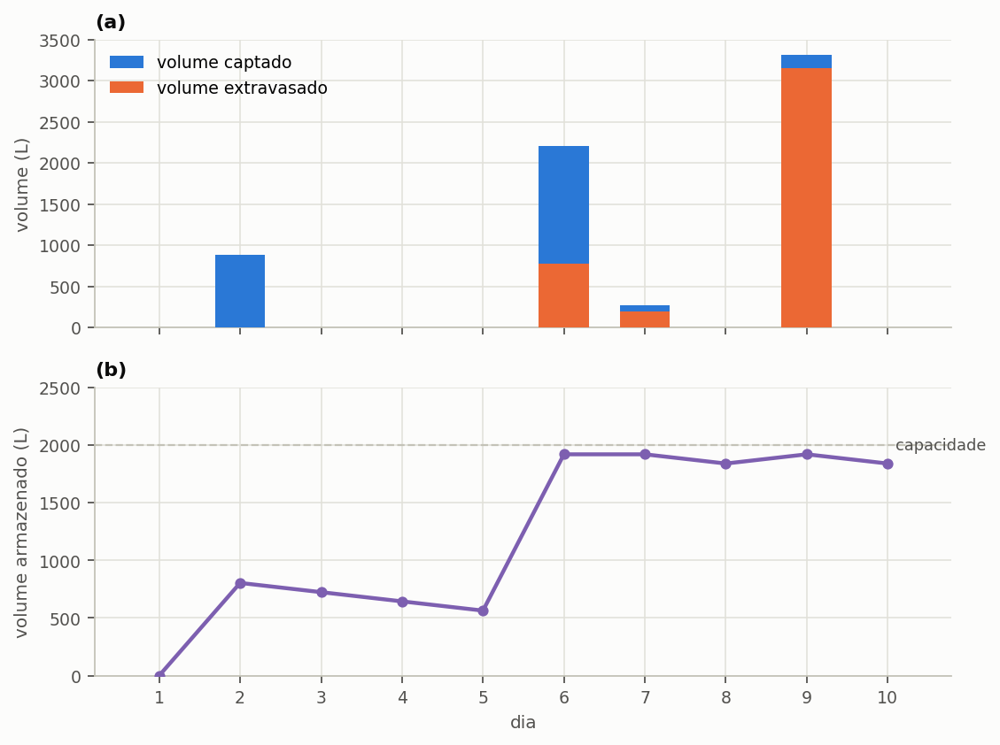

*Figura 1 — Os dez dias do caso resolvido: (a) volume captado, em azul, e volume extravasado, em laranja, por dia — no dia 9 o volume extravasado quase iguala o captado; (b) volume armazenado no reservatório inferior ao fim de cada dia, após o consumo, com a capacidade de 2.000 L em tracejado; nos dias 6, 7 e 9 o reservatório atinge a capacidade, extravasa e termina o dia com 1.920 L.*

#### 2.1.3.5. A soma: o balanço fecha

A última linha da tabela e o quadro de verificação mostram o fechamento:

```equacao:fechamento:1
V_cap = V_ext + V_con + V_res
```

<!-- tabela: **Tabela 6** — Variáveis da Equação 1 -->
| Símbolo | Significado | Unidade |
| :--- | :--- | :--- |
| `V_cap` | volume total captado no período | L |
| `V_ext` | volume total extravasado no período | L |
| `V_con` | volume total de água pluvial consumido no período | L |
| `V_res` | volume remanescente no reservatório ao fim do período | L |

Nos dez dias do caso resolvido, a Equação 1 se verifica com os valores
6.681 L de captação, 4.121 L de extravasamento, 720 L de consumo e 1.840 L
remanescentes.

Resíduo zero. O programa não cria nem perde água, e essa verificação é feita
automaticamente pela suíte de testes a cada alteração do código, sobre séries de dez
anos, com resíduo da ordem de 10⁻¹⁴ por cento do captado.

---

### 2.1.4. As equações

O balanço diário se escreve em cinco equações encadeadas, que o programa resolve
nesta ordem para cada dia da série. A notação segue a da seção 4.1 (volume Tutorial) para a parcela
de captação, e o índice `t` designa sempre o dia corrente da simulação, de modo que
`t−1` é o dia imediatamente anterior.

#### 2.1.4.1. O volume captado

A conversão da lâmina precipitada em volume é a primeira operação do dia, e a mais
simples de todas: multiplica-se a chuva efetiva pela área de captação e pelo
coeficiente de escoamento superficial.

```equacao:volume_captado:2
V_cap,t = P_ef,t × A × C
```

<!-- tabela: **Tabela 7** — Variáveis da Equação 2 -->
| Símbolo | Significado | Unidade |
| :--- | :--- | :--- |
| `V_cap,t` | volume captado no dia `t` | L |
| `P_ef,t` | chuva efetiva no dia `t`, já descontada a lâmina de descarte | mm |
| `A` | área de captação, em projeção horizontal | m² |
| `C` | coeficiente de escoamento superficial da cobertura | adimensional |

O resultado da Equação 2 sai diretamente em litros, sem fator de
conversão, porque um milímetro de lâmina sobre um metro quadrado de superfície
corresponde exatamente a um litro de água. É a única simplificação dimensional do
modelo, e ela é exata.

#### 2.1.4.2. O extravasamento e o armazenamento

O volume disponível antes de qualquer consumo é a soma do que sobrou no reservatório
no fim do dia anterior com o que foi captado hoje, conforme a Equação
3. Dessa soma decorrem duas parcelas, calculadas nesta ordem: o
excedente que não cabe no reservatório e por isso extravasa, e o volume que fica
efetivamente armazenado.

```equacao:disponivel:3
D_t = V_res,t−1 + V_cap,t
```

```equacao:extravasado:4
V_ext,t = max(0 ; D_t − V_max)
```

```equacao:armazenado:5
V_arm,t = min(D_t ; V_max)
```

<!-- tabela: **Tabela 8** — Variáveis da Equação 5 -->
| Símbolo | Significado | Unidade |
| :--- | :--- | :--- |
| `D_t` | volume disponível no dia `t`, antes do consumo | L |
| `V_res,t−1` | volume que sobrou no reservatório ao fim do dia anterior | L |
| `V_cap,t` | volume captado no dia `t`, da Equação 2 | L |
| `V_ext,t` | volume extravasado no dia `t` | L |
| `V_arm,t` | volume armazenado no dia `t`, antes do consumo | L |
| `V_max` | capacidade útil do reservatório inferior | L |

==A ordem em que as Equações 4 e 5 aparecem define o
modelo.== O extravasamento é calculado **antes** da retirada do consumo do dia, e é por isso que
o programa costuma ser descrito pela regra YAS, do inglês *yield after spillage*, isto
é, rendimento posterior ao extravasamento. A descrição é aproximada, e a subseção
seguinte diz em que ela falha. Inverter a ordem faria o reservatório
aceitar, na forma de consumo, água que fisicamente já teria extravasado, e
superestimaria o aproveitamento justamente nos dias de chuva intensa, que são os que
mais pesam no total anual.

A diferença entre as duas ordens é invisível na maior parte dos dias e decisiva
nos poucos que importam. Enquanto o reservatório não enche, extravasar antes ou depois
de consumir dá exatamente o mesmo resultado, porque não há extravasamento algum; nos
dias de chuva intensa, em que o reservatório atinge a capacidade, a ordem determina se
uma parcela de água é contabilizada como consumida ou como perdida. São justamente
esses dias os que mais pesam no total anual, e por isso uma escolha que parece formalidade desloca o resultado inteiro. A Figura 2 compara as duas sequências na notação das equações desta seção.

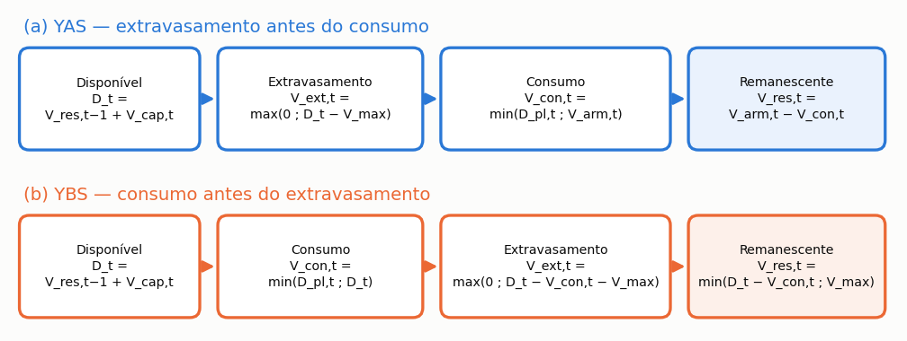

*Figura 2 — Sequência de operações do balanço diário: (a) a ordem adotada pelo programa, com o extravasamento calculado antes do consumo; (b) ordem invertida (YBS), com o consumo retirado antes do extravasamento. As duas sequências só divergem nos dias em que o reservatório atinge a capacidade, e a YBS supõe um consumo anterior à chuva do dia, o que superestima o aproveitamento.*

#### 2.1.4.3. YAS, YBS e a ordem do Triton

Na literatura, YAS e YBS têm definição precisa (Fewkes e Butler, 2000). Com `Y_t` o
volume retirado no dia, `Q_t` o volume captado, `S_t` o volume armazenado no fim do dia
e `V_max` a capacidade:

<!-- tabela: **Tabela 9** — Retirada do dia e volume armazenado no fim do dia nas regras YAS e YBS estritas e no Triton -->
| Regra | Retirada do dia | Armazenado no fim do dia |
| :--- | :--- | :--- |
| YAS estrita | `Y_t = min(D_pl,t ; S_t−1)` | `S_t = min(S_t−1 + Q_t − Y_t ; V_max − Y_t)` |
| YBS estrita | `Y_t = min(D_pl,t ; S_t−1 + Q_t)` | `S_t = min(S_t−1 + Q_t − Y_t ; V_max)` |
| Triton | `Y_t = min(D_pl,t ; min(S_t−1 + Q_t ; V_max))` | `S_t = min(S_t−1 + Q_t ; V_max) − Y_t` |

Na YAS estrita, a retirada do dia sai só do que estava guardado na véspera: a chuva de
hoje só serve amanhã. Na YBS estrita, a chuva de hoje atende a demanda antes de o
reservatório extravasar. O Triton faz o extravasamento primeiro, como a YAS, e depois
deixa a chuva do dia, até o limite da capacidade, atender a demanda do dia.

Disso decorre uma desigualdade que vale em qualquer série: o volume consumido pelo
Triton nunca é menor que o da YAS estrita nem maior que o da YBS estrita. O resultado
fica **entre as duas**, mais perto da YAS nos reservatórios grandes, em que a véspera
quase sempre basta, e mais longe dela nos pequenos, em que a chuva do dia pesa. Quem
compara o Triton com um programa ou com uma norma que use a YAS estrita, como o método
detalhado da EN 16941-1:2024 (Anexo A), deve esperar do Triton um potencial de economia
um pouco maior para o mesmo volume.

O programa mantém essa ordem por decisão: ela reproduz o Netuno 4 e os estudos do grupo
de pesquisa que o usaram, e uma mudança aqui deslocaria todos os resultados publicados.

#### 2.1.4.4. O atendimento da demanda

Estabelecido quanto há no reservatório, o programa retira dele o menor valor entre a
demanda pluvial do dia e o volume disponível, e devolve ao dia seguinte o que restar.

```equacao:consumido:6
V_con,t = min(D_pl,t ; V_arm,t)
```

```equacao:sobra:7
V_res,t = V_arm,t − V_con,t
```

<!-- tabela: **Tabela 10** — Variáveis da Equação 7 -->
| Símbolo | Significado | Unidade |
| :--- | :--- | :--- |
| `V_con,t` | volume de água pluvial consumido no dia `t` | L |
| `D_pl,t` | demanda pluvial do dia `t`, montada conforme a seção 4.2 (volume Tutorial) | L |
| `V_arm,t` | volume armazenado no dia `t`, da Equação 5 | L |
| `V_res,t` | volume remanescente, transferido ao dia seguinte | L |

A Equação 7 é o que torna a simulação diária necessária e insubstituível:
ela liga cada dia ao seguinte e faz do reservatório uma memória do que aconteceu antes.
Nenhum cálculo baseado em médias mensais ou anuais consegue representar esse
encadeamento, e é dele que decorre todo o descasamento entre a oferta concentrada e a
demanda distribuída.

#### 2.1.4.5. O complemento da rede pública

O que a chuva não atendeu é comprado da concessionária, e essa parcela reúne três
origens distintas.

```equacao:potavel:8
V_pot,t = D_pot,t + ΔD_int,t + ΔD_irr,t
```

<!-- tabela: **Tabela 11** — Variáveis da Equação 8 -->
| Símbolo | Significado | Unidade |
| :--- | :--- | :--- |
| `V_pot,t` | volume de água potável consumido da rede no dia `t` | L |
| `D_pot,t` | demanda que exige água potável por natureza do uso | L |
| `ΔD_int,t` | déficit do uso interno não potável, não atendido pela chuva | L |
| `ΔD_irr,t` | déficit da irrigação, **somente** se o suprimento de reserva estiver ligado | L |

A terceira parcela da Equação 8 merece atenção porque depende de uma
escolha do usuário. Com o suprimento de reserva ligado, a rede socorre a irrigação nos
dias em que a cisterna seca, e o déficit é suprido com água potável; com ele desligado, o
jardim simplesmente não é regado, a edificação não compra essa água, e o volume
correspondente é contabilizado como **demanda não atendida**, que é a terceira parcela
do balanço de demanda tratada adiante nesta seção.

#### 2.1.4.6. A classificação do dia

Por fim, cada dia recebe uma classificação segundo o grau de atendimento alcançado, e é
a partir dessa classificação que se calculam os percentuais de dias de atendimento
pleno, parcial e nulo relatados na seção 2.3.

```equacao:classificacao:9
pleno: V_con,t = D_pl,t ; parcial: 0 < V_con,t < D_pl,t ; nulo: V_con,t = 0
```

<!-- tabela: **Tabela 12** — Variáveis da Equação 9 -->
| Símbolo | Significado | Unidade |
| :--- | :--- | :--- |
| `V_con,t` | volume de água pluvial consumido no dia `t` | L |
| `D_pl,t` | demanda pluvial do dia `t` | L |

A comparação da Equação 9 é feita com tolerância de 10⁻⁵ L, e não
por igualdade exata. A razão é aritmética e não conceitual: o balanço trabalha com
números de ponto flutuante, e uma diferença da ordem do erro de arredondamento
classificaria como parcial um dia que foi plenamente atendido.

### 2.1.5. O balanço de demanda tem três parcelas

A demanda total de um dia se reparte em três, e não em duas:

```equacao:demanda_tres:10
D_t = V_con,t + V_pot,t + V_nao,t
```

<!-- tabela: **Tabela 13** — Variáveis da Equação 10 -->
| Símbolo | Significado | Unidade |
| :--- | :--- | :--- |
| `D_t` | demanda total da edificação no dia `t` | L |
| `V_con,t` | parcela atendida com água pluvial | L |
| `V_pot,t` | parcela comprada da rede pública | L |
| `V_nao,t` | parcela que ninguém forneceu, isto é, demanda não atendida | L |

As três parcelas são o consumo de água pluvial, o consumo da rede pública e a **demanda não atendida**. A terceira é zero na
configuração padrão, em que a rede socorre a irrigação nos dias secos. Ela deixa de
ser zero quando o usuário desliga esse socorro, e aí o programa precisa mostrá-la:
sem ela, o balanço fecharia por construção, escondendo a água que ninguém forneceu.

---

### 2.1.6. Com reservatório superior

Quando o projeto tem caixa d'água superior, o passo 4 muda. Em vez de consumir
direto do reservatório inferior, o programa:

1. consome da caixa superior o que estiver **acima do limiar de acionamento**;
2. se ainda falta e há água embaixo, **aciona a motobomba**: transfere o menor valor
   entre o que há no inferior e o espaço livre em cima, e conta **um ciclo**;
3. consome de novo do que acabou de chegar;
4. repete até atender a demanda ou acabar a água.

O limiar de acionamento é o volume de reserva que não se consome, e serve para a
bomba não ligar a cada litro. Ele é limitado ao volume da caixa superior: informar um
limiar maior que a caixa não faz o programa recusar, faz ele adotar a caixa cheia.

> **O reservatório superior não aumenta a economia de água.** Ele muda **quando** a
> água é entregue, não **quanta**. O que ele acrescenta é custo: o investimento na
> caixa e na bomba, a energia do recalque e a emissão associada. A seção 4.5 (volume Tutorial)
> mostra isso com números.

O número de ciclos e o volume recalcado saem daqui e alimentam o cálculo de energia
da seção 2.6.

---

### 2.1.7. O que o modelo não representa

- **Não há sub-passo horário.** Uma chuva de 40 mm concentrada em duas horas e a
  mesma lâmina distribuída em vinte e quatro horas produzem o mesmo resultado. Para
  reservatórios muito pequenos em relação à área de captação, isso subestima o
  extravasamento.
- **Não há perda por evaporação ou vazamento** no reservatório.
- **A condição inicial é reservatório vazio.** Em séries de menos de um ano, isso
  penaliza o resultado de forma sensível.
- **O coeficiente de escoamento é único e constante.** Não varia com a intensidade da
  chuva nem com o tempo desde o último evento.
- **No balanço, o descarte é uma lâmina, e não um dispositivo com dinâmica própria.** O reservatório de descarte é dimensionado e orçado pelo volume `A × d_f` (seção 2.5), mas o seu esvaziamento entre eventos não é simulado: a lâmina é aplicada conforme o modo de descarte escolhido.

A seção 5.2 (volume Enganos, limitações e confiabilidade) reúne estas e as demais limitações conhecidas.

---

### 2.1.8. Para conferir

O caso resolvido desta seção está no arquivo `03_dez_dias.triton`, na pasta de
casos que acompanha o programa. Abra, rode, e compare com a tabela impressa.

Se algum número divergir, é o manual que está desatualizado em relação ao programa. E
nesse caso a verificação automática já terá avisado, porque cada número desta tabela
tem uma asserção correspondente na suíte de testes descrita na seção 5.3 (volume Enganos, limitações e confiabilidade).

---

## 2.2. Volume ideal e a varredura

> Esta seção formaliza o que a seção 4.4 (volume Tutorial) fez na prática: como o programa monta a
> grade de volumes e como aplica o critério de volume ideal.

---

### 2.2.1. A grade discreta

A varredura simula um conjunto **finito** de volumes, e a montagem desse conjunto
tem três regras.

**O passo é arredondado para cima até o múltiplo de 250 litros.** É o quantum
comercial: reservatórios são vendidos em volumes padronizados, e um ótimo em 1.300 L
não é comprável. Quando o passo pedido não é múltiplo de 250, o programa ajusta e
registra o ajuste em `step_adjusted`, de modo que o relatório possa declarar o passo
efetivo.

**O número de volumes positivos é limitado a 40.** Uma varredura de 0 a 50.000 L com
passo de 100 L seriam 500 simulações de trinta anos, e o ganho de informação não paga
o custo. Quando o limite é atingido, o passo efetivo cresce.

**O volume máximo informado é sempre preservado** como último ponto da grade. Só o
último intervalo pode, portanto, ser menor que o passo efetivo.

O volume **zero** entra na grade como alternativa de referência: é o cenário sem
sistema, contra o qual os demais se comparam.

---

A consequência prática aparece na Figura 3. Com passo fino, a curva mostra o
joelho onde o retorno começa a decair; com passo grosseiro, o joelho cai entre dois
pontos da grade e o critério elege o primeiro volume tabulado depois dele, que pode estar
vários metros cúbicos adiante do volume que de fato interessa.

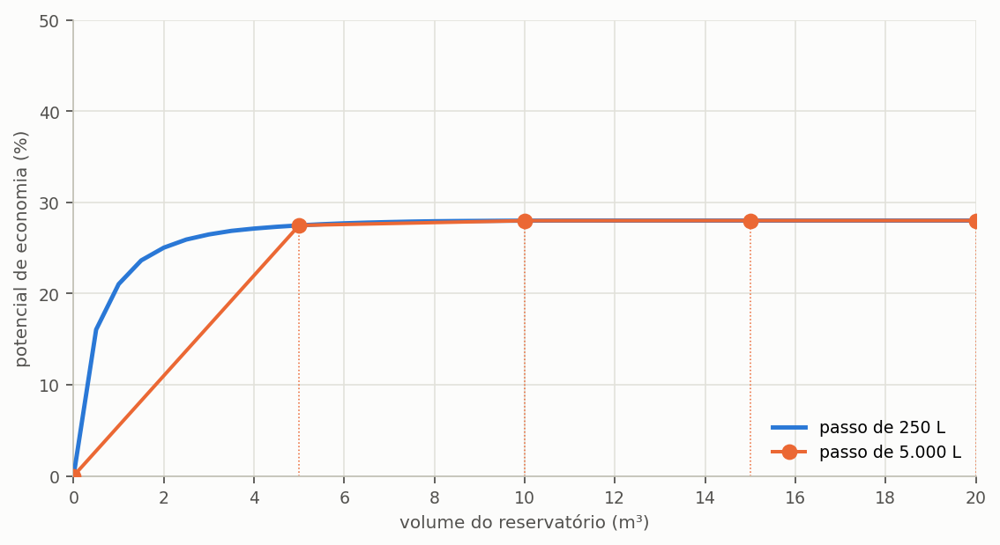

*Figura 3 — Curva de potencial de economia da mesma edificação, varrida com passo de 250 L e com passo de 5.000 L. A grade grossa calcula corretamente cada ponto que contém, mas não contém o trecho de maior curvatura, entre 1 e 5 m³.*

---

### 2.2.2. O ganho marginal

A curva de potencial de economia contra volume é monotônica e côncava: cada metro
cúbico acrescentado ao reservatório rende menos que o anterior, e o rendimento tende a
zero à medida que o sistema se aproxima do teto imposto pela fração atendível. O
programa quantifica esse rendimento decrescente pela derivada discreta da curva,
calculada para cada volume da grade a partir do segundo.

```equacao:ganho_marginal:11
Δ(V_i) = [ Epot(V_i) − Epot(V_i−1) ] ÷ [ (V_i − V_i−1) ÷ 1000 ]
```

<!-- tabela: **Tabela 14** — Variáveis da Equação 11 -->
| Símbolo | Significado | Unidade |
| :--- | :--- | :--- |
| `Δ(V_i)` | ganho marginal do volume `V_i` em relação ao anterior | %/m³ |
| `Epot(V_i)` | potencial de economia de água potável obtido com o volume `V_i` | % |
| `Epot(V_i−1)` | potencial de economia obtido com o volume imediatamente menor | % |
| `V_i` | volume do reservatório na posição `i` da grade | L |
| `V_i−1` | volume imediatamente menor da grade | L |
| `1000` | conversão de litros para metros cúbicos | L/m³ |

A divisão por mil no denominador da Equação 11 existe para que o
resultado saia em pontos percentuais por metro cúbico acrescentado, que é a unidade em
que a decisão é tomada — reservatórios são comprados e orçados em metros cúbicos, não
em litros.

==Por ser uma derivada discreta, o ganho marginal depende do passo da grade.== Uma
grade fina produz um valor mais local, próximo da derivada verdadeira naquele ponto;
uma grade grossa produz a média do rendimento ao longo de um intervalo maior. A
subseção sobre sensibilidade ao passo, adiante, mede o tamanho desse efeito.

---

### 2.2.3. O critério de volume ideal

O volume ideal é definido como o menor volume positivo da grade cujo ganho marginal já
tenha caído abaixo de um limiar declarado pelo usuário.

```equacao:volume_ideal:12
V_ideal = min { V_i > 0 : Δ(V_i) ≤ Δ_lim }
```

<!-- tabela: **Tabela 15** — Variáveis da Equação 12 -->
| Símbolo | Significado | Unidade |
| :--- | :--- | :--- |
| `V_ideal` | volume ideal pelo critério de ganho marginal | L |
| `V_i` | volume do reservatório na posição `i` da grade | L |
| `Δ(V_i)` | ganho marginal do volume `V_i`, da Equação 11 | %/m³ |
| `Δ_lim` | limiar de ganho marginal declarado pelo usuário; o programa abre com 5,0, e o tutorial adota 1,0 | %/m³ |

Quando nenhum volume da grade satisfaz a condição da Equação 12 —
situação que ocorre quando a faixa varrida termina antes de a curva achatar — o
programa adota o maior volume da grade e registra essa circunstância no relatório, de
modo que o leitor saiba que o ótimo encontrado é um limite da busca e não um ponto de
inflexão da curva. O Manual do Netuno 4 trata o mesmo caso no sétimo capítulo, e a conduta
adotada aqui é a mesma.

#### 2.2.3.1. Um exemplo, passo a passo

A tabela da varredura do tutorial, na seção 4.4 (volume Tutorial), permite refazer a conta à mão.
Entre 3.000 L e 4.000 L o potencial sobe de 26,48% para 27,12%, isto é, 0,64 ponto
percentual por um metro cúbico a mais. Como 0,64 é menor que o limiar de 1,0 %/m³, e o
ganho anterior, entre 2.000 L e 3.000 L, foi de 1,45 %/m³, o primeiro volume a cruzar o
limiar é 4.000 L, e é ele o volume ideal.

Repare no que acontece logo depois. Entre 6.000 L e 8.000 L o potencial sobe 0,23
ponto, o mesmo que no intervalo anterior, de 5.000 para 6.000 L, e no entanto o ganho
**por metro cúbico** cai à metade, de 0,23 para 0,11 %/m³, porque o intervalo tem dois
metros cúbicos. É por
isso que o critério usa o ganho por metro cúbico, e não o ganho entre pontos
consecutivos da grade: o segundo depende do passo, e o primeiro, muito menos.

> **O critério é hidráulico e só hidráulico.** Ele ignora custo, tarifa e carbono. Um
> volume ideal por este critério não é uma recomendação de projeto; é o ponto em que a
> curva de aproveitamento deixa de compensar **em água**. A seção 2.10 trata da
> escolha com os demais critérios, que frequentemente apontam para volumes diferentes.

---

Este é um critério entre outros igualmente defensáveis, e convém deixar isso
explícito. Um projetista que queira o máximo desempenho hídrico escolherá o maior volume
da varredura; um que responda por um orçamento escolherá o volume de maior valor
presente líquido; o critério de ganho marginal fica entre os dois, por ser o que identifica
onde a curva deixa de compensar. Os três leem a mesma varredura e não precisam coincidir:
neste projeto eles apontam três volumes diferentes, e o de máximo desempenho é o maior
dos três. Nenhum dos três está errado — errado é não dizer qual deles foi usado. A Figura 4 marca o volume eleito por cada critério, com o valor anotado na legenda do gráfico.

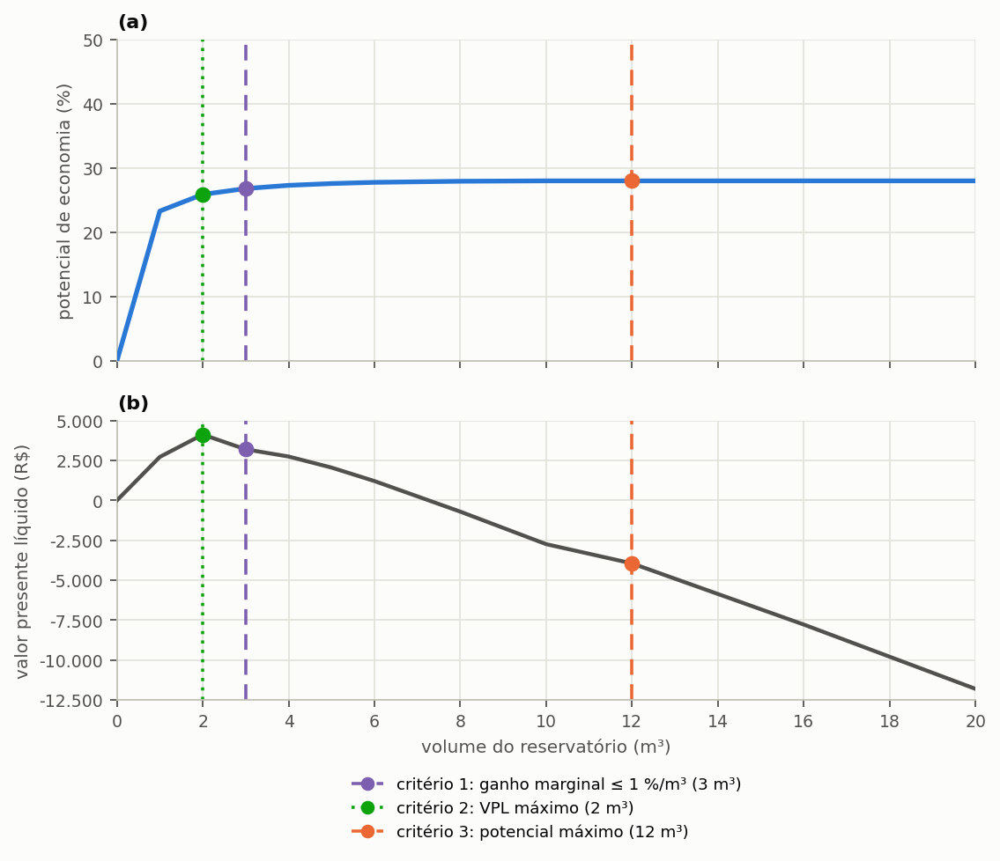

*Figura 4 — Varredura do projeto do tutorial lida por três critérios: (a) potencial de economia e (b) valor presente líquido do mesmo conjunto de volumes. As linhas verticais marcam o volume eleito pelo ganho marginal abaixo de 1 %/m³, pelo VPL máximo e pelo potencial máximo; o volume de cada um vai anotado na legenda, porque depende da grade varrida e das premissas econômicas em vigor.*

---

### 2.2.4. Por que o programa simula: os métodos empíricos da norma

A primeira edição da norma brasileira de aproveitamento de água de chuva, a ABNT NBR
15527:2007, trazia no Anexo A, de caráter informativo, seis métodos para dimensionar o
reservatório: o de Rippl, o da simulação, o de Azevedo Neto e três métodos práticos, o
alemão, o inglês e o australiano. Eles continuam em uso corrente em projetos e em
trabalhos acadêmicos, e convém entender o que cada um responde antes de compará-los
com a varredura do programa.

**O método de Rippl** é o diagrama de massas aplicado ao reservatório: acumula, período
a período, a diferença entre a demanda e a chuva aproveitável, e adota como volume o
maior déficit acumulado da série. O volume resultante é o que atenderia **toda** a
demanda mesmo na pior estiagem registrada, e por isso cresce com o comprimento da série
e com a resolução dela: com dados diários, as sequências secas aparecem inteiras; com
dados mensais, parte delas se dilui na média do mês.

**O método de Azevedo Neto** multiplica a precipitação média anual `P`, em milímetros, a
área de coleta `A`, em metros quadrados, e o número de meses de pouca chuva `T` pelo
coeficiente 0,042, e dá o volume em litros. O resultado depende inteiramente de `T`, e
em cidades sem estação seca definida, como Florianópolis, a escolha de `T` é arbitrária.

**Os métodos práticos** são regras de bolso. O alemão toma 6% do menor valor entre a
chuva aproveitável anual e a demanda anual; o inglês toma 5% do produto `P × A`; o
australiano faz um balanço mensal por tentativas até alcançar a confiança desejada.
Nenhum dos dois primeiros usa a distribuição da chuva no tempo, e o inglês não usa
sequer a demanda.

A tabela a seguir aplica cinco desses métodos ao projeto do tutorial, arredonda cada
volume ao múltiplo de 250 L e simula, no próprio programa, o potencial que ele produz.

<!-- tabela: **Tabela 16** — Volumes dados pelos métodos do Anexo A da ABNT NBR 15527:2007 para o projeto do tutorial, arredondados a 250 L, e o potencial que cada um produz na simulação diária -->
| Método | Regra | Volume | Potencial simulado |
| :--- | :--- | ---: | ---: |
| prático alemão | 6% do menor entre oferta e demanda anuais | 3 750 L | 27,00% |
| Rippl, série mensal | maior déficit acumulado, meses | 4 500 L | 27,32% |
| Azevedo Neto, T = 1 mês | 0,042 × P × A × T | 11 250 L | 28,00% |
| Rippl, série diária | maior déficit acumulado, dias | 7 000 L | 27,83% |
| prático inglês | 0,05 × P × A | 13 500 L | 28,00% |
| **simulação diária, ganho marginal de 1 %/m³** | varredura | **4 000 L** | **27,12%** |

<!-- tabela: **Tabela 17** — Fração de armazenamento dos volumes da varredura e o passo de simulação que Fewkes e Butler (2000) recomendam para cada faixa -->
| Volume | Fração de armazenamento S/(A·R) | Passo recomendado por Fewkes e Butler |
| ---: | ---: | :--- |
| 1 000 L | 0,0037 | horário |
| 2 000 L | 0,0074 | horário |
| 3 000 L | 0,0111 | diário |
| 4 000 L | 0,0149 | diário |
| 8 000 L | 0,0297 | diário |
| 12 000 L | 0,0446 | diário |
| 20 000 L | 0,0743 | diário |

A primeira tabela mostra o que a curva côncava da seção 4.4 (volume Tutorial) já anunciava. Os métodos
que dimensionam para a pior estiagem, como Rippl com série diária, e os que ignoram a
demanda, como o inglês, levam a reservatórios de 7 a 14 m³, que entregam menos de um
ponto percentual a mais que os 4.000 L da simulação ao custo de duas a três vezes o
volume. O método alemão e o de Rippl com série mensal acertam a ordem de grandeza neste
caso, mas por coincidência: ele
não tem como saber que a chuva de Florianópolis é bem distribuída, e daria o mesmo
volume para uma cidade com seis meses secos.

==A diferença essencial é que os métodos empíricos respondem a uma pergunta fixa, e a
simulação responde à pergunta que o projetista declara.== Rippl pergunta qual volume
nunca falha; o método inglês pergunta que fração da chuva guardar; a varredura com ganho
marginal pergunta a partir de qual volume o metro cúbico seguinte deixa de compensar.
Ghisi (2010) mostrou, para três cidades do estado de São Paulo, que o volume adequado
varia muito com a chuva local, a área de cobertura, o número de moradores e as
demandas, e concluiu que dimensionar reservatórios pela tradição local, sem simulação,
pode levar a sistemas de baixa eficiência.

---

### 2.2.5. O passo de tempo e a fração de armazenamento

O programa simula dia a dia, e essa escolha tem uma faixa de validade conhecida. Fewkes
e Butler (2000) compararam modelos comportamentais com passos de um minuto, uma hora, um
dia e um mês, tomaram como referência o modelo horário com a regra YAS, descrita na
seção 2.1, e mostraram que o passo adequado depende de uma grandeza adimensional,
a **fração de armazenamento**.

```equacao:fracao_de_armazenamento:13
F_S = S ÷ (A × R)
```

<!-- tabela: **Tabela 18** — Variáveis da Equação 13 -->
| Símbolo | Significado | Unidade |
| :--- | :--- | :--- |
| `F_S` | fração de armazenamento | adimensional |
| `S` | capacidade do reservatório | m³ |
| `A` | área de captação em projeção horizontal | m² |
| `R` | precipitação média anual | m |

Pelos resultados daqueles autores, o modelo horário é o indicado para frações de até
0,01; o diário, para frações entre 0,01 e 0,125; e o mensal, só acima de 0,125. A razão
física é simples: quanto menor o reservatório em relação à chuva que recebe, mais ele
enche e extravasa **dentro** de um mesmo dia chuvoso, enquanto a demanda é retirada ao
longo das horas; um passo diário soma numa entrada só o que, hora a hora, teria entrado
e saído aos poucos.

A segunda tabela calcula a fração para os volumes da varredura do tutorial. A cisterna
escolhida, de 4.000 L, tem fração de 0,015, dentro da faixa do modelo diário; os
reservatórios de 1.000 e 2.000 L ficam abaixo de 0,01, e para eles o resultado diário
deve ser lido como aproximação. Campisano e Modica (2015), que simularam um sistema
residencial com passos diários e subdiários a partir de descargas medidas, chegaram a
uma conclusão complementar: o passo diário é confiável para estimar a **economia de
água**, mas passos de no máximo uma hora são necessários quando o objetivo é a
**retenção de águas pluviais**, sobretudo em reservatórios pequenos e com demanda alta.

> **Na prática.** Para economia de água potável em edificações, o passo diário do
> programa é adequado na faixa usual de projeto. Se a fração de armazenamento do seu
> estudo ficar abaixo de 0,01, declare a limitação; e se o objetivo for amortecer vazões
> de pico na drenagem urbana, o programa não é a ferramenta adequada.

---

### 2.2.6. O que a literatura diz sobre o volume ideal

Não há definição única de volume ideal, e a revisão sistemática de Semaan et al. (2020)
ajuda a situar o critério do programa. Examinando estudos de otimização de sistemas
domésticos, os autores observaram que o dimensionamento do reservatório é o objetivo de
otimização mais importante, mas que o custo é o critério mais usado; que o
subdimensionamento produz sistemas incapazes de fornecer volume confiável; e que o
superdimensionamento eleva o investimento com benefício marginal pequeno e ainda pode
comprometer a qualidade da água, que fica armazenada por mais tempo.

Campisano et al. (2017), numa revisão ampla sobre sistemas urbanos de aproveitamento
pluvial, reúnem critérios de três famílias: os de **eficiência hídrica**, como o potencial
de economia e a confiabilidade; os **econômicos**, como o valor presente líquido e o tempo
de retorno; e os de **desempenho na drenagem**, como a retenção. O programa cobre as duas
primeiras famílias e declara não cobrir a terceira.

O critério de ganho marginal pertence à primeira família e tem uma vantagem sobre a
confiabilidade fixa, como a de Rippl: não exige que o projetista escolha um nível de
falha aceitável, que raramente tem justificativa técnica, e sim um nível de retorno
decrescente, que se lê diretamente em metros cúbicos de reservatório. A desvantagem é
simétrica: o limiar de 1 %/m³, ou de 5 %/m³, também é uma escolha, e precisa ser
declarado.

---

### 2.2.7. A sensibilidade ao passo

O volume ideal depende do passo da varredura, e convém saber quanto.

Um passo grosso salta o joelho da curva: com passo de 5.000 L, o primeiro ponto
avaliado após o zero já tem ganho marginal médio de todo o intervalo, que é alto, e
o segundo pode já estar abaixo do limiar. O ideal sai deslocado para cima.

Um passo fino resolve melhor o joelho, ao custo de tempo.

**Recomendação prática:** passo entre 500 e 1.000 L para reservatórios residenciais,
e entre 2.000 e 5.000 L para edificações de grande porte, sempre declarando o passo
adotado junto do volume ideal.

---

### 2.2.8. Por que a curva tem esta forma

A curva de aproveitamento pluvial é côncava e assintótica, sempre. Duas razões:

**Os eventos pequenos são a maioria.** Os primeiros litros de armazenamento capturam
as chuvas frequentes e pequenas, que respondem pela maior parte dos dias. Os últimos
litros só servem para os poucos eventos extremos.

**A fração atendível é um teto.** O potencial não pode ultrapassar a fração da
demanda que a chuva atende, definida na seção 4.2 (volume Tutorial). A curva se aproxima desse teto e
nunca o cruza — invariante que a suíte de testes verifica até volumes de 100 m³.

---

### 2.2.9. A série é longa o bastante?

Todo resultado desta seção depende da série de chuva carregada, e a pergunta que
o revisor faz primeiro é se ela basta. Geraldi e Ghisi responderam-na em três
artigos: extraem-se subséries de uma série longa, simula-se cada uma e conta-se
com que frequência elas reproduzem o resultado da série inteira. O comprimento
representativo é o menor que reproduz o resultado na maior parte das janelas, e
que **continua reproduzindo** nos comprimentos maiores — um acerto isolado numa
subsérie curta não vale recomendação.

O programa traz essa análise na etapa de varredura, no botão «a série de chuva é
longa o bastante?». Ele usa a mesma grade de volumes e o mesmo limiar de ganho
marginal que a varredura, porque a resposta depende deles, e devolve o veredito
em uma frase, com a tabela de frequência por comprimento.

==A resposta é deste projeto, e não da cidade.== É o ponto que os artigos não
isolam e que a análise deixa visível: a série necessária cresce com a fração
atendível. Nas quatro séries de trinta anos que acompanham o programa, com
cobertura de 100 m², quatro moradores e 150 L por pessoa ao dia:

<!-- tabela: **Tabela 19** — **Tabela 99** — Comprimento de série representativo, em anos, conforme a fração atendível -->
| Fração atendível | Florianópolis | São Paulo | Brasília | Manaus |
| :--- | ---: | ---: | ---: | ---: |
| 20% | 2 | 8 | 9 | 16 |
| 30% | 8 | 18 | 14 | 20 |
| 40% | 9 | 9 | 20 | 30 |
| 50% | 24 | 25 | 29 | 30 |

Com 20% da demanda atendida por chuva, dois anos de série bastam em
Florianópolis; com 50%, são precisos 24. A razão é direta: quanto maior a parcela
que se quer cobrir, mais a cisterna depende das estiagens raras, e mais longa
precisa ser a série que as contém. Uma série curta não erra o potencial médio —
erra o volume, que é o que se compra.

> **Atenção: série curta não vira série longa por média.** Se a análise disser que o
> projeto precisa de mais anos do que a série tem, o volume ideal calculado é
> provisório, e é isso que se declara no trabalho. Repetir a simulação com outra
> janela dos mesmos dados não resolve: o que falta é registro, não processamento.

---

### 2.2.10. O que a varredura não responde

- **Qual volume comprar.** Reservatórios existem em volumes comerciais; o ideal
  calculado deve ser arredondado para o volume disponível mais próximo, e a
  varredura já ajuda ao trabalhar em múltiplos de 250 L.
- **Se o sistema vale a pena.** Isso é a seção 2.7.
- **Se o volume cabe no terreno.** O programa não conhece o sítio.
- **Quanto a cisterna amortece a drenagem.** O passo diário não representa as vazões de
  pico, e a retenção exige passo horário ou menor, como mostram Campisano e Modica
  (2015).

---

## 2.3. Indicadores de eficiência

> Esta seção define formalmente cada indicador que o programa reporta, com
> unidade, e diz **o que cada um não mede**.

Um indicador mal interpretado é pior que nenhum, e os desta seção são confundidos com
frequência na literatura. Os dois primeiros partem do mesmo numerador — a água de
chuva efetivamente consumida — e diferem apenas no denominador: uma diferença
aritmética pequena e uma diferença de significado grande, porque cada denominador
formula uma pergunta distinta. O terceiro não é uma razão entre volumes, e sim uma
contagem de dias, e responde a uma pergunta que nenhum dos outros dois alcança: com que frequência se pode contar com o sistema (Figura 5).

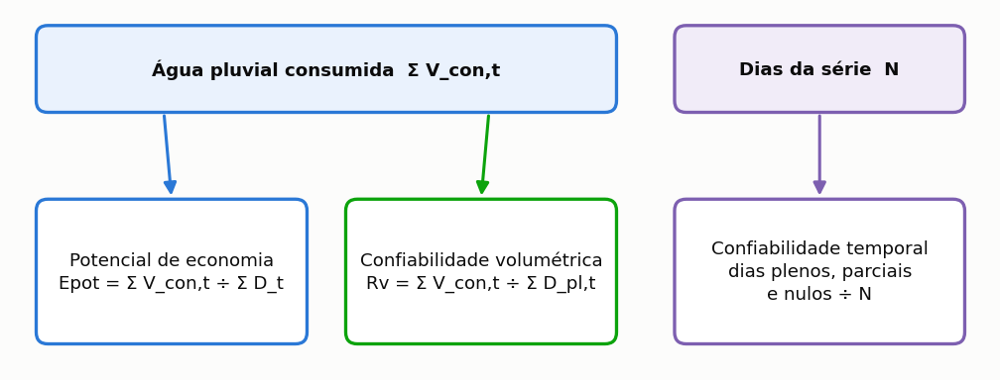

*Figura 5 — Os três indicadores de eficiência e o que cada um conta. O potencial de economia e a confiabilidade volumétrica compartilham o numerador e se relacionam pela identidade Epot = Rv × f, em que f é a fração atendível; a confiabilidade temporal conta dias, e não litros.*

---

### 2.3.1. Potencial de economia de água potável

O potencial de economia de água potável é o indicador central do programa e aquele que
figura no resumo de qualquer estudo. Ele expressa a fração do consumo **total** da
edificação que a água pluvial conseguiu substituir ao longo de toda a série simulada, e
não apenas da parcela que a chuva poderia atender.

```equacao:potencial:14
Epot = ( Σ V_con,t ÷ Σ D_t ) × 100
```

<!-- tabela: **Tabela 20** — Variáveis da Equação 14 -->
| Símbolo | Significado | Unidade |
| :--- | :--- | :--- |
| `Epot` | potencial de economia de água potável | % |
| `V_con,t` | volume de água pluvial consumido no dia `t` | L |
| `D_t` | demanda total da edificação no dia `t` | L |
| `Σ` | somatório sobre todos os dias da série simulada | — |

O denominador da Equação 14 é a demanda **total**, e essa escolha é a
origem da confusão mais comum na leitura de resultados. Um sistema que atendesse
integralmente toda a demanda que lhe cabe, sem falhar um único dia, ainda assim
apresentaria potencial de economia igual à fração atendível declarada, e não a cem por
cento. O teto, portanto, não é uma limitação do sistema: é uma consequência aritmética
da definição do indicador.

---

### 2.3.2. Confiabilidade volumétrica

A confiabilidade volumétrica responde a uma pergunta diferente, e complementar: da água
que o sistema **deveria** fornecer, quanto ele de fato forneceu? O denominador aqui é a
demanda pluvial, e não a demanda total.

```equacao:confiabilidade:15
Rv = ( Σ V_con,t ÷ Σ D_pl,t ) × 100
```

<!-- tabela: **Tabela 21** — Variáveis da Equação 15 -->
| Símbolo | Significado | Unidade |
| :--- | :--- | :--- |
| `Rv` | confiabilidade volumétrica do sistema | % |
| `V_con,t` | volume de água pluvial consumido no dia `t` | L |
| `D_pl,t` | demanda pluvial do dia `t`, isto é, a parcela atendível por chuva | L |
| `Σ` | somatório sobre todos os dias da série simulada | — |

As Equações 14 e 15 diferem apenas no denominador, e
essa diferença basta para que se relacionem por uma identidade exata, útil como
conferência rápida de qualquer resultado.

```equacao:relacao_indicadores:16
Epot = Rv × f
```

<!-- tabela: **Tabela 22** — Variáveis da Equação 16 -->
| Símbolo | Significado | Unidade |
| :--- | :--- | :--- |
| `Epot` | potencial de economia de água potável | % |
| `Rv` | confiabilidade volumétrica | % |
| `f` | fração da demanda total atendível por água pluvial | adimensional |

==Um sistema com 97% de confiabilidade e 28% de fração atendível economiza 27,1% do
consumo total, e os três números dizem a mesma coisa de três maneiras.== É exatamente o
caso da cisterna de 4.000 L do tutorial, antes da caixa superior: a confiabilidade
volumétrica é de 96,86%, e 96,86% × 0,28 = 27,12%, o potencial impresso na seção 4.4 (volume Tutorial). Relatar apenas
um deles, sem declarar a fração atendível adotada, torna o resultado impossível de
comparar com o de outro estudo — e é a causa mais frequente de comparações indevidas na
literatura da área.

A literatura usa nomes diferentes para a mesma razão. Fewkes e Butler (2000) chamam de
**eficiência de economia de água** o quociente entre o volume pluvial fornecido e a
demanda que o sistema deveria atender, que é a confiabilidade volumétrica desta seção.
Outros autores chamam de eficiência o que aqui é potencial de economia. Ao comparar com
outro trabalho, confira o denominador, e não o nome.

---

### 2.3.3. Confiabilidade temporal

A confiabilidade temporal classifica cada dia da série em uma de três classes mutuamente exclusivas, conforme a relação entre o volume pluvial consumido e a demanda pluvial do dia, definida na Equação 9. O dia é **pleno** quando a água de chuva atende integralmente a demanda pluvial; **parcial**, quando atende parte dela e a rede pública supre o restante; e **nulo**, quando o reservatório está vazio e a rede supre toda a demanda (Figura 6). Os três percentuais somam 100%. A classificação conta dias, e não volume: um dia em que faltou um litro para atender a demanda é parcial, e não quase pleno, e por isso a confiabilidade temporal não se converte diretamente em volume economizado.

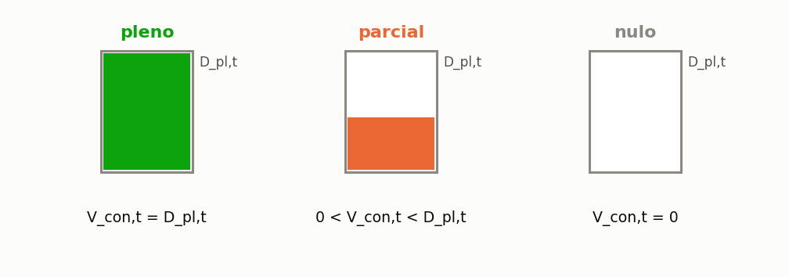

*Figura 6 — Classes de atendimento diário: pleno (V_con,t = D_pl,t), parcial (0 < V_con,t < D_pl,t) e nulo (V_con,t = 0). A altura preenchida representa a fração da demanda pluvial do dia atendida por água pluvial.*

Formalmente, o dia é **pleno** quando `V_con,t = D_pl,t`, com tolerância de 10⁻⁵ L; **parcial** quando `0 < V_con,t < D_pl,t`; e **nulo** quando `V_con,t = 0`.


No tutorial, a cisterna de 4.000 L tem 96,6% de dias plenos, 0,6% de dias parciais e
2,8% de dias nulos. Repare que a confiabilidade temporal, 96,6%, é menor que a
volumétrica, 96,86%. Não há contradição: os dias parciais não contam como plenos, mas
contribuem com volume, e é essa água que a confiabilidade volumétrica soma e a temporal
não. A diferença entre as duas é, por isso, uma medida indireta de quanto os dias de
falha são falhas parciais.

**O que mede:** com que frequência o usuário pode contar com o sistema.

**O que não mede:** o volume. Um sistema pode ter 95% de dias plenos e potencial
baixo se a demanda pluvial for pequena, e o contrário também acontece.

> A confiabilidade temporal é o indicador que mais importa para o **projeto
> hidráulico**. Muitos dias nulos exigem alimentação automática de reserva bem
> dimensionada, e o usuário percebe a alternância entre as duas fontes.

---

### 2.3.4. Extravasamento

```equacao:extravasamento_medio:17
V_ext,med = ( Σ V_ext,t ) ÷ n
```

<!-- tabela: **Tabela 23** — Variáveis da Equação 17 -->
| Símbolo | Significado | Unidade |
| :--- | :--- | :--- |
| `V_ext,med` | extravasamento médio diário | L/dia |
| `V_ext,t` | volume extravasado no dia `t` | L |
| `n` | número de dias da série simulada | dia |

**O que mede:** o quanto a cisterna é pequena em relação aos eventos de chuva.

**O que não mede:** desperdício. A água que extravasa vai para a drenagem urbana,
como iria sem o sistema. Não há perda em relação ao cenário sem sistema — há apenas
oportunidade não aproveitada.

> O extravasamento **nunca zera** num sistema real. Ele tende a um piso que é a
> diferença entre o que a cobertura capta e o que a demanda consome, e no tutorial
> esse piso é mais da metade da água captada. Quem quer retenção de cheia precisa de
> um reservatório de detenção, que é outro projeto com outra lógica.

---

### 2.3.5. Eficiência de uso da captação

O programa não imprime este indicador, mas ele sai diretamente dos anteriores e ajuda a
entender o extravasamento. É a fração da água que chegou à cisterna, já descontado o
descarte de primeiras águas, que acabou consumida.

```equacao:uso_da_captacao:18
η_cap = ( Σ V_con,t ÷ Σ V_cap,t ) × 100
```

<!-- tabela: **Tabela 24** — Variáveis da Equação 18 -->
| Símbolo | Significado | Unidade |
| :--- | :--- | :--- |
| `η_cap` | eficiência de uso da água captada | % |
| `V_con,t` | volume de água pluvial consumido no dia `t` | L |
| `V_cap,t` | volume captado no dia `t`, depois do descarte | L |
| `Σ` | somatório sobre todos os dias da série simulada | — |

Na cisterna de 4.000 L do tutorial, a cobertura entrega 187,4 m³ por ano à cisterna; o
sistema consome 59,4 m³ e extravasa 127,9 m³, e as duas parcelas fecham o balanço de
massa. A eficiência de uso da captação é, portanto, de 31,7%. O número explica por que
aumentar a cisterna rende tão pouco a partir de certo ponto: a água não falta na
cobertura, falta **demanda** para consumi-la. Quando a oferta supera largamente a demanda
pluvial, como em Florianópolis, a eficiência de uso da captação é necessariamente baixa,
qualquer que seja o volume.

---

### 2.3.6. Duração e intensidade das falhas

Os indicadores anteriores dizem quanto e com que frequência o sistema falha, mas não
**como** falha. Hashimoto, Stedinger e Loucks (1982) propuseram, para sistemas de
recursos hídricos em geral, três critérios complementares que hoje são usados também em
aproveitamento pluvial: a **confiabilidade**, que é a probabilidade de o sistema estar em
estado satisfatório; a **resiliência**, que mede a rapidez com que ele se recupera de uma
falha; e a **vulnerabilidade**, que mede a gravidade das falhas quando elas ocorrem.

O programa reporta a primeira e não reporta as outras duas, mas ambas podem ser calculadas
a partir da série diária detalhada, exportada em planilha. Para a cisterna de 4.000 L do
tutorial, em trinta anos:

- houve 60 sequências de dias não plenos, com duração média de 6,3 dias e máxima de 23
  dias. A resiliência, tomada como o inverso da duração média de uma falha, é de 0,16 por
  dia;
- nos dias de falha, faltaram em média 153 L de uma demanda pluvial de 168 L, isto é,
  cerca de 90%. A falha típica, portanto, não é um pequeno déficit: é a cisterna vazia.

A leitura de projeto é direta. Falhas longas e quase totais significam que a alimentação
de reserva pela rede pública precisa ser automática e dimensionada para a vazão total
dos pontos de uso pluviais, e não apenas para complementar pequenas faltas.

---

### 2.3.7. Volume anual poupado

```equacao:volume_poupado:19
V_poup = ( V_con,med × 365,25 ) ÷ 1000
```

<!-- tabela: **Tabela 25** — Variáveis da Equação 19 -->
| Símbolo | Significado | Unidade |
| :--- | :--- | :--- |
| `V_poup` | volume de água potável poupado por ano | m³/ano |
| `V_con,med` | consumo médio diário de água pluvial | L/dia |
| `365,25` | duração do ano médio, incluindo os bissextos | dia/ano |
| `1000` | conversão de litros para metros cúbicos | L/m³ |

**O que mede:** a base de cálculo do econômico e da avaliação de ciclo de vida.

> **Aprofundamento: o 365,25 não é descuido.** A conversão usa o ano médio, incluindo bissextos,
> porque séries longas os contêm. Usar 365 introduziria um viés sistemático de
> 0,07% — pequeno, mas gratuito.

---

### 2.3.8. Ganho marginal

A definição formal do ganho marginal, com a grade de volumes explicitada, está na
Equação 11, na seção 2.2.

Definido na seção 2.2. É o indicador que decide o volume ideal, e **só existe numa
varredura** — uma simulação de volume único não o produz.

---

### 2.3.9. Demanda não atendida

```equacao:nao_atendida:20
V_nao,med = ( Σ V_nao,t ) ÷ n
```

<!-- tabela: **Tabela 26** — Variáveis da Equação 20 -->
| Símbolo | Significado | Unidade |
| :--- | :--- | :--- |
| `V_nao,med` | demanda média diária não atendida por nenhuma fonte | L/dia |
| `V_nao,t` | demanda não atendida no dia `t` | L |
| `n` | número de dias da série simulada | dia |

Terceira parcela do balanço de demanda. É zero na
configuração padrão e deixa de ser zero quando o suprimento de reserva da irrigação
está desligado.

**Por que existe:** sem ela, o balanço fecharia por construção, atribuindo à rede
toda a demanda que a chuva não atendeu. A seção 2.1 detalha.

---

### 2.3.10. Quadro-resumo

<!-- tabela: **Tabela 27** — Quadro-resumo dos indicadores, com denominador e pergunta que cada um responde -->
| Indicador | Unidade | Denominador | Responde |
| :--- | :--- | :--- | :--- |
| potencial de economia | % | demanda total | quanto do consumo de água potável cai |
| confiabilidade volumétrica | % | demanda pluvial | quanto do pretendido se atendeu |
| dias plenos, parciais, nulos | % | dias da série | com que frequência se pode contar |
| extravasamento | L/dia | — | o reservatório é pequeno? |
| volume poupado | m³/ano | — | base do dinheiro e do carbono |
| ganho marginal | %/m³ | — | vale ampliar? |
| demanda não atendida | L/dia | — | o que ninguém forneceu |

---

## 2.4. Índices pluviométricos

> Esta seção traz a equação de cada um dos nove índices que o programa calcula, e
> declara três divergências em relação ao padrão ETCCDI.

Os índices pluviométricos não participam do balanço hídrico e não alteram nenhum
resultado de simulação. Sua função é caracterizar a série de precipitação — e
uma caracterização honesta é o que permite comparar estudos de cidades diferentes.

---

### 2.4.1. Os nove índices

Os índices são calculados **ano a ano** sobre a série carregada, e o programa reporta a
média e a dispersão do conjunto de anos. Em toda esta seção, `P_i` designa a precipitação
do dia `i` do ano, e um **dia úmido** é aquele em que `P_i ≥ 1 mm` — convenção do ETCCDI,
adotada porque lâminas abaixo de um milímetro são da ordem do erro de medição dos
pluviômetros convencionais.

#### 2.4.1.1. Precipitação total anual, PRCPTOT

Soma da precipitação de todos os dias úmidos do ano. Difere do total anual bruto por
excluir os dias de lâmina desprezível, o que evita que ruído de instrumento se acumule
no total.

```equacao:prcptot:21
PRCPTOT = Σ P_i , para P_i ≥ 1 mm
```

<!-- tabela: **Tabela 28** — Variáveis da Equação 21 -->
| Símbolo | Significado | Unidade |
| :--- | :--- | :--- |
| `PRCPTOT` | precipitação total dos dias úmidos do ano | mm |
| `P_i` | precipitação do dia `i` | mm |
| `Σ` | somatório sobre os dias do ano que satisfazem a condição | — |

#### 2.4.1.2. Precipitação em dias muito úmidos, R95p

Soma da precipitação dos dias cuja lâmina supera o percentil 95 dos dias úmidos. Mede
quanto do total anual chega nos eventos extremos, e é o índice mais diretamente ligado ao
extravasamento de cisternas.

```equacao:r95p:22
R95p = Σ P_i , para P_i > q_95
```

<!-- tabela: **Tabela 29** — Variáveis da Equação 22 -->
| Símbolo | Significado | Unidade |
| :--- | :--- | :--- |
| `R95p` | precipitação acumulada nos dias muito úmidos | mm |
| `P_i` | precipitação do dia `i` | mm |
| `q_95` | percentil 95 da precipitação dos dias úmidos da série | mm |

#### 2.4.1.3. Máxima precipitação em um dia, RX1day

O maior valor diário registrado no ano. É o índice que dimensiona o extravasor e a
calha, e não o reservatório.

```equacao:rx1day:23
RX1day = max ( P_i )
```

<!-- tabela: **Tabela 30** — Variáveis da Equação 23 -->
| Símbolo | Significado | Unidade |
| :--- | :--- | :--- |
| `RX1day` | maior precipitação diária do ano | mm |
| `P_i` | precipitação do dia `i` | mm |
| `max` | valor máximo sobre todos os dias do ano | — |

#### 2.4.1.4. Máxima precipitação em cinco dias, RX5day

O maior acumulado de cinco dias consecutivos no ano. Importa ao aproveitamento pluvial
mais que o RX1day, porque um reservatório enche ao longo de um evento prolongado e não
apenas no pico diário.

```equacao:rx5day:24
RX5day = max ( Σ P_j ) , para j de i a i + 4
```

<!-- tabela: **Tabela 31** — Variáveis da Equação 24 -->
| Símbolo | Significado | Unidade |
| :--- | :--- | :--- |
| `RX5day` | maior acumulado de cinco dias consecutivos no ano | mm |
| `P_j` | precipitação do dia `j` da janela | mm |
| `i` | primeiro dia de cada janela de cinco dias | — |
| `max` | valor máximo sobre todas as janelas do ano | — |

#### 2.4.1.5. Índice simples de intensidade diária, SDII

Precipitação média dos dias úmidos. Separa dois regimes que o total anual confunde: muita
chuva em poucos dias e pouca chuva em muitos dias podem produzir o mesmo PRCPTOT e SDII
bem diferentes.

```equacao:sdii:25
SDII = PRCPTOT ÷ n_úmidos
```

<!-- tabela: **Tabela 32** — Variáveis da Equação 25 -->
| Símbolo | Significado | Unidade |
| :--- | :--- | :--- |
| `SDII` | intensidade média dos dias úmidos | mm/dia |
| `PRCPTOT` | precipitação total dos dias úmidos, da Equação 21 | mm |
| `n_úmidos` | número de dias úmidos do ano | dia |

#### 2.4.1.6. Dias de precipitação intensa, R20mm

Contagem dos dias em que a lâmina atinge ou supera vinte milímetros. Num sistema de
aproveitamento pluvial, esses são tipicamente os dias de extravasamento.

```equacao:r20mm:26
R20mm = # { i : P_i ≥ 20 mm }
```

<!-- tabela: **Tabela 33** — Variáveis da Equação 26 -->
| Símbolo | Significado | Unidade |
| :--- | :--- | :--- |
| `R20mm` | número de dias com precipitação intensa no ano | dia |
| `P_i` | precipitação do dia `i` | mm |
| `# { }` | contagem dos dias que satisfazem a condição | — |

#### 2.4.1.7. Dias secos consecutivos, CDD

Maior sequência de dias consecutivos com precipitação abaixo de um milímetro. ==É o
índice que melhor prevê o desempenho de um sistema pluvial,== porque a estiagem mais
longa é o que esvazia a cisterna.

```equacao:cdd:27
CDD = max ( L ) , com P_i < 1 mm em toda a sequência L
```

<!-- tabela: **Tabela 34** — Variáveis da Equação 27 -->
| Símbolo | Significado | Unidade |
| :--- | :--- | :--- |
| `CDD` | maior sequência de dias secos consecutivos no ano | dia |
| `L` | comprimento de uma sequência de dias secos consecutivos | dia |
| `P_i` | precipitação do dia `i` | mm |

#### 2.4.1.8. Dias úmidos consecutivos, CWD

Maior sequência de dias consecutivos com precipitação igual ou superior a um milímetro.
Caracteriza a persistência da chuva, e sequências longas favorecem o enchimento completo
do reservatório.

```equacao:cwd:28
CWD = max ( L ) , com P_i ≥ 1 mm em toda a sequência L
```

<!-- tabela: **Tabela 35** — Variáveis da Equação 28 -->
| Símbolo | Significado | Unidade |
| :--- | :--- | :--- |
| `CWD` | maior sequência de dias úmidos consecutivos no ano | dia |
| `L` | comprimento de uma sequência de dias úmidos consecutivos | dia |
| `P_i` | precipitação do dia `i` | mm |

#### 2.4.1.9. Índice de sazonalidade, SI

Mede o afastamento entre a distribuição mensal real da chuva e a distribuição
perfeitamente uniforme ao longo do ano. Diferentemente dos oito anteriores, não pertence
ao conjunto ETCCDI: foi proposto por Walsh e Lawler em 1981.

```equacao:sazonalidade:29
SI = ( 1 ÷ R ) × Σ | X_m − R ÷ 12 |
```

<!-- tabela: **Tabela 36** — Variáveis da Equação 29 -->
| Símbolo | Significado | Unidade |
| :--- | :--- | :--- |
| `SI` | índice de sazonalidade de Walsh e Lawler | adimensional |
| `R` | precipitação total do ano | mm |
| `X_m` | precipitação total do mês `m`, com `m` de 1 a 12 | mm |
| `R ÷ 12` | precipitação mensal que haveria se a chuva fosse uniforme | mm |
| `Σ` | somatório sobre os doze meses do ano | — |
| `\| \|` | valor absoluto da diferença | — |

O índice da Equação 29 vale zero quando todos os meses recebem a mesma
lâmina e tende a 1,83 quando toda a chuva do ano cai num único mês. Entre esses extremos, Walsh e Lawler (1981) classificam o regime em muito uniforme (abaixo de 0,20), uniforme com estação úmida definida (0,20 a 0,39), sazonal com estação seca curta (0,40 a 0,59), sazonal (0,60 a 0,79), marcadamente sazonal com estação seca longa (0,80 a 0,99), com a maior parte da chuva em até três meses (1,00 a 1,19) e extremo (1,20 ou mais).

O índice de sazonalidade é o que mais importa ao aproveitamento pluvial, e a seção
3.1 (volume Guias de uso) mostra por quê: é a distribuição da chuva ao longo do ano, e não o total
precipitado, que decide o rendimento do sistema.

---

Os nove índices ficam abstratos enquanto permanecem em forma de tabela, e a Figura 7 os posiciona sobre um ano da série. Postos sobre
um ano real de série, cada um passa a apontar um trecho identificável do registro: o dia
mais intenso, os dias acima do limiar, a maior estiagem, o total acumulado.

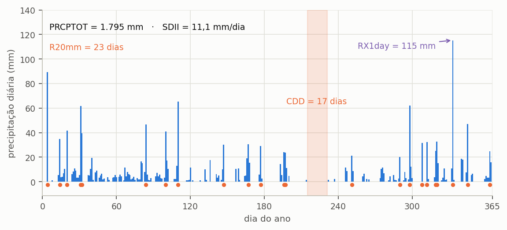

*Figura 7 — Quatro dos nove índices marcados sobre o ano de 1995 em Florianópolis: PRCPTOT e SDII, no alto; RX1day, o maior valor diário do ano; CDD, a maior sequência de dias secos, na faixa sombreada; e R20mm, os dias com 20 mm ou mais, marcados na base.*

A sazonalidade é o índice que menos se parece com os demais, porque não descreve
intensidade nem frequência: descreve o quanto a chuva do ano se concentra em parte dele.
É também o índice que mais separa as capitais brasileiras entre si, e o que melhor prevê se um reservatório precisará atravessar uma estiagem longa (Figura 8).

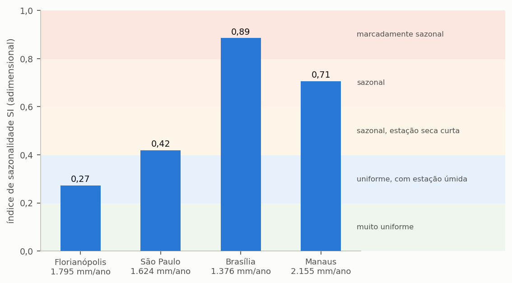

*Figura 8 — Índice de sazonalidade de Walsh e Lawler (1981) nas quatro capitais do guia, com as classes do índice ao fundo e a precipitação média anual sob o nome de cada cidade. Precipitação anual elevada e distribuição uniforme ao longo do ano são propriedades independentes.*

---

### 2.4.2. Três divergências que precisam ser declaradas

O programa chama o conjunto de «ETCCDI mais sazonalidade», e a precisão da expressão
importa.

**Primeira: o conjunto não é ETCCDI puro.** O índice de sazonalidade é de Walsh e
Lawler, e não pertence ao conjunto do *Expert Team on Climate Change Detection and
Indices*. Em compensação, o **R10mm**, que é ETCCDI, **não** está implementado.

Oito dos nove índices são ETCCDI; o nono não é; e falta um que seria.

**Segunda: o período-base do percentil.** O R95p exige um percentil 95 dos dias
úmidos. O ETCCDI define o período-base fixo de 1961 a 1990. O programa calcula o
percentil sobre **toda a série carregada**.

A consequência é que o R95p de duas séries de comprimentos diferentes **não é
diretamente comparável**, porque o limiar de cada uma é próprio. Para comparação
estrita com literatura ETCCDI, recorte a série no período-base.

O programa calcula o percentil **apenas sobre os dias úmidos**, o que está correto:
incluir dias secos deslocaria o percentil para baixo em séries sazonais.

**Terceira: as janelas incompletas do RX5day.** A soma móvel de cinco dias usa
janelas parciais no início de cada ano, de modo que as primeiras janelas têm de um a
quatro dias. O efeito é pequeno e sempre no sentido de subestimar o RX5day dos
primeiros dias do ano.

---

A aba de índices do programa apresenta cada indicador ano a ano: a precipitação total anual (Figura 9) e as maiores sequências de dias secos e chuvosos (Figura 10).

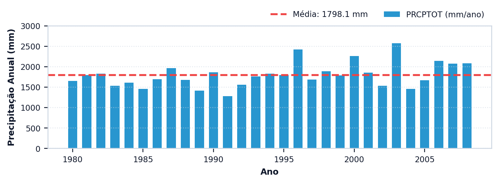

*Figura 9 — Precipitação total anual (PRCPTOT) da série de Florianópolis, com a média do período em linha tracejada, na aba de índices. Figura gerada pelo próprio programa.*

---
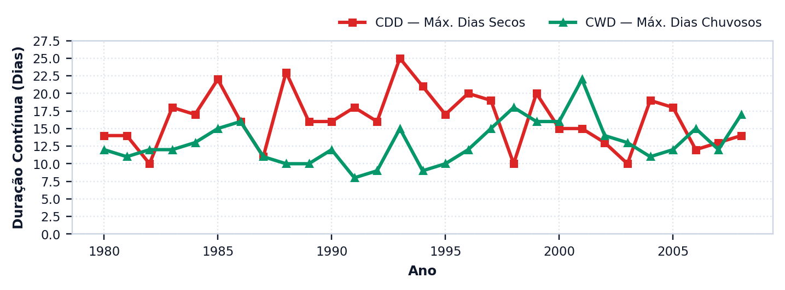

*Figura 10 — Maior sequência anual de dias secos (CDD) e de dias chuvosos (CWD) da série de Florianópolis, na aba de índices. São os dois índices mais diretamente ligados ao volume de reservatório que o regime de chuva exige. Figura gerada pelo próprio programa.*

---
### 2.4.3. Para que servem no estudo

**Caracterizar a série** no método do artigo. PRCPTOT, SDII e SI descrevem o regime
melhor que a média anual sozinha.

**Explicar o resultado.** Um CDD alto explica um sistema de baixo desempenho apesar
de chuva abundante — é o caso de Brasília na seção 3.1 (volume Guias de uso).

**Comparar cenários climáticos.** Entre a série histórica e a projetada, o que
costuma mudar primeiro é o SDII e o CDD, e não o PRCPTOT. Reportar só o total anual
esconde a mudança que mais afeta o sistema.

---

### 2.4.4. O que os índices não fazem

Não entram no balanço. Não alteram o dimensionamento. Não substituem a simulação
diária — que é justamente o argumento do programa contra os métodos por valores
médios.

Um índice é um resumo. O balanço usa a série inteira.

---

## 2.5. Dimensionamento da ETAP

> Esta seção formaliza como o programa dimensiona a estação de tratamento de água
> pluvial e explica a **regra incremental**, que impede o tratamento de ser contado
> duas vezes no orçamento e no fluxo de caixa.

A água que escoa de uma cobertura carrega poeira, folhas, fuligem e dejetos de aves, e
nenhum uso — nem mesmo a descarga sanitária — admite que ela chegue ao ponto de consumo
como saiu do telhado. A estação de tratamento de água pluvial, abreviada como ETAP, é o
conjunto de equipamentos que realiza essa adequação, e o programa a dimensiona a partir
de três entradas: a classe de qualidade que o uso exige, a área de cobertura e o volume
pluvial anual efetivamente consumido, este último resultado do balanço diário
apresentado na seção 2.1.

A linha de tratamento dimensionada pelo programa tem quatro componentes em série. O **descarte inicial** desvia a primeira lâmina de cada chuva, que carreia a sujeira acumulada na cobertura; o **filtro mecânico de entrada** retira folhas e sólidos grosseiros antes que cheguem ao reservatório; a **desinfecção** é o estágio obrigatório, do qual depende a segurança microbiológica da água armazenada; e o **filtro de polimento** é opcional, e se destina aos usos em que a aparência ou a ausência de resíduo dissolvido importa.

---

A linha de tratamento é uma sequência, e a ordem dos estágios não é arbitrária: cada
um remove aquilo que tornaria o seguinte ineficaz. Convém ter o encadeamento inteiro à vista antes de discutir cada peça (Figura 11). A ordem não é intercambiável: desinfetar antes de filtrar consome o reagente na matéria orgânica em suspensão e deixa microrganismos protegidos nas partículas. A turbidez é, por isso, condição de eficácia da desinfecção, e não apenas parâmetro estético.

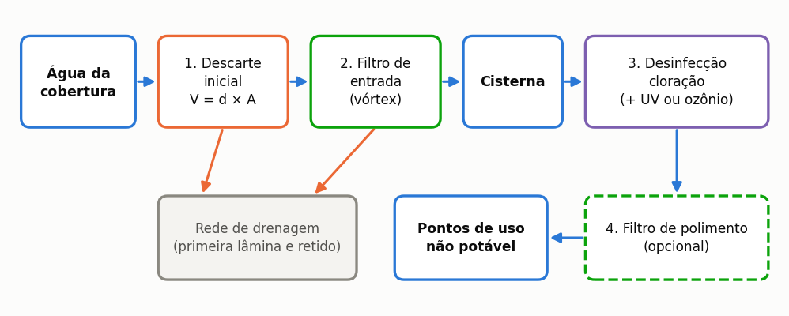

*Figura 11 — Componentes da linha de tratamento dimensionada pelo programa, na ordem do escoamento, e destino do material retido. O descarte inicial e o filtro de entrada atuam antes da cisterna; a desinfecção atua depois deles porque o reagente seria consumido pela matéria orgânica em suspensão que os estágios anteriores removem; o filtro de polimento é opcional.*

---

### 2.5.1. O filtro de entrada

O filtro de entrada é dimensionado pela área de cobertura, e não pela classe de
qualidade pretendida, porque o que ele precisa vencer é a vazão de pico que a cobertura
produz — grandeza que independe do destino final da água. As três faixas adotadas pelo
programa correspondem às capacidades que os próprios fabricantes declaram para os
equipamentos correntes no mercado brasileiro.

<!-- tabela: **Tabela 37** — Filtro mecânico de entrada dimensionado pela área de cobertura -->
| Cobertura | Equipamento | Malha |
| :--- | :--- | ---: |
| até 200 m² | vórtex autolimpante DN 100 | 350 µm |
| até 500 m² | vórtex autolimpante DN 150 | 400 µm |
| acima de 500 m² | cesto ou ciclônico DN 200 | 500 µm |

> Os limites de faixa acompanham a área que o próprio produto declara atender, e não
> uma folga arbitrada sobre ela. É a razão de um telhado de 180 m² receber o filtro de
> DN 100: o equipamento é declarado suficiente pelo fabricante para até 200 m², e impor
> o da faixa seguinte encareceria a instalação sem fundamento técnico.

---

### 2.5.2. A desinfecção

A desinfecção é o estágio que o programa nunca dispensa, e a razão está no conceito de
residual. Entre as três tecnologias disponíveis, apenas a cloração deixa na água um
agente desinfetante que permanece ativo depois do tratamento; a radiação ultravioleta e a ozonização atuam no instante da passagem e nada deixam atrás de si (Figura 12).

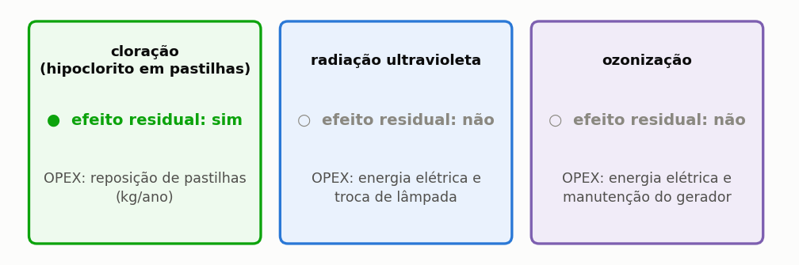

*Figura 12 — As três tecnologias de desinfecção, o efeito residual de cada uma e a composição do custeio anual (OPEX). O efeito residual distingue a cloração das demais: protege a água armazenada, enquanto a radiação ultravioleta e o ozônio atuam apenas sobre a água que atravessa o equipamento.*


==Ultravioleta e ozônio entram como barreira adicional à cloração, e não como
substitutas dela.== Sem residual, a água tratada volta a se contaminar ao longo do
percurso até o ponto de uso, e a prática correta — alinhada ao item 4.6.5 da ABNT NBR
15527:2019, que trabalha com cloro residual livre — mantém a cloração para proteger o
reservatório e a rede interna. A consequência econômica é direta: as duas opções somam
o custo do cloro ao seu próprio, e escolher qualquer uma delas jamais reduz o custeio.

#### 2.5.2.1. A massa de cloro

O insumo de cloração é dimensionado pela massa de produto comercial consumida por metro
cúbico tratado, que decorre da dose aplicada e da pureza do produto adquirido.

```equacao:massa_cloro:30
m_prod = ( C_Cl ÷ 1000 ) ÷ p
```

<!-- tabela: **Tabela 38** — Variáveis da Equação 30 -->
| Símbolo | Significado | Unidade |
| :--- | :--- | :--- |
| `m_prod` | massa de produto comercial consumida por metro cúbico tratado | kg/m³ |
| `C_Cl` | dose de cloro ativo aplicada à água | mg Cl₂/L |
| `1000` | conversão de miligramas por litro para quilogramas por metro cúbico | — |
| `p` | pureza do produto, em massa de cloro ativo por massa de produto | adimensional |

> **O que se compra é o produto, e não o cloro puro.** A pastilha de hipoclorito de
> cálcio contém cerca de 65% de cloro ativo, e o preço em reais por quilograma refere-se
> ao produto comercial, não ao princípio ativo. Calcular o custo pela massa de cloro
> ativo o subestimaria pelo inverso da pureza, isto é, em cerca de 35% — e é um engano
> comum em planilhas de orçamento.

---

### 2.5.3. O filtro de polimento

O filtro de polimento é opcional e constitui o único ponto do dimensionamento em que a
classe de qualidade alvo interfere na escolha do equipamento. Para as classes mais
exigentes, o programa recomenda sua inclusão, e a recomendação varia também quanto ao
tipo de meio filtrante: a lavagem de roupas, por envolver contato com tecido e pele,
exige carvão ativado em bloco, ao passo que os demais usos se satisfazem com filtro de
areia ou cartucho de vinte micrômetros.

<!-- tabela: **Tabela 39** — Recomendação de filtro de polimento por classe de qualidade alvo -->
| Classe | Recomenda polimento? | Equipamento quando marcado |
| :--- | :---: | :--- |
| 1 — NBR 15527:2019 | não | filtro de areia ou cartucho de 20 µm |
| 2 — irrigação e lavagem | sim | idem |
| 3 — torres e caldeiras | sim | idem |
| 4 — lavagem de roupas | sim | **carvão ativado em bloco** |

A recomendação, contudo, não é imposição: o filtro só entra no dimensionamento se o
usuário efetivamente o marcar. Quando a classe o recomenda e o usuário o recusa, o
programa registra a recusa em campo próprio e o relatório a exibe, de modo que a decisão
fique documentada em vez de desaparecer.

> **As classes 2 a 4 são adaptações do programa, e não da NBR 15527.** A matriz de
> parâmetros por uso final é característica da versão de 2007 da norma e não sobreviveu
> à revisão de 2019. Num estudo publicado, apresente-as como critério adotado pelo
> autor, e nunca como requisito normativo.

---

### 2.5.4. O descarte de primeiras águas

O descarte de primeiras águas entra no programa de duas formas. No balanço hídrico, é a lâmina subtraída da precipitação de cada dia, descrita na seção 2.1. No orçamento, quando o dimensionamento físico do descarte está habilitado na etapa **3. Qualidade & ETAP** — condição padrão da interface —, é um subsistema com investimento, custeio e carbono incorporado próprios, composto pelo separador de folhas e pelo reservatório de descarte.

O volume do reservatório de descarte é o produto da lâmina de descarte pela área de captação, `V_desc = d × A`, em litros, com `d` em milímetros e `A` em metros quadrados. Até 250 L, o programa orça uma coluna vertical de desvio em PVC, a R$ 2,20 por litro acrescidos de R$ 120 em conexões e válvula de purga lenta; acima de 250 L, um reservatório de polietileno rotomoldado, com preço interpolado na base de custos e acréscimo de R$ 150 em boia de vedação e dispositivo de purga. O separador de folhas custa R$ 220 para até 200 m² de captação, R$ 440 para até 500 m² e R$ 220 por unidade, a cada 250 m², acima disso. O custeio anual do subsistema é de R$ 40, e todos os valores são multiplicados pelo fator regional. São preços de referência brasileiros; na International Edition, os custos são digitados.

<!-- tabela: **Tabela 40** — Dimensionamento e orçamento do descarte inicial no projeto do tutorial -->
| Item | Valor |
| :--- | ---: |
| lâmina de descarte | 2 mm |
| área de captação | 150 m² |
| volume do reservatório de descarte | 300 L |
| reservatório de descarte em polietileno | R$ 396,90 |
| separador de folhas DN 100 | R$ 220,00 |
| investimento do subsistema | R$ 616,90 |
| custeio anual | R$ 40,00 |

O investimento do subsistema integra o investimento da linha de tratamento e, por isso, entra no fluxo de caixa pela regra incremental a seguir.

---

### 2.5.5. A regra incremental

A regra incremental é a parte do cálculo que mais frequentemente se erra em
implementações próprias, e o erro é sempre o mesmo: contar o tratamento duas vezes. Ela
se aplica em três frentes distintas, e em cada uma delas assume forma própria.

**No investimento.** O orçamento de um sistema de aproveitamento pluvial já reserva uma
verba genérica de tratamento dentro da rubrica de acessórios, porque nenhum projetista
orça um sistema sem prever alguma forma de filtragem. Somar a linha detalhada por cima
dessa verba cobraria o tratamento duas vezes, e por isso o programa desconta a verba
genérica e soma apenas o incremento.

```equacao:capex_etap:31
CAPEX_inc = CAPEX_linha − V_gen
```

<!-- tabela: **Tabela 41** — Variáveis da Equação 31 -->
| Símbolo | Significado | Unidade |
| :--- | :--- | :--- |
| `CAPEX_inc` | investimento incremental da linha de tratamento | R$ |
| `CAPEX_linha` | investimento total dos equipamentos da linha dimensionada | R$ |
| `V_gen` | verba genérica de tratamento já incluída na rubrica de acessórios | R$ |

**No custeio.** A cloração já é paga na linha de insumos químicos do fluxo de caixa, de
modo que o custeio incremental da ETAP desconta essa parcela e o hipoclorito é pago uma
vez só, e não duas.

**Na avaliação de ciclo de vida.** A linha de tratamento **substitui** o termo de
cloração em vez de somar-se a ele, e a diferença de tratamento entre o fluxo de caixa e
o inventário de emissões decorre de os dois contabilizarem grandezas distintas.

> A regra vive num módulo único, consumido pelos **dois** motores econômicos do
> programa. Duas cópias da mesma regra divergem com o tempo, e a divergência entre elas
> é invisível no resultado: cada motor responde de forma coerente consigo mesmo.

---

### 2.5.6. Desligar a ETAP

O dimensionamento da linha de tratamento pode ser inteiramente desativado, e nesse caso
nem o investimento nem o custeio de tratamento entram na análise econômica. A finalidade
da chave é permitir o estudo da hipótese de tratamento já existente na edificação — caso
em que o custo não deve ser atribuído ao sistema pluvial — e comparar cenários com e sem
a linha. ==Desligá-la não significa que a água dispense tratamento:== significa que o
tratamento não está sendo orçado aqui.

---

### 2.5.7. O que o programa não dimensiona

O escopo do dimensionamento termina nos equipamentos da linha, e quatro itens correlatos permanecem a cargo do projetista. O **arranjo hidráulico do descarte inicial** — conexões, dispositivo de purga e ligação à drenagem — não é projetado: o programa calcula apenas o volume do reservatório de descarte e o seu custo. A **tubulação** da linha de
tratamento e a perda de carga que ela impõe também não são calculadas. O **regime de
manutenção** — troca de elemento filtrante, limpeza do vórtex, reposição de pastilhas —
não é planejado pelo programa, embora determine boa parte do custeio real. E o
**controle de qualidade** permanece integralmente fora do escopo: o programa dimensiona
equipamento a partir de premissas, e não substitui ensaio laboratorial.

A ABNT NBR 15527 trata do controle e da manutenção, e o plano correspondente é
responsabilidade do projetista.

---

## 2.6. Energia de bombeamento

> Esta seção traz a cadeia completa do eixo à tomada, e explica por que a
> potência de placa **não** é o que o medidor registra.

Três versões desta conta já existiram no programa, e as duas primeiras cometiam os enganos descritos no item «Por que a cadeia completa importa»: tratar a potência de placa como potência elétrica e descontar o rendimento da bomba duas vezes. Quem lê um estudo feito numa versão antiga precisa saber disso.

---

### 2.6.1. A potência de placa é de eixo

A ABNT NBR 17094-2:2016 manda marcar o **rendimento** na placa de identificação do
motor, como grandeza separada da potência. Isso só faz sentido se a potência de
placa for a potência mecânica **no eixo**.

Daí a cadeia ter dois rendimentos, e não um:

<!-- tabela: **Tabela 42** — Os dois rendimentos da cadeia de bombeamento e o que cada um converte -->
| Rendimento | O que converte |
| :--- | :--- |
| **da bomba**, `η_b` | potência de eixo em potência hidráulica entregue à água |
| **do motor**, `η_m` | potência elétrica da tomada em potência mecânica no eixo |

O programa pede os dois, em campos separados.

---

### 2.6.2. As equações

**Energia específica do recalque**, por metro cúbico elevado:

```equacao:energia_especifica:32
e = ( ρ × g × H ) ÷ ( η_b × η_m )
```

<!-- tabela: **Tabela 43** — Variáveis da Equação 32 -->
| Símbolo | Significado | Unidade |
| :--- | :--- | :--- |
| `e` | consumo específico de energia por volume recalcado | kWh/m³ |
| `ρ` | massa específica da água, adotada como 1.000 | kg/m³ |
| `g` | aceleração da gravidade, adotada como 9,81 | m/s² |
| `H` | altura manométrica total do recalque | m.c.a. |
| `η_b` | rendimento hidráulico da bomba | adimensional |
| `η_m` | rendimento do motor elétrico | adimensional |

==A Equação 32 não depende da vazão nem da potência instalada.==
Elevar um metro cúbico de água a uma dada altura custa a mesma energia com bomba grande
ou pequena, porque o trabalho realizado é o mesmo; o que muda com a potência é o tempo
gasto para realizá-lo, e não o consumo específico.

**Quando a vazão de operação é declarada**, a forma equivalente:

```equacao:energia_por_vazao:33
e = P ÷ ( Q × η_m )
```

<!-- tabela: **Tabela 44** — Variáveis da Equação 33 -->
| Símbolo | Significado | Unidade |
| :--- | :--- | :--- |
| `e` | consumo específico de energia por volume recalcado | kWh/m³ |
| `P` | potência de placa da motobomba, que é potência de eixo | kW |
| `Q` | vazão de recalque informada ou deduzida | m³/h |
| `η_m` | rendimento do motor elétrico | adimensional |

O rendimento hidráulico da bomba não comparece na Equação 33, e a
ausência é proposital: ele já está embutido no fato de um motor de `P` quilowatts no
eixo fazer a bomba entregar `Q` metros cúbicos por hora naquela altura. Dividir por ele
outra vez contabilizaria a perda hidráulica duas vezes.

**Vazão, quando não declarada:**

```equacao:vazao_deduzida:34
Q = ( P × η_b ) ÷ ( ρ × g × H )
```

<!-- tabela: **Tabela 45** — Variáveis da Equação 34 -->
| Símbolo | Significado | Unidade |
| :--- | :--- | :--- |
| `Q` | vazão de recalque deduzida | m³/h |
| `P` | potência de placa da motobomba, que é potência de eixo | kW |
| `η_b` | rendimento hidráulico da bomba | adimensional |
| `ρ` | massa específica da água, adotada como 1.000 | kg/m³ |
| `g` | aceleração da gravidade, adotada como 9,81 | m/s² |
| `H` | altura manométrica total do recalque | m.c.a. |

**Energia das partidas:**

```equacao:energia_partida:35
E_part = ( P × t_part ) ÷ η_m
```

<!-- tabela: **Tabela 46** — Variáveis da Equação 35 -->
| Símbolo | Significado | Unidade |
| :--- | :--- | :--- |
| `E_part` | energia consumida no conjunto das partidas do período | kWh |
| `P` | potência de placa da motobomba, que é potência de eixo | kW |
| `t_part` | tempo total de partida acumulado no período | h |
| `η_m` | rendimento do motor elétrico | adimensional |

O rendimento da bomba está ausente da Equação 35 pela razão física
que a distingue das anteriores: durante a partida não há vazão útil, e portanto não há
perda hidráulica a descontar. O motor puxa energia da tomada, e é apenas isso que o
medidor da concessionária registra.

A energia anual da motobomba é a soma das duas parcelas: a do recalque efetivo, que
depende do volume elevado, e a das partidas, que depende do número de acionamentos.

```equacao:energia_anual:36
E_ano = e × V_rec + ( P × t_part ) ÷ η_m
```

<!-- tabela: **Tabela 47** — Variáveis da Equação 36 -->
| Símbolo | Significado | Unidade |
| :--- | :--- | :--- |
| `E_ano` | energia elétrica consumida pela motobomba no ano | kWh/ano |
| `e` | consumo específico de energia por volume recalcado | kWh/m³ |
| `V_rec` | volume recalcado no ano | m³/ano |
| `P` | potência de placa da motobomba, que é potência de eixo | kW |
| `t_part` | tempo total de partida acumulado no ano | h/ano |
| `η_m` | rendimento do motor elétrico | adimensional |

---

A potência de placa de uma motobomba é a potência mecânica no eixo, e não a potência elétrica registrada pelo medidor (Figura 13). Uma motobomba de 0,5 CV (0,37 kW) com motor de rendimento 60,5% absorve da rede cerca de 0,61 kW: calcular a energia com a potência de placa subestimaria o consumo em cerca de 40%, e o custeio de energia é justamente a parcela que reduz a economia do sistema.


*Figura 13 — Cadeia de energia do bombeamento. A potência de placa é a potência no eixo, no meio da cadeia: entre ela e o medidor de energia está o rendimento do motor, η_m, e entre ela e a potência hidráulica entregue à água está o rendimento da bomba, η_b.*

A potência hidráulica depende da altura manométrica, que soma ao desnível geométrico entre as lâminas d'água as perdas de carga do escoamento (Figura 14). A perda de carga é a energia dissipada por unidade de peso do fluido e tem duas parcelas: a perda contínua, ao longo da tubulação, dada pela equação de Darcy-Weisbach, `h_f = f · (L/D) · v²/2g`, em que `f` é o fator de atrito, `L` o comprimento, `D` o diâmetro interno e `v` a velocidade média; e as perdas localizadas em conexões, registros e válvulas, `h_loc = K · v²/2g`, em que `K` é o coeficiente da singularidade. Em recalques prediais curtos, as perdas somam tipicamente de 10% a 30% do desnível geométrico.

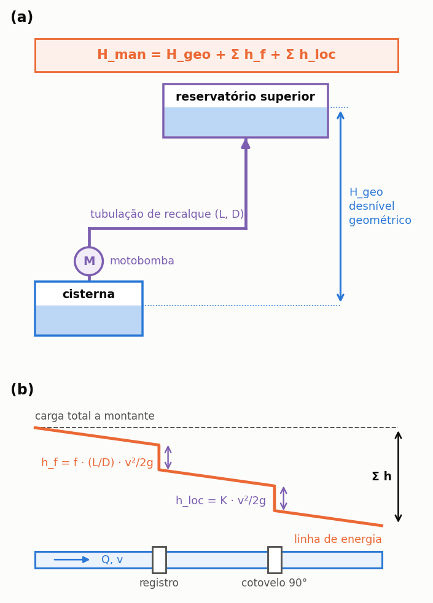

*Figura 14 — (a) Altura manométrica de um recalque predial: desnível geométrico entre as lâminas d'água da cisterna e do reservatório superior, somado às perdas de carga; (b) linha de energia ao longo de um trecho de tubulação, com a perda contínua por atrito (h_f) e as perdas localizadas em registro e cotovelo (h_loc).*

---

### 2.6.3. O rendimento do motor, quando não informado

Vale a Tabela 13 da ABNT NBR 17094-2:2016, linha IR1, motores de dois polos — que é o que são as motobombas residenciais, a 3.450 rpm (Figura 15):

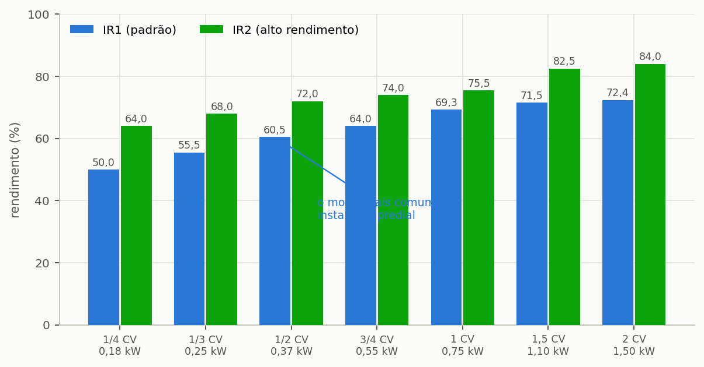

*Figura 15 — Rendimento mínimo de motores de indução monofásicos de dois polos, conforme a Tabela 13 da ABNT NBR 17094-2:2016. O programa adota a classe IR1 quando o projeto não informa o rendimento, por ser a de menor exigência e, portanto, a hipótese conservadora.*


Os dois valores que mais aparecem em instalação predial são o de meio CV, com
**60,5%** de rendimento na classe IR1, e o de um CV, com **69,3%**. A diferença entre
eles é de quase nove pontos percentuais, e ela se propaga inteira para o custeio de
energia, porque é o rendimento que separa a potência de eixo da potência efetivamente
puxada da rede.

Adota-se a **IR1** por ser o piso normativo e o que se encontra em motobomba de
prateleira. Quem tem motor de alto rendimento informa o valor marcado na placa.

Para potências fora da tabela, a norma manda adotar o maior dos dois rendimentos
vizinhos quando a potência estiver no ponto médio ou acima, e o menor quando estiver
abaixo.

---

### 2.6.4. Por que a cadeia completa importa

O consumo específico do caso de referência — meio cavalo, 12 m.c.a. de altura
manométrica, 82 m³ recalcados e 98 acionamentos por ano — é de 0,1080 kWh/m³.
==Ignorar o rendimento do motor, ou descontar o rendimento da bomba duas vezes,
altera esse número em dezenas de pontos percentuais,== e esses são precisamente os dois
enganos mais frequentes em planilhas de dimensionamento.

O primeiro engano consiste em tratar a potência de placa como potência consumida na
tomada; o segundo, em aplicar o rendimento hidráulico numa conta que já parte da vazão
efetivamente entregue, o que o contabiliza duas vezes. A cadeia apresentada nesta seção
é explícita justamente para tornar ambos visíveis.

---

### 2.6.5. O assistente de dimensionamento da motobomba

Quando a potência, a vazão e a altura manométrica da motobomba não são conhecidas, o botão *Assistente de Dimensionamento de Motobomba*, na etapa **4. Reservatório & Custos** e no diálogo econômico, estima os três valores e seleciona um modelo comercial. O assistente segue a sequência usual de dimensionamento de um recalque predial:

1. **Vazão de recalque.** `Q = V_sup ÷ t_ench`, com o volume do reservatório superior e o tempo de enchimento desejado, de 45 minutos por padrão.
2. **Diâmetro econômico.** Pela fórmula de Forchheimer, `D = 1,3 · (t_op ÷ 24)^0,25 · √Q`, com `D` em metros, `Q` em m³/s e `t_op` o tempo diário de funcionamento, de 2 h por padrão. O diâmetro adotado é o menor tubo comercial de PVC soldável cujo diâmetro interno atende ao valor calculado, e nunca inferior ao bocal da motobomba selecionada; a sucção recebe uma bitola comercial acima do recalque.
3. **Velocidade.** `v = Q ÷ (π · D_i² ÷ 4)`, destacada quando fica fora do intervalo de 0,6 m/s a 2,5 m/s.
4. **Perda de carga.** Pela fórmula de Hazen-Williams, `J = 10,643 · Q^1,852 · C^−1,852 · D_i^−4,87`, com `C = 140` para PVC, multiplicada pelo comprimento da tubulação e acrescida de 30% para as perdas localizadas.
5. **Altura manométrica e potência.** `H_man = H_geo + h_f` e `P = ρ · g · Q · H_man ÷ η`, com rendimento de conjunto de 55% por padrão.
6. **Seleção.** O primeiro modelo do catálogo interno cuja vazão, altura máxima e potência atendem ao ponto de operação, com a curva da bomba traçada contra o ponto calculado.

A altura manométrica e a perda de carga calculadas retornam ao projeto e passam a alimentar o cálculo de energia desta seção, no lugar do valor de recurso.

---

### 2.6.6. Os valores de recurso

Usados quando o projeto não declara:

<!-- tabela: **Tabela 48** — Valores de recurso adotados quando o projeto não os declara -->
| Parâmetro | Valor | Origem |
| :--- | ---: | :--- |
| altura manométrica | 12 m.c.a. | casa de dois pavimentos com cisterna enterrada: ~8 m de desnível geométrico e ~30% de perda de carga dão de 10 a 12 m; adota-se o extremo conservador |
| rendimento da bomba | 55% | motobombas residenciais de meio a um CV ficam entre 40% e 60% no ponto de operação |
| tempo de partida | 108 s | ver a ressalva abaixo |

> **Aprofundamento: a altura manométrica é o parâmetro que mais pesa.** Quem conhece o
> desnível do projeto deve informá-lo. Dobrar a altura dobra a energia.

> **Aprofundamento: o tempo de partida de 108 s.** Ele representa o tempo de escorva
> de uma bomba autoaspirante cuja linha de sucção drenou. Numa instalação com válvula
> de pé em ordem, a linha permanece escorvada e as partidas seguintes são imediatas.
> No caso de referência, as partidas respondem por 19% do consumo anual; com um
> transitório de 3 s, responderiam por 0,5%. O valor é conservador e está registrado
> como pendência aberta do programa.

---

### 2.6.7. A pressurização direta: a energia é tempo ligado

Tudo o que se disse até aqui vale para o recalque, em que a bomba enche a caixa
superior de uma vez, na vazão dela, e desliga. O pressurizador trabalha de outro
modo. Ele liga a cada descarga e fica ligado enquanto a caixa acoplada enche, e quem
decide a vazão é a boia da caixa, e não a bomba. Uma bomba maior não enche a caixa mais
depressa: fica o mesmo tempo ligada, puxando mais potência.

Por isso o programa não calcula a energia do pressurizador pela energia específica
`ρ·g·H/(η_b·η_m)`, que pressupõe a bomba no ponto de melhor rendimento. Calcula pelo
tempo ligado:

```equacao:energia_pressurizador:37
E = (P ÷ η_m) · [V ÷ min(Q_b(H), Q_p) + N · t_r]
```

<!-- tabela: **Tabela 49** — Variáveis da Equação 37 -->
| Símbolo | Significado | Unidade |
| :--- | :--- | :--- |
| `E` | energia anual do pressurizador | kWh/ano |
| `P` | potência de placa, no eixo | kW |
| `η_m` | rendimento do motor, da Tabela 13 da ABNT NBR 17094-2 | adimensional |
| `V` | volume pluvial consumido | m³/ano |
| `Q_b(H)` | vazão da curva do modelo na pressão de trabalho `H` | m³/h |
| `Q_p` | vazão do ponto de uso | m³/h |
| `N` | acionamentos por ano: moradores × 5,05 descargas × 365,25 | 1/ano |
| `t_r` | retardo de desligamento do controle eletrônico | h |

É a forma do «método simples» que Ward, Butler e Memon (2012) descrevem, potência vezes
duração de operação, com duas correções: a vazão efetiva é a menor entre a da bomba e
a do ponto, e o retardo dos controles eletrônicos entra a cada partida. A potência de
placa é a do ponto nominal, e em vazão baixa o motor puxa um pouco menos; a estimativa
tende a superestimar a energia, mas ordena os modelos entre si.

A vazão do ponto padrão é de 0,15 L/s, isto é, 9 L/min: a vazão de projeto da bacia com
caixa de descarga na Tabela A.1 da ABNT NBR 5626:1998. A edição de 2020 retirou a tabela
e passou ao projeto a tarefa de explicitar as vazões nos pontos de utilização (item
6.7.1); quem tiver o dado do fabricante da bacia deve usá-lo.

#### 2.6.7.1. O catálogo

A etapa **4. Reservatório & Custos** traz seis pressurizadores residenciais de cinco
fabricantes, cada um com a curva vazão × pressão do manual, guardado nos documentos
consultados: Komeco TP 820T e TP 825T, Cardal Potenza, Jacuzzi AcquaHouse, com curva
ensaiada no Laboratório de Etiquetagem de Bombas da UNIFEI, Syllent Impulse Press e Rowa
Max Press 20E. Para outro modelo, a opção «Personalizado» pede a potência de placa, a
vazão lida na curva do fabricante na pressão de trabalho e o retardo de desligamento.

A tabela aplica o catálogo à pressurização direta do tutorial: a cisterna de 4.000 L sem
caixa superior, quatro moradores e a vazão da bacia de 9 L/min.

<!-- tabela: **Tabela 50** — Energia anual de seis pressurizadores de catálogo na pressurização direta do tutorial, com a vazão da bacia sanitária limitando a da bomba -->
| Modelo | Controle | Vazão da curva a 18 m.c.a. | Horas por ano | kWh por ano | kWh/m³ | kWh por ano a 24 m.c.a. |
| :--- | :--- | ---: | ---: | ---: | ---: | ---: |
| Komeco TP 820T, 1/4 CV | pressostato | 13,3 L/min | 110 | 40,5 | 0,68 | 82,0 |
| Cardal Potenza, 1/3 CV | fluxostato | 18,8 L/min | 110 | 48,6 | 0,82 | não alcança |
| Komeco TP 825T, 1/2 CV | pressostato | 29,1 L/min | 110 | 66,9 | 1,13 | 66,9 |
| Jacuzzi AcquaHouse 5AQH1, 1/2 CV | pressostato | 27,4 L/min | 110 | 66,9 | 1,13 | 66,9 |
| Rowa Max Press 20E, 1/2 CV | eletrônico | 12,8 L/min | 110 | 66,9 | 1,13 | não alcança |
| Syllent Impulse Press, 1/2 CV | eletrônico | 7,0 L/min | 162 | 98,5 | 1,66 | não alcança |

A 18 m.c.a., cinco dos seis modelos entregam mais que os 9 L/min da bacia, e todos
ficam as mesmas 110 horas por ano ligados. O que os separa é a potência: o de 1/4 CV
gasta 40 kWh, os de 1/2 CV, 67. O sexto, com pouco mais de 7 L/min a 18 m.c.a., opera
quase no fim da curva, fica mais tempo ligado e ainda soma dez segundos de retardo a
cada uma das 7.373 partidas do ano.

A 24 m.c.a. a ordem se inverte. O modelo de 1/4 CV chega a 4,4 L/min, e o tempo ligado
dobra; três modelos nem alcançam a pressão. O melhor passa a ser um de 1/2 CV. ==A
regra que a tabela ensina é escolher o menor modelo que entrega a vazão do ponto na
pressão de trabalho,== e é o que o item 6.5.11.12 da ABNT NBR 5626:2020 pede: que o
consumo de energia das bombas de recalque e de pressurização seja minimizado pela escolha
da bomba, entre as alternativas consideradas. A tela aponta esse modelo e mostra a
energia de todos os outros ao lado.

> **Duas bombas, e não uma.** O item 6.5.11.2 da mesma norma exige no mínimo duas bombas,
> de funcionamento independente, nos sistemas de recalque e de pressurização. O tutorial
> segue a norma, e o investimento conta a principal e a reserva.

---

### 2.6.8. Por que a energia do recalque é pequena, e a do pressurizador não

Elevar um metro cúbico a doze metros custa cerca de 0,033 kWh de energia hidráulica.
Com os dois rendimentos, chega a 0,11 kWh por metro cúbico entregue, e o recalque do
tutorial, com as partidas, a 0,13 kWh/m³.

A pressurização direta do mesmo projeto gasta de 0,68 a 1,66 kWh/m³, conforme o modelo:
cinco a treze vezes mais. Os números reproduzem uma diferença que a literatura já
tinha medido. Na revisão de Vieira et al. (2014), a mediana dos estudos teóricos foi de
0,20 kWh/m³, e a dos empíricos, de 1,40 kWh/m³, porque os primeiros ignoravam as partidas,
o modo de espera e o rendimento real de motor e bomba. A mesma revisão relata 1,70 kWh/m³
para abastecer uma caixa acoplada diretamente com uma bomba de 450 W, e 1,52 kWh/m³ em
média em dezenove residências australianas com alimentação direta.

O recalque do tutorial fica perto da mediana teórica porque trabalha como os estudos
teóricos supõem: poucas partidas por ano, na vazão da própria bomba. O pressurizador fica
na faixa empírica porque trabalha como as casas medidas: uma partida por uso, na vazão
do ponto.

Mesmo assim, a energia é pequena diante da economia na fatura. Os 40 kWh do menor
pressurizador custam menos de trinta reais por ano na tarifa do tutorial. O argumento de
que «bombear gasta mais do que economiza» não se sustenta em edificação de pequeno porte,
mas a escolha do arranjo e do modelo pode multiplicar por dez a parcela de energia, e é
ela que pesa no carbono da seção 2.8.

Em prédio alto, com trinta metros de recalque, a conta muda, e vale refazê-la.

---

## 2.7. Análise econômica e os regimes tarifários

> Esta seção formaliza o fluxo de caixa e detalha os seis regimes
> tarifários — o dado que mais decide a viabilidade de um sistema pluvial no Brasil.

---

### 2.7.1. A economia é a diferença entre duas faturas

O programa não calcula a economia multiplicando o volume poupado por uma tarifa média,
e a distinção não é de refinamento: é de ordem de grandeza. Para cada mês da projeção
ele monta duas faturas completas, uma com o consumo que a edificação teria sem o sistema
pluvial e outra com o consumo de água potável efetivamente comprado, e toma a diferença
entre elas.

```equacao:economia_mensal:38
E_mês = F(V_tot) − F(V_pot)
```

<!-- tabela: **Tabela 51** — Variáveis da Equação 38 -->
| Símbolo | Significado | Unidade |
| :--- | :--- | :--- |
| `E_mês` | economia obtida no mês | R$ |
| `F(·)` | função que calcula a fatura de água e esgoto para um volume | R$ |
| `V_tot` | volume mensal que a edificação consumiria sem o sistema pluvial | m³ |
| `V_pot` | volume mensal de água potável efetivamente comprado da rede | m³ |

A razão de proceder assim está na progressividade das estruturas tarifárias brasileiras.
==O metro cúbico que se deixa de consumir é sempre o último da fatura, que é o mais
caro, e nunca o médio.== Num município cuja primeira faixa custa R$ 3,08/m³ e cuja
segunda faixa custa R$ 14,31/m³, calcular a economia pela tarifa média a subestima em
mais da metade, e o erro cresce com o consumo da edificação.

---

### 2.7.2. A fatura de água e esgoto

A estrutura tarifária de cada município é representada no programa por uma sequência de
faixas, e cada faixa é uma quádrupla composta pelo volume mínimo, pelo volume máximo, por
um valor e por um código. O código é o elemento que dá sentido ao valor, porque
estruturas aparentemente semelhantes cobram de maneiras muito distintas.

Antes dos códigos, convém ver de que a fatura é feita. A fatura mensal de água e esgoto é a soma de parcelas com comportamentos distintos: uma parcela fixa, que não responde ao consumo; uma ou mais faixas de consumo, em que é cobrado o preço por volume que está alocado dentro de cada faixa de consumo; e o esgoto, que em boa parte do Brasil é um percentual do valor da água e portanto acompanha tudo o que ele faz. A
economia de água atinge cada uma dessas parcelas de um jeito diferente, e é essa assimetria que a Figura 16 mostra.

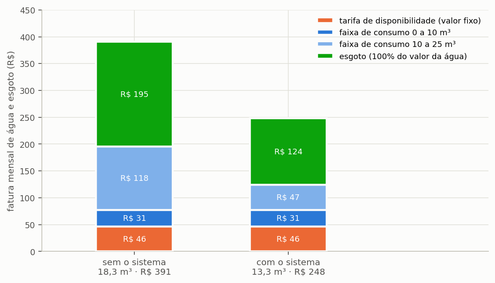

*Figura 16 — Fatura mensal de água e esgoto do projeto do tutorial, aberta em parcelas, sem e com o sistema. A tarifa de disponibilidade é idêntica nos dois casos; a redução ocorre nas faixas de consumo superiores, que têm o maior preço por metro cúbico, e se estende ao esgoto, cobrado como percentual do valor da água.*

O código de cada faixa define como o seu valor é aplicado (Figura 17). Nas faixas de consumo, de código 1 ou 0, é cobrado o preço por volume que está alocado dentro de cada faixa de consumo; na tarifa de disponibilidade, de código −1, o valor fixo é somado à parcela de consumo; na franquia retroativa, de código −2, o consumo acima da franquia faz todo o volume ser faturado desde 0 m³; no piso de pagamento, de código −3, o valor declarado é o limite inferior da fatura; e na fórmula exponencial, o código 2 guarda o preço-base e as linhas de código 3 guardam a tabela de expoentes.

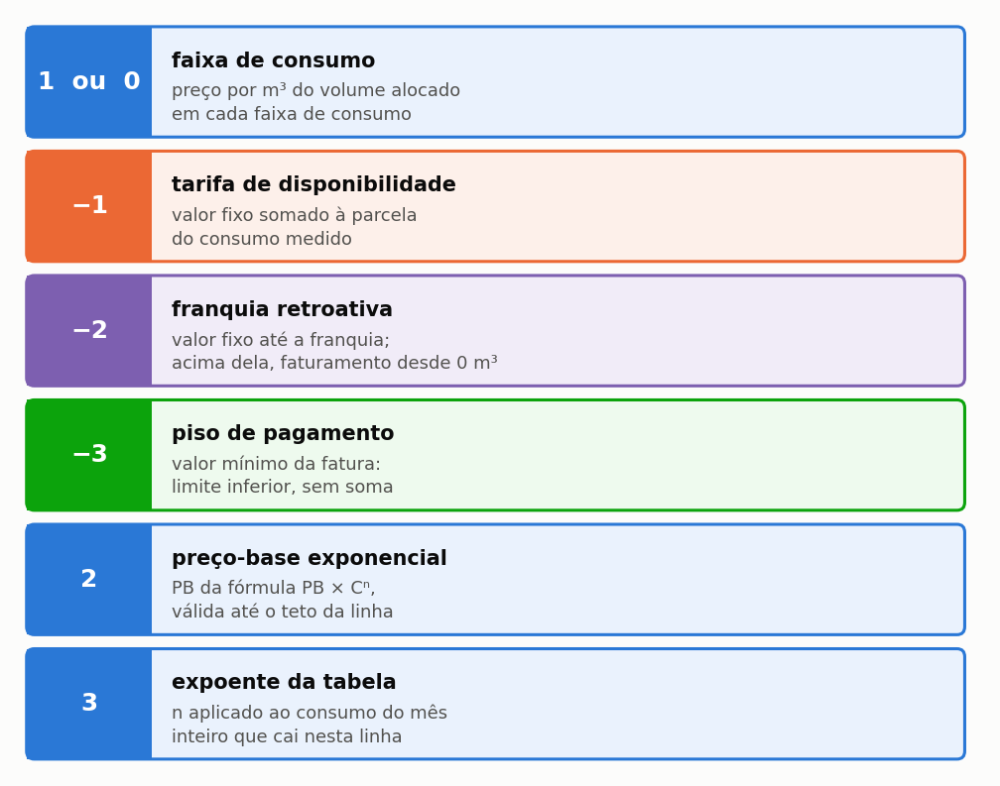

*Figura 17 — Os seis códigos de faixa tarifária e o efeito de cada um sobre a fatura mensal de água e esgoto. Duas estruturas com os mesmos valores numéricos resultam em faturas distintas conforme o código de cada faixa.*


Dois desses regimes são frequentemente confundidos entre si, embora produzam efeitos
opostos sobre a viabilidade de um sistema pluvial. Vale examiná-los com números.

- **Disponibilidade soma.** Parcela de consumo de R$ 55 mais R$ 46 de disponibilidade dá fatura de R$ 101,
  e economizar R$ 15 de consumo deixa a fatura em R$ 86.
- **Piso limita por baixo.** Com piso de R$ 40 e consumo tarifado de R$ 55,
  economizar até R$ 15 **não reduz nada**.

A diferença entre os dois regimes decide se cada metro cúbico economizado gera desconto
desde o primeiro ou se a economia só começa a valer depois de vencido um patamar, e um
estudo de viabilidade que os confunda chega a conclusões invertidas. É por essa razão que
o programa codifica o regime de forma explícita, em vez de tratá-lo como detalhe da
tabela.

#### 2.7.2.1. A fórmula exponencial

Nos municípios da CORSAN a parcela de água não é soma de faixas, e sim uma potência do
consumo do mês:

```equacao:exponencial:39
T_agua = PB × C^n + SB
```

<!-- tabela: **Tabela 52** — Variáveis da Equação 39 -->
| Símbolo | Significado | Unidade |
| :--- | :--- | :--- |
| `T_agua` | parcela de água da fatura | R$ |
| `PB` | preço-base do município | R$/m³ |
| `C` | consumo do mês por economia | m³ |
| `n` | expoente da Tabela de Exponenciais para o consumo `C`: 1,00 até 20 m³, 1,13 entre 101 e 150 m³ | adimensional |
| `SB` | serviço básico | R$ |

O expoente é lido pelo consumo **total** do mês e aplicado a todo o volume. Na categoria
residencial não há teto; só a industrial passa, acima de 1.000 m³, a cobrar o excedente
por preços próprios, e o programa representa esse teto com uma faixa comum a partir dele.
A economia mensal é a
diferença entre as duas contas, `PB × (C₁ⁿ¹ − C₂ⁿ²)`, cada consumo com o seu expoente, e não o produto de um preço
unitário pelo volume poupado; com `n` acima de 1, o metro cúbico poupado vale mais que o
preço-base.

Como o hidrômetro fatura metros cúbicos inteiros e a fração passa para a leitura seguinte, o consumo médio fracionário de uma simulação é cobrado pela reta entre as contas dos dois inteiros vizinhos: 20,5 m³ ficam entre 20 m³ (n = 1,00) e 21 m³ (n = 1,01). Sem essa regra, o expoente saltaria dentro do metro cúbico, e o valor do m³ poupado oscilaria com a casa decimal do consumo médio — em Alegrete, de R$ 25,42 a R$ 13,55 entre 30 e 30,5 m³ de consumo.

#### 2.7.2.2. Micromedição

Em edificações multifamiliares com medição individualizada, o consumo é avaliado no
patamar de uma única unidade habitacional e o resultado é multiplicado pelo número de
economias. O tratamento importa por causa da progressividade: um prédio de vinte
apartamentos tratado como consumidor único cairia inteiro na faixa mais cara da tabela, e
a economia resultante sairia grosseiramente superestimada, porque cada metro cúbico
poupado seria valorado a uma tarifa que nenhuma das vinte unidades efetivamente paga.

#### 2.7.2.3. O esgoto

```equacao:esgoto:40
T_esg = T_agua × s
```

<!-- tabela: **Tabela 53** — Variáveis da Equação 40 -->
| Símbolo | Significado | Unidade |
| :--- | :--- | :--- |
| `T_esg` | parcela de esgoto da fatura | R$ |
| `T_agua` | parcela de água da fatura, já calculada pelas faixas progressivas | R$ |
| `s` | percentual de esgoto praticado pela concessionária | adimensional |

O percentual de esgoto incide sobre a parcela de água da fatura, e não sobre a fatura
total, e a confusão entre os dois denominadores dobra ou divide pela metade a parcela
calculada. Cem por cento, que é o valor praticado por boa parte das concessionárias
brasileiras, significa que a parcela de esgoto iguala a de água, e portanto que o esgoto
responde por metade da fatura total.

Há um terceiro modo, o da CORSAN: o esgoto cobrado **por metro cúbico consumido**,
`T_esg = C × p_esg`, sem o serviço básico e sem o expoente da água. Aplicar ali o
percentual sobre a parcela de água cobraria esgoto sobre o serviço básico e sobre a
potência, e a conta sairia maior do que a concessionária fatura.

---

### 2.7.3. Os seis regimes na base

O catálogo distribui os seus 652 municípios de maneira bastante desigual entre os seis
regimes. A franquia no mínimo responde sozinha por **371** deles, mais da metade;
seguem-se 122 com tarifa de disponibilidade, 100 sem mínimo algum, 36 na fórmula exponencial (CORSAN, COMUSA e DMAE de Porto Alegre) e 23 na franquia retroativa — a conta mínima de 15 m³ da CEDAE e das concessionárias que herdaram a sua estrutura no Rio de Janeiro —, ao passo que o piso de pagamento não aparece em nenhum (Figura 18). A tabela a seguir mostra como cada regime é codificado e aplicado no cálculo da fatura.

<!-- tabela: **Tabela 54** — Codificação e aplicação de cada regime de valor mínimo no cálculo da fatura -->
| Regime | Codificação das faixas | Cálculo da parcela de água | Efeito da redução do consumo |
| :--- | :--- | :--- | :--- |
| sem valor mínimo | apenas faixas de consumo (código 1 ou 0) | soma, em cada faixa, do preço por m³ aplicado ao volume alocado dentro dela | toda redução de consumo reduz a fatura |
| tarifa de disponibilidade | valor fixo (−1) e faixas de consumo a partir de 0 m³, com preço positivo | valor fixo somado à parcela de consumo, faturada desde o primeiro m³ | toda redução de consumo reduz a fatura; o valor fixo permanece |
| franquia no mínimo | valor fixo (−1) e primeira faixa de 0 a N m³ a R$ 0,00/m³ | valor fixo que inclui os N m³ da franquia; acima deles, faixas de consumo | redução abaixo de N m³ não altera a fatura |
| franquia retroativa | franquia (−2) de 0 a N m³ com valor fixo, e faixas de consumo | até N m³, valor fixo; acima, todo o volume faturado desde 0 m³ pelas faixas | reduzir o consumo para até N m³ substitui a parcela de consumo pelo valor fixo |
| piso de pagamento | piso (−3) e faixas de consumo | parcela de consumo pelas faixas, limitada inferiormente ao valor do piso | redução que leva a parcela abaixo do piso não reduz a fatura |
| fórmula exponencial | serviço básico (−1), preço-base (2) e tabela de expoentes (3) cobrindo todo o consumo | serviço básico somado a `PB × Cⁿ`, com `n` pelo consumo do mês inteiro | toda redução de consumo reduz a fatura, pela diferença entre as duas potências |

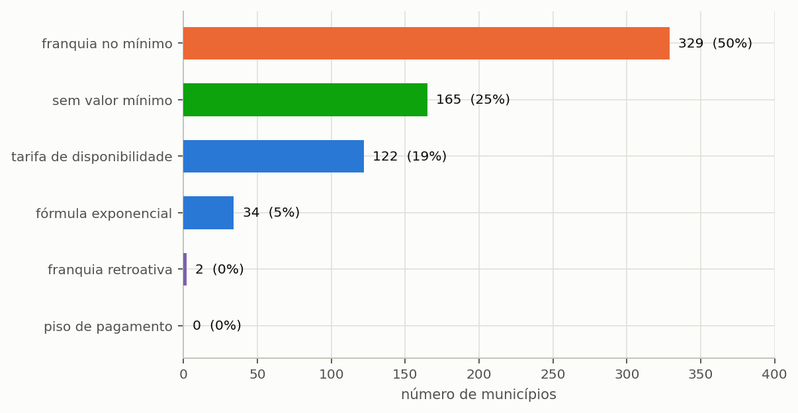

*Figura 18 — Distribuição dos 652 municípios do catálogo pelos seis regimes tarifários. Metade deles pratica franquia no mínimo, regime em que a redução do consumo abaixo da franquia não reduz a fatura.*


O piso de pagamento está implementado no motor de cálculo e nenhum município da base foi
até agora classificado nele, situação que se registra aqui por transparência: a ausência
de ocorrências não significa que o regime não exista no país, e sim que o levantamento
não o encontrou entre os 652 municípios catalogados.

A seção 3.3 (volume Guias de uso) apresenta o exemplo numérico que compara Floriano e Florianópolis, do
qual decorre a lição prática mais importante desta seção: em regime de franquia,
economizar água abaixo do volume de franquia não produz desconto algum na fatura.

---

### 2.7.4. O investimento

```equacao:capex:41
CAPEX = C_cist + C_sup + C_mo + C_tub + C_ace + ( C_bomba × n_b ) + CAPEX_inc
```

<!-- tabela: **Tabela 55** — Variáveis da Equação 41 -->
| Símbolo | Significado | Unidade |
| :--- | :--- | :--- |
| `CAPEX` | investimento inicial total do sistema | R$ |
| `C_cist` | custo do reservatório inferior | R$ |
| `C_sup` | custo do reservatório superior, quando houver | R$ |
| `C_mo` | custo de mão de obra de instalação: no projeto novo, 30% dos materiais, com piso de R$ 1.400 | R$ |
| `C_tub` | custo da tubulação: tubos, curvas e conexões do arranjo 3D | R$ |
| `C_ace` | custo dos acessórios: as peças do arranjo 3D, uma a uma, e os cabos de comando | R$ |
| `C_bomba` | custo unitário da motobomba | R$ |
| `n_b` | número de motobombas, incluindo a reserva quando houver | unidade |
| `CAPEX_inc` | investimento incremental da linha de tratamento, incluído o descarte inicial quando dimensionado | R$ |

No projeto novo, `C_tub` e `C_ace` não são verbas: saem do **quantitativo do arranjo 3D**
(seção 3.9 (volume Guias de uso)). Cada metro de tubo, cada curva, cada conexão de extremidade, cada peça —
registros, válvulas de retenção e de pé, solenoide, hidrômetro, chaves de nível, quadro de
comando, freio d'água, sucção flutuante, respiros, ladrão, separação atmosférica, ponto de
consumo — e cada metro de cabo de comando tem preço, e a soma é o que entra aqui. Cisterna,
caixa superior e motobomba têm termo próprio; o filtro de entrada e o descarte entram pela
linha de tratamento quando ela os dimensiona. O projetista pode digitar outros valores na
etapa econômica; o projeto passa então a usar os digitados, e a planilha de auditoria
registra a troca. Projetos gravados antes desta regra mantêm os custos que declaram.

A mão de obra do projeto novo também é refeita a cada cálculo: 30% da soma de cisterna,
caixa superior, motobombas, tubulação e acessórios, com piso de R$ 1.400 (chave
`labor_percentage` de `costs_database.json`). Assim, ela cresce com o reservatório: na
varredura de volumes, cada volume tem a sua cisterna, o seu arranjo usual e a sua mão de
obra. Antes, a mão de obra era fixada uma única vez, sobre verbas genéricas de tubulação
e acessórios, e valia igual para todos os volumes. Um valor digitado na etapa econômica
prevalece, como nas outras rubricas.

O último termo segue a regra incremental da seção 2.5 e inclui, quando o dimensionamento físico do descarte está habilitado, o reservatório de descarte inicial e o separador de folhas; o custeio anual desse subsistema entra no custeio da linha de tratamento.

Os preços de reservatório provêm da base de custos do programa, com procedência
declarada para cada material. Quando o volume pedido não consta da tabela, o programa
interpola linearmente entre os pontos vizinhos; quando o volume excede o maior valor
tabelado, a extrapolação só é realizada se a regressão sobre os pontos conhecidos
apresentar coeficiente de determinação acima de 0,90, e o programa adverte quando esse
critério não é satisfeito, em vez de extrapolar em silêncio.

---

A composição do investimento surpreende quem chega ao assunto esperando que o
reservatório domine a conta. Em volumes residenciais pequenos ele pesa menos que a mão de obra e a tubulação, e só passa a dominar quando o volume cresce o bastante para que o preço do tanque supere a
soma fixa da instalação. A consequência de projeto é direta: dobrar o reservatório não
dobra o investimento, e essa não linearidade é parte do motivo de a curva de valor presente líquido ter máximo interior (Figura 19).

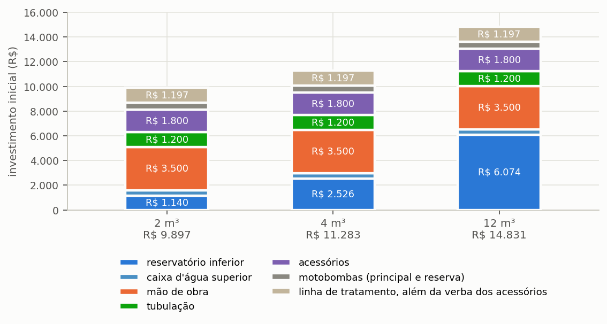

*Figura 19 — Investimento inicial aberto nas sete rubricas que o programa soma, para três volumes de reservatório de polietileno. Com os custos que o tutorial declara, só o reservatório inferior cresce com o volume; caixa superior, mão de obra, tubulação, acessórios, motobombas e linha de tratamento não mudam. A linha de tratamento entra pelo que acrescenta além da verba de filtração já embutida nos acessórios, para não contar o filtro duas vezes. Num projeto novo, tubulação e acessórios saem do arranjo 3D, que não tem essa verba, e a mão de obra acompanha os materiais de cada volume.*

---

### 2.7.5. O custeio anual

<!-- tabela: **Tabela 56** — Parcelas do custeio anual e a origem de cada uma -->
| Parcela | Origem |
| :--- | :--- |
| energia de bombeamento | seção 2.6, com a bandeira tarifária aplicada |
| cloração | massa de **produto**, não de cloro ativo |
| ETAP | custeio incremental, sem contar a cloração duas vezes |
| descarte inicial | manutenção anual do reservatório de descarte e do separador de folhas, quando dimensionados |
| custos operacionais declarados | lista livre do usuário |

A bandeira tarifária ajusta a tarifa de energia conforme a condição de operação do
sistema elétrico nacional, e o programa aceita as quatro modalidades vigentes: amarela,
vermelha patamar 1, vermelha patamar 2 e branca, esta última com desconto nos períodos
fora de ponta.

---

### 2.7.6. A projeção mês a mês

A projeção é feita mês a mês ao longo de todo o período de análise, e aplica a cada parcela os fatores de inflação e de reajuste definidos a seguir.

O resultado dessa projeção é uma série mensal de saldos, e o que interessa nela é
o instante em que o saldo acumulado deixa de ser negativo. Esse instante é o tempo de retorno. A Figura 20 agrega a projeção por ano: em colunas, a economia na fatura de água e esgoto e os custos, com o investimento no ano zero; em linha, o saldo acumulado descontado, que cruza o zero no tempo de retorno.

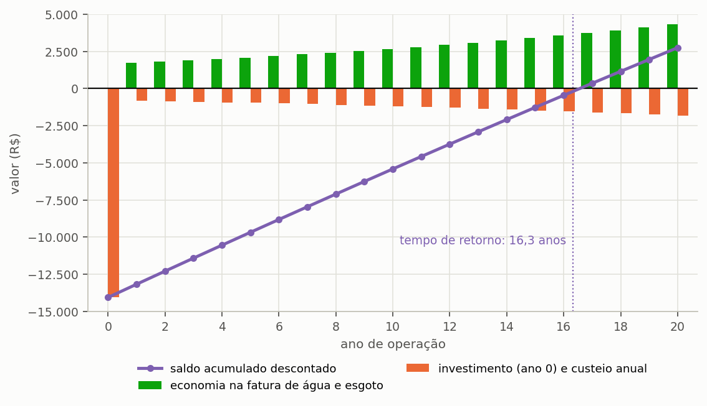

*Figura 20 — Fluxo de caixa do projeto do tutorial em vinte anos: economia anual na fatura de água e esgoto e custos anuais, com o investimento inicial no ano zero, em valores nominais; e saldo acumulado descontado à taxa mínima de atratividade, que cruza o zero no tempo de retorno de 16,3 anos. Cisterna de concreto de 4.000 L com caixa superior, como na seção 4.7 (volume Tutorial).*

**A inflação incide só sobre o custeio:**

```equacao:inflacao:42
f_inf = ( 1 + i )^( m − 1 )
```

<!-- tabela: **Tabela 57** — Variáveis da Equação 42 -->
| Símbolo | Significado | Unidade |
| :--- | :--- | :--- |
| `f_inf` | fator acumulado de inflação até o mês `m` | adimensional |
| `i` | taxa de inflação mensal declarada, como fração: 0,35% ao mês entra como 0,0035 | adimensional |
| `m` | mês do fluxo de caixa, contado a partir de 1 | mês |

**Os reajustes tarifários incidem só sobre a fatura, em degraus:**

```equacao:degraus:43
k = ⌊ ( m − 1 ) ÷ I ⌋
```

```equacao:reajuste:44
f_j = ( 1 + r_j )^k
```

<!-- tabela: **Tabela 58** — Variáveis da Equação 44 -->
| Símbolo | Significado | Unidade |
| :--- | :--- | :--- |
| `k` | número de reajustes já aplicados até o mês `m` | adimensional |
| `m` | mês do fluxo de caixa, contado a partir de 1 | mês |
| `I` | intervalo entre reajustes, tipicamente 12 | mês |
| `⌊ ⌋` | parte inteira da divisão | — |
| `f_j` | fator acumulado de reajuste da parcela `j` | adimensional |
| `r_j` | taxa de reajuste da parcela `j`, que pode ser água, esgoto ou energia | adimensional |

A Equação 44 é aplicada separadamente a cada uma das três parcelas, com
taxas próprias, e é dessa separação que trata a observação seguinte.

> **Água e esgoto são reajustados por índices separados**, e não por um índice único
> sobre a fatura agregada. As duas parcelas são objeto de atos distintos da
> concessionária, e tratá-las juntas indexa metade da conta pelo índice errado.

O incentivo de IPTU verde, quando o município o oferece e o usuário o habilita, entra no
fluxo de caixa como economia anual dividida por doze, o que o distribui uniformemente
pelos meses do ano. A simplificação é deliberada: o desconto é concedido de uma vez, no
lançamento anual do tributo, mas distribuí-lo evita que o fluxo de caixa apresente um
degrau que nada tem a ver com o desempenho do sistema.

---

### 2.7.7. Os indicadores

**Valor presente líquido:**

```equacao:vpl:45
VPL = − CAPEX + Σ [ FC_m ÷ ( 1 + TMA )^m ]
```

<!-- tabela: **Tabela 59** — Variáveis da Equação 45 -->
| Símbolo | Significado | Unidade |
| :--- | :--- | :--- |
| `VPL` | valor presente líquido do investimento | R$ |
| `CAPEX` | investimento inicial total, da Equação 41 | R$ |
| `FC_m` | fluxo de caixa líquido do mês `m` | R$ |
| `TMA` | taxa mínima de atratividade mensal, como fração: 0,5% ao mês entra como 0,005 | adimensional |
| `m` | mês do fluxo de caixa, de 1 até o fim do período de análise | mês |

**Taxa interna de retorno:** a taxa que zera o VPL. Quando não há raiz real — o que
acontece quando o fluxo nunca se torna positivo — o programa devolve nulo, em vez de
um número inventado.

**Payback descontado:** o primeiro mês em que o acumulado descontado cruza zero.

---

### 2.7.8. As premissas frágeis

Duas merecem sensibilidade, e a seção 3.7 (volume Guias de uso) mostra como.

**O reajuste tarifário.** Cinco por cento ao ano por vinte anos multiplica a tarifa por 2,65; três por cento, por 1,81; sete por cento, por 3,87. A economia dos últimos anos cresce na mesma proporção, e é por isso que o reajuste está entre as premissas que mais movem o valor presente líquido, como mostra o tornado da seção 3.7 (volume Guias de uso); é também uma das mais incertas.

**A vida útil.** Vinte anos é a adoção padrão. Cisterna de concreto dura mais;
componentes de polietileno expostos ao sol duram menos. A vida útil entra tanto no
período de análise quanto no payback de carbono da seção 2.8.

---

## 2.8. Avaliação de ciclo de vida

> Esta seção traz as sete etapas do inventário, a fronteira adotada, e declara o
> que é medido e o que é premissa de triagem.

Avaliação de ciclo de vida é o método que contabiliza os impactos ambientais de um
produto ao longo de toda a sua existência, da extração das matérias-primas ao descarte
final. Aplicada a um sistema de aproveitamento pluvial, ela responde se o carbono emitido
para fabricar o reservatório, a tubulação e a motobomba compensa o carbono que se deixa
de emitir ao não consumir água da concessionária.

==A avaliação do Triton é de triagem, e não um inventário completo.== A distinção é
importante e a norma a reconhece: uma avaliação de triagem ordena alternativas e
identifica o que domina o resultado, ao passo que um inventário conforme a ISO 14040
documenta cada fluxo elementar com procedência rastreável e submete-se a revisão crítica
externa. O primeiro serve para decidir entre polietileno e concreto; o segundo, para
declarar publicamente um desempenho ambiental.

---

### 2.8.1. As quatro fases da norma, e onde o programa se situa

As normas ISO 14040 e ISO 14044, publicadas no Brasil como ABNT NBR ISO 14040 e ABNT NBR
ISO 14044, organizam toda avaliação de ciclo de vida em quatro fases que se retroalimentam.
Vale percorrê-las, porque cada uma corresponde a uma decisão que o programa já tomou por
você, e que um estudo publicado precisa declarar.

**1. Objetivo e escopo.** Define para que serve o estudo, a **unidade funcional** e a
fronteira do sistema. A unidade funcional é a quantidade de serviço que se compara, e é
ela que torna comparáveis alternativas diferentes. No programa, a unidade implícita é o
**sistema de aproveitamento de um projeto ao longo da vida útil adotada**, e a
comparação se faz contra o fornecimento, pela concessionária, do mesmo volume de água.
Quem quiser comparar com a literatura pode convertê-la para a unidade mais usada, o
metro cúbico de água entregue, dividindo o saldo pelo volume da vida útil, como faz a
Equação 51.

**2. Inventário.** Levanta os fluxos de entrada e saída de cada processo: massas de
material, energia, insumos. No programa, o inventário são as massas dos componentes, a
energia do recalque, a massa de produto clorado e o volume de água substituído.

**3. Avaliação de impacto.** Converte os fluxos em indicadores de categoria por fatores
de caracterização. O programa avalia **uma** categoria, a mudança climática, em quilos
de dióxido de carbono equivalente, com os fatores de emissão do apêndice C.

**4. Interpretação.** Identifica o que domina o resultado, testa a sensibilidade às
premissas e tira conclusões dentro dos limites do escopo. É o que as seções 4.8 (volume Tutorial) e
3.7 (volume Guias de uso) fazem com o material do reservatório e com as demais premissas.

---

### 2.8.2. Os módulos da construção

Para edificações, a norma europeia EN 15978 subdivide o ciclo de vida em módulos, e a
mesma nomenclatura é usada nas declarações ambientais de produto conforme a EN 15804.
Declarar quais módulos o estudo cobre é a forma mais curta e precisa de declarar a
fronteira, e é o que um avaliador espera encontrar.

<!-- tabela: **Tabela 60** — Módulos do ciclo de vida da EN 15978 e o que a avaliação do programa cobre em cada um -->
| Módulo | Etapa | Coberto pelo programa |
| :--- | :--- | :--- |
| A1 a A3 | produto: matéria-prima, transporte até a fábrica, fabricação | sim, para reservatórios, tubulação, motobombas, descarte inicial e todas as peças, conexões e cabos do arranjo 3D |
| A4 e A5 | construção: transporte até a obra e instalação | não; a escavação da cisterna enterrada fica de fora |
| B1 a B5 | uso, manutenção, reparo, substituição e reforma | não; trocas de bomba e de componentes não entram |
| B6 | energia operacional | sim, a energia de bombeamento |
| B7 | água operacional | sim, na forma do crédito da água potável evitada e dos insumos de tratamento |
| C1 a C4 | fim de vida: demolição, transporte, tratamento e disposição | não |
| D | benefícios e cargas além da fronteira, como a reciclagem | não |

A leitura da tabela é que o programa faz uma avaliação **do berço ao portão, mais a
operação**. É a fronteira mais comum nos estudos de aproveitamento pluvial em edificações,
mas não é a única, e comparar o saldo do programa com o de um estudo que inclui fim de
vida ou substituições exige ajustar as fronteiras antes de comparar os números.

---

### 2.8.3. As sete etapas

O inventário é organizado em sete etapas, agrupadas pela natureza da emissão (Figura 21). O saldo de carbono é a soma das emissões das seis primeiras menos o crédito da sétima, único termo com sinal negativo, e é esse crédito que decide se o sistema compensa o carbono incorporado na sua construção.


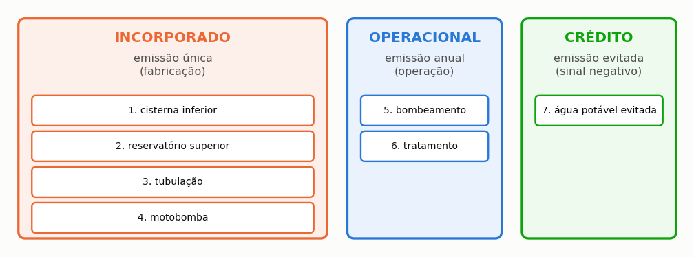

*Figura 21 — As sete etapas do inventário, agrupadas pela natureza da emissão. As quatro primeiras são incorporadas e ocorrem uma única vez; a quinta e a sexta são operacionais e se repetem todo ano; a sétima é o crédito, e é a única que entra com sinal negativo.*


As quatro primeiras etapas contabilizam o **carbono incorporado**, isto é, as emissões ocorridas na fabricação dos componentes, antes que o sistema entre em operação; quando o descarte físico está dimensionado, o reservatório de descarte e o separador de folhas somam-se a elas. As duas
seguintes contabilizam as emissões operacionais, que se repetem a cada ano de uso. E a
sétima é o **crédito**: a emissão que a concessionária deixou de gerar porque aquela água
não precisou ser captada, tratada e distribuída.

O volume zero sem consumo pluvial representa o cenário sem sistema e, por construção, não
recebe o impacto fixo de reservatório, tubulação ou motobomba — é a referência contra a
qual todas as demais alternativas se comparam.

---

### 2.8.4. O carbono incorporado

```equacao:emissao_componente:46
E_comp = m_comp × FE_mat
```

<!-- tabela: **Tabela 61** — Variáveis da Equação 46 -->
| Símbolo | Significado | Unidade |
| :--- | :--- | :--- |
| `E_comp` | emissão incorporada do componente | kg CO₂e |
| `m_comp` | massa do componente | kg |
| `FE_mat` | fator de emissão do material, do berço ao portão | kg CO₂e/kg |

A massa de cada componente decorre do seu dimensionamento. No caso do reservatório, ela
é obtida do volume útil multiplicado pela densidade de massa característica do material,
que varia por mais de uma ordem de grandeza entre o polietileno e o concreto armado — e é
dessa variação que decorre boa parte do resultado ambiental do projeto.

<!-- tabela: **Tabela 62** — Massa por metro cúbico útil de cada material de reservatório -->
| Material | Massa por m³ útil | O que isso significa em 5 m³ |
| :--- | ---: | ---: |
| polietileno | 22 kg/m³ | 110 kg |
| fibra de vidro | 15 kg/m³ | 75 kg |
| aço inoxidável | 38 kg/m³ | 190 kg |
| concreto armado | 1.200 kg/m³ | 6.000 kg |

> **Massa é carbono.** Concreto armado é o material mais massivo da lista por
> larga margem, e é por isso que ele domina o inventário quando escolhido. A
> seção 4.8 (volume Tutorial) mostra a consequência: com concreto, o sistema do tutorial
> não paga a dívida de carbono dentro da vida útil.

#### 2.8.4.1. O inventário do projeto do tutorial, item a item

A tabela a seguir abre o carbono do projeto fechado do tutorial: cisterna de 4.000 L em
polietileno, caixa superior de 1.000 L, duas motobombas, a tubulação padrão e o descarte
inicial.

<!-- tabela: **Tabela 63** — Inventário de carbono do projeto fechado do tutorial, item a item, com a parcela de cada componente no carbono incorporado; valores anuais negativos são crédito -->
| Item | Incorporado | Parcela do incorporado | Anual |
| :--- | ---: | ---: | ---: |
| cisterna de 4.000 L, polietileno | 141,9 kg | 43,3% | — |
| caixa superior de 1.000 L, polietileno | 35,5 kg | 10,8% | — |
| tubulação de PVC, DN 100 mm | 55,5 kg | 17,0% | — |
| tubulação de PVC, DN 32 mm | 3,5 kg | 1,1% | — |
| tubulação de PVC, DN 25 mm | 8,9 kg | 2,7% | — |
| duas motobombas de meio CV | 61,0 kg | 18,6% | — |
| descarte inicial: reservatório de 300 L e separador de folhas | 21,1 kg | 6,5% | — |
| energia do recalque | — | — | 0,66 kg/ano |
| cloração por pastilhas | — | — | 0,24 kg/ano |
| água potável evitada | — | — | -20,94 kg/ano |
| **total** | **327,4 kg** | **100%** | **-20,05 kg/ano** |

Três leituras importam. A primeira é que, mesmo em polietileno, a cisterna responde por
quase metade do carbono incorporado, e os reservatórios juntos por mais da metade. A
segunda é que a tubulação e as motobombas, que costumam ser esquecidas nas contas
simplificadas, somam quase dois quintos do total: um estudo que contasse só o reservatório
subestimaria o carbono incorporado em quase metade. A terceira está na coluna anual: o
crédito da água evitada é cerca de 23 vezes maior que as emissões anuais do recalque e da
cloração juntas, e é por isso que, com o material certo, a dívida de fabricação se paga.

---

### 2.8.5. A operação

**Bombeamento:**

```equacao:emissao_energia:47
E_ener = C_ano × FE_rede
```

<!-- tabela: **Tabela 64** — Variáveis da Equação 47 -->
| Símbolo | Significado | Unidade |
| :--- | :--- | :--- |
| `E_ener` | emissão anual da energia de bombeamento | kg CO₂e/ano |
| `C_ano` | consumo anual de energia da motobomba | kWh/ano |
| `FE_rede` | fator de emissão da rede elétrica, por região e ano | kg CO₂e/kWh |

O consumo anual de energia provém do cálculo apresentado na seção 2.6, conforme o
arranjo de abastecimento declarado, e o fator de emissão da rede elétrica provém de uma
das bases do programa. A base padrão, de 0,085 kg CO₂e/kWh, é uma escolha declarada entre
os valores publicados para a matriz brasileira: fica próxima do valor do SIDAC e do CaDI,
e acima da série anual do MCTI, que cobre só o dióxido de carbono da geração. As bases
alternativas incluem os valores de Vaz, Scolaro e Ghisi (2025) para a matriz de 2022,
0,104 kg CO₂e/kWh no indicador fóssil e 0,151 no indicador total, úteis para a análise
de sensibilidade. Na International Edition, o fator é digitado.

A energia é pequena no programa, mas convém saber que ela tende a ser maior na prática.
Vieira et al. (2014), numa revisão sobre a intensidade energética de sistemas de
aproveitamento pluvial, encontraram mediana de 0,20 kWh/m³ nos estudos teóricos e de
1,40 kWh/m³ nos estudos empíricos, e atribuíram parte da diferença a partidas, ao
consumo em espera e a rendimentos reais piores que os de catálogo. O tutorial, com
0,13 kWh/m³, está na faixa dos estudos teóricos. Ghimire et al. (2014, 2017) chegaram a
conclusão convergente pela avaliação de ciclo de vida: nos sistemas que analisaram, a
motobomba e a energia de bombeamento foram os componentes que mais pesaram na maior
parte das categorias de impacto, e a versão sem bomba superou o abastecimento público em
quase todas elas.

> **Quando a energia decide.** Com o fator da rede brasileira, multiplicar por dez a
> energia do tutorial, levando-a para perto da mediana empírica de Vieira et al., somaria
> cerca de 6 kg CO₂e por ano às emissões e reduziria o saldo anual de 20,1 para cerca de
> 14,1 kg CO₂e. O saldo anual continuaria positivo, mas o payback de carbono passaria de
> 16,3 para cerca de 23 anos, além dos vinte de vida útil adotados: o sistema terminaria a
> vida devendo carbono. Em matrizes mais fósseis que a brasileira, o efeito é ainda maior.

**Tratamento:** a linha da ETAP **substitui** o termo de cloração, em vez de somar a
ele. É a mesma regra da seção 2.5, e existe para o hipoclorito não ser contado duas
vezes.

---

### 2.8.6. O que a fronteira inclui, e o que ela deixa de fora

Antes de discutir qualquer fator de emissão, convém fixar o recorte. A avaliação do
programa é de **triagem**: serve para ordenar alternativas entre si, e não para
substituir um inventário de ciclo de vida conforme a ISO 14040. O que entra na conta e o
que fica de fora está declarado, porque um saldo ambiental sem fronteira declarada não se pode nem conferir nem contestar (Figura 22). A exclusão mais limitante é a das categorias de impacto além do aquecimento global: um sistema com bom desempenho de carbono pode ter desempenho desfavorável em outra categoria, e a avaliação não o registra.


*Figura 22 — Fronteira da avaliação ambiental do programa: (a) processos incluídos — carbono incorporado dos reservatórios, da tubulação e da motobomba, emissões operacionais de recalque e de insumos da ETAP, e crédito da água potável evitada; (b) processos excluídos — obra civil, manutenção e reposição, fim de vida e categorias de impacto além do aquecimento global.*

---

### 2.8.7. A fronteira: água entregue, não produzida

O fator de emissão da água potável é por metro cúbico **entregue na edificação**, e
não por metro cúbico produzido na estação de tratamento.

A diferença são as perdas de distribuição, que no Brasil vão de **33,9% no Sudeste a
46,9% no Norte**. Produzir um metro cúbico entrega entre 0,53 e 0,66.

Um fator publicado de saída de estação, aplicado ao volume entregue, **subestima a
emissão evitada em até um terço**. O programa faz a conversão e declara a
macrorregião adotada.

O apêndice C traz as 19 rotas de produção de água disponíveis, com procedência e
fronteira de cada uma.

---

### 2.8.8. Os indicadores

**Saldo líquido anual:**

```equacao:saldo_liquido:48
E_liq = E_evit − E_ener − E_trat
```

<!-- tabela: **Tabela 65** — Variáveis da Equação 48 -->
| Símbolo | Significado | Unidade |
| :--- | :--- | :--- |
| `E_liq` | saldo líquido anual de emissões | kg CO₂e/ano |
| `E_evit` | emissão evitada pela água da concessionária que deixou de ser consumida | kg CO₂e/ano |
| `E_ener` | emissão anual da energia de bombeamento | kg CO₂e/ano |
| `E_trat` | emissão anual dos insumos de tratamento | kg CO₂e/ano |

**Payback de carbono:**

```equacao:payback_carbono:49
PB_amb = E_inc ÷ E_liq
```

<!-- tabela: **Tabela 66** — Variáveis da Equação 49 -->
| Símbolo | Significado | Unidade |
| :--- | :--- | :--- |
| `PB_amb` | tempo de retorno ambiental do sistema | ano |
| `E_inc` | carbono incorporado na fabricação dos componentes | kg CO₂e |
| `E_liq` | saldo líquido anual de emissões, da Equação 48 | kg CO₂e/ano |

Quando o saldo líquido anual não é positivo — situação real, e não hipotética, em
sistemas com reservatório de concreto de grande volume — o retorno ambiental não existe,
porque a dívida nunca é amortizada. O programa devolve 999 anos nesse caso, em vez de
infinito, para que o valor continue ordenável nas comparações; o significado, contudo, é
que o sistema termina a vida útil devendo carbono.

**Saldo no fim da vida:**

```equacao:saldo_vida:50
S_vida = ( E_liq × n_anos ) − E_inc
```

<!-- tabela: **Tabela 67** — Variáveis da Equação 50 -->
| Símbolo | Significado | Unidade |
| :--- | :--- | :--- |
| `S_vida` | saldo de carbono ao fim da vida útil adotada | kg CO₂e |
| `E_liq` | saldo líquido anual de emissões, da Equação 48 | kg CO₂e/ano |
| `n_anos` | vida útil adotada para o sistema | ano |
| `E_inc` | carbono incorporado na fabricação dos componentes | kg CO₂e |

Negativo significa que o sistema **emitiu mais do que evitou** ao longo da vida
adotada. Não é hipótese teórica: acontece com cisterna de concreto e vida útil de
vinte anos, como a seção 4.8 (volume Tutorial) demonstra.

**Emissão específica evitada:**

```equacao:emissao_especifica:51
E_esp = S_vida ÷ V_vida
```

<!-- tabela: **Tabela 68** — Variáveis da Equação 51 -->
| Símbolo | Significado | Unidade |
| :--- | :--- | :--- |
| `E_esp` | emissão específica do sistema ao longo da vida útil | g CO₂e/L |
| `S_vida` | saldo de carbono ao fim da vida útil, da Equação 50 | kg CO₂e |
| `V_vida` | volume total de água pluvial entregue ao longo da vida útil | m³ |

---

### 2.8.9. O que carrega rótulo de triagem

Nem todo fator do inventário tem fonte primária. O programa marca os que não têm, e
o relatório exibe a marca.

Carregam o rótulo as massas por metro cúbico útil do polietileno, do concreto e do aço inoxidável, que ainda são cenários geométricos, e qualquer fator digitado sem fonte. Os fatores de emissão padrão têm procedência declarada; o último a recebê-la foi o do **hipoclorito**, que agora vem do Ecoinvent 3.8: como a base não tem hipoclorito de cálcio, o programa usa o de sódio na base de cloro ativo, 2,65 kg CO₂e por kg, o que dá 1,72 kg CO₂e por kg de pastilha a 65%. A emissão de fabricação da motobomba, que até a revisão de setembro de 2026 era extrapolação aritmética em quatro das seis potências, passou a combinar a massa de catálogo com a intensidade de uma declaração ambiental de produto; é aproximação de ordem de grandeza, e o apêndice C declara a ressalva.

> **Num estudo publicado, declare quais fatores estão com rótulo de triagem.** Um
> inventário que apresenta todos os fatores com o mesmo grau de confiança esconde
> onde está a fragilidade.

---

### 2.8.10. O que a literatura mostra

A avaliação de ciclo de vida de sistemas de aproveitamento pluvial é um campo ativo e sem
método único. Vaz et al. (2023), numa revisão integrativa conduzida pelo protocolo
PRISMA, concluíram que as edificações residenciais são o caso mais estudado, mas que
falta consenso sobre um arcabouço analítico uniforme; que vários benefícios da água de
chuva, como a redução do escoamento, raramente entram na avaliação; e que a integração
com o custo de ciclo de vida é um caminho promissor para mostrar os benefícios de forma
mais direta.

Para o caso brasileiro, Marinoski e Ghisi (2018) avaliaram uma habitação de interesse
social em Florianópolis e compararam reservatórios de fibra de vidro, polietileno de alta
densidade e concreto armado. Os de fibra de vidro foram os mais favoráveis do ponto de
vista ambiental, e os de concreto, do ponto de vista do investimento. O resultado
converge com o da seção 4.8 (volume Tutorial) no essencial: o material do reservatório pesa no
carbono, e as dimensões ambiental e econômica podem apontar em direções diferentes.

Ghimire et al. (2017), ao comparar um sistema comercial com o abastecimento municipal em
onze categorias de impacto, mostraram outra coisa que esta avaliação não alcança: o
sistema pluvial superou o municipal em dez das onze categorias, mas não em todas, e o
resultado de cada categoria dependia da intensidade energética do bombeamento. É o
argumento mais forte para declarar que a avaliação do programa cobre uma categoria só.

---

### 2.8.11. O que a avaliação não cobre

- **fim de vida.** Não há crédito por reciclagem nem ônus por disposição. A fronteira
  é do berço ao portão mais a operação.
- **escavação e obra civil.** O movimento de terra da cisterna enterrada não entra.
- **manutenção.** Trocas de componente ao longo da vida útil não entram.
- **impactos além do carbono.** Não há eutrofização, acidificação, uso do solo nem
  toxicidade. É uma avaliação de **uma** categoria de impacto.

O último ponto é o mais importante. Um sistema com bom desempenho de carbono pode ter
desempenho ruim em outra categoria, e esta avaliação não o veria.

---

## 2.9. Certificações

> Esta seção reúne as regras de enquadramento de cinco referenciais de sustentabilidade
> e distingue, em cada um deles, o que é requisito normativo do que é critério adotado
> pelo programa.

Sistemas de aproveitamento de água pluvial aparecem em praticamente todos os
referenciais de certificação ambiental de edificações, e em cada um deles com uma
métrica própria. Uns medem a economia contra o consumo total da edificação, outros
contra um caso-base de referência, e outros ainda exigem a comparação em mais de uma
dimensão simultaneamente. O programa calcula o enquadramento em cinco desses
referenciais a partir dos resultados da simulação, e o faz sempre com a mesma ressalva:
==o programa mostra onde o projeto se enquadraria, e não certifica coisa alguma.== A
certificação é decidida pelo organismo certificador, com a documentação completa do
empreendimento, da qual o desempenho hídrico é apenas uma peça.

Na International Edition, o programa mostra só LEED, EDGE e GRI; os dois referenciais
brasileiros, AQUA-HQE e Selo Casa Azul, estão descritos aqui porque a Edição Brasil os avalia.

Antes de entrar num a um, convém vê-los lado a lado. Os limiares de cada referencial estão em escalas que parecem incomparáveis enquanto ficam em tabelas separadas, e passam a ser comparáveis quando postos sobre a mesma régua de economia (Figura 23). O LEED v4 pontua separadamente a redução do uso externo (WEc1: 1 ponto a partir de 50% e 2 pontos com 100%) e a do uso interno (WEc2: de 1 a 6 pontos entre 25% e 50%); o LEED v5 reúne a categoria no crédito WEc2, em que a redução em louças e metais vale de 1 a 3 pontos entre 30% e 40% e a redução do projeto inteiro, de 1 a 8 pontos entre 30% e 65%; o AQUA-HQE Residencial atribui o item EAU.1.2 a partir de 20% e o EAU.1.3 a partir de 40%; e o EDGE exige redução mínima de 20% simultaneamente em água, energia e energia incorporada nos materiais, sem pontuação.

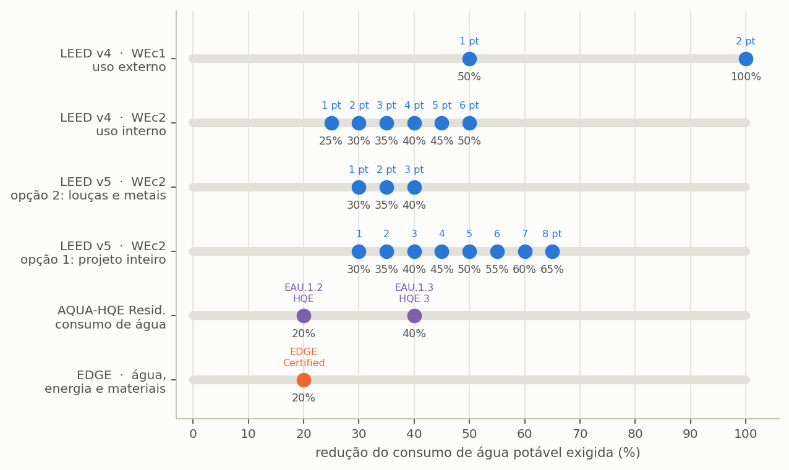

*Figura 23 — Os limiares de redução do consumo de água potável com que o programa enquadra o projeto no LEED v4 (créditos WEc1 e WEc2), no LEED v5 (crédito WEc2, opções 1, 2 e 4), no AQUA-HQE Residencial e no EDGE, na mesma escala. O Selo Casa Azul não entra na régua, porque o seu critério pontua a existência do sistema e a abrangência do uso, e não um percentual. Um mesmo projeto cruza referenciais diferentes em pontos diferentes, e é por isso que declarar a economia obtida vale mais do que declarar a certificação pretendida.*

---

### 2.9.1. LEED v4 e v4.1, categoria Water Efficiency

O LEED é o referencial norte-americano mais difundido internacionalmente. A versão 5, lançada em abril de 2025 para edificações comerciais, convive com as versões 4 e 4.1, que aceitam registro de novos projetos comerciais até 30 de junho de 2027 e certificação até 30 de junho de 2033; o programa enquadra o projeto nas duas. Nas versões 4 e 4.1, a eficiência hídrica ocupa uma categoria própria que vale oito pontos distribuídos em dois créditos. A distinção fundamental que ele impõe é entre uso interno e uso externo da
água, e é dessa separação que decorre toda a pontuação.

O crédito WEc1 trata da redução do uso externo, isto é, da irrigação e das demais
demandas de área descoberta, e vale até dois pontos. O programa concede os dois pontos
com 100% de redução do uso externo de água potável e um ponto a partir de 50%, tomando a
água de chuva destinada à irrigação do próprio balanço diário; e um projeto que não tenha
demanda externa cadastrada não pontua, situação em que o programa registra explicitamente
a razão, para que o usuário não interprete o zero como falha de desempenho.

O crédito WEc2 trata da redução do uso interno e vale até seis pontos, distribuídos numa
escala de cinco em cinco pontos percentuais a partir de 25% de economia. Antecede-o um
pré-requisito, o WEp2, que exige 20% de redução interna e é obrigatório: sem ele o
empreendimento não é elegível à certificação, e ele próprio não confere pontuação alguma.


> A separação entre uso interno e externo depende inteiramente da **discretização da
> demanda** descrita na seção 4.2 (volume Tutorial). O programa não inventa essa separação: usa a água
> de chuva que o balanço diário destinou à irrigação, que é atendida depois do uso
> interno. Sem demanda externa discretizada, o crédito WEc1 aparece como não avaliado, e a
> economia interna é tomada, conservadoramente, igual à economia total.

> O rótulo da pontuação informa apenas os pontos da categoria de água. O nível do LEED —
> Certified, Silver, Gold ou Platinum — resulta da soma de todas as categorias, e a água
> sozinha não o define.

---

### 2.9.2. LEED v5, crédito WEc2 Enhanced Water Efficiency

Na versão 5, conferida contra o *LEED v5 BD+C Rating System* de novembro de 2025, os
créditos de uso interno e externo foram reunidos no crédito WEc2, *Enhanced Water
Efficiency*, que vale até oito pontos em construção nova e até sete em *Core and Shell*;
o programa avalia só a construção nova. O código WEc1 passou a designar outro crédito,
*Water Metering and Leak Detection*, de medição setorizada e detecção de vazamentos, e
não deve ser confundido com o WEc1 de uso externo do LEED v4. O pré-requisito WEp2 exige,
entre outras condições, redução de 20% no consumo de louças e metais em relação à linha
de base do referencial, e o pré-requisito WEp1 exige que a fonte alternativa de água, como
a cisterna pluvial, tenha medidor próprio, separado do da rede pública. O projeto pontua
por um de dois caminhos: a Opção 1, que mede a redução do uso de água do projeto inteiro,
ou a soma das Opções 2 a 6, que tratam cada parcela separadamente.

<!-- tabela: **Tabela 69** — Opções do crédito WEc2 do LEED v5 às quais o aproveitamento pluvial contribui -->
| Opção | O que mede | Pontuação |
| :--- | :--- | :--- |
| 1. Projeto inteiro | redução do uso de água do projeto contra a linha de base | 30% 1 ponto, e 1 ponto a cada 5%, até 65% 8 pontos; com fonte alternativa de água, cada faixa vale 1 ponto a mais, até 8 |
| 2. Louças e metais | redução calculada contra a linha de base do WEp2, que pode incluir fonte alternativa | 30% 1 ponto, 35% 2 pontos, 40% 3 pontos |
| 4. Uso externo, caminho 2 | redução do requisito teórico de irrigação | 50% 1 ponto, 100% 2 pontos |
| 6. Reúso, caminho 2 | sistema de reúso no lote que atenda a irrigação, descargas, reposição ou processo | 2 pontos |

O programa calcula as duas vias e adota a de maior pontuação: a Opção 1 com a economia
total, e a soma das Opções 2, 4 e 6 com a economia interna, a economia externa e a
existência do sistema, que o programa trata como o sistema de reúso da Opção 6. O teto de
oito pontos vale para as duas. As Opções 3 e 5, de equipamentos e de água de processo, e o
caminho 1 da Opção 4, de paisagismo sem irrigação, não dependem do aproveitamento pluvial e
ficam fora da conta. Como no LEED v4, as
reduções do referencial são medidas contra uma linha de base de vazões de aparelhos e de
irrigação, e não contra a demanda modelada, de modo que o enquadramento é indicativo.

O aproveitamento pluvial também pode contribuir para o crédito SSc3, *Rainwater
Management*. Pela Opção 1, ele concede 1, 2 ou 3 pontos pela retenção no lote do volume
correspondente ao percentil 80, 85 ou 90 das chuvas locais (70, 75 ou 80 em lote sem
recuo), e 1 ponto adicional quando parte desse volume é reusada, sem ultrapassar o teto de
3 pontos; pela Opção 2, concede 3 pontos a quem retém o acréscimo de escoamento em relação
à cobertura natural do terreno. O programa não avalia esse crédito, porque ele depende do escoamento de todo o
terreno, e não só da cobertura; a matriz de critérios o registra como não avaliado.

---

### 2.9.3. AQUA-HQE Residencial, tema consumo de água

O AQUA-HQE é a adaptação brasileira, conduzida pela Fundação Vanzolini com a CERQUAL
Qualitel, do referencial francês HQE. No referencial de edifícios residenciais vigente,
versão 00 de 22 de novembro de 2024, a água é tratada no tema «Consumo de água», por
itens, e cada item é classificado num nível: pré-requisito (PR), HQE, HQE 2 ou HQE 3.
Três itens dizem respeito ao aproveitamento pluvial:

<!-- tabela: **Tabela 70** — Itens do tema consumo de água do AQUA-HQE Residencial ligados ao aproveitamento pluvial -->
| Item | Nível | Exigência |
| :--- | :--- | :--- |
| EAU.1.2 | HQE | redução de pelo menos 20% do consumo de água potável em relação ao consumo de referência |
| EAU.1.3 | HQE 3 | economia de 40% de água potável no empreendimento |
| EAU.1.5 | HQE 3 | sistema de recuperação de águas pluviais, conforme as ABNT NBR 15527 e 16783 |

O programa compara a economia de água potável simulada com os limiares de 20% e 40%, e
registra o item EAU.1.5 sempre que há sistema. ==O percentual do programa é indicativo:==
o referencial mede a economia contra um cenário de referência de vazões e usos por
dispositivo, calculado na planilha auxiliar da Fundação Vanzolini, que soma o efeito dos
aparelhos economizadores ao da água não potável.

> **Correção desta versão.** Até a revisão de setembro de 2026 o programa enquadrava o
> projeto em perfis «Base», «Boas Práticas» e «Excelente», a 10, 25 e 40% de economia.
> O referencial de 2024 não tem esses perfis, e o enquadramento foi refeito pelos itens.

---

### 2.9.4. Selo Casa Azul + CAIXA, critério 3.6

O Selo Casa Azul é o referencial da Caixa Econômica Federal para habitação. No guia
vigente, versão V023 de 29 de abril de 2026, o aproveitamento pluvial é o critério 3.6,
da categoria «Gestão eficiente da água», e o seu indicador não é um percentual: é a
**existência** de sistema de aproveitamento, com captação, tratamento, reservação e
pontos de uso indicados no projeto. A pontuação depende da abrangência do uso:

<!-- tabela: **Tabela 71** — Pontuação do critério 3.6 do Selo Casa Azul + CAIXA conforme a abrangência do uso -->
| Abrangência do uso da água pluvial | Pontos |
| :--- | ---: |
| áreas comuns do empreendimento | 2 |
| casas em loteamento, com a preparação exigida | 2 |
| unidades habitacionais | 4 |
| unidades habitacionais e áreas comuns | 5 |

O critério é de livre escolha para os níveis Cristal/Bronze, Topázio/Prata e Safira/Ouro,
e obrigatório para o Diamante. Para a unidade isolada vale o Selo Casa Azul Uni, versão
V001 de dezembro de 2025, em que o critério 7, «Aproveitamento de águas pluviais», vale
1 ponto e é obrigatório para o Selo Ouro. O programa registra o critério como atendido
quando há sistema, e atribui os pontos só quando a abrangência é informada.

> **Correção desta versão.** Até a revisão de setembro de 2026 o programa graduava o
> projeto em «Prata», «Ouro» e «Diamante» a 10, 20 e 30% de economia. O guia não liga o
> critério a percentual, e o enquadramento foi refeito pela existência e pela abrangência.

> **Declare no estudo.** O enquadramento só é defensável com a versão vigente do
> referencial em mãos, e o programa não substitui essa conferência.


---

### 2.9.5. EDGE, o único que não pontua

O EDGE, desenvolvido pela International Finance Corporation do Banco Mundial, adota uma
lógica distinta de todos os anteriores. Em vez de atribuir pontos a desempenhos
crescentes, ele mede o percentual de economia contra um caso-base local em três
dimensões independentes — energia, água e energia incorporada nos materiais — e exige
que **cada uma** delas cruze o limiar estabelecido. Não há compensação entre dimensões:
um desempenho hídrico excepcional não supre uma deficiência em energia.

O EDGE tem ainda dois níveis acima do primeiro. O **EDGE Advanced** exige, além dos 20% nas três dimensões, economia de energia de pelo menos 40% no local; o **Zero Carbon** exige o anterior mais 100% de energia renovável ou compensação integral das emissões remanescentes.

Vale notar qual barra o nível avançado eleva. ==O EDGE Advanced sobe a exigência de
energia, e não a de água.== A consequência prática para quem projeta sistemas pluviais é
que o sistema garante a barra hídrica com relativa folga, ao passo que o nível de
certificação alcançado se decide inteiramente fora do escopo do projeto de água. O
programa avalia apenas a barra de água, pela medida WEM14, cuja entrada no aplicativo do
IFC é a área de captação em metros quadrados.

> **O limite honesto está no denominador.** O caso-base do EDGE é local, varia conforme
> o país e a tipologia, e é fixado pelo próprio aplicativo do IFC. O programa aceita o
> caso-base declarado pelo usuário; na ausência dele, adota a demanda modelada do
> projeto e adverte que o percentual resultante é um **piso**, e não o valor que a
> certificação reconhecerá.
>
> As barras de energia e de energia incorporada nos materiais estão fora do alcance do
> programa, que declara essa limitação no relatório. Afirmar que um projeto é EDGE
> Certified dispondo de um terço da evidência necessária seria irresponsável.

Os limiares acima foram extraídos do documento *EDGE Certification Process*, do IFC, e
os códigos das medidas de água foram conferidos contra um relatório de avaliação EDGE
v3.0.0 de projeto já certificado.

---

### 2.9.6. GRI 303

A Global Reporting Initiative não é um referencial de certificação de edificações, e sim
um padrão de divulgação corporativa de desempenho socioambiental. Sua série 303 trata de
água e efluentes, e dois de seus indicadores são alimentados diretamente pelos resultados
do programa: o GRI 303-3, que reporta a captação evitada em metros cúbicos por ano e
acumulada ao longo do período, e o GRI 303-5, que expressa a taxa de circularidade
hídrica do empreendimento.

---

### 2.9.7. O que declarar

Qualquer estudo que reporte enquadramento em referenciais de certificação precisa
explicitar quatro pontos, e a omissão de qualquer um deles compromete a verificabilidade
do resultado. O primeiro é que as classes 2 a 4 de qualidade da água adotadas pelo
programa são adaptações internas, e não classes da ABNT NBR 15527. O segundo diz respeito
ao EDGE, e consiste em declarar que apenas a barra de água foi avaliada, identificando o
caso-base utilizado. O terceiro aplica-se ao LEED, e consiste em declarar a versão do referencial adotada e informar se a partição entre uso interno e externo foi discretizada a partir de dados do projeto ou se, na falta dela, a economia interna foi tomada igual à economia total. O quarto, finalmente, é a ressalva geral: o
enquadramento produzido pelo programa é indicativo, e a certificação é decidida pelo
organismo certificador à luz da documentação completa do empreendimento.

---

## 2.10. Decisão multicritério

> Esta seção formaliza os dois métodos de ordenação que o programa oferece e declara
> três desvios em relação à formulação canônica que um estudo publicado precisa citar.

Análise multicritério é o ramo da pesquisa operacional que trata de escolher entre
alternativas quando os critérios de avaliação discordam entre si e não podem ser
reduzidos a um único número sem que alguém declare o que vale mais. É exatamente a
situação de um projeto de aproveitamento pluvial: o volume que entrega mais água não é o
que rende mais dinheiro, e nenhum dos dois costuma ser o de menor impacto de carbono.

O que os métodos desta seção fazem não é descobrir a resposta certa. ==Eles tornam
explícita a ponderação que, de outro modo, ficaria implícita na escolha de quem
decide.== Essa é toda a diferença entre um estudo que declara os seus valores e um que
os esconde atrás de um resultado aparentemente objetivo.

---

### 2.10.1. Os sete critérios

O programa avalia cada volume da varredura segundo sete critérios, agrupados em três
dimensões. Cada critério tem uma direção de preferência: em uns, mais é melhor; em
outros, menos.

<!-- tabela: **Tabela 72** — Os sete critérios de decisão, a direção de preferência e o grupo de cada um -->
| # | Critério | Direção | Grupo |
| :-- | :--- | :--- | :--- |
| 1 | potencial de economia | maximizar | técnico |
| 2 | extravasamento | minimizar | técnico |
| 3 | valor presente líquido | maximizar | econômico |
| 4 | payback descontado | minimizar | econômico |
| 5 | taxa interna de retorno | maximizar | econômico |
| 6 | CO₂e no fim da vida | minimizar | ambiental |
| 7 | consumo de água potável | minimizar | ambiental |

As alternativas submetidas à ordenação são os volumes simulados na varredura, e cada uma
delas comparece com os sete valores acima, calculados nas seções 2.1, 2.7 e
2.8. Não há critério inventado nesta etapa: o método apenas ordena o que as
dimensões anteriores já produziram.

---

### 2.10.2. TOPSIS

O TOPSIS — *Technique for Order of Preference by Similarity to Ideal Solution*, proposto
por Hwang e Yoon em 1981 — parte de uma ideia geométrica simples. Se cada alternativa é
um ponto num espaço de sete dimensões, uma por critério, então existem dois pontos de
referência: a **solução ideal**, composta pelo melhor valor de cada critério, e a
**solução anti-ideal**, composta pelos piores. Nenhuma alternativa real ocupa qualquer
um dos dois, porque nenhuma vence em tudo nem perde em tudo, e a melhor alternativa é a
que está simultaneamente mais perto do ideal e mais longe do pior caso.

O método executa cinco passos. Monta a matriz de decisão, com as alternativas nas linhas
e os critérios nas colunas; normaliza essa matriz, para que critérios medidos em reais,
em pontos percentuais e em quilogramas passem a ocupar escalas comparáveis; aplica os
pesos declarados; identifica as soluções ideal e anti-ideal; e ordena as alternativas
pela proximidade relativa ao ideal.

```equacao:topsis:52
C_i = d_i⁻ ÷ ( d_i⁺ + d_i⁻ )
```

<!-- tabela: **Tabela 73** — Variáveis da Equação 52 -->
| Símbolo | Significado | Unidade |
| :--- | :--- | :--- |
| `C_i` | coeficiente de proximidade da alternativa `i`, entre 0 e 1 | adimensional |
| `d_i⁺` | distância euclidiana da alternativa `i` à solução ideal | adimensional |
| `d_i⁻` | distância euclidiana da alternativa `i` à solução anti-ideal | adimensional |

O coeficiente da Equação 52 valeria 1 para uma alternativa que coincidisse com
a solução ideal em todos os critérios, e 0 para uma que coincidisse com a anti-ideal.
Como nenhuma alternativa real ocupa esses extremos, o que interessa não é o valor
absoluto do coeficiente, e sim a ordenação que ele produz.

---

Aplicado à varredura completa do projeto do tutorial, de 1 a 20 m³ com passo de 1 m³ e pesos iguais, o escore cresce até um máximo interior e decresce nos volumes maiores, em que o investimento e o carbono incorporado passam a pesar mais que o ganho de água (Figura 24). O máximo, em 7 m³, difere dos 5 m³ obtidos na seção 4.9 (volume Tutorial) com seis candidatos, porque o ideal e o anti-ideal são construídos a partir do conjunto avaliado: acrescentar ou retirar alternativas desloca os pontos de referência e pode alterar a ordenação, fenômeno conhecido como inversão de ordem (*rank reversal*).

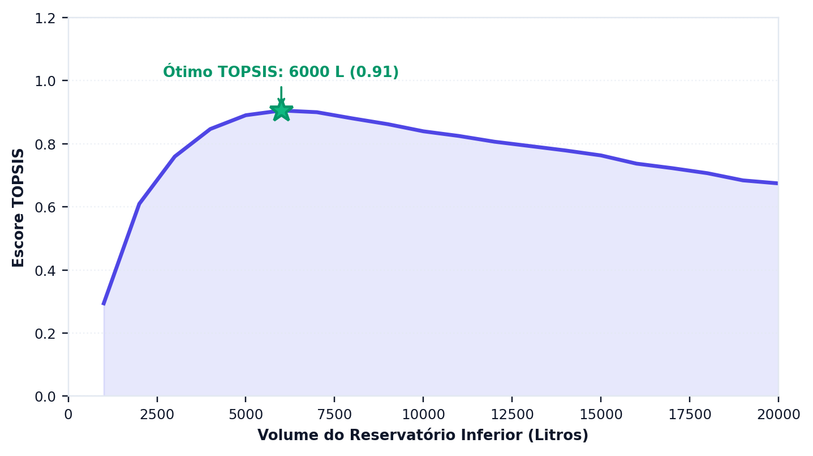

*Figura 24 — Escore TOPSIS de cada volume da varredura do projeto do tutorial, de 1 a 20 m³, com cisterna de polietileno e pesos iguais entre os sete critérios; a estrela marca o volume de maior escore. Figura gerada pelo próprio programa.*

---

### 2.10.3. Três desvios a declarar

A implementação do programa se afasta da formulação canônica em três pontos, todos
deliberados, e um estudo publicado precisa declará-los para não atribuir aos métodos
originais um comportamento que é do programa.

**A normalização é uma variante.** A formulação canônica de Hwang e Yoon emprega
normalização vetorial, que pressupõe valores não negativos em todos os critérios. O valor
presente líquido, porém, é negativo com frequência nos volumes pequenos, em que o
investimento não se paga. O programa contorna a restrição transladando cada critério por
`x − min(x)` antes de normalizar. A escolha é necessária e deliberada, mas apresentar o
resultado como TOPSIS canônico seria incorreto: declare a variante.

**As condições de Opricovic não estão implementadas.** O método VIKOR, na formulação de
Opricovic, exige duas verificações sobre a solução de compromisso encontrada — a de
vantagem aceitável e a de estabilidade aceitável — e, quando qualquer uma delas falha,
devolve um **conjunto** de soluções equivalentes em vez de um único vencedor. O programa
devolve sempre a melhor alternativa, sem realizar o teste. Na prática, isso significa que
a solução de compromisso do VIKOR deve ser lida ao lado da análise de sensibilidade de
pesos, e nunca sozinha.

**A atribuição do código.** A implementação do VIKOR e do SMAA-VIKOR foi escrita de forma
independente e verificada contra a biblioteca `crispyn`, de Aleksandra Bączkiewicz. O
TOPSIS foi verificado contra a formulação original de Hwang e Yoon num caso de valores
todos positivos, em que a translação descrita acima é inócua e as duas formulações
precisam coincidir.

---

### 2.10.4. SMAA-VIKOR

O SMAA — *Stochastic Multicriteria Acceptability Analysis* — existe para responder à
pergunta que o TOPSIS não responde: e se os pesos fossem outros? Em vez de exigir um
conjunto de pesos definido de antemão, o método sorteia milhares de combinações de pesos
e devolve, para cada alternativa, a probabilidade de ela ocupar cada posição do ranking.

A leitura do resultado é direta e informativa. Um volume que vence em 80% dos sorteios é
uma recomendação robusta, que não depende de uma ponderação específica para se sustentar.
Um volume que vence em 30% é uma recomendação frágil, e o texto do estudo precisa dizê-lo
em vez de apresentar o vencedor como se fosse consensual.

> É a ferramenta certa quando não há consenso sobre os pesos — que é o caso normal em
> projetos reais, nos quais o cliente, o projetista e o órgão ambiental costumam
> valorizar dimensões diferentes.

---

A leitura mais útil da análise estocástica não é o vencedor, e sim a margem com que
ele vence. Um volume que fica em primeiro lugar em três quartos dos sorteios de pesos é
uma escolha estável, que sobrevive a uma mudança de prioridade do decisor; dois volumes
tecnicamente empatados indicam o contrário, e nesse caso declarar o peso adotado deixa
de ser formalidade e passa a ser a única informação que sustenta a recomendação (Figura 25).

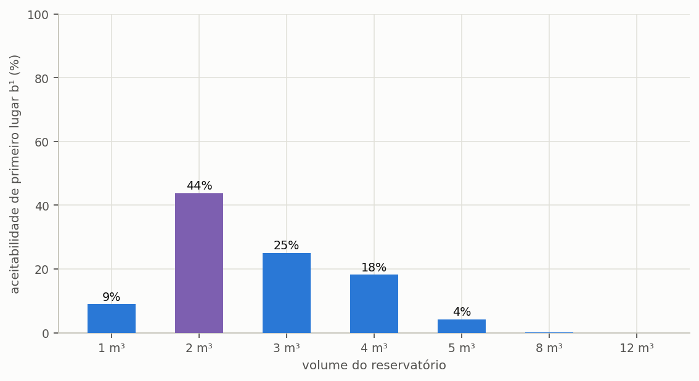

*Figura 25 — Aceitabilidade de primeiro lugar (b¹) de cada volume candidato, obtida com cinco mil vetores de pesos sorteados no simplex. O volume destacado é o que mais vezes fica em primeiro lugar, e os demais repartem o restante.*

#### 2.10.4.1. O tutorial, pelos dois métodos

A tabela põe lado a lado o escore TOPSIS, com pesos iguais entre as três dimensões, e a
aceitabilidade de primeiro lugar do SMAA-VIKOR, com cinco mil vetores de pesos
sorteados, para os sete volumes do tutorial em polietileno com caixa superior.

<!-- tabela: **Tabela 74** — Escore de proximidade TOPSIS com pesos iguais entre as dimensões e aceitabilidade de primeiro lugar no SMAA-VIKOR, com 5.000 vetores de pesos sorteados, para os volumes do tutorial -->
| Volume | Escore TOPSIS | Posição TOPSIS | Primeiro lugar no SMAA-VIKOR, b¹ |
| ---: | ---: | ---: | ---: |
| 1 000 L | 0,401 | 7º | 0,0% |
| 2 000 L | 0,688 | 5º | 5,0% |
| 3 000 L | 0,800 | 3º | 14,2% |
| 4 000 L | 0,854 | 1º | 45,4% |
| 5 000 L | 0,847 | 2º | 34,5% |
| 8 000 L | 0,693 | 4º | 1,0% |
| 12 000 L | 0,542 | 6º | 0,0% |

Os dois métodos concordam no vencedor, 4.000 L, e discordam na margem. O TOPSIS separa o
primeiro do segundo colocado por sete milésimos de escore, diferença que nenhum dado de
entrada sustenta. O SMAA mede essa fragilidade: 4.000 L vence em 45% dos sorteios e
5.000 L em 35%, e os dois juntos somam quatro de cada cinco sorteios. Pela régua da seção
3.7 (volume Guias de uso), a recomendação é razoável, e o estudo deve declarar os 5.000 L como segunda
opção. Os extremos, 1.000 L e 12.000 L, não vencem em sorteio nenhum: nenhuma ponderação
plausível os recomenda, e isso também é resultado.

---

### 2.10.5. Os pesos

O programa aceita um peso por dimensão, técnica, econômica e ambiental, ou um peso por
critério. Com pesos iguais entre as dimensões, cada uma vale um terço, repartido
igualmente entre os seus critérios: os dois técnicos e os dois ambientais valem um sexto
cada, e os três econômicos, um nono cada. A escolha, contudo, não é técnica: é uma declaração de valor, e por isso
precisa aparecer no texto do estudo. ==A afirmação «volume ótimo pelo TOPSIS», sem os
pesos, é impossível de reproduzir,== e dois estudos com pesos diferentes chegam a volumes
diferentes sem que nenhum dos dois esteja errado.

Três condutas são defensáveis, e a escolha entre elas depende de quanto se sabe sobre as
prioridades de quem decide. Pesos iguais, declarados explicitamente como ausência de
preferência, constituem a posição neutra. Pesos justificados, com a razão de cada um,
são preferíveis quando as prioridades são conhecidas. E o SMAA, reportando a faixa de
resultados em vez de um vencedor único, é a conduta mais completa quando não há consenso.

---

### 2.10.6. Os melhores por critério isolado

Além da ordenação ponderada, o programa identifica o vencedor de cada grupo de critérios
— técnico, financeiro e ambiental — e reporta os três separadamente. São números que
valem ser publicados em conjunto, porque cada um responde a uma pergunta legítima e
diferente.

Quando os três coincidem, a recomendação é forte e a decisão dispensa ponderação. Quando
divergem, que é o caso comum e é o do tutorial, ==a divergência **é** o resultado:==
escondê-la atrás de um único número ponderado empobrece o estudo e transfere ao leitor
uma conclusão que ele não tem como avaliar.

---

### 2.10.7. O que o método não faz

Convém encerrar pelos limites, porque métodos multicritério são frequentemente
apresentados com uma autoridade que não têm.

**Não escolhem os pesos.** A ponderação é do analista, e é uma decisão de valor, não de
técnica. Nenhum procedimento estatístico a substitui.

**Não validam os critérios.** Se o valor presente líquido estiver errado porque o regime
tarifário do município foi mal informado, o TOPSIS ordenará o erro com precisão
impecável. O método ordena o que recebe.

**Não incorporam restrições.** Espaço disponível no terreno, orçamento máximo, exigência
normativa: tudo isso é filtro anterior à ordenação, aplicado pelo projetista ao decidir
quais volumes sequer entram na comparação.

---

# Apêndices

---

## Apêndice A — Os parâmetros do projeto

São **122 parâmetros**. É a lista completa do que um projeto
guarda, com o nome exato de cada campo dentro do arquivo `.triton`.

A lista não foi transcrita à mão: é extraída do próprio programa a cada
versão, e por isso não pode divergir dele.

A coluna **onde se informa** diz em que tela o campo aparece; a coluna
**quem consome** diz que cálculo o usa. Campo sem nenhuma das duas é campo
gravado no arquivo e nunca lido, e está listado na seção 5.2 (volume Enganos, limitações e confiabilidade).

### A.1. Identificação

3 parâmetros.

<!-- tabela: **Tabela 75** — Parâmetros do projeto: identificação -->
| Parâmetro | Padrão | Unidade | Onde se informa | Quem consome |
| :--- | ---: | :--- | :--- | :--- |
| `project_name` | Novo projeto Triton | — | Exportação, Janela principal, Relatórios | Automação, CAD e BIM, Planilhas, Relatórios |
| `project_id` | — | — | Janela principal, Relatórios | Automação |
| `created_at` | — | — | Janela principal | — |

### A.2. Chuva

9 parâmetros.

<!-- tabela: **Tabela 76** — Parâmetros do projeto: chuva -->
| Parâmetro | Padrão | Unidade | Onde se informa | Quem consome |
| :--- | ---: | :--- | :--- | :--- |
| `precip_file` | — | — | Janela principal, Projeto | Automação, Cenários, Planilhas |
| `climate_source_mode` | national_db | — | Janela principal, Projeto | — |
| `climate_city_uf` | SC | — | Janela principal, Projeto, Relatórios | — |
| `climate_city_name` | Florianópolis | — | Janela principal, Projeto, Relatórios | — |
| `climate_model` | INM-CM4 | — | Janela principal, Projeto, Relatórios | — |
| `climate_scenario` | HIST | — | Janela principal, Projeto, Relatórios | — |
| `climate_start_date` | 01/01/1980 | — | Janela principal, Projeto, Relatórios | — |
| `climate_end_date` | 31/12/2013 | — | Janela principal, Projeto, Relatórios | — |
| `start_date` | 01/01/1980 | — | Exportação, Janela principal, Projeto, Tarifas e custos | Automação, Clima, Planilhas |

Observações do código:

- `climate_source_mode`: "national_db" (base nacional) ou "custom_file" (arquivo próprio)

### A.3. Captação

7 parâmetros.

<!-- tabela: **Tabela 77** — Parâmetros do projeto: captação -->
| Parâmetro | Padrão | Unidade | Onde se informa | Quem consome |
| :--- | ---: | :--- | :--- | :--- |
| `discard` | — | mm | Ambiental, Documentação, Gráficos, Janela principal, Projeto, Qualidade, Relatórios | ACV, Automação, CAD e BIM, Cenários, ETAP, Planilhas, Relatórios |
| `discard_mode` | 1 | código | Janela principal, Projeto, Varredura | Automação, Balanço diário, Cenários |
| `discard_days_interval` | 7 | dias | Janela principal, Projeto, Varredura | Automação, Balanço diário, Cenários |
| `area` | 100 | m² | Ambiental, Documentação, Edificação, Gráficos, Janela principal, Qualidade, Relatórios, Tarifas e custos, Varredura | ACV, Automação, Balanço diário, CAD e BIM, Cenários, ETAP, Planilhas, Relatórios |
| `irrigation_garden_area_m2` | 0 | m² | — | — |
| `runoff_coeff` | — | — | Edificação, Janela principal, Qualidade, Varredura | Automação, Balanço diário, Cenários, Planilhas |
| `first_flush_system_enabled` | não | — | Ambiental, Qualidade | ACV, Automação, ETAP |

Observações do código:

- `discard`: mm
- `discard_mode`: 1 = todos os eventos, 2 = 1º evento após estiagem, 3 = a cada X dias
- `discard_days_interval`: intervalo para modo 3
- `area`: m²
- `irrigation_garden_area_m2`: Área de jardim em m² para o assistente de dimensionamento
- `runoff_coeff`: ver hydrology_defaults

### A.4. Edificação

2 parâmetros.

<!-- tabela: **Tabela 78** — Parâmetros do projeto: edificação -->
| Parâmetro | Padrão | Unidade | Onde se informa | Quem consome |
| :--- | ---: | :--- | :--- | :--- |
| `num_economias` | 1 | un | Ambiental, Edificação | Automação, Econômico |
| `building_template_id` | res_medio | — | Edificação | Automação, Tarifas |

Observações do código:

- `num_economias`: Número de economias / apartamentos com micromedição individual

### A.5. Demanda

17 parâmetros.

<!-- tabela: **Tabela 79** — Parâmetros do projeto: demanda -->
| Parâmetro | Padrão | Unidade | Onde se informa | Quem consome |
| :--- | ---: | :--- | :--- | :--- |
| `demand_type` | 0 | código | — | — |
| `demand_mode` | constant | — | Ambiental, Edificação, Janela principal, Relatórios, Varredura | Automação, Balanço diário |
| `demand_value` | 200 | L/dia | Documentação, Econômico, Janela principal | Automação, Balanço diário |
| `demand_monthly` | — | — | Janela principal | Automação |
| `residents_type` | 0 | código | — | — |
| `residents_count` | 4 | hab | Ambiental, Econômico, Janela principal | Automação, Balanço diário, Motobomba |
| `residents_monthly` | — | — | Janela principal | Automação |
| `potable_indoor_share` | 0,6 | fração | Edificação, Janela principal | Automação |
| `non_potable_indoor_share` | 0,4 | fração | Edificação, Janela principal | Automação, Balanço diário |
| `rainwater_share` | 0,4 | fração | Documentação, Janela principal, Varredura | Automação, Balanço diário, Cenários, Planilhas |
| `weekly_demands` | — | — | Edificação, Janela principal, Varredura | Automação, Balanço diário |
| `weekly_residents` | — | — | Edificação, Janela principal, Varredura | Automação, Balanço diário |
| `weekly_shares` | — | — | Edificação, Janela principal, Varredura | Automação, Balanço diário |
| `monthly_shares` | — | — | Edificação, Janela principal, Varredura | Automação, Balanço diário |
| `daily_demands` | — | — | Edificação, Janela principal, Varredura | Automação, Balanço diário |
| `daily_residents` | — | — | Edificação, Janela principal, Varredura | Automação, Balanço diário |
| `daily_shares` | — | — | Edificação, Janela principal, Varredura | Automação, Balanço diário |

Observações do código:

- `demand_mode`: "constant", "weekly", "monthly", "daily"
- `demand_value`: L/dia, por habitante ou total
- `potable_indoor_share`: Fração potável do consumo interno; 1 − non_potable_indoor_share
- `non_potable_indoor_share`: Fração não potável do consumo interno (bacias, máquina); ver fracao_atendivel
- `rainwater_share`: fração de 0 a 1 (0,4 = 40%)

### A.6. Irrigação

4 parâmetros.

<!-- tabela: **Tabela 80** — Parâmetros do projeto: irrigação -->
| Parâmetro | Padrão | Unidade | Onde se informa | Quem consome |
| :--- | ---: | :--- | :--- | :--- |
| `irrigation_liters_per_day` | 0 | L/dia | Ambiental, Edificação, Janela principal, Relatórios | Automação, Balanço diário |
| `irrigation_rain_threshold_mm` | 2 | mm/dia | Edificação, Janela principal | Automação, Balanço diário |
| `irrigation_potable_backup` | sim | — | Edificação, Janela principal | Automação, Balanço diário |
| `irrigation_rate_l_m2_day` | 3 | L/m²·dia | — | — |

Observações do código:

- `irrigation_liters_per_day`: Demanda externa (rega, lavagem de áreas externas), L/dia
- `irrigation_rain_threshold_mm`: Limiar diário de precipitação para supressão da irrigação (mm/dia)
- `irrigation_potable_backup`: Se True, a rede pública atende a irrigação em dias secos se a cisterna secar
- `irrigation_rate_l_m2_day`: Taxa diária de rega (L/m²/dia)

### A.7. Qualidade da água

9 parâmetros.

<!-- tabela: **Tabela 81** — Parâmetros do projeto: qualidade da água -->
| Parâmetro | Padrão | Unidade | Onde se informa | Quem consome |
| :--- | ---: | :--- | :--- | :--- |
| `water_quality_target_class` | classe_1 | — | Ambiental, Qualidade | ACV, Automação, ETAP |
| `water_quality_disinfection` | cloro | — | Ambiental, Qualidade | ACV, Automação, ETAP |
| `water_quality_polishing` | não | — | Ambiental, Qualidade | ACV, Automação, ETAP |
| `etap_enabled` | sim | — | Ambiental, Econômico, Otimizador | ACV, Automação, ETAP |
| `chlorine_treatment_enabled` | sim | — | Ambiental, Econômico, Otimizador, Qualidade | ACV, Automação, Econômico |
| `chlorine_dose_mg_l` | — | mg Cl₂/L | Ambiental, Econômico, Otimizador, Qualidade | ACV, Automação, ETAP, Econômico, Relatórios |
| `chlorine_product_purity` | — | kg/kg | Ambiental, Qualidade | ACV, Automação, ETAP, Econômico |
| `chlorine_cost_per_kg` | 25 | R$/kg | Econômico, Otimizador, Qualidade | Automação, ETAP, Econômico, Preços |
| `chlorine_co2_kg_per_kg` | — | kg CO₂e/kg | Ambiental, Qualidade | ACV, Automação, ETAP |

Observações do código:

- `water_quality_disinfection`: "cloro", "uv", "ozonio", "nenhum"
- `chlorine_dose_mg_l`: mg de Cl2 ativo por litro
- `chlorine_product_purity`: kg Cl2 ativo por kg de produto
- `chlorine_cost_per_kg`: R$ por kg de PRODUTO comercial

### A.8. Reservatórios

12 parâmetros.

<!-- tabela: **Tabela 82** — Parâmetros do projeto: reservatórios -->
| Parâmetro | Padrão | Unidade | Onde se informa | Quem consome |
| :--- | ---: | :--- | :--- | :--- |
| `upper_tank_vol` | 500 | L | Ambiental, Assistente da bomba, Caixa superior, Econômico, Exportação, Janela principal, Otimizador, Relatórios, Tarifas e custos, Varredura | Automação, Balanço diário, CAD e BIM, Cenários, Multicritério, Planilhas, Preços |
| `upper_tank_used` | 1 | código | Ambiental, Econômico, Janela principal, Otimizador, Relatórios, Tarifas e custos, Varredura | ACV, Automação, Balanço diário, Cenários, Motobomba, Planilhas, Preços |
| `lower_tank_max` | 10000 | L | Janela principal, Varredura | Automação, Balanço diário, Cenários, Planilhas |
| `lower_tank_step` | 250 | L | Janela principal, Varredura | Automação, Balanço diário, Cenários, Planilhas |
| `lower_tank_mode` | 1 | código | Janela principal, Varredura | Automação |
| `lower_tank_fixed` | 2000 | L | Janela principal, Tarifas e custos, Varredura | Automação |
| `delta_ideal` | 5 | %/m³ | Janela principal, Otimizador, Varredura | Automação, Cenários |
| `econ_lower_tank_vol` | 2000 | L | Ambiental, Econômico, Tarifas e custos, Varredura | Automação |
| `lower_tank_material` | PEAD | — | Econômico, Otimizador, Tarifas e custos | ACV, Automação, Preços |
| `upper_tank_material` | PEAD | — | Econômico, Otimizador, Tarifas e custos | ACV, Automação, Preços |
| `cost_lower_tank` | 0 | R$ | Econômico, Tarifas e custos, Varredura | Automação, Econômico, Preços |
| `cost_upper_tank` | 0 | R$ | Econômico, Tarifas e custos, Varredura | Automação, Econômico |

Observações do código:

- `upper_tank_vol`: L
- `upper_tank_used`: 0 = sem caixa superior, 1 = com caixa superior
- `lower_tank_max`: L
- `lower_tank_step`: L
- `lower_tank_mode`: 0 = volume fixo, 1 = varredura
- `lower_tank_fixed`: usado no modo de volume fixo
- `delta_ideal`: limiar de ganho marginal para o volume ideal, em %/m³
- `lower_tank_material`: "PEAD", "CONCRETO", "FIBRA" (PRFV), "ACO_INOX"
- `upper_tank_material`: "PEAD", "CONCRETO", "FIBRA" (PRFV), "ACO_INOX"

### A.9. Motobomba

18 parâmetros.

<!-- tabela: **Tabela 83** — Parâmetros do projeto: motobomba -->
| Parâmetro | Padrão | Unidade | Onde se informa | Quem consome |
| :--- | ---: | :--- | :--- | :--- |
| `pumping_threshold` | 50 | L | Janela principal, Varredura | Automação, Balanço diário, Cenários, Planilhas |
| `supply_arrangement` | — | código | Ambiental, Econômico, Varredura | ACV, Automação, Econômico, Motobomba |
| `pressurizer_pressure_m` | 18 | m.c.a. | Varredura | Motobomba |
| `pressurizer_starts_per_person_day` | 5,05 | 1/pessoa·dia | Varredura | Motobomba |
| `pressurizer_model` | komeco_tp820t | código | Varredura | Motobomba |
| `pressurizer_point_flow_l_min` | 9 | L/min | Varredura | Motobomba |
| `pressurizer_power_kw` | 0,18 | kW | Varredura | Motobomba |
| `pressurizer_flow_l_min` | 13,3 | L/min | Varredura | Motobomba |
| `pressurizer_post_run_s` | 0 | s | Varredura | Motobomba |
| `pump_count` | 2 | un | Ambiental, Econômico, Otimizador, Relatórios, Tarifas e custos | ACV, Automação, Econômico, Preços, Relatórios |
| `pump_power_str` | 1/2 | — | Relatórios | — |
| `pump_power_kw` | 0,36775 | kW | Econômico, Gráficos, Otimizador, Relatórios, Tarifas e custos, Varredura | Automação, CAD e BIM, Econômico, Motobomba, Preços, Relatórios |
| `pump_manometric_head_m` | 0 | m.c.a. | Varredura | Automação, Motobomba |
| `pump_efficiency` | 0 | % | Gráficos, Tarifas e custos, Varredura | Automação, Motobomba |
| `pump_flow_rate` | 0 | L/h | Econômico, Gráficos, Otimizador, Relatórios, Tarifas e custos, Varredura | Automação, Motobomba |
| `pump_startup_time_h` | 0,03 | h | Econômico, Gráficos, Otimizador, Tarifas e custos | Automação, Motobomba |
| `pump_motor_efficiency` | 0 | % | Tarifas e custos | Automação, Motobomba |
| `pump_unit_cost` | 300 | R$ | Econômico, Otimizador, Tarifas e custos, Varredura | Automação, Econômico, Preços |

Observações do código:

- `pumping_threshold`: L, nível de acionamento do recalque
- `pump_count`: principal + reserva como configuração inicial recomendada
- `pump_power_kw`: kW (1 CV = 0,7355 kW; 1/2 CV = 0,36775 kW)
- `pump_efficiency`: %, 0 = deduzir do porte
- `pump_startup_time_h`: h
- `pump_motor_efficiency`: %
- `pump_unit_cost`: R$, referência de mercado para motobomba periférica 1/2 CV

### A.10. Tubulação

1 parâmetro.

<!-- tabela: **Tabela 84** — Parâmetros do projeto: tubulação -->
| Parâmetro | Padrão | Unidade | Onde se informa | Quem consome |
| :--- | ---: | :--- | :--- | :--- |
| `pipes_list` | — | — | Econômico, Tarifas e custos | ACV, Automação |

### A.11. Investimento

3 parâmetros.

<!-- tabela: **Tabela 85** — Parâmetros do projeto: investimento -->
| Parâmetro | Padrão | Unidade | Onde se informa | Quem consome |
| :--- | ---: | :--- | :--- | :--- |
| `cost_labor` | 0 | R$ | Econômico, Tarifas e custos, Varredura | Automação, Econômico |
| `cost_piping` | 0 | R$ | Econômico, Tarifas e custos, Varredura | Automação, Econômico |
| `cost_accessories` | 0 | R$ | Econômico, Tarifas e custos, Varredura | Automação, ETAP, Econômico |

### A.12. Operação

1 parâmetro.

<!-- tabela: **Tabela 86** — Parâmetros do projeto: operação -->
| Parâmetro | Padrão | Unidade | Onde se informa | Quem consome |
| :--- | ---: | :--- | :--- | :--- |
| `op_costs` | — | — | Econômico, Otimizador, Tarifas e custos, Varredura | Automação, Econômico |

### A.13. Tarifas

18 parâmetros.

<!-- tabela: **Tabela 87** — Parâmetros do projeto: tarifas -->
| Parâmetro | Padrão | Unidade | Onde se informa | Quem consome |
| :--- | ---: | :--- | :--- | :--- |
| `tariff_customized` | não | — | Projeto | — |
| `water_tariffs` | — | — | Projeto, Tarifas, Tarifas e custos, Varredura | Econômico |
| `tariff_city_uf` | SC | — | Janela principal, Projeto, Relatórios, Tarifas, Tarifas e custos | — |
| `tariff_city_name` | Florianópolis | — | Janela principal, Projeto, Relatórios, Tarifas, Tarifas e custos | — |
| `tariff_vigencia` | — | — | Projeto, Tarifas e custos | — |
| `tariff_category` | residencial | — | Econômico, Tarifas, Tarifas e custos | Tarifas |
| `sewage_rate` | 100 | % da água | Projeto, Tarifas, Tarifas e custos | Automação, Econômico, Tarifas |
| `sewage_mode` | 1 | código | Econômico, Otimizador, Projeto, Tarifas, Tarifas e custos | Automação, Econômico, Tarifas |
| `sewage_tariffs` | — | — | — | Econômico, Tarifas |
| `sewage_volume_factor` | 1 | — | — | Automação, Econômico, Tarifas |
| `water_tax_fixed` | 0 | R$/mês | Tarifas e custos | Automação, Econômico |
| `water_tax_var` | 0 | % | Tarifas e custos | Automação, Econômico |
| `tariff_escalation` | 12 | meses | Econômico, Otimizador, Tarifas e custos, Varredura | Automação, Econômico |
| `water_tariff_escalation` | 5 | % por período | Econômico, Otimizador, Tarifas e custos, Varredura | Automação, Econômico |
| `sewage_tariff_escalation` | 5 | % por período | Econômico, Otimizador, Tarifas e custos | Automação, Econômico |
| `elec_tariff_escalation` | 5 | % por período | Econômico, Otimizador, Varredura | Automação, Econômico |
| `tariff_flag` | verde | — | Econômico | Automação, Econômico |
| `elec_tariff` | 0,6957 | R$/kWh | Econômico, Gráficos, Otimizador, Projeto, Tarifas e custos, Varredura | Automação, Econômico |

Observações do código:

- `tariff_category`: categoria da tabela tarifária aplicada; "personalizada" quando digitada
- `sewage_mode`: 0 = valor fixo em R$, 1 = percentual da parcela de água, 2 = R$/m³ consumido, 3 = escalões
- `water_tax_fixed`: R$
- `water_tax_var`: %
- `tariff_escalation`: meses; comprimento do período de reajuste
- `water_tariff_escalation`: % por período de reajuste; com 12 meses, % ao ano
- `sewage_tariff_escalation`: % por período de reajuste; com 12 meses, % ao ano
- `elec_tariff_escalation`: % por período de reajuste; com 12 meses, % ao ano
- `tariff_flag`: "verde", "amarela", "vermelha_1", "vermelha_2", "branca"
- `elec_tariff`: R$/kWh (Tarifa B1 Residencial CELESC/SC Florianópolis)

### A.14. Energia

4 parâmetros.

<!-- tabela: **Tabela 88** — Parâmetros do projeto: energia -->
| Parâmetro | Padrão | Unidade | Onde se informa | Quem consome |
| :--- | ---: | :--- | :--- | :--- |
| `elec_city_uf` | SC | — | Janela principal, Projeto, Tarifas e custos | — |
| `elec_city_name` | Florianópolis | — | Janela principal, Projeto, Tarifas e custos | — |
| `elec_tax_fixed` | 0 | R$/mês | Tarifas e custos | Automação, Econômico |
| `elec_tax_var` | 0 | % | Tarifas e custos | Automação, Econômico |

Observações do código:

- `elec_tax_fixed`: R$
- `elec_tax_var`: %

### A.15. Incentivos

3 parâmetros.

<!-- tabela: **Tabela 89** — Parâmetros do projeto: incentivos -->
| Parâmetro | Padrão | Unidade | Onde se informa | Quem consome |
| :--- | ---: | :--- | :--- | :--- |
| `iptu_green_enabled` | não | — | Econômico, Otimizador | Automação, Econômico |
| `iptu_annual_value` | 4000 | R$/ano | Econômico, Otimizador | Automação, Econômico |
| `iptu_discount_pct` | 5 | % | Econômico, Otimizador | Automação, Econômico |

Observações do código:

- `iptu_annual_value`: Valor venal do IPTU anual da edificação (R$/ano)
- `iptu_discount_pct`: Desconto municipal do IPTU Verde (%)

### A.16. Financeiro

4 parâmetros.

<!-- tabela: **Tabela 90** — Parâmetros do projeto: financeiro -->
| Parâmetro | Padrão | Unidade | Onde se informa | Quem consome |
| :--- | ---: | :--- | :--- | :--- |
| `inflation` | 0,2 | % ao mês | Documentação, Econômico, Otimizador, Tarifas e custos, Varredura | Automação, Econômico |
| `analysis_period_years` | 20 | anos | Econômico, Otimizador, Relatórios, Tarifas e custos, Varredura | ACV, Automação, Econômico, Relatórios |
| `tma` | 2 | % ao mês | Econômico, Otimizador, Tarifas e custos, Varredura | Automação, Econômico |
| `install_month` | 0 | mês | — | — |

Observações do código:

- `inflation`: % ao mês; inflação dos custos de O&M
- `analysis_period_years`: anos
- `tma`: % ao mês; taxa mínima de atratividade

### A.17. Certificações

1 parâmetro.

<!-- tabela: **Tabela 91** — Parâmetros do projeto: certificações -->
| Parâmetro | Padrão | Unidade | Onde se informa | Quem consome |
| :--- | ---: | :--- | :--- | :--- |
| `edge_base_case_l_person_day` | 0 | L/pessoa·dia | Ambiental | — |

### A.18. Outros

6 parâmetros.

<!-- tabela: **Tabela 92** — Parâmetros do projeto: outros -->
| Parâmetro | Padrão | Unidade | Onde se informa | Quem consome |
| :--- | ---: | :--- | :--- | :--- |
| `phi_operation_rule` | — | — | Janela principal, Varredura | Automação, Balanço diário, Planilhas |
| `data_base_estudo` | — | — | Tarifas e custos | — |
| `precos_de_catalogo` | sim | — | Assistente da bomba, Econômico, Otimizador, Qualidade, Tarifas e custos, Varredura | Automação, ETAP, Preços |
| `bim_layout` | — | — | Exportação, Janela principal | — |
| `capex_do_arranjo` | não | — | Janela principal, Tarifas e custos, Varredura | ETAP |
| `mao_de_obra_automatica` | não | — | Janela principal, Tarifas e custos, Varredura | — |

---

## Apêndice B — Os processos do programa

São **24 processos**, do arquivo de chuva ao relatório. Cada
um declara o que o dispara, o que recebe, as regras com suas ramificações, o
que produz e o que acontece quando falha.

É o apêndice mais técnico do manual, e serve a duas pessoas: quem revisa um
estudo feito com o programa e precisa saber exatamente que conta foi feita, e
quem encontrou um resultado estranho e quer saber por onde o número passou.

Os nomes em `código` são os campos do arquivo de projeto, listados no apêndice A.

### B.1. PROC-01 — Carregar a série de precipitação

*Chuva*

**Gatilho.** Aba Projeto: escolher cidade na base nacional ou abrir arquivo CSV.

**Entradas**

- Arquivo CSV diário, ou cidade da base CMIP6 (652 cidades, 19 modelos, histórico mais SSP2-4.5 e SSP5-8.5)
- `climate_start_date` e `climate_end_date`, que recortam a série
- `start_date`, data do primeiro dia da série

**Regras**

1. A série vira um vetor `numpy` de milímetros por dia; o índice do vetor é o dia, e a data serve só para saber o dia da semana e o mês.
2. Ano incompleto é descartado na leitura, para não enviesar totais anuais.
3. A base climática vai embutida na Edição Brasil, em `climbra.db`; na International Edition, que não a traz, a série é sempre um arquivo do usuário.

**Saídas**

- `precip_data`: vetor de mm/dia, que é a entrada de **dois** processos distintos — PROC-04 (descarte e captação) e PROC-03 (supressão de irrigação)

**Exceção.** Arquivo ilegível ou sem coluna de chuva interrompe o carregamento com mensagem; a simulação não roda com série vazia.

### B.2. PROC-02 — Compor a demanda diária

*Demanda*

**Gatilho.** Início da simulação, uma vez por execução.

**Entradas**

- `demand_mode`: constante, semanal, mensal ou diária
- `demand_value` (L/dia por pessoa), `residents_count`
- `rainwater_share` ou `non_potable_indoor_share`
- vetores `weekly_*`, `monthly_*`, `daily_*` quando o modo os usa

**Regras**

1. Demanda-base do dia = `demand_value × residents_count`, com o multiplicador do dia da semana, do mês ou do dia, conforme o modo.
2. A fração não potável separa a demanda em duas: interna potável e interna não potável.
3. Quando o modo é semanal, mensal ou diário, a fração vem do próprio vetor do período; fora disso, vale `non_potable_indoor_share`, e só então `rainwater_share`.
4. Valor nulo ou zero em qualquer posição do vetor cai para o valor constante.

**Saídas**

- `tot_arr`: demanda total do dia
- `pot_in_arr`: potável interna, que a chuva nunca atende
- `non_pot_in_arr`: não potável interna, prioridade 1 da chuva
- `pluv_arr` = não potável interna + irrigação ativa

**Exceção.** Data inicial ilegível cai para 01/01/1980 em vez de interromper, porque só afeta o dia da semana.

### B.3. PROC-03 — Suprimir a irrigação nos dias de chuva

*Demanda*

**Gatilho.** Composição da demanda, um teste por dia da série.

**Entradas**

- `irrigation_liters_per_day`
- `irrigation_rain_threshold_mm` (padrão 2 mm/dia)
- `precip_data`, o **mesmo** vetor que alimenta a captação

**Regras**

1. Se a chuva do dia ≥ limiar, a irrigação do dia é **zero** e o dia entra na contagem de dias suprimidos.
2. Caso contrário, a irrigação do dia é o volume nominal.
3. É a segunda leitura do arquivo de chuva, e independente da primeira: um dia pode suprimir a irrigação e ainda assim render captação.

**Saídas**

- `irr_arr`: irrigação do dia
- `irr_suppressed_mask`: dias suprimidos, que viram `total_irrigation_days_suppressed` no resultado

**Exceção.** Sem volume de irrigação cadastrado, o vetor é zero e a máscara é falsa em todos os dias.

### B.4. PROC-04 — Descartar as primeiras águas

*Balanço hídrico*

**Gatilho.** Todo dia com chuva, dentro do laço diário.

**Entradas**

- `precip_mm` do dia
- `discard_mm`
- `discard_mode` (1, 2 ou 3)
- `discard_days_interval`

**Regras**

1. **Modo 1**: descarta em todo evento de chuva.
2. **Modo 2**: descarta apenas no primeiro evento após estiagem, definida como véspera com menos de 1 mm.
3. **Modo 3**: descarta quando passaram `discard_days_interval` dias desde o último descarte.
4. Quando o descarte se aplica: `p_eff = p − discard_mm` se `p > discard_mm`, senão **zero**: toda a chuva do dia vai para o descarte.
5. Quando não se aplica: `p_eff = p`, a chuva inteira é aproveitável.

**Saídas**

- `p_eff`: lâmina efetiva do dia, em mm, que segue **só** para PROC-05
- `eff_precip_mm` na série diária detalhada, quando ela é guardada

**Exceção.** Lâmina de descarte negativa é rejeitada na porta de validação, antes do laço.

### B.5. PROC-05 — Converter lâmina em volume captado

*Balanço hídrico*

**Gatilho.** Todo dia, depois do descarte.

**Entradas**

- `p_eff` de PROC-04
- `area` (m²)
- `runoff_coeff`

**Regras**

1. `v_ac = p_eff × area × runoff_coeff`, em litros.
2. É aqui que o arquivo de chuva vira volume, e é o único ponto onde isso acontece.
3. O coeficiente é adimensional e fica em [0, 1]; fora disso a simulação nem começa.

**Saídas**

- `v_ac`: volume captado do dia, que segue para PROC-06
- `harvested_liters` na série diária

**Exceção.** Área negativa ou coeficiente fora de [0, 1] levantam `ValueError` nomeando o campo, em PROC-11.

### B.6. PROC-06 — Armazenar e extravasar

*Balanço hídrico*

**Gatilho.** Todo dia, depois da captação.

**Entradas**

- `v_ac`
- volume remanescente do dia anterior
- `lower_tank_vol`

**Regras**

1. **Extravasamento antes do consumo**, como na regra YAS; a chuva do dia, até a capacidade, já atende a demanda do dia, o que põe o modelo entre a YAS e a YBS estritas.
2. `disponível = v_lower + v_ac`. Se passar da capacidade, o excedente extravasa e o reservatório fica cheio.
3. A ordem importa: retirar a demanda antes faria o reservatório aceitar água que fisicamente já teria extravasado, superestimando o aproveitamento.

**Saídas**

- `v_spill_today`, somado em `avg_spilled_l_day`, que vira critério de extravasamento no multicritério
- `v_in_tank`, o volume disponível para atendimento

**Exceção.** Volume zero é válido e representa o cenário sem sistema; negativo é rejeitado.

### B.7. PROC-07 — Atender com reservatório único

*Balanço hídrico*

**Gatilho.** Todo dia, quando não há reservatório superior.

**Entradas**

- `v_in_tank`
- `pluvial_demand_per_day` de PROC-02

**Regras**

1. `v_c = min(demanda pluvial, volume no reservatório)`.
2. O volume remanescente permanece para o dia seguinte: `v_lower = v_in_tank − v_c`.

**Saídas**

- `v_c`: volume pluvial consumido no dia

**Exceção.** Nenhuma: o mínimo já trata reservatório vazio e demanda nula.

### B.8. PROC-08 — Atender com recalque para caixa superior

*Balanço hídrico*

**Gatilho.** Todo dia, quando `upper_tank_used` e o volume superior é positivo.

**Entradas**

- `v_lower`, `v_upper`
- `upper_tank_vol`
- `pumping_threshold`, o volume de reserva que não se consome

**Regras**

1. Laço até a demanda ser atendida ou a água acabar.
2. Primeiro consome da caixa superior o que estiver **acima** do limiar de acionamento.
3. Se ainda falta e há água embaixo, aciona a bomba: transfere `min(v_lower, espaço livre em cima)`, conta **um ciclo** e registra a batelada.
4. Depois do recalque, consome de novo.
5. O limiar é limitado ao volume da caixa superior na entrada do processo.

**Saídas**

- `v_c`
- `v_rec_today`, somado em `total_pumped_liters`
- `cycles_today`, somado em `total_pump_cycles`
- `max_pump_batch_liters`

**Exceção.** Volume superior negativo é rejeitado na validação. O laço tem saída garantida: se não há água embaixo nem em cima, interrompe.

### B.9. PROC-09 — Repartir o atendimento e completar com potável

*Balanço hídrico*

**Gatilho.** Todo dia, depois do atendimento.

**Entradas**

- `v_c`
- `non_pot_in_day`
- `irr_day`
- `pot_in_day`
- `irrigation_potable_backup`

**Regras**

1. **Prioridade 1**, uso interno não potável: `c_pluv_in = min(v_c, não potável interna)`.
2. **Prioridade 2**, irrigação: `c_pluv_irr = min(v_c − c_pluv_in, irrigação do dia)`.
3. O potável consumido é a soma de três parcelas: o potável interno, o déficit do não potável interno e — só se o suprimento de reserva estiver ligado — o déficit da irrigação.
4. Com o suprimento de reserva desligado, o jardim simplesmente não é regado no dia seco, e a rede não é acionada.

**Saídas**

- `potable_consumed_liters` do dia
- `avg_pluvial_indoor_consumed_l_day` e `avg_pluvial_irrigation_consumed_l_day`, que separam o uso interno do externo para os créditos WEc1 e WEc2 do LEED v4 e as Opções 2 e 4 do WEc2 do LEED v5

**Exceção.** Nenhuma: todas as parcelas são mínimos e máximos com zero.

### B.10. PROC-10 — Classificar o atendimento do dia

*Balanço hídrico*

**Gatilho.** Todo dia, ao fim do atendimento.

**Entradas**

- `v_c`
- `pluvial_demand_per_day`

**Regras**

1. **Pleno** quando o consumido iguala a demanda pluvial, com tolerância de 10⁻⁵ L.
2. **Parcial** quando consumiu algo, mas menos que a demanda.
3. **Nulo** quando não consumiu nada.

**Saídas**

- `pct_days_full_satisfaction`, `pct_days_partial_satisfaction` e `pct_days_null_satisfaction`, que são a confiabilidade temporal do sistema

**Exceção.** Nenhuma.

### B.11. PROC-11 — Validar a entrada física

*Balanço hídrico*

**Gatilho.** Primeira linha de `run_single_simulation`, antes de qualquer conta.

**Entradas**

- volume inferior e superior
- área
- coeficiente de escoamento
- lâmina de descarte
- demanda diária
- fração pluvial

**Regras**

1. Volume negativo, área negativa, descarte negativo e demanda negativa são recusados.
2. Coeficiente de escoamento e fração pluvial têm de ficar em [0, 1].
3. **Volume zero continua válido**: é a referência «sem sistema» da varredura.
4. A mensagem nomeia o campo e o valor recebido, em vez de corrigir por baixo dos panos.

**Saídas**

- Nenhuma saída: ou passa, ou levanta `ValueError`

**Exceção.** É o próprio tratamento. Antes desta porta, volume de −1.000 L devolvia −166,67% de economia, e o número seguia para o econômico, para a ACV e para o relatório.

### B.12. PROC-12 — Agregar o período e calcular os indicadores

*Balanço hídrico*

**Gatilho.** Fim do laço diário.

**Entradas**

- acumuladores do laço
- `n_days`

**Regras**

1. **Potencial de economia** = pluvial consumido no período ÷ demanda total do período × 100.
2. As médias diárias dividem os acumulados pelo número de dias simulados.
3. As conversões para o ano usam **365,25** dias, e não 365, para absorver os bissextos da série.
4. O potencial fica sempre em [0, 100] — invariante que a porta de validação existe para garantir.

**Saídas**

- `SingleTankSimulationResult`, com 21 campos, que é o objeto que **todos** os módulos a jusante consomem

**Exceção.** Demanda total nula devolve potencial zero em vez de dividir por zero.

### B.13. PROC-13 — Varrer volumes e achar o volume ideal

*Balanço hídrico*

**Gatilho.** Aba Varredura: botão de simular.

**Entradas**

- `lower_tank_max`
- `lower_tank_step`
- `delta_ideal` (%/m³)

**Regras**

1. A grade discreta arredonda o passo **para cima** até o múltiplo de 250 L, que é o quantum comercial de reservatório, e limita a 40 volumes positivos.
2. O volume máximo informado é sempre preservado como último ponto, de modo que só o último intervalo pode ser menor que o passo.
3. Zero entra na grade como alternativa de referência.
4. Roda PROC-04 a PROC-12 uma vez por volume.
5. O **volume ideal** é o primeiro cujo ganho marginal `Δpotencial/Δm³` cai abaixo do limiar: a partir dali, mais reservatório não compensa.

**Saídas**

- `SweepSimulationResult`: um resultado por volume, o volume ideal, e o registro de que o passo foi ajustado
- A lista de volumes é a lista de **candidatos** do multicritério

**Exceção.** Passo maior que o máximo devolve grade com um ponto. O ajuste do passo é registrado em `step_adjusted`, e não silenciado.

### B.14. PROC-14 — Calcular os índices pluviométricos

*Chuva*

**Gatilho.** Aba Gráficos e relatório científico.

**Entradas**

- `precip_data`
- datas da série

**Regras**

1. Nove índices: PRCPTOT, R95p, RX1day, RX5day, SDII, R20mm, CDD, CWD e o índice de sazonalidade de Walsh e Lawler.
2. O conjunto **não** é ETCCDI puro: a sazonalidade não é do conjunto, e o R10mm, que é, está ausente.
3. O percentil 95 é calculado sobre a **série inteira carregada**, e não sobre a base fixa 1961–1990 do ETCCDI.
4. O RX5day usa `min_periods=1`, de modo que as primeiras janelas do ano têm de 1 a 4 dias.

**Saídas**

- Nove séries anuais, para gráfico e relatório

**Exceção.** Série menor que um ano devolve os índices possíveis, sem interromper.

### B.15. PROC-15 — Dimensionar a estação de tratamento

*Qualidade e ETAP*

**Gatilho.** Mudança na aba Qualidade da Água, ou início do econômico e da ACV.

**Entradas**

- `water_quality_target_class` (4 classes de uso)
- `water_quality_disinfection`: cloro, ultravioleta ou ozônio
- `water_quality_polishing`, filtro de polimento
- `annual_pluvial_m3` de PROC-12
- `area`
- dose, pureza, preço e fator de CO₂ do cloro
- `discard` e `first_flush_system_enabled`, para o descarte inicial

**Regras**

1. A classe alvo define as etapas obrigatórias; a desinfecção escolhida define o equipamento e o custeio.
2. O filtro de polimento é aplicado **se e somente se** marcado; quando a classe o recomendaria e o usuário recusa, isso fica registrado em `polishing_recommended_but_declined` em vez de ser imposto.
3. O que se compra é o **produto** — pastilha a 65% de cloro ativo — e não o cloro puro. Faturar a massa de cloro ativo, e não a do produto, subestima o custo em cerca de 35%.
4. **Regra incremental**: o CAPEX da linha desconta a verba genérica de tratamento já embutida em «Acessórios», e o custeio desconta a cloração, que o fluxo de caixa já paga. A regra vive num lugar só, consumida pelos **dois** motores econômicos.
5. Com `first_flush_system_enabled`, o dispositivo de descarte inicial, de volume `discard × area`, entra no CAPEX e no custeio da linha.
6. Na ACV, a linha de tratamento **substitui** o termo de cloração; nunca soma a ele.
7. Com `etap_enabled = False`, a linha de tratamento não entra em conta alguma: nem no CAPEX, nem no custeio, nem na avaliação ambiental.

**Saídas**

- `total_etap_capex`, que entra no CAPEX
- `total_etap_annual_opex`, que entra no custeio
- `total_etap_co2e_kg_yr`, que substitui a cloração na ACV
- `disinfection_stages`, exibido no relatório

**Exceção.** Pureza fora de (0, 1] é recusada pelo validador da cadeia de cloração.

### B.16. PROC-16 — Calcular a energia de bombeamento

*Motobomba*

**Gatilho.** Econômico e ACV, a partir do mesmo resultado de simulação.

**Entradas**

- `supply_arrangement`: recalque, pressurização direta ou gravidade
- `total_pumped_liters` e `total_pump_cycles` de PROC-08
- `pressurizer_pressure_m`, `pressurizer_starts_per_person_day`, `residents_count`
- `pump_power_kw`, `pump_efficiency`, `pump_flow_rate`
- `pump_manometric_head_m`
- `pump_startup_time_h`

**Regras**

1. O arranjo decide o que se bombeia. **Recalque**: o volume enviado à caixa superior. **Pressurização direta**: todo o volume pluvial consumido, com a pressão de trabalho no lugar da altura e sem energia de partida. **Gravidade**: nada. É a única fonte de kWh do econômico e da ACV.
2. Energia específica `e = ρgH/(η_bomba·η_motor)` por m³ recalcado, ou `P/(Q·η_motor)` quando a vazão é declarada.
3. A potência de placa é potência de eixo e **já embute** o rendimento da bomba; por isso `P × horas / η_bomba` conta esse rendimento duas vezes, e o que falta é dividir pelo rendimento do motor, da ABNT NBR 17094-2. Quatro cópias dessa fórmula antiga sobreviviam no programa e superestimavam o consumo em 1,68 vez — a pior delas ordenava volumes no multicritério.
4. A energia de partida entra à parte, pelo número de ciclos.
5. Vazão e rendimento não informados caem para valores típicos **da potência escolhida**, e não para constantes fixas.

**Saídas**

- `annual_kwh`, que vira custo no econômico e emissão na ACV
- `pump_hours_year`, `annual_cycles`

**Exceção.** Arranjo por gravidade, arranjo não informado num projeto antigo, ou potência zero: a energia é zero.

### B.17. PROC-17 — Calcular a fatura de água e esgoto

*Econômico*

**Gatilho.** Duas vezes por mês de projeção: com e sem aproveitamento.

**Entradas**

- volume mensal em litros
- `water_tariffs`: quádruplas (mínimo, máximo, valor, código)
- `sewage_mode` e `sewage_rate`
- impostos fixo e variável
- `num_economias`

**Regras**

1. O consumo é avaliado **no patamar de uma economia** e multiplicado pelo número de economias, para não distorcer as faixas progressivas em prédio com micromedição.
2. Código **1** ou **0**: faixa progressiva, cobrada só sobre o volume dentro dela.
3. Código **−1**, disponibilidade: valor fixo que **soma** por cima do consumo medido.
4. Código **−2**, franquia retroativa: até o volume da franquia paga-se o valor fixo; passando dele, **todo** o volume desde zero é tarifado pelas faixas.
5. Código **−3**, piso de pagamento: não soma, **limita por baixo**. Com piso de R$ 40 e consumo tarifado de R$ 55, economizar até R$ 15 não reduz nada — e é exatamente isso que um estudo de aproveitamento pluvial precisa enxergar.
6. O esgoto é percentual da **parcela de água**, não da fatura total. Em Florianópolis são 100% da água, que é metade da fatura.
7. Os seis regimes tarifários estão nomeados e auditados na base dos 652 municípios.

**Saídas**

- Valor da fatura de água e esgoto em R$/mês, para a projeção de PROC-18

**Exceção.** Tabela vazia cai para a estrutura da CASAN. Estrutura incompleta é sinalizada pela porta de validação, que separa erro de aviso.

### B.18. PROC-18 — Projetar o fluxo de caixa

*Econômico*

**Gatilho.** Aba Econômico, após a simulação técnica.

**Entradas**

- CAPEX das cinco rubricas mais bomba e ETAP
- economia mensal de água e esgoto de PROC-17
- custeio: bombeamento, cloração, ETAP e custos operacionais declarados
- `tma`, `inflation`, `analysis_period_years`
- reajustes separados de água, esgoto e energia, e o intervalo entre reajustes
- IPTU verde, quando habilitado

**Regras**

1. Água e esgoto são reajustados por índices **separados**, e não pela fatura agregada.
2. A inflação incide só sobre o custeio; os reajustes tarifários incidem só sobre a fatura.
3. O reajuste é aplicado a cada `tariff_escalation` meses, em degraus.
4. A bandeira tarifária ajusta a tarifa de energia: amarela, vermelha 1, vermelha 2, ou desconto fora de ponta na branca.
5. O IPTU verde entra como economia anual dividida por doze.
6. O payback é o primeiro mês em que o acumulado descontado cruza zero.

**Saídas**

- `vpl`, `tir_monthly_pct`, `tir_annual_pct`, `payback_months`
- `monthly_cash_flows`, série mês a mês
- `annual_pump_kwh`, `annual_chlorine_kg`, `etap_capex_brl`

**Exceção.** Economia mensal negativa é truncada em zero antes de entrar no fluxo. TIR sem raiz real devolve nulo em vez de um número inventado.

### B.19. PROC-19 — Avaliar o ciclo de vida

*ACV*

**Gatilho.** Aba Ambiental, após a simulação técnica.

**Entradas**

- `tank_vol_liters`
- `annual_pluvial_m3` de PROC-12
- materiais e massas dos dois reservatórios
- comprimentos por diâmetro de tubo
- `pump_count`
- fator da rede elétrica
- rota de produção da água potável
- resultado da ETAP de PROC-15

**Regras**

1. Sete etapas: cisterna inferior, caixa superior, tubulação, motobomba, operação de bombeamento, operação de tratamento e potável evitada.
2. Volume zero **sem** volume pluvial é o cenário sem sistema, e não recebe impacto fixo de caixa, tubo ou bomba.
3. A linha de tratamento **substitui** o termo de cloração; não soma a ele. A cloração acompanha o tratamento, e não a caixa superior.
4. Caixa superior só no arranjo de recalque; motobombas em todo arranjo com bomba; energia de PROC-16.
5. A água evitada é a **entregue**, não a produzida: as perdas de distribuição no Brasil vão de 33,9% no Sudeste a 46,9% no Norte, de modo que produzir 1 m³ entrega de 0,53 a 0,66 m³. O fator publicado de 0,236 kg CO₂e/m³ é de saída de estação; por m³ entregue vira de 0,336 a 0,461 conforme a macrorregião.
6. O payback de carbono é o carbono incorporado dividido pela economia anual líquida; sem economia líquida positiva, devolve 999 anos em vez de infinito.

**Saídas**

- `total_embodied_co2_kg`, `net_annual_avoided_co2_kg`
- `lifetime_net_co2_saved_kg`, que é critério do multicritério
- `environmental_payback_years`
- `inventory_items`, o inventário item a item

**Exceção.** Fator sem procedência primária recebe rótulo de triagem, e o rótulo é exibido — a lacuna é declarada, não escondida.

### B.20. PROC-20 — Enquadrar nas certificações

*ESG e certificações*

**Gatilho.** Aba Ambiental e relatórios.

**Entradas**

- `potential_potable_savings_pct`
- volume pluvial e potável anuais
- repartição interno/externo de PROC-09
- CO₂ evitado no ciclo de vida
- `area`, para a área de captação da WEM14
- caso-base do EDGE, quando declarado

**Regras**

1. **LEED v4**: WEc1 até 2 pontos pelo uso externo, WEc2 até 6 pontos pelo uso interno, pela escala oficial. Sem demanda externa cadastrada, WEc1 é zero e diz por quê.
2. **LEED v5 BD+C** (rating system de novembro de 2025): WEc2 até 8 pontos, pela Opção 1 (projeto inteiro, 30% a 65%, +1 com fonte alternativa) ou pela soma das Opções 2 (louças e metais, 30% a 40%), 4 (externo, 50% e 100%) e 6 (reúso no lote, 2 pontos), só em construção nova. SSc3 registrado como não avaliado; o ponto de reúso dele não ultrapassa o teto de 3.
3. **AQUA-HQE Residencial** (referencial de 22/11/2024): itens EAU.1.2 (HQE, 20% de economia), EAU.1.3 (HQE 3, 40%) e EAU.1.5 (HQE 3, existência de sistema pluvial).
4. **Casa Azul + CAIXA** (guia V023, 29/04/2026): critério 3.6 atendido pela existência do sistema; 2, 4 ou 5 pontos conforme a abrangência do uso, só quando informada.
5. **EDGE**: **não pontua**. Mede percentual contra um caso-base local e compara com 20%, em três barras independentes. O nível avançado sobe a barra de *energia* para 40%, e não a de água. O programa avalia só a barra de água, pela medida WEM14, e diz que as outras duas estão fora do seu alcance.
6. Sem caso-base declarado, o EDGE usa a demanda modelada e avisa que o número é **piso**.
7. **GRI 303**: captação evitada e taxa de circularidade.

**Saídas**

- `credit_details`: a matriz de créditos que alimenta a tabela da tela e os relatórios
- `esg_summary_text`
- cartões de LEED, AQUA, Casa Azul, EDGE e GRI

**Exceção.** Demanda total nula devolve zero por cento sem dividir por zero.

### B.21. PROC-21 — Ordenar volumes por múltiplos critérios

*Multicritério*

**Gatilho.** Aba Otimizador, com a varredura pronta.

**Entradas**

- um candidato por volume da varredura, cada um com potencial, extravasamento, VPL, payback descontado, TIR, CO₂ de ciclo de vida e consumo de potável
- pesos dos sete critérios

**Regras**

1. Sete critérios: **maximizar** potencial, VPL e TIR; **minimizar** extravasamento, payback, CO₂ e consumo de potável.
2. A normalização translada por `x − min(x)` **antes** da normalização vetorial de Hwang e Yoon, para admitir VPL negativo. É variante deliberada, e precisa ser declarada como variante.
3. O SMAA-VIKOR sorteia pesos e devolve as probabilidades de cada volume ocupar cada posição.
4. As condições C1 e C2 de Opricovic não estão implementadas.

**Saídas**

- Ordenação dos volumes, distância ao ideal por critério, volume de compromisso

**Exceção.** Candidato único devolve ordenação trivial. Critério constante entre candidatos não contribui para a distância.

### B.22. PROC-22 — Gravar e reabrir o projeto

*Arquivo do projeto*

**Gatilho.** Menu de salvar e de abrir.

**Entradas**

- `TritonConfig` inteiro, com os campos do apêndice A
- estado da interface
- análise corrente

**Regras**

1. Formato JSON, em seções nomeadas.
2. A leitura usa valor-padrão campo a campo, de modo que arquivo antigo continua abrindo.
3. `created_at` e `precip_file` descrevem o ato de salvar, e não o projeto: por isso não voltam.
4. É a quinta travessia do programa — a que atravessa o **tempo** em vez dos módulos. Trinta dos 87 campos de então não sobreviviam ao ciclo, inclusive a escolha inteira da ETAP, a altura manométrica, os materiais dos reservatórios, a irrigação e o IPTU.

**Saídas**

- Arquivo `.triton`
- `TritonConfig` reconstruída

**Exceção.** Seção ausente no arquivo cai para os padrões da classe. JSON inválido interrompe a abertura com mensagem.

### B.23. PROC-23 — Emitir relatórios e exportações

*Relatórios*

**Gatilho.** Aba Relatórios; aba Exportação.

**Entradas**

- resultados de PROC-12, PROC-18, PROC-19, PROC-20 e PROC-21
- dados do projeto

**Regras**

1. Três relatórios: executivo, ambiental com ESG, e científico.
2. Exportação para CAD e BIM a partir do dimensionamento.
3. Planilhas com a série diária e a varredura.

**Saídas**

- HTML, PDF, DXF, JSON para BIM e XLSX

**Exceção.** A conversão para PDF tenta o motor do Qt e cai para o gerador alternativo quando ele não está disponível.

### B.24. PROC-24 — Automação para estudos de larga escala

*Automação*

**Gatilho.** Linha de comando `triton`, descrita na seção 3.6 (volume Guias de uso); acompanha a instalação como pacote Python, e não o instalador de Windows.

**Entradas**

- arquivo de projeto
- arquivo de chuva

**Regras**

1. Chama o **mesmo** núcleo de cálculo da janela, sem tela.
2. Só parte dos parâmetros é alcançável por ela; os demais só existem na interface, e o caminho é montar o projeto na janela e variar por automação só o que muda entre os casos.
3. Serve a matrizes fatoriais de milhares de casos e à propagação de incerteza por sorteio, que são o instrumental dos trabalhos publicados pelo grupo.

**Saídas**

- JSON e CSV com os resultados

**Exceção.** Parâmetro fora de faixa é recusado antes de simular, com a mesma porta de validação da interface.

---

## Apêndice C — Fatores de emissão

Todo fator usado pela avaliação de ciclo de vida, com procedência, fronteira e grau
de confiança. O detalhamento completo, com as fontes item a item, está em
`docs/procedencia_fatores_co2.md`.

---

### C.1. Materiais de reservatório

<!-- tabela: **Tabela 93** — Fatores de emissão dos materiais de reservatório, com massa e fronteira -->
| Material | Massa por m³ útil | Fator | Fronteira |
| :--- | ---: | ---: | :--- |
| polietileno de alta densidade | 22 kg/m³ | 1,612 kg CO₂e/kg | berço ao portão |
| concreto armado | 1.200 kg/m³ | 0,140 kg CO₂e/kg | berço ao portão |
| fibra de vidro | 15 kg/m³ | 3,250 kg CO₂e/kg | berço ao portão |
| aço inoxidável AISI 304 | 38 kg/m³ | 3,700 kg CO₂e/kg | berço ao portão |

A massa por metro cúbico útil é a que converte volume de reservatório em massa de
material. É ela, e não o fator, que faz o concreto dominar o inventário: 1.200 kg
por metro cúbico contra 22 do polietileno.

> **Consequência prática, demonstrada na seção 4.8 (volume Tutorial):** o material decide o **sinal**
> do resultado ambiental. Com concreto e vida útil de vinte anos, o sistema do
> tutorial não paga a dívida de carbono.

---

### C.2. Água potável de rede

Dezenove rotas de produção disponíveis, por macrorregião e tipo de manancial.

**A fronteira é por metro cúbico entregue na edificação**, e não por metro cúbico
produzido na estação. A conversão usa as perdas de distribuição de cada macrorregião (Figura 26):

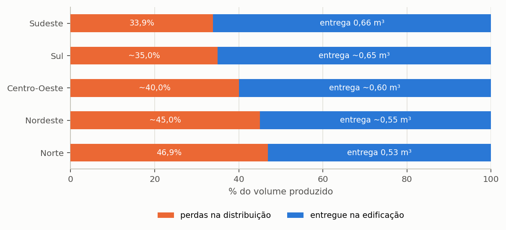

*Figura 26 — Quanto de cada metro cúbico produzido chega efetivamente à edificação, por macrorregião. É essa fração que converte um fator de emissão de saída de estação em fator por metro cúbico entregue, e ignorá-la subestima a emissão evitada em até um terço.*


---

### C.3. Rede elétrica

O fator da matriz elétrica brasileira muda **todo ano**, e um estudo sem o ano
declarado é irreprodutível. O programa traz cinco bases de referência e registra qual
foi usada.

---

### C.4. Insumos de tratamento

<!-- tabela: **Tabela 94** — Fatores de emissão dos insumos de tratamento -->
| Insumo | Fator |
| :--- | ---: |
| hipoclorito de cálcio em pastilha a 65% | 1,72 kg CO₂e/kg de produto |
| lâmpada ultravioleta | energia da rede |
| gerador de ozônio | energia da rede |

A massa é de **produto**, e não de cloro ativo. Pastilhas têm cerca de 65% de cloro
ativo.

---

### C.5. Motobomba

Não existe Declaração Ambiental de Produto de motobomba residencial brasileira. O
programa compõe o valor com duas fontes lidas: a massa de cada potência, do catálogo da
Dancor, e a intensidade de 4,77 kg CO₂e por quilo de bomba, da EPD da Grundfos
EPD-GRU-20250340-CBA1-EN (2025, módulos A1 a A3).

<!-- tabela: **Tabela 95** — Emissão de fabricação da motobomba por potência, com a massa de catálogo -->
| Potência | Massa | Emissão de fabricação |
| ---: | ---: | ---: |
| 1/4 CV | 6,1 kg | 29,1 kg CO₂e |
| 1/2 CV | 6,4 kg | 30,5 kg CO₂e |
| 3/4 CV | 13,5 kg | 64,4 kg CO₂e |
| 1 CV | 15,3 kg | 73,0 kg CO₂e |
| 1 1/2 CV | 17,5 kg | 83,5 kg CO₂e |
| 2 CV | 20,7 kg | 98,8 kg CO₂e |

> **Declare no estudo.** A EPD é de um circulador europeu com eletrônica embarcada, e a
> massa de referência inclui a embalagem. A intensidade por quilo é aproximação de ordem
> de grandeza, e não inventário da bomba instalada; havendo EPD do fabricante empregado,
> ela prevalece. Os valores anteriores, de 12 a 55 kg CO₂e, ficavam de 1,7 a 2,7 vezes
> abaixo destes, e quatro deles eram extrapolação aritmética.

---

### C.6. Fatores com rótulo de triagem

Nem todo parâmetro tem fonte primária, e os que não têm são marcados no relatório: hoje,
as massas por metro cúbico útil do polietileno, do concreto e do aço inoxidável, que são
cenários geométricos, e qualquer fator digitado sem fonte. Na revisão de setembro de 2026,
o último fator de emissão padrão sem procedência, o do hipoclorito, passou a tê-la:

<!-- tabela: **Tabela 96** — Procedência do fator de emissão do hipoclorito -->
| Etapa | Valor |
| :--- | :--- |
| base e modelo | Ecoinvent 3.8, *cutoff* |
| processo | *sodium hypochlorite production, product in 15% solution state*, geografia RoW (resto do mundo) |
| método | EF 3.1, categoria *Climate change* |
| resultado | 2,522 kg CO₂e por kg de NaOCl puro |
| conversão | 0,9525 kg de cloro ativo por kg de NaOCl, logo 2,65 kg CO₂e por kg de cloro ativo |
| fator adotado | 2,65 × 0,65 = **1,72 kg CO₂e por kg de pastilha** |

> **Declare a aproximação.** O Ecoinvent 3.8 não tem hipoclorito de cálcio, e o fator é
> o do hipoclorito de sódio levado à base de cloro ativo. Fatores informados pelo usuário
> sem fonte continuam recebendo o rótulo de triagem, e um inventário que apresenta todos
> os fatores com o mesmo grau de confiança esconde onde está a fragilidade.

---

### C.7. O que consultar antes de publicar

1. `docs/procedencia_fatores_co2.md`, para a fonte item a item;
2. a aba de Documentação, capítulo de avaliação de ciclo de vida, para as
   justificativas exibidas ao usuário;
3. o inventário do relatório ambiental, que lista cada item com o fator aplicado.

---

## Apêndice E — Base climática


---

### E.1. O que a base contém

<!-- tabela: **Tabela 97** — Conteúdo da base climática nacional -->
| O que a base traz | Quantidade |
| :--- | ---: |
| cidades brasileiras | 652 |
| modelos climáticos do CMIP6 | 19 |
| cenários de emissão | 2, SSP2-4.5 e SSP5-8.5 |
| simulações por cidade e modelo | 3: histórica, SSP2-4.5 e SSP5-8.5 |
| total de séries temporais | 37.164 séries |
| formato original descompactado | ~6,5 GB (CSVs) |
| formato compilado do Triton | Banco SQLite comprimido (`climbra.db`) |

Cada série é um registro diário contínuo de precipitação, em milímetros, para uma combinação de
cidade, modelo e simulação: 652 cidades × 19 modelos × 3 simulações dão as 37.164
séries. As séries vêm do **CLIMBra** (Ballarin et al., 2023, [*Scientific Data / Nature*](https://www.nature.com/articles/s41597-023-01956-z), [doi:10.1038/s41597-023-01956-z](https://doi.org/10.1038/s41597-023-01956-z); repositório [*Science Data Bank*](https://doi.org/10.57760/sciencedb.02316), [doi:10.57760/sciencedb.02316](https://doi.org/10.57760/sciencedb.02316)), corrigidas de viés por
*Quantile Delta Mapping* contra a grade diária de Xavier, King e Scanlon (2016), com
resolução de 0,25°. A histórica cobre de 1980 a 2013 (12.419 dias) e as futuras, de 2015 a 2100 (31.411 dias); as
janelas de estudo são recortes livres dessas séries. Todas estão em calendário
gregoriano. Os modelos HadGEM3-GC31-LL, KACE e UKESM1-0-LL, que usam originalmente anos
de 360 dias, têm um dia a menos no fim de cada série, o que não afeta o recorte.

---

### E.2. Embarque no executável e formato otimizado

Para evitar a manipulação morosa de dezenas de milhares de arquivos de texto e viabilizar
a distribuição direta no instalador e executável do Triton, as 37.164 séries foram
compiladas e indexadas em um banco de dados **SQLite de alta eficiência** (`climbra.db`), com
compressão binária por série via `zlib`.

- **Velocidade de acesso:** O acesso indexado no banco leva **menos de 1 milissegundo** por série, contra dezenas de milissegundos na abertura e parse de arquivos CSV em disco.
- **Transparência:** O motor de dados climáticos do Triton prioriza o banco compilado e recorre automaticamente à pasta de arquivos `.csv` soltos se o banco não for encontrado.
- **Portabilidade:** Permite ao instalador do Triton fornecer a base nacional pronta para uso sem exigir download manual e descompactação de 6,5 GB pelo usuário.

---

### E.3. Os cenários

As duas trajetórias socioeconômicas compartilhadas do CMIP6 disponíveis na base, as *Shared Socioeconomic Pathways*, estão desenhadas na seção 3.2 (volume Guias de uso): o SSP2-4.5 é a trajetória intermediária e o SSP5-8.5 supõe emissões altas sem mitigação. O CLIMBra não inclui cenários de mitigação forte, como o SSP1-2.6.


---

### E.4. As séries históricas que acompanham o programa

Independentes da base CMIP6, quatro séries históricas longas acompanham a
instalação, na pasta `data/rainfall` do programa:

<!-- tabela: **Tabela 98** — Séries históricas de precipitação distribuídas com o programa -->
| Cidade | Arquivos |
| :--- | ---: |
| Florianópolis | 3 |
| Brasília | 3 |
| Manaus | 3 |
| São Paulo | 3 |

A série de Florianópolis usada no tutorial tem 86 anos; os trinta primeiros anos
somam 1.795 mm anuais médios, com chuva em 46% dos dias.

---

### E.5. O que declarar num estudo

- **modelo ou modelos**, pelo nome, e o critério de seleção;
- **cenário** SSP;
- **janela temporal**, com os anos;
- a **série histórica** usada como referência;
- se houve *downscaling* ou correção de viés, e qual;
- a **procedência e a versão** da base.

A seção 3.2 (volume Guias de uso) trata da condução do estudo com cenários futuros, e alerta para o erro de
escolher o modelo pelo resultado.

---

## Apêndice G — Glossário

Termos técnicos e siglas, com o equivalente em inglês quando ele é usado na
literatura, acompanhados das diretrizes de padronização terminológica do Triton.

---

**AAC** (*aproveitamento de água de chuva*). Emprego de água precipitada sobre coberturas
para usos não potáveis em edificações, regulamentado no Brasil pela ABNT NBR 15527:2019.
Deve-se preferir o termo «aproveitamento» a «reúso», uma vez que a água de chuva captada
na cobertura é um recurso primário e não um efluente gerado por uso antrópico anterior.

**ABNT**. Associação Brasileira de Normas Técnicas, o organismo que publica as normas
brasileiras. Uma norma é identificada pela sigla NBR seguida do número e do ano da
edição, como em ABNT NBR 15527:2019.

**ACV** (*life cycle assessment*). Avaliação de ciclo de vida. Método que contabiliza os
impactos ambientais de um produto ao longo de toda a sua existência, da extração das
matérias-primas ao descarte. A do programa é de **triagem**, e não um inventário completo
conforme a ISO 14040.

**Água de chuva** (*rainwater*). Precipitação atmosférica coletada diretamente em
superfícies impermeáveis de cobertura (telhados e lajes impermeabilizadas), antes de atingir
o solo ou galerias públicas. É o termo técnico-normativo oficial consagrado pela ABNT NBR
15527:2019. Deve-se utilizar rigorosamente «água de chuva» para designar o recurso natural
e a fonte hídrica captada, evitando a forma coloquial «água da chuva».

**Água não potável** (*non-potable water*). Água que não se destina ao consumo humano direto,
mas atende aos padrões de qualidade física, química e microbiológica estabelecidos por
normas específicas (como a Tabela 1 da ABNT NBR 15527:2019 e a ABNT NBR 16783:2019) para
usos admitidos: descargas em bacias sanitárias e mictórios, lavagem de veículos, calçadas e
pisos, irrigação paisagística, lavagem de roupas e torres de resfriamento.

**Água pluvial** (*stormwater*, *pluvial water*). Água de chuva que escoa superficialmente
por superfícies urbanas ou é conduzida por canalizações e sistemas prediais de drenagem
(ABNT NBR 10844). No Triton, o termo aplica-se preferencialmente à infraestrutura predial
e aos componentes de engenharia: *sistema de aproveitamento de água pluvial (SAAP)*, *rede
pluvial*, *demanda pluvial*, *consumo de água pluvial* e *extravasamento pluvial*.

**Água potável** (*potable water*, *drinking water*). Água que atende integralmente aos
padrões de potabilidade definidos pela Portaria GM/MS nº 888/2021 do Ministério da Saúde,
destinada à ingestão direta, preparação de alimentos e higiene pessoal.

**ANEEL**. Agência Nacional de Energia Elétrica, que homologa as tarifas das
distribuidoras de energia. O Triton lê delas o preço da energia do bombeamento, e a
atualização das tarifas é feita a partir dos dados abertos da agência.

**AQUA-HQE**. Referencial de certificação ambiental de edificações, adaptação brasileira
do francês HQE conduzida pela Fundação Vanzolini. No referencial residencial de 2024, a
água é tratada no tema «Consumo de água», em itens classificados nos níveis PR, HQE,
HQE 2 e HQE 3.

**Área de captação** (*catchment area*). Área projetada na **horizontal** da superfície
impermeável da cobertura onde a água é captada, conforme o item 3.6 da NBR 15527:2019.
Não é a área inclinada do telhado, nem a área de contribuição da NBR 10844, que serve
ao dimensionamento de calhas.

**Bandeira tarifária**. Acréscimo ou desconto sobre a tarifa de energia elétrica,
conforme as condições de geração. Verde, amarela, vermelha 1, vermelha 2, e a
modalidade branca.

**BD+C** (*Building Design and Construction*). Família de referenciais do LEED
para projeto e construção de edificações novas ou em grande reforma. É a família
tratada neste manual, nas versões 4, 4.1 e 5.

**BIM** (*building information modeling*). Modelagem da informação da construção.
Representação digital da edificação em que cada componente carrega propriedades além da
geometria, o que permite compatibilizar projetos de disciplinas diferentes.

**BRL**. Sigla da Edição Brasil do programa, a que traz os dados brasileiros: base
climática CLIMBra, tarifas de 652 municípios, energia da ANEEL, custos em reais e
certificações nacionais. A seção 1.2 (volume Comece aqui) compara as duas edições.

**CAD** (*computer-aided design*). Desenho assistido por computador. O programa exporta o
esquema hidráulico em DXF, formato de intercâmbio aceito pelos programas de CAD.

**CAPEX** (*capital expenditure*). Investimento inicial.

**CASAN**. Companhia Catarinense de Águas e Saneamento, a concessionária de água e esgoto
de Florianópolis e de boa parte de Santa Catarina. A estrutura tarifária dela é a adotada
no tutorial deste manual.

**CDD** (*consecutive dry days*). Maior sequência de dias consecutivos com chuva
abaixo de 1 mm.

**CEDAE**. Companhia Estadual de Águas e Esgotos do Rio de Janeiro. A estrutura tarifária
dela — conta mínima de 15 m³ (Tarifa 1) e faixas com multiplicadores da tarifa de
referência — foi herdada pela Águas do Rio, pela Rio+ Saneamento e pela Águas da
Imperatriz.

**CMIP6**. Sexta fase do *Coupled Model Intercomparison Project*, o exercício
internacional coordenado que produz as projeções climáticas usadas pelos relatórios do
IPCC. A base climática do programa deriva dele.

**CLIMBra** (*Climate Change Dataset for Brazil*). Conjunto de dados meteorológicos diários em grade de alta resolução (0,25° × 0,25°, ~28 km) para todo o Brasil, cobrindo 19 modelos climáticos globais do CMIP6 e cenários de emissões SSP2-4.5 e SSP5-8.5. Desenvolvido por Ballarin et al. (2023) na revista [*Scientific Data* (Nature)](https://www.nature.com/articles/s41597-023-01956-z) ([doi:10.1038/s41597-023-01956-z](https://doi.org/10.1038/s41597-023-01956-z)) e disponibilizado publicamente no [*Science Data Bank*](https://doi.org/10.57760/sciencedb.02316) ([doi:10.57760/sciencedb.02316](https://doi.org/10.57760/sciencedb.02316)). As projeções brutas foram corrigidas de viés pelo método *Quantile Delta Mapping* (QDM) utilizando como referência observacional a base de Xavier, King e Scanlon (2016). No Triton, o CLIMBra constitui a Base de dados CLIMBra para 652 cidades brasileiras (série histórica de 1980 a 2013 e projeções futuras contínuas de 2015 a 2100).

**Coeficiente de escoamento** (*runoff coefficient*). Fração da chuva que
efetivamente chega ao reservatório, descontadas perdas por absorção, evaporação e
molhamento inicial da cobertura.

**Comprimento representativo de série de precipitação** (*representative rainfall time series length*, $N_{rep}$).
Menor período contínuo em anos de dados diários de chuva necessário para estabilizar
estatisticamente o dimensionamento e o desempenho do sistema (reproduzindo o volume ideal
e o potencial de economia da série completa sob confiança $\ge 90\%$), segundo a
metodologia de Geraldi e Ghisi (2017, 2018, 2019). O comprimento necessário não é uma
constante geográfica fixa: cresce com a fração atendível e com o nível de demanda da edificação.

**Confiabilidade temporal** ($C_t$). Percentual de dias em que o sistema atendeu
plenamente ($V_{con,t} = D_{pl,t}$), parcialmente ou não atendeu a demanda pluvial.

**Confiabilidade volumétrica** ($C_v$). Fração da demanda **pluvial** que o sistema atendeu
($C_v = \sum V_{con} / \sum D_{pl} = E_{pot} / f$). Não confundir com o potencial de economia,
que tem no denominador a demanda total da edificação.

**CORSAN**. Companhia Riograndense de Saneamento, a concessionária de água e esgoto de boa
parte do Rio Grande do Sul. Fatura a água pela fórmula exponencial `PB × Cⁿ` somada ao
serviço básico, e não por faixas de consumo.

**CSV** (*comma-separated values*). Formato de arquivo de texto em que cada linha é um
registro e as colunas são separadas por um caractere, tipicamente vírgula ou ponto e
vírgula. É o formato das séries de precipitação.

**CV**. Cavalo-vapor, unidade de potência equivalente a 0,7355 kW, corrente no comércio
de motobombas no Brasil. Uma motobomba de meio CV tem 0,37 kW de potência de eixo.

**CWD** (*consecutive wet days*). Maior sequência de dias consecutivos com chuva
igual ou superior a 1 mm.

**Demanda estocástica** (*stochastic water demand*). Modelagem do consumo diário de água como
variável probabilística que varia dia a dia e entre realizações (Silva e Ghisi, 2016),
permitindo avaliar a faixa de incerteza do dimensionamento e dos indicadores de desempenho
sob variabilidade real de uso.

**Demanda pluvial** (*pluvial demand*, $D_{pl}$). Parcela da demanda diária de água da
edificação que pode ser suprida pelo sistema de aproveitamento ($D_{pl,t} = D_{tot,t} \times f$).
Corresponde aos pontos de consumo não potável interligados à rede pluvial.

**Descarte de primeiras águas** (*first flush*). Lâmina inicial de chuva desviada do
sistema, que carrega a sujeira depositada na cobertura (mínimo de 2 mm conforme a NBR
15527:2019). No Triton é **subtraída** da chuva do dia; no Netuno 4 era tratada como
limiar do evento.

**Disponibilidade**. Regime tarifário em que um valor fixo **soma** por cima do
consumo medido. Cada metro cúbico economizado desconta.

**DN** (*diâmetro nominal*). Designação comercial do diâmetro de um tubo ou conexão, em
milímetros. Não corresponde exatamente ao diâmetro interno nem ao externo: é um número de
referência do qual decorrem as dimensões reais, tabeladas por norma.

**DXF** (*drawing exchange format*). Formato de intercâmbio de desenhos técnicos, lido
por praticamente todos os programas de CAD.

**EAU**. Prefixo dos itens do tema «Consumo de água» no referencial AQUA-HQE, do francês
*eau*, água. Os itens ligados ao aproveitamento pluvial são o EAU.1.2, o EAU.1.3 e o
EAU.1.5.

**EDGE** (*excellence in design for greater efficiencies*). Referencial de certificação
da International Finance Corporation, do Banco Mundial. Mede economia percentual contra
um caso-base local em três dimensões independentes e exige que cada uma cruze o limiar.

**EN** (*Europäische Norm*, norma europeia). Norma publicada pelo Comitê Europeu de
Normalização. Neste manual, a EN 15978, que define os módulos do ciclo de vida da
edificação, e a EN 15804, que rege as declarações ambientais de produtos de construção.

**EPD** (*Environmental Product Declaration*). Declaração ambiental de produto: documento
verificado por terceiros, conforme a ISO 14025 e, na construção, a EN 15804, que publica
os impactos do ciclo de vida de um produto por unidade declarada. É a fonte preferida para
fatores de emissão de materiais e equipamentos.

**ESG** (*environmental, social and governance*). Conjunto de critérios ambientais,
sociais e de governança usado na avaliação de empresas e de empreendimentos. O programa
alimenta indicadores ambientais desse conjunto.

**ETAP**. Estação de tratamento de água pluvial. No programa, o conjunto de filtro
de entrada, desinfecção e filtro de polimento.

**ETCCDI** (*Expert Team on Climate Change Detection and Indices*). Grupo de trabalho
internacional que padronizou os índices de extremos climáticos, dos quais o programa
calcula oito.

**Extravasamento** (*spillage*, *overflow*). Volume que excede a capacidade do reservatório
e é conduzido pelo extravasor quando ele já está cheio.

**Fração atendível por água pluvial** (*non-potable demand share*, $f$). Percentual da demanda
total de água da edificação ($D_{tot}$) passível de suprimento por água de chuva ($f = D_{pl} / D_{tot}$).
Representa o **teto assintótico intransponível** do potencial de economia de água potável
($E_{pot} \le f$): mesmo sob capacidade infinita de armazenamento e precipitação ilimitada,
a economia de potável nunca ultrapassa a fração atendível, pois o restante ($1 - f$) é
reservado aos usos nobres e potáveis. Distingue-se da confiabilidade volumétrica ($C_v = E_{pot} / f$),
que avalia o atendimento da parcela pluvial.

**Franquia no mínimo**. Regime tarifário em que o valor fixo já inclui um volume de
consumo. Economizar **abaixo** da franquia não reduz a fatura.

**Ganho marginal**. Variação do potencial de economia por metro cúbico acrescentado
ao reservatório, em %/m³ ($\Delta E_{pot} / \Delta V$). Critério de escolha do volume ideal.

**GRI** (*Global Reporting Initiative*). Padrão internacional de divulgação corporativa
de desempenho socioambiental. Sua série 303 trata de água e efluentes.

**HQE** (*Haute Qualité Environnementale*). Referencial francês de alta qualidade
ambiental, base do AQUA-HQE. Designa também os níveis dos itens do referencial: HQE,
HQE 2 e HQE 3, em ordem crescente de exigência, acima do pré-requisito (PR).

**IFC**. A sigla designa duas coisas distintas. Em certificação, é a *International
Finance Corporation*, do Banco Mundial, que desenvolve o EDGE. No contexto BIM, é o
*Industry Foundation Classes*, formato aberto de intercâmbio que o programa **não**
exporta: a exportação BIM do programa é um arquivo JSON de propriedades.

**INT**. Sigla da *International Edition* do programa: abre em inglês e não traz dados
brasileiros. Tarifas, custos, moeda e fatores de emissão são informados pelo usuário.

**IPCC** (*Intergovernmental Panel on Climate Change*). Painel intergovernamental que
sintetiza o conhecimento científico sobre mudança do clima e organiza os relatórios de
avaliação a que as projeções climáticas se referem.

**IPTU verde**. Desconto no imposto predial concedido por alguns municípios a edificações
que adotam medidas de sustentabilidade, entre elas o aproveitamento de água pluvial. O
percentual e as condições variam por legislação municipal.

**ISO 14040**. Norma internacional que estabelece os princípios e a estrutura da
avaliação de ciclo de vida. Um inventário conforme a ISO 14040 exige rastreabilidade de
cada fluxo e revisão crítica externa, requisitos que uma avaliação de triagem não cumpre.

**JSON** (*JavaScript object notation*). Formato de arquivo de texto estruturado, legível
por pessoas e por programas. É o formato interno do arquivo `.triton`.

**LCOW** (*levelized cost of water*). Custo nivelado da água: razão entre o valor presente
de todos os custos do ciclo de vida do sistema (CAPEX, substituições, O&M, energia e
produtos químicos) e o volume descontado de água pluvial consumida ao longo do horizonte
de análise, em R$/m³. Permite confrontar a viabilidade econômica do sistema diretamente
com a tarifa da concessionária.

**LEED** (*leadership in energy and environmental design*). Referencial de certificação
ambiental de edificações do *U.S. Green Building Council*, o mais difundido
internacionalmente. Trata eficiência hídrica na categoria *Water Efficiency*: na versão 4,
pelos créditos WEc1 e WEc2; na versão 5, pelo crédito WEc2, *Enhanced Water Efficiency*.

**m.c.a.** Metro de coluna d'água, unidade de pressão equivalente à exercida por uma
coluna de água de um metro de altura, cerca de 9,81 kPa. É a unidade usual em instalações
prediais.

**MCTI**. Ministério da Ciência, Tecnologia e Inovação, que publica o fator de emissão
médio do Sistema Interligado Nacional usado na avaliação ambiental da Edição Brasil.

**Micromedição**. Medição individualizada por unidade habitacional em edifício
multifamiliar. Informada ao programa como número de economias.

**Manuais do Triton** (*Triton manual suite*). A documentação do programa, montada
das mesmas fontes em três formatos: o manual completo, oito volumes avulsos, cada um com
uma parte dele, e o site de documentação. Os volumes servem a quem precisa de uma parte
só, para consultar ou enviar:

1. **Manual completo**: todos os capítulos e apêndices.
   
2. **Volume 1 — Comece aqui**: o que o programa faz, como instalá-lo e por onde entrar
   conforme o seu objetivo.
   
3. **Volume 2 — O método**: as equações, os critérios e as fontes por trás de cada número
   que o programa publica.
   
4. **Volume 3 — Guias de uso**: outras cidades, clima futuro, tarifas, demanda variável,
   lote, sensibilidade e exportação.
   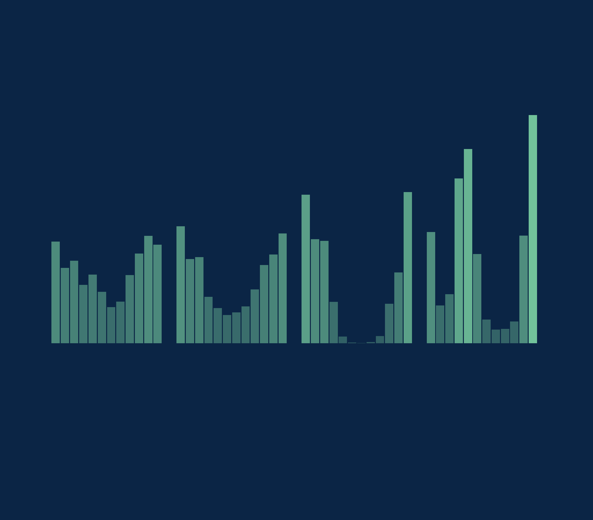
5. **Volume 4 — Tutorial**: um projeto de residência em Florianópolis, do primeiro dado ao
   volume recomendado.
   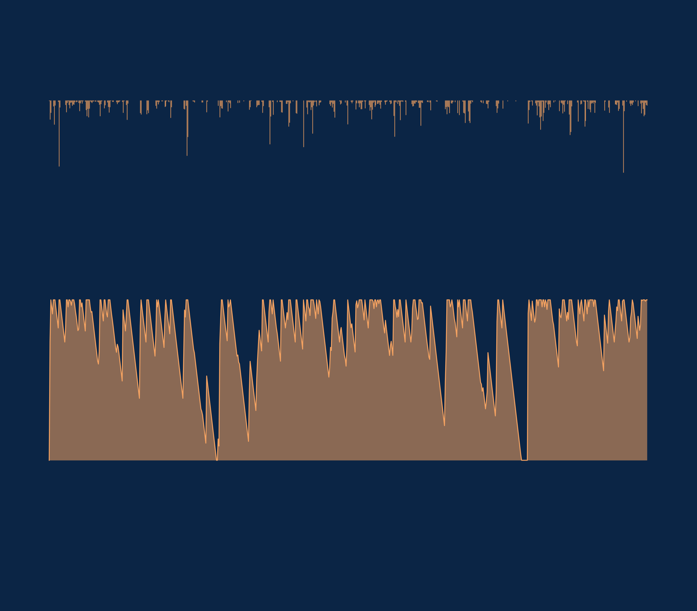
6. **Volume 5 — Enganos, limitações e confiabilidade**: os enganos mais comuns, os limites
   do modelo e como o programa é verificado.
   
7. **Volume 6 — Correções, bugs e versionamento**: o que mudou desde o Netuno 4, as
   mensagens de erro e como relatar um problema.
   
8. **Volume 7 — Modulação probabilística**: o estudo refeito com premissas sorteadas —
   variáveis, distribuições, leitura dos resultados e limites do método.
   
9. **Volume 8 — Apêndices**: parâmetros, processos, fatores de emissão, tarifas, base
   climática, formatos, glossário e referências.
   

Os PDFs acompanham o programa e abrem pela etapa 9. Documentação; o manual existe também
em inglês, na íntegra.

**NBR**. Norma Brasileira, publicada pela ABNT. As mais citadas neste manual são a NBR
15527, de aproveitamento de água de chuva, a NBR 10844, de instalações prediais de águas
pluviais, a NBR 5626, de sistemas prediais de água fria e quente, e a NBR 17094-2, de
motores de indução.

**Payback de carbono**. Tempo para a economia anual líquida de emissões pagar o
carbono incorporado na fabricação do sistema.

**Payback descontado**. Tempo para o fluxo de caixa descontado acumulado cruzar zero.

**PB**. Preço-base, em R$/m³, da fórmula exponencial da CORSAN, `PB × Cⁿ`, em que `C` é o
consumo do mês e `n` o expoente da tabela exponencial para aquele consumo.

**PEAD**. Polietileno de alta densidade, material dos reservatórios plásticos mais
comuns no mercado brasileiro.

**Piso de pagamento**. Regime tarifário em que a fatura **não fica** abaixo de um
valor. Diferente de disponibilidade: o piso limita por baixo, a disponibilidade soma
por cima.

**Potencial de economia de água potável** (*potable water saving potential*, $E_{pot}$).
Fração da demanda **total** da edificação suprida por água pluvial ($E_{pot} = \sum V_{con} / \sum D_{tot} \times 100\%$).
É o indicador central do programa, limitado superiormente pela fração atendível ($E_{pot} \le f$).

**pp**. Pontos percentuais. Usado para exprimir a diferença entre dois percentuais: de
35% para 37% vão dois pontos percentuais, e não dois por cento.

**PR**. Pré-requisito: no AQUA-HQE, o nível de item de atendimento obrigatório, abaixo
dos níveis HQE, HQE 2 e HQE 3.

**PRCPTOT**. Precipitação total anual em dias úmidos.

**PRFV**. Plástico reforçado com fibra de vidro, material de reservatórios de médio e
grande porte. Aparece no programa sob a designação «fibra».

**PVC**. Policloreto de vinila, material das tubulações prediais de água fria e das
colunas de desvio do descarte inicial. As dimensões dos tubos soldáveis seguem a ABNT NBR 5648.

**R95p**. Soma da precipitação dos dias acima do percentil 95 dos dias úmidos.

**Rendimento da bomba**. Razão entre a potência hidráulica entregue à água e a
potência mecânica no eixo. Não inclui o motor.

**Rendimento do motor**. Razão entre a potência mecânica no eixo e a potência
elétrica consumida da rede. A ABNT NBR 17094-2 manda marcá-lo na placa.

**RX1day**, **RX5day**. Maior precipitação em um e em cinco dias consecutivos, no
ano.

**SAAP**. Sistema de aproveitamento de água pluvial. Conjunto integrado de componentes
prediais — área de captação, condutores, descarte inicial (first flush), estação de
tratamento (ETAP), cisterna inferior, reservatório superior, grupo motobomba ou pressurizador
e rede de distribuição independente — concebido para coletar, tratar, armazenar e fornecer
água não potável em conformidade com a ABNT NBR 15527 e a ABNT NBR 5626.

**SB**. Serviço básico: a parcela fixa mensal da fatura de água da CORSAN, somada ao
resultado da fórmula exponencial.

**SDII** (*simple daily intensity index*). Precipitação média dos dias úmidos.

**SI** (*seasonality index*). Índice de sazonalidade de Walsh e Lawler. Zero quando a
chuva é uniforme ao longo do ano.

**SMAA** (*stochastic multicriteria acceptability analysis*). Método que sorteia
pesos e devolve a probabilidade de cada alternativa vencer.

**SNIS**. Sistema Nacional de Informações sobre Saneamento, base oficial brasileira de
indicadores do setor, mantida pelo governo federal. É a origem dos indicadores de
consumo energético do saneamento usados na avaliação ambiental.

**SSP** (*shared socioeconomic pathways*). Trajetórias socioeconômicas compartilhadas,
que descrevem hipóteses coerentes de desenvolvimento global e as emissões correspondentes.
Combinam-se com os modelos climáticos para produzir projeções.

**TFDI**. Tarifa fixa de disponibilidade da infraestrutura, nome que algumas
concessionárias dão à parcela da fatura cobrada independentemente do consumo. Ver
*Disponibilidade*.

**TIR**. Taxa interna de retorno. A taxa de desconto que zera o valor presente
líquido.

**TMA**. Taxa mínima de atratividade. A taxa de desconto adotada.

**TOPSIS** (*technique for order of preference by similarity to ideal solution*).
Método de ordenação multicritério de Hwang e Yoon.

**UV**. Radiação ultravioleta, empregada na desinfecção de água por inativação de
microrganismos. Atua apenas no instante da passagem pelo reator e não deixa residual, ao
contrário da cloração.

**VIKOR**. Método de decisão multicritério proposto por Opricovic, que busca uma solução
de compromisso entre critérios conflitantes. Ver também *SMAA*.

**Volume ideal** (*optimal tank volume*). Menor volume de reservatório da grade de simulação
a partir do qual o ganho marginal de economia de água potável ($\Delta E_{pot} / \Delta V$)
cai abaixo de um limiar declarado (tipicamente $1,0\%/\text{m}^3$ ou $0,5\%/\text{m}^3$).
Evita o superdimensionamento de reservatórios, assegurando a melhor relação custo-benefício.

**VPL**. Valor presente líquido.

**WEM**. Codificação das medidas de eficiência hídrica do EDGE. A WEM14 é o sistema
de aproveitamento de água pluvial.

**XLSX**. Formato de pasta de trabalho do Microsoft Excel, baseado em XML compactado. É um
dos formatos de exportação de planilhas e de resultados da linha de comando.

**YAS** (*yield after spillage*). Regra de operação em que o extravasamento é
calculado **antes** da retirada da demanda e, na forma estrita, a retirada do dia sai
só do volume guardado na véspera. O programa calcula o extravasamento antes, como a
YAS, mas deixa a chuva do dia atender a demanda do dia; fica entre a YAS e a YBS
(seção 2.1).

**YBS** (*yield before spillage*). Regra de operação em que a demanda é retirada **antes**
do cálculo do extravasamento. Supõe consumo anterior à chuva do dia e superestima o
aproveitamento; o programa não a adota, e o resultado dele fica entre a YAS e a YBS.

---

### G.1. Diretrizes de Padronização e Nomenclatura no Triton

A padronização terminológica é indispensável para assegurar a consistência e o rigor técnico
em artigos científicos, relatórios técnicos, na interface gráfica e na documentação do Triton.
As convenções a seguir detalham a distinção de termos correlatos frequentemente confundidos:

#### G.1.1. 1. Água de Chuva versus Água Pluvial versus «Água da Chuva»

<!-- tabela: **Tabela 99** — Padronização terminológica de água de chuva e água pluvial -->
| Termo | Definição e Contexto de Aplicação | Situação no Triton | Referência |
| :--- | :--- | :--- | :--- |
| **Água de chuva** (*rainwater*) | Precipitação atmosférica coletada diretamente na cobertura (telhado/laje impermeabilizada), antes de atingir o solo ou galerias. Refere-se à **fonte hídrica** e ao recurso ambiental. | **Canônico e preferencial** para o recurso captado («aproveitamento de água de chuva», «precipitação de água de chuva»). | ABNT NBR 15527:2019, título e item 3.1. |
| **Água pluvial** (*stormwater* / *pluvial water*) | Água de chuva após escoamento superficial urbano ou quando conduzida por canalizações e sistemas prediais de drenagem e armazenamento. Aplica-se à **infraestrutura física** e aos componentes de engenharia. | **Canônico e preferencial** para sistemas, redes e balanço («sistema predial de água pluvial - SAAP», «rede pluvial», «demanda pluvial», «extravasamento pluvial»). | ABNT NBR 10844:1989; ABNT NBR 5626:2020. |
| **«Água da chuva»** | Expressão coloquial e informal. | **Desaconselhada**. Não deve ser empregada em publicações, textos normativos, relatórios do Triton ou código. | Prática de redação técnica e científica. |

#### G.1.2. 2. Fração Atendível, Demanda Pluvial, Potencial e Confiabilidade

Para evitar ambiguidades matemáticas e conceituais frequentemente encontradas na literatura:

<!-- tabela: **Tabela 100** — Grandezas fundamentais do balanço hídrico e relações entre fração e potencial -->
| Grandeza | Símbolo / Código | Definição | Fórmula | Relação / Teto |
| :--- | :--- | :--- | :--- | :--- |
| **Fração atendível por água pluvial** | $f$ / `rainwater_share` | Proporção da demanda total da edificação correspondente a pontos de consumo não potável conectáveis ao SAAP. | $f = D_{pl} / D_{tot}$ | Parâmetro de projeto ($0 \le f \le 1$). Constitui o **teto assintótico** de $E_{pot}$. |
| **Demanda pluvial** | $D_{pl}$ / `rainwater_demand` | Volume de água requerido pelos pontos não potáveis da edificação em um intervalo de tempo. | $D_{pl,t} = D_{tot,t} \times f$ | Em L/dia ou m³/ano. |
| **Volume de água pluvial consumido** | $V_{con}$ / `pluvial_consumed` | Volume de água não potável efetivamente suprido pelo reservatório pluvial aos pontos de consumo. | Determinado pelo balanço diário (seção 2.1) | $V_{con,t} \le D_{pl,t}$ e $V_{con,t} \le S_{t-1} + C_t$. |
| **Potencial de economia de água potável** | $E_{pot}$ / `potential_potable_savings_pct` | Percentual da demanda **total** da edificação economizado pelo aproveitamento pluvial. | $E_{pot} = \frac{\sum V_{con}}{\sum D_{tot}} \times 100\%$ | **Indicador central**. Sempre $E_{pot} \le f$. |
| **Confiabilidade volumétrica** | $C_v$ / `volumetric_reliability_pct` | Percentual da demanda **pluvial** suprido pela água de chuva armazenada. | $C_v = \frac{\sum V_{con}}{\sum D_{pl}} \times 100\%$ | $C_v = \frac{E_{pot}}{f}$. Pode atingir 100% mesmo quando $E_{pot} < 100\%$. |
| **Confiabilidade temporal** | $C_t$ / `temporal_reliability_pct` | Percentual de dias da série em que a demanda pluvial foi 100% atendida ($V_{con,t} = D_{pl,t}$). | $C_t = \frac{N_{dias\_plenos}}{N_{total}} \times 100\%$ | Mede a segurança de abastecimento diário sem suplementação potável. |

#### G.1.3. 3. Síntese de Nomenclatura Recomendada para Artigos e Relatórios

- Utilize **«aproveitamento de água de chuva»** (e não «reúso de água da chuva» — água de chuva não é efluente; seu uso é *aproveitamento*, não *reúso*).
- Utilize **«área de captação»** para o plano horizontal da cobertura (NBR 15527) e reserve **«área de contribuição»** exclusivamente para o dimensionamento hidráulico de calhas sob vento (NBR 10844).
- Utilize **«descarte de primeiras águas»** ou *first flush* para a lâmina inicial desviada (mínimo de 2 mm conforme NBR 15527), e não «limiar de descarte».
- Utilize **«fração atendível»** (e não «demanda relativa» ou «fração de economia») para expressar a partição de usos não potáveis no consumo total.
- Utilize **«comprimento representativo de série»** para a extensão mínima em anos necessária para estabilização estatística da simulação (método Geraldi & Ghisi).
- Utilize **«LCOW»** ou **«custo nivelado da água»** para a métrica de custo unitário ao longo do ciclo de vida descontado à TMA.

---

## Apêndice H — Referências

Normas, publicações e bases que sustentam as decisões do programa. A lista completa,
com a proveniência de cada citação, está no módulo de bibliografia do programa e na
aba de Documentação.

---

### H.1. Normas técnicas brasileiras

**ABNT NBR 15527** — Água de chuva: aproveitamento de coberturas em áreas urbanas
para fins não potáveis. Requisitos. Estabelece os parâmetros de qualidade, o
descarte de primeiras águas e a manutenção.

**ABNT NBR 10844:1989** — Instalações prediais de águas pluviais. Procedimento.
Define a área de contribuição (item 3.2 e Figura 2), com os incrementos da inclinação e
das paredes, para a vazão de projeto de calhas e condutores; não é a área de captação do
balanço hídrico, que segue a NBR 15527:2019, item 3.6.

**ABNT NBR 16783** — Uso de fontes alternativas de água não potável em edificações.

**ABNT NBR 5626:2020** — Sistemas prediais de água fria e água quente. Projeto,
execução, operação e manutenção. Segunda edição, versão corrigida de 30/09/2020.

**ABNT NBR 15575-1:2025** — Edificações habitacionais. Desempenho. Parte 1: Requisitos
gerais. Sétima edição, 05/12/2025.

**ABNT NBR 15575-6:2021** — Edificações habitacionais. Desempenho. Parte 6: Requisitos
para os sistemas hidrossanitários. Quinta edição, 29/09/2021.

**ABNT NBR 17094-2:2016** — Máquinas elétricas girantes. Parte 2: motores de indução
monofásicos. Requisitos. A Tabela 13 traz o rendimento nominal mínimo a plena carga
da linha IR1, e a Tabela 14 o da linha IR2. A norma manda marcar o rendimento na
placa de identificação, o que estabelece que a potência de placa é a mecânica no
eixo.

**Portaria GM/MS 888/2021** — Procedimentos de controle e vigilância da qualidade da
água para consumo humano. Rege cloro residual e coliformes.

---

### H.2. Referenciais de certificação

**LEED v4 / v4.1 BD+C** — USGBC. Categoria *Water Efficiency*, créditos WEc1 e WEc2. Registro de projetos comerciais até 30 jun. 2027.

**LEED v5 BD+C** — U.S. GREEN BUILDING COUNCIL. *LEED v5 Building Design and Construction: rating system*. Washington, DC: USGBC, nov. 2025. Pré-requisitos WEp1 (*Water Metering and Reporting*) e WEp2 (*Minimum Water Efficiency*), créditos WEc2 (*Enhanced Water Efficiency*) e SSc3 (*Rainwater Management*).

**AQUA-HQE Residencial** — FUNDAÇÃO VANZOLINI; CERQUAL QUALITEL. *Referencial de avaliação
do desempenho de edifícios residenciais em construção e renovação*. Versão 00. São Paulo:
Fundação Vanzolini, 22 nov. 2024. Tema «Consumo de água», itens EAU.1.2, EAU.1.3 e EAU.1.5.

**Selo Casa Azul + CAIXA** — CAIXA ECONÔMICA FEDERAL. *Guia Selo Casa Azul + CAIXA*. V023.
Brasília: CAIXA, 29 abr. 2026. Critério 3.6, aproveitamento de águas pluviais.

**Selo Casa Azul Uni** — CAIXA ECONÔMICA FEDERAL. *Guia Selo Casa Azul Uni*. V001. Brasília:
CAIXA, dez. 2025. Critério 7, aproveitamento de águas pluviais.

**EDGE** — IFC, Grupo Banco Mundial. *EDGE Certification Process*, e a codificação
WEM das medidas de eficiência hídrica. Administrado pelo GBCI em mais de 120 países.

**GRI 303** — Global Reporting Initiative. Água e efluentes, indicadores 303-3 e
303-5.

---

### H.3. Métodos

**Hwang, C.-L.; Yoon, K.** (1981). *Multiple Attribute Decision Making: Methods and
Applications*. A formulação original do TOPSIS.

**Opricovic, S.; Tzeng, G.-H.** O método VIKOR e as condições C1 e C2 de vantagem
aceitável e estabilidade.

**Lahdelma, R.; Hokkanen, J.; Salminen, P.** (1998), e **Tervonen, T.; Figueira, J.**
(2008). SMAA e SMAA-2.

**Walsh, R. P. D.; Lawler, D. M.** (1981). O índice de sazonalidade.

**ETCCDI** — *Expert Team on Climate Change Detection and Indices*, da OMM. Os
índices de extremos climáticos.

---

**Mayer, P. W.; DeOreo, W. B. et al.** (1999). *Residential End Uses of Water*.
Denver: AWWA Research Foundation. Frequência de uso dos aparelhos: 5,05 descargas e
0,37 ciclos de máquina de lavar por pessoa por dia; as descargas são a base dos
acionamentos da pressurização direta.

**Komeco.** *Pressurizador de água TP 820T e TP 825T G2: manual do usuário*. Versão de
15/05/2007. Ficha técnica e gráfico vazão × pressão; a faixa do pressostato do TP 820T, 12
a 24 m.c.a., é a base da pressão de trabalho padrão.

**Cardal.** *Pressurizador Potenza: manual de instruções*. IM 311. Especificações
técnicas e curva vazão × pressão (figura 8).

**Jacuzzi.** *Pressurizador residencial AcquaHouse: manual de instruções*. Março de 2017.
Curvas vazão × pressão ensaiadas no Laboratório de Etiquetagem de Bombas da
Universidade Federal de Itajubá.

**Syllent (Eberle).** *Pressurizador para água quente, linha Impulse Press: manual de
instalação e operação*. Des. 3I4743. Tabela vazão × altura manométrica e retardo de
desligamento de 10 s do controle eletrônico.

**Rowa.** *Pressurizadores Max Press E: manual de instalação*, e ficha técnica do Max
Press 20E: pressão máxima de 20 m.c.a. e 5.000 L/h a 7 m.c.a.

### H.4. Normas de avaliação de ciclo de vida

**ABNT NBR ISO 14040** — Gestão ambiental: avaliação do ciclo de vida, princípios e
estrutura. Correspondente à ISO 14040:2006. As quatro fases da avaliação.

**ABNT NBR ISO 14044** — Gestão ambiental: avaliação do ciclo de vida, requisitos e
orientações. Correspondente à ISO 14044:2006.

**EN 15978:2011** — Sustainability of construction works: assessment of environmental
performance of buildings, calculation method. Os módulos A a D do ciclo de vida da
edificação.

**EN 15804:2012+A2:2019** — Sustainability of construction works: environmental product
declarations, core rules for the product category of construction products.

**EN 16941-1:2024** — On-site non-potable water systems — Part 1: Systems for the use
of rainwater. Bruxelas: CEN, 2024.

**ABNT NBR 15527:2007** — Água de chuva: aproveitamento de coberturas em áreas urbanas
para fins não potáveis. Anexo A, informativo: métodos de Rippl, da simulação, de Azevedo
Neto e práticos alemão, inglês e australiano.

---

### H.5. Dimensionamento e desempenho de sistemas de aproveitamento pluvial

**GHISI, E.; SOUZA, E. L.** (2012). Potable water savings by using rainwater for
non-potable uses in houses. *Water*, v. 4, n. 3, p. 607-628. doi:10.3390/w4030607.

**GHISI, E.; LOPES, A. C.; RUPP, R. F.** (2016). Assessment of the potential for potable
water savings by using rainwater in houses in southern Brazil. *Water Science and
Technology: Water Supply*, v. 16, n. 2, p. 533-541. doi:10.2166/ws.2015.166.

**GHISI, E.; CUSTÓDIO, D. A.** (2019). Assessing the potential for potable water savings
in the residential sector of a city: a case study of Joinville city. *Water*, v. 11,
n. 10, 2074. doi:10.3390/w11102074.

**CAMPISANO, A. et al.** (2017). Urban rainwater harvesting systems: research,
implementation and future perspectives. *Water Research*, v. 115.
doi:10.1016/j.watres.2017.02.056.

**CAMPISANO, A.; MODICA, C.** (2015). Appropriate resolution timescale to evaluate water
saving and retention potential of rainwater harvesting for toilet flushing in single
houses. *Journal of Hydroinformatics*, v. 17, n. 3. doi:10.2166/hydro.2015.022.

**FEWKES, A.; BUTLER, D.** (2000). Simulating the performance of rainwater collection and
reuse systems using behavioural models. *Building Services Engineering Research and
Technology*, v. 21, n. 2, p. 99-106. doi:10.1177/014362440002100204.

**GHISI, E.** (2010). Parameters influencing the sizing of rainwater tanks for use in
houses. *Water Resources Management*, v. 24, n. 10, p. 2381-2403.
doi:10.1007/s11269-009-9557-4.

**HASHIMOTO, T.; STEDINGER, J. R.; LOUCKS, D. P.** (1982). Reliability, resiliency, and
vulnerability criteria for water resource system performance evaluation. *Water
Resources Research*, v. 18, n. 1, p. 14-20. doi:10.1029/WR018i001p00014.

**MAYKOT, J. K.; GHISI, E.** (2020). Assessment of a rainwater harvesting system in a
multi-storey residential building in Brazil. *Water*, v. 12, n. 2, 546.
doi:10.3390/w12020546.

**PROENÇA, L. C.; GHISI, E.** (2010). Water end-uses in Brazilian office buildings.
*Resources, Conservation and Recycling*, v. 54, n. 8, p. 489-500.
doi:10.1016/j.resconrec.2009.10.005.

**SEMAAN, M. et al.** (2020). Optimal sizing of rainwater harvesting systems for domestic
water usages: a systematic literature review. *Resources, Conservation & Recycling: X*,
v. 6, 100033. doi:10.1016/j.rcrx.2020.100033.

---

### H.6. Clima futuro

**BALLARIN, A. S. et al.** (2023). CLIMBra: Climate Change Dataset for Brazil.
*Scientific Data*, v. 10. doi:10.1038/s41597-023-01956-z. A origem da base climática do
programa.

**HAWKINS, E.; SUTTON, R.** (2011). The potential to narrow uncertainty in projections of
regional precipitation change. *Climate Dynamics*, v. 37, p. 407-418.
doi:10.1007/s00382-010-0810-6.

**KISAKYE, V.; VAN DER BRUGGEN, B.** (2018). Effects of climate change on
water savings and water security from rainwater harvesting systems. *Resources,
Conservation and Recycling*. doi:10.1016/j.resconrec.2018.07.009.

**LASH, D. et al.** (2014). Robust rainwater harvesting: probabilistic tank sizing for
climate change adaptation. *Journal of Water and Climate Change*.
doi:10.2166/wcc.2014.080.

**MARAUN, D.** (2016). Bias correcting climate change simulations: a critical review.
*Current Climate Change Reports*, v. 2, n. 4, p. 211-220.
doi:10.1007/s40641-016-0050-x.

**XAVIER, A. C.; KING, C. W.; SCANLON, B. R.** (2016). Daily gridded meteorological
variables in Brazil (1980-2013). *International Journal of Climatology*, v. 36,
p. 2644-2659. doi:10.1002/joc.4518.

---

### H.7. Ciclo de vida e energia de sistemas pluviais

**GHIMIRE, S. R. et al.** (2014). Life cycle assessment of domestic and agricultural
rainwater harvesting systems. *Environmental Science & Technology*, v. 48.
doi:10.1021/es500189f.

**GHIMIRE, S. R. et al.** (2017). Life cycle assessment of a commercial rainwater
harvesting system compared with a municipal water supply system. *Journal of Cleaner
Production*. doi:10.1016/j.jclepro.2017.02.025.

**MARINOSKI, A. K.; GHISI, E.** (2018). Avaliação de viabilidade ambiental e econômica
de sistemas de aproveitamento de água pluvial em habitação de baixo padrão: estudo de
caso em Florianópolis, SC. *Ambiente Construído*, v. 18, n. 1, p. 423-443.
doi:10.1590/s1678-86212018000100230.

**VAZ, I. C. M. et al.** (2023). Sustainable rainwater management and life cycle
assessment: challenges and perspectives. *Sustainability*, v. 15, n. 16, 12133.
doi:10.3390/su151612133.

**VIEIRA, A. S. et al.** (2014). Energy intensity of rainwater harvesting systems: a
review. *Renewable and Sustainable Energy Reviews*, v. 34, p. 225-242.
doi:10.1016/j.rser.2014.03.012.

**WARD, S.; BUTLER, D.; MEMON, F. A.** (2012). Benchmarking energy consumption and CO2
emissions from rainwater-harvesting systems: an improved method by proxy. *Water and
Environment Journal*, v. 26, n. 2, p. 184-190. doi:10.1111/j.1747-6593.2011.00279.x.

---

### H.8. Incerteza e simulação de Monte Carlo

**SILVA, A. S.; GHISI, E.** (2016). Uncertainty analysis of daily potable water demand on
the performance evaluation of rainwater harvesting systems in residential buildings.
*Journal of Environmental Management*, v. 180, p. 82-93. doi:10.1016/j.jenvman.2016.05.028.

**WILSON, E. B.** (1927). Probable inference, the law of succession, and statistical
inference. *Journal of the American Statistical Association*, v. 22, n. 158, p. 209-212.
doi:10.1080/01621459.1927.10502953.

**SPEARMAN, C.** (1904). The proof and measurement of association between two things.
*The American Journal of Psychology*, v. 15, n. 1, p. 72-101. doi:10.2307/1412159.

**SALTELLI, A.; RATTO, M.; ANDRES, T.; CAMPOLONGO, F.; CARIBONI, J.; GATELLI, D.;
SAISANA, M.; TARANTOLA, S.** (2008). *Global Sensitivity Analysis: The Primer*. Chichester:
Wiley. doi:10.1002/9780470725184.

### H.9. O programa antecessor

**Ghisi, E.; Cordova, M. M.** (2014). *Netuno 4 — Manual do Usuário*. Universidade
Federal de Santa Catarina, Departamento de Engenharia Civil, Laboratório de
Eficiência Energética em Edificações. Florianópolis, junho de 2014.

A seção 6.1 (volume Correções, bugs e versionamento) traz a comparação quantitativa entre as duas versões e a decomposição
das diferenças.

---

### H.10. Bases de dados

**CMIP6** — *Coupled Model Intercomparison Project*, fase 6. Projeções climáticas
que alimentam os relatórios do IPCC.

**ANEEL** — Dados abertos de tarifas homologadas de distribuidoras de energia
elétrica.

**Agências reguladoras estaduais e municipais de saneamento** — resoluções
tarifárias, uma por município da base.

**SNIS** — Sistema Nacional de Informações sobre Saneamento. Índices de perdas na
distribuição por macrorregião.

---

### H.11. Como citar o programa

Ao publicar um estudo feito com o Triton, cite o programa **com a versão**, e
declare os itens da seção 4.10 (volume Tutorial). Um estudo que cita «Netuno» sem versão não é
reproduzível: correções entre versões mudam resultados, e a seção 2.6 traz o
exemplo do consumo da motobomba, que mudou 65% entre duas versões consecutivas.
