# Triton

## Manual do Usuário — Tutorial

Igor Catão Martins Vaz e Enedir Ghisi

Grupo de Pesquisa em Ambientes Sustentáveis
Universidade Federal de Santa Catarina

Florianópolis, 2026

---

### Sobre este volume

Este é um dos oito volumes em que o manual do Triton pode ser distribuído, e
reúne o capítulo 4 (Tutorial: um exemplo do começo ao fim) e os apêndices G, I e J do manual completo. Serve para mandar
só a parte que interessa: o método a um revisor, o tutorial a uma turma, os guias
a quem já usa o programa.

A numeração das seções e das equações é a mesma do manual completo, de modo que
uma remissão vale nos dois. Quando o texto remete a uma seção que está em outro
volume, o nome do volume vem entre parênteses.

| Volume | Conteúdo |
| :--- | :--- |
| Comece aqui | o capítulo 1 (Comece aqui) e o apêndice G |
| O método | o capítulo 2 (O método) e os apêndices A, B, C, E, G e H |
| Guias de uso | o capítulo 3 (Guias disponíveis no programa) e os apêndices D, F e G |
| **Tutorial** | o capítulo 4 (Tutorial: um exemplo do começo ao fim) e os apêndices G, I e J |
| Enganos, limitações e confiabilidade | o capítulo 5 (Enganos, limitações e confiabilidade) e os apêndices G e H |
| Correções, bugs e versionamento | o capítulo 6 (Correções, bugs e versionamento) |
| Modulação probabilística | o capítulo 7 (Modulação probabilística) e os apêndices G e H |
| Apêndices | os apêndices |

### Como citar

> VAZ, Igor Catão Martins; GHISI, Enedir. **Triton: manual do usuário**.
> Tutorial. Versão 0.1.0. Florianópolis: Universidade Federal de Santa
> Catarina, 2026.

---

## Sumário

**4 Tutorial: um exemplo do começo ao fim**

4.1 O projeto e a chuva

4.2 A edificação e a demanda

4.3 A primeira simulação

4.4 Escolher o volume

4.5 Precisa de reservatório superior?

4.6 Que qualidade o uso exige

4.7 Quanto custa e em quanto se paga

4.8 Quanto carbono evita

4.9 Qual volume escolher, afinal

4.10 O relatório, e o que declarar num artigo


**Apêndices**

Apêndice G — Glossário

Apêndice I — Fichas de uma página

Apêndice J — Arquivos de exemplo


## Lista de figuras

Figura 1 — Série de precipitação de Florianópolis usada em todo o tutorial: (a) precipitação total de cada ano, com a média dos trinta anos em linha contínua e os anos acima da média em azul e abaixo dela em laranja; (b) distribuição de frequência da precipitação diária nos dias úmidos, em escala logarítmica, que mostra como poucos dias respondem pelos maiores volumes

Figura 2 — O ciclo sazonal médio da série, calculado e desenhado pelo programa assim que a precipitação é carregada

Figura 3 — O coeficiente de escoamento que o programa atribui a cada material da cobertura, com os valores do estudo de materiais publicado na revista MIX Sustentável (2020). A linha tracejada marca 0,85, o fator de captação da ABNT NBR 15527 adotado no tutorial

Figura 4 — As faixas usuais de consumo per capita por tipologia de edificação

Figura 5 — Repartição típica do consumo de uma residência por uso final

Figura 6 — Estados do campo de fração atendível na interface

Figura 7 — O nível da cisterna ao longo do primeiro ano da série, com a chuva diária ao fundo

Figura 8 — (a) Potencial de economia em função do volume do reservatório, que se aproxima do teto de 28% sem cruzá-lo, com o volume ideal marcado; (b) ganho marginal, em escala logarítmica, com o limiar de 1 %/m³ adotado no tutorial

Figura 9 — O primeiro gráfico da aba de resultados: o potencial de economia de água potável em função do volume do reservatório inferior

Figura 10 — O segundo gráfico: o ganho marginal, em pontos percentuais por metro cúbico acrescentado

Figura 11 — O terceiro gráfico: o volume extravasado e o volume pluvial consumido, ambos anuais, na mesma escala

Figura 12 — O quarto gráfico: a repartição dos dias do período em atendidos por inteiro, atendidos em parte e não atendidos

Figura 13 — Uso da capacidade do reservatório inferior no projeto do tutorial, com demanda pluvial de 168 L/dia: (a) curvas de permanência da autonomia armazenada ao fim de cada dia, em dias de demanda pluvial, para 2, 4, 10 e 20 m³; (b) renovações anuais do volume, dadas pela razão entre o consumo pluvial anual e a capacidade, com a fração de dias em que o reservatório termina vazio (até 5% da capacidade) indicada sob cada volume

Figura 14 — As quatro classes de qualidade do programa e a situação normativa de cada uma

Figura 15 — O gráfico da aba econômica: o valor presente líquido de cada volume da varredura, com cisterna de concreto, com o máximo econômico e o ótimo técnico marcados

Figura 16 — O gráfico da aba ambiental para o mesmo projeto, com cisterna de concreto: as parcelas do balanço de carbono em vinte anos

Figura 17 — Emissões líquidas acumuladas da cisterna de 4.000 L ao longo da vida útil, para polietileno e concreto

Figura 18 — Emissões líquidas em vinte anos da cisterna de 4.000 L, por material

Figura 19 — Emissões líquidas em vinte anos contra o volume da cisterna, para (a) polietileno e (b) concreto, no projeto do tutorial

Figura 20 — O gráfico da aba de decisão: o escore de proximidade ao ideal de cada volume candidato, com o vencedor destacado

Figura 21 — O segundo gráfico da aba de decisão: quanto o volume escolhido se aproxima do melhor valor possível em cada um dos sete critérios

---

## Lista de tabelas

Tabela 1 — Caracterização da série de precipitação de Florianópolis adotada no tutorial

Tabela 2 — Os três modos de aplicação do descarte de primeiras águas

Tabela 3 — Estado do projeto do tutorial ao fim da definição da chuva e da captação

Tabela 4 — Estado do projeto do tutorial ao fim da definição da demanda

Tabela 5 — Confronto entre a oferta anual de água pluvial e a demanda atendível

Tabela 6 — Resultado da primeira simulação do tutorial, com reservatório de 3.000 L

Tabela 7 — Classificação de cada dia da simulação quanto ao grau de atendimento

Tabela 8 — Estado do projeto do tutorial após a primeira simulação

Tabela 9 — Varredura de volumes do projeto do tutorial, com o ganho marginal de cada metro cúbico acrescentado

Tabela 10 — Ganho marginal de economia a cada metro cúbico acrescentado ao reservatório

Tabela 11 — Indicadores do volume ideal obtido com o limiar de 1 %/m³ adotado no tutorial

Tabela 12 — Volume ideal obtido com cada limiar de ganho marginal, para o mesmo projeto

Tabela 13 — Custo e desempenho comparados entre o volume ideal e o volume máximo varrido

Tabela 14 — Estado do projeto do tutorial após a escolha do volume

Tabela 15 — Os três arranjos de abastecimento e o que cada um acrescenta ao projeto

Tabela 16 — Comparação entre reservatório único e reservatório duplo, mantido o mesmo armazenamento total

Tabela 17 — Efeito do limiar de acionamento da motobomba sobre o potencial de economia e sobre o número de acionamentos

Tabela 18 — Estado do projeto do tutorial após a decisão sobre o reservatório superior

Tabela 19 — Custo da linha de tratamento conforme a tecnologia de desinfecção adotada

Tabela 20 — Recomendação de filtração fina e custo da linha por classe de qualidade

Tabela 21 — Filtro mecânico de entrada dimensionado pela área de cobertura

Tabela 22 — Estado do projeto do tutorial após a definição da classe de qualidade

Tabela 23 — Composição da fatura de água e esgoto antes e depois do sistema pluvial

Tabela 24 — Indicadores econômicos do projeto do tutorial em vinte anos de análise

Tabela 25 — Os seis regimes tarifários e o efeito de cada um sobre a economia

Tabela 26 — Composição do investimento inicial do projeto do tutorial

Tabela 27 — Indicadores econômicos do projeto do tutorial em vinte anos

Tabela 28 — Premissas da projeção econômica e o peso de cada uma no resultado

Tabela 29 — Estado do projeto do tutorial após a análise econômica

Tabela 30 — Balanço de carbono do projeto do tutorial com cisterna de concreto

Tabela 31 — Emissões líquidas de carbono do projeto do tutorial conforme o material do reservatório

Tabela 32 — Efeito do volume da cisterna de concreto sobre as emissões líquidas de carbono

Tabela 33 — Efeito da troca de concreto por polietileno nas três dimensões de análise

Tabela 34 — Estado do projeto do tutorial após a análise ambiental

Tabela 35 — Matriz de decisão multicritério: cada volume da varredura avaliado nas três dimensões de análise

Tabela 36 — Volume vencedor segundo cada critério isolado

Tabela 37 — Os sete critérios do multicritério e a direção de preferência de cada um

Tabela 38 — Volume escolhido pelo TOPSIS conforme a dimensão que recebe peso dominante, e o segundo colocado

Tabela 39 — Resumo do projeto do tutorial, com todos os parâmetros e resultados

Tabela 40 — Padronização terminológica de água de chuva e água pluvial

Tabela 41 — Grandezas fundamentais do balanço hídrico e relações entre fração e potencial

Tabela 42 — Ficha de consulta: os dez passos de um estudo completo e a seção que trata de cada um

Tabela 43 — Ficha de consulta: as dez armadilhas de projeto e onde cada uma é tratada

Tabela 44 — Ficha de consulta: os seis regimes tarifários e o efeito da economia

Tabela 45 — Ficha de consulta: os indicadores e a pergunta que cada um responde

Tabela 46 — Os casos de exemplo e o que cada um demonstra

Tabela 47 — Resultado que cada caso de exemplo produz ao ser relido e simulado

---


---
# 4. Tutorial: um exemplo do começo ao fim

---

## 4.1. O projeto e a chuva

> Ao terminar esta seção você terá um projeto criado, uma série de precipitação
> carregada e a captação definida. E saberá por que cada um desses três números
> importa mais do que parece.

As dez seções deste capítulo constroem **um projeto só**, do começo ao fim. A cada seção o estudo ganha uma camada, e o resultado muda. Guarde o arquivo: ele é o
mesmo até a seção 4.10.

### 4.1.1. O projeto

Uma residência unifamiliar em Florianópolis. Quatro moradores, cobertura de
150 m² em telha cerâmica, cisterna enterrada no quintal. É o caso mais comum do
Brasil, e o mais estudado.

A escolha de Florianópolis não é sentimental. A série de precipitação disponível é
longa; a estrutura tarifária da CASAN, a concessionária de água e esgoto de Santa
Catarina, é pública e auditável; e o regime de chuva local é bem distribuído ao longo do
ano, o que — como a seção 4.4 demonstrará — altera profundamente a escolha do
volume.

> **Na International Edition (INT).** O tutorial usa dados brasileiros porque é o caso contra o qual
> os resultados do programa foram conferidos. Na International Edition, você pode segui-lo
> com a série de Florianópolis que acompanha o programa e digitar a tarifa da seção
> 4.7; os resultados hidráulicos são os mesmos nas duas edições.

---

### 4.1.2. A série de precipitação

Abra a etapa **1. Projeto e Chuva**. Há dois caminhos para a chuva.

**Arquivo próprio.** Um CSV com uma leitura diária por linha, em milímetros, em
coluna única. É o caminho de quem tem dados de uma estação específica, do INMET ou
da Agência Nacional de Águas; fora do Brasil, do serviço meteorológico nacional.

**Base nacional (Edição Brasil).** 652 cidades brasileiras, 19 modelos climáticos do CMIP6 e dois
cenários de emissão, com a simulação histórica de cada modelo. É o caminho de quem estuda outras cidades ou cenários futuros, e a seção 3.2 (volume Guias de uso) mostra como usá-la.

Para o nosso projeto, use a série de Florianópolis que acompanha o programa e recorte
os **30 primeiros anos**.

<!-- tabela: **Tabela 1** — Caracterização da série de precipitação de Florianópolis adotada no tutorial -->
| A série de Florianópolis | Valor |
| :--- | ---: |
| dias na série | 10 950 |
| anos | 30,0 |
| precipitação média anual | 1 795 mm |
| dias com chuva | 46% |
| chuva média nos dias chuvosos | 10,6 mm |
| maior chuva diária | 128,1 mm |
| dias abaixo da lâmina de descarte | 7% |

Três números dessa tabela decidem o projeto, e vale olhar para eles antes de
qualquer simulação.

**1.795 mm por ano** é muita chuva. Florianópolis está entre as capitais mais
chuvosas do país, e isso significa que o fator limitante do sistema não será a
oferta de água, e sim a demanda e o tamanho do reservatório.

**Chove em 46% dos dias.** Chuva frequente e bem distribuída favorece
reservatórios pequenos: a cisterna se enche muitas vezes ao ano em vez de precisar
atravessar uma estiagem longa. Compare com Brasília, na seção 3.1 (volume Guias de uso), onde a chuva se concentra de outubro a abril e o mesmo reservatório rende pouco mais da metade.

**Sete por cento dos dias têm chuva, mas abaixo de 2 mm.** Esses dias serão
descartados por inteiro, e o item sobre o descarte de primeiras águas, adiante, explica por quê.

> **Quantos anos de série usar.** Trinta é confortável. Abaixo de dez, o resultado
> começa a depender do trecho escolhido; abaixo de cinco, o viés do reservatório
> vazio no início da simulação passa a pesar de forma sensível. A seção 5.1 (volume Enganos, limitações e confiabilidade) trata
> este engano em detalhe.

---

Vale a pena olhar uma série inteira antes de usá-la. Trinta anos de Florianópolis
não são trinta anos parecidos: o ano mais seco fica quase um terço abaixo do mais
chuvoso, e é essa variação entre anos que uma média anual apaga. A distribuição diária
diz o resto da história — a maior parte dos dias não tem chuva alguma, e o volume anual é entregue por um número pequeno de dias intensos (Figura 1).

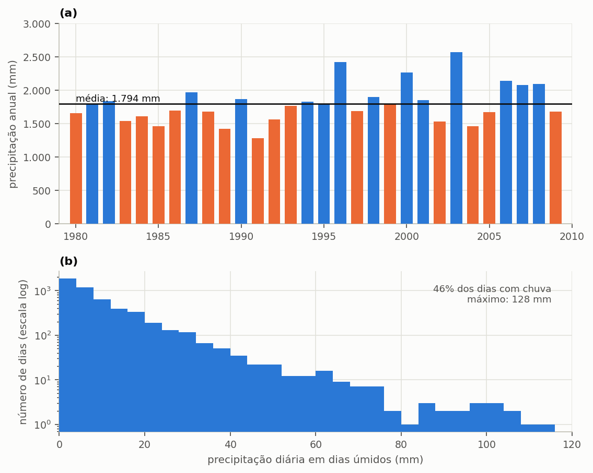

*Figura 1 — Série de precipitação de Florianópolis usada em todo o tutorial: (a) precipitação total de cada ano, com a média dos trinta anos em linha contínua e os anos acima da média em azul e abaixo dela em laranja; (b) distribuição de frequência da precipitação diária nos dias úmidos, em escala logarítmica, que mostra como poucos dias respondem pelos maiores volumes.*

---

### 4.1.3. A área de captação

O projeto do tutorial adota 150 m² de área de captação, e este é o primeiro campo em que
se erra com frequência.

A área de captação é a **projeção horizontal** da cobertura, e não a área inclinada do
telhado. Um telhado com 30% de inclinação sobre uma planta de 150 m² tem cerca de 157 m²
de superfície de telha, e ainda assim capta os mesmos 150 m² de chuva: a precipitação cai
na vertical, e o que ela encontra é a sombra da cobertura projetada no chão. A definição
é a do item 3.6 da ABNT NBR 15527:2019: área de captação é a «área projetada na
horizontal da superfície impermeável da cobertura onde a água é captada», e é essa a
área `A` da equação de disponibilidade do item 4.1.6.

> **Área de captação não é área de contribuição.** A ABNT NBR 10844:1989 usa outra
> área, com outro fim. Para dimensionar calhas e condutores pela vazão de pico, o item
> 5.2.1 manda somar à projeção os incrementos da inclinação da cobertura, `(a + h/2)·b`
> na Figura 2, e as paredes que interceptam chuva inclinada pelo vento. Essa área serve à
> vazão de projeto de uma chuva de cinco minutos (item 5.3.1), e superestima o volume
> que a cobertura capta ao longo do ano. No Triton, informe a projeção horizontal; a
> área de contribuição fica para o projeto das calhas, que o programa não faz.

> **Atenção.** Usar a área inclinada superestima a captação na razão
> `1/cos(inclinação)`. Num telhado de 30% dá 4,4% a mais de água que não existe. Em
> telhados de maior caimento o erro cresce depressa.

---

Carregada a série, o programa já mostra o regime que ela descreve. Vale conferir esse desenho antes de seguir: uma série trocada de cidade, ou com unidade errada, costuma aparecer no ciclo sazonal da Figura 2 antes de aparecer em qualquer resultado.

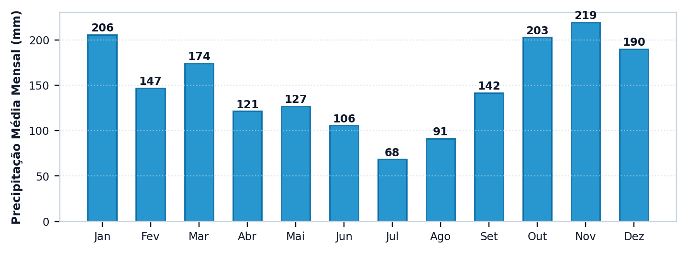

*Figura 2 — O ciclo sazonal médio da série, calculado e desenhado pelo programa assim que a precipitação é carregada. Em Florianópolis, julho recebe cerca de um terço do que recebe novembro, e é essa diferença que o reservatório tem de atravessar. Figura gerada pelo próprio programa.*

---
### 4.1.4. O coeficiente de escoamento

O tutorial digita 0,85 no campo do coeficiente. O programa, por sua vez, abre com a telha
cerâmica selecionada e aplica 0,75, o valor que a lista de materiais atribui a ela, que é
também o valor que ele assume quando nenhum material é informado. ==Atenção ao reproduzir
o tutorial: para chegar aos números deste manual, escolha «Outro / Personalizado» e digite
0,85.==

A origem do 0,85 merece precisão, porque ele é citado com frequência como coeficiente de
escoamento e não é. A ABNT NBR 15527:2019, no item 4.1.6, escreve o volume disponível como
produto de quatro termos — precipitação, área, coeficiente de escoamento superficial C e
eficiência do sistema de captação η — e recomenda 0,85 **para η**, na falta de dados do
fabricante. Esse η já leva em conta o dispositivo de descarte de sólidos e o desvio do
escoamento inicial. O Triton tem um campo só para a fração da chuva que chega à cisterna e
modela o descarte à parte, em milímetros. Digitar ali o η da norma e aplicar também o
descarte de 2 mm conta a perda do escoamento inicial duas vezes, de modo que o tutorial é
conservador. Num estudo, declare o valor adotado no campo, a sua origem e o descarte, e não
atribua à norma um coeficiente de escoamento que ela não fixa.

> **Na International Edition (INT).** A EN 16941-1:2024 escreve o rendimento como o produto de
> um coeficiente de rendimento da superfície `e`, dado por tipo de cobertura na sua
> Tabela 2, e de uma eficiência do filtro `η`, 0,9 por padrão, sem lâmina de descarte. O
> Triton mantém a sua própria lista de coeficientes e o descarte inicial nas duas
> edições; para se aproximar da norma europeia, digite `e × η` como valor personalizado e
> zere a lâmina de descarte. O documento `docs/normas_nbr_x_en16941.md` do repositório
> lista as diferenças.

O coeficiente de escoamento superficial representa a fração da chuva incidente que
efetivamente chega à cisterna, e a diferença até a unidade corresponde ao que se perde no
caminho. As perdas têm quatro origens: a absorção pelo material da cobertura, a
evaporação sobre a superfície aquecida, o respingo para fora da calha e o molhamento inicial da telha a cada novo evento de chuva. A Figura 3 traz o coeficiente que o programa atribui a cada material de cobertura.


*Figura 3 — O coeficiente de escoamento que o programa atribui a cada material da cobertura, com os valores do estudo de materiais publicado na revista MIX Sustentável (2020). A linha tracejada marca 0,85, o fator de captação da ABNT NBR 15527 adotado no tutorial. O telhado verde é o único que se afasta do grupo, porque retém parte da chuva no substrato.*


O programa aceita qualquer valor entre zero e um, e recusa valores fora desse intervalo
nomeando o campo — um coeficiente maior que a unidade significaria que a cobertura entrega
mais água do que a chuva lhe traz. A etapa **11. Documentação** traz a mesma tabela, com a
fonte dos valores. Para uma cobertura mista, o coeficiente a digitar é a média dos
coeficientes de cada material ponderada pelas respectivas áreas.

---

### 4.1.5. O descarte de primeiras águas

O tutorial descarta 2,0 mm em todo evento de chuva.

A primeira água que lava a cobertura carrega poeira, folhas, fezes de aves e tudo o mais
que tenha se depositado desde a chuva anterior. Descartá-la, em vez de conduzi-la à
cisterna, é a medida de qualidade mais barata e mais eficaz de que um sistema pluvial
dispõe, e por isso é praticamente universal em projetos bem conduzidos. A ABNT NBR 15527
recomenda o descarte de 2 mm quando não houver dado local que justifique outro valor, e é
esse o valor adotado aqui.

O programa oferece três modos de aplicação do descarte, que correspondem a três tipos de
dispositivo de autolimpeza.

<!-- tabela: **Tabela 2** — Os três modos de aplicação do descarte de primeiras águas -->
| Modo | Quando descarta | Quando usar |
| :--- | :--- | :--- |
| 1 | em todo evento de chuva | o padrão, e o mais conservador |
| 2 | só no primeiro evento após estiagem | dispositivo que não se esvazia sozinho entre chuvas próximas |
| 3 | a cada X dias | dispositivo com esvaziamento programado |

> **Atenção, e este é o ponto que mais surpreende.** Quando o descarte se aplica e a
> chuva do dia **não supera** a lâmina, perde-se o dia **inteiro**, e não a
> diferença. Um dia de 1,6 mm com descarte de 2,0 mm capta **zero**.
>
> Na série de Florianópolis, isso atinge 7% dos dias. Em climas de garoa frequente,
> como o litoral sul no inverno, pode passar de 20%.

A razão desse comportamento é física, e não convencional: o dispositivo de autolimpeza
precisa encher-se por completo antes que qualquer água siga para a cisterna. Quando a
chuva do dia não basta para enchê-lo, nada passa adiante, e o volume retido é perdido
para a drenagem junto com a sujeira que ele lavou.

> **A lâmina não é o dispositivo.** `d_f` é uma lâmina em milímetros. O volume
> hidráulico do reservatório de autolimpeza é `A × d_f`, que no nosso projeto dá
> 150 × 2 = **300 litros**. A etapa **3. Qualidade & ETAP** dimensiona e orça esse
> reservatório (seção 2.5 (volume O método)), e a seção 4.7 mostra o seu custo no investimento.

---

### 4.1.6. O que temos até aqui

<!-- tabela: **Tabela 3** — Estado do projeto do tutorial ao fim da definição da chuva e da captação -->
| Dado | Valor |
| :--- | ---: |
| série | Florianópolis, 30 anos |
| área de captação | 150 m² |
| coeficiente de escoamento | 0,85 |
| lâmina de descarte | 2,0 mm, todo evento |

Com isso o programa já sabe **quanta água entra**. Falta dizer quanta sai, que é a seção 4.2.

Um cálculo de guardanapo, para calibrar a expectativa: 1.795 mm por ano sobre 150 m²
a 0,85 de coeficiente dão cerca de 229 m³ por ano de água bruta, antes do descarte.
A seção 4.3 mostra quanto desse volume se converte em economia efetiva — e a diferença entre os
dois números é a lição mais importante do tutorial.

---

## 4.2. A edificação e a demanda

> Ao terminar esta seção o programa saberá **quanta água sai** e, mais importante,
> **qual parte dela a chuva pode atender**. Essa fração é o teto de tudo o que vem
> depois.

A seção 4.1 definiu a oferta. Esta define a demanda. E há uma assimetria que
convém entender desde já: **a chuva não pode atender toda a demanda**, por mais
água que haja. Existe um teto, ele é definido aqui, e nenhum reservatório o
ultrapassa.

---

### 4.2.1. A tipologia

Na etapa **2. Edificação e Consumo**, escolha *Residencial unifamiliar*. O programa traz oito
tipologias, cada uma com o consumo per capita de referência (Figura 4) e a repartição usual dos usos finais. A indústria não tem faixa de referência, porque o consumo depende do processo produtivo, e não da ocupação: nesse caso, o valor deve vir de medição.

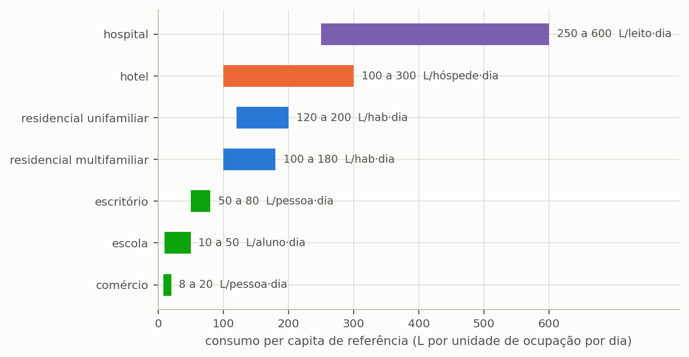

*Figura 4 — As faixas usuais de consumo per capita por tipologia de edificação. A amplitude de cada faixa é grande de propósito: são valores de referência para quem ainda não mediu, e a medição, quando existe, sempre prevalece.*


A tipologia serve de ponto de partida, não de imposição: o valor continua editável.
A seção 3.5 (volume Guias de uso) trata dos casos não residenciais, que têm uma armadilha própria na tarifa.

---

### 4.2.2. Os moradores e o consumo

**Quatro moradores, 150 L/hab·dia.** Total de **600 L/dia**.

O valor de 150 L/hab·dia é o consumo de uma residência de classe média com
abastecimento regular. Se você tem a fatura de água e esgoto da edificação, use-a: divida o
consumo mensal em litros por trinta e pelo número de moradores. O número medido vale
mais que qualquer referência.

O programa aceita demanda **constante** ou modulada por semana, mês ou dia. O
tutorial usa constante; a seção 3.4 (volume Guias de uso) mostra a modulação, que importa em escola, hotel e
qualquer edificação com sazonalidade.

---

### 4.2.3. A fração que a chuva pode atender

**28%.** É o número mais importante desta seção.

Água de chuva não vai para o chuveiro, para a pia da cozinha nem para beber. Numa
residência, vai para a bacia sanitária, a lavagem de piso, a rega de jardim e a lavagem
de veículo. A fração desses usos no consumo total é o **teto do potencial de economia**.

A repartição adotada no tutorial está representada na Figura 5, com a
marcação dos usos que a chuva atende. A bacia sanitária responde por 20% do consumo e a
limpeza e a rega por 8%; chuveiro, pia de cozinha, lavatório e máquina de lavar roupa,
que respondem pelo restante, ficam com a água potável.

Somando os dois que a chuva atende, chega-se aos 28% do tutorial. É um valor
conservador para residência unifamiliar sem jardim grande, e é conservador de
propósito: ele se limita aos usos que a norma admite.

> **A máquina de lavar roupa não está na lista da norma.** A ABNT NBR 15527:2019, no item
> 4.1.7, admite sete usos não potáveis para a água de chuva: sistemas de resfriamento,
> descarga de bacias sanitárias e mictórios, lavagem de veículos, lavagem de pisos,
> reserva técnica de incêndio, uso ornamental e irrigação paisagística. A ABNT NBR
> 16783:2019, que trata das fontes alternativas em geral, também não inclui a lavagem de
> roupa no item 4.2.1. Para qualquer outro uso, o item 4.1.8 da NBR 15527 exige que o
> profissional responsável estude os parâmetros de qualidade e o tratamento específicos.
> O uso na máquina de lavar é comum na literatura e na prática, e por isso muitos
> estudos trabalham com frações atendíveis maiores que a deste tutorial. Em Joinville,
> Ghisi e Custódio (2019) obtiveram potencial médio de 18,5% com água de chuva só nas
> bacias sanitárias, e de 40,8% com as bacias e a máquina de lavar. O tutorial **não** o adota: a máquina fica com
> a água potável, e a fração atendível cai para os 28% da bacia sanitária e dos usos
> externos. Um projeto que inclua a lavagem de roupa precisa declarar que ela está fora
> da lista normativa e qual critério de qualidade foi adotado para ela.

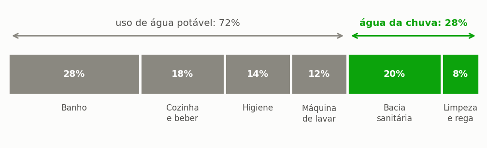

*Figura 5 — Repartição típica do consumo de uma residência por uso final. Em cinza, os usos que exigem água potável; em verde, os de possível uso de água da chuva, cuja soma é a fração atendível e o teto do potencial de economia: nenhum reservatório, por maior que seja, economiza mais do que essa fração.*

> **Este número é o teto.** Com 28% de fração atendível, o potencial de economia
> **jamais** passa de 28%, por maior que seja o reservatório e por mais que chova.
> A tabela da seção 4.4 mostra a curva se aproximando exatamente desse limite e
> nunca o cruzando.
>
> Quem quer passar de 28% precisa mudar o **uso**, não o reservatório: acrescentar um
> uso, como a lavagem de roupa, com o critério de qualidade declarado que o item 4.1.8 da
> norma exige, ou reduzir o consumo potável.

#### 4.2.3.1. Percentual na tela, fração no arquivo

A mesma grandeza aparece com duas grafias, e cada uma tem o seu lugar. Em todo campo em
que se digita — as frações da tela de edificação, as tabelas semanal e mensal, as tabelas
de cenários, a planilha de lote e o argumento `--share` da linha de comando — a fração é
um **percentual, de 0 a 100**: 28 significa 28%. No arquivo de projeto, no arquivo de
parâmetros e em `rainwater_share` e `non_potable_indoor_share`, ela é uma **fração, de 0
a 1**: 0,28.

A divisão não é arbitrária. O percentual é a forma em que a grandeza circula entre
projetistas, normas e faturas de água e esgoto, e é a forma que menos se erra ao digitar. A
fração é a forma em que ela entra na equação do balanço, multiplicando a demanda
interna (seção 2.1 (volume O método)), e é a forma que não exige conversão a quem lê o arquivo com
outro programa.

O que não se admite é a mistura. Até esta versão, doze pontos do programa aceitavam as
duas grafias e decidiam pela regra «acima de 1 é percentual». A regra erra justamente
nos valores pequenos, onde o erro não se vê: 1 virava 100%, e não 1%; 0,5 digitado numa
coluna em percentual virava 50%. ==Agora a unidade é fixada pelo lugar, e nunca
adivinhada pelo valor.== Um percentual acima de 100 é recusado; uma fração acima de 1 é recusada com a indicação de que parece percentual. A Figura 6 mostra os três estados do campo na interface.

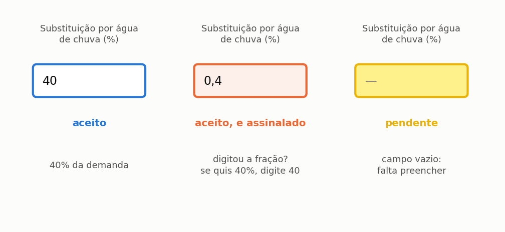

*Figura 6 — Estados do campo de fração atendível na interface. O campo recebe percentual de 0 a 100; no arquivo de projeto e nos parâmetros de cálculo a grandeza é armazenada como fração de 0 a 1. Um valor entre 0 e 1 digitado no campo fica assinalado em laranja, sem bloquear o cálculo, porque 0,4% é possível, embora raro.*

> **O marcador laranja.** Um valor entre 0 e 1 num campo em percentual é aceito, porque
> menos de 1% de substituição é possível, mas o campo fica laranja e a dica explica o
> que foi entendido. Nas tabelas de cenários e na planilha de lote, o programa pergunta
> antes de simular.

---

### 4.2.4. Discretizar os usos, ou não

O programa aceita dois níveis de detalhe na descrição da demanda, e a escolha entre eles
depende do que o estudo pretende responder.

No **modo simplificado**, informam-se duas coisas: a fração não potável do consumo
interno — bacias sanitárias e lavagem de roupa — e, se houver, a demanda externa em litros
por dia. A fração atendível **total** sai das duas,

```text
f = (fração interna × demanda interna + demanda externa) ÷ (demanda interna + demanda externa)
```

e aparece num campo que não se edita, porque é resultado e não dado. Sem demanda externa,
a total é a própria fração interna: os 28% deste tutorial. É o modo adotado aqui e é
suficiente para a maior parte dos estudos.

> **Por que a total não se digita.** Antes da versão 0.1.0 o campo da fração total era
> editável, mas a simulação usava a fração interna; e, ao abrir um projeto, a tela voltava
> a interna para 35% e a externa para zero, quaisquer que fossem as gravadas. Um projeto
> que declarava 28% era simulado com 35%. Hoje a tela restaura as duas, a total é
> calculada, e um arquivo antigo cujas frações discordem é aberto com a total que ele
> declara, com um aviso.

No **modo discretizado**, a demanda é separada em três parcelas: a potável interna, que a
chuva nunca atende; a não potável interna, que é a prioridade do sistema; e a irrigação,
atendida por último. A separação muda duas coisas. Altera a ordem de atendimento nos dias
de escassez, em que o uso interno tem precedência sobre o jardim; e permite distinguir uso
interno de uso externo nos créditos de certificação, distinção que o LEED exige em
créditos separados, conforme a seção 2.9 (volume O método) descreve.

Vale discretizar quando há jardim de área relevante, quando a certificação está no
horizonte do projeto, ou quando a irrigação pode ser suprimida em dias de chuva — situação
que o item seguinte trata.

---

### 4.2.5. A irrigação e a supressão por chuva

Declarado um volume de irrigação, o programa oferece um limiar de supressão por chuva:
nos dias em que a precipitação supera esse limiar, o jardim não é regado. O comportamento
reproduz o de qualquer controlador de irrigação dotado de sensor de chuva, equipamento
corrente e barato, e ignorá-lo superestimaria a demanda externa ao longo do ano inteiro. O
limiar adotado por padrão é de 2 mm diários.

> **A série de chuva é lida duas vezes.** Uma leitura é convertida em volume captado,
> após o descarte. A outra decide se o jardim é regado. As duas são independentes: um dia
> pode suprimir a irrigação **e** render captação.

Resta uma escolha que merece atenção particular, porque altera o resultado econômico e
não é neutra: o **suprimento de reserva** da irrigação. Com ele ligado, a rede pública
rega o jardim nos dias secos em que a cisterna não dá conta, e esse volume entra na fatura de água e esgoto como consumo potável. Com ele desligado, o jardim simplesmente não é regado
naquele dia, a edificação não compra essa água, e o volume correspondente aparece no
balanço como *demanda não atendida* — a terceira parcela tratada na seção 2.1 (volume O método).

==A distinção entre as duas configurações é conceitual antes de ser numérica.== Um jardim
que precisa ser regado todos os dias representa uma demanda real, que alguém pagará; um
jardim que aceita não ser regado num dia seco representa uma conveniência, e tratá-lo como
demanda infla tanto o consumo quanto a economia aparente do sistema.

---

### 4.2.6. O que temos até aqui

<!-- tabela: **Tabela 4** — Estado do projeto do tutorial ao fim da definição da demanda -->
| Dado | Valor |
| :--- | ---: |
| tipologia | residencial unifamiliar |
| moradores | 4 |
| consumo per capita | 150 L/hab·dia |
| demanda total | 600 L/dia |
| fração atendível por chuva | 28% |
| **demanda pluvial** | **168 L/dia** |

O programa agora sabe a oferta e a demanda. Antes de simular, um confronto que vale
guardar:

<!-- tabela: **Tabela 5** — Confronto entre a oferta anual de água pluvial e a demanda atendível -->
| | m³/ano |
| :--- | ---: |
| precipitação incidente na área de captação | 229 |
| volume remanescente após o descarte | 187 |
| **demanda pluvial do ano** | **61** |

A oferta excede a demanda: o volume disponível é **o triplo** do que se pretende usar. Se
o único limite fosse a oferta, o sistema atenderia 100% da demanda pluvial e chegaria aos 28% de teto.

Ele não chega, e a seção 4.3 mostra por quê.

---

## 4.3. A primeira simulação

> Ao terminar esta seção você terá o primeiro resultado na tela e saberá **ler**
> os quatro números que importam. Ler é a parte difícil: o programa entrega muitos
> números, e três deles respondem perguntas diferentes.

Falta um dado para simular: o volume do reservatório. Vamos chutar.

**3.000 litros.** Uma cisterna de concreto de 3 m³ é um tamanho comum de quintal,
cabe no orçamento e é o que um projetista proporia sem pensar muito. A seção 4.4
vai perguntar se é o volume certo. Aqui só queremos ver o programa rodar.

Na etapa **4. Reservatório & Custos**, escolha volume fixo, informe 3.000 L, deixe o reservatório
superior desmarcado, e rode.

---

### 4.3.1. O resultado

<!-- tabela: **Tabela 6** — Resultado da primeira simulação do tutorial, com reservatório de 3.000 L -->
| Resultado com 3 000 L | Valor |
| :--- | ---: |
| potencial de economia de água potável | **26,48%** |
| água pluvial consumida | 158,9 L/dia |
| água da rede consumida | 441,1 L/dia |
| água extravasada | 354,1 L/dia |
| dias de atendimento pleno | 93,9% |
| dias de atendimento parcial | 1,3% |
| dias de atendimento nulo | 4,9% |
| demanda pluvial pretendida | 168 L/dia |
| volume anual poupado | 58,0 m³/ano |

A tela devolve várias dezenas de valores, e quatro deles bastam para julgar o projeto
nesta etapa. Cada um responde a uma pergunta distinta, e é precisamente por responderem
a perguntas distintas que eles não se substituem: um projeto pode ser bom pelo primeiro
e ruim pelo terceiro, e a leitura conjunta é o que evita conclusão apressada.

---

### 4.3.2. O potencial de economia: 26,48%

Este indicador responde à pergunta que motiva a maior parte dos projetos: quanto da
fatura de água e esgoto se deixa de pagar. É o valor central produzido pelo programa e o que
figura no resumo de qualquer estudo, e corresponde à razão entre a água pluvial
consumida e a demanda total da edificação ao longo de toda a série, conforme a Equação
14 (volume O método).

O denominador merece atenção, porque dele decorre todo o resto: trata-se da demanda
**total**, e não da demanda pluvial. É essa escolha que fixa o teto do indicador em 28%,
que é a fração atendível definida na seção 4.2, e não em cem por cento.

O sistema alcançou 26,48% contra um teto de 28%, o que significa que ele entrega 95% do
que se propunha a entregar. Os 5% restantes correspondem aos dias em que a cisterna não
dispunha de água suficiente para atender à demanda pluvial daquele dia.

> **Não confunda os dois percentuais.** «Economia de 26%» e «atendimento de 95% da
> demanda pluvial» descrevem o mesmo sistema e são números diferentes. Estudos
> publicados às vezes trocam um pelo outro. Declare qual está usando.

---

### 4.3.3. O extravasamento: 354 L/dia

**Responde: o reservatório é grande o bastante?**

Trezentos e cinquenta e quatro litros por dia, em média ao longo dos trinta anos,
extravasam da cisterna e seguem para a rede de drenagem. ==O volume extravasado é mais
que o dobro dos 168 L/dia que o sistema pretende consumir,== e o reservatório deixa
passar mais água do que aproveita.

Parece o argumento definitivo a favor de aumentar o reservatório, e não é. A cobertura
oferece o triplo do que a casa consome (seção 4.2), e boa parte desse excedente
extravasaria de qualquer cisterna: a seção 4.4 mostra que nem 20.000 L o reduzem
abaixo de 340 L/dia. O extravasamento só diz algo sobre o volume quando comparado ao de
outros volumes, e é essa comparação que a seção 4.4 faz.

> Um extravasamento alto não é defeito do programa nem do projeto. É a assinatura do
> descasamento entre a chuva, que chega concentrada em poucos dias, e a demanda, que
> é constante. O reservatório existe para amortecer isso, e todo reservatório
> finito falha em algum evento.

---

### 4.3.4. Os dias de atendimento: 93,9% plenos

**Responde: com que frequência posso contar com o sistema?**

Trata-se da confiabilidade **temporal** do sistema, e ela responde a uma pergunta que o
potencial de economia não alcança: com que frequência se pode contar com a água pluvial.
Cada dia da simulação recebe uma de três classificações, segundo o grau de atendimento
alcançado.

<!-- tabela: **Tabela 7** — Classificação de cada dia da simulação quanto ao grau de atendimento -->
| Classe | O que significa |
| :--- | :--- |
| pleno | a chuva atendeu **toda** a demanda pluvial do dia |
| parcial | atendeu parte, e a rede completou |
| nulo | a cisterna estava vazia; tudo veio da rede |

Em 93,9% dos dias o sistema deu conta sozinho da demanda pluvial, e nos 6,1% restantes
a rede pública entrou, integral ou parcialmente. A distinção tem consequência direta
sobre o projeto hidráulico: um sistema com muitos dias de atendimento nulo exige
alimentação automática de reserva bem dimensionada, e o usuário percebe a alternância
entre as duas fontes ao longo do ano. Um sistema com 99% de dias plenos é, na prática,
independente da rede para os usos que atende.

> **Potencial e confiabilidade não andam juntos.** É possível ter potencial alto com
> confiabilidade baixa: um reservatório que se enche na estação chuvosa e seca na
> estiagem entrega muito volume no ano e falha metade dos dias. A tabela da seção 4.4 mostra as duas colunas divergindo.

---

### 4.3.5. O volume anual poupado

**Responde: quanto vale isso em dinheiro e em carbono?**

Este é o valor que atravessa para as seções 4.7 e 4.8, porque tanto a economia na fatura de água e esgoto quanto a emissão de carbono evitada são calculadas a partir dele. Ele
vale 58,0 m³/ano, menos de um terço dos 187 m³/ano que a cobertura disponibiliza depois
do descarte, e a diferença inteira corresponde ao que extravasou.

---

Antes de discutir por que o potencial não chega aos 28%, convém ver o reservatório trabalhando. A aba de resultados traz a série diária do nível da cisterna, e é nela que se enxergam de uma vez os dois regimes que limitam o aproveitamento: o extravasamento e a falta (Figura 7).

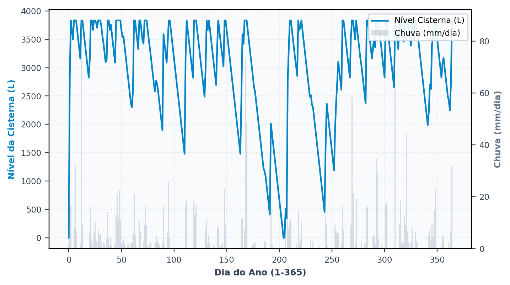

*Figura 7 — O nível da cisterna ao longo do primeiro ano da série, com a chuva diária ao fundo. Os platôs no alto são os dias em que o reservatório está cheio e extravasa; os vales no zero são os dias em que ele secou e a rede atendeu tudo. Figura gerada pelo próprio programa.*

---
### 4.3.6. Por que não chegamos aos 28%

A seção 4.2 encerrou com um confronto aparentemente favorável: 187 m³ anuais de
oferta contra 61 m³ de demanda pluvial, isto é, o triplo do necessário. Diante desse
excedente, seria razoável esperar atendimento integral, e ainda assim o sistema entrega
95% do pretendido.

A explicação está inteiramente no **tempo**. O excedente não ocorre no momento em que a água é
necessária: a precipitação chega concentrada, enche a cisterna de 3.000 L num único dia
de chuva intensa, extravasa no mesmo dia, e falta duas semanas depois. O excedente anual e o
atendimento diário são grandezas que não se comunicam, e é justamente essa
incomunicabilidade que torna a simulação diária indispensável.

O reservatório de 3.000 L armazena o equivalente a dezoito dias de demanda pluvial.
Qualquer estiagem mais longa que isso o esvazia, e a partir daí o sistema passa a
depender integralmente da rede até a chuva seguinte.

É por isso que aumentar o reservatório funciona — e é por isso que aumentar tem
limite. A seção 4.4 mede exatamente onde fica esse limite.

---

### 4.3.7. O que temos até aqui

<!-- tabela: **Tabela 8** — Estado do projeto do tutorial após a primeira simulação -->
| Resultado com 3.000 L | |
| :--- | ---: |
| potencial de economia | 26,48% |
| de um teto de | 28% |
| extravasamento | 354 L/dia |
| dias de atendimento pleno | 93,9% |

Um resultado defensável, e já perto do teto. Mas escolhemos 3.000 L por palpite: pode
ser pouco, e pode ser demais.

Quanto seria o certo?

---

## 4.4. Escolher o volume

> Ao terminar esta seção você terá a curva de retorno do reservatório, saberá
> onde ela deixa de compensar, e entenderá por que **não existe** um volume ótimo
> absoluto — existe um volume ótimo para um critério declarado.

A seção 4.3 adotou 3.000 L como primeiro palpite e encontrou 354 L/dia
extravasando, mais de dois terços de tudo o que a cobertura capta, e um atendimento já
perto do teto. As duas leituras puxam em sentidos opostos, e a pergunta que se impõe é
quanto reservatório vale a pena ter, e ela não se responde por tentativa isolada: responde-se simulando o mesmo
projeto para muitos volumes e observando como o resultado evolui. É o que o programa
chama de **varredura**.

---

### 4.4.1. Rodar a varredura

Na etapa **4. Reservatório & Custos**, escolha o modo varredura e informe o
volume máximo e o passo. Para o nosso projeto:
máximo de 20.000 L, passo de 1.000 L.

Duas particularidades da montagem da grade convêm ser conhecidas antes de interpretar o
resultado. A primeira é que o passo informado é arredondado para cima até o múltiplo de
250 L, valor que corresponde ao quantum comercial de reservatórios — não se compra
cisterna de 1.300 L, e um ótimo apontado nesse volume seria inexequível. Quando o passo
pedido não é múltiplo de 250, o programa o ajusta e registra o ajuste, de modo que o
relatório possa declarar o passo efetivamente utilizado.

A segunda é que a grade se limita a quarenta volumes positivos. Uma varredura de 0 a
50.000 L com passo de 100 L exigiria quinhentas simulações de trinta anos cada, e o ganho
de informação não compensa o tempo de máquina, porque a curva é suave e quarenta pontos
já a descrevem com folga. O volume máximo informado é sempre preservado como último
ponto da grade, de modo que apenas o último intervalo pode ser menor que o passo efetivo.

O volume zero integra a grade como alternativa de referência: ele representa o cenário
sem sistema, contra o qual todos os demais se comparam.

---

### 4.4.2. A curva

<!-- tabela: **Tabela 9** — Varredura de volumes do projeto do tutorial, com o ganho marginal de cada metro cúbico acrescentado -->
| Volume | Potencial | Ganho sobre o anterior | Ganho por m³ acrescentado | Extravasado | Dias plenos |
| ---: | ---: | ---: | ---: | ---: | ---: |
| L | % | pontos percentuais | %/m³ | L/dia | % |
| 0 | 0,00 | — | — | 513 | 0,0 |
| 1 000 | 21,03 | 21,03 | 21,03 | 387 | 70,3 |
| 2 000 | 25,03 | 3,99 | 3,99 | 363 | 87,9 |
| 3 000 | 26,48 | 1,45 | 1,45 | 354 | 93,9 |
| 4 000 | 27,12 | 0,64 | 0,64 | 350 | 96,6 |
| 5 000 | 27,47 | 0,35 | 0,35 | 348 | 97,9 |
| 6 000 | 27,70 | 0,23 | 0,23 | 346 | 98,8 |
| 8 000 | 27,92 | 0,23 | 0,11 | 345 | 99,7 |
| 10 000 | 27,99 | 0,06 | 0,03 | 344 | 99,9 |
| 12 000 | 28,00 | 0,01 | 0,01 | 344 | 100,0 |
| 16 000 | 28,00 | 0,00 | 0,00 | 344 | 100,0 |
| 20 000 | 28,00 | 0,00 | 0,00 | 343 | 100,0 |

A Figura 8 traça os resultados da tabela: o potencial de economia converge para a fração atendível, e o ganho marginal decresce em três ordens de grandeza ao longo da varredura.

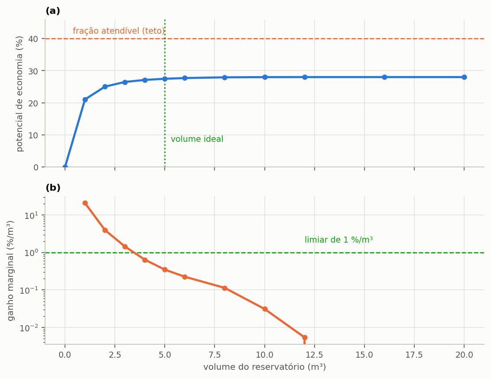

*Figura 8 — (a) Potencial de economia em função do volume do reservatório, que se aproxima do teto de 28% sem cruzá-lo, com o volume ideal marcado; (b) ganho marginal, em escala logarítmica, com o limiar de 1 %/m³ adotado no tutorial.*

A coluna decisiva da tabela é a de **ganho por metro cúbico acrescentado**, que é a
derivada discreta da curva de potencial e expressa quanto cada metro cúbico adicional de
reservatório acrescenta de economia. A tabela abaixo destaca alguns intervalos, e o
padrão que ela revela é o argumento central desta seção.

<!-- tabela: **Tabela 10** — Ganho marginal de economia a cada metro cúbico acrescentado ao reservatório -->
| De → para | Ganho por m³ |
| :--- | ---: |
| 0 → 1.000 L | 21,03 %/m³ |
| 1.000 → 2.000 L | 3,99 %/m³ |
| 2.000 → 3.000 L | 1,45 %/m³ |
| 3.000 → 4.000 L | 0,64 %/m³ |
| 4.000 → 5.000 L | 0,35 %/m³ |
| 10.000 → 12.000 L | 0,005 %/m³ |
| 16.000 → 20.000 L | 0 |

==O primeiro metro cúbico de reservatório entrega 21 pontos percentuais de economia; os
de 10 para 12 m³ entregam cinco milésimos de ponto cada um, e os de 12 para 20 m³, nada.==
A diferença é de quatro ordens de grandeza, e os metros cúbicos custam o mesmo concreto, a
mesma escavação e a mesma mão de obra. A partir de 12 m³ o sistema atende a todos os dias
da série, e nenhum volume a mais tem o que acrescentar.

Esse comportamento não é peculiaridade do regime de chuva de Florianópolis. É a forma
característica de toda curva de aproveitamento pluvial, e decorre de dois fatos que
atuam em conjunto. Os primeiros litros de armazenamento capturam os eventos pequenos e
frequentes, que constituem a maioria das chuvas em qualquer regime; e o teto imposto pela
fração atendível, de 28% neste projeto, puxa a curva para a horizontal à medida que o
sistema dele se aproxima, de modo que o espaço restante para ganho vai se esgotando.

---

#### 4.4.2.1. Os quatro gráficos que a tela mostra

A varredura não devolve apenas a curva de potencial. A aba de resultados traz quatro
gráficos que respondem a perguntas diferentes sobre o mesmo conjunto de simulações, reproduzidos a seguir com os dados deste tutorial: o potencial de economia (Figura 9), o ganho marginal (Figura 10), os volumes extravasado e consumido (Figura 11) e a classificação dos dias (Figura 12).

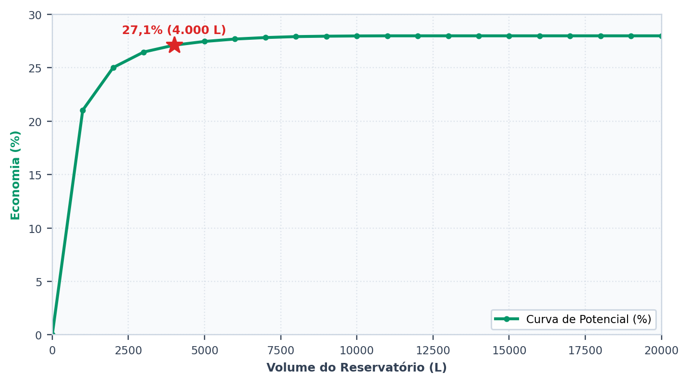

*Figura 9 — O primeiro gráfico da aba de resultados: o potencial de economia de água potável em função do volume do reservatório inferior. A estrela marca o volume selecionado. Figura gerada pelo próprio programa, com os dados do tutorial.*

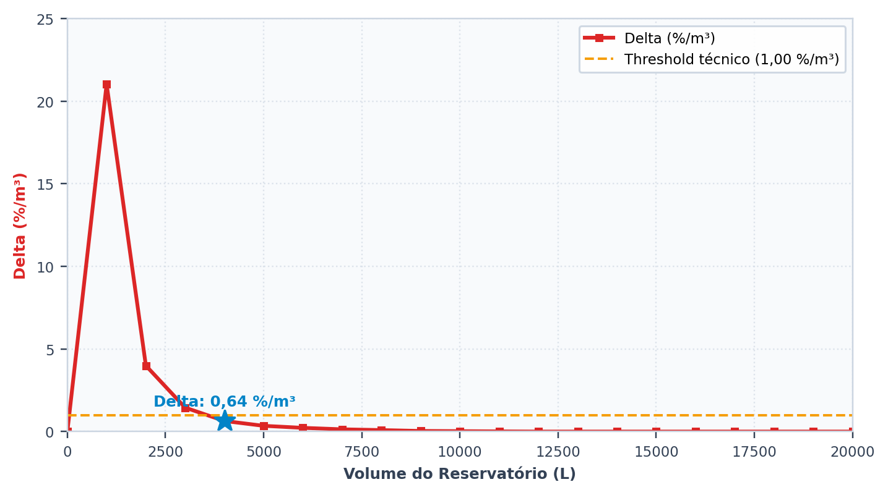

*Figura 10 — O segundo gráfico: o ganho marginal, em pontos percentuais por metro cúbico acrescentado. É a derivada da curva anterior, e é sobre ela que o critério de volume ideal opera. Figura gerada pelo próprio programa.*

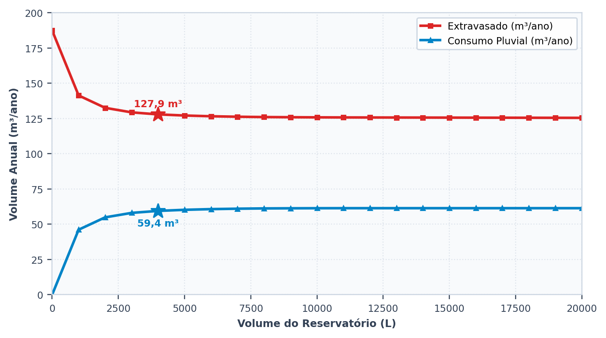

*Figura 11 — O terceiro gráfico: o volume extravasado e o volume pluvial consumido, ambos anuais, na mesma escala. As duas curvas explicam uma à outra, porque toda água que deixa de extravasar passa a ser consumida. Figura gerada pelo próprio programa.*

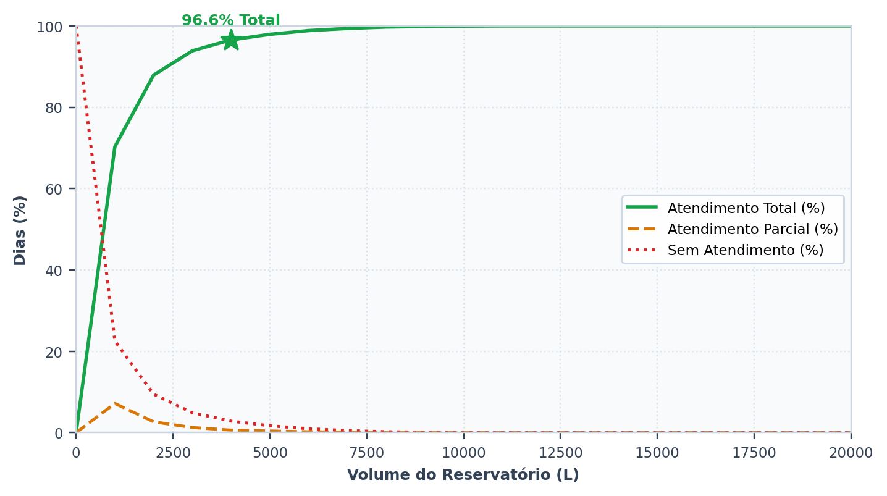

*Figura 12 — O quarto gráfico: a repartição dos dias do período em atendidos por inteiro, atendidos em parte e não atendidos. É a leitura temporal da mesma varredura, e a única que responde com que frequência se pode contar com o sistema. Figura gerada pelo próprio programa.*

---

### 4.4.3. O volume ideal

Diante de uma curva cujo rendimento decai dessa forma, a pergunta «qual o volume ideal?»
só admite resposta depois que se estabeleça o que significa deixar de compensar. O
Triton adota para isso o critério do ganho marginal: o volume ideal é o menor volume cujo
ganho por metro cúbico acrescentado já tenha caído abaixo de um limiar declarado pelo
usuário, conforme a formulação da seção 2.2 (volume O método).

O programa abre com limiar de 5 %/m³, e o tutorial adota um mais exigente, de 1 %/m³.
A diferença não é detalhe: com o padrão, o volume ideal deste projeto seria de 2.000 L;
com o limiar do tutorial, o primeiro volume a cair abaixo dele é o de 4.000 L, com
ganho marginal de 0,64 %/m³. Quem refizer o tutorial precisa, portanto, alterar o limiar
no programa antes de rodar a varredura.

<!-- tabela: **Tabela 11** — Indicadores do volume ideal obtido com o limiar de 1 %/m³ adotado no tutorial -->
| Indicador | Valor |
| :--- | ---: |
| volume ideal, limiar de 1 %/m³ | 4.000 L |
| potencial nesse volume | 27,12% |
| de um teto de | 28% |
| dias de atendimento pleno | 96,6% |

O limiar, contudo, é uma escolha do analista, e ela decide o resultado tanto quanto os
dados de entrada. A tabela abaixo mostra o volume ideal que cada limiar plausível
produziria para este mesmo projeto.

<!-- tabela: **Tabela 12** — Volume ideal obtido com cada limiar de ganho marginal, para o mesmo projeto -->
| Limiar declarado | Volume ideal | Potencial |
| ---: | ---: | ---: |
| 3,0 %/m³ | 3 000 L | 26,48% |
| 1,0 %/m³ | 4 000 L | 27,12% |
| 0,5 %/m³ | 5 000 L | 27,47% |

<!-- tabela: **Tabela 13** — Custo e desempenho comparados entre o volume ideal e o volume máximo varrido -->
| | 4.000 L | 20.000 L |
| :--- | ---: | ---: |
| potencial de economia | 27,12% | 28,00% |
| preço da cisterna de concreto | R$ 5 304 | R$ 20 607 |
| massa de concreto | 4 800 kg | 24 000 kg |
| carbono incorporado do sistema | 858 kg CO₂e | 3 546 kg CO₂e |
| **razão de preço** | | **3,9×** |
| **ganho de potencial** | | **+0,88 pontos** |

O programa não emite opinião sobre qual limiar seria o correto, e não poderia fazê-lo:
a escolha depende do custo do reservatório, do valor da água no município e da
disponibilidade de espaço no terreno, nenhum dos quais é dado hidrológico. O que o
programa faz é aplicar fielmente o limiar declarado e registrá-lo no relatório.

> **Num estudo publicado, declare o limiar.** Dois artigos com «volume ideal» de
> limiares diferentes não são comparáveis. Entre os limiares da tabela, a diferença
> é de 2.000 L, e o volume de 5.000 L custa um terço a mais que o de 3.000 L para
> entregar um ponto percentual.

---

### 4.4.4. Por que o critério do ganho marginal não basta

O critério do ganho marginal é puramente hidráulico: ele observa a curva de
aproveitamento e nada mais. Desconhece quanto custa o reservatório, quanto vale o metro
cúbico de água no município em questão e quanto carbono o material escolhido carrega
consigo. Três consequências decorrem dessa cegueira, e cada uma delas pode deslocar a
recomendação em sentido diferente.

- Se a água for muito cara, o ganho de 0,35 %/m³ do quinto metro cúbico pode se pagar
  bem, e o volume econômico será **maior** que o hidráulico.
- Se a cisterna for cara ou o espaço for escasso, o inverso.
- Uma cisterna de concreto de 20 m³ pesa vinte e quatro toneladas e carrega, com o
  resto do sistema, cerca de **3,5 toneladas de CO₂e** incorporado, contra menos de
  uma tonelada na de 4 m³. O último metro cúbico não acrescenta economia alguma, e não
  tem como compensar a diferença.

São três critérios e três respostas distintas para a mesma pergunta, e nenhuma delas é
mais legítima que as outras em abstrato. É por essa razão que o tutorial não se encerra
aqui: as seções 4.7 e 4.8 acrescentam respectivamente o dinheiro e o carbono à
análise, e a seção 4.9 põe as três dimensões na mesma mesa, com pesos declarados,
para chegar a um volume de compromisso que se possa defender.

> **O engano mais comum, e está na seção 5.1 (volume Enganos, limitações e confiabilidade).** Publicar o volume de maior economia
> de água como se fosse o volume recomendado. Pela tabela, 20.000 L dão o maior
> potencial, 28,00%, o mesmo que 12.000 L já davam. Também custam **3,9 vezes mais**
> que os 4.000 L, e carregam **4,1 vezes mais carbono incorporado**, para entregar
> 0,88 ponto percentual a mais.

---

A varredura traz ainda uma leitura que a tabela não mostra: quanto da capacidade o consumo de fato utiliza. Medir o reservatório pelo nível engana, porque a cisterna grande parece sempre cheia justamente por guardar água que a demanda não chega a retirar. A Figura 13 mede a capacidade pelo consumo, de duas maneiras. A primeira é a **autonomia armazenada**, o volume ao fim de cada dia dividido pela demanda pluvial diária de 168 L, apresentada como curva de permanência. A segunda é o número de **renovações por ano**, a razão entre o consumo pluvial anual e a capacidade, que diz quantas vezes o volume da cisterna é efetivamente consumido e reposto.

A cisterna de 2 m³ renova o seu volume 27 vezes por ano e termina o dia vazia em 13% dos dias: a capacidade é inteiramente utilizada, e falta água. A de 4 m³ renova 15 vezes e esvazia em 4% dos dias. A de 20 m³ renova apenas 3 vezes por ano e nunca esvazia, mas guarda em metade dos dias mais de 110 dias de demanda, muito além da estiagem que a série registra. Essa reserva que o consumo não chega a mobilizar é o que o investimento adicional compra, e é a leitura física do retorno decrescente da curva de potencial.

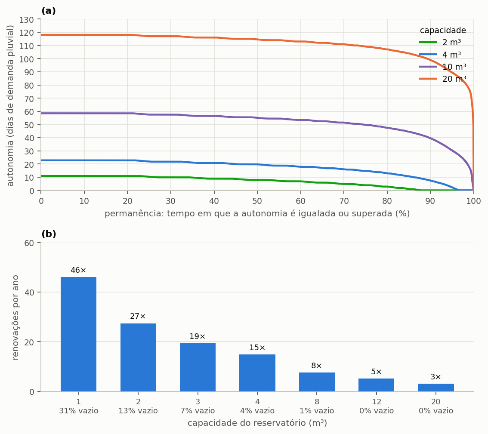

*Figura 13 — Uso da capacidade do reservatório inferior no projeto do tutorial, com demanda pluvial de 168 L/dia: (a) curvas de permanência da autonomia armazenada ao fim de cada dia, em dias de demanda pluvial, para 2, 4, 10 e 20 m³; (b) renovações anuais do volume, dadas pela razão entre o consumo pluvial anual e a capacidade, com a fração de dias em que o reservatório termina vazio (até 5% da capacidade) indicada sob cada volume.*

---
### 4.4.5. Duas leituras a mais da tabela

**O extravasamento nunca chega a zero.** Ele parte de 513 L/dia na ausência de
reservatório, cai para 343 L/dia com vinte metros cúbicos e estaciona nesse patamar. Dois
terços da água que a cobertura capta continuarão indo para a drenagem, por uma
razão que nenhum aumento de reservatório resolve: a demanda simplesmente não a consome.
Sistemas de aproveitamento pluvial não retêm água por retê-la, e quem busca amortecimento
de cheia precisa de reservatório de detenção, que é outro projeto, com outro critério de
dimensionamento.

**A confiabilidade cresce mais depressa que o potencial.** Ao passar de 3.000 para
4.000 L, o potencial de economia ganha 0,64 ponto percentual, ao passo que os dias de
atendimento pleno sobem de 93,9% para 96,6%, e os dias de falta caem quase pela metade. Quando o critério de projeto é o conforto
de uso — não faltar água pluvial nos pontos que a utilizam — e não a economia na fatura,
a leitura da mesma tabela conduz a outra escolha.

---

### 4.4.6. O que temos até aqui

O tutorial adota 4.000 L e segue. Trata-se do volume ideal pelo critério hidráulico com
o limiar de 1 %/m³, e é o valor que o projeto carrega até a seção 4.9, onde será
questionado outra vez, então com o dinheiro e o carbono incorporados à análise.

<!-- tabela: **Tabela 14** — Estado do projeto do tutorial após a escolha do volume -->
| Projeto até aqui | |
| :--- | ---: |
| série | Florianópolis, 30 anos |
| área de captação | 150 m² |
| demanda total | 600 L/dia |
| fração atendível | 28% |
| **volume do reservatório** | **4.000 L** |
| potencial de economia | 27,12% |
| dias de atendimento pleno | 96,6% |

Resta uma decisão hidráulica antes que se possa falar de dinheiro: essa água precisa
subir para uma caixa elevada, ou pode ser pressurizada diretamente da cisterna? É o
assunto da seção 4.5.

---

## 4.5. Precisa de reservatório superior?

> Ao terminar esta seção você saberá responder a pergunta com número, e não com
> hábito. A resposta costuma surpreender.

O arranjo clássico do aproveitamento pluvial brasileiro emprega dois reservatórios: uma
cisterna enterrada, que recebe a água da cobertura, e uma caixa d'água elevada, que
alimenta os pontos de consumo por gravidade; entre as duas, uma motobomba faz o recalque.
O arranjo é tão difundido que quase todo projeto o adota sem examinar a razão, e esta
seção examina.

---

### 4.5.1. Para que serve a caixa superior

==A caixa superior não serve para guardar mais água; serve para entregá-la.== A distinção
parece sutil e decide a análise inteira, porque tudo o que se segue depende de não
confundir capacidade de armazenamento com capacidade de distribuição.

A cisterna fica enterrada, e os pontos de consumo — bacia sanitária, tanque, torneira de
jardim — situam-se acima dela. Alguma coisa precisa vencer esse desnível, e há duas
maneiras de fazê-lo com bomba.

- **Pressurização direta.** Uma bomba pequena com pressostato liga sempre que se
  abre um ponto. Não há caixa superior.
- **Recalque para caixa elevada.** A bomba enche a caixa de tempos em tempos, e a
  gravidade faz o resto.

Quando a cisterna fica acima dos pontos de uso, há ainda uma terceira: **gravidade**,
sem bomba. A etapa **4. Reservatório & Custos** pergunta qual dos três arranjos o projeto
adota, e é essa resposta que define a energia e as motobombas no custo e no carbono.

<!-- tabela: **Tabela 15** — Os três arranjos de abastecimento e o que cada um acrescenta ao projeto -->
| Arranjo | Energia calculada | Caixa superior e motobombas |
| :--- | :--- | :--- |
| recalque para caixa superior | volume recalcado, pela altura manométrica, mais as partidas | entram no custo e no carbono |
| pressurização direta | todo o volume pluvial consumido, pela pressão de trabalho | só as motobombas |
| gravidade | nenhuma | nenhuma |

Na pressurização direta, a etapa 4 pede o modelo do pressurizador, escolhido num
catálogo de seis modelos com curva vazão × pressão do fabricante, a pressão de trabalho
e a vazão do ponto de uso. O pressurizador liga a cada descarga, 5,05 por pessoa por dia
segundo o levantamento de usos finais de Mayer et al. (1999), e fica ligado enquanto a
caixa acoplada enche, no ritmo da boia. A energia é esse tempo vezes a potência
elétrica. No tutorial, o menor modelo do catálogo gastaria 40,5 kWh por ano, cinco vezes
os 7,7 kWh do recalque; a seção 2.6 (volume O método) explica por quê, e mostra que o modelo escolhido
pesa mais que a pressão.

O recalque para caixa elevada tem três vantagens práticas reais. A motobomba liga poucas vezes por
dia, em vez de dezenas, o que prolonga a vida do equipamento; a pressão nos pontos de
consumo é constante, porque decorre da altura da coluna d'água e não do funcionamento da
bomba; e existe reserva disponível durante uma falta de energia. ==Nenhuma dessas três
vantagens é economia de água,== e é justamente essa a confusão que a seção desfaz.

---

### 4.5.2. A comparação justa

Comparar um sistema de 4.000 L sem caixa elevada com outro de 4.000 L mais 1.000 L de
caixa é uma armadilha metodológica, porque o segundo dispõe de mais armazenamento total e
venceria por essa razão, e não pelo arranjo. Para isolar o efeito do arranjo é preciso
manter constante o armazenamento: comparam-se, portanto, 5.000 L num único reservatório
contra 4.000 L embaixo mais 1.000 L em cima.

<!-- tabela: **Tabela 16** — Comparação entre reservatório único e reservatório duplo, mantido o mesmo armazenamento total -->
| Mesmo armazenamento de 5.000 L | Um tanque só | 4.000 embaixo + 1.000 em cima |
| :--- | ---: | ---: |
| potencial de economia | 27,47% | 27,30% |
| dias de atendimento pleno | 97,9% | 97,3% |
| volume recalcado | — | 59,8 m³/ano |
| acionamentos da bomba | — | 68 por ano |
| horas de bomba | — | 12,6 h/ano |
| energia | — | 7,7 kWh/ano |
| custo da energia | — | R$ 5,37/ano |
| **diferença de potencial** | | **-0,17 pontos** |

Mantido o mesmo armazenamento, o arranjo com caixa elevada entrega cerca de um sexto de
ponto percentual a menos de economia que o reservatório único. A diferença não é erro de
arredondamento, e tem uma causa: **a cisterna extravasa enquanto a caixa superior ainda
tem espaço**.

A chuva entra só pela cisterna, e o extravasamento é calculado nela antes do consumo do
dia. O recalque, porém, só acontece quando há consumo e a caixa superior desce abaixo do
limiar de acionamento. Assim, num dia chuvoso com a cisterna cheia, a água que excede os
4.000 L de baixo é perdida mesmo que a caixa de cima tenha centenas de litros livres. Um
reservatório único de 5.000 L guardaria essa água.

É também por isso que o limiar de acionamento maior rende mais: com ele, a bomba enche a
caixa mais cedo, a cisterna fica mais vazia quando a chuva chega, e extravasa menos. A
reserva abaixo do limiar não é imobilizada, porque é consumida logo depois de cada
recalque e quando a cisterna seca.

> **A caixa superior não aumenta a economia de água. Ela custa.** No nosso projeto,
> custa a caixa, custa a bomba, custa 7,7 kWh por ano de energia, e custa um sexto
> de ponto de potencial em relação a um tanque único do mesmo volume total.
>
> Isso não a torna errada. Torna a decisão **hidráulica**, e não hídrica: adote-a se
> o projeto precisa de pressão por gravidade ou de reserva contra falta de energia,
> e não esperando que ela renda mais água.

---

### 4.5.3. O limiar de acionamento

Se você adotar a caixa, há um parâmetro a ajustar: o volume de reserva que não se
consome, abaixo do qual a bomba é acionada.

<!-- tabela: **Tabela 17** — Efeito do limiar de acionamento da motobomba sobre o potencial de economia e sobre o número de acionamentos -->
| Limiar de acionamento | Potencial | Acionamentos por ano |
| ---: | ---: | ---: |
| 0 L | 27,24% | 62 |
| 100 L | 27,30% | 68 |
| 300 L | 27,33% | 87 |
| 500 L | 27,39% | 121 |

Limiar maior significa **mais potencial e mais acionamentos**, pela razão acima. De 0 para 500 L, o
potencial sobe 0,15 ponto e os acionamentos quase dobram, de 62 para 121 por ano.

A troca é entre um ganho hídrico marginal e o desgaste da motobomba. Motobombas
residenciais suportam bem alguns acionamentos por dia; o que as mata é o
liga-desliga contínuo. Cento e vinte e um acionamentos por ano é um a cada três
dias, e nenhum dos valores da tabela chega perto de ser problema.

> **Onde o limiar importa de verdade** é em edificações com demanda concentrada, em
> que a caixa esvazia rápido. Aí ele pode passar de mil acionamentos por ano, e
> convém dimensionar a caixa em vez de mexer no limiar.

---

### 4.5.4. A energia, e por que ela é pequena

Sete vírgula sete quilowatt-hora por ano. Cinco reais e trinta e sete centavos.

Parece pouco demais, e vale entender por quê. Elevar um metro cúbico de água a doze
metros custa, em energia hidráulica, cerca de 0,033 kWh. Com o rendimento da bomba e
o do motor, e somadas as partidas da bomba, chega a cerca de 0,13 kWh por metro cúbico recalcado. Sessenta metros cúbicos por
ano dão os 7,7 quilowatt-hora da tabela.

Água é pesada, mas doze metros é pouco. É por isso que o custo energético do
aproveitamento pluvial é desprezível diante da economia na fatura de água e esgoto — e é por
isso também que o argumento de que «bombear água gasta mais energia do que
economiza» não se sustenta em edificação de pequeno porte.

> **Atenção à potência de placa.** O programa pede o rendimento **da bomba** e o
> rendimento **do motor** separadamente. A potência de placa é a potência mecânica
> no eixo, e o rendimento do motor é o que separa o que o eixo entrega do que o
> medidor registra. Em branco, o programa adota a Tabela 13 da ABNT NBR 17094-2:
> 60,5% para meio CV. A seção 2.6 (volume O método) detalha.

---

### 4.5.5. A decisão do tutorial

**Adotamos recalque para uma caixa superior de 1.000 L, com limiar de 100 L.**

A decisão é hidráulica, e não hídrica. A caixa elevada dá pressão constante nos pontos
de uso sem depender da bomba a cada descarga, mantém água disponível durante uma falta de
energia e faz a motobomba partir 68 vezes por ano, em vez das mais de sete mil partidas de um
pressurizador acionado a cada descarga por quatro moradores, que gastaria de 40 a 99 kWh
por ano conforme o modelo. O preço é o que a tabela mostra: a caixa, as bombas,
7,7 kWh por ano e um sexto de ponto de potencial frente a um tanque único de 5.000 L.
As bombas são duas, a principal e a reserva, como exige o item 6.5.11.2 da ABNT NBR
5626:2020 para sistemas de recalque e de pressurização.

Em relação à cisterna sozinha de 4.000 L, o potencial sobe de 27,12% para 27,30%,
porque a caixa acrescenta 1.000 L de armazenamento. Daqui em diante, o custo, o carbono
e a decisão do tutorial incluem a caixa, as duas motobombas e a energia do recalque.

<!-- tabela: **Tabela 18** — Estado do projeto do tutorial após a decisão sobre o reservatório superior -->
| Projeto até aqui | |
| :--- | ---: |
| volume do reservatório inferior | 4.000 L |
| arranjo | recalque para caixa superior |
| reservatório superior | 1.000 L, limiar de 100 L |
| potencial de economia | 27,30% |

Agora sabemos quanta água o sistema entrega. Falta saber **que água** é essa.

---

## 4.6. Que qualidade o uso exige

> Ao terminar esta seção o projeto terá uma linha de tratamento definida, e você
> saberá distinguir o que a norma exige do que o programa recomenda.

Até este ponto o tutorial tratou a água pluvial exclusivamente como volume: quanto se
capta, quanto se armazena, quanto se consome. A água, porém, é também uma qualidade, e a
qualidade custa dinheiro — em equipamento na instalação e em insumo todos os meses. Esta
seção define a classe de qualidade do projeto e dimensiona a linha de tratamento
correspondente.

---

### 4.6.1. O que a norma diz, e o que ela não diz

A ABNT NBR 15527 é a norma brasileira que trata do aproveitamento de água de chuva em
usos não potáveis. Na edição de 2019, a Tabela 1 fixa três parâmetros mínimos: *E. coli*
abaixo de 200 por 100 mL, turbidez abaixo de 5,0 uT e pH entre 6,0 e 9,0 (item 4.6.3). A
desinfecção fica a critério do projetista (4.6.4); se for por cloro, a norma recomenda
residual livre entre 0,5 e 2,0 mg/L, com máximo de 5 mg/L (4.6.5), e pede monitoramento
no mínimo semestral (4.6.7). Cor aparente e coliformes totais, que a edição de 2007
limitava, saíram da tabela.

O que a norma vigente **não** faz é dividir os usos não potáveis em classes com exigências
distintas entre si. Essa divisão existiu na versão de 2007 e não sobreviveu à revisão de
2019, que optou por um conjunto único de parâmetros aplicável a todos os usos não
potáveis.

O programa, por sua vez, oferece quatro classes, e a razão é prática: descarga de bacia
e rega de jardim não expõem o usuário da mesma forma, ainda que a norma não os distinga
(Figura 14).

> **Reúso não é aproveitamento.** A ABNT NBR 15575-1:2025, na Tabela 26 do item 18.4.2,
> traz parâmetros bem mais restritivos para usos não potáveis — ausência de coliformes
> totais e termotolerantes, cloro residual de 0,5 a 3,0 mg/L, turbidez abaixo de 2,0 uT
> e cor abaixo de 15 uH —, mas eles valem para o **reúso** de águas servidas. A água de
> chuva não é reúso: a NBR 15527:2019 distingue os dois termos (itens 3.5 e 3.18), e é a
> Tabela 1 dela que vale para o aproveitamento pluvial.


*Figura 14 — As quatro classes de qualidade do programa e a situação normativa de cada uma. Apenas a classe 1 corresponde aos parâmetros da ABNT NBR 15527:2019; as classes 2 a 4 são adaptações do programa, adequadas à comparação de tratamentos e impróprias para apresentação como requisito normativo.*


> **As classes 2 a 4 são adaptações do programa, e não da norma.** O próprio Triton
> declara isso na tela e no relatório. Num estudo publicado, não as apresente como
> requisito normativo: apresente-as como critério adotado, e cite a origem.

---

### 4.6.2. A classe recomenda, você decide

Escolher uma classe não impõe equipamento algum ao projeto. A classe expressa uma
recomendação do programa, fundada na exigência típica do uso pretendido, e a decisão sobre
adotá-la ou não permanece com quem assina o projeto.

<!-- tabela: **Tabela 19** — Custo da linha de tratamento conforme a tecnologia de desinfecção adotada -->
| Desinfecção | CAPEX | Custeio anual | CO₂e anual |
| :--- | ---: | ---: | ---: |
| Cloração por pastilhas | R$ 1 547 | R$ 43 | 0,2 kg |
| Cloração + ultravioleta | R$ 2 747 | R$ 259 | 6,4 kg |
| Cloração + ozonização | R$ 5 047 | R$ 243 | 15,2 kg |

<!-- tabela: **Tabela 20** — Recomendação de filtração fina e custo da linha por classe de qualidade -->
| Classe alvo | Recomenda filtração fina? | CAPEX sem | CAPEX com |
| :--- | :---: | ---: | ---: |
| classe 1 | não | R$ 1 547 | R$ 1 927 |
| classe 2 | sim | R$ 1 547 | R$ 1 927 |
| classe 3 | sim | R$ 1 547 | R$ 1 927 |
| classe 4 | sim | R$ 1 547 | R$ 2 097 |

A segunda tabela revela o ponto: sem o filtro de polimento, as quatro classes custam
exatamente o mesmo. A classe alvo altera uma única coisa, que é se o programa recomenda ou
não a filtração fina, e o filtro correspondente só entra no orçamento quando o usuário o
marca explicitamente.

Quando a classe recomenda o polimento e o usuário o recusa, o programa registra a recusa
no relatório, em vez de impor o equipamento em silêncio ou de deixar a decisão passar sem
registro. ==É a conduta correta em qualquer programa de projeto: quem assina decide, e a
decisão fica documentada para quem vier depois.==

---

### 4.6.3. A desinfecção

A desinfecção é o estágio de que depende a segurança microbiológica da água armazenada, e
o programa oferece três tecnologias. A diferença entre elas é grande, tanto em custo
quanto em comportamento, e o critério que as separa não é a eficácia de desinfecção — as
três desinfetam — e sim a permanência do efeito.

**Cloração por pastilhas.** Um dosador com pastilhas de hipoclorito de cálcio na
linha. É a opção padrão. Para os 82 m³ do nosso projeto, a linha de tratamento com cloração custa R$ 1.547 de investimento e R$ 47 por ano de custeio, valores que incluem o descarte inicial dimensionado na mesma etapa — R$ 617 de investimento e R$ 40 por ano, como detalha a seção 2.5 (volume O método) — e as pastilhas. Deixa **residual** na água, o que protege o
reservatório e a rede interna contra recontaminação.

**Ultravioleta.** Um reator com lâmpada UV. A linha passa a R$ 2.747 de investimento e R$ 263 por ano de custeio, com a lâmpada e a energia do reator. **Não deixa residual**: desinfeta o que
passa por ele, e nada protege a água depois.

**Ozonização.** A linha passa a R$ 5.047 de investimento e R$ 247 por ano de custeio. Também sem
residual.

> **Atenção.** No programa, ultravioleta e ozônio entram como barreira **adicional**
> à cloração, e não como substitutas. É a prática correta: sem residual, a água
> tratada volta a se contaminar no percurso até o ponto de uso.
>
> Por isso as linhas de UV e ozônio somam o custo do cloro. Quem esperava que trocar
> cloro por UV **reduzisse** custo verá o contrário.

O impacto de carbono acompanha a mesma ordem: 0,4 kg CO₂e por ano com cloração, 6,5 com
ultravioleta e 15,4 com ozonização, para o volume tratado neste projeto. A diferença
inteira está na energia elétrica consumida pela lâmpada e pelo gerador de ozônio, já que o
insumo químico da cloração tem emissão de fabricação modesta frente a isso.

---

### 4.6.4. O filtro de entrada

Antes de qualquer desinfecção vem o filtro mecânico de entrada, que retira folhas e
sólidos grosseiros da água antes que ela alcance o reservatório. O programa o dimensiona
pela área de cobertura, e não pela classe de qualidade pretendida, porque o que esse
filtro precisa vencer é a vazão de pico da cobertura — grandeza que independe do destino
final da água.

<!-- tabela: **Tabela 21** — Filtro mecânico de entrada dimensionado pela área de cobertura -->
| Cobertura | Filtro | Malha |
| :--- | :--- | ---: |
| até 200 m² | vórtex autolimpante DN 100 | 350 µm |
| até 500 m² | vórtex autolimpante DN 150 | 400 µm |
| acima | cesto ou ciclônico DN 200 | 500 µm |

Nossa cobertura de 150 m² fica na primeira faixa.

---

### 4.6.5. A regra incremental do custo

O investimento da linha de tratamento não é somado por inteiro ao investimento total do
sistema, e a razão é evitar dupla contagem. O orçamento de um sistema pluvial já reserva
uma verba genérica de tratamento dentro da rubrica de acessórios, porque nenhum projetista
orça um sistema sem prever alguma filtragem; somar a linha detalhada por cima dessa verba
cobraria o tratamento duas vezes. O programa desconta a verba genérica e soma apenas o
incremento, conforme a Equação 31 (volume O método) formaliza na seção 2.5 (volume O método).

O mesmo vale para o custeio: a cloração já é paga na linha de insumos químicos do
fluxo de caixa, e a linha de tratamento desconta essa parcela para não cobrar o
hipoclorito duas vezes.

E na avaliação de ciclo de vida, a linha de tratamento **substitui** o termo de
cloração em vez de somar a ele. A seção 2.5 (volume O método) detalha a regra.

---

### 4.6.6. A decisão do tutorial

**Classe 1, cloração por pastilhas, sem filtro de polimento.**

A água vai para a bacia sanitária e a área externa. A classe 1, que reproduz a Tabela 1
da ABNT NBR 15527:2019 (*E. coli* abaixo de 200 por 100 mL, turbidez abaixo de 5,0 uT e
pH entre 6,0 e 9,0), atende os dois, que estão na lista do item 4.1.7 da norma. Um
projeto que acrescente a máquina de lavar roupa sai dessa lista, e o item 4.1.8 pede que
o responsável defina e declare o critério de qualidade para ela, como a seção 4.2
registra. A cloração deixa residual, e o custo é
o menor dos três. Investimento incremental de R$ 1.197 sobre a verba já prevista, dos quais R$ 617 são o descarte inicial, e R$ 43,45 por ano de custeio: R$ 3,45 de pastilha e R$ 40 de manutenção do descarte.

<!-- tabela: **Tabela 22** — Estado do projeto do tutorial após a definição da classe de qualidade -->
| Projeto até aqui | |
| :--- | ---: |
| volume | 4.000 L |
| classe de qualidade | 1, normativa |
| desinfecção | cloração por pastilhas |
| filtro de polimento | não |
| investimento incremental do tratamento, com o descarte inicial | R$ 1.197 |

Temos volume, arranjo e qualidade. Agora a pergunta que decide se o projeto sai do
papel.

---

## 4.7. Quanto custa e em quanto se paga

> Ao terminar esta seção você terá o fluxo de caixa de vinte anos, e saberá por
> que o **regime tarifário do seu município** decide a viabilidade mais do que
> qualquer parâmetro do projeto.

> **Na International Edition (INT).** O tutorial é orçado em reais, com a tarifa da CASAN de
> Florianópolis. Na International Edition, os custos começam em zero e a tarifa é
> digitada, na moeda do projeto; o cálculo que se segue é o mesmo, e também a lição sobre
> estruturas tarifárias.

---

### 4.7.1. A economia é a diferença entre duas faturas

O erro mais comum na análise econômica de sistemas pluviais consiste em multiplicar o
volume poupado por uma tarifa média. O resultado quase nunca é correto, e a razão está na
estrutura das tarifas brasileiras, que são progressivas por faixa de consumo, conforme a
seção 3.3 (volume Guias de uso) detalha: ==o metro cúbico que se deixa de consumir é o último da fatura,
que é o mais caro, e não o médio.==

O Triton evita o problema calculando duas faturas completas — a que a edificação pagaria
sem o sistema e a que ela paga com ele — e tomando a diferença entre as duas.

<!-- tabela: **Tabela 23** — Composição da fatura de água e esgoto antes e depois do sistema pluvial -->
| A fatura da CASAN | Consumo | Valor |
| :--- | ---: | ---: |
| sem o sistema | 18,26 m³/mês | R$ 390,75 |
| com o sistema | 13,28 m³/mês | R$ 248,06 |
| **economia** | 4,99 m³/mês | **R$ 142,69** |

<!-- tabela: **Tabela 24** — Indicadores econômicos do projeto do tutorial em vinte anos de análise -->
| Análise de 20 anos | Valor |
| :--- | ---: |
| investimento inicial | R$ 14 061,19 |
| economia anual com água | R$ 1 712,26 |
| custeio anual | R$ 48,82 |
| valor presente líquido | R$ 2 745,40 |
| taxa interna de retorno | 7,54% ao ano |
| payback descontado | 16,3 anos |

O resultado merece atenção. O sistema poupa 4,99 m³ por mês e a fatura cai R$ 142,69, o
que equivale a R$ 28,60 por metro cúbico economizado — valor bem acima dos R$ 14,31 da
faixa em que o consumo se situava. A diferença tem duas origens que atuam juntas: a
progressividade, que faz o metro cúbico economizado valer o preço da faixa mais alta, e o
esgoto, que em Florianópolis é cobrado a 100% do valor da água e portanto dobra o valor
de cada metro cúbico poupado.

> **O esgoto é percentual da parcela de água, não da fatura total.** Cem por cento da água
> significa que a parcela de esgoto iguala a de água, e portanto o esgoto é metade
> da fatura. Economizar água economiza as duas parcelas, e é por isso que o valor
> efetivo do metro cúbico poupado quase dobra.

---

### 4.7.2. O regime tarifário da CASAN

Florianópolis pratica o regime de disponibilidade, no qual a concessionária cobra uma
taxa fixa mensal de R$ 46,34 que se soma ao consumo medido, e tarifa as faixas
progressivas a partir do primeiro metro cúbico consumido.

Para um projeto de aproveitamento pluvial, essa é a configuração mais favorável que
existe: cada metro cúbico economizado gera desconto desde o primeiro, porque a taxa fixa
é cobrada por disponibilizar a rede, e não por um volume incluído. Ela continua sendo
paga, e não impede a economia sobre o consumo.

Nem todo município adota esse regime, e a diferença entre eles decide a viabilidade de
projetos inteiros. O programa distingue seis.

<!-- tabela: **Tabela 25** — Os seis regimes tarifários e o efeito de cada um sobre a economia -->
| Regime | O que acontece ao economizar | Municípios na base |
| :--- | :--- | ---: |
| disponibilidade | cada m³ economizado desconta | 122 |
| fórmula exponencial | cada m³ economizado desconta, pelo preço-base elevado ao expoente | 36 |
| sem mínimo | idem | 100 |
| franquia no mínimo | economizar abaixo da franquia **não desconta nada** | 371 |
| franquia retroativa | passando da franquia, tarifa-se tudo desde zero | 23 |
| piso de pagamento | a fatura não fica abaixo do piso | 0 |

> **Atenção, e é o ponto que mais derruba estudo.** Em município com **franquia no
> mínimo** — a maioria da base, 371 dos 652 — a concessionária cobra um valor fixo
> que já inclui, digamos, 10 m³. Uma residência que consome 12 m³ e economiza 3
> desce para 9, entra na franquia, e **a fatura para de cair**. O sistema economiza
> água e não economiza dinheiro.
>
> Rodar esse caso com a tarifa de Florianópolis produziria um payback que não existe.
> A seção 3.3 (volume Guias de uso) ensina a montar a estrutura do seu município corretamente.

---

### 4.7.3. O investimento

R$ 14.061,19, assim distribuídos:

<!-- tabela: **Tabela 26** — Composição do investimento inicial do projeto do tutorial -->
| Rubrica | Valor |
| :--- | ---: |
| cisterna de concreto de 4.000 L | R$ 5.304 |
| caixa superior de 1.000 L em polietileno | R$ 460 |
| duas motobombas de meio CV, principal e reserva | R$ 600 |
| mão de obra e escavação | R$ 3.500 |
| tubulação | R$ 1.200 |
| acessórios | R$ 1.800 |
| linha de tratamento, incremento | R$ 580 |
| descarte inicial: reservatório de 300 L e separador de folhas | R$ 617 |

Os preços de reservatório vêm da base do programa, que traz valores por volume e por
material, com procedência declarada. Para volumes fora da tabela, o programa
interpola; para extrapolar além dela, só o faz se a regressão tiver R² acima de
0,90, e avisa quando não tem.

**O reservatório de descarte inicial.** O descarte de primeiras águas não é só a lâmina subtraída da chuva: é um componente físico, com custo. A etapa **3. Qualidade & ETAP** o dimensiona por padrão, e no tutorial a lâmina de 2 mm sobre 150 m² exige reservatório de 300 L, que com o separador de folhas custa R$ 616,90 de investimento e R$ 40 por ano de custeio. Sem ele, o investimento seria de R$ 13.444,29, o valor presente líquido de R$ 4.032 e o payback descontado de 14,8 anos: omitir o descarte adianta o retorno em um ano e meio, e é por isso que um estudo que o omite parece mais viável do que o sistema que se constrói. A seção 2.5 (volume O método) detalha o dimensionamento.

---

### 4.7.4. O resultado

<!-- tabela: **Tabela 27** — Indicadores econômicos do projeto do tutorial em vinte anos -->
| Indicador | Valor |
| :--- | ---: |
| valor presente líquido | R$ 2.745 |
| taxa interna de retorno | 7,54% ao ano |
| payback descontado | 16,3 anos |

O projeto se paga, mas por pouco. Rende 7,5% ao ano contra uma taxa mínima de 6,2%, e
devolve o investimento no décimo sétimo ano de vinte. O que o sustenta é a tarifa de
Florianópolis, que é alta, e o esgoto a 100%; o que o aperta é a fração de 28%, que
limita a economia a menos de cinco metros cúbicos por mês, e a cisterna de concreto,
que é a mais cara por litro depois do aço inoxidável. A seção 4.8 mostra que a troca
do material muda a conta.

**O custeio é pequeno:** R$ 48,82 por ano, dos quais R$ 3,45 de pastilha de cloro, R$ 40 de manutenção do descarte e R$ 5,36 de energia do recalque, os 7,7 kWh por ano da seção 4.5. A energia vem da mesma função que alimenta a avaliação ambiental, conforme o arranjo declarado na etapa **4. Reservatório & Custos**: recalque, pressurização direta ou gravidade.

---

O resultado de um volume isolado diz pouco sem os vizinhos. A aba econômica repete a conta para todos os volumes da varredura e traça a curva, e é nela que se vê se o ótimo técnico e o ótimo econômico caem no mesmo lugar (Figura 15).

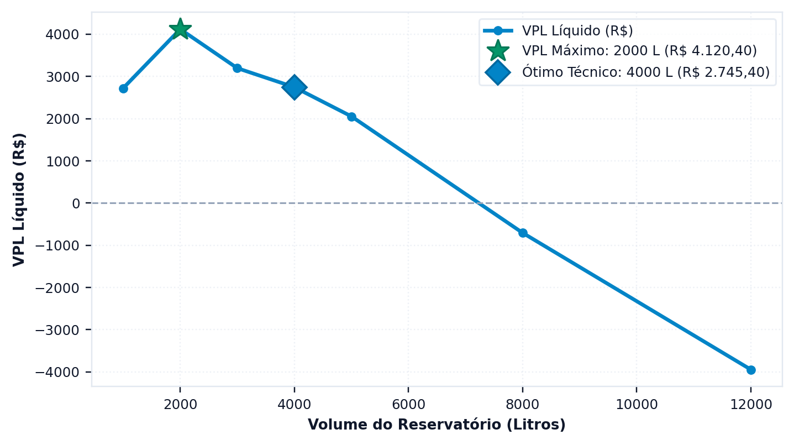

*Figura 15 — O gráfico da aba econômica: o valor presente líquido de cada volume da varredura, com cisterna de concreto, com o máximo econômico e o ótimo técnico marcados. Quando os dois coincidem, o programa os marca com um único símbolo. Figura gerada pelo próprio programa.*

---
### 4.7.5. O que a projeção assume

Vinte anos são muito tempo, e a projeção depende de premissas que convém declarar:

<!-- tabela: **Tabela 28** — Premissas da projeção econômica e o peso de cada uma no resultado -->
| Premissa | Valor adotado | Onde ela pesa |
| :--- | ---: | :--- |
| taxa mínima de atratividade | 0,5% ao mês | desconta o fluxo; quanto maior, pior o VPL |
| inflação dos custos | 0,35% ao mês | incide só sobre o custeio |
| reajuste da tarifa de água | 5% ao ano | incide sobre a economia |
| reajuste da tarifa de esgoto | 5% ao ano | idem, e é indexado à parte |
| intervalo de reajuste | 12 meses | em degraus, não continuamente |
| período de análise | 20 anos | vida útil de projeto mínima do sistema hidrossanitário, Tabela 25 da ABNT NBR 15575-1:2025 |

> **Os reajustes de água e de esgoto são separados**, e não um índice único sobre a
> fatura agregada. As duas parcelas são reajustadas por atos diferentes da
> concessionária, e tratá-las juntas indexa metade da conta pelo índice errado.

O reajuste tarifário é a premissa mais frágil da lista. Cinco por cento ao ano por
vinte anos multiplica a tarifa por 2,65. Se a tarifa real subir mais que isso, o
projeto rende mais; se subir menos, rende menos. Um estudo sério declara o valor
adotado e mostra a sensibilidade — a seção 3.7 (volume Guias de uso) ensina como.

---

### 4.7.6. O que temos até aqui

<!-- tabela: **Tabela 29** — Estado do projeto do tutorial após a análise econômica -->
| Projeto até aqui | |
| :--- | ---: |
| volume | 4.000 L, concreto |
| arranjo | recalque para caixa superior de 1.000 L |
| investimento | R$ 14.061 |
| economia anual | R$ 1.712 |
| VPL em 20 anos | R$ 2.745 |
| payback | 16,3 anos |

O dinheiro diz sim, sem folga.

Falta ouvir o carbono. E ele vai discordar.

---

## 4.8. Quanto carbono evita

> Ao terminar esta seção você terá o balanço de carbono do sistema e uma
> surpresa: com a cisterna que escolhemos, o projeto **emite mais do que evita** ao
> longo da vida útil.

---

### 4.8.1. A conta

Um sistema de aproveitamento pluvial evita emissões porque cada metro cúbico que ele
entrega deixa de ser captado, tratado e bombeado pela concessionária, e essas três
operações consomem energia. O mesmo sistema, porém, emite carbono em três frentes
próprias: a fabricação dos seus componentes, a energia consumida no bombeamento interno e
os insumos de tratamento aplicados à água.

O saldo ambiental do sistema é a diferença entre o que ele evita e o que ele emite, e a
pergunta que organiza esta seção é em quantos anos o crédito anual líquido amortiza a
dívida contraída na fabricação. Esse prazo é o **payback de carbono**, e ele desempenha
na dimensão ambiental o mesmo papel que o tempo de retorno desempenha na dimensão
econômica.

Para o nosso projeto, cisterna de concreto de 4.000 L com recalque para a caixa superior
de 1.000 L:

<!-- tabela: **Tabela 30** — Balanço de carbono do projeto do tutorial com cisterna de concreto -->
| Parcela | Valor |
| :--- | ---: |
| carbono incorporado no sistema | 858 kg CO₂e |
| emissão evitada por ano | 20,9 kg CO₂e |
| emissão anual de bombeamento e tratamento | 0,9 kg CO₂e |
| saldo líquido anual | 20,0 kg CO₂e |
| **payback de carbono** | **42,8 anos** |
| saldo ao fim de 20 anos | **−457 kg CO₂e** |

São quase quarenta e três anos para amortizar a dívida de carbono, contra uma vida útil adotada
de vinte anos. ==O sistema, portanto, não chega a se pagar ambientalmente:== ao ser
desativado, terá emitido 457 kg CO₂e a mais do que evitou ao longo de toda a sua
operação.

E esse é o resultado de um projeto que, do ponto de vista financeiro, se paga — o que
ilustra com clareza incômoda por que as dimensões de análise precisam ser mantidas
separadas até o momento da decisão.

> **Na International Edition (INT).** Os fatores de emissão desta seção são brasileiros: o fator
> da rede do Ministério da Ciência, Tecnologia e Inovação (MCTI) e o fator da água potável
> por região. Na International Edition, eles começam vazios, e a avaliação ambiental não é
> calculada até que se informem os fatores do país do projeto (apêndice C (volume Apêndices)).

---

### 4.8.2. Por que a economia de carbono é tão pequena

Vinte e um quilogramas de CO₂e por ano parecem pouco para 60 metros cúbicos de água
poupada, e de fato são: o resultado equivale a 0,35 kg CO₂e por metro cúbico
substituído.

A explicação está na natureza do produto substituído. Água tratada não é um bem
intensivo em carbono. Captar, tratar e distribuir a água custa, no Brasil,
entre 0,34 e 0,46 kg CO₂e por metro cúbico entregue, conforme a região e a composição da matriz elétrica local, e
essa faixa é modesta quando comparada à de concreto, aço ou combustíveis. Substituir um
produto de baixa intensidade de carbono por outro que exige fabricação de reservatório
não produz, portanto, o ganho ambiental que a intuição sugere.

> **A fronteira importa.** O fator do programa é por metro cúbico **entregue** na
> edificação, e não por metro cúbico produzido na estação. As perdas de distribuição
> no Brasil vão de 33,9% no Sudeste a 46,9% no Norte: produzir um metro cúbico
> entrega entre 0,53 e 0,66. Usar o fator de saída de estação subestimaria a
> emissão evitada em até um terço. A seção 2.8 (volume O método) detalha.

---

A aba ambiental apresenta o mesmo balanço em forma gráfica, com as parcelas de emissão e o crédito da água evitada separados (Figura 16).

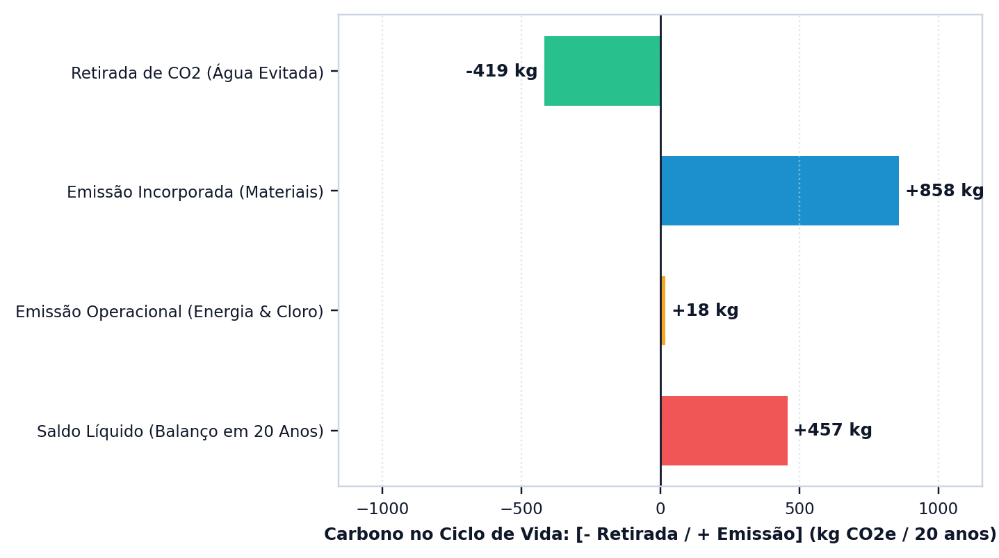

*Figura 16 — O gráfico da aba ambiental para o mesmo projeto, com cisterna de concreto: as parcelas do balanço de carbono em vinte anos. O sinal segue a convenção adotada em todo este capítulo: emissões positivas, água evitada negativa. Figura gerada pelo próprio programa.*

---
### 4.8.3. O material decide o sinal

A dívida de carbono está quase toda na cisterna. E cisterna de 4.000 L pode pesar
88 kg ou 4.800 kg, conforme o material. A tabela a seguir e a Figura 17 mostram a trajetória das emissões líquidas ao longo da vida útil, e a Figura 18, o resultado final de cada material.

==Em todo este capítulo, **positivo emite e negativo retira**. É a convenção do gráfico de balanço da aba ambiental do programa, e a que mantém a leitura intuitiva de um gráfico de emissões: a linha que desce é a que melhora.==

<!-- tabela: **Tabela 31** — Emissões líquidas de carbono do projeto do tutorial conforme o material do reservatório -->
| Material da cisterna | Massa | Carbono incorporado | Payback de carbono | Emissões líquidas em 20 anos | Preço |
| :--- | ---: | ---: | ---: | ---: | ---: |
| Polietileno (PEAD) | 88 kg | 327 kg CO₂e | 16,3 anos | -74 kg | R$ 2 526 |
| Concreto armado | 4 800 kg | 858 kg CO₂e | 42,8 anos | 457 kg | R$ 5 304 |
| Fibra de vidro | 57 kg | 371 kg CO₂e | 18,5 anos | -30 kg | R$ 3 410 |
| Aço inoxidável | 152 kg | 748 kg CO₂e | 37,3 anos | 347 kg | R$ 9 093 |

<!-- tabela: **Tabela 32** — Efeito do volume da cisterna de concreto sobre as emissões líquidas de carbono -->
| Volume em concreto | Payback de carbono | Emissões líquidas em 20 anos |
| ---: | ---: | ---: |
| 2 000 L | 27,4 anos | 141 kg CO₂e |
| 3 000 L | 35,0 anos | 296 kg CO₂e |
| 4 000 L | 42,8 anos | 457 kg CO₂e |
| 8 000 L | 74,6 anos | 1 119 kg CO₂e |

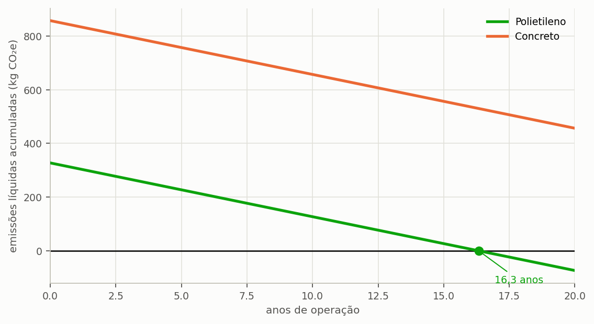

*Figura 17 — Emissões líquidas acumuladas da cisterna de 4.000 L ao longo da vida útil, para polietileno e concreto. A curva parte do carbono incorporado na fabricação, acima de zero, e desce com o crédito anual da água potável evitada; o polietileno cruza o zero aos 16,3 anos e encerra a vida útil retirando carbono, e o concreto não o cruza nos vinte anos adotados.*

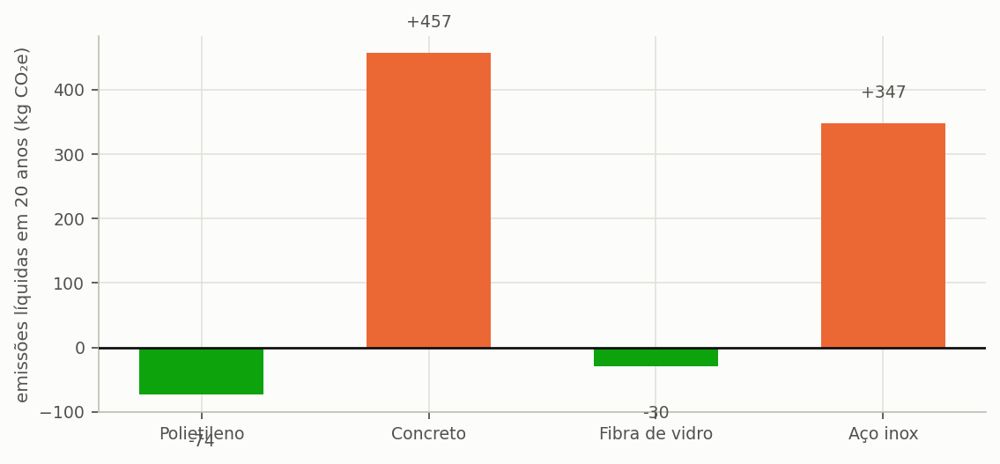

*Figura 18 — Emissões líquidas em vinte anos da cisterna de 4.000 L, por material. Em verde, valor negativo, isto é, retirada líquida; em laranja, positivo: dois dos quatro materiais encerram a vida útil emitindo mais do que evitaram.*

**A escolha do material inverte o resultado.**

Polietileno paga a dívida em 16,3 anos e termina os vinte anos tendo retirado 74 kg. Concreto leva 42,8 anos e termina emitindo 457 kg. Aço inoxidável também termina emitindo, 347 kg. Com 28% de fração atendível, a água poupada é pouca, e só os materiais leves chegam a pagar a própria fabricação.

E a segunda tabela mostra o outro lado da mesma moeda: em concreto, **quanto maior a
cisterna, pior o carbono**. A de 2.000 L fecha os vinte anos emitindo 141 kg; a de
8.000 L, 1.119 kg. Cada metro cúbico de concreto acrescenta 168 kg CO₂e e
rende cada vez menos água.

---
### 4.8.4. Existe um volume ambientalmente ótimo

A observação acima vale para o concreto, mas ela é um caso particular de algo mais
geral. O carbono incorporado cresce de forma quase afim com o volume; a água
evitada cresce com o atendimento, que satura. A soma das duas parcelas tem
**mínimo interior**: existe um volume a partir do qual cada litro a mais de
reservação emite mais do que evita. A Figura 19 mostra as
duas curvas.

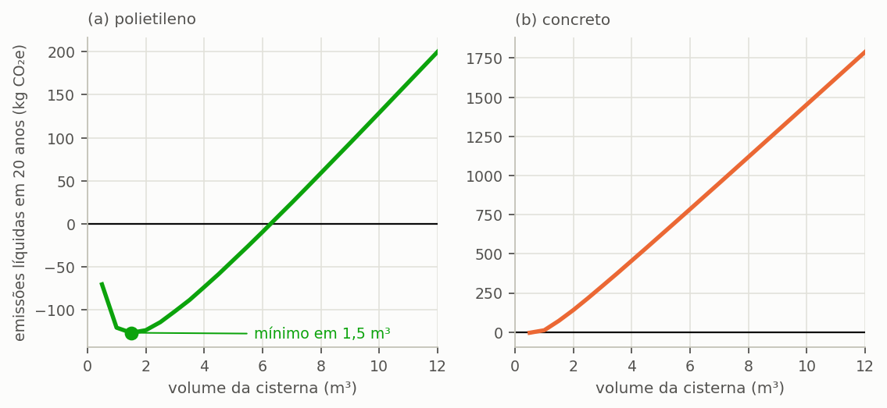

*Figura 19 — Emissões líquidas em vinte anos contra o volume da cisterna, para (a) polietileno e (b) concreto, no projeto do tutorial. Em polietileno a curva tem mínimo interior em 1,5 m³ e volta a cruzar o zero por volta de 6 m³: acima desse volume o sistema passa a emitir mais do que evita. Em concreto não há mínimo interior dentro da faixa, e a curva é positiva em toda ela.*

==Mais reservatório não é monotonicamente melhor para o clima.== É o contrário do que
a intuição corrente sugere, e decorre de uma propriedade simples: a saturação do
atendimento. O volume que minimiza as emissões não é o mesmo que maximiza a
economia de água — e a seção 4.9 trata de como decidir entre os dois.

> **O mais barato também é o melhor para o carbono.** Polietileno custa R$ 2.526
> contra R$ 5.304 do concreto, pesa cinquenta e cinco vezes menos, e é o
> material da tabela que fecha os vinte anos com a maior folga positiva.
>
> Isso não é sorte. Massa é carbono, e concreto armado é o material mais massivo da
> lista por larga margem.

---

### 4.8.5. Quando o concreto ainda faz sentido

A tabela não condena o concreto. Ela diz que ele precisa de justificativa.

- **Vida útil maior.** O programa adota 20 anos para todos os materiais, a vida útil de
  projeto mínima que a Tabela 25 da ABNT NBR 15575-1:2025 fixa para o sistema
  hidrossanitário. É um piso, e não uma previsão: a norma admite valores maiores, desde
  que explicitados no projeto (item 14.2.2 da NBR 15575-1). Uma cisterna
  de concreto bem executada dura 40 ou 50 anos; num horizonte de 50 anos, o payback de 43 anos é pago, ainda que sem folga. Se você adotar vida útil diferente, **declare**.
- **Volumes grandes.** Acima de 20 m³, polietileno deixa de ser prático e o concreto
  moldado no local passa a ser a única opção viável.
- **Restrição de espaço.** Cisterna enterrada de concreto se conforma ao terreno; a
  de polietileno vem em formatos fixos.
- **Estrutura já existente.** Reservatório de concreto aproveitado de outra
  finalidade tem carbono incorporado **zero** para efeito deste projeto.

---

### 4.8.6. A decisão do tutorial

**Trocamos para polietileno.**

É o que um projetista faria diante desta tabela, e é o que faz este tutorial ser
honesto: um estudo muda de rumo quando a análise mostra que o rumo estava errado.

A troca melhora ao mesmo tempo o resultado financeiro e o ambiental, sem mudar o potencial de economia, o que é raro:

<!-- tabela: **Tabela 33** — Efeito da troca de concreto por polietileno nas três dimensões de análise -->
| | Concreto | Polietileno |
| :--- | ---: | ---: |
| preço da cisterna | R$ 5.304 | R$ 2.526 |
| investimento total | R$ 14.061 | R$ 11.283 |
| payback financeiro | 16,3 anos | 12,8 anos |
| VPL em 20 anos | R$ 2.745 | R$ 5.524 |
| payback de carbono | 42,8 anos | 16,3 anos |
| emissões líquidas em 20 anos | +457 kg | −74 kg |

<!-- tabela: **Tabela 34** — Estado do projeto do tutorial após a análise ambiental -->
| Projeto até aqui | |
| :--- | ---: |
| volume | 4.000 L |
| **material** | **polietileno** |
| investimento | R$ 11.283 |
| VPL | R$ 5.524 |
| payback financeiro | 12,8 anos |
| payback de carbono | 16,3 anos |

---

### 4.8.7. O que declarar

A avaliação de ciclo de vida do Triton é de **triagem**, não de inventário completo.
Todos os fatores padrão têm procedência declarada, mas alguns são aproximações, como o
da motobomba e o do hipoclorito, e um fator digitado sem fonte recebe rótulo de
triagem, que o programa exibe. Num estudo publicado:

- declare a **fronteira** adotada, água entregue e não produzida;
- declare a **vida útil** e a justifique;
- declare quais fatores são aproximações e quais foram informados sem fonte;
- declare a **base da rede elétrica** e o ano.

O apêndice C (volume Apêndices) traz a procedência de cada fator, e a seção 2.8 (volume O método) explica as sete
etapas do inventário.

Temos três respostas agora. O potencial diz um volume, o dinheiro diz outro, o
carbono diz um terceiro. É hora de escolher.

---

## 4.9. Qual volume escolher, afinal

> Ao terminar esta seção você terá um volume recomendado, e saberá que ele
> depende de pesos que **você** declarou — não de uma verdade que o programa
> descobriu.

---

### 4.9.1. Três critérios, três respostas

As seções anteriores deste tutorial formularam três perguntas distintas ao mesmo projeto
— quanta água ele entrega, quanto dinheiro ele rende e quanto carbono ele evita — e
receberam três respostas que não coincidem. Essa discordância não é defeito da análise
nem inconsistência dos dados: é a manifestação de que os três critérios medem coisas
diferentes e têm comportamentos diferentes em relação ao volume do reservatório.

<!-- tabela: **Tabela 35** — Matriz de decisão multicritério: cada volume da varredura avaliado nas três dimensões de análise -->
| Volume | Potencial | VPL | Payback | Saldo de carbono em 20 anos | Investimento |
| ---: | ---: | ---: | ---: | ---: | ---: |
| 1 000 L | 23,30% | R$ 3 228 | 13,9 anos | 121 kg | R$ 9 217 |
| 2 000 L | 25,89% | R$ 5 374 | 12,4 anos | 124 kg | R$ 9 897 |
| 3 000 L | 26,80% | R$ 5 453 | 12,7 anos | 102 kg | R$ 10 809 |
| 4 000 L | 27,30% | R$ 5 524 | 12,8 anos | 74 kg | R$ 11 283 |
| 5 000 L | 27,58% | R$ 5 354 | 12,9 anos | 42 kg | R$ 11 757 |
| 8 000 L | 27,94% | R$ 4 245 | 14,6 anos | -59 kg | R$ 13 257 |
| 12 000 L | 28,00% | R$ 2 737 | 16,5 anos | -200 kg | R$ 14 831 |

<!-- tabela: **Tabela 36** — Volume vencedor segundo cada critério isolado -->
| Critério isolado | Volume que vence |
| :--- | ---: |
| maior potencial de economia | 12 000 L |
| menor payback descontado, desempate pelo VPL | 2 000 L |
| maior saldo de carbono | 2 000 L |
| **compromisso, pesos iguais** | **4 000 L** |

A primeira tabela é o retrato do problema. Repare em como as colunas discordam:

- O **potencial** cresce monotonicamente: quanto maior a cisterna, mais água.
  Máximo em 12.000 L.
- O **VPL** sobe, achata e começa a cair: máximo em 4.000 L, praticamente empatado
  com 2.000 e 3.000 L, e caindo desde 5.000 L, porque o investimento adicional deixa de
  se pagar.
- O **carbono** sobe e cai bem antes: máximo em 2.000 L, praticamente empatado com
  1.000 L. Depois disso, cada metro cúbico de polietileno acrescenta mais dívida do
  que crédito.

==Não existe volume que vença nos três critérios simultaneamente.== Cada um deles tem
ótimo em posição distinta da curva, e a escolha entre eles não é uma questão técnica que
admita resposta única: é uma questão de prioridade, que precisa ser declarada por quem
decide e não pode ser descoberta pelo programa. É exatamente essa a lacuna que os
métodos multicritério vêm preencher.

---

### 4.9.2. Como o TOPSIS resolve

O programa usa TOPSIS sobre **sete critérios**:

<!-- tabela: **Tabela 37** — Os sete critérios do multicritério e a direção de preferência de cada um -->
| Critério | Direção |
| :--- | :--- |
| potencial de economia | maximizar |
| extravasamento | minimizar |
| valor presente líquido | maximizar |
| payback descontado | minimizar |
| taxa interna de retorno | maximizar |
| CO₂e no fim da vida | minimizar |
| consumo de água potável | minimizar |

O método opera em quatro etapas encadeadas. Primeiro normaliza a matriz de decisão, de
modo que critérios medidos em unidades incomparáveis — pontos percentuais, reais,
quilogramas de dióxido de carbono equivalente e anos — passem a ocupar a mesma escala.
Em seguida aplica os pesos declarados. Calcula então, para cada alternativa de volume, a
distância euclidiana até a solução ideal, composta pelos melhores valores de cada
critério, e até a solução anti-ideal, composta pelos piores. Ordena, por fim, as
alternativas pela proximidade relativa ao ideal, conforme a formulação apresentada na
seção 2.10 (volume O método).

Aplicado ao projeto do tutorial com pesos iguais entre as três dimensões, repartidos
igualmente entre os critérios de cada uma, o método indica o volume de 4.000 L.

> **Três declarações que um estudo publicado precisa fazer.**
>
> A normalização do programa é uma **variante** de Hwang e Yoon: ela translada por
> `x − min(x)` antes da normalização vetorial, para admitir VPL negativo. É uma
> escolha deliberada, e apresentá-la como TOPSIS canônico seria incorreto.
>
> O SMAA-VIKOR, disponível ao lado, sorteia pesos e devolve a probabilidade de cada
> volume ocupar cada posição. É a resposta certa quando não há consenso sobre os
> pesos.
>
> As condições C1 e C2 de Opricovic, de vantagem aceitável e de estabilidade, **não
> estão implementadas**. A seção 2.10 (volume O método) detalha.

---

A aba de decisão apresenta o escore de cada volume candidato (Figura 20).

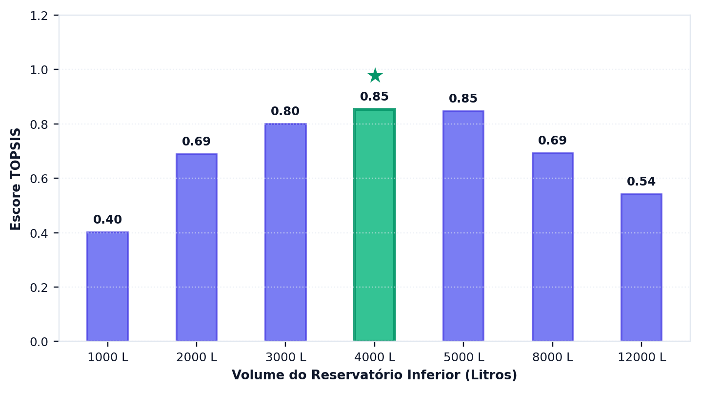

*Figura 20 — O gráfico da aba de decisão: o escore de proximidade ao ideal de cada volume candidato, com o vencedor destacado. Escores próximos entre si significam alternativas tecnicamente equivalentes, e nesse caso a escolha passa a depender do peso declarado. Figura gerada pelo próprio programa.*

---
### 4.9.3. O peso muda a resposta

A tabela a seguir mostra o que acontece ao deslocar o peso.

<!-- tabela: **Tabela 38** — Volume escolhido pelo TOPSIS conforme a dimensão que recebe peso dominante, e o segundo colocado -->
| Peso dominante | Volume | Segundo colocado |
| :--- | ---: | ---: |
| pesos iguais | 4 000 L | 5 000 L |
| técnico, 60% | 5 000 L | 4 000 L |
| econômico, 60% | 4 000 L | 3 000 L |
| ambiental, 60% | 4 000 L | 5 000 L |

Privilegiar o critério técnico desloca a recomendação para 5.000 L, o que era
esperado: o potencial de economia cresce monotonicamente com o volume, e um peso
dominante nessa dimensão empurra a escolha para cima. O deslocamento é pequeno porque o
potencial já está perto do teto, e o metro cúbico a mais rende pouco. Os critérios
econômico e ambiental, por sua vez, convergem ambos para 4.000 L.

Essa convergência, contudo, não constitui regra geral, e interpretá-la como tal seria
generalizar indevidamente um caso particular. Ela ocorre aqui porque o volume de 4.000 L
está no máximo, pouco pronunciado, da curva de valor presente líquido e ainda encerra a
vida útil retirando carbono. Em município de tarifa mais baixa, o ótimo econômico se deslocaria
para baixo e a divergência entre os dois critérios apareceria com clareza.

> **Declare os pesos.** «Volume ótimo pelo TOPSIS» sem os pesos é uma afirmação
> impossível de reproduzir. Dois artigos com pesos diferentes chegam a volumes
> diferentes e ambos estão certos.

---

Uma solução de compromisso cede em alguma coisa, e convém saber em quê. O programa desdobra o escore único em sete, um por critério, e mostra a distância que separa a alternativa escolhida do melhor valor alcançado em cada um deles (Figura 21).

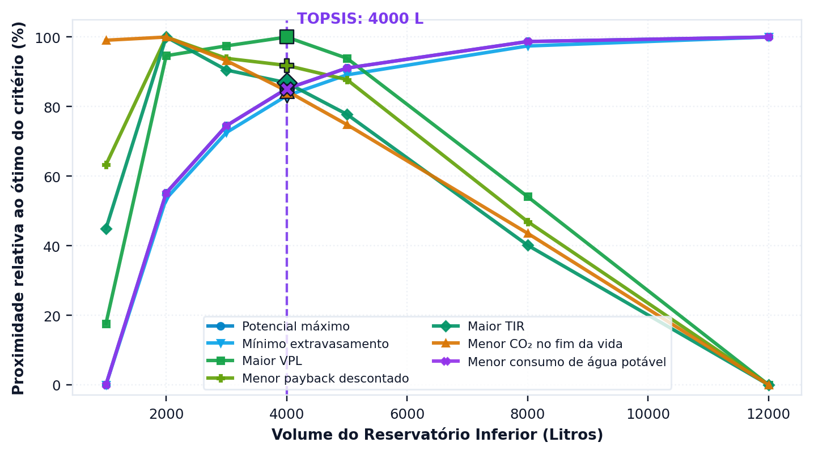

*Figura 21 — O segundo gráfico da aba de decisão: quanto o volume escolhido se aproxima do melhor valor possível em cada um dos sete critérios. É a figura que mostra o que a solução de compromisso está cedendo, e em qual dimensão. Figura gerada pelo próprio programa.*

---
### 4.9.4. A recomendação do tutorial

A recomendação do tutorial é o reservatório de **4.000 L em polietileno**, e a razão de
adotá-la não é apenas o fato de ele vencer sob pesos iguais. Ele vence também sob peso
econômico dominante e sob peso ambiental dominante, e fica em segundo lugar por margem
estreita sob peso técnico dominante. ==Uma recomendação que sobrevive a quatro
ponderações diferentes é robusta precisamente porque não depende de nenhuma delas.==

Vale registrar ainda que esse é o mesmo volume que o critério hidráulico da seção
4.4 havia indicado, com limiar de ganho marginal de 1 %/m³. Duas rotas
metodologicamente independentes — uma que olha apenas para a curva de aproveitamento e
outra que pondera sete critérios de três dimensões — chegaram ao mesmo resultado, e essa
concordância aumenta a confiança na recomendação.

A concordância, porém, não é garantida em nenhum outro caso, e é por isso que o tutorial
percorreu o caminho longo em vez de parar na seção 4.4. O propósito não era chegar
mais depressa ao volume, e sim saber que as duas rotas concordam **neste** projeto, em
vez de supor que concordem sempre.

---

### 4.9.5. O projeto, fechado

<!-- tabela: **Tabela 39** — Resumo do projeto do tutorial, com todos os parâmetros e resultados -->
| Triton · residência unifamiliar em Florianópolis | |
| :--- | ---: |
| série de precipitação | Florianópolis, 30 anos, 1.795 mm/ano |
| área de captação | 150 m² |
| coeficiente de escoamento | 0,85 |
| descarte de primeiras águas | 2,0 mm, todo evento |
| moradores | 4 |
| demanda total | 600 L/dia |
| fração atendível por chuva | 28% |
| reservatório inferior | 4.000 L, polietileno |
| arranjo de abastecimento | recalque para caixa superior |
| reservatório superior | 1.000 L, limiar de acionamento de 100 L |
| classe de qualidade | 1, cloração por pastilhas |
| descarte inicial | reservatório de 300 L |
| **potencial de economia de água potável** | **27,30%** |
| dias de atendimento pleno | 97,3% |
| água poupada | 59,8 m³/ano |
| energia do recalque | 7,7 kWh/ano |
| investimento | R$ 11.283 |
| **valor presente líquido em 20 anos** | **R$ 5.524** |
| payback descontado | 12,8 anos |
| **emissões líquidas em 20 anos** | **−74 kg CO₂e** |
| payback de carbono | 16,3 anos |

Resta uma etapa, que é a de comunicar o resultado: um estudo que não é relatado de modo
verificável não se distingue, para quem o lê, de um palpite bem apresentado. É o assunto
da seção seguinte.

---

## 4.10. O relatório, e o que declarar num artigo

> Ao terminar esta seção você terá o relatório emitido e, se pretende publicar, a
> lista do que precisa constar no método do artigo. Essa lista é a parte mais
> curta e a mais importante do manual.

---

### 4.10.1. Os três relatórios

O programa emite três relatórios distintos, e a distinção não é de extensão, mas de
público e de finalidade. Escolher o relatório errado para o destinatário certo é a
forma mais comum de produzir um documento que ninguém lê: um cliente não percorre um
inventário de ciclo de vida item a item, e um avaliador de certificação não se satisfaz
com uma conclusão de quatro páginas.

O **relatório executivo** ocupa de quatro a seis páginas e reúne o resultado técnico, o
investimento, o retorno e uma conclusão objetiva. É o documento de entrega ao cliente, e
sua virtude é a de caber numa leitura única, sem exigir que o leitor conheça o método.

O **relatório ambiental e ESG** apresenta o inventário de ciclo de vida discriminado por
componente, o saldo de carbono ao longo da vida útil e o enquadramento do projeto nos
cinco referenciais tratados na seção 2.9 (volume O método) — LEED, AQUA-HQE, Selo Casa Azul, EDGE e
GRI 303 (na International Edition, LEED, EDGE e GRI 303). É o documento que se anexa a um processo de certificação, e a discriminação por
componente existe justamente porque um avaliador confere item a item.

O **relatório científico** traz o método completo, as premissas declaradas, a série
utilizada e os resultados com a precisão que um artigo exige. É a base sobre a qual se
redige uma publicação, e é o único dos três que inclui as figuras analíticas.

Além dos três, a etapa **10. Exportação** gera o desenho esquemático em DXF, o modelo
BIM em JSON e planilhas com a série diária completa e com a varredura de volumes, conforme a
seção 3.9 (volume Guias de uso) detalha.

---

### 4.10.2. O que o relatório não decide por você

==O relatório traz os números; o contexto que os torna reproduzíveis é seu.== Nenhum
documento gerado automaticamente pode declarar por que aquela série de precipitação foi
escolhida, se o consumo per capita adotado foi medido ou tomado da literatura, ou qual
a justificativa da vida útil considerada na avaliação ambiental. São essas informações
que permitem a um terceiro repetir o estudo e chegar ao mesmo resultado, e é delas que
trata o restante desta seção.

---

### 4.10.3. A lista de declaração

Um estudo conduzido no Triton que deixe de declarar qualquer dos itens abaixo não é
reproduzível por terceiros e, o que costuma ser pior, não é comparável com outro estudo
feito no mesmo programa — porque duas simulações com premissas diferentes produzem
números que parecem comparáveis e não são. A lista está organizada na ordem em que as
decisões aparecem no trabalho, e pode ser percorrida como roteiro de redação do método.

#### 4.10.3.1. Programa e versão

- **Versão do Triton**, com o número completo. Correções de cálculo entre versões
  deslocam resultados, e sem a versão declarada não há como saber qual conta produziu o
  número publicado.

#### 4.10.3.2. Série de precipitação

- **Origem**: estação, base nacional, ou modelo climático.
- Se for base nacional: **modelo, cenário e janela temporal**.
- **Recorte**: datas de início e fim, e número de anos.
- **Tratamento de falhas** e critério de descarte de ano incompleto.

#### 4.10.3.3. Edificação e demanda

- Área de captação e **como foi obtida** — projeção horizontal.
- Coeficiente de escoamento e sua origem.
- Consumo per capita e se é **medido ou de referência**.
- **Fração atendível por água pluvial** e os usos finais que a compõem. É o teto do
  resultado, e sem ele o potencial não se interpreta.
- Se algum uso está fora da lista do item 4.1.7 da ABNT NBR 15527:2019, como a máquina
  de lavar roupa, e qual critério de qualidade foi adotado para ele.

#### 4.10.3.4. Arranjo de abastecimento

- **Arranjo**: recalque para caixa superior, pressurização direta ou gravidade. Ele
  define a energia e as motobombas no custo e no carbono.
- No recalque: volume da caixa, limiar de acionamento e altura manométrica.
- Na pressurização direta: pressão de trabalho e acionamentos por pessoa por dia.

#### 4.10.3.5. Descarte de primeiras águas

- Lâmina adotada e **modo** entre os três.
- **A divergência em relação ao Netuno 4**, se o estudo comparar as versões: o
  Netuno 4 trata a lâmina como limiar do evento, o Triton a subtrai, e a diferença
  vale de 2,3 a 2,7 pontos percentuais de economia sobre 4.050 casos de referência.

#### 4.10.3.6. Volume e critério de escolha

- Se veio de varredura: **limiar de ganho marginal adotado**. Sem ele, «volume
  ideal» não significa nada.
- Se veio de multicritério: **os pesos dos sete critérios** e o método, TOPSIS ou
  SMAA-VIKOR.
- Que a normalização do TOPSIS é uma **variante** com translação por `x − min(x)`.

#### 4.10.3.7. Análise econômica

- **Município e concessionária**, com a data de vigência da tabela tarifária.
- **Regime de mínimo** entre os seis. É o que mais muda resultado entre municípios.
- Percentual de esgoto, e que ele incide sobre a **parcela de água** da fatura.
- Taxa mínima de atratividade, inflação, período de análise.
- **Reajustes tarifários** de água, esgoto e energia, com o intervalo.

#### 4.10.3.8. Avaliação de ciclo de vida

- **Fronteira**: água entregue, e não produzida.
- **Vida útil** adotada e sua justificativa.
- **Material** do reservatório. Ele inverte o sinal do resultado, como a seção 4.8
  mostra.
- Base do fator de emissão da rede elétrica, **com o ano**.
- Quais fatores são **aproximações** e quais carregam **rótulo de triagem**.

#### 4.10.3.9. Certificações

- Que as classes 2 a 4 de qualidade são **adaptações do programa**, não da NBR 15527.
- No caso do LEED, a **versão** do referencial: v4/v4.1 ou v5.
- No caso do EDGE, que o programa avalia **apenas a barra de água**, e que o
  caso-base usado é o declarado ou a demanda modelada.

---

### 4.10.4. O parágrafo pronto

Para o nosso projeto, o método ficaria assim:

> A simulação foi conduzida no Triton 0.1.0, com modelo comportamental de base
> diária (extravasamento calculado antes da retirada da demanda, com a chuva do dia
> disponível para o consumo do dia, ordem intermediária entre YAS e YBS), sobre série de
> precipitação de Florianópolis com 30 anos (10.950 dias, média de 1.795 mm/ano).
> Adotou-se área de captação de 150 m² em projeção horizontal, coeficiente de
> escoamento de 0,85, adotado a partir da eficiência de captação η que a ABNT NBR 15527:2019
> recomenda no item 4.1.6, e descarte de primeiras águas de 2,0 mm em
> todo evento, subtraído da lâmina diária — divergência deliberada em relação ao
> Netuno 4, que trata o valor como limiar do evento. A demanda total adotada foi de
> 600 L/dia (4 moradores, 150 L/hab·dia), com fração atendível por água pluvial de
> 28%, correspondente à bacia sanitária e aos usos externos, dentro da lista do item
> 4.1.7 da ABNT NBR 15527:2019. O volume de 4.000 L resultou do critério de ganho
> marginal com limiar de 1 %/m³ e foi confirmado por análise multicritério TOPSIS com
> sete critérios e pesos iguais entre as dimensões técnica, econômica e ambiental,
> com normalização em variante de Hwang e Yoon translada por x − min(x). O
> abastecimento dos pontos de uso é feito por recalque para caixa superior de 1.000 L,
> com limiar de acionamento de 100 L, motobomba de 0,5 CV, altura manométrica de 12 m e
> rendimento de motor da Tabela 13 da ABNT NBR 17094-2. A análise
> econômica utilizou a estrutura tarifária da CASAN vigente desde 01/04/2026, regime
> de disponibilidade, esgoto a 100% do valor da água, TMA de 0,5% ao mês, inflação
> de 0,35% ao mês, reajustes de 5% ao ano em intervalos de 12 meses e período de 20
> anos. A avaliação de ciclo de vida adotou fronteira de água entregue, reservatório
> em polietileno e vida útil de 20 anos.

São cerca de duzentas e cinquenta palavras, e elas são a diferença entre um estudo que
outro pesquisador consegue repetir e um número solto que ninguém pode verificar. A
extensão é modesta diante do que se ganha: um método assim redigido responde
antecipadamente à maior parte das perguntas que um parecerista faria.

---

### 4.10.5. O fim do tutorial

Dez seções, um único projeto acompanhado do início ao fim, e um estudo completo: partiu
de uma residência sem sistema e chegou a uma recomendação de volume, material, classe de
qualidade e viabilidade econômica e ambiental, com cada decisão justificada pelo número
que a sustentou. A tabela da seção 4.9 reúne o resultado consolidado.

O caminho a seguir depende do que você pretende fazer em seguida:

- **Resolver um caso diferente do tutorial** — o capítulo 3, os guias de tarefa.
- **Entender de onde vem cada número** — o capítulo 2, o método.
- **Não cometer os erros que o programa não impede** — a seção 5.1 (volume Enganos, limitações e confiabilidade).
- **Defender o estudo diante de um revisor** — o capítulo 5.

---

# Apêndices

---

## Apêndice G — Glossário

Termos técnicos e siglas, com o equivalente em inglês quando ele é usado na
literatura, acompanhados das diretrizes de padronização terminológica do Triton.

---

**AAC** (*aproveitamento de água de chuva*). Emprego de água precipitada sobre coberturas
para usos não potáveis em edificações, regulamentado no Brasil pela ABNT NBR 15527:2019.
Deve-se preferir o termo «aproveitamento» a «reúso», uma vez que a água de chuva captada
na cobertura é um recurso primário e não um efluente gerado por uso antrópico anterior.

**ABNT**. Associação Brasileira de Normas Técnicas, o organismo que publica as normas
brasileiras. Uma norma é identificada pela sigla NBR seguida do número e do ano da
edição, como em ABNT NBR 15527:2019.

**ACV** (*life cycle assessment*). Avaliação de ciclo de vida. Método que contabiliza os
impactos ambientais de um produto ao longo de toda a sua existência, da extração das
matérias-primas ao descarte. A do programa é de **triagem**, e não um inventário completo
conforme a ISO 14040.

**Água de chuva** (*rainwater*). Precipitação atmosférica coletada diretamente em
superfícies impermeáveis de cobertura (telhados e lajes impermeabilizadas), antes de atingir
o solo ou galerias públicas. É o termo técnico-normativo oficial consagrado pela ABNT NBR
15527:2019. Deve-se utilizar rigorosamente «água de chuva» para designar o recurso natural
e a fonte hídrica captada, evitando a forma coloquial «água da chuva».

**Água não potável** (*non-potable water*). Água que não se destina ao consumo humano direto,
mas atende aos padrões de qualidade física, química e microbiológica estabelecidos por
normas específicas (como a Tabela 1 da ABNT NBR 15527:2019 e a ABNT NBR 16783:2019) para
usos admitidos: descargas em bacias sanitárias e mictórios, lavagem de veículos, calçadas e
pisos, irrigação paisagística, lavagem de roupas e torres de resfriamento.

**Água pluvial** (*stormwater*, *pluvial water*). Água de chuva que escoa superficialmente
por superfícies urbanas ou é conduzida por canalizações e sistemas prediais de drenagem
(ABNT NBR 10844). No Triton, o termo aplica-se preferencialmente à infraestrutura predial
e aos componentes de engenharia: *sistema de aproveitamento de água pluvial (SAAP)*, *rede
pluvial*, *demanda pluvial*, *consumo de água pluvial* e *extravasamento pluvial*.

**Água potável** (*potable water*, *drinking water*). Água que atende integralmente aos
padrões de potabilidade definidos pela Portaria GM/MS nº 888/2021 do Ministério da Saúde,
destinada à ingestão direta, preparação de alimentos e higiene pessoal.

**ANEEL**. Agência Nacional de Energia Elétrica, que homologa as tarifas das
distribuidoras de energia. O Triton lê delas o preço da energia do bombeamento, e a
atualização das tarifas é feita a partir dos dados abertos da agência.

**AQUA-HQE**. Referencial de certificação ambiental de edificações, adaptação brasileira
do francês HQE conduzida pela Fundação Vanzolini. No referencial residencial de 2024, a
água é tratada no tema «Consumo de água», em itens classificados nos níveis PR, HQE,
HQE 2 e HQE 3.

**Área de captação** (*catchment area*). Área projetada na **horizontal** da superfície
impermeável da cobertura onde a água é captada, conforme o item 3.6 da NBR 15527:2019.
Não é a área inclinada do telhado, nem a área de contribuição da NBR 10844, que serve
ao dimensionamento de calhas.

**Bandeira tarifária**. Acréscimo ou desconto sobre a tarifa de energia elétrica,
conforme as condições de geração. Verde, amarela, vermelha 1, vermelha 2, e a
modalidade branca.

**BD+C** (*Building Design and Construction*). Família de referenciais do LEED
para projeto e construção de edificações novas ou em grande reforma. É a família
tratada neste manual, nas versões 4, 4.1 e 5.

**BIM** (*building information modeling*). Modelagem da informação da construção.
Representação digital da edificação em que cada componente carrega propriedades além da
geometria, o que permite compatibilizar projetos de disciplinas diferentes.

**BRL**. Sigla da Edição Brasil do programa, a que traz os dados brasileiros: base
climática CLIMBra, tarifas de 652 municípios, energia da ANEEL, custos em reais e
certificações nacionais. A seção 1.2 (volume Comece aqui) compara as duas edições.

**CAD** (*computer-aided design*). Desenho assistido por computador. O programa exporta o
esquema hidráulico em DXF, formato de intercâmbio aceito pelos programas de CAD.

**CAPEX** (*capital expenditure*). Investimento inicial.

**CASAN**. Companhia Catarinense de Águas e Saneamento, a concessionária de água e esgoto
de Florianópolis e de boa parte de Santa Catarina. A estrutura tarifária dela é a adotada
no tutorial deste manual.

**CDD** (*consecutive dry days*). Maior sequência de dias consecutivos com chuva
abaixo de 1 mm.

**CEDAE**. Companhia Estadual de Águas e Esgotos do Rio de Janeiro. A estrutura tarifária
dela — conta mínima de 15 m³ (Tarifa 1) e faixas com multiplicadores da tarifa de
referência — foi herdada pela Águas do Rio, pela Rio+ Saneamento e pela Águas da
Imperatriz.

**CMIP6**. Sexta fase do *Coupled Model Intercomparison Project*, o exercício
internacional coordenado que produz as projeções climáticas usadas pelos relatórios do
IPCC. A base climática do programa deriva dele.

**CLIMBra** (*Climate Change Dataset for Brazil*). Conjunto de dados meteorológicos diários em grade de alta resolução (0,25° × 0,25°, ~28 km) para todo o Brasil, cobrindo 19 modelos climáticos globais do CMIP6 e cenários de emissões SSP2-4.5 e SSP5-8.5. Desenvolvido por Ballarin et al. (2023) na revista [*Scientific Data* (Nature)](https://www.nature.com/articles/s41597-023-01956-z) ([doi:10.1038/s41597-023-01956-z](https://doi.org/10.1038/s41597-023-01956-z)) e disponibilizado publicamente no [*Science Data Bank*](https://doi.org/10.57760/sciencedb.02316) ([doi:10.57760/sciencedb.02316](https://doi.org/10.57760/sciencedb.02316)). As projeções brutas foram corrigidas de viés pelo método *Quantile Delta Mapping* (QDM) utilizando como referência observacional a base de Xavier, King e Scanlon (2016). No Triton, o CLIMBra constitui a Base de dados CLIMBra para 652 cidades brasileiras (série histórica de 1980 a 2013 e projeções futuras contínuas de 2015 a 2100).

**Coeficiente de escoamento** (*runoff coefficient*). Fração da chuva que
efetivamente chega ao reservatório, descontadas perdas por absorção, evaporação e
molhamento inicial da cobertura.

**Comprimento representativo de série de precipitação** (*representative rainfall time series length*, $N_{rep}$).
Menor período contínuo em anos de dados diários de chuva necessário para estabilizar
estatisticamente o dimensionamento e o desempenho do sistema (reproduzindo o volume ideal
e o potencial de economia da série completa sob confiança $\ge 90\%$), segundo a
metodologia de Geraldi e Ghisi (2017, 2018, 2019). O comprimento necessário não é uma
constante geográfica fixa: cresce com a fração atendível e com o nível de demanda da edificação.

**Confiabilidade temporal** ($C_t$). Percentual de dias em que o sistema atendeu
plenamente ($V_{con,t} = D_{pl,t}$), parcialmente ou não atendeu a demanda pluvial.

**Confiabilidade volumétrica** ($C_v$). Fração da demanda **pluvial** que o sistema atendeu
($C_v = \sum V_{con} / \sum D_{pl} = E_{pot} / f$). Não confundir com o potencial de economia,
que tem no denominador a demanda total da edificação.

**CORSAN**. Companhia Riograndense de Saneamento, a concessionária de água e esgoto de boa
parte do Rio Grande do Sul. Fatura a água pela fórmula exponencial `PB × Cⁿ` somada ao
serviço básico, e não por faixas de consumo.

**CSV** (*comma-separated values*). Formato de arquivo de texto em que cada linha é um
registro e as colunas são separadas por um caractere, tipicamente vírgula ou ponto e
vírgula. É o formato das séries de precipitação.

**CV**. Cavalo-vapor, unidade de potência equivalente a 0,7355 kW, corrente no comércio
de motobombas no Brasil. Uma motobomba de meio CV tem 0,37 kW de potência de eixo.

**CWD** (*consecutive wet days*). Maior sequência de dias consecutivos com chuva
igual ou superior a 1 mm.

**Demanda estocástica** (*stochastic water demand*). Modelagem do consumo diário de água como
variável probabilística que varia dia a dia e entre realizações (Silva e Ghisi, 2016),
permitindo avaliar a faixa de incerteza do dimensionamento e dos indicadores de desempenho
sob variabilidade real de uso.

**Demanda pluvial** (*pluvial demand*, $D_{pl}$). Parcela da demanda diária de água da
edificação que pode ser suprida pelo sistema de aproveitamento ($D_{pl,t} = D_{tot,t} \times f$).
Corresponde aos pontos de consumo não potável interligados à rede pluvial.

**Descarte de primeiras águas** (*first flush*). Lâmina inicial de chuva desviada do
sistema, que carrega a sujeira depositada na cobertura (mínimo de 2 mm conforme a NBR
15527:2019). No Triton é **subtraída** da chuva do dia; no Netuno 4 era tratada como
limiar do evento.

**Disponibilidade**. Regime tarifário em que um valor fixo **soma** por cima do
consumo medido. Cada metro cúbico economizado desconta.

**DN** (*diâmetro nominal*). Designação comercial do diâmetro de um tubo ou conexão, em
milímetros. Não corresponde exatamente ao diâmetro interno nem ao externo: é um número de
referência do qual decorrem as dimensões reais, tabeladas por norma.

**DXF** (*drawing exchange format*). Formato de intercâmbio de desenhos técnicos, lido
por praticamente todos os programas de CAD.

**EAU**. Prefixo dos itens do tema «Consumo de água» no referencial AQUA-HQE, do francês
*eau*, água. Os itens ligados ao aproveitamento pluvial são o EAU.1.2, o EAU.1.3 e o
EAU.1.5.

**EDGE** (*excellence in design for greater efficiencies*). Referencial de certificação
da International Finance Corporation, do Banco Mundial. Mede economia percentual contra
um caso-base local em três dimensões independentes e exige que cada uma cruze o limiar.

**EN** (*Europäische Norm*, norma europeia). Norma publicada pelo Comitê Europeu de
Normalização. Neste manual, a EN 15978, que define os módulos do ciclo de vida da
edificação, e a EN 15804, que rege as declarações ambientais de produtos de construção.

**EPD** (*Environmental Product Declaration*). Declaração ambiental de produto: documento
verificado por terceiros, conforme a ISO 14025 e, na construção, a EN 15804, que publica
os impactos do ciclo de vida de um produto por unidade declarada. É a fonte preferida para
fatores de emissão de materiais e equipamentos.

**ESG** (*environmental, social and governance*). Conjunto de critérios ambientais,
sociais e de governança usado na avaliação de empresas e de empreendimentos. O programa
alimenta indicadores ambientais desse conjunto.

**ETAP**. Estação de tratamento de água pluvial. No programa, o conjunto de filtro
de entrada, desinfecção e filtro de polimento.

**ETCCDI** (*Expert Team on Climate Change Detection and Indices*). Grupo de trabalho
internacional que padronizou os índices de extremos climáticos, dos quais o programa
calcula oito.

**Extravasamento** (*spillage*, *overflow*). Volume que excede a capacidade do reservatório
e é conduzido pelo extravasor quando ele já está cheio.

**Fração atendível por água pluvial** (*non-potable demand share*, $f$). Percentual da demanda
total de água da edificação ($D_{tot}$) passível de suprimento por água de chuva ($f = D_{pl} / D_{tot}$).
Representa o **teto assintótico intransponível** do potencial de economia de água potável
($E_{pot} \le f$): mesmo sob capacidade infinita de armazenamento e precipitação ilimitada,
a economia de potável nunca ultrapassa a fração atendível, pois o restante ($1 - f$) é
reservado aos usos nobres e potáveis. Distingue-se da confiabilidade volumétrica ($C_v = E_{pot} / f$),
que avalia o atendimento da parcela pluvial.

**Franquia no mínimo**. Regime tarifário em que o valor fixo já inclui um volume de
consumo. Economizar **abaixo** da franquia não reduz a fatura.

**Ganho marginal**. Variação do potencial de economia por metro cúbico acrescentado
ao reservatório, em %/m³ ($\Delta E_{pot} / \Delta V$). Critério de escolha do volume ideal.

**GRI** (*Global Reporting Initiative*). Padrão internacional de divulgação corporativa
de desempenho socioambiental. Sua série 303 trata de água e efluentes.

**HQE** (*Haute Qualité Environnementale*). Referencial francês de alta qualidade
ambiental, base do AQUA-HQE. Designa também os níveis dos itens do referencial: HQE,
HQE 2 e HQE 3, em ordem crescente de exigência, acima do pré-requisito (PR).

**IFC**. A sigla designa duas coisas distintas. Em certificação, é a *International
Finance Corporation*, do Banco Mundial, que desenvolve o EDGE. No contexto BIM, é o
*Industry Foundation Classes*, formato aberto de intercâmbio que o programa **não**
exporta: a exportação BIM do programa é um arquivo JSON de propriedades.

**INT**. Sigla da *International Edition* do programa: abre em inglês e não traz dados
brasileiros. Tarifas, custos, moeda e fatores de emissão são informados pelo usuário.

**IPCC** (*Intergovernmental Panel on Climate Change*). Painel intergovernamental que
sintetiza o conhecimento científico sobre mudança do clima e organiza os relatórios de
avaliação a que as projeções climáticas se referem.

**IPTU verde**. Desconto no imposto predial concedido por alguns municípios a edificações
que adotam medidas de sustentabilidade, entre elas o aproveitamento de água pluvial. O
percentual e as condições variam por legislação municipal.

**ISO 14040**. Norma internacional que estabelece os princípios e a estrutura da
avaliação de ciclo de vida. Um inventário conforme a ISO 14040 exige rastreabilidade de
cada fluxo e revisão crítica externa, requisitos que uma avaliação de triagem não cumpre.

**JSON** (*JavaScript object notation*). Formato de arquivo de texto estruturado, legível
por pessoas e por programas. É o formato interno do arquivo `.triton`.

**LCOW** (*levelized cost of water*). Custo nivelado da água: razão entre o valor presente
de todos os custos do ciclo de vida do sistema (CAPEX, substituições, O&M, energia e
produtos químicos) e o volume descontado de água pluvial consumida ao longo do horizonte
de análise, em R$/m³. Permite confrontar a viabilidade econômica do sistema diretamente
com a tarifa da concessionária.

**LEED** (*leadership in energy and environmental design*). Referencial de certificação
ambiental de edificações do *U.S. Green Building Council*, o mais difundido
internacionalmente. Trata eficiência hídrica na categoria *Water Efficiency*: na versão 4,
pelos créditos WEc1 e WEc2; na versão 5, pelo crédito WEc2, *Enhanced Water Efficiency*.

**m.c.a.** Metro de coluna d'água, unidade de pressão equivalente à exercida por uma
coluna de água de um metro de altura, cerca de 9,81 kPa. É a unidade usual em instalações
prediais.

**MCTI**. Ministério da Ciência, Tecnologia e Inovação, que publica o fator de emissão
médio do Sistema Interligado Nacional usado na avaliação ambiental da Edição Brasil.

**Micromedição**. Medição individualizada por unidade habitacional em edifício
multifamiliar. Informada ao programa como número de economias.

**Manuais do Triton** (*Triton manual suite*). A documentação do programa, montada
das mesmas fontes em três formatos: o manual completo, oito volumes avulsos, cada um com
uma parte dele, e o site de documentação. Os volumes servem a quem precisa de uma parte
só, para consultar ou enviar:

1. **Manual completo**: todos os capítulos e apêndices.
   
2. **Volume 1 — Comece aqui**: o que o programa faz, como instalá-lo e por onde entrar
   conforme o seu objetivo.
   
3. **Volume 2 — O método**: as equações, os critérios e as fontes por trás de cada número
   que o programa publica.
   
4. **Volume 3 — Guias de uso**: outras cidades, clima futuro, tarifas, demanda variável,
   lote, sensibilidade e exportação.
   
5. **Volume 4 — Tutorial**: um projeto de residência em Florianópolis, do primeiro dado ao
   volume recomendado.
   
6. **Volume 5 — Enganos, limitações e confiabilidade**: os enganos mais comuns, os limites
   do modelo e como o programa é verificado.
   
7. **Volume 6 — Correções, bugs e versionamento**: o que mudou desde o Netuno 4, as
   mensagens de erro e como relatar um problema.
   
8. **Volume 7 — Modulação probabilística**: o estudo refeito com premissas sorteadas —
   variáveis, distribuições, leitura dos resultados e limites do método.
   
9. **Volume 8 — Apêndices**: parâmetros, processos, fatores de emissão, tarifas, base
   climática, formatos, glossário e referências.
   

Os PDFs acompanham o programa e abrem pela etapa 9. Documentação; o manual existe também
em inglês, na íntegra.

**NBR**. Norma Brasileira, publicada pela ABNT. As mais citadas neste manual são a NBR
15527, de aproveitamento de água de chuva, a NBR 10844, de instalações prediais de águas
pluviais, a NBR 5626, de sistemas prediais de água fria e quente, e a NBR 17094-2, de
motores de indução.

**Payback de carbono**. Tempo para a economia anual líquida de emissões pagar o
carbono incorporado na fabricação do sistema.

**Payback descontado**. Tempo para o fluxo de caixa descontado acumulado cruzar zero.

**PB**. Preço-base, em R$/m³, da fórmula exponencial da CORSAN, `PB × Cⁿ`, em que `C` é o
consumo do mês e `n` o expoente da tabela exponencial para aquele consumo.

**PEAD**. Polietileno de alta densidade, material dos reservatórios plásticos mais
comuns no mercado brasileiro.

**Piso de pagamento**. Regime tarifário em que a fatura **não fica** abaixo de um
valor. Diferente de disponibilidade: o piso limita por baixo, a disponibilidade soma
por cima.

**Potencial de economia de água potável** (*potable water saving potential*, $E_{pot}$).
Fração da demanda **total** da edificação suprida por água pluvial ($E_{pot} = \sum V_{con} / \sum D_{tot} \times 100\%$).
É o indicador central do programa, limitado superiormente pela fração atendível ($E_{pot} \le f$).

**pp**. Pontos percentuais. Usado para exprimir a diferença entre dois percentuais: de
35% para 37% vão dois pontos percentuais, e não dois por cento.

**PR**. Pré-requisito: no AQUA-HQE, o nível de item de atendimento obrigatório, abaixo
dos níveis HQE, HQE 2 e HQE 3.

**PRCPTOT**. Precipitação total anual em dias úmidos.

**PRFV**. Plástico reforçado com fibra de vidro, material de reservatórios de médio e
grande porte. Aparece no programa sob a designação «fibra».

**PVC**. Policloreto de vinila, material das tubulações prediais de água fria e das
colunas de desvio do descarte inicial. As dimensões dos tubos soldáveis seguem a ABNT NBR 5648.

**R95p**. Soma da precipitação dos dias acima do percentil 95 dos dias úmidos.

**Rendimento da bomba**. Razão entre a potência hidráulica entregue à água e a
potência mecânica no eixo. Não inclui o motor.

**Rendimento do motor**. Razão entre a potência mecânica no eixo e a potência
elétrica consumida da rede. A ABNT NBR 17094-2 manda marcá-lo na placa.

**RX1day**, **RX5day**. Maior precipitação em um e em cinco dias consecutivos, no
ano.

**SAAP**. Sistema de aproveitamento de água pluvial. Conjunto integrado de componentes
prediais — área de captação, condutores, descarte inicial (first flush), estação de
tratamento (ETAP), cisterna inferior, reservatório superior, grupo motobomba ou pressurizador
e rede de distribuição independente — concebido para coletar, tratar, armazenar e fornecer
água não potável em conformidade com a ABNT NBR 15527 e a ABNT NBR 5626.

**SB**. Serviço básico: a parcela fixa mensal da fatura de água da CORSAN, somada ao
resultado da fórmula exponencial.

**SDII** (*simple daily intensity index*). Precipitação média dos dias úmidos.

**SI** (*seasonality index*). Índice de sazonalidade de Walsh e Lawler. Zero quando a
chuva é uniforme ao longo do ano.

**SMAA** (*stochastic multicriteria acceptability analysis*). Método que sorteia
pesos e devolve a probabilidade de cada alternativa vencer.

**SNIS**. Sistema Nacional de Informações sobre Saneamento, base oficial brasileira de
indicadores do setor, mantida pelo governo federal. É a origem dos indicadores de
consumo energético do saneamento usados na avaliação ambiental.

**SSP** (*shared socioeconomic pathways*). Trajetórias socioeconômicas compartilhadas,
que descrevem hipóteses coerentes de desenvolvimento global e as emissões correspondentes.
Combinam-se com os modelos climáticos para produzir projeções.

**TFDI**. Tarifa fixa de disponibilidade da infraestrutura, nome que algumas
concessionárias dão à parcela da fatura cobrada independentemente do consumo. Ver
*Disponibilidade*.

**TIR**. Taxa interna de retorno. A taxa de desconto que zera o valor presente
líquido.

**TMA**. Taxa mínima de atratividade. A taxa de desconto adotada.

**TOPSIS** (*technique for order of preference by similarity to ideal solution*).
Método de ordenação multicritério de Hwang e Yoon.

**UV**. Radiação ultravioleta, empregada na desinfecção de água por inativação de
microrganismos. Atua apenas no instante da passagem pelo reator e não deixa residual, ao
contrário da cloração.

**VIKOR**. Método de decisão multicritério proposto por Opricovic, que busca uma solução
de compromisso entre critérios conflitantes. Ver também *SMAA*.

**Volume ideal** (*optimal tank volume*). Menor volume de reservatório da grade de simulação
a partir do qual o ganho marginal de economia de água potável ($\Delta E_{pot} / \Delta V$)
cai abaixo de um limiar declarado (tipicamente $1,0\%/\text{m}^3$ ou $0,5\%/\text{m}^3$).
Evita o superdimensionamento de reservatórios, assegurando a melhor relação custo-benefício.

**VPL**. Valor presente líquido.

**WEM**. Codificação das medidas de eficiência hídrica do EDGE. A WEM14 é o sistema
de aproveitamento de água pluvial.

**XLSX**. Formato de pasta de trabalho do Microsoft Excel, baseado em XML compactado. É um
dos formatos de exportação de planilhas e de resultados da linha de comando.

**YAS** (*yield after spillage*). Regra de operação em que o extravasamento é
calculado **antes** da retirada da demanda e, na forma estrita, a retirada do dia sai
só do volume guardado na véspera. O programa calcula o extravasamento antes, como a
YAS, mas deixa a chuva do dia atender a demanda do dia; fica entre a YAS e a YBS
(seção 2.1 (volume O método)).

**YBS** (*yield before spillage*). Regra de operação em que a demanda é retirada **antes**
do cálculo do extravasamento. Supõe consumo anterior à chuva do dia e superestima o
aproveitamento; o programa não a adota, e o resultado dele fica entre a YAS e a YBS.

---

### G.1. Diretrizes de Padronização e Nomenclatura no Triton

A padronização terminológica é indispensável para assegurar a consistência e o rigor técnico
em artigos científicos, relatórios técnicos, na interface gráfica e na documentação do Triton.
As convenções a seguir detalham a distinção de termos correlatos frequentemente confundidos:

#### G.1.1. 1. Água de Chuva versus Água Pluvial versus «Água da Chuva»

<!-- tabela: **Tabela 40** — Padronização terminológica de água de chuva e água pluvial -->
| Termo | Definição e Contexto de Aplicação | Situação no Triton | Referência |
| :--- | :--- | :--- | :--- |
| **Água de chuva** (*rainwater*) | Precipitação atmosférica coletada diretamente na cobertura (telhado/laje impermeabilizada), antes de atingir o solo ou galerias. Refere-se à **fonte hídrica** e ao recurso ambiental. | **Canônico e preferencial** para o recurso captado («aproveitamento de água de chuva», «precipitação de água de chuva»). | ABNT NBR 15527:2019, título e item 3.1. |
| **Água pluvial** (*stormwater* / *pluvial water*) | Água de chuva após escoamento superficial urbano ou quando conduzida por canalizações e sistemas prediais de drenagem e armazenamento. Aplica-se à **infraestrutura física** e aos componentes de engenharia. | **Canônico e preferencial** para sistemas, redes e balanço («sistema predial de água pluvial - SAAP», «rede pluvial», «demanda pluvial», «extravasamento pluvial»). | ABNT NBR 10844:1989; ABNT NBR 5626:2020. |
| **«Água da chuva»** | Expressão coloquial e informal. | **Desaconselhada**. Não deve ser empregada em publicações, textos normativos, relatórios do Triton ou código. | Prática de redação técnica e científica. |

#### G.1.2. 2. Fração Atendível, Demanda Pluvial, Potencial e Confiabilidade

Para evitar ambiguidades matemáticas e conceituais frequentemente encontradas na literatura:

<!-- tabela: **Tabela 41** — Grandezas fundamentais do balanço hídrico e relações entre fração e potencial -->
| Grandeza | Símbolo / Código | Definição | Fórmula | Relação / Teto |
| :--- | :--- | :--- | :--- | :--- |
| **Fração atendível por água pluvial** | $f$ / `rainwater_share` | Proporção da demanda total da edificação correspondente a pontos de consumo não potável conectáveis ao SAAP. | $f = D_{pl} / D_{tot}$ | Parâmetro de projeto ($0 \le f \le 1$). Constitui o **teto assintótico** de $E_{pot}$. |
| **Demanda pluvial** | $D_{pl}$ / `rainwater_demand` | Volume de água requerido pelos pontos não potáveis da edificação em um intervalo de tempo. | $D_{pl,t} = D_{tot,t} \times f$ | Em L/dia ou m³/ano. |
| **Volume de água pluvial consumido** | $V_{con}$ / `pluvial_consumed` | Volume de água não potável efetivamente suprido pelo reservatório pluvial aos pontos de consumo. | Determinado pelo balanço diário (seção 2.1 (volume O método)) | $V_{con,t} \le D_{pl,t}$ e $V_{con,t} \le S_{t-1} + C_t$. |
| **Potencial de economia de água potável** | $E_{pot}$ / `potential_potable_savings_pct` | Percentual da demanda **total** da edificação economizado pelo aproveitamento pluvial. | $E_{pot} = \frac{\sum V_{con}}{\sum D_{tot}} \times 100\%$ | **Indicador central**. Sempre $E_{pot} \le f$. |
| **Confiabilidade volumétrica** | $C_v$ / `volumetric_reliability_pct` | Percentual da demanda **pluvial** suprido pela água de chuva armazenada. | $C_v = \frac{\sum V_{con}}{\sum D_{pl}} \times 100\%$ | $C_v = \frac{E_{pot}}{f}$. Pode atingir 100% mesmo quando $E_{pot} < 100\%$. |
| **Confiabilidade temporal** | $C_t$ / `temporal_reliability_pct` | Percentual de dias da série em que a demanda pluvial foi 100% atendida ($V_{con,t} = D_{pl,t}$). | $C_t = \frac{N_{dias\_plenos}}{N_{total}} \times 100\%$ | Mede a segurança de abastecimento diário sem suplementação potável. |

#### G.1.3. 3. Síntese de Nomenclatura Recomendada para Artigos e Relatórios

- Utilize **«aproveitamento de água de chuva»** (e não «reúso de água da chuva» — água de chuva não é efluente; seu uso é *aproveitamento*, não *reúso*).
- Utilize **«área de captação»** para o plano horizontal da cobertura (NBR 15527) e reserve **«área de contribuição»** exclusivamente para o dimensionamento hidráulico de calhas sob vento (NBR 10844).
- Utilize **«descarte de primeiras águas»** ou *first flush* para a lâmina inicial desviada (mínimo de 2 mm conforme NBR 15527), e não «limiar de descarte».
- Utilize **«fração atendível»** (e não «demanda relativa» ou «fração de economia») para expressar a partição de usos não potáveis no consumo total.
- Utilize **«comprimento representativo de série»** para a extensão mínima em anos necessária para estabilização estatística da simulação (método Geraldi & Ghisi).
- Utilize **«LCOW»** ou **«custo nivelado da água»** para a métrica de custo unitário ao longo do ciclo de vida descontado à TMA.

---

## Apêndice I — Fichas de uma página

Resumos destacáveis. Cada ficha cabe numa página e serve de consulta rápida ao lado
do computador.

---

### I.1. Ficha 1 — O fluxo de um estudo completo

<!-- tabela: **Tabela 42** — Ficha de consulta: os dez passos de um estudo completo e a seção que trata de cada um -->
| # | Passo | O que se decide nele | Seção |
| ---: | :--- | :--- | ---: |
| 1 | Projeto e chuva | série, área, coeficiente, descarte | 4.1 |
| 2 | Edificação | tipologia, demanda, fração atendível | 4.2 |
| 3 | Primeira simulação | um volume de palpite, para ver | 4.3 |
| 4 | Varredura | curva de retorno, volume ideal | 4.4 |
| 5 | Arranjo | precisa de caixa superior? | 4.5 |
| 6 | Qualidade | classe, desinfecção, filtros | 4.6 |
| 7 | Economia | tarifa real, CAPEX, fluxo de caixa | 4.7 |
| 8 | Carbono | inventário, material, payback | 4.8 |
| 9 | Decisão | sete critérios, pesos declarados | 4.9 |
| 10 | Relatório | saídas e lista de declaração | 4.10 |

**Antes de publicar:** seção 4.10, a lista de declaração. Seção 5.1 (volume Enganos, limitações e confiabilidade), os dez
enganos. Seção 5.2 (volume Enganos, limitações e confiabilidade), as limitações que afetam o seu caso.

---

### I.2. Ficha 2 — As armadilhas, em uma linha cada

<!-- tabela: **Tabela 43** — Ficha de consulta: as dez armadilhas de projeto e onde cada uma é tratada -->
| Armadilha | Onde |
| :--- | :--- |
| área **inclinada** em vez da projeção horizontal | 5.1.1 (volume Enganos, limitações e confiabilidade) |
| chuva **média mensal** em vez da série diária | 5.1.2 (volume Enganos, limitações e confiabilidade) |
| descarte em **litros** quando o campo quer milímetros | 5.1.3 (volume Enganos, limitações e confiabilidade) |
| **regime de mínimo** tarifário ignorado | 5.1.4 (volume Enganos, limitações e confiabilidade) |
| escola ou hospital com **tarifa residencial** | 5.1.5 (volume Enganos, limitações e confiabilidade) |
| esperar mais **água** da caixa superior | 5.1.6 (volume Enganos, limitações e confiabilidade) |
| **série curta** demais | 5.1.7 (volume Enganos, limitações e confiabilidade) |
| classe de qualidade escolhida pelo **custo** | 5.1.8 (volume Enganos, limitações e confiabilidade) |
| comparar com o **Netuno 4** sem declarar a divergência | 5.1.9 (volume Enganos, limitações e confiabilidade) |
| publicar o volume de **maior economia** como recomendado | 5.1.10 (volume Enganos, limitações e confiabilidade) |

---

### I.3. Ficha 3 — Os seis regimes tarifários

<!-- tabela: **Tabela 44** — Ficha de consulta: os seis regimes tarifários e o efeito da economia -->
| Regime | Ao economizar | Municípios |
| :--- | :--- | ---: |
| sem mínimo | cada m³ desconta | 165 |
| disponibilidade | cada m³ desconta; o fixo continua | 122 |
| fórmula exponencial (CORSAN) | cada m³ desconta; a conta é PB × Cⁿ + serviço básico | 34 |
| **franquia no mínimo** | **abaixo da franquia não desconta nada** | **329** |
| franquia retroativa | passando dela, tarifa tudo desde zero | 2 |
| piso de pagamento | a fatura não fica abaixo do piso | 0 |

**Teste rápido:** simule dois consumos, um dentro e um fora da faixa mínima, e
compare com uma fatura real. Se só um bater, o regime está errado.

---

### I.4. Ficha 4 — Os indicadores, e o que cada um responde

<!-- tabela: **Tabela 45** — Ficha de consulta: os indicadores e a pergunta que cada um responde -->
| Indicador | Denominador | Responde |
| :--- | :--- | :--- |
| potencial de economia | demanda **total** | quanto do consumo de água potável cai |
| confiabilidade volumétrica | demanda **pluvial** | quanto do pretendido se atendeu |
| dias plenos, parciais, nulos | dias da série | com que frequência se pode contar |
| extravasamento | — | o reservatório é pequeno? |
| ganho marginal | — | vale ampliar? |

`Epot = confiabilidade volumétrica × fração atendível`

---

### I.5. Ficha 5 — A cadeia de energia da motobomba

```
recalque:  e = ρ · g · H ÷ (η_bomba · η_motor)      kWh/m³
partidas:  E = placa × tempo ÷ η_motor              kWh
```

A placa é a potência **no eixo**. O rendimento do motor separa o eixo da tomada. Em
branco, vale a Tabela 13 da NBR 17094-2: 60,5% em meio CV, 69,3% em um CV.

---

### I.6. Ficha 6 — A lista de declaração, resumida

**Programa:** versão, com revisão.

**Chuva:** origem, recorte, anos; se projeção, modelo, cenário e janela.

**Edificação:** área e como foi obtida, coeficiente, per capita e origem, **fração
atendível** e os usos que a compõem.

**Descarte:** lâmina e modo; a divergência contra o Netuno 4, se comparar versões.

**Volume:** critério de escolha — limiar de ganho marginal, ou pesos do
multicritério.

**Economia:** município, concessionária, vigência da tabela, **regime de mínimo**,
percentual de esgoto, TMA, inflação, reajustes e período.

**Carbono:** fronteira (água entregue), vida útil, material do reservatório, base da
rede com o ano, fatores **aproximados** ou com **rótulo de triagem**.

**Certificação:** que as classes 2 a 4 são adaptações do programa; no LEED, a versão; no EDGE, que só a
barra de água foi avaliada.

---

## Apêndice J — Arquivos de exemplo

O manual imprime resultados; estes arquivos são o que se abre para
reproduzi-los. Ficam na pasta `casos` do programa, e cada um traz a série de chuva
incorporada: abrem sem o CSV de origem, em qualquer máquina. A exceção é o
`11_modulacao_climbra.triton`, que usa a chuva da base CLIMBra: ele guarda a
referência da série — cidade, modelo, cenário e recorte — e o programa a recompõe
da base ao abrir.

---

### J.1. Os casos do manual

<!-- tabela: **Tabela 46** — Os casos de exemplo e o que cada um demonstra -->
| Arquivo | Seção | O que demonstra |
| :--- | :--- | :--- |
| `01_tutorial_florianopolis.triton` | 4.1 a 4.10 | o projeto fechado do tutorial: cisterna de 4.000 L em polietileno e recalque para caixa superior de 1.000 L |
| `02_tutorial_varredura.triton` | 4.4 e 2.2 | o projeto antes da caixa superior, em modo varredura, de 0 a 20.000 L, passo de 1.000 L |
| `03_dez_dias.triton` | 2.1 | o caso didático de dez dias, que cabe numa planilha |
| `04_reservatorio_superior.triton` | 4.5 | 4.000 L embaixo mais 1.000 em cima, a comparação da seção 4.5 contra os 5.000 L de um tanque só |
| `05_manaus.triton` | 3.1 | o projeto do tutorial levado a Manaus, que chove mais e rende menos |
| `06_brasilia.triton` | 3.1 | o projeto do tutorial levado a Brasília, de estação seca marcada |
| `07_saopaulo.triton` | 3.1 | o projeto do tutorial levado a São Paulo |
| `08_escola_semanal.triton` | 3.4 e 3.5 | escola de 300 alunos com demanda modulada por dia da semana |
| `09_hotel_mensal.triton` | 3.4 | hotel de litoral com ocupação mensal em fase com a chuva |
| `10_modulacao_tutorial.triton` | 7.3 e 7.4 | a varredura do tutorial com a Modulação Probabilística montada: as três variáveis de consumo, a chuva, a tarifa e o investimento, mil realizações, semente 42 |
| `11_modulacao_climbra.triton` | 7.4 | a mesma varredura com a chuva da CLIMBra (Florianópolis, SSP2-4.5, 2025 a 2054) e os dezenove modelos climáticos marcados; o arquivo guarda a referência da série, e não os valores |

### J.2. O que cada um produz

Os valores abaixo são obtidos **relendo o arquivo gravado** e simulando o
que foi relido, e não a configuração que o gerou. É a diferença que
importa: um parâmetro que não sobreviva à gravação aparece aqui como
número errado, em vez de passar despercebido.

<!-- tabela: **Tabela 47** — Resultado que cada caso de exemplo produz ao ser relido e simulado -->
| Arquivo | Modo | Volume | Potencial | Pluvial consumida |
| :--- | :--- | ---: | ---: | ---: |
| `01_tutorial_florianopolis.triton` | volume fixo | 4.000 L | 27,30% | 163,8 L/dia |
| `02_tutorial_varredura.triton` | varredura | ideal: 4.000 L | 27,12% | 21 volumes |
| `03_dez_dias.triton` | volume fixo | 2.000 L | 36,00% | 72,0 L/dia |
| `04_reservatorio_superior.triton` | volume fixo | 4.000 L | 27,30% | 163,8 L/dia |
| `05_manaus.triton` | volume fixo | 4.000 L | 20,96% | 125,8 L/dia |
| `06_brasilia.triton` | volume fixo | 4.000 L | 15,45% | 92,7 L/dia |
| `07_saopaulo.triton` | volume fixo | 4.000 L | 25,74% | 154,4 L/dia |
| `08_escola_semanal.triton` | volume fixo | 30.000 L | 34,34% | 3.095,8 L/dia |
| `09_hotel_mensal.triton` | volume fixo | 25.000 L | 32,11% | 1.854,9 L/dia |
| `10_modulacao_tutorial.triton` | varredura | ideal: 4.000 L | 27,12% | 21 volumes |
| `11_modulacao_climbra.triton` | varredura | ideal: 4.000 L | 26,57% | 21 volumes |

---

### J.3. Como rodar

**Arquivo, Abrir projeto**, escolha o arquivo, e o programa carrega tudo: a
chuva, a edificação, os custos e a configuração das análises. Percorra as
etapas de resultado na barra lateral para ver cada dimensão.

Os casos 10 e 11 abrem com a **Modulação Probabilística** já montada — as
variáveis, as distribuições, os modelos climáticos, o número de realizações e
a semente da seção 7.4 (volume Modulação probabilística): vá à etapa 13 e clique em **Simular**. Os dois estão
em modo varredura, que é o que dá sentido às figuras por volume; num caso de
volume fixo, a ferramenta mostra só o volume do estudo.

Os arquivos ficam na pasta `casos`, dentro da pasta de instalação do
programa. Se quiser modificá-los, **salve com outro nome**: assim o caso
original continua reproduzindo o número impresso no manual.

---

### J.4. Os três estudos de `exemplos`

Além dos casos do manual, o programa traz três estudos de referência em
`exemplos`: residência unifamiliar em Florianópolis, edifício
corporativo em Brasília e escola pública em Manaus. São maiores e menos
didáticos que os do manual, e servem de ponto de partida para projetos
reais.

> **Eles foram regravados nesta versão.** Estavam num esquema plano
> anterior, que o programa lia sem reconhecer: abriam como projeto
> padrão, com 100 m² e três moradores, e nada avisava. A abertura agora
> recusa formato desconhecido com mensagem própria, e os três foram
> convertidos para o esquema corrente, com a chuva incorporada.

---

### J.5. O que estes arquivos não são

Não são gabarito de projeto. São **casos de demonstração**: os custos são
os do tutorial, a tarifa é a da CASAN e a categoria é residencial em
todos, inclusive na escola e no hotel, pela limitação que a seção 5.2 (volume Enganos, limitações e confiabilidade)
descreve. Para um estudo real, troque tarifa, custos e série de chuva
pelos do seu caso.
