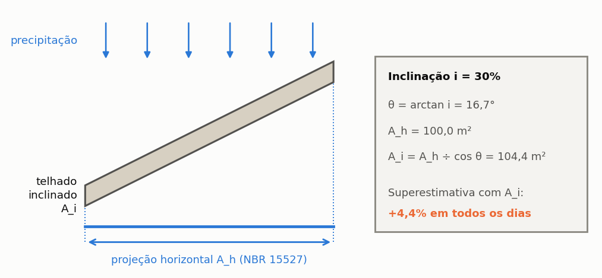
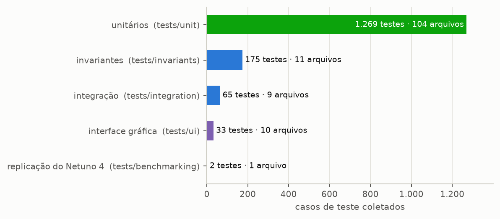
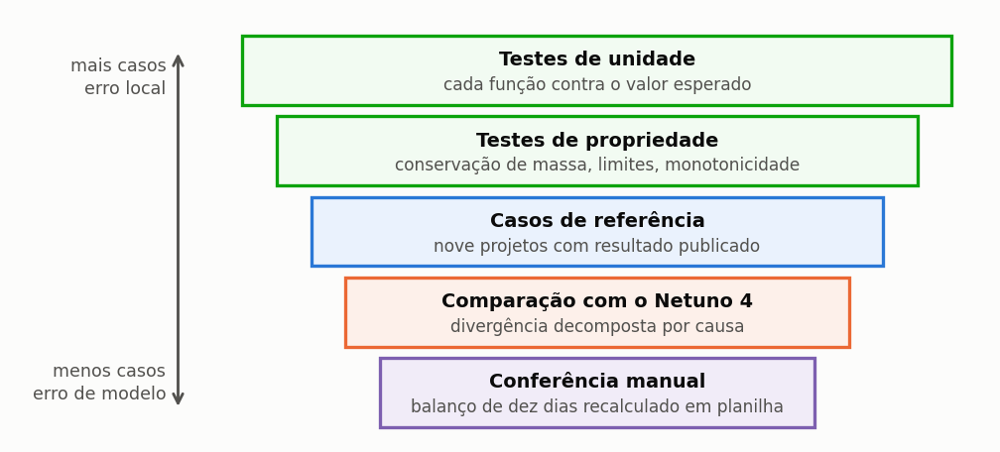

# Triton

## Manual do Usuário — Enganos, limitações e confiabilidade

Igor Catão Martins Vaz e Enedir Ghisi

Grupo de Pesquisa em Ambientes Sustentáveis
Universidade Federal de Santa Catarina

Florianópolis, 2026

---

### Sobre este volume

Este é um dos oito volumes em que o manual do Triton pode ser distribuído, e
reúne o capítulo 5 (Enganos, limitações e confiabilidade) e os apêndices G e H do manual completo. Serve para mandar
só a parte que interessa: o método a um revisor, o tutorial a uma turma, os guias
a quem já usa o programa.

A numeração das seções e das equações é a mesma do manual completo, de modo que
uma remissão vale nos dois. Quando o texto remete a uma seção que está em outro
volume, o nome do volume vem entre parênteses.

| Volume | Conteúdo |
| :--- | :--- |
| Comece aqui | o capítulo 1 (Comece aqui) e o apêndice G |
| O método | o capítulo 2 (O método) e os apêndices A, B, C, E, G e H |
| Guias de uso | o capítulo 3 (Guias disponíveis no programa) e os apêndices D, F e G |
| Tutorial | o capítulo 4 (Tutorial: um exemplo do começo ao fim) e os apêndices G, I e J |
| **Enganos, limitações e confiabilidade** | o capítulo 5 (Enganos, limitações e confiabilidade) e os apêndices G e H |
| Correções, bugs e versionamento | o capítulo 6 (Correções, bugs e versionamento) |
| Modulação probabilística | o capítulo 7 (Modulação probabilística) e os apêndices G e H |
| Apêndices | os apêndices |

### Como citar

> VAZ, Igor Catão Martins; GHISI, Enedir. **Triton: manual do usuário**.
> Enganos, limitações e confiabilidade. Versão 0.1.0. Florianópolis: Universidade Federal de Santa
> Catarina, 2026.

---

## Sumário

**5 Enganos, limitações e confiabilidade**

5.1 Dez enganos que o programa não impede

5.2 Limitações conhecidas

5.3 Como o programa é verificado

**Apêndices**

Apêndice G — Glossário

Apêndice H — Referências

## Lista de figuras

Figura 1 — Área de captação como projeção horizontal da cobertura, conforme o item 3.6 da ABNT NBR 15527:2019

Figura 2 — Número de testes e de arquivos de cada família da suíte de verificação, conforme a coleta da suíte nesta versão

Figura 3 — As cinco camadas de verificação do programa, dos testes de unidade, numerosos e dirigidos a erros locais, à conferência manual, pontual e dirigida a erros de modelo

---

## Lista de tabelas

Tabela 1 — Padronização terminológica de água de chuva e água pluvial

Tabela 2 — Grandezas fundamentais do balanço hídrico e relações entre fração e potencial

---

---
# 5. Enganos, limitações e confiabilidade

---

## 5.1. Dez enganos que o programa não impede

> Estes não são defeitos do programa. São erros de **engenharia** que ele aceita sem
> reclamar, porque não tem como saber. Cada um traz o engano, por que ele é
> tentador, o que faz ao resultado, e como evitar.

---

### 5.1.1. Usar a área inclinada do telhado

**O engano.** Informar a área da superfície do telhado em vez da projeção horizontal.

**Por que é tentador.** É a área que aparece no quantitativo de telhas, e é a que o
pedreiro conhece.

**O que faz ao resultado.** Superestima a captação na razão `1 ÷ cos(inclinação)`.
Num telhado de 30% de caimento, 4,4% de água que não existe; em 60%, 16,6%.

**Como evitar.** O item 3.6 da NBR 15527:2019 define a área de captação como a
projeção horizontal, e a EN 16941-1:2024 faz o mesmo. Não use a área de contribuição da NBR 10844, que soma a metade da
altura do telhado e as paredes para dimensionar calhas.
A chuva cai na vertical, e o que ela vê é a sombra da cobertura no chão. Se você tem a área inclinada, multiplique por `cos(inclinação)`, como na Figura 1.

---

*Figura 1 — Área de captação como projeção horizontal da cobertura, conforme o item 3.6 da ABNT NBR 15527:2019. Para inclinação de 30%, θ = 16,7° e a área inclinada é 4,4% maior que a projeção horizontal; usar a área inclinada superestima o volume captado nessa proporção em todos os dias da série.*

---

### 5.1.2. Dimensionar pela chuva média mensal

**O engano.** Usar a média mensal de precipitação num cálculo de planilha, em vez da
série diária.

**Por que é tentador.** A média mensal é o dado publicado nas normais
climatológicas, e a planilha cabe numa página.

**O que faz ao resultado.** Superestima sistematicamente. A média esconde que a
chuva chega concentrada: um mês com 200 mm distribuídos em cinco eventos enche e
faz a cisterna extravasar cinco vezes, enquanto o cálculo médio supõe um fluxo contínuo
que a cisterna absorveria inteiro.

**Como evitar.** É a razão de existir deste programa. A seção 2.1 (volume O método) mostra o
extravasamento acontecendo dia a dia; o cálculo por médias não o enxerga.

---

### 5.1.3. Confundir a lâmina de descarte com o volume do dispositivo

**O engano.** Informar no campo de descarte o volume do reservatório de autolimpeza,
em litros.

**Por que é tentador.** O dispositivo é dimensionado em litros, e o campo pede um
número.

**O que faz ao resultado.** O campo espera **milímetros**. Informar 300, pensando nos
300 litros do dispositivo, produz um descarte de 300 mm — maior que quase toda chuva
diária já registrada no Brasil. O sistema capta **praticamente zero**.

**Como evitar.** `d_f` é uma lâmina. O volume do dispositivo é `A × d_f`: no projeto
do tutorial, 150 m² × 2 mm = 300 litros. São a mesma decisão expressa em duas
unidades, e o programa quer a primeira.

---

### 5.1.4. Ignorar o regime de mínimo tarifário

**O engano.** Montar a tabela tarifária com as faixas progressivas e esquecer como a
concessionária trata o consumo mínimo.

**Por que é tentador.** As faixas são o que está publicado em destaque. O regime de
mínimo está numa nota de rodapé, quando está.

**O que faz ao resultado.** Em município de **franquia no mínimo**, que são 371 dos
652 da base, economizar abaixo da franquia **não desconta nada**. Um estudo que
suponha desconto linear produz um payback que não existe.

**Como evitar.** A seção 3.3 (volume Guias de uso). E o teste prático: simule dois consumos, um dentro e um
fora da faixa mínima, e compare com uma fatura real da edificação.

---

### 5.1.5. Simular escola ou hospital com tarifa residencial

**O engano.** Usar a tarifa residencial do catálogo para edificação não residencial.

**Por que é tentador.** O catálogo traz 652 municípios prontos, quase todos só com a
categoria residencial, e o programa não impede.

**O que faz ao resultado.** Subestima a economia. As categorias não residenciais são
mais caras: na CASAN de abril de 2026, a primeira faixa custa R$ 6,81/m³ no
comercial contra R$ 3,08/m³ no residencial.

**Como evitar.** O programa **avisa** quando a tipologia não é residencial, e diz o
sentido do erro. Escolha a categoria da edificação onde o catálogo a traz, hoje nos
municípios da CORSAN; nos demais, lance a estrutura da categoria correta no modo
personalizado. A seção 3.5 (volume Guias de uso) trata do assunto. Na International Edition, a tarifa é sempre
digitada; digite a da categoria da edificação.

---

### 5.1.6. Esperar que o reservatório superior aumente a economia

**O engano.** Adotar a caixa elevada esperando mais água.

**Por que é tentador.** É o arranjo clássico brasileiro, e «mais reservatório» soa
como «mais água».

**O que faz ao resultado.** Com o mesmo armazenamento total, o arranjo com caixa
elevada entrega **menos**: a cisterna extravasa enquanto a caixa de cima ainda tem
espaço, porque o recalque só acontece quando há consumo. No tutorial, cerca de um sexto de ponto percentual a menos, mais
7,7 kWh por ano de energia.

**Como evitar.** Decida a caixa por critério **hidráulico** — pressão por gravidade,
reserva contra falta de energia — e não hídrico. A seção 4.5 (volume Tutorial) faz a comparação justa.

---

### 5.1.7. Adotar série curta demais

**O engano.** Simular com dois ou três anos de série.

**Por que é tentador.** É o que se consegue rápido de uma estação próxima.

**O que faz ao resultado.** Dois efeitos somados. O **viés do reservatório vazio**,
porque a simulação começa com a cisterna seca e os primeiros meses penalizam o
resultado; e a **dependência do trecho**, porque uma série curta pode cair num
período atipicamente seco ou chuvoso.

**Como evitar.** Trinta anos é confortável, dez é o mínimo defensável. Abaixo disso,
declare a limitação e mostre o resultado como faixa.

---

### 5.1.8. Escolher a classe de qualidade pelo custo

**O engano.** Adotar a classe 1 porque é a mais barata, para um uso que exigiria
mais.

**Por que é tentador.** O programa deixa, e a diferença de custo é visível
imediatamente.

**O que faz ao resultado.** Não muda o número; muda a **validade** do projeto. Um
sistema que alimenta máquina de lavar roupas com água tratada ao mínimo normativo é
uma decisão de qualidade, não de orçamento.

**Como evitar.** Escolha pela **exigência do uso**. E lembre que as classes 2 a 4 são
adaptações do programa, não requisitos da NBR 15527: use-as como critério declarado, e
não como norma.

---

### 5.1.9. Comparar com o Netuno 4 sem declarar a divergência

**O engano.** Apresentar resultados das duas versões lado a lado como se fossem
comparáveis.

**Por que é tentador.** São o mesmo programa, em versões diferentes.

**O que faz ao resultado.** O Triton estima, em média, de **2,3 a 2,7 pontos
percentuais menos** economia que o Netuno 4 sobre 4.050 casos de referência, e cerca
de **metade** dessa diferença vem do tratamento do descarte, que mudou
deliberadamente.

**Como evitar.** Declare a divergência, e compare com descarte igual a zero, em que
as duas regras coincidem. As seções 3.8 (volume Guias de uso) e 6.1 (volume Correções, bugs e versionamento) detalham o assunto.

---

### 5.1.10. Publicar o volume de maior economia como recomendado

**O engano.** Escolher da varredura o volume de maior potencial.

**Por que é tentador.** É a coluna que o estudo de aproveitamento pluvial reporta, e
mais é melhor.

**O que faz ao resultado.** No tutorial, 20.000 L dão o maior potencial, o mesmo que
12.000 L já davam. Também custam **3,9 vezes mais** que os 4.000 L e carregam **4,1
vezes mais carbono incorporado**, para entregar 0,88 ponto percentual a mais. E, em concreto, o
volume maior é ambientalmente **pior** em termos absolutos.

**Como evitar.** Declare o critério de escolha. Se for hidráulico, o limiar de ganho
marginal; se for multicritério, os pesos. E reporte os vencedores de cada critério
isolado, porque a divergência entre eles **é** o resultado.

---

### 5.1.11. O engano de fundo

Os dez acima têm uma raiz comum: **tratar o programa como uma calculadora em vez de
um modelo**.

Uma calculadora recebe números e devolve números. Um modelo recebe premissas e
devolve consequências dessas premissas. Todo resultado do Triton é condicional ao que
foi declarado, e a qualidade do estudo está na qualidade e na explicitação dessas
declarações.

É por isso que a seção 4.10 (volume Tutorial) traz a lista do que declarar, e é por isso que a seção 5.2 traz as limitações conhecidas. Um estudo que não declara premissas não é
reproduzível, por mais correto que o cálculo esteja.

---

## 5.2. Limitações conhecidas

> Onde o programa não serve, e por quê. Um programa que declara os próprios limites é
> mais confiável que um que aparenta servir para tudo, porque o segundo transfere ao
> usuário a tarefa de descobri-los por conta própria.

Esta seção deriva do registro de pendências que o grupo de pesquisa mantém, e reflete o
estado da versão 0.1.0 (beta). Uma limitação sai desta lista quando é efetivamente resolvida, e
não quando deixa de ser mencionada — distinção que parece óbvia e que a documentação de
programas científicos frequentemente não observa.

As limitações estão agrupadas por origem, porque a providência que cada grupo admite é
diferente. As do modelo decorrem de escolhas de representação e só mudam com uma revisão
do próprio modelo. As dos dados dependem de levantamento, e podem ser supridas pelo
usuário. As metodológicas são desvios declarados em relação a uma formulação de
referência. E as de implementação são trabalho pendente, sem obstáculo conceitual.

---

### 5.2.1. Limitações do modelo

**Não há sub-passo horário.** Uma chuva de 40 mm concentrada em duas horas e a mesma
lâmina distribuída em vinte e quatro horas produzem o mesmo resultado. Para
reservatórios muito pequenos em relação à área de captação, isso subestima o
extravasamento.

**Não há perdas no reservatório.** Evaporação e vazamento não são modelados.

**A condição inicial é reservatório vazio.** Em séries de menos de um ano, isso
penaliza o resultado de forma sensível.

**O coeficiente de escoamento é único e constante.** Não varia com a intensidade da
chuva nem com o tempo desde o último evento, quando na realidade o primeiro evento
após uma estiagem tem coeficiente menor.

**O descarte é uma lâmina, não um dispositivo.** O programa calcula o volume e o custo
do dispositivo, `A × d_f`, mas não o seu arranjo hidráulico, que exige projeto à parte.

---

### 5.2.2. Limitações dos dados tarifários

Estas limitações dizem respeito ao catálogo da Edição Brasil. Na International Edition não
há catálogo: a tarifa é digitada, e a exatidão dela é do usuário.

**O catálogo tarifário cobre quase só a categoria residencial.** Os 652 municípios da
base trazem a estrutura residencial; as categorias não residenciais só entram com a
tabela oficial do prestador, e hoje estão transcritas nos municípios da CORSAN — comercial
e pública em 34, industrial em 30. Nos demais, as categorias comercial, industrial e
pública, que existem em toda concessionária e costumam ser mais caras, precisam ser
lançadas à mão pelo usuário, conforme a seção 3.3 (volume Guias de uso) descreve. Enquanto não forem, um
estudo de escola, comércio ou indústria calcula a economia com a tarifa residencial, e
portanto a **subestima**: o erro é conservador e tem sentido conhecido, mas precisa ser
declarado. O apêndice D (volume Apêndices) mostra, município a município, o que já foi coletado.

**Cinco municípios da BRK Tocantins com tarifa decrescente** na primeira faixa, o que
subestima a fatura no primeiro bloco.

**Quatorze municípios com esgoto por faixas próprias**, representados por percentual
único. É aproximação declarada.

**Sem tarifa social nem bandeiras de água.** A classe de baixa renda é mal
representada. Na CASAN, a tarifa social é de R$ 8,63 contra R$ 46,34 da
disponibilidade comum — diferença que inverteria a conclusão de um estudo em
habitação de interesse social.

---

### 5.2.3. Limitações da avaliação de ciclo de vida

**É uma avaliação de triagem**, e não um inventário conforme a ISO 14040.

**Uma única categoria de impacto.** Só carbono. Não há eutrofização, acidificação,
uso do solo nem toxicidade.

**A emissão de fabricação da motobomba é aproximação por massa.** O programa multiplica
a massa de catálogo de cada potência pela intensidade por quilo de uma declaração
ambiental de produto de bomba de outra classe. A ordem de grandeza é defensável; o valor
de cada potência não é medição.

**A pressurização direta é modelada por valores médios.** A energia usa uma pressão de
trabalho única, a média da faixa do pressostato, e não o ciclo liga-desliga de cada uso;
e não se soma energia de partida nem consumo em espera, que um pressurizador com inversor
de frequência teria. Projetos antigos sem caixa superior abrem com o arranjo «não
informado» e não recebem energia até que ele seja escolhido.

**Não há fim de vida.** Nem crédito por reciclagem, nem ônus por disposição.

**Não há manutenção.** Trocas de componente ao longo da vida útil não entram.

---

### 5.2.4. Limitações da qualidade da água

**As classes 2 a 4 são adaptações do programa**, não da NBR 15527. A matriz de
parâmetros por uso é característica da versão de 2007 da norma e não sobreviveu à
revisão de 2019.

**As constantes do modelo de lavagem da cobertura não são calibradas.** A qualidade
da água resultante é **premissa**, e não medição. O programa não substitui ensaio
laboratorial.

---

### 5.2.5. Limitações metodológicas declaradas

**O percentil do R95p é calculado sobre a série inteira**, e não sobre a base fixa
1961–1990 do ETCCDI. Séries de comprimentos diferentes não são diretamente
comparáveis nesse índice.

**As condições C1 e C2 de Opricovic não estão implementadas** no VIKOR. A solução de
compromisso deve ser lida com a análise de sensibilidade de pesos ao lado.

**A normalização do TOPSIS é uma variante** com translação por `x − min(x)`, para
admitir valor presente líquido negativo.

**O reajuste tarifário é percentual único** ao longo de todo o período de análise, o
que torna frágil a projeção de vinte anos. É a premissa que mais move o resultado
econômico.

---

### 5.2.6. Limitações de implementação

**Seis campos são gravados no arquivo e nunca lidos.** Entre eles o **mês de
instalação**, de modo que o fluxo de caixa começa sempre no mês 1.

**A importação de projeto do Netuno 4 não reconhece demanda variável**, e a degrada
para constante em silêncio. A seção 3.8 (volume Guias de uso) ensina a conferir.

**O tempo de partida da motobomba, de 108 s por acionamento**, representa o tempo de
escorva de uma bomba cuja linha de sucção drenou, e é aplicado a **toda** partida. No
caso de referência responde por 19% do consumo anual da bomba. É conservador.

**Não há opção para tratar o descarte como limiar do evento**, como fazia o Netuno 4,
embora o protocolo de verificação a mencione. Para comparar as duas versões, use
descarte igual a zero, em que as duas regras coincidem.

---

### 5.2.7. O que fazer com esta lista

Num trabalho publicado, cite as limitações que afetam o seu caso — não todas, que
transformaria a seção de método numa lista defensiva, mas as que efetivamente incidem
sobre as conclusões apresentadas. ==Uma limitação declarada é uma ressalva; uma limitação
omitida, quando descoberta, é um erro.==

Três exemplos orientam a seleção. Um estudo conduzido em escola precisa citar a questão da
categoria tarifária, porque ela desloca todo o resultado econômico. Um estudo de
desempenho ambiental precisa citar a categoria única de impacto e a aproximação por massa do
fator de emissão da motobomba. E um estudo em habitação de interesse social precisa citar a
ausência de tarifa social, que nesse contexto pode inverter a conclusão.

Um parecerista que encontre uma dessas limitações silenciada tem inteira razão em
cobrá-la, e a cobrança costuma custar mais tempo do que a declaração teria custado.

---

## 5.3. Como o programa é verificado

> Esta seção descreve a suíte de verificação do Triton, para que um revisor disponha
> dos elementos necessários para julgar o grau de confiança de um resultado produzido
> pelo programa.

Um programa científico cuja verificação não é declarada equivale a uma afirmação sem
evidência: pode estar correto, mas quem o utiliza não tem como saber, e quem avalia um
trabalho feito com ele não tem como julgar. Esta seção é a evidência que sustenta os
números apresentados no restante do manual, e foi escrita para ser lida por quem precisa
decidir se confia neles.

---

### 5.3.1. A suíte

A verificação do programa consiste em 1.544 testes automatizados, distribuídos por 135 arquivos e organizados em cinco famílias que se complementam (Figura 2): testes unitários, testes de invariantes, testes de integração, testes da interface gráfica e o teste de replicação dos resultados do Netuno 4. A separação não é meramente organizacional: cada família captura uma
classe distinta de defeito, e a ausência de qualquer uma delas deixaria um flanco
descoberto.

*Figura 2 — Número de testes e de arquivos de cada família da suíte de verificação, conforme a coleta da suíte nesta versão. Os testes unitários respondem por mais de quatro quintos do total, por serem de execução rápida e localizarem o erro perto da origem.*

A suíte inteira é executada a cada alteração do código, e nenhuma alteração é
incorporada enquanto houver um teste falhando. Essa disciplina é o que permite afirmar
que um defeito corrigido não retorna: a correção acompanha o teste que a vigia.

---

As camadas de verificação do programa formam uma hierarquia, e cada uma responde por
um tipo de erro que as demais não alcançariam. Um teste de unidade não detecta um erro de
modelo, porque confere a função contra o que dela se espera; e uma conferência manual,
que detectaria esse erro, não cobre mil combinações de entrada (Figura 3).

*Figura 3 — As cinco camadas de verificação do programa, dos testes de unidade, numerosos e dirigidos a erros locais, à conferência manual, pontual e dirigida a erros de modelo. Nenhuma camada substitui outra: é a superposição das cinco que sustenta o resultado publicado.*

---

### 5.3.2. As invariantes

As invariantes constituem a família mais importante da suíte, e a razão está na natureza
do que verificam. Um teste de valor confere se o programa produz um número específico
diante de uma entrada específica; uma invariante confere se uma **propriedade** vale para
qualquer entrada admissível. A primeira detecta que uma conta mudou; a segunda detecta
que o modelo deixou de ser fisicamente consistente.

A **conservação de massa** exige que, sobre séries de dez anos, o volume captado iguale
a soma do extravasado, do consumido e do que permaneceu armazenado. O resíduo medido é
da ordem de 10⁻¹⁴ por cento do captado, isto é, o próprio erro de arredondamento da
aritmética de ponto flutuante. O **fechamento do balanço de demanda** faz o mesmo pelo
lado do consumo: a demanda total precisa ser exatamente a soma de três parcelas, que são
o pluvial consumido, o potável comprado e a demanda não atendida.

A **faixa do potencial** verifica que o potencial de economia permaneça entre zero e cem
por cento para toda combinação de volume, coeficiente de escoamento e área, o que é
conferido sobre sessenta combinações. O **teto da fração atendível** é mais específico e
mais revelador: o potencial nunca pode ultrapassar a fração da demanda atendível por
chuva, e a verificação se estende até volumes de cem metros cúbicos, muito além de
qualquer aplicação predial plausível.

A **paridade entre motores** compara o núcleo compilado com o laço de referência e exige
que ambos devolvam o mesmo número, para reservatório único e duplo, com e sem suprimento
de reserva da irrigação, dentro de tolerância de 10⁻⁹. A **monotonicidade**, por fim,
exige que mais volume nunca reduza o potencial e que mais demanda nunca o aumente — duas
propriedades que qualquer implementação correta satisfaz e que uma implementação
defeituosa viola de modo evidente.

---

### 5.3.3. Casos analíticos

Um conjunto à parte reúne casos de **solução fechada**, isto é, situações em que o
resultado correto é conhecido por dedução, sem necessidade de simular: chuva constante,
demanda constante, reservatório de capacidade infinita e reservatório de capacidade
nula. ==São o teste mais forte de que se dispõe, porque não dependem de nenhum valor de
referência produzido pelo próprio programa.== Um teste que compara a saída atual com a
saída de ontem detecta regressão, mas perpetua um erro que já existisse em ambas; um
caso analítico não tem como fazê-lo.

---

### 5.3.4. Testes de percurso

Esta família nasceu do defeito mais persistente que este programa apresentou ao longo de
sua história: um valor calculado corretamente que não chega a quem deveria consumi-lo.
Trata-se de uma classe de erro que escapa inteiramente aos testes de fórmula, porque cada
parte isolada está correta — a origem calcula bem, o destino calcularia bem se recebesse,
e o que falha é o trecho entre os dois. Apenas um teste de percurso o captura: alterar a
entrada na tela e verificar que o resultado final efetivamente se move.

Cinco defeitos reais encontrados por essa família, e hoje vigiados por ela, ilustram o
padrão: a escolha de tecnologia de desinfecção não chegava à avaliação de ciclo de vida;
desmarcar o filtro de polimento não surtia efeito nas classes 2 a 4; os quatro campos de
imposto eram zerados pela própria tela ao ser fechada; a opção de suprimento de reserva
da irrigação não alcançava os núcleos compilados; e trinta dos oitenta e sete campos de
então não sobreviviam a salvar e reabrir o projeto.

---

### 5.3.5. Os números do manual

Com a redação deste manual criou-se uma família própria de verificação, destinada a
impedir que o documento e o programa divirjam: **cada valor impresso tem asserção
correspondente**. Estão cobertos os números da seção 2.1 (volume O método), os do tutorial inteiro,
cada linha da tabela dos dez dias e ainda a exigência de que determinadas seções
declarem determinadas ressalvas. Quando o programa muda, o teste falha e aponta qual
página corrigir.

É o mecanismo que impede um manual inteiro de envelhecer em silêncio, que é o destino
usual da documentação de programas científicos.

---

### 5.3.6. Verificação contra o Netuno 4

A verificação se estende à comparação com a versão anterior do programa, sobre quatro mil
e cinquenta casos de referência, com decomposição da diferença por causa atribuível. A
seção 6.1 (volume Correções, bugs e versionamento) apresenta o resultado dessa comparação e as duas divergências
metodológicas deliberadas que a explicam.

---

### 5.3.7. O que a verificação **não** prova

A distinção entre verificação e validação é cobrada por qualquer revisor competente, e
com inteira razão, porque as duas respondem a perguntas diferentes e apenas uma delas
está ao alcance de uma suíte de testes.

A **verificação** responde se o programa resolve corretamente as equações que implementa,
e é exatamente isso que a suíte descrita nesta seção testa. A **validação** responde se
as equações implementadas representam adequadamente a realidade física, e isso exige
medição em campo: sistemas instalados, monitorados ao longo do tempo e comparados com o
que a simulação previu.

O Triton é verificado. A validação do modelo comportamental de base diária apoia-se na
literatura da área, e não em medição própria conduzida por este grupo. ==Um estudo que
apresentasse resultados do programa como se fossem medição estaria incorrendo em erro de
método.==

---

### 5.3.8. O relatório de verificação na interface

O menu **Ajuda → Relatório de Verificação** abre, dentro do programa, o relatório de verificação da versão: a distinção entre verificação e validação, os kernels exercitados, as invariantes, os casos analíticos e a comparação com o Netuno 4. É a referência a citar quando um estudo precisa declarar como o programa foi verificado.

---

### 5.3.9. Quem roda a suíte, e quando

A suíte acompanha o código-fonte do programa, e não a instalação: ela é executada pelo
grupo de pesquisa a cada alteração, antes que qualquer versão seja publicada. O que isso
significa para quem usa o programa instalado é que a versão presente na sua máquina
passou pelos 1.544 testes aqui descritos, incluindo as que conferem cada número
impresso neste manual.

> **Aprofundamento: verificar por conta própria.** O código-fonte é público, sob licença
> acadêmica (uso não comercial; `LICENSE.md`), e a suíte é executada com um único comando no ambiente de desenvolvimento. Um
> revisor que queira conferir as invariantes — fechamento de massa, monotonicidade,
> paridade entre os dois motores de cálculo — encontra os arquivos de teste organizados
> por tema, e o apêndice B (volume Apêndices) liga cada processo do programa ao que o verifica.

---

# Apêndices

---

## Apêndice G — Glossário

Termos técnicos e siglas, com o equivalente em inglês quando ele é usado na
literatura, acompanhados das diretrizes de padronização terminológica do Triton.

---

**AAC** (*aproveitamento de água de chuva*). Emprego de água precipitada sobre coberturas
para usos não potáveis em edificações, regulamentado no Brasil pela ABNT NBR 15527:2019.
Deve-se preferir o termo «aproveitamento» a «reúso», uma vez que a água de chuva captada
na cobertura é um recurso primário e não um efluente gerado por uso antrópico anterior.

**ABNT**. Associação Brasileira de Normas Técnicas, o organismo que publica as normas
brasileiras. Uma norma é identificada pela sigla NBR seguida do número e do ano da
edição, como em ABNT NBR 15527:2019.

**ACV** (*life cycle assessment*). Avaliação de ciclo de vida. Método que contabiliza os
impactos ambientais de um produto ao longo de toda a sua existência, da extração das
matérias-primas ao descarte. A do programa é de **triagem**, e não um inventário completo
conforme a ISO 14040.

**COSIP**. Contribuição para o Custeio do Serviço de Iluminação Pública, cobrada pelos municípios na fatura de energia elétrica. A tarifa B1 da base não a inclui.

**GFDL-CM4**. Modelo climático do Geophysical Fluid Dynamics Laboratory (NOAA), um dos modelos do CMIP6 de que a base CLIMBra traz séries.

**ICMS**. Imposto sobre Circulação de Mercadorias e Serviços, estadual, que incide sobre a energia elétrica. A tarifa B1 da base não o inclui.

**KACE**. Modelo climático KACE-1-0-G, do Serviço Meteorológico da Coreia (KMA), um dos modelos do CMIP6 da base CLIMBra; usa calendário de 360 dias.

**MS**. Mato Grosso do Sul, unidade da federação; aparece nas tabelas de custo por estado.

**OPEX** (*operational expenditure*). Custo anual de operação e manutenção: energia da bomba, cloro, manutenções periódicas e troca de componentes. Entra na análise econômica ao lado do CAPEX.

**PIS**. PIS/Pasep, contribuição federal que incide, com a Cofins, sobre a fatura de energia elétrica. A tarifa B1 da base não a inclui.

**RS**. Rio Grande do Sul, unidade da federação; aparece nas tabelas de custo por estado.

**SHA-256**. Função de resumo criptográfico (hash) de 256 bits. O programa a usa para registrar a identidade de cada arquivo de dados e de cada documento de fonte, de modo que uma alteração seja detectável.

**SIRENE**. Sistema de Registro Nacional de Emissões, do MCTI, que publica o fator médio de emissão da rede elétrica brasileira.

**Água de chuva** (*rainwater*). Precipitação atmosférica coletada diretamente em
superfícies impermeáveis de cobertura (telhados e lajes impermeabilizadas), antes de atingir
o solo ou galerias públicas. É o termo técnico-normativo oficial consagrado pela ABNT NBR
15527:2019. Deve-se utilizar rigorosamente «água de chuva» para designar o recurso natural
e a fonte hídrica captada, evitando a forma coloquial «água da chuva».

**Água não potável** (*non-potable water*). Água que não se destina ao consumo humano direto,
mas atende aos padrões de qualidade física, química e microbiológica estabelecidos por
normas específicas (como a Tabela 1 da ABNT NBR 15527:2019 e a ABNT NBR 16783:2019) para
usos admitidos: descargas em bacias sanitárias e mictórios, lavagem de veículos, calçadas e
pisos, irrigação paisagística, lavagem de roupas e torres de resfriamento.

**Água pluvial** (*stormwater*, *pluvial water*). Água de chuva que escoa superficialmente
por superfícies urbanas ou é conduzida por canalizações e sistemas prediais de drenagem
(ABNT NBR 10844). No Triton, o termo aplica-se preferencialmente à infraestrutura predial
e aos componentes de engenharia: *sistema de aproveitamento de água pluvial (SAAP)*, *rede
pluvial*, *demanda pluvial*, *consumo de água pluvial* e *extravasamento pluvial*.

**Água potável** (*potable water*, *drinking water*). Água que atende integralmente aos
padrões de potabilidade definidos pela Portaria GM/MS nº 888/2021 do Ministério da Saúde,
destinada à ingestão direta, preparação de alimentos e higiene pessoal.

**ANEEL**. Agência Nacional de Energia Elétrica, que homologa as tarifas das
distribuidoras de energia. O Triton lê delas o preço da energia do bombeamento, e a
atualização das tarifas é feita a partir dos dados abertos da agência.

**AQUA-HQE**. Referencial de certificação ambiental de edificações, adaptação brasileira
do francês HQE conduzida pela Fundação Vanzolini. No referencial residencial de 2024, a
água é tratada no tema «Consumo de água», em itens classificados nos níveis PR, HQE,
HQE 2 e HQE 3.

**Área de captação** (*catchment area*). Área projetada na **horizontal** da superfície
impermeável da cobertura onde a água é captada, conforme o item 3.6 da NBR 15527:2019.
Não é a área inclinada do telhado, nem a área de contribuição da NBR 10844, que serve
ao dimensionamento de calhas.

**Bandeira tarifária**. Acréscimo ou desconto sobre a tarifa de energia elétrica,
conforme as condições de geração. Verde, amarela, vermelha 1, vermelha 2, e a
modalidade branca.

**BD+C** (*Building Design and Construction*). Família de referenciais do LEED
para projeto e construção de edificações novas ou em grande reforma. É a família
tratada neste manual, nas versões 4, 4.1 e 5.

**BIM** (*building information modeling*). Modelagem da informação da construção.
Representação digital da edificação em que cada componente carrega propriedades além da
geometria, o que permite compatibilizar projetos de disciplinas diferentes.

**BRL**. Sigla da Edição Brasil do programa, a que traz os dados brasileiros: base
climática CLIMBra, tarifas de 652 municípios, energia da ANEEL, custos em reais e
certificações nacionais. A seção 1.2 (volume Comece aqui) compara as duas edições.

**CAD** (*computer-aided design*). Desenho assistido por computador. O programa exporta o
esquema hidráulico em DXF, formato de intercâmbio aceito pelos programas de CAD.

**CAPEX** (*capital expenditure*). Investimento inicial.

**CASAN**. Companhia Catarinense de Águas e Saneamento, a concessionária de água e esgoto
de Florianópolis e de boa parte de Santa Catarina. A estrutura tarifária dela é a adotada
no tutorial deste manual.

**CDD** (*consecutive dry days*). Maior sequência de dias consecutivos com chuva
abaixo de 1 mm.

**CEDAE**. Companhia Estadual de Águas e Esgotos do Rio de Janeiro. A estrutura tarifária
dela — conta mínima de 15 m³ (Tarifa 1) e faixas com multiplicadores da tarifa de
referência — foi herdada pela Águas do Rio, pela Rio+ Saneamento e pela Águas da
Imperatriz.

**CMIP6**. Sexta fase do *Coupled Model Intercomparison Project*, o exercício
internacional coordenado que produz as projeções climáticas usadas pelos relatórios do
IPCC. A base climática do programa deriva dele.

**CLIMBra** (*Climate Change Dataset for Brazil*). Conjunto de dados meteorológicos diários em grade de alta resolução (0,25° × 0,25°, ~28 km) para todo o Brasil, cobrindo 19 modelos climáticos globais do CMIP6 e cenários de emissões SSP2-4.5 e SSP5-8.5. Desenvolvido por Ballarin et al. (2023) na revista [*Scientific Data* (Nature)](https://www.nature.com/articles/s41597-023-01956-z) ([doi:10.1038/s41597-023-01956-z](https://doi.org/10.1038/s41597-023-01956-z)) e disponibilizado publicamente no [*Science Data Bank*](https://doi.org/10.57760/sciencedb.02316) ([doi:10.57760/sciencedb.02316](https://doi.org/10.57760/sciencedb.02316)). As projeções brutas foram corrigidas de viés pelo método *Quantile Delta Mapping* (QDM) utilizando como referência observacional a base de Xavier, King e Scanlon (2016). No Triton, o CLIMBra constitui a Base de dados CLIMBra para 652 cidades brasileiras (série histórica de 1980 a 2013 e projeções futuras contínuas de 2015 a 2100).

**Coeficiente de escoamento** (*runoff coefficient*). Fração da chuva que
efetivamente chega ao reservatório, descontadas perdas por absorção, evaporação e
molhamento inicial da cobertura.

**Comprimento representativo de série de precipitação** (*representative rainfall time series length*, $N_{rep}$).
Menor período contínuo em anos de dados diários de chuva necessário para estabilizar
estatisticamente o dimensionamento e o desempenho do sistema (reproduzindo o volume ideal
e o potencial de economia da série completa sob confiança $\ge 90\%$), segundo a
metodologia de Geraldi e Ghisi (2017, 2018, 2019). O comprimento necessário não é uma
constante geográfica fixa: cresce com a fração atendível e com o nível de demanda da edificação.

**Confiabilidade temporal** ($C_t$). Percentual de dias em que o sistema atendeu
plenamente ($V_{con,t} = D_{pl,t}$), parcialmente ou não atendeu a demanda pluvial.

**Confiabilidade volumétrica** ($C_v$). Fração da demanda **pluvial** que o sistema atendeu
($C_v = \sum V_{con} / \sum D_{pl} = E_{pot} / f$). Não confundir com o potencial de economia,
que tem no denominador a demanda total da edificação.

**CORSAN**. Companhia Riograndense de Saneamento, a concessionária de água e esgoto de boa
parte do Rio Grande do Sul. Fatura a água pela fórmula exponencial `PB × Cⁿ` somada ao
serviço básico, e não por faixas de consumo.

**CSV** (*comma-separated values*). Formato de arquivo de texto em que cada linha é um
registro e as colunas são separadas por um caractere, tipicamente vírgula ou ponto e
vírgula. É o formato das séries de precipitação.

**CV**. Cavalo-vapor, unidade de potência equivalente a 0,7355 kW, corrente no comércio
de motobombas no Brasil. Uma motobomba de meio CV tem 0,37 kW de potência de eixo.

**CWD** (*consecutive wet days*). Maior sequência de dias consecutivos com chuva
igual ou superior a 1 mm.

**Demanda estocástica** (*stochastic water demand*). Modelagem do consumo diário de água como
variável probabilística que varia dia a dia e entre realizações (Silva e Ghisi, 2016),
permitindo avaliar a faixa de incerteza do dimensionamento e dos indicadores de desempenho
sob variabilidade real de uso.

**Demanda pluvial** (*pluvial demand*, $D_{pl}$). Parcela da demanda diária de água da
edificação que pode ser suprida pelo sistema de aproveitamento ($D_{pl,t} = D_{tot,t} \times f$).
Corresponde aos pontos de consumo não potável interligados à rede pluvial.

**Descarte de primeiras águas** (*first flush*). Lâmina inicial de chuva desviada do
sistema, que carrega a sujeira depositada na cobertura (mínimo de 2 mm conforme a NBR
15527:2019). No Triton é **subtraída** da chuva do dia; no Netuno 4 era tratada como
limiar do evento.

**Disponibilidade**. Regime tarifário em que um valor fixo **soma** por cima do
consumo medido. Cada metro cúbico economizado desconta.

**DN** (*diâmetro nominal*). Designação comercial do diâmetro de um tubo ou conexão, em
milímetros. Não corresponde exatamente ao diâmetro interno nem ao externo: é um número de
referência do qual decorrem as dimensões reais, tabeladas por norma.

**DXF** (*drawing exchange format*). Formato de intercâmbio de desenhos técnicos, lido
por praticamente todos os programas de CAD.

**EAU**. Prefixo dos itens do tema «Consumo de água» no referencial AQUA-HQE, do francês
*eau*, água. Os itens ligados ao aproveitamento pluvial são o EAU.1.2, o EAU.1.3 e o
EAU.1.5.

**EDGE** (*excellence in design for greater efficiencies*). Referencial de certificação
da International Finance Corporation, do Banco Mundial. Mede economia percentual contra
um caso-base local em três dimensões independentes e exige que cada uma cruze o limiar.

**EN** (*Europäische Norm*, norma europeia). Norma publicada pelo Comitê Europeu de
Normalização. Neste manual, a EN 15978, que define os módulos do ciclo de vida da
edificação, e a EN 15804, que rege as declarações ambientais de produtos de construção.

**EPD** (*Environmental Product Declaration*). Declaração ambiental de produto: documento
verificado por terceiros, conforme a ISO 14025 e, na construção, a EN 15804, que publica
os impactos do ciclo de vida de um produto por unidade declarada. É a fonte preferida para
fatores de emissão de materiais e equipamentos.

**ESG** (*environmental, social and governance*). Conjunto de critérios ambientais,
sociais e de governança usado na avaliação de empresas e de empreendimentos. O programa
alimenta indicadores ambientais desse conjunto.

**ETAP**. Estação de tratamento de água pluvial. No programa, o conjunto de filtro
de entrada, desinfecção e filtro de polimento.

**ETCCDI** (*Expert Team on Climate Change Detection and Indices*). Grupo de trabalho
internacional que padronizou os índices de extremos climáticos, dos quais o programa
calcula oito.

**Extravasamento** (*spillage*, *overflow*). Volume que excede a capacidade do reservatório
e é conduzido pelo extravasor quando ele já está cheio.

**Fração atendível por água pluvial** (*non-potable demand share*, $f$). Percentual da demanda
total de água da edificação ($D_{tot}$) passível de suprimento por água de chuva ($f = D_{pl} / D_{tot}$).
Representa o **teto assintótico intransponível** do potencial de economia de água potável
($E_{pot} \le f$): mesmo sob capacidade infinita de armazenamento e precipitação ilimitada,
a economia de potável nunca ultrapassa a fração atendível, pois o restante ($1 - f$) é
reservado aos usos nobres e potáveis. Distingue-se da confiabilidade volumétrica ($C_v = E_{pot} / f$),
que avalia o atendimento da parcela pluvial.

**Franquia no mínimo**. Regime tarifário em que o valor fixo já inclui um volume de
consumo. Economizar **abaixo** da franquia não reduz a fatura.

**Ganho marginal**. Variação do potencial de economia por metro cúbico acrescentado
ao reservatório, em %/m³ ($\Delta E_{pot} / \Delta V$). Critério de escolha do volume ideal.

**GRI** (*Global Reporting Initiative*). Padrão internacional de divulgação corporativa
de desempenho socioambiental. Sua série 303 trata de água e efluentes.

**HQE** (*Haute Qualité Environnementale*). Referencial francês de alta qualidade
ambiental, base do AQUA-HQE. Designa também os níveis dos itens do referencial: HQE,
HQE 2 e HQE 3, em ordem crescente de exigência, acima do pré-requisito (PR).

**IFC**. A sigla designa duas coisas distintas. Em certificação, é a *International
Finance Corporation*, do Banco Mundial, que desenvolve o EDGE. No contexto BIM, é o
*Industry Foundation Classes*, formato aberto de intercâmbio que o programa **não**
exporta: a exportação BIM do programa é um arquivo JSON de propriedades.

**INT**. Sigla da *International Edition* do programa: abre em inglês e não traz dados
brasileiros. Tarifas, custos, moeda e fatores de emissão são informados pelo usuário.

**IPCC** (*Intergovernmental Panel on Climate Change*). Painel intergovernamental que
sintetiza o conhecimento científico sobre mudança do clima e organiza os relatórios de
avaliação a que as projeções climáticas se referem.

**IPTU verde**. Desconto no imposto predial concedido por alguns municípios a edificações
que adotam medidas de sustentabilidade, entre elas o aproveitamento de água pluvial. O
percentual e as condições variam por legislação municipal.

**ISO 14040**. Norma internacional que estabelece os princípios e a estrutura da
avaliação de ciclo de vida. Um inventário conforme a ISO 14040 exige rastreabilidade de
cada fluxo e revisão crítica externa, requisitos que uma avaliação de triagem não cumpre.

**JSON** (*JavaScript object notation*). Formato de arquivo de texto estruturado, legível
por pessoas e por programas. É o formato interno do arquivo `.triton`.

**LCOW** (*levelized cost of water*). Custo nivelado da água: razão entre o valor presente
de todos os custos do ciclo de vida do sistema (CAPEX, substituições, O&M, energia e
produtos químicos) e o volume descontado de água pluvial consumida ao longo do horizonte
de análise, em R$/m³. Permite confrontar a viabilidade econômica do sistema diretamente
com a tarifa da concessionária.

**LEED** (*leadership in energy and environmental design*). Referencial de certificação
ambiental de edificações do *U.S. Green Building Council*, o mais difundido
internacionalmente. Trata eficiência hídrica na categoria *Water Efficiency*: na versão 4,
pelos créditos WEc1 e WEc2; na versão 5, pelo crédito WEc2, *Enhanced Water Efficiency*.

**m.c.a.** Metro de coluna d'água, unidade de pressão equivalente à exercida por uma
coluna de água de um metro de altura, cerca de 9,81 kPa. É a unidade usual em instalações
prediais.

**MCTI**. Ministério da Ciência, Tecnologia e Inovação, que publica o fator de emissão
médio do Sistema Interligado Nacional usado na avaliação ambiental da Edição Brasil.

**Micromedição**. Medição individualizada por unidade habitacional em edifício
multifamiliar. Informada ao programa como número de economias.

**Manuais do Triton** (*Triton manual suite*). A documentação do programa, montada
das mesmas fontes em três formatos: o manual completo, oito volumes avulsos, cada um com
uma parte dele, e o site de documentação. Os volumes servem a quem precisa de uma parte
só, para consultar ou enviar:

1. **Manual completo**: todos os capítulos e apêndices.
   
2. **Volume 1 — Comece aqui**: o que o programa faz, como instalá-lo e por onde entrar
   conforme o seu objetivo.
   
3. **Volume 2 — O método**: as equações, os critérios e as fontes por trás de cada número
   que o programa publica.
   
4. **Volume 3 — Guias de uso**: outras cidades, clima futuro, tarifas, demanda variável,
   lote, sensibilidade e exportação.
   
5. **Volume 4 — Tutorial**: um projeto de residência em Florianópolis, do primeiro dado ao
   volume recomendado.
   
6. **Volume 5 — Enganos, limitações e confiabilidade**: os enganos mais comuns, os limites
   do modelo e como o programa é verificado.
   
7. **Volume 6 — Correções, bugs e versionamento**: o que mudou desde o Netuno 4, as
   mensagens de erro e como relatar um problema.
   
8. **Volume 7 — Modulação probabilística**: o estudo refeito com premissas sorteadas —
   variáveis, distribuições, leitura dos resultados e limites do método.
   
9. **Volume 8 — Apêndices**: parâmetros, processos, fatores de emissão, tarifas, base
   climática, formatos, glossário e referências.
   

Os PDFs acompanham o programa e abrem pela etapa 9. Documentação; o manual existe também
em inglês, na íntegra.

**NBR**. Norma Brasileira, publicada pela ABNT. As mais citadas neste manual são a NBR
15527, de aproveitamento de água de chuva, a NBR 10844, de instalações prediais de águas
pluviais, a NBR 5626, de sistemas prediais de água fria e quente, e a NBR 17094-2, de
motores de indução.

**Payback de carbono**. Tempo para a economia anual líquida de emissões pagar o
carbono incorporado na fabricação do sistema.

**Payback descontado**. Tempo para o fluxo de caixa descontado acumulado cruzar zero.

**PB**. Preço-base, em R$/m³, da fórmula exponencial da CORSAN, `PB × Cⁿ`, em que `C` é o
consumo do mês e `n` o expoente da tabela exponencial para aquele consumo.

**PEAD**. Polietileno de alta densidade, material dos reservatórios plásticos mais
comuns no mercado brasileiro.

**Piso de pagamento**. Regime tarifário em que a fatura **não fica** abaixo de um
valor. Diferente de disponibilidade: o piso limita por baixo, a disponibilidade soma
por cima.

**Potencial de economia de água potável** (*potable water saving potential*, $E_{pot}$).
Fração da demanda **total** da edificação suprida por água pluvial ($E_{pot} = \sum V_{con} / \sum D_{tot} \times 100\%$).
É o indicador central do programa, limitado superiormente pela fração atendível ($E_{pot} \le f$).

**pp**. Pontos percentuais. Usado para exprimir a diferença entre dois percentuais: de
35% para 37% vão dois pontos percentuais, e não dois por cento.

**PR**. Pré-requisito: no AQUA-HQE, o nível de item de atendimento obrigatório, abaixo
dos níveis HQE, HQE 2 e HQE 3.

**PRCPTOT**. Precipitação total anual em dias úmidos.

**PRFV**. Plástico reforçado com fibra de vidro, material de reservatórios de médio e
grande porte. Aparece no programa sob a designação «fibra».

**PVC**. Policloreto de vinila, material das tubulações prediais de água fria e das
colunas de desvio do descarte inicial. As dimensões dos tubos soldáveis seguem a ABNT NBR 5648.

**R95p**. Soma da precipitação dos dias acima do percentil 95 dos dias úmidos.

**Rendimento da bomba**. Razão entre a potência hidráulica entregue à água e a
potência mecânica no eixo. Não inclui o motor.

**Rendimento do motor**. Razão entre a potência mecânica no eixo e a potência
elétrica consumida da rede. A ABNT NBR 17094-2 manda marcá-lo na placa.

**RX1day**, **RX5day**. Maior precipitação em um e em cinco dias consecutivos, no
ano.

**SAAP**. Sistema de aproveitamento de água pluvial. Conjunto integrado de componentes
prediais — área de captação, condutores, descarte inicial (first flush), estação de
tratamento (ETAP), cisterna inferior, reservatório superior, grupo motobomba ou pressurizador
e rede de distribuição independente — concebido para coletar, tratar, armazenar e fornecer
água não potável em conformidade com a ABNT NBR 15527 e a ABNT NBR 5626.

**SB**. Serviço básico: a parcela fixa mensal da fatura de água da CORSAN, somada ao
resultado da fórmula exponencial.

**SDII** (*simple daily intensity index*). Precipitação média dos dias úmidos.

**SI** (*seasonality index*). Índice de sazonalidade de Walsh e Lawler. Zero quando a
chuva é uniforme ao longo do ano.

**SMAA** (*stochastic multicriteria acceptability analysis*). Método que sorteia
pesos e devolve a probabilidade de cada alternativa vencer.

**SNIS**. Sistema Nacional de Informações sobre Saneamento, base oficial brasileira de
indicadores do setor, mantida pelo governo federal. É a origem dos indicadores de
consumo energético do saneamento usados na avaliação ambiental.

**SSP** (*shared socioeconomic pathways*). Trajetórias socioeconômicas compartilhadas,
que descrevem hipóteses coerentes de desenvolvimento global e as emissões correspondentes.
Combinam-se com os modelos climáticos para produzir projeções.

**TFDI**. Tarifa fixa de disponibilidade da infraestrutura, nome que algumas
concessionárias dão à parcela da fatura cobrada independentemente do consumo. Ver
*Disponibilidade*.

**TIR**. Taxa interna de retorno. A taxa de desconto que zera o valor presente
líquido.

**TMA**. Taxa mínima de atratividade. A taxa de desconto adotada.

**TOPSIS** (*technique for order of preference by similarity to ideal solution*).
Método de ordenação multicritério de Hwang e Yoon.

**UV**. Radiação ultravioleta, empregada na desinfecção de água por inativação de
microrganismos. Atua apenas no instante da passagem pelo reator e não deixa residual, ao
contrário da cloração.

**VIKOR**. Método de decisão multicritério proposto por Opricovic, que busca uma solução
de compromisso entre critérios conflitantes. Ver também *SMAA*.

**Volume ideal** (*optimal tank volume*). Menor volume de reservatório da grade de simulação
a partir do qual o ganho marginal de economia de água potável ($\Delta E_{pot} / \Delta V$)
cai abaixo de um limiar declarado (tipicamente $1,0\%/\text{m}^3$ ou $0,5\%/\text{m}^3$).
Evita o superdimensionamento de reservatórios, assegurando a melhor relação custo-benefício.

**VPL**. Valor presente líquido.

**WEM**. Codificação das medidas de eficiência hídrica do EDGE. A WEM14 é o sistema
de aproveitamento de água pluvial.

**XLSX**. Formato de pasta de trabalho do Microsoft Excel, baseado em XML compactado. É um
dos formatos de exportação de planilhas e de resultados da linha de comando.

**YAS** (*yield after spillage*). Regra de operação em que o extravasamento é
calculado **antes** da retirada da demanda e, na forma estrita, a retirada do dia sai
só do volume guardado na véspera. O programa calcula o extravasamento antes, como a
YAS, mas deixa a chuva do dia atender a demanda do dia; fica entre a YAS e a YBS
(seção 2.1 (volume O método)).

**YBS** (*yield before spillage*). Regra de operação em que a demanda é retirada **antes**
do cálculo do extravasamento. Supõe consumo anterior à chuva do dia e superestima o
aproveitamento; o programa não a adota, e o resultado dele fica entre a YAS e a YBS.

---

### G.1. Diretrizes de Padronização e Nomenclatura no Triton

A padronização terminológica é indispensável para assegurar a consistência e o rigor técnico
em artigos científicos, relatórios técnicos, na interface gráfica e na documentação do Triton.
As convenções a seguir detalham a distinção de termos correlatos frequentemente confundidos:

#### G.1.1. 1. Água de Chuva versus Água Pluvial versus «Água da Chuva»

<!-- tabela: **Tabela 1** — Padronização terminológica de água de chuva e água pluvial -->
| Termo | Definição e Contexto de Aplicação | Situação no Triton | Referência |
| :--- | :--- | :--- | :--- |
| **Água de chuva** (*rainwater*) | Precipitação atmosférica coletada diretamente na cobertura (telhado/laje impermeabilizada), antes de atingir o solo ou galerias. Refere-se à **fonte hídrica** e ao recurso ambiental. | **Canônico e preferencial** para o recurso captado («aproveitamento de água de chuva», «precipitação de água de chuva»). | ABNT NBR 15527:2019, título e item 3.1. |
| **Água pluvial** (*stormwater* / *pluvial water*) | Água de chuva após escoamento superficial urbano ou quando conduzida por canalizações e sistemas prediais de drenagem e armazenamento. Aplica-se à **infraestrutura física** e aos componentes de engenharia. | **Canônico e preferencial** para sistemas, redes e balanço («sistema predial de água pluvial - SAAP», «rede pluvial», «demanda pluvial», «extravasamento pluvial»). | ABNT NBR 10844:1989; ABNT NBR 5626:2020. |
| **«Água da chuva»** | Expressão coloquial e informal. | **Desaconselhada**. Não deve ser empregada em publicações, textos normativos, relatórios do Triton ou código. | Prática de redação técnica e científica. |

#### G.1.2. 2. Fração Atendível, Demanda Pluvial, Potencial e Confiabilidade

Para evitar ambiguidades matemáticas e conceituais frequentemente encontradas na literatura:

<!-- tabela: **Tabela 2** — Grandezas fundamentais do balanço hídrico e relações entre fração e potencial -->
| Grandeza | Símbolo / Código | Definição | Fórmula | Relação / Teto |
| :--- | :--- | :--- | :--- | :--- |
| **Fração atendível por água pluvial** | $f$ / `rainwater_share` | Proporção da demanda total da edificação correspondente a pontos de consumo não potável conectáveis ao SAAP. | $f = D_{pl} / D_{tot}$ | Parâmetro de projeto ($0 \le f \le 1$). Constitui o **teto assintótico** de $E_{pot}$. |
| **Demanda pluvial** | $D_{pl}$ / `rainwater_demand` | Volume de água requerido pelos pontos não potáveis da edificação em um intervalo de tempo. | $D_{pl,t} = D_{tot,t} \times f$ | Em L/dia ou m³/ano. |
| **Volume de água pluvial consumido** | $V_{con}$ / `pluvial_consumed` | Volume de água não potável efetivamente suprido pelo reservatório pluvial aos pontos de consumo. | Determinado pelo balanço diário (seção 2.1 (volume O método)) | $V_{con,t} \le D_{pl,t}$ e $V_{con,t} \le S_{t-1} + C_t$. |
| **Potencial de economia de água potável** | $E_{pot}$ / `potential_potable_savings_pct` | Percentual da demanda **total** da edificação economizado pelo aproveitamento pluvial. | $E_{pot} = \frac{\sum V_{con}}{\sum D_{tot}} \times 100\%$ | **Indicador central**. Sempre $E_{pot} \le f$. |
| **Confiabilidade volumétrica** | $C_v$ / `volumetric_reliability_pct` | Percentual da demanda **pluvial** suprido pela água de chuva armazenada. | $C_v = \frac{\sum V_{con}}{\sum D_{pl}} \times 100\%$ | $C_v = \frac{E_{pot}}{f}$. Pode atingir 100% mesmo quando $E_{pot} < 100\%$. |
| **Confiabilidade temporal** | $C_t$ / `temporal_reliability_pct` | Percentual de dias da série em que a demanda pluvial foi 100% atendida ($V_{con,t} = D_{pl,t}$). | $C_t = \frac{N_{dias\_plenos}}{N_{total}} \times 100\%$ | Mede a segurança de abastecimento diário sem suplementação potável. |

#### G.1.3. 3. Síntese de Nomenclatura Recomendada para Artigos e Relatórios

- Utilize **«aproveitamento de água de chuva»** (e não «reúso de água da chuva» — água de chuva não é efluente; seu uso é *aproveitamento*, não *reúso*).
- Utilize **«área de captação»** para o plano horizontal da cobertura (NBR 15527) e reserve **«área de contribuição»** exclusivamente para o dimensionamento hidráulico de calhas sob vento (NBR 10844).
- Utilize **«descarte de primeiras águas»** ou *first flush* para a lâmina inicial desviada (mínimo de 2 mm conforme NBR 15527), e não «limiar de descarte».
- Utilize **«fração atendível»** (e não «demanda relativa» ou «fração de economia») para expressar a partição de usos não potáveis no consumo total.
- Utilize **«comprimento representativo de série»** para a extensão mínima em anos necessária para estabilização estatística da simulação (método Geraldi & Ghisi).
- Utilize **«LCOW»** ou **«custo nivelado da água»** para a métrica de custo unitário ao longo do ciclo de vida descontado à TMA.

---

## Apêndice H — Referências

Normas, publicações e bases que sustentam as decisões do programa. A lista completa,
com a proveniência de cada citação, está no módulo de bibliografia do programa e na
aba de Documentação.

---

### H.1. Normas técnicas brasileiras

**ABNT NBR 15527** — Água de chuva: aproveitamento de coberturas em áreas urbanas
para fins não potáveis. Requisitos. Estabelece os parâmetros de qualidade, o
descarte de primeiras águas e a manutenção.

**ABNT NBR 10844:1989** — Instalações prediais de águas pluviais. Procedimento.
Define a área de contribuição (item 3.2 e Figura 2), com os incrementos da inclinação e
das paredes, para a vazão de projeto de calhas e condutores; não é a área de captação do
balanço hídrico, que segue a NBR 15527:2019, item 3.6.

**ABNT NBR 16783** — Uso de fontes alternativas de água não potável em edificações.

**ABNT NBR 5626:2020** — Sistemas prediais de água fria e água quente. Projeto,
execução, operação e manutenção. Segunda edição, versão corrigida de 30/09/2020.

**ABNT NBR 15575-1:2025** — Edificações habitacionais. Desempenho. Parte 1: Requisitos
gerais. Sétima edição, 05/12/2025.

**ABNT NBR 15575-6:2021** — Edificações habitacionais. Desempenho. Parte 6: Requisitos
para os sistemas hidrossanitários. Quinta edição, 29/09/2021.

**ABNT NBR 17094-2:2016** — Máquinas elétricas girantes. Parte 2: motores de indução
monofásicos. Requisitos. A Tabela 13 traz o rendimento nominal mínimo a plena carga
da linha IR1, e a Tabela 14 o da linha IR2. A norma manda marcar o rendimento na
placa de identificação, o que estabelece que a potência de placa é a mecânica no
eixo.

**Portaria GM/MS 888/2021** — Procedimentos de controle e vigilância da qualidade da
água para consumo humano. Rege cloro residual e coliformes.

---

### H.2. Referenciais de certificação

**LEED v4 / v4.1 BD+C** — USGBC. Categoria *Water Efficiency*, créditos WEc1 e WEc2. Registro de projetos comerciais até 30 jun. 2027.

**LEED v5 BD+C** — U.S. GREEN BUILDING COUNCIL. *LEED v5 Building Design and Construction: rating system*. Washington, DC: USGBC, nov. 2025. Pré-requisitos WEp1 (*Water Metering and Reporting*) e WEp2 (*Minimum Water Efficiency*), créditos WEc2 (*Enhanced Water Efficiency*) e SSc3 (*Rainwater Management*).

**AQUA-HQE Residencial** — FUNDAÇÃO VANZOLINI; CERQUAL QUALITEL. *Referencial de avaliação
do desempenho de edifícios residenciais em construção e renovação*. Versão 00. São Paulo:
Fundação Vanzolini, 22 nov. 2024. Tema «Consumo de água», itens EAU.1.2, EAU.1.3 e EAU.1.5.

**Selo Casa Azul + CAIXA** — CAIXA ECONÔMICA FEDERAL. *Guia Selo Casa Azul + CAIXA*. V023.
Brasília: CAIXA, 29 abr. 2026. Critério 3.6, aproveitamento de águas pluviais.

**Selo Casa Azul Uni** — CAIXA ECONÔMICA FEDERAL. *Guia Selo Casa Azul Uni*. V001. Brasília:
CAIXA, dez. 2025. Critério 7, aproveitamento de águas pluviais.

**EDGE** — IFC, Grupo Banco Mundial. *EDGE Certification Process*, e a codificação
WEM das medidas de eficiência hídrica. Administrado pelo GBCI em mais de 120 países.

**GRI 303** — Global Reporting Initiative. Água e efluentes, indicadores 303-3 e
303-5.

---

### H.3. Métodos

**Hwang, C.-L.; Yoon, K.** (1981). *Multiple Attribute Decision Making: Methods and
Applications*. A formulação original do TOPSIS.

**Opricovic, S.; Tzeng, G.-H.** O método VIKOR e as condições C1 e C2 de vantagem
aceitável e estabilidade.

**Lahdelma, R.; Hokkanen, J.; Salminen, P.** (1998), e **Tervonen, T.; Figueira, J.**
(2008). SMAA e SMAA-2.

**Walsh, R. P. D.; Lawler, D. M.** (1981). O índice de sazonalidade.

**ETCCDI** — *Expert Team on Climate Change Detection and Indices*, da OMM. Os
índices de extremos climáticos.

---

**Mayer, P. W.; DeOreo, W. B. et al.** (1999). *Residential End Uses of Water*.
Denver: AWWA Research Foundation. Frequência de uso dos aparelhos: 5,05 descargas e
0,37 ciclos de máquina de lavar por pessoa por dia; as descargas são a base dos
acionamentos da pressurização direta.

**Komeco.** *Pressurizador de água TP 820T e TP 825T G2: manual do usuário*. Versão de
15/05/2007. Ficha técnica e gráfico vazão × pressão; a faixa do pressostato do TP 820T, 12
a 24 m.c.a., é a base da pressão de trabalho padrão.

**Cardal.** *Pressurizador Potenza: manual de instruções*. IM 311. Especificações
técnicas e curva vazão × pressão (figura 8).

**Jacuzzi.** *Pressurizador residencial AcquaHouse: manual de instruções*. Março de 2017.
Curvas vazão × pressão ensaiadas no Laboratório de Etiquetagem de Bombas da
Universidade Federal de Itajubá.

**Syllent (Eberle).** *Pressurizador para água quente, linha Impulse Press: manual de
instalação e operação*. Des. 3I4743. Tabela vazão × altura manométrica e retardo de
desligamento de 10 s do controle eletrônico.

**Rowa.** *Pressurizadores Max Press E: manual de instalação*, e ficha técnica do Max
Press 20E: pressão máxima de 20 m.c.a. e 5.000 L/h a 7 m.c.a.

### H.4. Normas de avaliação de ciclo de vida

**ABNT NBR ISO 14040** — Gestão ambiental: avaliação do ciclo de vida, princípios e
estrutura. Correspondente à ISO 14040:2006. As quatro fases da avaliação.

**ABNT NBR ISO 14044** — Gestão ambiental: avaliação do ciclo de vida, requisitos e
orientações. Correspondente à ISO 14044:2006.

**EN 15978:2011** — Sustainability of construction works: assessment of environmental
performance of buildings, calculation method. Os módulos A a D do ciclo de vida da
edificação.

**EN 15804:2012+A2:2019** — Sustainability of construction works: environmental product
declarations, core rules for the product category of construction products.

**EN 16941-1:2024** — On-site non-potable water systems — Part 1: Systems for the use
of rainwater. Bruxelas: CEN, 2024.

**ABNT NBR 15527:2007** — Água de chuva: aproveitamento de coberturas em áreas urbanas
para fins não potáveis. Anexo A, informativo: métodos de Rippl, da simulação, de Azevedo
Neto e práticos alemão, inglês e australiano.

---

### H.5. Dimensionamento e desempenho de sistemas de aproveitamento pluvial

**GHISI, E.; SOUZA, E. L.** (2012). Potable water savings by using rainwater for
non-potable uses in houses. *Water*, v. 4, n. 3, p. 607-628. doi:10.3390/w4030607.

**GHISI, E.; LOPES, A. C.; RUPP, R. F.** (2016). Assessment of the potential for potable
water savings by using rainwater in houses in southern Brazil. *Water Science and
Technology: Water Supply*, v. 16, n. 2, p. 533-541. doi:10.2166/ws.2015.166.

**GHISI, E.; CUSTÓDIO, D. A.** (2019). Assessing the potential for potable water savings
in the residential sector of a city: a case study of Joinville city. *Water*, v. 11,
n. 10, 2074. doi:10.3390/w11102074.

**CAMPISANO, A. et al.** (2017). Urban rainwater harvesting systems: research,
implementation and future perspectives. *Water Research*, v. 115.
doi:10.1016/j.watres.2017.02.056.

**CAMPISANO, A.; MODICA, C.** (2015). Appropriate resolution timescale to evaluate water
saving and retention potential of rainwater harvesting for toilet flushing in single
houses. *Journal of Hydroinformatics*, v. 17, n. 3. doi:10.2166/hydro.2015.022.

**FEWKES, A.; BUTLER, D.** (2000). Simulating the performance of rainwater collection and
reuse systems using behavioural models. *Building Services Engineering Research and
Technology*, v. 21, n. 2, p. 99-106. doi:10.1177/014362440002100204.

**GHISI, E.** (2010). Parameters influencing the sizing of rainwater tanks for use in
houses. *Water Resources Management*, v. 24, n. 10, p. 2381-2403.
doi:10.1007/s11269-009-9557-4.

**HASHIMOTO, T.; STEDINGER, J. R.; LOUCKS, D. P.** (1982). Reliability, resiliency, and
vulnerability criteria for water resource system performance evaluation. *Water
Resources Research*, v. 18, n. 1, p. 14-20. doi:10.1029/WR018i001p00014.

**MAYKOT, J. K.; GHISI, E.** (2020). Assessment of a rainwater harvesting system in a
multi-storey residential building in Brazil. *Water*, v. 12, n. 2, 546.
doi:10.3390/w12020546.

**PROENÇA, L. C.; GHISI, E.** (2010). Water end-uses in Brazilian office buildings.
*Resources, Conservation and Recycling*, v. 54, n. 8, p. 489-500.
doi:10.1016/j.resconrec.2009.10.005.

**SEMAAN, M. et al.** (2020). Optimal sizing of rainwater harvesting systems for domestic
water usages: a systematic literature review. *Resources, Conservation & Recycling: X*,
v. 6, 100033. doi:10.1016/j.rcrx.2020.100033.

---

### H.6. Clima futuro

**BALLARIN, A. S. et al.** (2023). CLIMBra: Climate Change Dataset for Brazil.
*Scientific Data*, v. 10. doi:10.1038/s41597-023-01956-z. A origem da base climática do
programa.

**HAWKINS, E.; SUTTON, R.** (2011). The potential to narrow uncertainty in projections of
regional precipitation change. *Climate Dynamics*, v. 37, p. 407-418.
doi:10.1007/s00382-010-0810-6.

**KISAKYE, V.; VAN DER BRUGGEN, B.** (2018). Effects of climate change on
water savings and water security from rainwater harvesting systems. *Resources,
Conservation and Recycling*. doi:10.1016/j.resconrec.2018.07.009.

**LASH, D. et al.** (2014). Robust rainwater harvesting: probabilistic tank sizing for
climate change adaptation. *Journal of Water and Climate Change*.
doi:10.2166/wcc.2014.080.

**MARAUN, D.** (2016). Bias correcting climate change simulations: a critical review.
*Current Climate Change Reports*, v. 2, n. 4, p. 211-220.
doi:10.1007/s40641-016-0050-x.

**XAVIER, A. C.; KING, C. W.; SCANLON, B. R.** (2016). Daily gridded meteorological
variables in Brazil (1980-2013). *International Journal of Climatology*, v. 36,
p. 2644-2659. doi:10.1002/joc.4518.

---

### H.7. Ciclo de vida e energia de sistemas pluviais

**GHIMIRE, S. R. et al.** (2014). Life cycle assessment of domestic and agricultural
rainwater harvesting systems. *Environmental Science & Technology*, v. 48.
doi:10.1021/es500189f.

**GHIMIRE, S. R. et al.** (2017). Life cycle assessment of a commercial rainwater
harvesting system compared with a municipal water supply system. *Journal of Cleaner
Production*. doi:10.1016/j.jclepro.2017.02.025.

**MARINOSKI, A. K.; GHISI, E.** (2018). Avaliação de viabilidade ambiental e econômica
de sistemas de aproveitamento de água pluvial em habitação de baixo padrão: estudo de
caso em Florianópolis, SC. *Ambiente Construído*, v. 18, n. 1, p. 423-443.
doi:10.1590/s1678-86212018000100230.

**VAZ, I. C. M. et al.** (2023). Sustainable rainwater management and life cycle
assessment: challenges and perspectives. *Sustainability*, v. 15, n. 16, 12133.
doi:10.3390/su151612133.

**VIEIRA, A. S. et al.** (2014). Energy intensity of rainwater harvesting systems: a
review. *Renewable and Sustainable Energy Reviews*, v. 34, p. 225-242.
doi:10.1016/j.rser.2014.03.012.

**WARD, S.; BUTLER, D.; MEMON, F. A.** (2012). Benchmarking energy consumption and CO2
emissions from rainwater-harvesting systems: an improved method by proxy. *Water and
Environment Journal*, v. 26, n. 2, p. 184-190. doi:10.1111/j.1747-6593.2011.00279.x.

---

### H.8. Incerteza e simulação de Monte Carlo

**SILVA, A. S.; GHISI, E.** (2016). Uncertainty analysis of daily potable water demand on
the performance evaluation of rainwater harvesting systems in residential buildings.
*Journal of Environmental Management*, v. 180, p. 82-93. doi:10.1016/j.jenvman.2016.05.028.

**WILSON, E. B.** (1927). Probable inference, the law of succession, and statistical
inference. *Journal of the American Statistical Association*, v. 22, n. 158, p. 209-212.
doi:10.1080/01621459.1927.10502953.

**SPEARMAN, C.** (1904). The proof and measurement of association between two things.
*The American Journal of Psychology*, v. 15, n. 1, p. 72-101. doi:10.2307/1412159.

**SALTELLI, A.; RATTO, M.; ANDRES, T.; CAMPOLONGO, F.; CARIBONI, J.; GATELLI, D.;
SAISANA, M.; TARANTOLA, S.** (2008). *Global Sensitivity Analysis: The Primer*. Chichester:
Wiley. doi:10.1002/9780470725184.

### H.9. O programa antecessor

**Ghisi, E.; Cordova, M. M.** (2014). *Netuno 4 — Manual do Usuário*. Universidade
Federal de Santa Catarina, Departamento de Engenharia Civil, Laboratório de
Eficiência Energética em Edificações. Florianópolis, junho de 2014.

A seção 6.1 (volume Correções, bugs e versionamento) traz a comparação quantitativa entre as duas versões e a decomposição
das diferenças.

---

### H.10. Bases de dados

**CMIP6** — *Coupled Model Intercomparison Project*, fase 6. Projeções climáticas
que alimentam os relatórios do IPCC.

**ANEEL** — Dados abertos de tarifas homologadas de distribuidoras de energia
elétrica.

**Agências reguladoras estaduais e municipais de saneamento** — resoluções
tarifárias, uma por município da base.

**SNIS** — Sistema Nacional de Informações sobre Saneamento. Índices de perdas na
distribuição por macrorregião.

---

### H.11. Como citar o programa

Ao publicar um estudo feito com o Triton, cite o programa **com a versão**, e
declare os itens da seção 4.10 (volume Tutorial). Um estudo que cita «Netuno» sem versão não é
reproduzível: correções entre versões mudam resultados, e a seção 2.6 (volume O método) traz o
exemplo do consumo da motobomba, que mudou 65% entre duas versões consecutivas.
