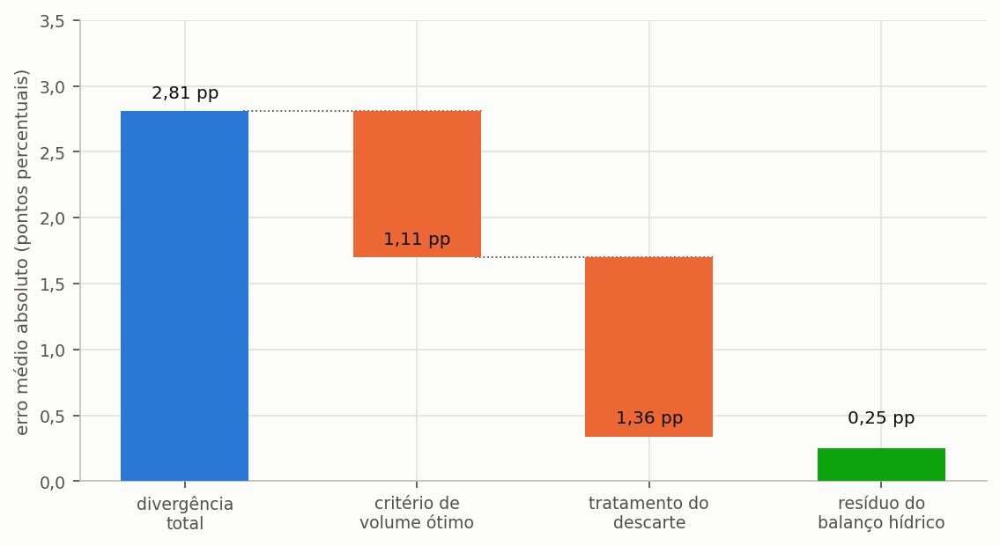

# Triton

## Manual do Usuário — Correções, bugs e versionamento

Igor Catão Martins Vaz e Enedir Ghisi

Grupo de Pesquisa em Ambientes Sustentáveis
Universidade Federal de Santa Catarina

Florianópolis, 2026

---

### Sobre este volume

Este é um dos oito volumes em que o manual do Triton pode ser distribuído, e
reúne o capítulo 6 (Correções, bugs e versionamento) do manual completo. Serve para mandar
só a parte que interessa: o método a um revisor, o tutorial a uma turma, os guias
a quem já usa o programa.

A numeração das seções e das equações é a mesma do manual completo, de modo que
uma remissão vale nos dois. Quando o texto remete a uma seção que está em outro
volume, o nome do volume vem entre parênteses.

| Volume | Conteúdo |
| :--- | :--- |
| Comece aqui | o capítulo 1 (Comece aqui) e o apêndice G |
| O método | o capítulo 2 (O método) e os apêndices A, B, C, E, G e H |
| Guias de uso | o capítulo 3 (Guias disponíveis no programa) e os apêndices D, F e G |
| Tutorial | o capítulo 4 (Tutorial: um exemplo do começo ao fim) e os apêndices G, I e J |
| Enganos, limitações e confiabilidade | o capítulo 5 (Enganos, limitações e confiabilidade) e os apêndices G e H |
| **Correções, bugs e versionamento** | o capítulo 6 (Correções, bugs e versionamento) |
| Modulação probabilística | o capítulo 7 (Modulação probabilística) e os apêndices G e H |
| Apêndices | os apêndices |

### Como citar

> VAZ, Igor Catão Martins; GHISI, Enedir. **Triton: manual do usuário**.
> Correções, bugs e versionamento. Versão 0.1.0. Florianópolis: Universidade Federal de Santa
> Catarina, 2026.

---

## Sumário

**6 Correções, bugs e versionamento**

6.1 Comparação com o Netuno 4

6.2 Mensagens de erro e o que fazer

6.3 Histórico de versões e o que mudou

6.4 Como relatar um problema

6.5 Roteiro de evolução


## Lista de figuras

Figura 1 — A divergência média em relação ao Netuno 4, decomposta

---

## Lista de tabelas

Tabela 1 — Os conjuntos de casos de referência exportados do Netuno 4

Tabela 2 — Divergência medida entre as duas versões, por conjunto de casos

Tabela 3 — Divergência em três configurações sucessivamente mais controladas

Tabela 4 — Atribuição da divergência às suas três fontes

Tabela 5 — Variáveis da Equação 53

Tabela 6 — Mensagens de validação física da entrada e a providência de cada uma

Tabela 7 — Mensagens da fração atendível e a providência de cada uma

Tabela 8 — Mensagens de erro da série de precipitação e a providência de cada uma

Tabela 9 — Mensagens de erro da varredura de volumes

Tabela 10 — Mensagens de erro dos parâmetros de cloração

Tabela 11 — Mensagens de erro da análise econômica e a providência de cada uma

Tabela 12 — Mensagens de erro da decisão multicritério e a providência de cada uma

Tabela 13 — Mensagens de erro dos parâmetros da motobomba

Tabela 14 — Situações de erro na leitura e na gravação de arquivos

Tabela 15 — Avisos que não interrompem o cálculo e precisam constar do estudo

Tabela 16 — **Tabela 99** — Panorama das versões publicadas

Tabela 17 — Correções que alteram resultados na versão 0.1.0

Tabela 18 — Itens previstos para a versão 1.1

Tabela 19 — Itens previstos para a versão 2.0

---

## Lista de equações

Equação 53 — Transformação da série para emular o Netuno 4

---


---
# 6. Correções, bugs e versionamento

---

## 6.1. Comparação com o Netuno 4

> Esta seção traz a medição contra 4.050 casos de referência e, mais importante,
> a **decomposição** da diferença por causa.

---

### 6.1.1. O papel da comparação

Convém começar esclarecendo o que esta comparação **não** é. ==O Netuno 4 não constitui
alvo de fidelidade para o Triton.== A versão atual adota decisões de modelagem distintas,
deliberadas e documentadas, e seria motivo de preocupação, e não de satisfação, se os
resultados coincidissem exatamente.

O valor do Netuno 4 nesta verificação é outro, e é maior: ele oferece um conjunto
independente de resultados, produzido por outra implementação do mesmo modelo conceitual,
por outras mãos e em outra linguagem. Sem uma referência externa dessa natureza, a
verificação se limitaria a propriedades internas do programa — necessárias, conforme a
seção 5.3 (volume Enganos, limitações e confiabilidade) descreve, e incapazes de detectar um erro sistemático que as respeitasse
todas.

---

### 6.1.2. Os dados de referência

A comparação entre as duas versões apoia-se em quatro mil e cinquenta casos exportados do
Netuno 4 e preservados desde então, byte a byte, justamente para que a referência não se
alterasse ao longo do desenvolvimento. Eles se distribuem por dois conjuntos, com
cidades e faixas de parâmetros distintas.

<!-- tabela: **Tabela 1** — Os conjuntos de casos de referência exportados do Netuno 4 -->
| Conjunto | Casos | Cidades |
| :--- | ---: | :--- |
| Floripa/Brasília | 1.458 | Florianópolis, Brasília |
| Manaus/São Paulo | 2.592 | Manaus, São Paulo |

---

### 6.1.3. A divergência total

<!-- tabela: **Tabela 2** — Divergência medida entre as duas versões, por conjunto de casos -->
| Conjunto | Erro médio absoluto | Viés | Erro máximo | ≤ 5 pp |
| :--- | ---: | ---: | ---: | ---: |
| Floripa/Brasília | 2,29 pp | −2,29 pp | 7,43 pp | 97,4% |
| Manaus/São Paulo | 2,71 pp | −2,71 pp | 10,60 pp | 88,6% |

O viés é sistematicamente negativo nos dois conjuntos, isto é, o Triton estima menos
economia que o Netuno 4 em praticamente todos os casos. O resultado é esperado, e a
subseção seguinte decompõe a diferença em suas causas atribuíveis.

---

### 6.1.4. A decomposição, que é o número que importa

Comparar diretamente o potencial no volume ótimo de um programa com o do outro mistura três
diferenças de naturezas distintas, e o número resultante não informa qual delas responde
pelo quê. A decomposição as separa comparando os dois programas em três configurações
sucessivamente mais controladas, sobre os 2.583 casos de Manaus e São Paulo.

<!-- tabela: **Tabela 3** — Divergência em três configurações sucessivamente mais controladas -->
| Configuração | Erro médio absoluto | Viés | ≤ 5 pp |
| :--- | ---: | ---: | ---: |
| 1. ótimo do Triton contra ótimo do Netuno 4 | 2,71 pp | −2,71 pp | 88,6% |
| 2. avaliado no volume que o Netuno 4 declarou ótimo | 1,60 pp | −1,60 pp | 96,4% |
| 3. idem, adotando o descarte por limiar do Netuno 4 | **0,25 pp** | **−0,25 pp** | **100,0%** |

As três configurações usam os mesmos casos, excluídos os nove de referência nula
tratados adiante. Em cada uma, o Triton estima menos que o Netuno 4 em quase todos
os casos, e por isso o erro médio absoluto praticamente coincide com o viés.

A atribuição resultante:

<!-- tabela: **Tabela 4** — Atribuição da divergência às suas três fontes -->
| Fonte da divergência | Contribuição | Natureza |
| :--- | ---: | :--- |
| critério de escolha do volume ótimo | 1,11 pp (41%) | diferença de projeto |
| tratamento do descarte de primeira chuva | 1,36 pp (50%) | diferença metodológica deliberada |
| **resíduo do balanço hídrico** | **0,25 pp (9%)** | — |

> **Neutralizadas as duas diferenças conhecidas, o motor do Triton reproduz o
> Netuno 4 com erro médio absoluto de 0,25 ponto percentual e 100% dos casos dentro
> de 5 pontos.**
>
> O resíduo é compatível com a precisão de duas casas decimais da própria planilha de
> referência. É **este** número que verifica o motor. O viés total de 2,71 pp
> não mede erro: mede a soma de duas decisões de projeto, ambas deliberadas.

---

A Figura 1 decompõe a divergência total nas três fontes da tabela.



*Figura 1 — A divergência média em relação ao Netuno 4, decomposta. A primeira barra é o total observado; as duas alaranjadas são diferenças de método declaradas, uma de critério de projeto e outra de tratamento do descarte; a última é o resíduo do balanço hídrico, que é o número que efetivamente verifica o motor.*

---

### 6.1.5. As duas diferenças, em detalhe

#### 6.1.5.1. O descarte

O Netuno 4 trata a lâmina de descarte como limiar do evento: quando a precipitação do dia
fica abaixo dela, nada é captado; quando a ultrapassa, capta-se a chuva inteira, sem
subtração alguma. O manual do Netuno 4 é explícito a respeito, ao afirmar que uma
precipitação diária abaixo desse valor faz o programa considerar que não houve
precipitação.

O Triton subtrai a lâmina da precipitação do dia, tratamento fisicamente mais fiel
porque a água desviada para o dispositivo de autolimpeza efetivamente não chega à
cisterna. A mudança responde por metade da divergência total medida entre as duas
versões.

#### 6.1.5.2. O critério de volume ótimo

Ambos os programas escolhem o volume ideal por critérios de ganho marginal, mas as
implementações e as grades de busca diferem entre si, de modo que cada um elege um volume
distinto e a comparação passa a incluir essa diferença de escolha. Avaliando os dois
programas no mesmo volume — o que o Netuno 4 declarou ótimo — o viés cai de 2,71
para 1,60 ponto percentual, o que atribui 41% da diferença total ao critério de escolha.

---

### 6.1.6. Como medir a diferença sem alterar o motor

A emulação da regra antiga é feita transformando a série de precipitação de entrada, e
não alterando o código do balanço hídrico. A distinção metodológica é essencial: medir a
divergência com um código modificado validaria um programa que não é o distribuído ao
usuário, o que anularia o propósito da verificação.

```equacao:emulacao:53
P′ = P + d_f se P ≥ d_f ; P′ = 0 caso contrário
```

<!-- tabela: **Tabela 5** — Variáveis da Equação 53 -->
| Símbolo | Significado | Unidade |
| :--- | :--- | :--- |
| `P′` | precipitação transformada, a ser fornecida ao Triton | mm |
| `P` | precipitação observada no dia | mm |
| `d_f` | lâmina de descarte de primeiras águas | mm |

Aplicada essa transformação, o cálculo `P_ef = max(0, P′ − d_f)` do Triton
reproduz exatamente a semântica de limiar. A medição não corre o risco de validar
código que não é o distribuído.

> **Uma ressalva de documentação.** O protocolo de verificação interno instrui a
> usar uma opção automática para essa emulação. Essa opção **não está
> implementada**. Use a transformação da série, ou compare com descarte igual a zero,
> em que as duas regras coincidem.

---

### 6.1.7. Os casos de referência nula

Em parte das linhas, o Netuno 4 exportou zero enquanto o Triton calcula valor
positivo. A incidência difere muito entre conjuntos: 0,35% em Manaus e São Paulo
contra 34,98% em Floripa e Brasília.

A disparidade aponta para característica dos **dados de referência** — provavelmente
o Netuno 4 não encontrou volume ótimo sob o seu próprio critério — e não para erro do
Triton, que nunca devolve zero nesses casos. São segregados das estatísticas para
não as dominar.

---

### 6.1.8. O que declarar num estudo comparativo

- os **dois números**: a divergência total e o resíduo depois da decomposição;
- as duas diferenças deliberadas, nomeadas;
- se a comparação foi feita com descarte zero, com emulação de limiar, ou sem
  neutralização;
- a versão de cada programa.

Apresentar apenas a divergência total, sem decompor, sugere um erro de motor que não
existe.

---

## 6.2. Mensagens de erro e o que fazer

> O que cada mensagem significa, o que a disparou, e como resolver.

O programa adota uma política deliberada diante de entradas impossíveis: ele as recusa
em vez de corrigi-las silenciosamente. A razão é que uma área de captação negativa não é
uma preferência do usuário a ser acomodada, e sim um erro de digitação que precisa ser
visto por quem o cometeu. ==Corrigir em silêncio produziria um resultado plausível a
partir de uma entrada errada, que é a pior combinação possível num programa de
simulação.==

---

### 6.2.1. Validação física da entrada

As mensagens abaixo são emitidas antes de qualquer cálculo ser iniciado, e todas
nomeiam o campo responsável e o valor recebido, de modo que a correção não exija procura.

<!-- tabela: **Tabela 6** — Mensagens de validação física da entrada e a providência de cada uma -->
| Mensagem | O que a disparou | O que fazer |
| :--- | :--- | :--- |
| «Volume do reservatório inferior negativo» | volume menor que zero | corrija; **zero é válido** e representa o cenário sem sistema |
| «Volume do reservatório superior negativo» | idem, na caixa elevada | corrija; zero significa sem caixa |
| «Área de captação negativa» | área menor que zero | corrija; use a projeção horizontal em m² |
| «Coeficiente de escoamento fora de [0, 1]» | coeficiente negativo ou acima de 1 | acima de 1 a cobertura entregaria mais água do que a chuva traz; telhados usuais ficam entre 0,80 e 0,95 |
| «Lâmina de descarte negativa» | descarte menor que zero | o descarte retira água da captação, não acrescenta |
| «Demanda diária negativa» | demanda menor que zero | corrija |
| «Fração atendível por água pluvial fora de [0, 1]» | fração maior que 1 | informe 0,4 para 40%, e não 40 |
| «… não é um número finito» | campo que chegou ao cálculo vazio, como texto ou infinito | preencha o campo nomeado com um número |
| «Modo de descarte desconhecido» | modo diferente de 1, 2 ou 3 | escolha um dos três modos; para não descartar, informe lâmina zero |
| «Intervalo de descarte inválido» | modo 3 com intervalo menor que 1 dia | informe o intervalo em dias inteiros |
| «Nível de acionamento da motobomba negativo» | nível menor que zero | corrija; zero significa acionar com a caixa vazia |

> A fração atendível é a mensagem mais frequente, e a regra que a evita é uma só: onde se
> digita, percentual de 0 a 100; onde se guarda, fração de 0 a 1. A seção 4.2 (volume Tutorial)
> justifica a divisão. Quando a mensagem aparecer, o valor chegou como 40 num lugar que
> guarda 0,4 — tipicamente um arquivo de parâmetros editado à mão ou uma chamada de
> automação.

<!-- tabela: **Tabela 7** — Mensagens da fração atendível e a providência de cada uma -->
| Mensagem | O que a disparou | O que fazer |
| :--- | :--- | :--- |
| «… parece estar em percentual» | fração entre 1 e 100 no arquivo, no vetor semanal, mensal ou diário, ou na automação | informe 0,4 para 40% |
| «… fora de [0, 100]» | percentual negativo ou acima de 100 na tela, na tabela de cenários, na planilha ou em `--share` | corrija; 40 significa 40% |
| campo laranja, ou pergunta «Simular mesmo assim?» | percentual entre 0 e 1 | se quis 40%, digite 40; se quis mesmo menos de 1%, confirme |

---

### 6.2.2. Série de precipitação

O programa não distingue um dia seco de um dia sem registro, e por isso não adivinha: uma
falha na série interrompe o cálculo com a indicação de onde ela está. Preencher a falha,
ou recortar a série para um período sem falhas, é decisão de quem conduz o estudo, e a
decisão precisa constar do estudo.

<!-- tabela: **Tabela 8** — Mensagens de erro da série de precipitação e a providência de cada uma -->
| Mensagem | Causa | O que fazer |
| :--- | :--- | :--- |
| «A série de precipitação está vazia» | arquivo sem nenhuma linha numérica | confira se o arquivo tem uma coluna de valores diários, um por linha |
| «… dia(s) sem valor numérico, o primeiro no dia N» | falha de registro: linha vazia ou texto no meio da série | preencha as falhas ou recorte a série, e declare o tratamento |
| «… valor(es) negativo(s), o primeiro de X mm no dia N» | sentinela de falha, como −999 | trate como falha: preencha ou recorte |

Uma linha de cabeçalho antes dos dados, como «Data;Precipitação», não é erro: ela é
ignorada e a leitura começa na primeira linha numérica.

---

### 6.2.3. Varredura

<!-- tabela: **Tabela 9** — Mensagens de erro da varredura de volumes -->
| Mensagem | Causa | Solução |
| :--- | :--- | :--- |
| «O volume máximo da varredura deve ser finito e não negativo» | campo vazio ou negativo | informe o volume máximo em litros |
| «O passo de varredura deve ser finito e maior que zero» | passo zero ou vazio | informe o passo; ele será arredondado para o múltiplo de 250 L |

Há ainda um aviso que não constitui erro e convém não confundir com um: quando o passo
de varredura é ajustado para o múltiplo de 250 L, ou quando o limite de quarenta volumes
obriga a alargá-lo, o programa registra o ajuste e prossegue normalmente. O que esse
aviso exige do usuário é apenas que ele declare no estudo o passo efetivamente utilizado,
e não o passo originalmente pedido.

---

### 6.2.4. Cloração

<!-- tabela: **Tabela 10** — Mensagens de erro dos parâmetros de cloração -->
| Mensagem | Causa | Solução |
| :--- | :--- | :--- |
| «Pureza deve ficar em (0, 1]» | pureza informada como percentual | informe 0,65 para 65%, e não 65 |
| «A dose não pode ser negativa» | dose menor que zero | corrija |
| «O fator de emissão não pode ser negativo» | fator de emissão do produto menor que zero | corrija; o fator é por quilo de produto comercial |

---

### 6.2.5. Análise econômica

<!-- tabela: **Tabela 11** — Mensagens de erro da análise econômica e a providência de cada uma -->
| Mensagem | Causa | Solução |
| :--- | :--- | :--- |
| «… deve ser um número finito e não negativo» | investimento, tarifa, custo, potência ou volume vazio, negativo ou infinito | a mensagem nomeia o campo; preencha-o com um número igual ou maior que zero |
| «O período de análise deve ser um número inteiro de anos» | período fracionário, zero ou negativo | informe o período em anos inteiros |
| «… deve ser um número finito e maior que -100%» | reajuste, inflação ou taxa de desconto de −100% ou menos | confira o sinal da taxa |
| «… parece estar em percentual» | taxa anual informada como 5 numa função que espera fração decimal | informe 0,05 para 5% |

> **Unidade das taxas.** Na interface e no arquivo de projeto, toda taxa é informada em
> percentual, com a unidade ao lado do campo: a TMA e a inflação em % ao mês (a.m.) ou em
> % ao ano (a.a.), conforme o botão ao lado, e os reajustes tarifários em % por período
> de reajuste, cujo comprimento em meses fica no campo vizinho. O projeto grava a TMA e a
> inflação em % ao mês. A conversão entre mês e ano é composta, (1 + i)^12 − 1, e não uma
> multiplicação por doze: 1% ao mês equivale a 12,68% ao ano. Na automação, as funções de
> cálculo anual recebem as taxas como fração decimal, 0,05 para 5%, e recusam um valor que
> pareça percentual em vez de reinterpretá-lo.

---

### 6.2.6. Decisão multicritério

<!-- tabela: **Tabela 12** — Mensagens de erro da decisão multicritério e a providência de cada uma -->
| Mensagem | Causa | Solução |
| :--- | :--- | :--- |
| «Informe 3 pesos de eixo ou 7 pesos de critérios TOPSIS» | quantidade de pesos diferente de 3 ou de 7 | informe um peso por eixo ou um por critério |
| «Os pesos TOPSIS devem ser finitos e não negativos» | peso vazio ou negativo | corrija; peso zero é válido e exclui o critério |
| «Ao menos um peso TOPSIS deve ser maior que zero» | todos os pesos zerados | atribua peso a pelo menos um critério |
| «O critério TOPSIS … da alternativa N não é finito» | indicador indefinido numa alternativa, tipicamente payback sem retorno | confira a alternativa indicada antes de decidir |

---

### 6.2.7. Motobomba

<!-- tabela: **Tabela 13** — Mensagens de erro dos parâmetros da motobomba -->
| Mensagem | Causa | Solução |
| :--- | :--- | :--- |
| «Rendimento deve ficar em (0, 1]» | rendimento como percentual no núcleo | use 0,55 para 55% |
| «Rendimento do motor deve ficar em (0, 1]» | idem, no campo do motor | deixe em branco para o programa adotar a tabela da NBR 17094-2 |

---

### 6.2.8. Arquivos

<!-- tabela: **Tabela 14** — Situações de erro na leitura e na gravação de arquivos -->
| Situação | O que acontece | O que fazer |
| :--- | :--- | :--- |
| série de chuva ilegível | a leitura é interrompida com mensagem | confira o formato: uma leitura por linha, em mm, coluna única |
| arquivo `.triton` com JSON inválido | a abertura é interrompida | o arquivo pode estar truncado; recorra à cópia de segurança |
| seção ausente no arquivo | os campos caem no padrão da classe | esperado ao abrir arquivo de versão anterior; revise a aba correspondente |
| base climática não instalada | a aba oferece só arquivo próprio | veja a seção 1.2 (volume Comece aqui) |

---

### 6.2.9. Avisos que não interrompem

Os avisos reunidos nesta tabela não impedem o cálculo e não indicam defeito: são
observações que o programa faz sobre as condições em que o resultado foi produzido. Todas
elas precisam ser transportadas para o texto do estudo, porque todas afetam a
interpretação do número e nenhuma delas fica evidente no resultado isolado.

<!-- tabela: **Tabela 15** — Avisos que não interrompem o cálculo e precisam constar do estudo -->
| Aviso | O que significa |
| :--- | :--- |
| tipologia não residencial com tarifa residencial | o resultado econômico está **subestimado**; veja a seção 3.5 (volume Guias de uso) |
| a classe alvo recomenda filtração fina e ela foi dispensada | decisão registrada no relatório |
| fator de emissão com rótulo de triagem | o fator não tem fonte primária; declare-o |
| estrutura tarifária incompleta | a tabela do município tem lacuna; confira contra a resolução |
| passo de varredura ajustado | o passo efetivo difere do pedido |
| extrapolação de preço com R² baixo | o volume está fora da tabela de preços e a regressão não é confiável |

---

### 6.2.10. Quando o resultado parece errado

Antes de suspeitar de defeito no programa, três conferências resolvem a maior parte dos
casos em que o resultado surpreende, e cada uma delas corresponde a um erro de entrada
com assinatura própria.

Quando o **potencial sai maior que o esperado**, o suspeito imediato é a fração
atendível: ela é o teto de todo o resultado, e uma fração generosa demais infla tudo o
que vem depois sem que nada no relatório denuncie a origem.

Quando o **potencial sai muito menor**, confira a lâmina de descarte. O engano
correspondente está descrito na seção 5.1.3 (volume Enganos, limitações e confiabilidade), e consiste em informar o descarte em
litros quando o campo pede milímetros — o que descarta, tipicamente, a chuva inteira de
todos os dias.

Quando o **retorno do investimento sai absurdo**, em qualquer das duas direções, confira
o regime tarifário do município. É a causa mais frequente de resultado econômico
implausível, e a seção 3.3 (volume Guias de uso) traz o teste que a identifica em dois minutos.

Vale ainda percorrer as quatro etapas de entrada antes de aceitar qualquer resultado. A
barra lateral assinala as que permanecem com pendência, e conferir quatro telas custa
menos tempo que descobrir o engano depois de o relatório estar emitido.

---

## 6.3. Histórico de versões e o que mudou

Esta seção registra o que mudou entre as versões do programa e, sobretudo, **quais
mudanças alteram resultados já publicados**. A distinção importa mais do que parece:
uma correção de interface não afeta nenhum estudo anterior, ao passo que uma correção
de cálculo pode deslocar cada número de um trabalho já submetido. Quem publicou com o
Triton precisa saber em que categoria cada alteração se encaixa, e é por isso que o
histórico abaixo separa as duas coisas de forma explícita.

==A regra que orienta toda esta seção é simples: correção de cálculo obriga a
declarar a versão usada; correção de interface, não.==

---

### 6.3.1. A versão que você está usando

O número da versão aparece na barra lateral, no rodapé, e no menu **Sobre o Triton**.
Ele também é gravado dentro de cada arquivo de projeto e impresso em cada relatório,
de modo que um estudo antigo sempre carrega consigo a identificação do programa que o
produziu. Essa redundância é deliberada: relatórios circulam separados dos arquivos, e
a pergunta «com que versão isto foi feito?» costuma aparecer meses depois, quando
ninguém lembra.

O esquema de numeração segue a convenção corrente em engenharia de software. O
primeiro número indica a geração do programa, e sua troca significa reformulação do
modelo conceitual; o segundo indica um conjunto de funcionalidades novas; e o terceiro
indica correções e ajustes que não alteram a arquitetura. A passagem do Netuno 4 para
o Triton, tratada na seção 6.1, é o único caso de troca do primeiro número na
história do programa.

A versão 0.1.0 é a primeira versão pública do Triton e é um beta: o programa ainda está em
desenvolvimento, e a numeração sobe (0.2.0, 0.3.0 e assim por diante) até a 1.0.0, que será a
primeira versão oficial. Os números anteriores à 0.1.0 foram de desenvolvimento, e nunca chegaram
a circular; nenhum estudo foi feito com eles.

---

### 6.3.2. Como este histórico é mantido

Daqui em diante, cada versão publicada ganha uma entrada própria nesta seção, com a
data do lançamento e o que mudou, sempre separado em duas listas: ==o que altera
resultados de estudos já feitos e o que não altera.== A entrada mais recente vem
primeiro.

Cada entrada segue o mesmo modelo, para que duas versões possam ser comparadas sem
releitura: uma frase de resumo, as novidades, as correções que alteram resultados, as
que não alteram, e o que mudou na documentação. Seções sem conteúdo naquela versão
simplesmente não aparecem.

A mesma lista é distribuída com o código, no arquivo `CHANGELOG.md` da raiz do
repositório, e alimenta a página de versões do site de documentação. Ela não é escrita
três vezes: os três saem desta seção, e uma verificação automática recusa a montagem se
divergirem. Quem acompanha o programa pelo repositório, pelo site ou pelo manual lê o
mesmo registro.

<!-- tabela: **Tabela 16** — **Tabela 99** — Panorama das versões publicadas -->
| Versão | Data | O que trouxe | Correções que alteram resultados |
| :--- | :--- | :--- | ---: |
| **0.1.0** (beta) | 15 de outubro de 2026 | Primeira versão beta do Triton, programa derivado do Netuno 5.0.1, com nome, versionamento e repositório próprios para cada edição; a 1.0.0, a primeira oficial, virá depois. | 0 |

---

### 6.3.3. Versão 0.1.0 (beta) — 15 de outubro de 2026

> **Em uma frase.** Primeira versão beta do Triton, programa derivado do Netuno 5.0.1, com
> nome, versionamento e repositório próprios para cada edição; a 1.0.0, a primeira oficial, virá depois.

#### 6.3.3.1. Novidades

O Triton é o filho do Netuno. Mantém o motor de simulação, a avaliação de ciclo de vida, a linha de
tratamento, a decisão multicritério e a modulação probabilística do Netuno 5.0.1, e passa a ser
distribuído em três programas independentes, um por edição: Brasil, Internacional e Portugal. Cada um
tem repositório, logo e numeração próprios, e esta é a primeira versão de todos: 0.1.0, ainda em beta.

O histórico do Netuno (versões 5.0.0 e 5.0.1) continua no manual do Netuno. O Triton 0.1.0 já inclui as
correções feitas até o Netuno 5.0.1, entre elas a da demanda mensal e semanal igual a zero, e a regra de
operação de Fewkes (φ) como opção em todos os módulos.

Na Edição Brasil, a base de tarifas de 652 municípios traz 617 conferências de conta, das quais 241 corrigidas, registradas em `tarifas/transcricoes/ALTERACOES.md`.

#### 6.3.3.2. Correções que alteram resultados

Nenhuma em relação ao Netuno 5.0.1, de que o Triton 0.1.0 parte.

<!-- tabela: **Tabela 17** — Correções que alteram resultados na versão 0.1.0 -->
| O que foi corrigido | Efeito no resultado |
| :--- | :--- |

#### 6.3.3.3. Correções que não alteram resultados

O nome, o logo, o pacote (`triton`) e a extensão dos arquivos de projeto (`.triton`) mudaram; o cálculo não.

---

### 6.3.4. Como saber se a sua versão tem uma correção

O procedimento é direto e não depende de consultar ninguém: abra um dos arquivos de
exemplo que acompanham o programa, descritos no apêndice J (volume Apêndices), rode-o, e compare o
resultado obtido com o valor impresso neste manual. Cada caso de exemplo foi gerado
pela mesma versão do programa que gerou este manual, e cada número publicado tem
verificação automática correspondente, conforme a seção 5.3 (volume Enganos, limitações e confiabilidade) descreve. Uma
divergência, portanto, indica que o programa instalado não é o da versão deste manual.

==Se os números baterem, a sua instalação corresponde exatamente ao manual que você
tem em mãos.== Se não baterem, a diferença não é um defeito da sua instalação, e sim
uma diferença de versão que precisa ser identificada antes de qualquer estudo.

---

### 6.3.5. O que declarar num trabalho publicado

A boa prática de reprodutibilidade computacional exige que um trabalho identifique de
modo inequívoco o programa que produziu os resultados. No caso do Triton, quatro
informações bastam, e todas estão disponíveis sem esforço: a versão do programa, que
aparece no relatório; a origem da série de precipitação, com o período utilizado; a
estrutura tarifária adotada, com a data de vigência; e a declaração de quais parâmetros
foram alterados em relação aos valores padrão. A seção 4.10 (volume Tutorial) traz a lista completa,
com um parágrafo de método pronto para ser adaptado.

Anexar o arquivo `.triton` ao material suplementar resolve as quatro de uma vez, porque
o arquivo é autocontido e traz a série de chuva dentro dele, ou, com a chuva da base
CLIMBra, a referência da série com a sua impressão digital. É a forma mais econômica de
tornar um estudo verificável por terceiros, e custa um anexo de cerca de 160 kB — bem
menos com a CLIMBra.

---

## 6.4. Como relatar um problema

Programas de simulação têm defeitos, e o Triton não é exceção. A revisão conduzida antes
desta publicação encontrou uma dúzia de defeitos de cálculo, nenhum deles acompanhado de
mensagem de erro, e a maioria descoberta não por leitura do código mas por comparação
entre dois pontos do próprio programa que deveriam concordar e não concordavam. A lição
prática é que o usuário atento constitui a melhor fonte de detecção de que um programa
científico dispõe, e é por essa razão que esta seção existe.

==Um relato bem feito é aquele que permite reproduzir o problema sem a sua presença.==
Tudo o que se pede abaixo serve a esse único objetivo.

---

### 6.4.1. O que enviar

Um relato útil tem quatro componentes, e a ausência de qualquer um deles costuma
transformar a investigação numa troca de mensagens que consome mais tempo de todos do
que o próprio conserto.

**O arquivo do projeto.** É o item mais importante, e sozinho substitui páginas de
descrição. O `.triton` é autocontido: traz todos os parâmetros e a série de chuva inteira
dentro dele — ou, com a chuva da base CLIMBra, a referência exata da série, que o programa
recompõe —, de modo que quem o receber reproduz exatamente a sua simulação, na mesma
máquina ou em outra qualquer. Sem ele, a investigação começa por tentar adivinhar as
entradas, e adivinhar entradas é a forma mais eficiente de não encontrar um defeito.

**O que você esperava e o que obteve.** Esta é a parte que só você pode fornecer.
Descreva o número que apareceu e o número que deveria ter aparecido, com a justificativa
do segundo — seja ela uma conta feita à mão, um resultado de versão anterior, um valor
da literatura ou simplesmente a ordem de grandeza que a experiência sugere. Um relato
que diz apenas «o resultado está errado» transfere ao destinatário a tarefa de descobrir
qual dos quarenta números da tela é o errado.

**A versão do programa.** Aparece na barra lateral, no rodapé e no menu **Sobre o
Triton**, e já está gravada dentro do arquivo de projeto e de qualquer relatório
exportado. Informe-a mesmo assim, porque é o primeiro filtro da investigação: metade dos
problemas relatados em programas científicos são defeitos já corrigidos numa versão
posterior à que o usuário tem instalada.

**A mensagem de erro, se houver.** Copie o texto integral, e não um resumo. A seção
6.2 lista as mensagens que o programa emite deliberadamente, com o significado e a
providência de cada uma; se a sua mensagem estiver lá, o problema provavelmente é de
entrada e tem solução imediata.

---

### 6.4.2. O que conferir antes de relatar

Uma parte considerável dos resultados que parecem errados são resultados corretos de
entradas erradas, e a conferência abaixo leva poucos minutos. Ela não existe para
desencorajar o relato, e sim para que o seu tempo e o de quem investiga sejam gastos com
o que de fato é defeito.

Comece pela seção 5.1 (volume Enganos, limitações e confiabilidade), que reúne os dez enganos de projeto que o programa não tem
como impedir. Três deles respondem pela maioria dos resultados inesperados: a área de
captação informada como área inclinada do telhado em vez da projeção horizontal, a
lâmina de descarte informada em litros em vez de milímetros, e o regime tarifário do
município tratado como consumo mínimo quando é taxa de disponibilidade — ou o inverso.

Confira em seguida se o comportamento observado não é uma limitação declarada. A seção
5.2 (volume Enganos, limitações e confiabilidade) relaciona o que o programa reconhecidamente não faz, e algumas dessas limitações
produzem exatamente a impressão de defeito. O caso mais frequente envolve a categoria
tarifária: o catálogo cobre a categoria residencial dos 652 municípios e as demais só
onde a tabela oficial do prestador foi transcrita, de modo que, nos outros municípios, um
estudo de escola ou de comércio sai com a tarifa residencial enquanto o usuário não
lançar a da categoria correta. O programa avisa disso em vez de corrigir por conta
própria, porque a tabela certa é pública e específica de cada concessionária.

---

### 6.4.3. Para onde enviar

O Triton é desenvolvido pelo Grupo de Pesquisa em Ambientes Sustentáveis, no
Departamento de Engenharia Civil da Universidade Federal de Santa Catarina. O contato
do grupo é o canal de relato, e vale tanto para defeitos quanto para sugestões de
funcionalidade e para pedidos de esclarecimento sobre o método.

Relatos que vêm acompanhados do arquivo de projeto entram diretamente na suíte de
verificação descrita na seção 5.3 (volume Enganos, limitações e confiabilidade): um caso que reproduz um defeito vira um teste, e
o teste passa a impedir que aquele defeito volte. É a razão pela qual o arquivo importa
tanto, e é também a resposta mais completa que se pode dar a quem relatou — o problema
não apenas foi corrigido, como passou a ser vigiado.

> **Aprofundamento: o que torna um defeito difícil de encontrar.** Os defeitos que
> sobrevivem por anos num programa científico têm todos a mesma assinatura: produzem
> números plausíveis. Um erro que gera um valor negativo, ou mil vezes maior que o
> esperado, é encontrado na primeira execução. Já um fator de rendimento aplicado duas
> vezes, ou uma unidade convertida uma vez a mais que o necessário, produz um número
> que passa em qualquer inspeção visual e atravessa anos de uso. É por isso que a
> verificação do programa se apoia em invariantes — o balanço de massa que precisa
> fechar, a monotonicidade que precisa valer, o teto que a curva não pode cruzar — e não
> apenas em valores esperados. Quando você suspeitar de um número, o caminho mais rápido
> de confirmar a suspeita é procurar uma dessas identidades que ele viola.

---

## 6.5. Roteiro de evolução

> Para onde o programa deve ir, e com que evidência. Um roteiro que separa o que está
> decidido do que é intenção deixa o usuário planejar o estudo com a versão que tem hoje,
> e não com a que gostaria de ter.

Esta seção resume o `ROADMAP.md` da raiz do repositório Triton, que vale para as três edições e reflete o estado da versão
0.1.0 (beta). Nada do que está abaixo da linha «Estável» existe nesta versão: são intenções do
grupo de pesquisa, sem data de entrega. Quando um item é implementado, ele sai daqui e
entra no histórico de versões, com a indicação de se muda o resultado de estudos já
feitos.

A direção vem de duas fontes. A primeira é a revisão sistemática da literatura que o grupo
conduz: 762 estudos quantitativos sobre a simulação do aproveitamento de água de chuva, dos
quais 56 usam o Triton. Ela mostra onde os estudos publicados omitem a regra de operação, a
definição de confiabilidade e os parâmetros econômicos. A segunda é o registro de pendências
do próprio programa, descrito na seção «Limitações conhecidas».

---

### 6.5.1. O que já é estável na 0.1.0 (beta)

**Série climática.** 652 municípios brasileiros com séries contínuas projetadas (base
CLIMBra, CMIP6). **Tarifas.** 652 municípios com catálogo de tarifas transcritas de fontes
oficiais. **Balanço hídrico.** Simulação diária pela regra do Triton, com a YAS estrita, a
YBS e o parâmetro φ de Fewkes (2000b) como opções para reservatório único. **Decisão.**
Multicritério por TOPSIS e por SMAA-VIKOR. **Incerteza.** Modulação probabilística das
premissas (seção «O que é a modulação probabilística»). **Edições.** Brasil, Internacional
e Portugal.

---

### 6.5.2. Versão 1.1: consolidação e confiabilidade

<!-- tabela: **Tabela 18** — Itens previstos para a versão 1.1 -->
| Eixo | Item | Método |
| :--- | :--- | :--- |
| Edição Internacional | Provedores globais de chuva | Reanálises ERA5-Land e NOAA GHCN-Daily |
| Edição Internacional | Unidades métricas e imperiais | Conversão sem resíduo, com a conservação de massa conferida nas duas |
| Edição Internacional | Tarifas sazonais e de escassez | Blocos dinâmicos, sobretaxa de seca, esgoto separado |
| Decisão multicritério | Ordenação completa com plano GAIA | PROMETHEE II |
| Decisão multicritério | Limiares de veto e classes de viabilidade | ELECTRE Tri |
| Decisão multicritério | Pesos mais consistentes | Best-Worst Method (BWM) |
| Probabilidade e risco | Dependência entre chuva e demanda | Cópulas bivariadas (Clayton, Gumbel) |
| Probabilidade e risco | Quais variáveis governam o resultado | Índices de Sobol de primeira ordem e totais |
| Probabilidade e risco | Chuva sintética | Bootstrap em blocos, com os dias secos consecutivos preservados |
| Custos e engenharia | Custo de implantação por material e por solo | Curvas paramétricas por tecnologia e por classe de solo |
| Custos e engenharia | Custo de operação detalhado | Filtros, desinfecção, curva de degradação da bomba |

### 6.5.3. Versão 2.0: fronteira metodológica

<!-- tabela: **Tabela 19** — Itens previstos para a versão 2.0 -->
| Eixo | Item | Método |
| :--- | :--- | :--- |
| Física do sistema | Passo de tempo horário | Modelo horário com dados de pluviógrafo |
| Física do sistema | Balanço hídrico na zona radicular | FAO-56 Penman-Monteith, para irrigação |
| Física do sistema | Coeficiente de escoamento variável | Dependente da lâmina e da estiagem antecedente |
| Territorial | Escala de bacia urbana | Vetores GeoJSON |

---

### 6.5.4. Como ler este roteiro

**A ordem não é um compromisso de data.** A ordem segue a consequência sobre o resultado de
um estudo. O passo horário, por exemplo, só chega na 2.0 porque exige dados de pluviógrafo
que a maioria dos municípios não tem.

**Um item entra pela evidência.** Cada método listado responde a uma lacuna medida na
revisão da literatura, e não a uma preferência de implementação.

**Uma mudança que altera resultados é declarada.** Quem publica com o programa precisa
registrar a versão usada. Por isso o histórico de versões separa a correção que muda um
número de estudo já feito da que muda só a interface.
