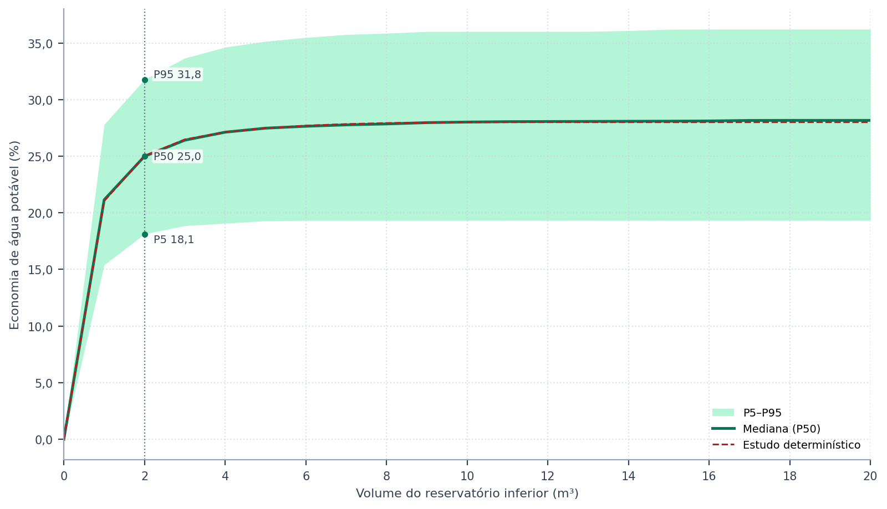
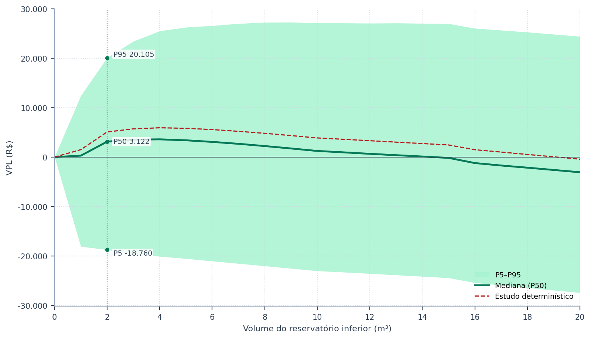
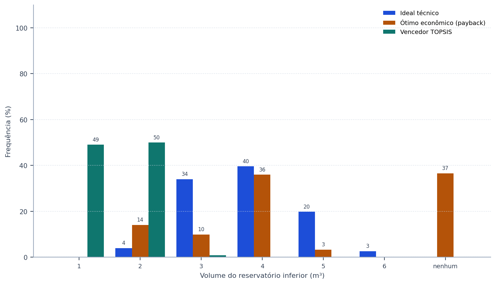
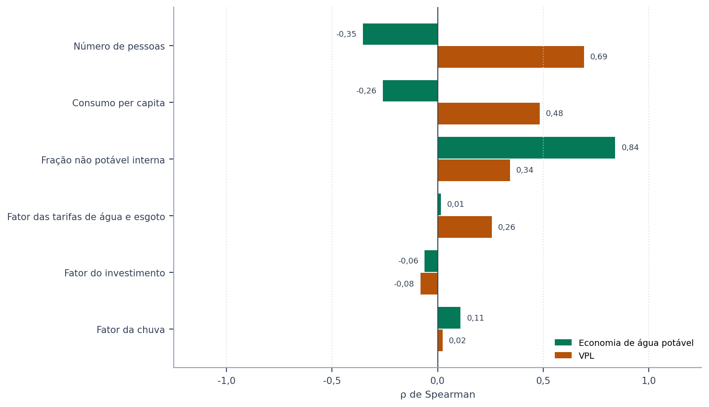

# Triton

## Manual do Usuário — Modulação probabilística

Igor Catão Martins Vaz e Enedir Ghisi

Grupo de Pesquisa em Ambientes Sustentáveis
Universidade Federal de Santa Catarina

Florianópolis, 2026

---

### Sobre este volume

Este é um dos oito volumes em que o manual do Triton pode ser distribuído, e
reúne o capítulo 7 (Modulação probabilística) e os apêndices G e H do manual completo. Serve para mandar
só a parte que interessa: o método a um revisor, o tutorial a uma turma, os guias
a quem já usa o programa.

A numeração das seções e das equações é a mesma do manual completo, de modo que
uma remissão vale nos dois. Quando o texto remete a uma seção que está em outro
volume, o nome do volume vem entre parênteses.

| Volume | Conteúdo |
| :--- | :--- |
| Comece aqui | o capítulo 1 (Comece aqui) e o apêndice G |
| O método | o capítulo 2 (O método) e os apêndices A, B, C, E, G e H |
| Guias de uso | o capítulo 3 (Guias disponíveis no programa) e os apêndices D, F e G |
| Tutorial | o capítulo 4 (Tutorial: um exemplo do começo ao fim) e os apêndices G, I e J |
| Enganos, limitações e confiabilidade | o capítulo 5 (Enganos, limitações e confiabilidade) e os apêndices G e H |
| Correções, bugs e versionamento | o capítulo 6 (Correções, bugs e versionamento) |
| **Modulação probabilística** | o capítulo 7 (Modulação probabilística) e os apêndices G e H |
| Apêndices | os apêndices |

### Como citar

> VAZ, Igor Catão Martins; GHISI, Enedir. **Triton: manual do usuário**.
> Modulação probabilística. Versão 0.1.0. Florianópolis: Universidade Federal de Santa
> Catarina, 2026.

---

## Sumário

**7 Modulação probabilística**

7.1 O que é a modulação probabilística

7.2 As variáveis e as distribuições

7.3 Como rodar

7.4 Como ler os resultados

7.5 Método, estatística e limites


**Apêndices**

Apêndice G — Glossário

Apêndice H — Referências


## Lista de figuras

Figura 1 — Economia de água potável por volume do reservatório inferior no exemplo do tutorial: faixa entre os percentis 5 e 95 das realizações, mediana e estudo determinístico

Figura 2 — Valor presente líquido por volume do reservatório inferior no mesmo exemplo

Figura 3 — Frequência, em porcentagem das realizações, com que cada volume é o ideal técnico, o ótimo econômico e o vencedor do TOPSIS no exemplo do tutorial

Figura 4 — Correlação de postos de Spearman de cada variável sorteada com a economia de água potável e com o valor presente líquido no volume escolhido pelo estudo do tutorial, da maior para a menor influência no valor presente líquido

---

## Lista de tabelas

Tabela 1 — As variáveis que a modulação probabilística pode sortear, com a distribuição de triagem que a tela propõe

Tabela 2 — O que cada variável econômica e ambiental faz no cálculo, e o que ela não toca

Tabela 3 — As quatro distribuições que a ferramenta oferece, os seus parâmetros e quando usar cada uma

Tabela 4 — As variáveis sorteadas no exemplo do tutorial: distribuição declarada e estatísticas das realizações

Tabela 5 — Resultados no volume escolhido pelo estudo do tutorial: estudo determinístico e estatísticas das realizações

Tabela 6 — Probabilidades no volume escolhido, com o intervalo de confiança de 95% de Wilson

Tabela 7 — Frequência com que cada volume é escolhido nas realizações do exemplo, por critério (%)

Tabela 8 — Sensibilidade no volume escolhido: força e sentido da influência de cada variável sorteada sobre os resultados do tutorial

Tabela 9 — Parte da variância do resultado explicada por cada variável sorteada no exemplo do tutorial, no volume escolhido (η²; as variáveis contínuas agrupadas em decis)

Tabela 10 — Resultados no volume escolhido (5 m³) por modelo climático sorteado, em Florianópolis no cenário SSP2-4.5 de 2025 a 2054, com as três variáveis de consumo também sorteadas

Tabela 11 — Parte da variância do resultado explicada por cada fonte de incerteza no exemplo dos modelos climáticos, no volume escolhido (η²; as variáveis contínuas agrupadas em decis)

Tabela 12 — Padronização terminológica de água de chuva e água pluvial

Tabela 13 — Grandezas fundamentais do balanço hídrico e relações entre fração e potencial

---


---
# 7. Modulação probabilística

---

## 7.1. O que é a modulação probabilística

> **Pergunta que este capítulo responde:** o volume que o estudo escolheu continua
> sendo uma boa escolha quando as premissas não são exatamente as que eu declarei?

O estudo do Triton responde com um número por volume. Esse número vale para as premissas
declaradas: um consumo per capita, um número de pessoas, uma fração não potável, uma
área de captação, uma tarifa, uma taxa de desconto. Nenhuma delas é conhecida com
exatidão no projeto. O consumo per capita de uma casa que ainda não existe é estimado; a
ocupação muda ao longo da vida útil; a chuva dos próximos vinte anos não repete a dos
últimos trinta; a tarifa é revista.

A ferramenta **13. Modulação Probabilística** mede o quanto essas incertezas chegam ao
resultado. Ela refaz o estudo pronto muitas vezes — mil, por padrão —, cada vez com
as premissas escolhidas sorteadas de distribuições declaradas pelo usuário, e devolve a
**distribuição** do resultado em vez de um valor único: faixas de economia e de valor
presente líquido por volume, a probabilidade de o investimento se pagar e a frequência
com que cada volume seria o escolhido.

==O estudo determinístico não muda.== As etapas 5 a 9, os relatórios e a linha de
comando continuam com ele. A modulação é uma camada de robustez por cima do estudo: ela
não escolhe outro volume, ela diz o quanto a escolha resiste.

---

### 7.1.1. Quando usar

A modulação responde a três perguntas que o estudo determinístico não responde:

1. **Quão largo é o resultado?** A economia do estudo vale com que margem? A faixa entre
   os percentis 5 e 95 das realizações é o número que deve acompanhar o resultado
   publicado.
2. **O investimento se paga com que probabilidade?** Um valor presente líquido positivo
   no caso-base pode esconder uma chance considerável de prejuízo; a modulação dá essa
   chance e o seu intervalo de confiança.
3. **A decisão de projeto é estável?** Se o volume escolhido vence numa minoria das
   realizações, ao lado de vizinhos com frequências parecidas, a escolha é frágil e o
   texto precisa dizer isso.

No exemplo do tutorial, na seção 7.4, as três respostas aparecem em números.

Ela é a continuação natural da análise de sensibilidade da seção 3.7 (volume Guias de uso). A sensibilidade
varia uma premissa de cada vez; a modulação varia todas as escolhidas ao mesmo tempo, com
pesos que vêm das distribuições, e permite ver combinações que um tornado não mostra.

### 7.1.2. O que ela não faz

A modulação não substitui um dado medido. Uma distribuição larga em torno de um valor
errado continua centrada no valor errado: quando houver medição de consumo, ela vale mais
que qualquer sorteio. As distribuições iniciais que a tela propõe são **de triagem** —
centradas no projeto, com larguras genéricas — e precisam ser ajustadas ao que se sabe da
edificação. A seção 7.5 discute os limites do método.

---

## 7.2. As variáveis e as distribuições

> **Pergunta que esta seção responde:** o que posso sortear, e como descrevo a incerteza
> de cada premissa?

### 7.2.1. O catálogo de variáveis

A ferramenta sorteia vinte premissas, organizadas em sete grupos, e pode sortear também o
modelo climático que fornece a chuva. Ao abrir, só as três de consumo vêm marcadas — o per
capita, o número de pessoas e a fração não potável —, porque são as mais incertas num
projeto novo e as que a literatura mostra mover o resultado (Silva e Ghisi, 2016). As
demais ficam com o valor do estudo até que o usuário as marque.

<!-- tabela: **Tabela 1** — As variáveis que a modulação probabilística pode sortear, com a distribuição de triagem que a tela propõe -->
| Grupo | Variável | Unidade | Distribuição de triagem | Marcada ao abrir |
| :--- | :--- | :--- | :--- | :--- |
| Demanda | Consumo per capita | L/hab.dia | lognormal, média do projeto, CV de 20% | sim |
| Demanda | Número de pessoas | pessoas | normal, média do projeto, desvio de 1 pessoa; inteiro de 1 ao dobro | sim |
| Demanda | Fração não potável interna | % | normal, média do projeto, desvio de 5 pontos; 0 a 100% | sim |
| Demanda | Demanda externa | L/dia | normal, média do projeto, CV de 30% | não |
| Captação | Área de captação | m² | normal, média do projeto, CV de 5% | não |
| Captação | Coeficiente de escoamento | — | triangular, do projeto −0,10 ao projeto +0,05; 0 a 1 | não |
| Captação | Lâmina de descarte | mm | uniforme, do projeto −1 mm ao projeto +1 mm | não |
| Chuva | Fator da chuva | × | normal, média 1, desvio de 0,10 | não |
| Tarifas | Fator das tarifas de água e esgoto | × | normal, média 1, desvio de 0,10 | não |
| Tarifas | Fator do esgoto | × | normal, média 1, desvio de 0,10 | não |
| Tarifas | Reajuste tarifário | % por período | normal, média do projeto, desvio de 2 pontos | não |
| Tarifas | Tarifa de energia | R$/kWh | normal, média do projeto, CV de 10% | não |
| Tarifas | Reajuste da energia | % por período | normal, média do projeto, desvio de 2 pontos | não |
| Custos | Fator do investimento | × | lognormal, média 1, desvio de 0,15 | não |
| Custos | Fator do preço da cisterna | × | lognormal, média 1, desvio de 0,15 | não |
| Custos | Fator do custeio (O&M) | × | lognormal, média 1, desvio de 0,25 | não |
| Custos | Inflação do custeio | % ao mês | normal, média do projeto, desvio de 0,10 ponto | não |
| Fluxo de caixa | Taxa mínima de atratividade | % ao mês | normal, média do projeto, desvio de 0,25 ponto | não |
| Fluxo de caixa | Período de análise | anos | triangular, do projeto −5 ao projeto +5 anos; inteiro, ao menos 1 | não |
| Ambiente | Fator da emissão da água potável | × | normal, média 1, desvio de 0,20 | não |
| Ambiente | Fator da emissão da rede elétrica | × | normal, média 1, desvio de 0,20 | não |

Cada grupo age num ponto diferente da cadeia de cálculo:

- **Demanda** muda o consumo diário e a fração que a água de chuva pode atender. A fração
  total atendível é recalculada a cada sorteio a partir da fração interna e da demanda
  externa, pela mesma regra do estudo (seção 4.2 (volume Tutorial)). Nos modos semanal, mensal e diário,
  as séries recebem o fator sorteado: o perfil do calendário se mantém, e o nível muda.
- **Captação** muda o volume de chuva que chega à cisterna: área, coeficiente de
  escoamento e lâmina de descarte.
- **Chuva** multiplica toda a série diária por um fator. É a forma mais simples de
  representar uma chuva futura mais seca ou mais úmida que a histórica. O sorteio entre
  modelos climáticos, descrito adiante, troca a própria série.
- **Tarifas** muda o preço da água, do esgoto e da energia e os seus reajustes.
- **Custos** muda o investimento inicial e o custeio anual de operação e manutenção.
- **Fluxo de caixa** muda a taxa de desconto e o horizonte da análise.
- **Ambiente** muda os fatores de emissão da avaliação de ciclo de vida.

### 7.2.2. O que cada variável econômica multiplica ou substitui

As variáveis econômicas são de dois tipos. As que têm unidade própria — reajustes, taxa,
inflação, tarifa de energia, período — **substituem** o valor do projeto pelo sorteado. Os
**fatores** (×) multiplicam um valor do projeto e valem 1 no estudo: um fator sorteado de
1,15 representa um custo 15% acima do orçado. A tabela diz em que cada um age e o que fica
de fora.

<!-- tabela: **Tabela 2** — O que cada variável econômica e ambiental faz no cálculo, e o que ela não toca -->
| Variável | Age sobre | Não toca |
| :--- | :--- | :--- |
| Fator das tarifas de água e esgoto | todos os valores em reais da estrutura de água — faixas, parcela fixa, conta mínima, preço-base da curva exponencial — e o esgoto cobrado em reais (fixo ou por m³) | o expoente da curva exponencial; o esgoto em % da água, que já acompanha a água |
| Fator do esgoto | a tarifa de esgoto, no modo declarado no projeto: a porcentagem, o valor fixo ou o preço por m³ | a tarifa de água |
| Reajuste tarifário | o reajuste da água e do esgoto em cada período de reajuste, no lugar do declarado | o reajuste da energia |
| Tarifa de energia | o preço do kWh do bombeamento, no lugar do declarado; a bandeira tarifária continua somada | — |
| Reajuste da energia | o reajuste da tarifa de energia em cada período | — |
| Fator do investimento | o investimento inicial **inteiro** de cada volume: cisterna, reservatório superior, motobomba, tubulação, acessórios, mão de obra e linha de tratamento | o custeio anual |
| Fator do preço da cisterna | só o preço da cisterna de cada volume, a parte do investimento que cresce com o volume; com a mão de obra automática, ela acompanha, pela regra do programa | os demais itens do investimento |
| Fator do custeio (O&M) | o custo anual de operação e manutenção: os itens declarados na etapa econômica, o custeio da linha de tratamento e o cloro | a energia do bombeamento, que tem variáveis próprias |
| Inflação do custeio | a correção anual do custeio, no lugar da declarada | as tarifas |
| Taxa mínima de atratividade | a taxa de desconto do fluxo de caixa | — |
| Período de análise | o horizonte do fluxo de caixa e da avaliação ambiental, em anos inteiros | a série de chuva, que continua a do estudo |
| Fator da emissão da água potável | a emissão por m³ da água da rede que a cisterna evita | o carbono incorporado dos materiais |
| Fator da emissão da rede elétrica | o fator de emissão da energia do bombeamento | o carbono incorporado dos materiais |

Os dois fatores de investimento se combinam. Marcados juntos, a cisterna recebe o produto
dos dois, e o restante do investimento só o fator do investimento. Na prática, o fator do
investimento representa a incerteza do orçamento como um todo — região, época,
imprevistos —, e o fator da cisterna, a do item que define o ótimo: como o preço da
cisterna é a parte do custo que cresce com o volume, é ele que desloca o volume de menor
payback.

### 7.2.3. Os modelos climáticos

> **Só na Edição Brasil (BRL).**

Quando a chuva do projeto vem da base CLIMBra (seção 3.2 (volume Guias de uso)), a ferramenta oferece a
lista dos dezenove modelos climáticos da base. Cada realização sorteia, com igual
probabilidade, a série de um dos modelos marcados, para a mesma cidade, o mesmo cenário e
o mesmo recorte de datas do projeto. O fator da chuva, se marcado, multiplica a série
sorteada.

O sorteio entre modelos representa a incerteza que um fator único não capta: os modelos
discordam não só no total anual, mas na sequência de estiagens e de dias chuvosos, que é o
que esvazia ou enche a cisterna. Marcar todos os modelos dá a cada um o mesmo peso — a
convenção usual quando não há razão para preferir um deles. Com nenhum marcado, todas as
realizações usam a série do projeto. O caso-base usa sempre a série do projeto.

Com a chuva lida de um arquivo próprio, a lista fica desativada: os dezenove modelos só
existem, para a mesma cidade, na base CLIMBra.

> **Na International Edition (INT).** A base CLIMBra não existe nesta edição, e a lista
> de modelos não aparece. A incerteza da chuva se representa pelo fator da chuva.

### 7.2.4. As quatro distribuições

Cada variável marcada recebe uma distribuição e os seus parâmetros:

<!-- tabela: **Tabela 3** — As quatro distribuições que a ferramenta oferece, os seus parâmetros e quando usar cada uma -->
| Distribuição | Parâmetros | Quando usar |
| :--- | :--- | :--- |
| normal | média e desvio-padrão | incerteza simétrica em torno de um valor provável |
| lognormal | média e desvio-padrão | grandeza positiva com cauda para cima, como o consumo e o preço da obra |
| triangular | mínimo, moda e máximo | quando se sabe o intervalo e o valor mais provável, mas não a forma |
| uniforme | mínimo e máximo | quando só se sabe o intervalo |

Na lognormal, a média e o desvio informados são os da própria variável, e não os do seu
logaritmo: o programa calcula os parâmetros da lognormal que devolvem exatamente a média e
o desvio pedidos. Qualquer distribuição pode ser **truncada** por um limite inferior e um
superior; o valor sorteado fora deles é sorteado de novo. O número de pessoas e o período
de análise são arredondados para inteiro e nunca ficam abaixo de 1; a fração não potável
e o coeficiente de escoamento ficam entre 0 e 100% e entre 0 e 1; fatores, preços, áreas
e consumos nunca ficam negativos.

Cada cartão da tela mostra a curva da distribuição escolhida, desenhada com 4.000
sorteios, e os seus percentis 5 e 95. É a forma mais rápida de conferir se a largura
declarada é plausível: um P95 de 400 L/hab.dia para uma residência indica um desvio
exagerado.

### 7.2.5. O nível, e não o ruído do dia

As variáveis são sorteadas **uma vez por realização**: em cada realização, a casa tem um
per capita, uma ocupação e uma fração, válidos por toda a série de chuva. Isso representa
a incerteza sobre **quanto** a edificação consome, que é a que importa. A variação de um
dia para o outro em torno desse nível, opcional (campo «Variação diária»), quase não move
o resultado: sorteada de forma independente a cada dia, ela se cancela ao longo de trinta
anos de série (Silva e Ghisi, 2016; seção 3.6 (volume Guias de uso), subcomando `stochastic-demand`).

---

## 7.3. Como rodar

> **Pergunta que esta seção responde:** quais são os passos, na tela e na linha de
> comando?

### 7.3.1. Na interface

A ferramenta fica no fim da barra lateral, em **13. Modulação Probabilística**, nas duas
edições. Ela parte do estudo que as etapas 1 a 4 descrevem — a mesma configuração que o
programa grava no arquivo `.triton` —, com os pesos do TOPSIS e as premissas ambientais da
tela. Sem série de chuva carregada, a ferramenta avisa e não roda. Para começar, abra o
caso `10_modulacao_tutorial.triton` ou o `11_modulacao_climbra.triton` (apêndice J): os
dois chegam com a ferramenta montada, e basta clicar em **Simular**.

As distribuições partem da triagem do estudo aberto. Ao abrir outro projeto, ou ao mudar
uma premissa nas etapas 1 a 4, os cartões que não foram editados acompanham o novo valor;
os editados ficam como estão. Num estudo de volume fixo, a ferramenta mostra só o volume do
estudo: as figuras e a tabela por volume pedem a varredura da etapa 4.

A tela tem quatro blocos, de cima para baixo:

1. **O que variar.** As vinte variáveis, em sete grupos, com caixas de marcar. Passar o
   cursor sobre uma delas mostra o que ela representa. Abaixo dos grupos, na Edição
   Brasil, a lista dos dezenove modelos climáticos, com os botões **Marcar todos** e
   **Desmarcar todos** (seção 7.2).
2. **Distribuições.** Um cartão por variável marcada, com o valor do estudo, a
   distribuição, os parâmetros, os limites e a curva. O botão **Valores de triagem**
   devolve todas as distribuições ao padrão centrado no projeto.
3. **Execução.** O número de realizações (1.000 por padrão), a semente (42) e a variação
   diária opcional. **Simular** roda em segundo plano, com barra de progresso, tempo
   restante e botão **Cancelar**; cancelada, a análise mostra as realizações já feitas.
4. **Resultados.** Tabelas e figuras numeradas, explicadas na seção 7.4.

O layout se reorganiza com a largura da janela — três, duas ou uma coluna —, e não há
rolagem lateral. As distribuições, os modelos marcados, o número de realizações e a
semente são gravados no projeto e voltam ao reabri-lo; os resultados não, porque se refazem iguais com a mesma
semente.

O tempo cresce com o número de realizações, de volumes e de anos de chuva. Cada
realização refaz a cadeia técnica, econômica, ambiental e TOPSIS para todos os volumes; a
aceitabilidade SMAA-VIKOR (seção 2.10 (volume O método)), que sorteia vinte mil vetores de pesos, fica de
fora das realizações, porque a modulação só usa o vencedor do TOPSIS. No tutorial, com 21
volumes e trinta anos de chuva, as mil realizações levam cerca de meio minuto no computador
em que este manual foi gerado; a barra de progresso dá a estimativa do tempo restante. O botão **Exportar (CSV + JSON)** grava as amostras, uma linha por
realização, e o resumo completo, com a semente e as distribuições.

### 7.3.2. Na linha de comando

O comando `probabilistic-study` usa o mesmo núcleo da tela e dá os mesmos números com o mesmo
projeto e a mesma semente:

```
triton probabilistic-study 02_tutorial_varredura.triton --samples 1000 --seed 42
triton probabilistic-study 02_tutorial_varredura.triton --list-variables
triton probabilistic-study projeto.triton --var fator_chuva=normal:1:0,1 --var fator_investimento=lognormal:1:0,15
triton probabilistic-study projeto.triton --var fator_cisterna=lognormal:1:0,15 --var fator_om=lognormal:1:0,25
triton probabilistic-study projeto.triton --climate-models todos
triton probabilistic-study projeto.triton --format json --output modulacao.json
```

Sem opções de distribuição, o comando lê as que a tela gravou no projeto, ou, na falta
delas, os valores de triagem. `--var VARIÁVEL=DISTRIBUIÇÃO` liga qualquer variável do
catálogo e pode ser repetida; as distribuições se escrevem `normal:média:desvio`,
`lognormal:média:desvio`, `triangular:mínimo:moda:máximo`, `uniforme:mínimo:máximo` ou
`fixo`. Os atalhos `--per-capita`, `--people` e `--non-potable` valem para as três de
consumo, e `--daily-cv` para a variação diária. `--climate-models` recebe os modelos
climáticos separados por vírgula, `todos` ou `nenhum`, e pede um projeto com a chuva da
base CLIMBra; `--list-variables` lista também os nomes dos modelos. O formato `csv` grava
as amostras; o `json`, o resultado inteiro. O nome antigo do comando, `stochastic-study`,
continua aceito.

---

## 7.4. Como ler os resultados

> **Pergunta que esta seção responde:** o que cada tabela e cada figura diz, e o que
> declarar num relatório ou num artigo?

O exemplo desta seção é o projeto do tutorial, gravado com a ferramenta já montada no
arquivo `10_modulacao_tutorial.triton` (apêndice J), com seis variáveis sorteadas: as três de
consumo, o fator da chuva, o fator das tarifas e o fator do investimento, com as
distribuições de triagem, em mil realizações e semente 42. Os números das tabelas são
os que o programa calcula; rodar a ferramenta com o mesmo projeto e a mesma semente os
reproduz.

### 7.4.1. O que entrou

A primeira tabela da tela diz o que foi de fato sorteado: o valor do estudo, a
distribuição declarada e as estatísticas da amostra. Ela é a primeira a ler, porque
confirma que as distribuições produziram o que se pretendia — a média da amostra deve ficar
perto da média declarada, e o intervalo entre P5 e P95 deve ser plausível para a
edificação.

<!-- tabela: **Tabela 4** — As variáveis sorteadas no exemplo do tutorial: distribuição declarada e estatísticas das realizações -->
| Variável | No estudo | Distribuição | Média | Desvio-padrão | P5 | P95 |
| :--- | ---: | :--- | ---: | ---: | ---: | ---: |
| Consumo per capita (L/hab.dia) | 150,0 | lognormal (150,0; 30,0) | 149,1 | 29,4 | 105,3 | 202,6 |
| Número de pessoas (pessoas) | 4 | normal (4; 1) | 3,9 | 1,0 | 2 | 6 |
| Fração não potável interna (%) | 28,0 | normal (28,0; 5,0) | 28,2 | 5,1 | 19,3 | 36,3 |
| Fator da chuva (×) | 1,00 | normal (1,00; 0,10) | 1,00 | 0,10 | 0,84 | 1,16 |
| Fator das tarifas de água e esgoto (×) | 1,00 | normal (1,00; 0,10) | 1,00 | 0,10 | 0,83 | 1,16 |
| Fator do investimento (×) | 1,00 | lognormal (1,00; 0,15) | 1,01 | 0,15 | 0,77 | 1,27 |

### 7.4.2. O resultado no volume escolhido

A segunda tabela resume o volume que o estudo escolheu — o vencedor do TOPSIS do caso-base
—, comparando o estudo determinístico com a média, o desvio-padrão, o coeficiente de
variação e os percentis das realizações.

<!-- tabela: **Tabela 5** — Resultados no volume escolhido pelo estudo do tutorial: estudo determinístico e estatísticas das realizações -->
| Grandeza | Estudo determinístico | Média | Desvio-padrão | CV (%) | P5 | P50 | P95 |
| :--- | ---: | ---: | ---: | ---: | ---: | ---: | ---: |
| Economia de água potável (%) | 27,1 | 27,0 | 4,5 | 16,8 | 19,1 | 27,1 | 34,6 |
| VPL (R$) | 5.926 | 3.379 | 13.583 | 402,0 | -20.104 | 3.589 | 25.514 |
| Payback descontado (anos) | 12,2 | 10,6 | 4,1 | 38,7 | 4,7 | 10,2 | 17,9 |
| Saldo de CO₂ no ciclo de vida (kg) | 76 | 60 | 108 | 179,1 | -109 | 60 | 249 |

Duas leituras importam. A primeira é a **largura**: o intervalo entre P5 e P95 contém 90%
das realizações e é o número que deve acompanhar o resultado publicado. A segunda é a
**posição do estudo determinístico** em relação à mediana. Quando a mediana fica abaixo do
caso-base, as não linearidades do sistema — a tarifa progressiva, o consumo mínimo, a
cisterna que transborda — fazem as realizações desfavoráveis pesarem mais que as
favoráveis, e o caso-base é otimista.

O payback descontado só existe quando o investimento se paga; a tabela o calcula sobre as
realizações em que isso acontece, e a tela diz quantas foram.

<!-- tabela: **Tabela 6** — Probabilidades no volume escolhido, com o intervalo de confiança de 95% de Wilson -->
| Evento | Probabilidade (%) | IC 95%, limite inferior (%) | IC 95%, limite superior (%) |
| :--- | ---: | ---: | ---: |
| o investimento se paga (VPL > 0) | 61,8 | 58,7 | 64,8 |
| o saldo de CO₂ no ciclo de vida é positivo | 69,7 | 66,8 | 72,5 |

A probabilidade de o investimento se pagar é a proporção de realizações com valor presente
líquido positivo. O intervalo de confiança de 95% ao lado é o de Wilson (1927), adequado a amostras pequenas e a proporções perto de 0% ou de 100%. Ele
mede a incerteza do **sorteio**, e não a das premissas: com mais realizações, ele estreita;
a probabilidade em si, não.

### 7.4.3. As faixas por volume

As figuras seguintes mostram a faixa entre os percentis 5 e 95, a mediana e o estudo
determinístico ao longo de todos os volumes. A linha pontilhada marca o volume escolhido, e
os valores escritos são os dele.



*Figura 1 — Economia de água potável por volume do reservatório inferior no exemplo do tutorial: faixa entre os percentis 5 e 95 das realizações, mediana e estudo determinístico. Os valores marcados são os do volume escolhido pelo estudo (linha pontilhada).*



*Figura 2 — Valor presente líquido por volume do reservatório inferior no mesmo exemplo. A faixa que atravessa o zero em todos os volumes indica que nenhum deles se paga com certeza; a mediana abaixo do estudo determinístico, que o caso-base é otimista.*

### 7.4.4. A estabilidade da escolha

A tabela e a figura de frequência contam, em cada realização, qual volume seria o ideal
técnico, qual seria o ótimo econômico — o de menor payback descontado, critério do
programa (seção 4.9 (volume Tutorial)) — e qual venceria o TOPSIS. Uma realização em que nenhum volume
se paga aparece como «nenhum se paga» na coluna econômica.

<!-- tabela: **Tabela 7** — Frequência com que cada volume é escolhido nas realizações do exemplo, por critério (%) -->
| Volume (m³) | Ideal técnico | Ótimo econômico (payback) | Vencedor TOPSIS |
| :--- | ---: | ---: | ---: |
| 1 | 0 | 0 | 2 |
| 2 | 4 | 14 | 22 |
| 3 | 34 | 10 | 14 |
| 4 | 40 | 36 | 22 |
| 5 | 20 | 3 | 22 |
| 6 | 3 | 0 | 12 |
| 7 | 0 | 0 | 5 |
| 8 | 0 | 0 | 1 |
| 9 | 0 | 0 | 0 |
| nenhum se paga | 0 | 37 | 0 |



*Figura 3 — Frequência, em porcentagem das realizações, com que cada volume é o ideal técnico, o ótimo econômico e o vencedor do TOPSIS no exemplo do tutorial.*

A leitura é a mesma da aceitabilidade SMAA-VIKOR (seção 2.10 (volume O método)): um volume que vence na
maioria das realizações é uma recomendação robusta; um que vence numa minoria, ao lado de
vizinhos com frequências parecidas, é uma preferência que depende das premissas, e o texto
precisa dizer isso.

### 7.4.5. O que mais pesa

A sensibilidade é medida pela correlação de postos de Spearman (1904) entre
cada variável sorteada e o resultado no volume escolhido. O coeficiente ρ vai de −1 a 1:
o sinal diz o sentido do efeito, e o módulo, a sua força. Por usar postos, e não valores,
ele capta relações monótonas não lineares — como a da tarifa progressiva — e não é
distorcido por realizações extremas.

<!-- tabela: **Tabela 8** — Sensibilidade no volume escolhido: força e sentido da influência de cada variável sorteada sobre os resultados do tutorial -->
| Variável | ρ com a economia | ρ com o VPL | ρ com o saldo de CO₂ |
| :--- | ---: | ---: | ---: |
| Número de pessoas | -0,15 | 0,70 | 0,70 |
| Consumo per capita | -0,12 | 0,49 | 0,47 |
| Fração não potável interna | 0,95 | 0,35 | 0,49 |
| Fator das tarifas de água e esgoto | 0,03 | 0,23 | 0,04 |
| Fator do investimento | -0,05 | -0,08 | 0,04 |
| Fator da chuva | 0,08 | 0,01 | 0,03 |



*Figura 4 — Correlação de postos de Spearman de cada variável sorteada com a economia de água potável e com o valor presente líquido no volume escolhido pelo estudo do tutorial, da maior para a menor influência no valor presente líquido.*

O exemplo mostra um efeito que a análise de uma premissa por vez não deixa ver. A fração não
potável é a variável que mais move a economia **percentual**, porque define a demanda que a
água de chuva pode atender. O número de pessoas e o per capita movem pouco a porcentagem —
e no sentido contrário, porque aumentam o consumo total —, mas são os que mais movem o
valor presente líquido: mais consumo empurra a conta para as faixas caras da tarifa
progressiva, e cada metro cúbico poupado passa a valer mais.

### 7.4.6. Quanto da incerteza vem de cada fonte

O ρ diz o sentido e a força de uma relação monótona, mas não diz que parte da incerteza do
resultado vem de cada variável. Essa parte é a razão de correlação, η²: a variância das
médias do resultado entre classes da variável, dividida pela variância total. As variáveis
contínuas são agrupadas em decis, o número de pessoas e o modelo climático pelos seus
próprios valores. O η² estima o índice de sensibilidade de primeira ordem (Saltelli et al.,
2008), vai de 0 a 1 e capta também relações não monótonas.

<!-- tabela: **Tabela 9** — Parte da variância do resultado explicada por cada variável sorteada no exemplo do tutorial, no volume escolhido (η²; as variáveis contínuas agrupadas em decis) -->
| Fonte de incerteza | η² da economia | η² do VPL | η² do saldo de CO₂ |
| :--- | ---: | ---: | ---: |
| Número de pessoas | 0,04 | 0,53 | 0,50 |
| Consumo per capita | 0,02 | 0,27 | 0,25 |
| Fração não potável interna | 0,89 | 0,10 | 0,23 |
| Fator das tarifas de água e esgoto | 0,01 | 0,05 | 0,01 |
| Fator do investimento | 0,01 | 0,01 | 0,01 |
| Fator da chuva | 0,02 | 0,01 | 0,01 |
| Soma | 0,99 | 0,96 | 1,01 |

No exemplo, o número de pessoas e o per capita respondem por cerca de quatro quintos da
variância do valor presente líquido, e a fração não potável por quase toda a variância da
economia. Os três fatores econômicos e o da chuva, com as larguras de triagem, pesam pouco.
Com variáveis independentes e efeitos aditivos, a soma fica perto de 1; uma soma bem abaixo
de 1 indica interação entre as variáveis. A estimativa por classes tem um pequeno viés para
cima, da ordem do número de classes dividido pelo número de realizações, e por isso a soma
pode passar ligeiramente de 1.

### 7.4.7. O modelo climático

> **Só na Edição Brasil (BRL).**

Quando os modelos climáticos são sorteados, a tela acrescenta uma tabela com o resultado
no volume escolhido por modelo — quantas realizações o sortearam, a economia média, o VPL
médio e a probabilidade de o investimento se pagar — e o η² do modelo. O exemplo a seguir,
gravado no arquivo `11_modulacao_climbra.triton`, usa o projeto do tutorial com a chuva da
base CLIMBra para Florianópolis, cenário
SSP2-4.5, de 2025 a 2054, os dezenove modelos marcados e as três variáveis de consumo
sorteadas, em mil realizações e semente 42.

<!-- tabela: **Tabela 10** — Resultados no volume escolhido (5 m³) por modelo climático sorteado, em Florianópolis no cenário SSP2-4.5 de 2025 a 2054, com as três variáveis de consumo também sorteadas -->
| Modelo | Realizações | Chuva média (mm/ano) | Economia média (%) | VPL médio (R$) | P(VPL > 0) (%) |
| :--- | ---: | ---: | ---: | ---: | ---: |
| HadGEM3-GC31-LL | 52 | 2.093 | 27,7 | 5.319 | 67 |
| KACE | 52 | 2.050 | 28,8 | 2.680 | 62 |
| ACCESS-ESM1-5 | 52 | 2.040 | 27,5 | 9.997 | 75 |
| ACCESS-CM2 | 56 | 1.998 | 27,3 | 2.551 | 55 |
| MPI-ESM1-2 | 49 | 1.980 | 27,7 | 3.525 | 65 |
| TaiESM1 | 45 | 1.934 | 28,1 | 1.105 | 56 |
| EC-EARTH3 | 66 | 1.896 | 26,2 | 1.987 | 62 |
| UKESM1-0-LL | 44 | 1.884 | 27,7 | 5.162 | 70 |
| KIOST | 47 | 1.883 | 24,9 | 1.320 | 66 |
| GFDL-CM4 | 60 | 1.848 | 26,9 | 4.999 | 68 |
| INM-CM5 | 62 | 1.844 | 27,7 | 7.654 | 76 |
| MRI-ESM2 | 47 | 1.842 | 29,3 | 4.955 | 62 |
| GFDL-ESM4 | 50 | 1.836 | 26,3 | 2.793 | 64 |
| IPSL-CM6A-LR | 55 | 1.798 | 24,9 | -1.353 | 51 |
| CMCC-ESM2 | 53 | 1.776 | 26,7 | 623 | 57 |
| MIROC6 | 59 | 1.772 | 26,0 | 2.118 | 54 |
| INM-CM4 | 43 | 1.756 | 26,4 | 1.525 | 58 |
| NESM3 | 59 | 1.728 | 27,8 | 1.659 | 59 |
| NorESM2-MM | 49 | 1.644 | 26,8 | 1.119 | 65 |

<!-- tabela: **Tabela 11** — Parte da variância do resultado explicada por cada fonte de incerteza no exemplo dos modelos climáticos, no volume escolhido (η²; as variáveis contínuas agrupadas em decis) -->
| Fonte de incerteza | η² da economia | η² do VPL | η² do saldo de CO₂ |
| :--- | ---: | ---: | ---: |
| Número de pessoas | 0,03 | 0,56 | 0,50 |
| Consumo per capita | 0,02 | 0,28 | 0,25 |
| Fração não potável interna | 0,89 | 0,10 | 0,23 |
| Modelo climático | 0,06 | 0,04 | 0,04 |
| Soma | 0,99 | 0,98 | 1,02 |

Os modelos discordam em mais de um quarto da chuva anual, e ainda assim o modelo explica só
uma pequena parte da variância. Em Florianópolis, a chuva sobra para uma cisterna desse
porte: o que limita a economia é a demanda que a água de chuva pode atender, e não a chuva
que chega. Com cerca de cinquenta realizações por modelo, o erro-padrão do VPL médio de
cada um é da ordem de R$ 1.900, e as diferenças entre as médias da tabela são, na maior
parte, ruído do sorteio do consumo. O η² separa as duas coisas; ler a tabela modelo a
modelo, sem ele, levaria a atribuir ao clima o que é efeito da ocupação. Num clima mais seco,
ou numa cisterna maior, o peso do modelo pode ser outro, e a tabela o mostra.

> **Na International Edition (INT).** Sem a base CLIMBra, a tabela por modelo não aparece;
> a tabela da variância traz as variáveis sorteadas, entre elas o fator da chuva.

### 7.4.8. O que declarar

Num relatório ou num artigo, declare: as variáveis sorteadas e as suas distribuições (a
primeira tabela), o número de realizações e a semente, a faixa P5–P95 e a mediana do
resultado no volume escolhido, a probabilidade de o investimento se pagar com o seu
intervalo, a frequência com que o volume escolhido vence e a parte da variância que cada
fonte explica. Com modelos climáticos sorteados, declare também a lista de modelos, o
cenário e o período. O botão **Exportar** grava tudo
isso em JSON, e o CSV das amostras permite refazer qualquer estatística fora do programa.

---

## 7.5. Método, estatística e limites

> **Pergunta que esta seção responde:** como a modulação calcula, e até onde se pode
> confiar nela?

### 7.5.1. O procedimento

A modulação é uma simulação de Monte Carlo sobre a cadeia completa do programa. Para N
realizações com semente s:

1. o programa roda o caso-base, com as premissas do estudo;
2. sorteia, de uma vez, N valores de cada variável marcada, com o gerador pseudoaleatório
   iniciado pela semente, e, por último, o modelo climático de cada realização, se houver
   modelos marcados — de modo que marcar modelos não muda os demais sorteios da mesma
   semente;
3. para cada realização, copia o projeto, troca as premissas pelos valores sorteados — e a
   série de chuva pela do modelo sorteado — e refaz a cadeia técnica, econômica, ambiental
   e TOPSIS para **todos** os volumes da varredura;
4. reúne as N realizações em estatísticas por volume e no volume escolhido.

A comparação entre volumes é **pareada**: numa realização, todos os volumes enfrentam as
mesmas premissas sorteadas, e a diferença entre dois deles é efeito do volume, e não do
sorteio. É o que permite contar com que frequência cada volume vence. A grade de volumes é
a do estudo, e o programa interrompe a análise se ela mudar entre realizações.

### 7.5.2. As estatísticas

Os percentis são empíricos, calculados sobre as realizações; o desvio-padrão é o amostral,
e o coeficiente de variação, a razão entre ele e o módulo da média. As probabilidades vêm
com o intervalo de 95% de Wilson (1927). A sensibilidade é o ρ de Spearman (1904), com empates no posto médio.
A parte da variância explicada é a razão de correlação η², a variância entre as médias de
classe dividida pela variância total; as classes são os decis da variável sorteada, ou os
seus próprios valores quando ela tem até dez valores distintos, como o número de pessoas e o
modelo climático. É o estimador por classes do índice de primeira ordem (Saltelli et al.,
2008), calculado com as mesmas realizações, sem custo adicional.

A convergência é acompanhada pela média acumulada do valor presente líquido no volume
escolhido e pelo seu intervalo de 95%, de meia largura igual a 1,96 vezes o desvio-padrão
dividido pela raiz do número de realizações. A faixa estreita com o inverso da raiz de N:
quadruplicar as realizações reduz pela metade a incerteza do sorteio. Se a faixa ainda
oscila no fim da curva, aumente N antes de publicar.

### 7.5.3. Limites

- **As variáveis são independentes.** O programa não impõe correlação entre elas. Em
  muitos projetos isso é razoável; quando duas premissas andam juntas — mais pessoas e
  mais demanda externa, por exemplo —, sortear de forma independente alarga a faixa além
  do real em algumas combinações e a estreita em outras.
- **A incerteza é a declarada.** A faixa de saída nunca é mais confiável que as
  distribuições de entrada. Os valores de triagem são genéricos; ajuste-os com dados da
  edificação, de medição ou de literatura, e declare a fonte.
- **A chuva varia por fator ou por modelo.** O fator da chuva escala a série inteira e
  preserva a sua estrutura temporal — a sequência de dias secos e chuvosos. O sorteio entre
  modelos climáticos troca essa estrutura, mas só entre os dezenove modelos da base, com
  pesos iguais, para o cenário e o período do projeto. A incerteza de cenário — SSP2-4.5
  ou SSP5-8.5 — não é sorteada: compare os cenários rodando a modulação uma vez em cada. O
  efeito do comprimento da série tem estudo próprio (seção 2.2 (volume O método)).
- **O que não está no catálogo fica fixo.** O preço de cada material em separado, os
  parâmetros da motobomba, a dose de cloro, o IPTU Verde e as demais premissas seguem o
  estudo. A análise de sensibilidade da seção 3.7 (volume Guias de uso) cobre as que faltam, uma de cada
  vez.
- **O η² por classes tem viés.** Com k classes e N realizações, ele superestima a parte
  explicada em cerca de (k − 1)/N — 0,009 com dez classes e mil realizações. Valores dessa
  ordem não distinguem uma variável sem efeito.

A modulação probabilística dá a incerteza do resultado a partir da incerteza das premissas; ela
não é uma validação do modelo, que a seção 5.3 (volume Enganos, limitações e confiabilidade) discute. Para uma introdução ao método
e às suas variantes — amostragem estratificada, índices de sensibilidade baseados em
variância —, ver Saltelli et al. (2008).

---

# Apêndices

---

## Apêndice G — Glossário

Termos técnicos e siglas, com o equivalente em inglês quando ele é usado na
literatura, acompanhados das diretrizes de padronização terminológica do Triton.

---

**AAC** (*aproveitamento de água de chuva*). Emprego de água precipitada sobre coberturas
para usos não potáveis em edificações, regulamentado no Brasil pela ABNT NBR 15527:2019.
Deve-se preferir o termo «aproveitamento» a «reúso», uma vez que a água de chuva captada
na cobertura é um recurso primário e não um efluente gerado por uso antrópico anterior.

**ABNT**. Associação Brasileira de Normas Técnicas, o organismo que publica as normas
brasileiras. Uma norma é identificada pela sigla NBR seguida do número e do ano da
edição, como em ABNT NBR 15527:2019.

**ACV** (*life cycle assessment*). Avaliação de ciclo de vida. Método que contabiliza os
impactos ambientais de um produto ao longo de toda a sua existência, da extração das
matérias-primas ao descarte. A do programa é de **triagem**, e não um inventário completo
conforme a ISO 14040.

**COSIP**. Contribuição para o Custeio do Serviço de Iluminação Pública, cobrada pelos municípios na fatura de energia elétrica. A tarifa B1 da base não a inclui.

**GFDL-CM4**. Modelo climático do Geophysical Fluid Dynamics Laboratory (NOAA), um dos modelos do CMIP6 de que a base CLIMBra traz séries.

**ICMS**. Imposto sobre Circulação de Mercadorias e Serviços, estadual, que incide sobre a energia elétrica. A tarifa B1 da base não o inclui.

**KACE**. Modelo climático KACE-1-0-G, do Serviço Meteorológico da Coreia (KMA), um dos modelos do CMIP6 da base CLIMBra; usa calendário de 360 dias.

**MS**. Mato Grosso do Sul, unidade da federação; aparece nas tabelas de custo por estado.

**OPEX** (*operational expenditure*). Custo anual de operação e manutenção: energia da bomba, cloro, manutenções periódicas e troca de componentes. Entra na análise econômica ao lado do CAPEX.

**PIS**. PIS/Pasep, contribuição federal que incide, com a Cofins, sobre a fatura de energia elétrica. A tarifa B1 da base não a inclui.

**RS**. Rio Grande do Sul, unidade da federação; aparece nas tabelas de custo por estado.

**SHA-256**. Função de resumo criptográfico (hash) de 256 bits. O programa a usa para registrar a identidade de cada arquivo de dados e de cada documento de fonte, de modo que uma alteração seja detectável.

**SIRENE**. Sistema de Registro Nacional de Emissões, do MCTI, que publica o fator médio de emissão da rede elétrica brasileira.

**Água de chuva** (*rainwater*). Precipitação atmosférica coletada diretamente em
superfícies impermeáveis de cobertura (telhados e lajes impermeabilizadas), antes de atingir
o solo ou galerias públicas. É o termo técnico-normativo oficial consagrado pela ABNT NBR
15527:2019. Deve-se utilizar rigorosamente «água de chuva» para designar o recurso natural
e a fonte hídrica captada, evitando a forma coloquial «água da chuva».

**Água não potável** (*non-potable water*). Água que não se destina ao consumo humano direto,
mas atende aos padrões de qualidade física, química e microbiológica estabelecidos por
normas específicas (como a Tabela 1 da ABNT NBR 15527:2019 e a ABNT NBR 16783:2019) para
usos admitidos: descargas em bacias sanitárias e mictórios, lavagem de veículos, calçadas e
pisos, irrigação paisagística, lavagem de roupas e torres de resfriamento.

**Água pluvial** (*stormwater*, *pluvial water*). Água de chuva que escoa superficialmente
por superfícies urbanas ou é conduzida por canalizações e sistemas prediais de drenagem
(ABNT NBR 10844). No Triton, o termo aplica-se preferencialmente à infraestrutura predial
e aos componentes de engenharia: *sistema de aproveitamento de água pluvial (SAAP)*, *rede
pluvial*, *demanda pluvial*, *consumo de água pluvial* e *extravasamento pluvial*.

**Água potável** (*potable water*, *drinking water*). Água que atende integralmente aos
padrões de potabilidade definidos pela Portaria GM/MS nº 888/2021 do Ministério da Saúde,
destinada à ingestão direta, preparação de alimentos e higiene pessoal.

**ANEEL**. Agência Nacional de Energia Elétrica, que homologa as tarifas das
distribuidoras de energia. O Triton lê delas o preço da energia do bombeamento, e a
atualização das tarifas é feita a partir dos dados abertos da agência.

**AQUA-HQE**. Referencial de certificação ambiental de edificações, adaptação brasileira
do francês HQE conduzida pela Fundação Vanzolini. No referencial residencial de 2024, a
água é tratada no tema «Consumo de água», em itens classificados nos níveis PR, HQE,
HQE 2 e HQE 3.

**Área de captação** (*catchment area*). Área projetada na **horizontal** da superfície
impermeável da cobertura onde a água é captada, conforme o item 3.6 da NBR 15527:2019.
Não é a área inclinada do telhado, nem a área de contribuição da NBR 10844, que serve
ao dimensionamento de calhas.

**Bandeira tarifária**. Acréscimo ou desconto sobre a tarifa de energia elétrica,
conforme as condições de geração. Verde, amarela, vermelha 1, vermelha 2, e a
modalidade branca.

**BD+C** (*Building Design and Construction*). Família de referenciais do LEED
para projeto e construção de edificações novas ou em grande reforma. É a família
tratada neste manual, nas versões 4, 4.1 e 5.

**BIM** (*building information modeling*). Modelagem da informação da construção.
Representação digital da edificação em que cada componente carrega propriedades além da
geometria, o que permite compatibilizar projetos de disciplinas diferentes.

**BRL**. Sigla da Edição Brasil do programa, a que traz os dados brasileiros: base
climática CLIMBra, tarifas de 652 municípios, energia da ANEEL, custos em reais e
certificações nacionais. A seção 1.2 (volume Comece aqui) compara as duas edições.

**CAD** (*computer-aided design*). Desenho assistido por computador. O programa exporta o
esquema hidráulico em DXF, formato de intercâmbio aceito pelos programas de CAD.

**CAPEX** (*capital expenditure*). Investimento inicial.

**CASAN**. Companhia Catarinense de Águas e Saneamento, a concessionária de água e esgoto
de Florianópolis e de boa parte de Santa Catarina. A estrutura tarifária dela é a adotada
no tutorial deste manual.

**CDD** (*consecutive dry days*). Maior sequência de dias consecutivos com chuva
abaixo de 1 mm.

**CEDAE**. Companhia Estadual de Águas e Esgotos do Rio de Janeiro. A estrutura tarifária
dela — conta mínima de 15 m³ (Tarifa 1) e faixas com multiplicadores da tarifa de
referência — foi herdada pela Águas do Rio, pela Rio+ Saneamento e pela Águas da
Imperatriz.

**CMIP6**. Sexta fase do *Coupled Model Intercomparison Project*, o exercício
internacional coordenado que produz as projeções climáticas usadas pelos relatórios do
IPCC. A base climática do programa deriva dele.

**CLIMBra** (*Climate Change Dataset for Brazil*). Conjunto de dados meteorológicos diários em grade de alta resolução (0,25° × 0,25°, ~28 km) para todo o Brasil, cobrindo 19 modelos climáticos globais do CMIP6 e cenários de emissões SSP2-4.5 e SSP5-8.5. Desenvolvido por Ballarin et al. (2023) na revista [*Scientific Data* (Nature)](https://www.nature.com/articles/s41597-023-01956-z) ([doi:10.1038/s41597-023-01956-z](https://doi.org/10.1038/s41597-023-01956-z)) e disponibilizado publicamente no [*Science Data Bank*](https://doi.org/10.57760/sciencedb.02316) ([doi:10.57760/sciencedb.02316](https://doi.org/10.57760/sciencedb.02316)). As projeções brutas foram corrigidas de viés pelo método *Quantile Delta Mapping* (QDM) utilizando como referência observacional a base de Xavier, King e Scanlon (2016). No Triton, o CLIMBra constitui a Base de dados CLIMBra para 652 cidades brasileiras (série histórica de 1980 a 2013 e projeções futuras contínuas de 2015 a 2100).

**Coeficiente de escoamento** (*runoff coefficient*). Fração da chuva que
efetivamente chega ao reservatório, descontadas perdas por absorção, evaporação e
molhamento inicial da cobertura.

**Comprimento representativo de série de precipitação** (*representative rainfall time series length*, $N_{rep}$).
Menor período contínuo em anos de dados diários de chuva necessário para estabilizar
estatisticamente o dimensionamento e o desempenho do sistema (reproduzindo o volume ideal
e o potencial de economia da série completa sob confiança $\ge 90\%$), segundo a
metodologia de Geraldi e Ghisi (2017, 2018, 2019). O comprimento necessário não é uma
constante geográfica fixa: cresce com a fração atendível e com o nível de demanda da edificação.

**Confiabilidade temporal** ($C_t$). Percentual de dias em que o sistema atendeu
plenamente ($V_{con,t} = D_{pl,t}$), parcialmente ou não atendeu a demanda pluvial.

**Confiabilidade volumétrica** ($C_v$). Fração da demanda **pluvial** que o sistema atendeu
($C_v = \sum V_{con} / \sum D_{pl} = E_{pot} / f$). Não confundir com o potencial de economia,
que tem no denominador a demanda total da edificação.

**CORSAN**. Companhia Riograndense de Saneamento, a concessionária de água e esgoto de boa
parte do Rio Grande do Sul. Fatura a água pela fórmula exponencial `PB × Cⁿ` somada ao
serviço básico, e não por faixas de consumo.

**CSV** (*comma-separated values*). Formato de arquivo de texto em que cada linha é um
registro e as colunas são separadas por um caractere, tipicamente vírgula ou ponto e
vírgula. É o formato das séries de precipitação.

**CV**. Cavalo-vapor, unidade de potência equivalente a 0,7355 kW, corrente no comércio
de motobombas no Brasil. Uma motobomba de meio CV tem 0,37 kW de potência de eixo.

**CWD** (*consecutive wet days*). Maior sequência de dias consecutivos com chuva
igual ou superior a 1 mm.

**Demanda estocástica** (*stochastic water demand*). Modelagem do consumo diário de água como
variável probabilística que varia dia a dia e entre realizações (Silva e Ghisi, 2016),
permitindo avaliar a faixa de incerteza do dimensionamento e dos indicadores de desempenho
sob variabilidade real de uso.

**Demanda pluvial** (*pluvial demand*, $D_{pl}$). Parcela da demanda diária de água da
edificação que pode ser suprida pelo sistema de aproveitamento ($D_{pl,t} = D_{tot,t} \times f$).
Corresponde aos pontos de consumo não potável interligados à rede pluvial.

**Descarte de primeiras águas** (*first flush*). Lâmina inicial de chuva desviada do
sistema, que carrega a sujeira depositada na cobertura (mínimo de 2 mm conforme a NBR
15527:2019). No Triton é **subtraída** da chuva do dia; no Netuno 4 era tratada como
limiar do evento.

**Disponibilidade**. Regime tarifário em que um valor fixo **soma** por cima do
consumo medido. Cada metro cúbico economizado desconta.

**DN** (*diâmetro nominal*). Designação comercial do diâmetro de um tubo ou conexão, em
milímetros. Não corresponde exatamente ao diâmetro interno nem ao externo: é um número de
referência do qual decorrem as dimensões reais, tabeladas por norma.

**DXF** (*drawing exchange format*). Formato de intercâmbio de desenhos técnicos, lido
por praticamente todos os programas de CAD.

**EAU**. Prefixo dos itens do tema «Consumo de água» no referencial AQUA-HQE, do francês
*eau*, água. Os itens ligados ao aproveitamento pluvial são o EAU.1.2, o EAU.1.3 e o
EAU.1.5.

**EDGE** (*excellence in design for greater efficiencies*). Referencial de certificação
da International Finance Corporation, do Banco Mundial. Mede economia percentual contra
um caso-base local em três dimensões independentes e exige que cada uma cruze o limiar.

**EN** (*Europäische Norm*, norma europeia). Norma publicada pelo Comitê Europeu de
Normalização. Neste manual, a EN 15978, que define os módulos do ciclo de vida da
edificação, e a EN 15804, que rege as declarações ambientais de produtos de construção.

**EPD** (*Environmental Product Declaration*). Declaração ambiental de produto: documento
verificado por terceiros, conforme a ISO 14025 e, na construção, a EN 15804, que publica
os impactos do ciclo de vida de um produto por unidade declarada. É a fonte preferida para
fatores de emissão de materiais e equipamentos.

**ESG** (*environmental, social and governance*). Conjunto de critérios ambientais,
sociais e de governança usado na avaliação de empresas e de empreendimentos. O programa
alimenta indicadores ambientais desse conjunto.

**ETAP**. Estação de tratamento de água pluvial. No programa, o conjunto de filtro
de entrada, desinfecção e filtro de polimento.

**ETCCDI** (*Expert Team on Climate Change Detection and Indices*). Grupo de trabalho
internacional que padronizou os índices de extremos climáticos, dos quais o programa
calcula oito.

**Extravasamento** (*spillage*, *overflow*). Volume que excede a capacidade do reservatório
e é conduzido pelo extravasor quando ele já está cheio.

**Fração atendível por água pluvial** (*non-potable demand share*, $f$). Percentual da demanda
total de água da edificação ($D_{tot}$) passível de suprimento por água de chuva ($f = D_{pl} / D_{tot}$).
Representa o **teto assintótico intransponível** do potencial de economia de água potável
($E_{pot} \le f$): mesmo sob capacidade infinita de armazenamento e precipitação ilimitada,
a economia de potável nunca ultrapassa a fração atendível, pois o restante ($1 - f$) é
reservado aos usos nobres e potáveis. Distingue-se da confiabilidade volumétrica ($C_v = E_{pot} / f$),
que avalia o atendimento da parcela pluvial.

**Franquia no mínimo**. Regime tarifário em que o valor fixo já inclui um volume de
consumo. Economizar **abaixo** da franquia não reduz a fatura.

**Ganho marginal**. Variação do potencial de economia por metro cúbico acrescentado
ao reservatório, em %/m³ ($\Delta E_{pot} / \Delta V$). Critério de escolha do volume ideal.

**GRI** (*Global Reporting Initiative*). Padrão internacional de divulgação corporativa
de desempenho socioambiental. Sua série 303 trata de água e efluentes.

**HQE** (*Haute Qualité Environnementale*). Referencial francês de alta qualidade
ambiental, base do AQUA-HQE. Designa também os níveis dos itens do referencial: HQE,
HQE 2 e HQE 3, em ordem crescente de exigência, acima do pré-requisito (PR).

**IFC**. A sigla designa duas coisas distintas. Em certificação, é a *International
Finance Corporation*, do Banco Mundial, que desenvolve o EDGE. No contexto BIM, é o
*Industry Foundation Classes*, formato aberto de intercâmbio que o programa **não**
exporta: a exportação BIM do programa é um arquivo JSON de propriedades.

**INT**. Sigla da *International Edition* do programa: abre em inglês e não traz dados
brasileiros. Tarifas, custos, moeda e fatores de emissão são informados pelo usuário.

**IPCC** (*Intergovernmental Panel on Climate Change*). Painel intergovernamental que
sintetiza o conhecimento científico sobre mudança do clima e organiza os relatórios de
avaliação a que as projeções climáticas se referem.

**IPTU verde**. Desconto no imposto predial concedido por alguns municípios a edificações
que adotam medidas de sustentabilidade, entre elas o aproveitamento de água pluvial. O
percentual e as condições variam por legislação municipal.

**ISO 14040**. Norma internacional que estabelece os princípios e a estrutura da
avaliação de ciclo de vida. Um inventário conforme a ISO 14040 exige rastreabilidade de
cada fluxo e revisão crítica externa, requisitos que uma avaliação de triagem não cumpre.

**JSON** (*JavaScript object notation*). Formato de arquivo de texto estruturado, legível
por pessoas e por programas. É o formato interno do arquivo `.triton`.

**LCOW** (*levelized cost of water*). Custo nivelado da água: razão entre o valor presente
de todos os custos do ciclo de vida do sistema (CAPEX, substituições, O&M, energia e
produtos químicos) e o volume descontado de água pluvial consumida ao longo do horizonte
de análise, em R$/m³. Permite confrontar a viabilidade econômica do sistema diretamente
com a tarifa da concessionária.

**LEED** (*leadership in energy and environmental design*). Referencial de certificação
ambiental de edificações do *U.S. Green Building Council*, o mais difundido
internacionalmente. Trata eficiência hídrica na categoria *Water Efficiency*: na versão 4,
pelos créditos WEc1 e WEc2; na versão 5, pelo crédito WEc2, *Enhanced Water Efficiency*.

**m.c.a.** Metro de coluna d'água, unidade de pressão equivalente à exercida por uma
coluna de água de um metro de altura, cerca de 9,81 kPa. É a unidade usual em instalações
prediais.

**MCTI**. Ministério da Ciência, Tecnologia e Inovação, que publica o fator de emissão
médio do Sistema Interligado Nacional usado na avaliação ambiental da Edição Brasil.

**Micromedição**. Medição individualizada por unidade habitacional em edifício
multifamiliar. Informada ao programa como número de economias.

**Manuais do Triton** (*Triton manual suite*). A documentação do programa, montada
das mesmas fontes em três formatos: o manual completo, oito volumes avulsos, cada um com
uma parte dele, e o site de documentação. Os volumes servem a quem precisa de uma parte
só, para consultar ou enviar:

1. **Manual completo**: todos os capítulos e apêndices.
   
2. **Volume 1 — Comece aqui**: o que o programa faz, como instalá-lo e por onde entrar
   conforme o seu objetivo.
   
3. **Volume 2 — O método**: as equações, os critérios e as fontes por trás de cada número
   que o programa publica.
   
4. **Volume 3 — Guias de uso**: outras cidades, clima futuro, tarifas, demanda variável,
   lote, sensibilidade e exportação.
   
5. **Volume 4 — Tutorial**: um projeto de residência em Florianópolis, do primeiro dado ao
   volume recomendado.
   
6. **Volume 5 — Enganos, limitações e confiabilidade**: os enganos mais comuns, os limites
   do modelo e como o programa é verificado.
   
7. **Volume 6 — Correções, bugs e versionamento**: o que mudou desde o Netuno 4, as
   mensagens de erro e como relatar um problema.
   
8. **Volume 7 — Modulação probabilística**: o estudo refeito com premissas sorteadas —
   variáveis, distribuições, leitura dos resultados e limites do método.
   
9. **Volume 8 — Apêndices**: parâmetros, processos, fatores de emissão, tarifas, base
   climática, formatos, glossário e referências.
   

Os PDFs acompanham o programa e abrem pela etapa 9. Documentação; o manual existe também
em inglês, na íntegra.

**NBR**. Norma Brasileira, publicada pela ABNT. As mais citadas neste manual são a NBR
15527, de aproveitamento de água de chuva, a NBR 10844, de instalações prediais de águas
pluviais, a NBR 5626, de sistemas prediais de água fria e quente, e a NBR 17094-2, de
motores de indução.

**Payback de carbono**. Tempo para a economia anual líquida de emissões pagar o
carbono incorporado na fabricação do sistema.

**Payback descontado**. Tempo para o fluxo de caixa descontado acumulado cruzar zero.

**PB**. Preço-base, em R$/m³, da fórmula exponencial da CORSAN, `PB × Cⁿ`, em que `C` é o
consumo do mês e `n` o expoente da tabela exponencial para aquele consumo.

**PEAD**. Polietileno de alta densidade, material dos reservatórios plásticos mais
comuns no mercado brasileiro.

**Piso de pagamento**. Regime tarifário em que a fatura **não fica** abaixo de um
valor. Diferente de disponibilidade: o piso limita por baixo, a disponibilidade soma
por cima.

**Potencial de economia de água potável** (*potable water saving potential*, $E_{pot}$).
Fração da demanda **total** da edificação suprida por água pluvial ($E_{pot} = \sum V_{con} / \sum D_{tot} \times 100\%$).
É o indicador central do programa, limitado superiormente pela fração atendível ($E_{pot} \le f$).

**pp**. Pontos percentuais. Usado para exprimir a diferença entre dois percentuais: de
35% para 37% vão dois pontos percentuais, e não dois por cento.

**PR**. Pré-requisito: no AQUA-HQE, o nível de item de atendimento obrigatório, abaixo
dos níveis HQE, HQE 2 e HQE 3.

**PRCPTOT**. Precipitação total anual em dias úmidos.

**PRFV**. Plástico reforçado com fibra de vidro, material de reservatórios de médio e
grande porte. Aparece no programa sob a designação «fibra».

**PVC**. Policloreto de vinila, material das tubulações prediais de água fria e das
colunas de desvio do descarte inicial. As dimensões dos tubos soldáveis seguem a ABNT NBR 5648.

**R95p**. Soma da precipitação dos dias acima do percentil 95 dos dias úmidos.

**Rendimento da bomba**. Razão entre a potência hidráulica entregue à água e a
potência mecânica no eixo. Não inclui o motor.

**Rendimento do motor**. Razão entre a potência mecânica no eixo e a potência
elétrica consumida da rede. A ABNT NBR 17094-2 manda marcá-lo na placa.

**RX1day**, **RX5day**. Maior precipitação em um e em cinco dias consecutivos, no
ano.

**SAAP**. Sistema de aproveitamento de água pluvial. Conjunto integrado de componentes
prediais — área de captação, condutores, descarte inicial (first flush), estação de
tratamento (ETAP), cisterna inferior, reservatório superior, grupo motobomba ou pressurizador
e rede de distribuição independente — concebido para coletar, tratar, armazenar e fornecer
água não potável em conformidade com a ABNT NBR 15527 e a ABNT NBR 5626.

**SB**. Serviço básico: a parcela fixa mensal da fatura de água da CORSAN, somada ao
resultado da fórmula exponencial.

**SDII** (*simple daily intensity index*). Precipitação média dos dias úmidos.

**SI** (*seasonality index*). Índice de sazonalidade de Walsh e Lawler. Zero quando a
chuva é uniforme ao longo do ano.

**SMAA** (*stochastic multicriteria acceptability analysis*). Método que sorteia
pesos e devolve a probabilidade de cada alternativa vencer.

**SNIS**. Sistema Nacional de Informações sobre Saneamento, base oficial brasileira de
indicadores do setor, mantida pelo governo federal. É a origem dos indicadores de
consumo energético do saneamento usados na avaliação ambiental.

**SSP** (*shared socioeconomic pathways*). Trajetórias socioeconômicas compartilhadas,
que descrevem hipóteses coerentes de desenvolvimento global e as emissões correspondentes.
Combinam-se com os modelos climáticos para produzir projeções.

**TFDI**. Tarifa fixa de disponibilidade da infraestrutura, nome que algumas
concessionárias dão à parcela da fatura cobrada independentemente do consumo. Ver
*Disponibilidade*.

**TIR**. Taxa interna de retorno. A taxa de desconto que zera o valor presente
líquido.

**TMA**. Taxa mínima de atratividade. A taxa de desconto adotada.

**TOPSIS** (*technique for order of preference by similarity to ideal solution*).
Método de ordenação multicritério de Hwang e Yoon.

**UV**. Radiação ultravioleta, empregada na desinfecção de água por inativação de
microrganismos. Atua apenas no instante da passagem pelo reator e não deixa residual, ao
contrário da cloração.

**VIKOR**. Método de decisão multicritério proposto por Opricovic, que busca uma solução
de compromisso entre critérios conflitantes. Ver também *SMAA*.

**Volume ideal** (*optimal tank volume*). Menor volume de reservatório da grade de simulação
a partir do qual o ganho marginal de economia de água potável ($\Delta E_{pot} / \Delta V$)
cai abaixo de um limiar declarado (tipicamente $1,0\%/\text{m}^3$ ou $0,5\%/\text{m}^3$).
Evita o superdimensionamento de reservatórios, assegurando a melhor relação custo-benefício.

**VPL**. Valor presente líquido.

**WEM**. Codificação das medidas de eficiência hídrica do EDGE. A WEM14 é o sistema
de aproveitamento de água pluvial.

**XLSX**. Formato de pasta de trabalho do Microsoft Excel, baseado em XML compactado. É um
dos formatos de exportação de planilhas e de resultados da linha de comando.

**YAS** (*yield after spillage*). Regra de operação em que o extravasamento é
calculado **antes** da retirada da demanda e, na forma estrita, a retirada do dia sai
só do volume guardado na véspera. O programa calcula o extravasamento antes, como a
YAS, mas deixa a chuva do dia atender a demanda do dia; fica entre a YAS e a YBS
(seção 2.1 (volume O método)).

**YBS** (*yield before spillage*). Regra de operação em que a demanda é retirada **antes**
do cálculo do extravasamento. Supõe consumo anterior à chuva do dia e superestima o
aproveitamento; o programa não a adota, e o resultado dele fica entre a YAS e a YBS.

---

### G.1. Diretrizes de Padronização e Nomenclatura no Triton

A padronização terminológica é indispensável para assegurar a consistência e o rigor técnico
em artigos científicos, relatórios técnicos, na interface gráfica e na documentação do Triton.
As convenções a seguir detalham a distinção de termos correlatos frequentemente confundidos:

#### G.1.1. 1. Água de Chuva versus Água Pluvial versus «Água da Chuva»

<!-- tabela: **Tabela 12** — Padronização terminológica de água de chuva e água pluvial -->
| Termo | Definição e Contexto de Aplicação | Situação no Triton | Referência |
| :--- | :--- | :--- | :--- |
| **Água de chuva** (*rainwater*) | Precipitação atmosférica coletada diretamente na cobertura (telhado/laje impermeabilizada), antes de atingir o solo ou galerias. Refere-se à **fonte hídrica** e ao recurso ambiental. | **Canônico e preferencial** para o recurso captado («aproveitamento de água de chuva», «precipitação de água de chuva»). | ABNT NBR 15527:2019, título e item 3.1. |
| **Água pluvial** (*stormwater* / *pluvial water*) | Água de chuva após escoamento superficial urbano ou quando conduzida por canalizações e sistemas prediais de drenagem e armazenamento. Aplica-se à **infraestrutura física** e aos componentes de engenharia. | **Canônico e preferencial** para sistemas, redes e balanço («sistema predial de água pluvial - SAAP», «rede pluvial», «demanda pluvial», «extravasamento pluvial»). | ABNT NBR 10844:1989; ABNT NBR 5626:2020. |
| **«Água da chuva»** | Expressão coloquial e informal. | **Desaconselhada**. Não deve ser empregada em publicações, textos normativos, relatórios do Triton ou código. | Prática de redação técnica e científica. |

#### G.1.2. 2. Fração Atendível, Demanda Pluvial, Potencial e Confiabilidade

Para evitar ambiguidades matemáticas e conceituais frequentemente encontradas na literatura:

<!-- tabela: **Tabela 13** — Grandezas fundamentais do balanço hídrico e relações entre fração e potencial -->
| Grandeza | Símbolo / Código | Definição | Fórmula | Relação / Teto |
| :--- | :--- | :--- | :--- | :--- |
| **Fração atendível por água pluvial** | $f$ / `rainwater_share` | Proporção da demanda total da edificação correspondente a pontos de consumo não potável conectáveis ao SAAP. | $f = D_{pl} / D_{tot}$ | Parâmetro de projeto ($0 \le f \le 1$). Constitui o **teto assintótico** de $E_{pot}$. |
| **Demanda pluvial** | $D_{pl}$ / `rainwater_demand` | Volume de água requerido pelos pontos não potáveis da edificação em um intervalo de tempo. | $D_{pl,t} = D_{tot,t} \times f$ | Em L/dia ou m³/ano. |
| **Volume de água pluvial consumido** | $V_{con}$ / `pluvial_consumed` | Volume de água não potável efetivamente suprido pelo reservatório pluvial aos pontos de consumo. | Determinado pelo balanço diário (seção 2.1 (volume O método)) | $V_{con,t} \le D_{pl,t}$ e $V_{con,t} \le S_{t-1} + C_t$. |
| **Potencial de economia de água potável** | $E_{pot}$ / `potential_potable_savings_pct` | Percentual da demanda **total** da edificação economizado pelo aproveitamento pluvial. | $E_{pot} = \frac{\sum V_{con}}{\sum D_{tot}} \times 100\%$ | **Indicador central**. Sempre $E_{pot} \le f$. |
| **Confiabilidade volumétrica** | $C_v$ / `volumetric_reliability_pct` | Percentual da demanda **pluvial** suprido pela água de chuva armazenada. | $C_v = \frac{\sum V_{con}}{\sum D_{pl}} \times 100\%$ | $C_v = \frac{E_{pot}}{f}$. Pode atingir 100% mesmo quando $E_{pot} < 100\%$. |
| **Confiabilidade temporal** | $C_t$ / `temporal_reliability_pct` | Percentual de dias da série em que a demanda pluvial foi 100% atendida ($V_{con,t} = D_{pl,t}$). | $C_t = \frac{N_{dias\_plenos}}{N_{total}} \times 100\%$ | Mede a segurança de abastecimento diário sem suplementação potável. |

#### G.1.3. 3. Síntese de Nomenclatura Recomendada para Artigos e Relatórios

- Utilize **«aproveitamento de água de chuva»** (e não «reúso de água da chuva» — água de chuva não é efluente; seu uso é *aproveitamento*, não *reúso*).
- Utilize **«área de captação»** para o plano horizontal da cobertura (NBR 15527) e reserve **«área de contribuição»** exclusivamente para o dimensionamento hidráulico de calhas sob vento (NBR 10844).
- Utilize **«descarte de primeiras águas»** ou *first flush* para a lâmina inicial desviada (mínimo de 2 mm conforme NBR 15527), e não «limiar de descarte».
- Utilize **«fração atendível»** (e não «demanda relativa» ou «fração de economia») para expressar a partição de usos não potáveis no consumo total.
- Utilize **«comprimento representativo de série»** para a extensão mínima em anos necessária para estabilização estatística da simulação (método Geraldi & Ghisi).
- Utilize **«LCOW»** ou **«custo nivelado da água»** para a métrica de custo unitário ao longo do ciclo de vida descontado à TMA.

---

## Apêndice H — Referências

Normas, publicações e bases que sustentam as decisões do programa. A lista completa,
com a proveniência de cada citação, está no módulo de bibliografia do programa e na
aba de Documentação.

---

### H.1. Normas técnicas brasileiras

**ABNT NBR 15527** — Água de chuva: aproveitamento de coberturas em áreas urbanas
para fins não potáveis. Requisitos. Estabelece os parâmetros de qualidade, o
descarte de primeiras águas e a manutenção.

**ABNT NBR 10844:1989** — Instalações prediais de águas pluviais. Procedimento.
Define a área de contribuição (item 3.2 e Figura 2), com os incrementos da inclinação e
das paredes, para a vazão de projeto de calhas e condutores; não é a área de captação do
balanço hídrico, que segue a NBR 15527:2019, item 3.6.

**ABNT NBR 16783** — Uso de fontes alternativas de água não potável em edificações.

**ABNT NBR 5626:2020** — Sistemas prediais de água fria e água quente. Projeto,
execução, operação e manutenção. Segunda edição, versão corrigida de 30/09/2020.

**ABNT NBR 15575-1:2025** — Edificações habitacionais. Desempenho. Parte 1: Requisitos
gerais. Sétima edição, 05/12/2025.

**ABNT NBR 15575-6:2021** — Edificações habitacionais. Desempenho. Parte 6: Requisitos
para os sistemas hidrossanitários. Quinta edição, 29/09/2021.

**ABNT NBR 17094-2:2016** — Máquinas elétricas girantes. Parte 2: motores de indução
monofásicos. Requisitos. A Tabela 13 traz o rendimento nominal mínimo a plena carga
da linha IR1, e a Tabela 14 o da linha IR2. A norma manda marcar o rendimento na
placa de identificação, o que estabelece que a potência de placa é a mecânica no
eixo.

**Portaria GM/MS 888/2021** — Procedimentos de controle e vigilância da qualidade da
água para consumo humano. Rege cloro residual e coliformes.

---

### H.2. Referenciais de certificação

**LEED v4 / v4.1 BD+C** — USGBC. Categoria *Water Efficiency*, créditos WEc1 e WEc2. Registro de projetos comerciais até 30 jun. 2027.

**LEED v5 BD+C** — U.S. GREEN BUILDING COUNCIL. *LEED v5 Building Design and Construction: rating system*. Washington, DC: USGBC, nov. 2025. Pré-requisitos WEp1 (*Water Metering and Reporting*) e WEp2 (*Minimum Water Efficiency*), créditos WEc2 (*Enhanced Water Efficiency*) e SSc3 (*Rainwater Management*).

**AQUA-HQE Residencial** — FUNDAÇÃO VANZOLINI; CERQUAL QUALITEL. *Referencial de avaliação
do desempenho de edifícios residenciais em construção e renovação*. Versão 00. São Paulo:
Fundação Vanzolini, 22 nov. 2024. Tema «Consumo de água», itens EAU.1.2, EAU.1.3 e EAU.1.5.

**Selo Casa Azul + CAIXA** — CAIXA ECONÔMICA FEDERAL. *Guia Selo Casa Azul + CAIXA*. V023.
Brasília: CAIXA, 29 abr. 2026. Critério 3.6, aproveitamento de águas pluviais.

**Selo Casa Azul Uni** — CAIXA ECONÔMICA FEDERAL. *Guia Selo Casa Azul Uni*. V001. Brasília:
CAIXA, dez. 2025. Critério 7, aproveitamento de águas pluviais.

**EDGE** — IFC, Grupo Banco Mundial. *EDGE Certification Process*, e a codificação
WEM das medidas de eficiência hídrica. Administrado pelo GBCI em mais de 120 países.

**GRI 303** — Global Reporting Initiative. Água e efluentes, indicadores 303-3 e
303-5.

---

### H.3. Métodos

**Hwang, C.-L.; Yoon, K.** (1981). *Multiple Attribute Decision Making: Methods and
Applications*. A formulação original do TOPSIS.

**Opricovic, S.; Tzeng, G.-H.** O método VIKOR e as condições C1 e C2 de vantagem
aceitável e estabilidade.

**Lahdelma, R.; Hokkanen, J.; Salminen, P.** (1998), e **Tervonen, T.; Figueira, J.**
(2008). SMAA e SMAA-2.

**Walsh, R. P. D.; Lawler, D. M.** (1981). O índice de sazonalidade.

**ETCCDI** — *Expert Team on Climate Change Detection and Indices*, da OMM. Os
índices de extremos climáticos.

---

**Mayer, P. W.; DeOreo, W. B. et al.** (1999). *Residential End Uses of Water*.
Denver: AWWA Research Foundation. Frequência de uso dos aparelhos: 5,05 descargas e
0,37 ciclos de máquina de lavar por pessoa por dia; as descargas são a base dos
acionamentos da pressurização direta.

**Komeco.** *Pressurizador de água TP 820T e TP 825T G2: manual do usuário*. Versão de
15/05/2007. Ficha técnica e gráfico vazão × pressão; a faixa do pressostato do TP 820T, 12
a 24 m.c.a., é a base da pressão de trabalho padrão.

**Cardal.** *Pressurizador Potenza: manual de instruções*. IM 311. Especificações
técnicas e curva vazão × pressão (figura 8).

**Jacuzzi.** *Pressurizador residencial AcquaHouse: manual de instruções*. Março de 2017.
Curvas vazão × pressão ensaiadas no Laboratório de Etiquetagem de Bombas da
Universidade Federal de Itajubá.

**Syllent (Eberle).** *Pressurizador para água quente, linha Impulse Press: manual de
instalação e operação*. Des. 3I4743. Tabela vazão × altura manométrica e retardo de
desligamento de 10 s do controle eletrônico.

**Rowa.** *Pressurizadores Max Press E: manual de instalação*, e ficha técnica do Max
Press 20E: pressão máxima de 20 m.c.a. e 5.000 L/h a 7 m.c.a.

### H.4. Normas de avaliação de ciclo de vida

**ABNT NBR ISO 14040** — Gestão ambiental: avaliação do ciclo de vida, princípios e
estrutura. Correspondente à ISO 14040:2006. As quatro fases da avaliação.

**ABNT NBR ISO 14044** — Gestão ambiental: avaliação do ciclo de vida, requisitos e
orientações. Correspondente à ISO 14044:2006.

**EN 15978:2011** — Sustainability of construction works: assessment of environmental
performance of buildings, calculation method. Os módulos A a D do ciclo de vida da
edificação.

**EN 15804:2012+A2:2019** — Sustainability of construction works: environmental product
declarations, core rules for the product category of construction products.

**EN 16941-1:2024** — On-site non-potable water systems — Part 1: Systems for the use
of rainwater. Bruxelas: CEN, 2024.

**ABNT NBR 15527:2007** — Água de chuva: aproveitamento de coberturas em áreas urbanas
para fins não potáveis. Anexo A, informativo: métodos de Rippl, da simulação, de Azevedo
Neto e práticos alemão, inglês e australiano.

---

### H.5. Dimensionamento e desempenho de sistemas de aproveitamento pluvial

**GHISI, E.; SOUZA, E. L.** (2012). Potable water savings by using rainwater for
non-potable uses in houses. *Water*, v. 4, n. 3, p. 607-628. doi:10.3390/w4030607.

**GHISI, E.; LOPES, A. C.; RUPP, R. F.** (2016). Assessment of the potential for potable
water savings by using rainwater in houses in southern Brazil. *Water Science and
Technology: Water Supply*, v. 16, n. 2, p. 533-541. doi:10.2166/ws.2015.166.

**GHISI, E.; CUSTÓDIO, D. A.** (2019). Assessing the potential for potable water savings
in the residential sector of a city: a case study of Joinville city. *Water*, v. 11,
n. 10, 2074. doi:10.3390/w11102074.

**CAMPISANO, A. et al.** (2017). Urban rainwater harvesting systems: research,
implementation and future perspectives. *Water Research*, v. 115.
doi:10.1016/j.watres.2017.02.056.

**CAMPISANO, A.; MODICA, C.** (2015). Appropriate resolution timescale to evaluate water
saving and retention potential of rainwater harvesting for toilet flushing in single
houses. *Journal of Hydroinformatics*, v. 17, n. 3. doi:10.2166/hydro.2015.022.

**FEWKES, A.; BUTLER, D.** (2000). Simulating the performance of rainwater collection and
reuse systems using behavioural models. *Building Services Engineering Research and
Technology*, v. 21, n. 2, p. 99-106. doi:10.1177/014362440002100204.

**GHISI, E.** (2010). Parameters influencing the sizing of rainwater tanks for use in
houses. *Water Resources Management*, v. 24, n. 10, p. 2381-2403.
doi:10.1007/s11269-009-9557-4.

**HASHIMOTO, T.; STEDINGER, J. R.; LOUCKS, D. P.** (1982). Reliability, resiliency, and
vulnerability criteria for water resource system performance evaluation. *Water
Resources Research*, v. 18, n. 1, p. 14-20. doi:10.1029/WR018i001p00014.

**MAYKOT, J. K.; GHISI, E.** (2020). Assessment of a rainwater harvesting system in a
multi-storey residential building in Brazil. *Water*, v. 12, n. 2, 546.
doi:10.3390/w12020546.

**PROENÇA, L. C.; GHISI, E.** (2010). Water end-uses in Brazilian office buildings.
*Resources, Conservation and Recycling*, v. 54, n. 8, p. 489-500.
doi:10.1016/j.resconrec.2009.10.005.

**SEMAAN, M. et al.** (2020). Optimal sizing of rainwater harvesting systems for domestic
water usages: a systematic literature review. *Resources, Conservation & Recycling: X*,
v. 6, 100033. doi:10.1016/j.rcrx.2020.100033.

---

### H.6. Clima futuro

**BALLARIN, A. S. et al.** (2023). CLIMBra: Climate Change Dataset for Brazil.
*Scientific Data*, v. 10. doi:10.1038/s41597-023-01956-z. A origem da base climática do
programa.

**HAWKINS, E.; SUTTON, R.** (2011). The potential to narrow uncertainty in projections of
regional precipitation change. *Climate Dynamics*, v. 37, p. 407-418.
doi:10.1007/s00382-010-0810-6.

**KISAKYE, V.; VAN DER BRUGGEN, B.** (2018). Effects of climate change on
water savings and water security from rainwater harvesting systems. *Resources,
Conservation and Recycling*. doi:10.1016/j.resconrec.2018.07.009.

**LASH, D. et al.** (2014). Robust rainwater harvesting: probabilistic tank sizing for
climate change adaptation. *Journal of Water and Climate Change*.
doi:10.2166/wcc.2014.080.

**MARAUN, D.** (2016). Bias correcting climate change simulations: a critical review.
*Current Climate Change Reports*, v. 2, n. 4, p. 211-220.
doi:10.1007/s40641-016-0050-x.

**XAVIER, A. C.; KING, C. W.; SCANLON, B. R.** (2016). Daily gridded meteorological
variables in Brazil (1980-2013). *International Journal of Climatology*, v. 36,
p. 2644-2659. doi:10.1002/joc.4518.

---

### H.7. Ciclo de vida e energia de sistemas pluviais

**GHIMIRE, S. R. et al.** (2014). Life cycle assessment of domestic and agricultural
rainwater harvesting systems. *Environmental Science & Technology*, v. 48.
doi:10.1021/es500189f.

**GHIMIRE, S. R. et al.** (2017). Life cycle assessment of a commercial rainwater
harvesting system compared with a municipal water supply system. *Journal of Cleaner
Production*. doi:10.1016/j.jclepro.2017.02.025.

**MARINOSKI, A. K.; GHISI, E.** (2018). Avaliação de viabilidade ambiental e econômica
de sistemas de aproveitamento de água pluvial em habitação de baixo padrão: estudo de
caso em Florianópolis, SC. *Ambiente Construído*, v. 18, n. 1, p. 423-443.
doi:10.1590/s1678-86212018000100230.

**VAZ, I. C. M. et al.** (2023). Sustainable rainwater management and life cycle
assessment: challenges and perspectives. *Sustainability*, v. 15, n. 16, 12133.
doi:10.3390/su151612133.

**VIEIRA, A. S. et al.** (2014). Energy intensity of rainwater harvesting systems: a
review. *Renewable and Sustainable Energy Reviews*, v. 34, p. 225-242.
doi:10.1016/j.rser.2014.03.012.

**WARD, S.; BUTLER, D.; MEMON, F. A.** (2012). Benchmarking energy consumption and CO2
emissions from rainwater-harvesting systems: an improved method by proxy. *Water and
Environment Journal*, v. 26, n. 2, p. 184-190. doi:10.1111/j.1747-6593.2011.00279.x.

---

### H.8. Incerteza e simulação de Monte Carlo

**SILVA, A. S.; GHISI, E.** (2016). Uncertainty analysis of daily potable water demand on
the performance evaluation of rainwater harvesting systems in residential buildings.
*Journal of Environmental Management*, v. 180, p. 82-93. doi:10.1016/j.jenvman.2016.05.028.

**WILSON, E. B.** (1927). Probable inference, the law of succession, and statistical
inference. *Journal of the American Statistical Association*, v. 22, n. 158, p. 209-212.
doi:10.1080/01621459.1927.10502953.

**SPEARMAN, C.** (1904). The proof and measurement of association between two things.
*The American Journal of Psychology*, v. 15, n. 1, p. 72-101. doi:10.2307/1412159.

**SALTELLI, A.; RATTO, M.; ANDRES, T.; CAMPOLONGO, F.; CARIBONI, J.; GATELLI, D.;
SAISANA, M.; TARANTOLA, S.** (2008). *Global Sensitivity Analysis: The Primer*. Chichester:
Wiley. doi:10.1002/9780470725184.

### H.9. O programa antecessor

**Ghisi, E.; Cordova, M. M.** (2014). *Netuno 4 — Manual do Usuário*. Universidade
Federal de Santa Catarina, Departamento de Engenharia Civil, Laboratório de
Eficiência Energética em Edificações. Florianópolis, junho de 2014.

A seção 6.1 (volume Correções, bugs e versionamento) traz a comparação quantitativa entre as duas versões e a decomposição
das diferenças.

---

### H.10. Bases de dados

**CMIP6** — *Coupled Model Intercomparison Project*, fase 6. Projeções climáticas
que alimentam os relatórios do IPCC.

**ANEEL** — Dados abertos de tarifas homologadas de distribuidoras de energia
elétrica.

**Agências reguladoras estaduais e municipais de saneamento** — resoluções
tarifárias, uma por município da base.

**SNIS** — Sistema Nacional de Informações sobre Saneamento. Índices de perdas na
distribuição por macrorregião.

---

### H.11. Como citar o programa

Ao publicar um estudo feito com o Triton, cite o programa **com a versão**, e
declare os itens da seção 4.10 (volume Tutorial). Um estudo que cita «Netuno» sem versão não é
reproduzível: correções entre versões mudam resultados, e a seção 2.6 (volume O método) traz o
exemplo do consumo da motobomba, que mudou 65% entre duas versões consecutivas.
