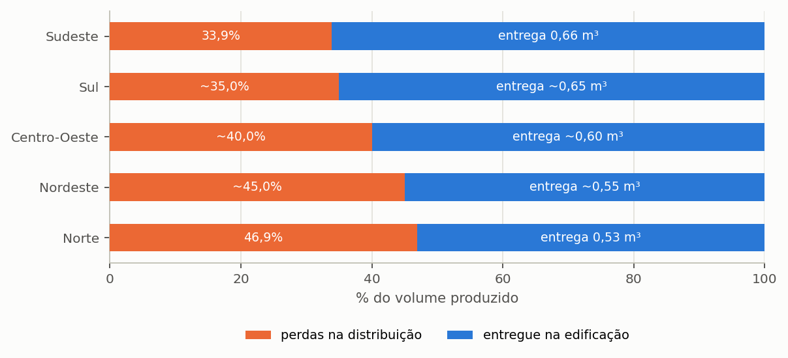

# Triton

## Manual do Usuário — Apêndices

Igor Catão Martins Vaz e Enedir Ghisi

Grupo de Pesquisa em Ambientes Sustentáveis
Universidade Federal de Santa Catarina

Florianópolis, 2026

---

### Sobre este volume

Este é um dos oito volumes em que o manual do Triton pode ser distribuído, e
reúne os apêndices do manual completo. Serve para mandar
só a parte que interessa: o método a um revisor, o tutorial a uma turma, os guias
a quem já usa o programa.

A numeração das seções e das equações é a mesma do manual completo, de modo que
uma remissão vale nos dois. Quando o texto remete a uma seção que está em outro
volume, o nome do volume vem entre parênteses.

| Volume | Conteúdo |
| :--- | :--- |
| Comece aqui | o capítulo 1 (Comece aqui) e o apêndice G |
| O método | o capítulo 2 (O método) e os apêndices A, B, C, E, G e H |
| Guias de uso | o capítulo 3 (Guias disponíveis no programa) e os apêndices D, F e G |
| Tutorial | o capítulo 4 (Tutorial: um exemplo do começo ao fim) e os apêndices G, I e J |
| Enganos, limitações e confiabilidade | o capítulo 5 (Enganos, limitações e confiabilidade) e os apêndices G e H |
| Correções, bugs e versionamento | o capítulo 6 (Correções, bugs e versionamento) |
| Modulação probabilística | o capítulo 7 (Modulação probabilística) e os apêndices G e H |
| **Apêndices** | os apêndices |

### Como citar

> VAZ, Igor Catão Martins; GHISI, Enedir. **Triton: manual do usuário**.
> Apêndices. Versão 0.1.0. Florianópolis: Universidade Federal de Santa
> Catarina, 2026.

---

## Sumário

**Apêndices**

Apêndice A — Os parâmetros do projeto

Apêndice B — Os processos do programa

Apêndice C — Fatores de emissão

Apêndice D — Regimes tarifários

Apêndice E — Base climática

Apêndice F — Arquivos, pastas e formatos

Apêndice G — Glossário

Apêndice H — Referências

Apêndice I — Fichas de uma página

Apêndice J — Arquivos de exemplo


## Lista de figuras

Figura 1 — Quanto de cada metro cúbico produzido chega efetivamente à edificação, por macrorregião

Figura 2 — A distribuição dos 652 municípios catalogados pelas unidades da federação, com as cores identificando a macrorregião

---

## Lista de tabelas

Tabela 1 — Parâmetros do projeto: identificação

Tabela 2 — Parâmetros do projeto: chuva

Tabela 3 — Parâmetros do projeto: captação

Tabela 4 — Parâmetros do projeto: edificação

Tabela 5 — Parâmetros do projeto: demanda

Tabela 6 — Parâmetros do projeto: irrigação

Tabela 7 — Parâmetros do projeto: qualidade da água

Tabela 8 — Parâmetros do projeto: reservatórios

Tabela 9 — Parâmetros do projeto: motobomba

Tabela 10 — Parâmetros do projeto: tubulação

Tabela 11 — Parâmetros do projeto: investimento

Tabela 12 — Parâmetros do projeto: operação

Tabela 13 — Parâmetros do projeto: tarifas

Tabela 14 — Parâmetros do projeto: energia

Tabela 15 — Parâmetros do projeto: incentivos

Tabela 16 — Parâmetros do projeto: financeiro

Tabela 17 — Parâmetros do projeto: certificações

Tabela 18 — Parâmetros do projeto: outros

Tabela 19 — Fatores de emissão dos materiais de reservatório, com massa e fronteira

Tabela 20 — Fatores de emissão dos insumos de tratamento

Tabela 21 — Emissão de fabricação da motobomba por potência, com a massa de catálogo

Tabela 22 — Procedência do fator de emissão do hipoclorito

Tabela 23 — Distribuição dos municípios do catálogo pelos seis regimes tarifários

Tabela 24 — Grau de confiança dos registros tarifários do catálogo

Tabela 25 — Cobertura do catálogo tarifário: municípios por categoria e situação do dado

Tabela 26 — As estruturas tarifárias do catálogo, numeradas para as tabelas de preço por faixa que vêm a seguir

Tabela 27 — Preço da água por intervalo de consumo mensal, em R$/m³, por município e categoria (parte 1 de 6: 0–4 a 15–20 m³)

Tabela 28 — Preço da água por intervalo de consumo mensal, em R$/m³, por município e categoria (parte 2 de 6: 20–24 a 55–60 m³)

Tabela 29 — Preço da água por intervalo de consumo mensal, em R$/m³, por município e categoria (parte 3 de 6: 60–64 a 100–104 m³)

Tabela 30 — Preço da água por intervalo de consumo mensal, em R$/m³, por município e categoria (parte 4 de 6: 104–120 a 400–500 m³)

Tabela 31 — Preço da água por intervalo de consumo mensal, em R$/m³, por município e categoria (parte 5 de 6: 500–600 a 15.000–20.000 m³)

Tabela 32 — Preço da água por intervalo de consumo mensal, em R$/m³, por município e categoria (parte 6 de 6: 20.000–30.000 a 120.000 m³)

Tabela 33 — Categorias tarifárias ainda não coletadas, por prestador

Tabela 34 — Vigência e última verificação da fonte de cada estrutura tarifária, com a situação do dado

Tabela 35 — A fórmula exponencial da CORSAN em cada tabela tarifária e categoria coletada

Tabela 36 — As estruturas de cobrança direta e de parcela fixa por faixa

Tabela 37 — Conteúdo da base climática nacional

Tabela 38 — Séries de precipitação de exemplo distribuídas com o programa

Tabela 39 — Grau de confiança do componente de saneamento do banco tarifário, por macrorregião (banco de 05/10/2026)

Tabela 40 — Os conjuntos de dados da Edição Brasil, a fonte e a licença

Tabela 41 — Formatos que o programa lê e onde cada um é carregado

Tabela 42 — Formatos que o programa escreve e onde cada um é gerado

Tabela 43 — As sete seções do arquivo de projeto e o que cada uma guarda

Tabela 44 — Localização dos arquivos do programa e dos arquivos do usuário

Tabela 45 — Compatibilidade entre versões do arquivo de projeto

Tabela 46 — Padronização terminológica de água de chuva e água pluvial

Tabela 47 — Grandezas fundamentais do balanço hídrico e relações entre fração e potencial

Tabela 48 — Ficha de consulta: os dez passos de um estudo completo e a seção que trata de cada um

Tabela 49 — Ficha de consulta: as dez armadilhas de projeto e onde cada uma é tratada

Tabela 50 — Ficha de consulta: os seis regimes tarifários e o efeito da economia

Tabela 51 — Ficha de consulta: os indicadores e a pergunta que cada um responde

Tabela 52 — Os casos de exemplo e o que cada um demonstra

Tabela 53 — Resultado que cada caso de exemplo produz ao ser relido e simulado

---


---
# Apêndices

---

## Apêndice A — Os parâmetros do projeto

São **122 parâmetros**. É a lista completa do que um projeto
guarda, com o nome exato de cada campo dentro do arquivo `.triton`.

A lista não foi transcrita à mão: é extraída do próprio programa a cada
versão, e por isso não pode divergir dele.

A coluna **onde se informa** diz em que tela o campo aparece; a coluna
**quem consome** diz que cálculo o usa. Campo sem nenhuma das duas é campo
gravado no arquivo e nunca lido, e está listado na seção 5.2 (volume Enganos, limitações e confiabilidade).

### A.1. Identificação

3 parâmetros.

<!-- tabela: **Tabela 1** — Parâmetros do projeto: identificação -->
| Parâmetro | Padrão | Unidade | Onde se informa | Quem consome |
| :--- | ---: | :--- | :--- | :--- |
| `project_name` | Novo projeto Triton | — | Exportação, Janela principal, Relatórios | Automação, CAD e BIM, Planilhas, Relatórios |
| `project_id` | — | — | Janela principal, Relatórios | Automação |
| `created_at` | — | — | Janela principal | — |

### A.2. Chuva

9 parâmetros.

<!-- tabela: **Tabela 2** — Parâmetros do projeto: chuva -->
| Parâmetro | Padrão | Unidade | Onde se informa | Quem consome |
| :--- | ---: | :--- | :--- | :--- |
| `precip_file` | — | — | Janela principal, Projeto | Automação, Cenários, Planilhas |
| `climate_source_mode` | national_db | — | Janela principal, Projeto | — |
| `climate_city_uf` | SC | — | Janela principal, Projeto, Relatórios | — |
| `climate_city_name` | Florianópolis | — | Janela principal, Projeto, Relatórios | — |
| `climate_model` | INM-CM4 | — | Janela principal, Projeto, Relatórios | — |
| `climate_scenario` | HIST | — | Janela principal, Projeto, Relatórios | — |
| `climate_start_date` | 01/01/1980 | — | Janela principal, Projeto, Relatórios | — |
| `climate_end_date` | 31/12/2013 | — | Janela principal, Projeto, Relatórios | — |
| `start_date` | 01/01/1980 | — | Exportação, Janela principal, Projeto, Tarifas e custos | Automação, Clima, Planilhas |

Observações do código:

- `climate_source_mode`: "national_db" (base nacional) ou "custom_file" (arquivo próprio)

### A.3. Captação

7 parâmetros.

<!-- tabela: **Tabela 3** — Parâmetros do projeto: captação -->
| Parâmetro | Padrão | Unidade | Onde se informa | Quem consome |
| :--- | ---: | :--- | :--- | :--- |
| `discard` | — | mm | Ambiental, Documentação, Gráficos, Janela principal, Projeto, Qualidade, Relatórios | ACV, Automação, CAD e BIM, Cenários, ETAP, Planilhas, Relatórios |
| `discard_mode` | 1 | código | Janela principal, Projeto, Varredura | Automação, Balanço diário, Cenários |
| `discard_days_interval` | 7 | dias | Janela principal, Projeto, Varredura | Automação, Balanço diário, Cenários |
| `area` | 100 | m² | Ambiental, Documentação, Edificação, Gráficos, Janela principal, Qualidade, Relatórios, Tarifas e custos, Varredura | ACV, Automação, Balanço diário, CAD e BIM, Cenários, ETAP, Planilhas, Relatórios |
| `irrigation_garden_area_m2` | 0 | m² | — | — |
| `runoff_coeff` | — | — | Edificação, Janela principal, Qualidade, Varredura | Automação, Balanço diário, Cenários, Planilhas |
| `first_flush_system_enabled` | não | — | Ambiental, Qualidade | ACV, Automação, ETAP |

Observações do código:

- `discard`: mm
- `discard_mode`: 1 = todos os eventos, 2 = 1º evento após estiagem, 3 = a cada X dias
- `discard_days_interval`: intervalo para modo 3
- `area`: m²
- `irrigation_garden_area_m2`: Área de jardim em m² para o assistente de dimensionamento
- `runoff_coeff`: ver hydrology_defaults

### A.4. Edificação

2 parâmetros.

<!-- tabela: **Tabela 4** — Parâmetros do projeto: edificação -->
| Parâmetro | Padrão | Unidade | Onde se informa | Quem consome |
| :--- | ---: | :--- | :--- | :--- |
| `num_economias` | 1 | un | Ambiental, Edificação | Automação, Econômico |
| `building_template_id` | res_medio | — | Edificação | Automação, Tarifas |

Observações do código:

- `num_economias`: Número de economias / apartamentos com micromedição individual

### A.5. Demanda

17 parâmetros.

<!-- tabela: **Tabela 5** — Parâmetros do projeto: demanda -->
| Parâmetro | Padrão | Unidade | Onde se informa | Quem consome |
| :--- | ---: | :--- | :--- | :--- |
| `demand_type` | 0 | código | — | — |
| `demand_mode` | constant | — | Ambiental, Edificação, Janela principal, Relatórios, Varredura | Automação, Balanço diário |
| `demand_value` | 200 | L/dia | Documentação, Econômico, Janela principal | Automação, Balanço diário |
| `demand_monthly` | — | — | Janela principal | Automação |
| `residents_type` | 0 | código | — | — |
| `residents_count` | 4 | hab | Ambiental, Econômico, Janela principal | Automação, Balanço diário, Motobomba |
| `residents_monthly` | — | — | Janela principal | Automação |
| `potable_indoor_share` | 0,6 | fração | Edificação, Janela principal | Automação |
| `non_potable_indoor_share` | 0,4 | fração | Edificação, Janela principal | Automação, Balanço diário |
| `rainwater_share` | 0,4 | fração | Documentação, Janela principal, Varredura | Automação, Balanço diário, Cenários, Planilhas |
| `weekly_demands` | — | — | Edificação, Janela principal, Varredura | Automação, Balanço diário |
| `weekly_residents` | — | — | Edificação, Janela principal, Varredura | Automação, Balanço diário |
| `weekly_shares` | — | — | Edificação, Janela principal, Varredura | Automação, Balanço diário |
| `monthly_shares` | — | — | Edificação, Janela principal, Varredura | Automação, Balanço diário |
| `daily_demands` | — | — | Edificação, Janela principal, Varredura | Automação, Balanço diário |
| `daily_residents` | — | — | Edificação, Janela principal, Varredura | Automação, Balanço diário |
| `daily_shares` | — | — | Edificação, Janela principal, Varredura | Automação, Balanço diário |

Observações do código:

- `demand_mode`: "constant", "weekly", "monthly", "daily"
- `demand_value`: L/dia, por habitante ou total
- `potable_indoor_share`: Fração potável do consumo interno; 1 − non_potable_indoor_share
- `non_potable_indoor_share`: Fração não potável do consumo interno (bacias, máquina); ver fracao_atendivel
- `rainwater_share`: fração de 0 a 1 (0,4 = 40%)

### A.6. Irrigação

4 parâmetros.

<!-- tabela: **Tabela 6** — Parâmetros do projeto: irrigação -->
| Parâmetro | Padrão | Unidade | Onde se informa | Quem consome |
| :--- | ---: | :--- | :--- | :--- |
| `irrigation_liters_per_day` | 0 | L/dia | Ambiental, Edificação, Janela principal, Relatórios | Automação, Balanço diário |
| `irrigation_rain_threshold_mm` | 2 | mm/dia | Edificação, Janela principal | Automação, Balanço diário |
| `irrigation_potable_backup` | sim | — | Edificação, Janela principal | Automação, Balanço diário |
| `irrigation_rate_l_m2_day` | 3 | L/m²·dia | — | — |

Observações do código:

- `irrigation_liters_per_day`: Demanda externa (rega, lavagem de áreas externas), L/dia
- `irrigation_rain_threshold_mm`: Limiar diário de precipitação para supressão da irrigação (mm/dia)
- `irrigation_potable_backup`: Se True, a rede pública atende a irrigação em dias secos se a cisterna secar
- `irrigation_rate_l_m2_day`: Taxa diária de rega (L/m²/dia)

### A.7. Qualidade da água

9 parâmetros.

<!-- tabela: **Tabela 7** — Parâmetros do projeto: qualidade da água -->
| Parâmetro | Padrão | Unidade | Onde se informa | Quem consome |
| :--- | ---: | :--- | :--- | :--- |
| `water_quality_target_class` | classe_1 | — | Ambiental, Qualidade | ACV, Automação, ETAP |
| `water_quality_disinfection` | cloro | — | Ambiental, Qualidade | ACV, Automação, ETAP |
| `water_quality_polishing` | não | — | Ambiental, Qualidade | ACV, Automação, ETAP |
| `etap_enabled` | sim | — | Ambiental, Econômico, Otimizador | ACV, Automação, ETAP |
| `chlorine_treatment_enabled` | sim | — | Ambiental, Econômico, Otimizador, Qualidade | ACV, Automação, Econômico |
| `chlorine_dose_mg_l` | — | mg Cl₂/L | Ambiental, Econômico, Otimizador, Qualidade | ACV, Automação, ETAP, Econômico, Relatórios |
| `chlorine_product_purity` | — | kg/kg | Ambiental, Qualidade | ACV, Automação, ETAP, Econômico |
| `chlorine_cost_per_kg` | 25 | R$/kg | Econômico, Otimizador, Qualidade | Automação, ETAP, Econômico, Preços |
| `chlorine_co2_kg_per_kg` | — | kg CO₂e/kg | Ambiental, Qualidade | ACV, Automação, ETAP |

Observações do código:

- `water_quality_disinfection`: "cloro", "uv", "ozonio", "nenhum"
- `chlorine_dose_mg_l`: mg de Cl2 ativo por litro
- `chlorine_product_purity`: kg Cl2 ativo por kg de produto
- `chlorine_cost_per_kg`: R$ por kg de PRODUTO comercial

### A.8. Reservatórios

12 parâmetros.

<!-- tabela: **Tabela 8** — Parâmetros do projeto: reservatórios -->
| Parâmetro | Padrão | Unidade | Onde se informa | Quem consome |
| :--- | ---: | :--- | :--- | :--- |
| `upper_tank_vol` | 500 | L | Ambiental, Assistente da bomba, Caixa superior, Econômico, Exportação, Janela principal, Otimizador, Relatórios, Tarifas e custos, Varredura | Automação, Balanço diário, CAD e BIM, Cenários, Multicritério, Planilhas, Preços |
| `upper_tank_used` | 1 | código | Ambiental, Econômico, Janela principal, Otimizador, Relatórios, Tarifas e custos, Varredura | ACV, Automação, Balanço diário, Cenários, Motobomba, Planilhas, Preços |
| `lower_tank_max` | 10000 | L | Janela principal, Varredura | Automação, Balanço diário, Cenários, Planilhas |
| `lower_tank_step` | 250 | L | Janela principal, Varredura | Automação, Balanço diário, Cenários, Planilhas |
| `lower_tank_mode` | 1 | código | Janela principal, Varredura | Automação |
| `lower_tank_fixed` | 2000 | L | Janela principal, Tarifas e custos, Varredura | Automação |
| `delta_ideal` | 5 | %/m³ | Janela principal, Otimizador, Varredura | Automação, Cenários |
| `econ_lower_tank_vol` | 2000 | L | Ambiental, Econômico, Tarifas e custos, Varredura | Automação |
| `lower_tank_material` | PEAD | — | Econômico, Otimizador, Tarifas e custos | ACV, Automação, Preços |
| `upper_tank_material` | PEAD | — | Econômico, Otimizador, Tarifas e custos | ACV, Automação, Preços |
| `cost_lower_tank` | 0 | R$ | Econômico, Tarifas e custos, Varredura | Automação, Econômico, Preços |
| `cost_upper_tank` | 0 | R$ | Econômico, Tarifas e custos, Varredura | Automação, Econômico |

Observações do código:

- `upper_tank_vol`: L
- `upper_tank_used`: 0 = sem caixa superior, 1 = com caixa superior
- `lower_tank_max`: L
- `lower_tank_step`: L
- `lower_tank_mode`: 0 = volume fixo, 1 = varredura
- `lower_tank_fixed`: usado no modo de volume fixo
- `delta_ideal`: limiar de ganho marginal para o volume ideal, em %/m³
- `lower_tank_material`: "PEAD", "CONCRETO", "FIBRA" (PRFV), "ACO_INOX"
- `upper_tank_material`: "PEAD", "CONCRETO", "FIBRA" (PRFV), "ACO_INOX"

### A.9. Motobomba

18 parâmetros.

<!-- tabela: **Tabela 9** — Parâmetros do projeto: motobomba -->
| Parâmetro | Padrão | Unidade | Onde se informa | Quem consome |
| :--- | ---: | :--- | :--- | :--- |
| `pumping_threshold` | 50 | L | Janela principal, Varredura | Automação, Balanço diário, Cenários, Planilhas |
| `supply_arrangement` | — | código | Ambiental, Econômico, Varredura | ACV, Automação, Econômico, Motobomba |
| `pressurizer_pressure_m` | 18 | m.c.a. | Varredura | Motobomba |
| `pressurizer_starts_per_person_day` | 5,05 | 1/pessoa·dia | Varredura | Motobomba |
| `pressurizer_model` | komeco_tp820t | código | Varredura | Motobomba |
| `pressurizer_point_flow_l_min` | 9 | L/min | Varredura | Motobomba |
| `pressurizer_power_kw` | 0,18 | kW | Varredura | Motobomba |
| `pressurizer_flow_l_min` | 13,3 | L/min | Varredura | Motobomba |
| `pressurizer_post_run_s` | 0 | s | Varredura | Motobomba |
| `pump_count` | 2 | un | Ambiental, Econômico, Otimizador, Relatórios, Tarifas e custos | ACV, Automação, Econômico, Preços, Relatórios |
| `pump_power_str` | 1/2 | — | Relatórios | — |
| `pump_power_kw` | 0,36775 | kW | Econômico, Gráficos, Otimizador, Relatórios, Tarifas e custos, Varredura | Automação, CAD e BIM, Econômico, Motobomba, Preços, Relatórios |
| `pump_manometric_head_m` | 0 | m.c.a. | Varredura | Automação, Motobomba |
| `pump_efficiency` | 0 | % | Gráficos, Tarifas e custos, Varredura | Automação, Motobomba |
| `pump_flow_rate` | 0 | L/h | Econômico, Gráficos, Otimizador, Relatórios, Tarifas e custos, Varredura | Automação, Motobomba |
| `pump_startup_time_h` | 0,03 | h | Econômico, Gráficos, Otimizador, Tarifas e custos | Automação, Motobomba |
| `pump_motor_efficiency` | 0 | % | Tarifas e custos | Automação, Motobomba |
| `pump_unit_cost` | 300 | R$ | Econômico, Otimizador, Tarifas e custos, Varredura | Automação, Econômico, Preços |

Observações do código:

- `pumping_threshold`: L, nível de acionamento do recalque
- `pump_count`: principal + reserva como configuração inicial recomendada
- `pump_power_kw`: kW (1 CV = 0,7355 kW; 1/2 CV = 0,36775 kW)
- `pump_efficiency`: %, 0 = deduzir do porte
- `pump_startup_time_h`: h
- `pump_motor_efficiency`: %
- `pump_unit_cost`: R$, referência de mercado para motobomba periférica 1/2 CV

### A.10. Tubulação

1 parâmetro.

<!-- tabela: **Tabela 10** — Parâmetros do projeto: tubulação -->
| Parâmetro | Padrão | Unidade | Onde se informa | Quem consome |
| :--- | ---: | :--- | :--- | :--- |
| `pipes_list` | — | — | Econômico, Tarifas e custos | ACV, Automação |

### A.11. Investimento

3 parâmetros.

<!-- tabela: **Tabela 11** — Parâmetros do projeto: investimento -->
| Parâmetro | Padrão | Unidade | Onde se informa | Quem consome |
| :--- | ---: | :--- | :--- | :--- |
| `cost_labor` | 0 | R$ | Econômico, Tarifas e custos, Varredura | Automação, Econômico |
| `cost_piping` | 0 | R$ | Econômico, Tarifas e custos, Varredura | Automação, Econômico |
| `cost_accessories` | 0 | R$ | Econômico, Tarifas e custos, Varredura | Automação, ETAP, Econômico |

### A.12. Operação

1 parâmetro.

<!-- tabela: **Tabela 12** — Parâmetros do projeto: operação -->
| Parâmetro | Padrão | Unidade | Onde se informa | Quem consome |
| :--- | ---: | :--- | :--- | :--- |
| `op_costs` | — | — | Econômico, Otimizador, Tarifas e custos, Varredura | Automação, Econômico |

### A.13. Tarifas

18 parâmetros.

<!-- tabela: **Tabela 13** — Parâmetros do projeto: tarifas -->
| Parâmetro | Padrão | Unidade | Onde se informa | Quem consome |
| :--- | ---: | :--- | :--- | :--- |
| `tariff_customized` | não | — | Projeto | — |
| `water_tariffs` | — | — | Projeto, Tarifas, Tarifas e custos, Varredura | Econômico |
| `tariff_city_uf` | SC | — | Janela principal, Projeto, Relatórios, Tarifas, Tarifas e custos | — |
| `tariff_city_name` | Florianópolis | — | Janela principal, Projeto, Relatórios, Tarifas, Tarifas e custos | — |
| `tariff_vigencia` | — | — | Projeto, Tarifas e custos | — |
| `tariff_category` | residencial | — | Econômico, Tarifas, Tarifas e custos | Tarifas |
| `sewage_rate` | 100 | % da água | Projeto, Tarifas, Tarifas e custos | Automação, Econômico, Tarifas |
| `sewage_mode` | 1 | código | Econômico, Otimizador, Projeto, Tarifas, Tarifas e custos | Automação, Econômico, Tarifas |
| `sewage_tariffs` | — | — | — | Econômico, Tarifas |
| `sewage_volume_factor` | 1 | — | — | Automação, Econômico, Tarifas |
| `water_tax_fixed` | 0 | R$/mês | Tarifas e custos | Automação, Econômico |
| `water_tax_var` | 0 | % | Tarifas e custos | Automação, Econômico |
| `tariff_escalation` | 12 | meses | Econômico, Otimizador, Tarifas e custos, Varredura | Automação, Econômico |
| `water_tariff_escalation` | 5 | % por período | Econômico, Otimizador, Tarifas e custos, Varredura | Automação, Econômico |
| `sewage_tariff_escalation` | 5 | % por período | Econômico, Otimizador, Tarifas e custos | Automação, Econômico |
| `elec_tariff_escalation` | 5 | % por período | Econômico, Otimizador, Varredura | Automação, Econômico |
| `tariff_flag` | verde | — | Econômico | Automação, Econômico |
| `elec_tariff` | 0,6957 | R$/kWh | Econômico, Gráficos, Otimizador, Projeto, Tarifas e custos, Varredura | Automação, Econômico |

Observações do código:

- `tariff_category`: categoria da tabela tarifária aplicada; "personalizada" quando digitada
- `sewage_mode`: 0 = valor fixo em R$, 1 = percentual da parcela de água, 2 = R$/m³ consumido, 3 = escalões
- `water_tax_fixed`: R$
- `water_tax_var`: %
- `tariff_escalation`: meses; comprimento do período de reajuste
- `water_tariff_escalation`: % por período de reajuste; com 12 meses, % ao ano
- `sewage_tariff_escalation`: % por período de reajuste; com 12 meses, % ao ano
- `elec_tariff_escalation`: % por período de reajuste; com 12 meses, % ao ano
- `tariff_flag`: "verde", "amarela", "vermelha_1", "vermelha_2", "branca"
- `elec_tariff`: R$/kWh (Tarifa B1 Residencial CELESC/SC Florianópolis)

### A.14. Energia

4 parâmetros.

<!-- tabela: **Tabela 14** — Parâmetros do projeto: energia -->
| Parâmetro | Padrão | Unidade | Onde se informa | Quem consome |
| :--- | ---: | :--- | :--- | :--- |
| `elec_city_uf` | SC | — | Janela principal, Projeto, Tarifas e custos | — |
| `elec_city_name` | Florianópolis | — | Janela principal, Projeto, Tarifas e custos | — |
| `elec_tax_fixed` | 0 | R$/mês | Tarifas e custos | Automação, Econômico |
| `elec_tax_var` | 0 | % | Tarifas e custos | Automação, Econômico |

Observações do código:

- `elec_tax_fixed`: R$
- `elec_tax_var`: %

### A.15. Incentivos

3 parâmetros.

<!-- tabela: **Tabela 15** — Parâmetros do projeto: incentivos -->
| Parâmetro | Padrão | Unidade | Onde se informa | Quem consome |
| :--- | ---: | :--- | :--- | :--- |
| `iptu_green_enabled` | não | — | Econômico, Otimizador | Automação, Econômico |
| `iptu_annual_value` | 4000 | R$/ano | Econômico, Otimizador | Automação, Econômico |
| `iptu_discount_pct` | 5 | % | Econômico, Otimizador | Automação, Econômico |

Observações do código:

- `iptu_annual_value`: Valor venal do IPTU anual da edificação (R$/ano)
- `iptu_discount_pct`: Desconto municipal do IPTU Verde (%)

### A.16. Financeiro

4 parâmetros.

<!-- tabela: **Tabela 16** — Parâmetros do projeto: financeiro -->
| Parâmetro | Padrão | Unidade | Onde se informa | Quem consome |
| :--- | ---: | :--- | :--- | :--- |
| `inflation` | 0,2 | % ao mês | Documentação, Econômico, Otimizador, Tarifas e custos, Varredura | Automação, Econômico |
| `analysis_period_years` | 20 | anos | Econômico, Otimizador, Relatórios, Tarifas e custos, Varredura | ACV, Automação, Econômico, Relatórios |
| `tma` | 2 | % ao mês | Econômico, Otimizador, Tarifas e custos, Varredura | Automação, Econômico |
| `install_month` | 0 | mês | — | — |

Observações do código:

- `inflation`: % ao mês; inflação dos custos de O&M
- `analysis_period_years`: anos
- `tma`: % ao mês; taxa mínima de atratividade

### A.17. Certificações

1 parâmetro.

<!-- tabela: **Tabela 17** — Parâmetros do projeto: certificações -->
| Parâmetro | Padrão | Unidade | Onde se informa | Quem consome |
| :--- | ---: | :--- | :--- | :--- |
| `edge_base_case_l_person_day` | 0 | L/pessoa·dia | Ambiental | — |

### A.18. Outros

6 parâmetros.

<!-- tabela: **Tabela 18** — Parâmetros do projeto: outros -->
| Parâmetro | Padrão | Unidade | Onde se informa | Quem consome |
| :--- | ---: | :--- | :--- | :--- |
| `phi_operation_rule` | — | — | Janela principal, Varredura | Automação, Balanço diário, Planilhas |
| `data_base_estudo` | — | — | Tarifas e custos | — |
| `precos_de_catalogo` | sim | — | Assistente da bomba, Econômico, Otimizador, Qualidade, Tarifas e custos, Varredura | Automação, ETAP, Preços |
| `bim_layout` | — | — | Exportação, Janela principal | — |
| `capex_do_arranjo` | não | — | Janela principal, Tarifas e custos, Varredura | ETAP |
| `mao_de_obra_automatica` | não | — | Janela principal, Tarifas e custos, Varredura | — |

---

## Apêndice B — Os processos do programa

São **24 processos**, do arquivo de chuva ao relatório. Cada
um declara o que o dispara, o que recebe, as regras com suas ramificações, o
que produz e o que acontece quando falha.

É o apêndice mais técnico do manual, e serve a duas pessoas: quem revisa um
estudo feito com o programa e precisa saber exatamente que conta foi feita, e
quem encontrou um resultado estranho e quer saber por onde o número passou.

Os nomes em `código` são os campos do arquivo de projeto, listados no apêndice A.

### B.1. PROC-01 — Carregar a série de precipitação

*Chuva*

**Gatilho.** Aba Projeto: escolher cidade na base nacional ou abrir arquivo CSV.

**Entradas**

- Arquivo CSV diário, ou cidade da base CMIP6 (652 cidades, 19 modelos, histórico mais SSP2-4.5 e SSP5-8.5)
- `climate_start_date` e `climate_end_date`, que recortam a série
- `start_date`, data do primeiro dia da série

**Regras**

1. A série vira um vetor `numpy` de milímetros por dia; o índice do vetor é o dia, e a data serve só para saber o dia da semana e o mês.
2. Ano incompleto é descartado na leitura, para não enviesar totais anuais.
3. A base climática vai embutida na Edição Brasil, em `climbra.db`; na International Edition, que não a traz, a série é sempre um arquivo do usuário.

**Saídas**

- `precip_data`: vetor de mm/dia, que é a entrada de **dois** processos distintos — PROC-04 (descarte e captação) e PROC-03 (supressão de irrigação)

**Exceção.** Arquivo ilegível ou sem coluna de chuva interrompe o carregamento com mensagem; a simulação não roda com série vazia.

### B.2. PROC-02 — Compor a demanda diária

*Demanda*

**Gatilho.** Início da simulação, uma vez por execução.

**Entradas**

- `demand_mode`: constante, semanal, mensal ou diária
- `demand_value` (L/dia por pessoa), `residents_count`
- `rainwater_share` ou `non_potable_indoor_share`
- vetores `weekly_*`, `monthly_*`, `daily_*` quando o modo os usa

**Regras**

1. Demanda-base do dia = `demand_value × residents_count`, com o multiplicador do dia da semana, do mês ou do dia, conforme o modo.
2. A fração não potável separa a demanda em duas: interna potável e interna não potável.
3. Quando o modo é semanal, mensal ou diário, a fração vem do próprio vetor do período; fora disso, vale `non_potable_indoor_share`, e só então `rainwater_share`.
4. Valor nulo ou zero em qualquer posição do vetor cai para o valor constante.

**Saídas**

- `tot_arr`: demanda total do dia
- `pot_in_arr`: potável interna, que a chuva nunca atende
- `non_pot_in_arr`: não potável interna, prioridade 1 da chuva
- `pluv_arr` = não potável interna + irrigação ativa

**Exceção.** Data inicial ilegível cai para 01/01/1980 em vez de interromper, porque só afeta o dia da semana.

### B.3. PROC-03 — Suprimir a irrigação nos dias de chuva

*Demanda*

**Gatilho.** Composição da demanda, um teste por dia da série.

**Entradas**

- `irrigation_liters_per_day`
- `irrigation_rain_threshold_mm` (padrão 2 mm/dia)
- `precip_data`, o **mesmo** vetor que alimenta a captação

**Regras**

1. Se a chuva do dia ≥ limiar, a irrigação do dia é **zero** e o dia entra na contagem de dias suprimidos.
2. Caso contrário, a irrigação do dia é o volume nominal.
3. É a segunda leitura do arquivo de chuva, e independente da primeira: um dia pode suprimir a irrigação e ainda assim render captação.

**Saídas**

- `irr_arr`: irrigação do dia
- `irr_suppressed_mask`: dias suprimidos, que viram `total_irrigation_days_suppressed` no resultado

**Exceção.** Sem volume de irrigação cadastrado, o vetor é zero e a máscara é falsa em todos os dias.

### B.4. PROC-04 — Descartar as primeiras águas

*Balanço hídrico*

**Gatilho.** Todo dia com chuva, dentro do laço diário.

**Entradas**

- `precip_mm` do dia
- `discard_mm`
- `discard_mode` (1, 2 ou 3)
- `discard_days_interval`

**Regras**

1. **Modo 1**: descarta em todo evento de chuva.
2. **Modo 2**: descarta apenas no primeiro evento após estiagem, definida como véspera com menos de 1 mm.
3. **Modo 3**: descarta quando passaram `discard_days_interval` dias desde o último descarte.
4. Quando o descarte se aplica: `p_eff = p − discard_mm` se `p > discard_mm`, senão **zero**: toda a chuva do dia vai para o descarte.
5. Quando não se aplica: `p_eff = p`, a chuva inteira é aproveitável.

**Saídas**

- `p_eff`: lâmina efetiva do dia, em mm, que segue **só** para PROC-05
- `eff_precip_mm` na série diária detalhada, quando ela é guardada

**Exceção.** Lâmina de descarte negativa é rejeitada na porta de validação, antes do laço.

### B.5. PROC-05 — Converter lâmina em volume captado

*Balanço hídrico*

**Gatilho.** Todo dia, depois do descarte.

**Entradas**

- `p_eff` de PROC-04
- `area` (m²)
- `runoff_coeff`

**Regras**

1. `v_ac = p_eff × area × runoff_coeff`, em litros.
2. É aqui que o arquivo de chuva vira volume, e é o único ponto onde isso acontece.
3. O coeficiente é adimensional e fica em [0, 1]; fora disso a simulação nem começa.

**Saídas**

- `v_ac`: volume captado do dia, que segue para PROC-06
- `harvested_liters` na série diária

**Exceção.** Área negativa ou coeficiente fora de [0, 1] levantam `ValueError` nomeando o campo, em PROC-11.

### B.6. PROC-06 — Armazenar e extravasar

*Balanço hídrico*

**Gatilho.** Todo dia, depois da captação.

**Entradas**

- `v_ac`
- volume remanescente do dia anterior
- `lower_tank_vol`

**Regras**

1. **Extravasamento antes do consumo**, como na regra YAS; a chuva do dia, até a capacidade, já atende a demanda do dia, o que põe o modelo entre a YAS e a YBS estritas.
2. `disponível = v_lower + v_ac`. Se passar da capacidade, o excedente extravasa e o reservatório fica cheio.
3. A ordem importa: retirar a demanda antes faria o reservatório aceitar água que fisicamente já teria extravasado, superestimando o aproveitamento.

**Saídas**

- `v_spill_today`, somado em `avg_spilled_l_day`, que vira critério de extravasamento no multicritério
- `v_in_tank`, o volume disponível para atendimento

**Exceção.** Volume zero é válido e representa o cenário sem sistema; negativo é rejeitado.

### B.7. PROC-07 — Atender com reservatório único

*Balanço hídrico*

**Gatilho.** Todo dia, quando não há reservatório superior.

**Entradas**

- `v_in_tank`
- `pluvial_demand_per_day` de PROC-02

**Regras**

1. `v_c = min(demanda pluvial, volume no reservatório)`.
2. O volume remanescente permanece para o dia seguinte: `v_lower = v_in_tank − v_c`.

**Saídas**

- `v_c`: volume pluvial consumido no dia

**Exceção.** Nenhuma: o mínimo já trata reservatório vazio e demanda nula.

### B.8. PROC-08 — Atender com recalque para caixa superior

*Balanço hídrico*

**Gatilho.** Todo dia, quando `upper_tank_used` e o volume superior é positivo.

**Entradas**

- `v_lower`, `v_upper`
- `upper_tank_vol`
- `pumping_threshold`, o volume de reserva que não se consome

**Regras**

1. Laço até a demanda ser atendida ou a água acabar.
2. Primeiro consome da caixa superior o que estiver **acima** do limiar de acionamento.
3. Se ainda falta e há água embaixo, aciona a bomba: transfere `min(v_lower, espaço livre em cima)`, conta **um ciclo** e registra a batelada.
4. Depois do recalque, consome de novo.
5. O limiar é limitado ao volume da caixa superior na entrada do processo.

**Saídas**

- `v_c`
- `v_rec_today`, somado em `total_pumped_liters`
- `cycles_today`, somado em `total_pump_cycles`
- `max_pump_batch_liters`

**Exceção.** Volume superior negativo é rejeitado na validação. O laço tem saída garantida: se não há água embaixo nem em cima, interrompe.

### B.9. PROC-09 — Repartir o atendimento e completar com potável

*Balanço hídrico*

**Gatilho.** Todo dia, depois do atendimento.

**Entradas**

- `v_c`
- `non_pot_in_day`
- `irr_day`
- `pot_in_day`
- `irrigation_potable_backup`

**Regras**

1. **Prioridade 1**, uso interno não potável: `c_pluv_in = min(v_c, não potável interna)`.
2. **Prioridade 2**, irrigação: `c_pluv_irr = min(v_c − c_pluv_in, irrigação do dia)`.
3. O potável consumido é a soma de três parcelas: o potável interno, o déficit do não potável interno e — só se o suprimento de reserva estiver ligado — o déficit da irrigação.
4. Com o suprimento de reserva desligado, o jardim simplesmente não é regado no dia seco, e a rede não é acionada.

**Saídas**

- `potable_consumed_liters` do dia
- `avg_pluvial_indoor_consumed_l_day` e `avg_pluvial_irrigation_consumed_l_day`, que separam o uso interno do externo para os créditos WEc1 e WEc2 do LEED v4 e as Opções 2 e 4 do WEc2 do LEED v5

**Exceção.** Nenhuma: todas as parcelas são mínimos e máximos com zero.

### B.10. PROC-10 — Classificar o atendimento do dia

*Balanço hídrico*

**Gatilho.** Todo dia, ao fim do atendimento.

**Entradas**

- `v_c`
- `pluvial_demand_per_day`

**Regras**

1. **Pleno** quando o consumido iguala a demanda pluvial, com tolerância de 10⁻⁵ L.
2. **Parcial** quando consumiu algo, mas menos que a demanda.
3. **Nulo** quando não consumiu nada.

**Saídas**

- `pct_days_full_satisfaction`, `pct_days_partial_satisfaction` e `pct_days_null_satisfaction`, que são a confiabilidade temporal do sistema

**Exceção.** Nenhuma.

### B.11. PROC-11 — Validar a entrada física

*Balanço hídrico*

**Gatilho.** Primeira linha de `run_single_simulation`, antes de qualquer conta.

**Entradas**

- volume inferior e superior
- área
- coeficiente de escoamento
- lâmina de descarte
- demanda diária
- fração pluvial

**Regras**

1. Volume negativo, área negativa, descarte negativo e demanda negativa são recusados.
2. Coeficiente de escoamento e fração pluvial têm de ficar em [0, 1].
3. **Volume zero continua válido**: é a referência «sem sistema» da varredura.
4. A mensagem nomeia o campo e o valor recebido, em vez de corrigir por baixo dos panos.

**Saídas**

- Nenhuma saída: ou passa, ou levanta `ValueError`

**Exceção.** É o próprio tratamento. Antes desta porta, volume de −1.000 L devolvia −166,67% de economia, e o número seguia para o econômico, para a ACV e para o relatório.

### B.12. PROC-12 — Agregar o período e calcular os indicadores

*Balanço hídrico*

**Gatilho.** Fim do laço diário.

**Entradas**

- acumuladores do laço
- `n_days`

**Regras**

1. **Potencial de economia** = pluvial consumido no período ÷ demanda total do período × 100.
2. As médias diárias dividem os acumulados pelo número de dias simulados.
3. As conversões para o ano usam **365,25** dias, e não 365, para absorver os bissextos da série.
4. O potencial fica sempre em [0, 100] — invariante que a porta de validação existe para garantir.

**Saídas**

- `SingleTankSimulationResult`, com 21 campos, que é o objeto que **todos** os módulos a jusante consomem

**Exceção.** Demanda total nula devolve potencial zero em vez de dividir por zero.

### B.13. PROC-13 — Varrer volumes e achar o volume ideal

*Balanço hídrico*

**Gatilho.** Aba Varredura: botão de simular.

**Entradas**

- `lower_tank_max`
- `lower_tank_step`
- `delta_ideal` (%/m³)

**Regras**

1. A grade discreta arredonda o passo **para cima** até o múltiplo de 250 L, que é o quantum comercial de reservatório, e limita a 40 volumes positivos.
2. O volume máximo informado é sempre preservado como último ponto, de modo que só o último intervalo pode ser menor que o passo.
3. Zero entra na grade como alternativa de referência.
4. Roda PROC-04 a PROC-12 uma vez por volume.
5. O **volume ideal** é o primeiro cujo ganho marginal `Δpotencial/Δm³` cai abaixo do limiar: a partir dali, mais reservatório não compensa.

**Saídas**

- `SweepSimulationResult`: um resultado por volume, o volume ideal, e o registro de que o passo foi ajustado
- A lista de volumes é a lista de **candidatos** do multicritério

**Exceção.** Passo maior que o máximo devolve grade com um ponto. O ajuste do passo é registrado em `step_adjusted`, e não silenciado.

### B.14. PROC-14 — Calcular os índices pluviométricos

*Chuva*

**Gatilho.** Aba Gráficos e relatório científico.

**Entradas**

- `precip_data`
- datas da série

**Regras**

1. Nove índices: PRCPTOT, R95p, RX1day, RX5day, SDII, R20mm, CDD, CWD e o índice de sazonalidade de Walsh e Lawler.
2. O conjunto **não** é ETCCDI puro: a sazonalidade não é do conjunto, e o R10mm, que é, está ausente.
3. O percentil 95 é calculado sobre a **série inteira carregada**, e não sobre a base fixa 1961–1990 do ETCCDI.
4. O RX5day usa `min_periods=1`, de modo que as primeiras janelas do ano têm de 1 a 4 dias.

**Saídas**

- Nove séries anuais, para gráfico e relatório

**Exceção.** Série menor que um ano devolve os índices possíveis, sem interromper.

### B.15. PROC-15 — Dimensionar a estação de tratamento

*Qualidade e ETAP*

**Gatilho.** Mudança na aba Qualidade da Água, ou início do econômico e da ACV.

**Entradas**

- `water_quality_target_class` (4 classes de uso)
- `water_quality_disinfection`: cloro, ultravioleta ou ozônio
- `water_quality_polishing`, filtro de polimento
- `annual_pluvial_m3` de PROC-12
- `area`
- dose, pureza, preço e fator de CO₂ do cloro
- `discard` e `first_flush_system_enabled`, para o descarte inicial

**Regras**

1. A classe alvo define as etapas obrigatórias; a desinfecção escolhida define o equipamento e o custeio.
2. O filtro de polimento é aplicado **se e somente se** marcado; quando a classe o recomendaria e o usuário recusa, isso fica registrado em `polishing_recommended_but_declined` em vez de ser imposto.
3. O que se compra é o **produto** — pastilha a 65% de cloro ativo — e não o cloro puro. Faturar a massa de cloro ativo, e não a do produto, subestima o custo em cerca de 35%.
4. **Regra incremental**: o CAPEX da linha desconta a verba genérica de tratamento já embutida em «Acessórios», e o custeio desconta a cloração, que o fluxo de caixa já paga. A regra vive num lugar só, consumida pelos **dois** motores econômicos.
5. Com `first_flush_system_enabled`, o dispositivo de descarte inicial, de volume `discard × area`, entra no CAPEX e no custeio da linha.
6. Na ACV, a linha de tratamento **substitui** o termo de cloração; nunca soma a ele.
7. Com `etap_enabled = False`, a linha de tratamento não entra em conta alguma: nem no CAPEX, nem no custeio, nem na avaliação ambiental.

**Saídas**

- `total_etap_capex`, que entra no CAPEX
- `total_etap_annual_opex`, que entra no custeio
- `total_etap_co2e_kg_yr`, que substitui a cloração na ACV
- `disinfection_stages`, exibido no relatório

**Exceção.** Pureza fora de (0, 1] é recusada pelo validador da cadeia de cloração.

### B.16. PROC-16 — Calcular a energia de bombeamento

*Motobomba*

**Gatilho.** Econômico e ACV, a partir do mesmo resultado de simulação.

**Entradas**

- `supply_arrangement`: recalque, pressurização direta ou gravidade
- `total_pumped_liters` e `total_pump_cycles` de PROC-08
- `pressurizer_pressure_m`, `pressurizer_starts_per_person_day`, `residents_count`
- `pump_power_kw`, `pump_efficiency`, `pump_flow_rate`
- `pump_manometric_head_m`
- `pump_startup_time_h`

**Regras**

1. O arranjo decide o que se bombeia. **Recalque**: o volume enviado à caixa superior. **Pressurização direta**: todo o volume pluvial consumido, com a pressão de trabalho no lugar da altura e sem energia de partida. **Gravidade**: nada. É a única fonte de kWh do econômico e da ACV.
2. Energia específica `e = ρgH/(η_bomba·η_motor)` por m³ recalcado, ou `P/(Q·η_motor)` quando a vazão é declarada.
3. A potência de placa é potência de eixo e **já embute** o rendimento da bomba; por isso `P × horas / η_bomba` conta esse rendimento duas vezes, e o que falta é dividir pelo rendimento do motor, da ABNT NBR 17094-2. Quatro cópias dessa fórmula antiga sobreviviam no programa e superestimavam o consumo em 1,68 vez — a pior delas ordenava volumes no multicritério.
4. A energia de partida entra à parte, pelo número de ciclos.
5. Vazão e rendimento não informados caem para valores típicos **da potência escolhida**, e não para constantes fixas.

**Saídas**

- `annual_kwh`, que vira custo no econômico e emissão na ACV
- `pump_hours_year`, `annual_cycles`

**Exceção.** Arranjo por gravidade, arranjo não informado num projeto antigo, ou potência zero: a energia é zero.

### B.17. PROC-17 — Calcular a fatura de água e esgoto

*Econômico*

**Gatilho.** Duas vezes por mês de projeção: com e sem aproveitamento.

**Entradas**

- volume mensal em litros
- `water_tariffs`: quádruplas (mínimo, máximo, valor, código)
- `sewage_mode` e `sewage_rate`
- impostos fixo e variável
- `num_economias`

**Regras**

1. O consumo é avaliado **no patamar de uma economia** e multiplicado pelo número de economias, para não distorcer as faixas progressivas em prédio com micromedição.
2. Código **1** ou **0**: faixa progressiva, cobrada só sobre o volume dentro dela.
3. Código **−1**, disponibilidade: valor fixo que **soma** por cima do consumo medido.
4. Código **−2**, franquia retroativa: até o volume da franquia paga-se o valor fixo; passando dele, **todo** o volume desde zero é tarifado pelas faixas.
5. Código **−3**, piso de pagamento: não soma, **limita por baixo**. Com piso de R$ 40 e consumo tarifado de R$ 55, economizar até R$ 15 não reduz nada — e é exatamente isso que um estudo de aproveitamento pluvial precisa enxergar.
6. O esgoto é percentual da **parcela de água**, não da fatura total. Em Florianópolis são 100% da água, que é metade da fatura.
7. Os seis regimes tarifários estão nomeados e auditados na base dos 652 municípios.

**Saídas**

- Valor da fatura de água e esgoto em R$/mês, para a projeção de PROC-18

**Exceção.** Tabela vazia cai para a estrutura da CASAN. Estrutura incompleta é sinalizada pela porta de validação, que separa erro de aviso.

### B.18. PROC-18 — Projetar o fluxo de caixa

*Econômico*

**Gatilho.** Aba Econômico, após a simulação técnica.

**Entradas**

- CAPEX das cinco rubricas mais bomba e ETAP
- economia mensal de água e esgoto de PROC-17
- custeio: bombeamento, cloração, ETAP e custos operacionais declarados
- `tma`, `inflation`, `analysis_period_years`
- reajustes separados de água, esgoto e energia, e o intervalo entre reajustes
- IPTU verde, quando habilitado

**Regras**

1. Água e esgoto são reajustados por índices **separados**, e não pela fatura agregada.
2. A inflação incide só sobre o custeio; os reajustes tarifários incidem só sobre a fatura.
3. O reajuste é aplicado a cada `tariff_escalation` meses, em degraus.
4. A bandeira tarifária ajusta a tarifa de energia: amarela, vermelha 1, vermelha 2, ou desconto fora de ponta na branca.
5. O IPTU verde entra como economia anual dividida por doze.
6. O payback é o primeiro mês em que o acumulado descontado cruza zero.

**Saídas**

- `vpl`, `tir_monthly_pct`, `tir_annual_pct`, `payback_months`
- `monthly_cash_flows`, série mês a mês
- `annual_pump_kwh`, `annual_chlorine_kg`, `etap_capex_brl`

**Exceção.** Economia mensal negativa é truncada em zero antes de entrar no fluxo. TIR sem raiz real devolve nulo em vez de um número inventado.

### B.19. PROC-19 — Avaliar o ciclo de vida

*ACV*

**Gatilho.** Aba Ambiental, após a simulação técnica.

**Entradas**

- `tank_vol_liters`
- `annual_pluvial_m3` de PROC-12
- materiais e massas dos dois reservatórios
- comprimentos por diâmetro de tubo
- `pump_count`
- fator da rede elétrica
- rota de produção da água potável
- resultado da ETAP de PROC-15

**Regras**

1. Sete etapas: cisterna inferior, caixa superior, tubulação, motobomba, operação de bombeamento, operação de tratamento e potável evitada.
2. Volume zero **sem** volume pluvial é o cenário sem sistema, e não recebe impacto fixo de caixa, tubo ou bomba.
3. A linha de tratamento **substitui** o termo de cloração; não soma a ele. A cloração acompanha o tratamento, e não a caixa superior.
4. Caixa superior só no arranjo de recalque; motobombas em todo arranjo com bomba; energia de PROC-16.
5. A água evitada é a **entregue**, não a produzida: as perdas de distribuição no Brasil vão de 33,9% no Sudeste a 46,9% no Norte, de modo que produzir 1 m³ entrega de 0,53 a 0,66 m³. O fator publicado de 0,236 kg CO₂e/m³ é de saída de estação; por m³ entregue vira de 0,336 a 0,461 conforme a macrorregião.
6. O payback de carbono é o carbono incorporado dividido pela economia anual líquida; sem economia líquida positiva, devolve 999 anos em vez de infinito.

**Saídas**

- `total_embodied_co2_kg`, `net_annual_avoided_co2_kg`
- `lifetime_net_co2_saved_kg`, que é critério do multicritério
- `environmental_payback_years`
- `inventory_items`, o inventário item a item

**Exceção.** Fator sem procedência primária recebe rótulo de triagem, e o rótulo é exibido — a lacuna é declarada, não escondida.

### B.20. PROC-20 — Enquadrar nas certificações

*ESG e certificações*

**Gatilho.** Aba Ambiental e relatórios.

**Entradas**

- `potential_potable_savings_pct`
- volume pluvial e potável anuais
- repartição interno/externo de PROC-09
- CO₂ evitado no ciclo de vida
- `area`, para a área de captação da WEM14
- caso-base do EDGE, quando declarado

**Regras**

1. **LEED v4**: WEc1 até 2 pontos pelo uso externo, WEc2 até 6 pontos pelo uso interno, pela escala oficial. Sem demanda externa cadastrada, WEc1 é zero e diz por quê.
2. **LEED v5 BD+C** (rating system de novembro de 2025): WEc2 até 8 pontos, pela Opção 1 (projeto inteiro, 30% a 65%, +1 com fonte alternativa) ou pela soma das Opções 2 (louças e metais, 30% a 40%), 4 (externo, 50% e 100%) e 6 (reúso no lote, 2 pontos), só em construção nova. SSc3 registrado como não avaliado; o ponto de reúso dele não ultrapassa o teto de 3.
3. **AQUA-HQE Residencial** (referencial de 22/11/2024): itens EAU.1.2 (HQE, 20% de economia), EAU.1.3 (HQE 3, 40%) e EAU.1.5 (HQE 3, existência de sistema pluvial).
4. **Casa Azul + CAIXA** (guia V023, 29/04/2026): critério 3.6 atendido pela existência do sistema; 2, 4 ou 5 pontos conforme a abrangência do uso, só quando informada.
5. **EDGE**: **não pontua**. Mede percentual contra um caso-base local e compara com 20%, em três barras independentes. O nível avançado sobe a barra de *energia* para 40%, e não a de água. O programa avalia só a barra de água, pela medida WEM14, e diz que as outras duas estão fora do seu alcance.
6. Sem caso-base declarado, o EDGE usa a demanda modelada e avisa que o número é **piso**.
7. **GRI 303**: captação evitada e taxa de circularidade.

**Saídas**

- `credit_details`: a matriz de créditos que alimenta a tabela da tela e os relatórios
- `esg_summary_text`
- cartões de LEED, AQUA, Casa Azul, EDGE e GRI

**Exceção.** Demanda total nula devolve zero por cento sem dividir por zero.

### B.21. PROC-21 — Ordenar volumes por múltiplos critérios

*Multicritério*

**Gatilho.** Aba Otimizador, com a varredura pronta.

**Entradas**

- um candidato por volume da varredura, cada um com potencial, extravasamento, VPL, payback descontado, TIR, CO₂ de ciclo de vida e consumo de potável
- pesos dos sete critérios

**Regras**

1. Sete critérios: **maximizar** potencial, VPL e TIR; **minimizar** extravasamento, payback, CO₂ e consumo de potável.
2. A normalização translada por `x − min(x)` **antes** da normalização vetorial de Hwang e Yoon, para admitir VPL negativo. É variante deliberada, e precisa ser declarada como variante.
3. O SMAA-VIKOR sorteia pesos e devolve as probabilidades de cada volume ocupar cada posição.
4. As condições C1 e C2 de Opricovic não estão implementadas.

**Saídas**

- Ordenação dos volumes, distância ao ideal por critério, volume de compromisso

**Exceção.** Candidato único devolve ordenação trivial. Critério constante entre candidatos não contribui para a distância.

### B.22. PROC-22 — Gravar e reabrir o projeto

*Arquivo do projeto*

**Gatilho.** Menu de salvar e de abrir.

**Entradas**

- `TritonConfig` inteiro, com os campos do apêndice A
- estado da interface
- análise corrente

**Regras**

1. Formato JSON, em seções nomeadas.
2. A leitura usa valor-padrão campo a campo, de modo que arquivo antigo continua abrindo.
3. `created_at` e `precip_file` descrevem o ato de salvar, e não o projeto: por isso não voltam.
4. É a quinta travessia do programa — a que atravessa o **tempo** em vez dos módulos. Trinta dos 87 campos de então não sobreviviam ao ciclo, inclusive a escolha inteira da ETAP, a altura manométrica, os materiais dos reservatórios, a irrigação e o IPTU.

**Saídas**

- Arquivo `.triton`
- `TritonConfig` reconstruída

**Exceção.** Seção ausente no arquivo cai para os padrões da classe. JSON inválido interrompe a abertura com mensagem.

### B.23. PROC-23 — Emitir relatórios e exportações

*Relatórios*

**Gatilho.** Aba Relatórios; aba Exportação.

**Entradas**

- resultados de PROC-12, PROC-18, PROC-19, PROC-20 e PROC-21
- dados do projeto

**Regras**

1. Três relatórios: executivo, ambiental com ESG, e científico.
2. Exportação para CAD e BIM a partir do dimensionamento.
3. Planilhas com a série diária e a varredura.

**Saídas**

- HTML, PDF, DXF, JSON para BIM e XLSX

**Exceção.** A conversão para PDF tenta o motor do Qt e cai para o gerador alternativo quando ele não está disponível.

### B.24. PROC-24 — Automação para estudos de larga escala

*Automação*

**Gatilho.** Linha de comando `triton`, descrita na seção 3.6 (volume Guias de uso); acompanha a instalação como pacote Python, e não o instalador de Windows.

**Entradas**

- arquivo de projeto
- arquivo de chuva

**Regras**

1. Chama o **mesmo** núcleo de cálculo da janela, sem tela.
2. Só parte dos parâmetros é alcançável por ela; os demais só existem na interface, e o caminho é montar o projeto na janela e variar por automação só o que muda entre os casos.
3. Serve a matrizes fatoriais de milhares de casos e à propagação de incerteza por sorteio, que são o instrumental dos trabalhos publicados pelo grupo.

**Saídas**

- JSON e CSV com os resultados

**Exceção.** Parâmetro fora de faixa é recusado antes de simular, com a mesma porta de validação da interface.

---

## Apêndice C — Fatores de emissão

Todo fator usado pela avaliação de ciclo de vida, com procedência, fronteira e grau
de confiança. O detalhamento completo, com as fontes item a item, está em
`docs/procedencia_fatores_co2.md`.

---

### C.1. Materiais de reservatório

<!-- tabela: **Tabela 19** — Fatores de emissão dos materiais de reservatório, com massa e fronteira -->
| Material | Massa por m³ útil | Fator | Fronteira |
| :--- | ---: | ---: | :--- |
| polietileno de alta densidade | 22 kg/m³ | 1,612 kg CO₂e/kg | berço ao portão |
| concreto armado | 1.200 kg/m³ | 0,140 kg CO₂e/kg | berço ao portão |
| fibra de vidro | 15 kg/m³ | 3,250 kg CO₂e/kg | berço ao portão |
| aço inoxidável AISI 304 | 38 kg/m³ | 3,700 kg CO₂e/kg | berço ao portão |

A massa por metro cúbico útil é a que converte volume de reservatório em massa de
material. É ela, e não o fator, que faz o concreto dominar o inventário: 1.200 kg
por metro cúbico contra 22 do polietileno.

> **Consequência prática, demonstrada na seção 4.8 (volume Tutorial):** o material decide o **sinal**
> do resultado ambiental. Com concreto e vida útil de vinte anos, o sistema do
> tutorial não paga a dívida de carbono.

---

### C.2. Água potável de rede

Dezenove rotas de produção disponíveis, por macrorregião e tipo de manancial.

**A fronteira é por metro cúbico entregue na edificação**, e não por metro cúbico
produzido na estação. A conversão usa as perdas de distribuição de cada macrorregião (Figura 1):



*Figura 1 — Quanto de cada metro cúbico produzido chega efetivamente à edificação, por macrorregião. É essa fração que converte um fator de emissão de saída de estação em fator por metro cúbico entregue, e ignorá-la subestima a emissão evitada em até um terço.*


---

### C.3. Rede elétrica

O fator da matriz elétrica brasileira muda **todo ano**, e um estudo sem o ano
declarado é irreprodutível. O programa traz cinco bases de referência e registra qual
foi usada.

---

### C.4. Insumos de tratamento

<!-- tabela: **Tabela 20** — Fatores de emissão dos insumos de tratamento -->
| Insumo | Fator |
| :--- | ---: |
| hipoclorito de cálcio em pastilha a 65% | 1,72 kg CO₂e/kg de produto |
| lâmpada ultravioleta | energia da rede |
| gerador de ozônio | energia da rede |

A massa é de **produto**, e não de cloro ativo. Pastilhas têm cerca de 65% de cloro
ativo.

---

### C.5. Motobomba

Não existe Declaração Ambiental de Produto de motobomba residencial brasileira. O
programa compõe o valor com duas fontes lidas: a massa de cada potência, do catálogo da
Dancor, e a intensidade de 4,77 kg CO₂e por quilo de bomba, da EPD da Grundfos
EPD-GRU-20250340-CBA1-EN (2025, módulos A1 a A3).

<!-- tabela: **Tabela 21** — Emissão de fabricação da motobomba por potência, com a massa de catálogo -->
| Potência | Massa | Emissão de fabricação |
| ---: | ---: | ---: |
| 1/4 CV | 6,1 kg | 29,1 kg CO₂e |
| 1/2 CV | 6,4 kg | 30,5 kg CO₂e |
| 3/4 CV | 13,5 kg | 64,4 kg CO₂e |
| 1 CV | 15,3 kg | 73,0 kg CO₂e |
| 1 1/2 CV | 17,5 kg | 83,5 kg CO₂e |
| 2 CV | 20,7 kg | 98,8 kg CO₂e |

> **Declare no estudo.** A EPD é de um circulador europeu com eletrônica embarcada, e a
> massa de referência inclui a embalagem. A intensidade por quilo é aproximação de ordem
> de grandeza, e não inventário da bomba instalada; havendo EPD do fabricante empregado,
> ela prevalece. Os valores anteriores, de 12 a 55 kg CO₂e, ficavam de 1,7 a 2,7 vezes
> abaixo destes, e quatro deles eram extrapolação aritmética.

---

### C.6. Fatores com rótulo de triagem

Nem todo parâmetro tem fonte primária, e os que não têm são marcados no relatório: hoje,
as massas por metro cúbico útil do polietileno, do concreto e do aço inoxidável, que são
cenários geométricos, e qualquer fator digitado sem fonte. Na revisão de setembro de 2026,
o último fator de emissão padrão sem procedência, o do hipoclorito, passou a tê-la:

<!-- tabela: **Tabela 22** — Procedência do fator de emissão do hipoclorito -->
| Etapa | Valor |
| :--- | :--- |
| base e modelo | Ecoinvent 3.8, *cutoff* |
| processo | *sodium hypochlorite production, product in 15% solution state*, geografia RoW (resto do mundo) |
| método | EF 3.1, categoria *Climate change* |
| resultado | 2,522 kg CO₂e por kg de NaOCl puro |
| conversão | 0,9525 kg de cloro ativo por kg de NaOCl, logo 2,65 kg CO₂e por kg de cloro ativo |
| fator adotado | 2,65 × 0,65 = **1,72 kg CO₂e por kg de pastilha** |

> **Declare a aproximação.** O Ecoinvent 3.8 não tem hipoclorito de cálcio, e o fator é
> o do hipoclorito de sódio levado à base de cloro ativo. Fatores informados pelo usuário
> sem fonte continuam recebendo o rótulo de triagem, e um inventário que apresenta todos
> os fatores com o mesmo grau de confiança esconde onde está a fragilidade.

---

### C.7. O que consultar antes de publicar

1. `docs/procedencia_fatores_co2.md`, para a fonte item a item;
2. a aba de Documentação, capítulo de avaliação de ciclo de vida, para as
   justificativas exibidas ao usuário;
3. o inventário do relatório ambiental, que lista cada item com o fator aplicado.

---

## Apêndice D — Regimes tarifários

> **Só na Edição Brasil (BRL).** O catálogo tarifário é brasileiro e só acompanha a
> Edição Brasil. Na International Edition, a tarifa é informada pelo usuário, num dos
> mesmos seis regimes, e este apêndice serve de descrição deles.

A base traz **652 municípios** com estrutura tarifária, percentual
de esgoto, regime de mínimo, data de vigência e fonte. Esta lista é extraída
da própria base do programa, e não transcrita.

### D.1. Os códigos de faixa

Cada linha da tabela tarifária é uma quádrupla `(mínimo, máximo, valor, código)`.

Os seis códigos e o efeito de cada um sobre a fatura estão desenhados na seção 2.7 (volume O método), e não se repetem aqui.


### D.2. Os seis regimes

<!-- tabela: **Tabela 23** — Distribuição dos municípios do catálogo pelos seis regimes tarifários -->
| Regime | Municípios | O que acontece ao economizar |
| :--- | ---: | :--- |
| **Sem mínimo** | 100 | Cada m³ economizado reduz a fatura. |
| **Disponibilidade** | 122 | Valor fixo que **soma** por cima do consumo medido. Cada m³ economizado desconta. |
| **Franquia no mínimo** | 371 | O valor fixo já inclui um volume. Economizar **abaixo** da franquia não desconta nada. |
| **Franquia retroativa** | 23 | Até a franquia paga-se o fixo; passando dela, tarifa-se **tudo desde zero**. |
| **Piso de pagamento** | 0 | A fatura **não fica** abaixo do piso. Não soma: limita. |
| **Fórmula exponencial** | 36 | Serviço básico mais `PB × Cⁿ`, com `n` pelo consumo do mês (CORSAN). Cada m³ economizado desconta. |

> O piso de pagamento está implementado e nenhum município da base foi
> classificado nele até esta versão.

### D.3. Distribuição por unidade da federação

A cobertura do catálogo acompanha a população, e não o território: as capitais e as regiões metropolitanas estão quase todas cadastradas, e o interior das regiões Norte e Centro-Oeste concentra os municípios ainda ausentes (Figura 2).


*Figura 2 — A distribuição dos 652 municípios catalogados pelas unidades da federação, com as cores identificando a macrorregião. São Paulo e Minas Gerais respondem sozinhos por quase um terço do catálogo.*


### D.4. Atualização e auditoria da base

A base tarifária é mantida pelo grupo com uma rotina de atualização executada fora da interface, antes de cada versão. A rotina tem três componentes.

**Energia elétrica.** As tarifas residenciais do subgrupo B1 são lidas da base aberta de tarifas homologadas das distribuidoras, publicada pela Agência Nacional de Energia Elétrica (ANEEL), e associadas à distribuidora de cada município do catálogo.

**Água e esgoto.** Um registro de evidências primárias associa cada prestador à agência reguladora, à página oficial de tarifas e ao tipo de ato que as publica. Os prestadores com portal padronizado têm leitura automática; os demais são marcados para conferência manual do decreto ou da resolução, e a estrutura resultante é submetida à mesma validação de regime descrita neste apêndice.

**Detecção de alterações.** Cada página oficial monitorada é registrada com a assinatura SHA-256 do conteúdo e os cabeçalhos `ETag` e `Last-Modified`. Uma nova verificação compara as assinaturas e aponta as páginas alteradas desde a última coleta, que são as candidatas a revisão tarifária.

A rotina pode simular a atualização sem gravar a base, executar apenas a detecção de alterações, restringir-se a uma unidade da federação ou a um município e separar energia de saneamento. Cada execução grava um relatório de auditoria em Markdown e um painel HTML com a situação de cada município.

### D.5. Grau de confiança

Cada registro traz o grau de confiança da coleta:

<!-- tabela: **Tabela 24** — Grau de confiança dos registros tarifários do catálogo -->
| Grau | Registros |
| :--- | ---: |
| A — alta | 584 |
| B — boa | 63 |
| C — estrutura a conferir | 5 |

> **Confira sempre a data de vigência** do registro do seu município contra a
> resolução da concessionária. Tarifas são reajustadas anualmente, e a seção 3.3 (volume Guias de uso)
> ensina o teste que identifica estrutura errada.


### D.6. As faixas por município e categoria

A tabela abaixo traz o preço da água, em R$/m³, em cada intervalo de consumo mensal,
para cada estrutura do catálogo. As colunas são a maior discretização que o catálogo
pede: a união dos limites de faixa de todos os prestadores, de modo que dentro de cada
coluna nenhum prestador muda o preço. Municípios com a mesma tabela formam uma linha,
identificada pelo número da primeira coluna, que se repete nas partes seguintes.

A categoria residencial está nos 652 municípios; as demais aparecem onde a tabela oficial
do prestador foi coletada. A tabela é gerada da base a cada versão e cresce com ela.
A parcela fixa soma por cima do consumo; um preço zero nas primeiras faixas é o volume
já incluído no valor fixo (franquia no mínimo).

A cor da linha diz quanto o dado merece confiança: **verde** (🟢), auditado contra a
fonte primária, a resolução ou a tabela oficial do prestador; **amarelo** (🟡), coletado
automaticamente ou marcado para revisão, e por isso a confirmar contra a resolução
vigente; **vermelho** (🔴), estrutura incompleta, que não deve ser usada sem correção.

São 652 municípios e cinco categorias, 3260 combinações. A primeira tabela diz, para cada categoria, em quantos municípios a tabela tarifária está auditada, a confirmar, incompleta ou ainda não coletada; cada município aparece por extenso nas tabelas seguintes, e as categorias não coletadas estão listadas por prestador ao fim da seção.

<!-- tabela: **Tabela 25** — Cobertura do catálogo tarifário: municípios por categoria e situação do dado -->
| Categoria | 🟢 auditada | 🟡 a confirmar | 🔴 incompleta | 🔴 não coletada | Municípios |
| :--- | ---: | ---: | ---: | ---: | ---: |
| Residencial | 604 | 48 | 0 | 0 | 652 |
| Comercial | 584 | 0 | 0 | 68 | 652 |
| Pública | 574 | 0 | 0 | 78 | 652 |
| Industrial | 578 | 0 | 0 | 74 | 652 |
| Social | 404 | 0 | 0 | 248 | 652 |

<!-- tabela: **Tabela 26** — As estruturas tarifárias do catálogo, numeradas para as tabelas de preço por faixa que vêm a seguir -->
| Nº | Prestador: municípios | Categoria | Fixo (R$/mês) | Esgoto |
| ---: | :--- | :--- | :--- | :--- |
| 🟢 1 | BRK Alagoas: Maceió (AL) | Residencial | 76,40 | 100% |
| 🟢 2 | BRK Alagoas: Marechal Deodoro (AL) | Residencial | 68,19 | 80% |
| 🟢 3 | BRK Alagoas: Rio Largo (AL) | Residencial | 76,40 | 80% |
| 🟢 4 | BRK Alagoas: Maceió (AL) | Comercial | 176,80 | 100% |
| 🟢 5 | BRK Alagoas: Marechal Deodoro (AL) | Comercial | 157,83 | 80% |
| 🟢 6 | BRK Alagoas: Rio Largo (AL) | Comercial | 176,80 | 80% |
| 🟢 7 | BRK Alagoas: Maceió (AL) | Pública | 149,10 | 100% |
| 🟢 8 | BRK Alagoas: Marechal Deodoro (AL) | Pública | 157,83 | 80% |
| 🟢 9 | BRK Alagoas: Rio Largo (AL) | Pública | 149,10 | 80% |
| 🟢 10 | BRK Alagoas: Maceió (AL) | Industrial | 198,50 | 100% |
| 🟢 11 | BRK Alagoas: Marechal Deodoro (AL) | Industrial | 171,90 | 80% |
| 🟢 12 | BRK Alagoas: Rio Largo (AL) | Industrial | 198,50 | 80% |
| 🟢 13 | BRK Alagoas: Maceió (AL) | Social | 38,20 | 100% |
| 🟢 14 | BRK Alagoas: Rio Largo (AL) | Social | 38,20 | 80% |
| 🟢 15 | BRK Ambiental Cachoeiro: Cachoeiro de Itapemirim (ES) | Residencial | — | 80% |
| 🟢 16 | BRK Ambiental Cachoeiro: Cachoeiro de Itapemirim (ES) | Comercial | — | 100% |
| 🟢 17 | BRK Ambiental Cachoeiro: Cachoeiro de Itapemirim (ES) | Pública | — | 100% |
| 🟢 18 | BRK Ambiental Cachoeiro: Cachoeiro de Itapemirim (ES) | Industrial | — | 100% |
| 🟢 19 | BRK Ambiental Limeira: Limeira (SP) | Residencial | 37,10 | 100% |
| 🟢 20 | BRK Ambiental Limeira: Limeira (SP) | Comercial | 82,40 | 100% |
| 🟢 21 | BRK Ambiental Limeira: Limeira (SP) | Pública | 49,40 | 100% |
| 🟢 22 | BRK Ambiental Limeira: Limeira (SP) | Industrial | 82,40 | 100% |
| 🟢 23 | BRK Ambiental Limeira: Limeira (SP) | Social | 18,55 | 100% |
| 🟡 24 | BRK Ambiental Porto Ferreira: Porto Ferreira (SP) | Residencial | 42,00 | 90% |
| 🟢 25 | BRK Ambiental Sumaré: Sumaré (SP) | Residencial | 36,35 | 100% |
| 🟢 26 | BRK Ambiental Sumaré: Sumaré (SP) | Comercial | 83,02 | 100% |
| 🟢 27 | BRK Ambiental Sumaré: Sumaré (SP) | Pública | 83,02 | 100% |
| 🟢 28 | BRK Ambiental Sumaré: Sumaré (SP) | Industrial | 105,64 | 100% |
| 🟢 29 | BRK Ambiental Sumaré: Sumaré (SP) | Social | 18,18 | 100% |
| 🟢 30 | BRK Ambiental Uruguaiana: Uruguaiana (RS) | Residencial | — | 70% |
| 🟢 31 | BRK Ambiental Uruguaiana: Uruguaiana (RS) | Comercial | — | 70% |
| 🟢 32 | BRK Ambiental Uruguaiana: Uruguaiana (RS) | Pública | — | 70% |
| 🟢 33 | BRK Ambiental Uruguaiana: Uruguaiana (RS) | Industrial | — | 70% |
| 🟢 34 | BRK Tocantins: Araguaína (TO), Gurupi (TO), Palmas (TO), Paraíso do Tocantins (TO), Porto Nacional (TO) | Residencial | — | 80% |
| 🟢 35 | BRK Tocantins: Araguaína (TO), Gurupi (TO), Palmas (TO), Paraíso do Tocantins (TO), Porto Nacional (TO) | Comercial | — | 80% |
| 🟢 36 | BRK Tocantins: Araguaína (TO), Gurupi (TO), Palmas (TO), Paraíso do Tocantins (TO), Porto Nacional (TO) | Pública | — | 80% |
| 🟢 37 | BRK Tocantins: Araguaína (TO), Gurupi (TO), Palmas (TO), Paraíso do Tocantins (TO), Porto Nacional (TO) | Industrial | — | 80% |
| 🟢 38 | BRK Tocantins: Araguaína (TO), Gurupi (TO), Palmas (TO), Paraíso do Tocantins (TO), Porto Nacional (TO) | Social | — | 80% |
| 🟢 39 | CAEMA: Açailândia (MA), Bacabal (MA), Balsas (MA), Barra do Corda (MA), Barreirinhas (MA), Buriticupu (MA), Caxias (MA), Chapadinha (MA), Codó (MA), Coroatá (MA), Grajaú (MA), Imperatriz (MA), Itapecuru-Mirim (MA), Paço do Lumiar (MA), Pinheiro (MA), Santa Inês (MA), Santa Luzia (MA), São José de Ribamar (MA), São Luís (MA), Timon (MA), Tutóia (MA), Viana (MA) | Residencial | 33,58 | 100% |
| 🟢 40 | CAEMA: Açailândia (MA), Bacabal (MA), Balsas (MA), Barra do Corda (MA), Barreirinhas (MA), Buriticupu (MA), Caxias (MA), Chapadinha (MA), Codó (MA), Coroatá (MA), Grajaú (MA), Imperatriz (MA), Itapecuru-Mirim (MA), Paço do Lumiar (MA), Pinheiro (MA), Santa Inês (MA), Santa Luzia (MA), São José de Ribamar (MA), São Luís (MA), Timon (MA), Tutóia (MA), Viana (MA) | Comercial | 174,42 | 100% |
| 🟢 41 | CAEMA: Açailândia (MA), Bacabal (MA), Balsas (MA), Barra do Corda (MA), Barreirinhas (MA), Buriticupu (MA), Caxias (MA), Chapadinha (MA), Codó (MA), Coroatá (MA), Grajaú (MA), Imperatriz (MA), Itapecuru-Mirim (MA), Paço do Lumiar (MA), Pinheiro (MA), Santa Inês (MA), Santa Luzia (MA), São José de Ribamar (MA), São Luís (MA), Timon (MA), Tutóia (MA), Viana (MA) | Pública | 179,16 | 100% |
| 🟢 42 | CAEMA: Açailândia (MA), Bacabal (MA), Balsas (MA), Barra do Corda (MA), Barreirinhas (MA), Buriticupu (MA), Caxias (MA), Chapadinha (MA), Codó (MA), Coroatá (MA), Grajaú (MA), Imperatriz (MA), Itapecuru-Mirim (MA), Paço do Lumiar (MA), Pinheiro (MA), Santa Inês (MA), Santa Luzia (MA), São José de Ribamar (MA), São Luís (MA), Timon (MA), Tutóia (MA), Viana (MA) | Industrial | 178,77 | 100% |
| 🟡 43 | CAER: Boa Vista (RR) | Residencial | 39,92 | 80% |
| 🟢 44 | CAERD: Ariquemes (RO), Jaru (RO), Ji-Paraná (RO), Porto Velho (RO), Rolim de Moura (RO) | Residencial | 57,51 | 70% |
| 🟢 45 | CAERD: Ariquemes (RO), Jaru (RO), Ji-Paraná (RO), Porto Velho (RO), Rolim de Moura (RO) | Comercial | 96,39 | 70% |
| 🟢 46 | CAERD: Ariquemes (RO), Jaru (RO), Ji-Paraná (RO), Porto Velho (RO), Rolim de Moura (RO) | Pública | 219,76 | 70% |
| 🟢 47 | CAERD: Ariquemes (RO), Jaru (RO), Ji-Paraná (RO), Porto Velho (RO), Rolim de Moura (RO) | Industrial | 143,61 | 70% |
| 🟢 48 | CAERD: Ariquemes (RO), Jaru (RO), Ji-Paraná (RO), Porto Velho (RO), Rolim de Moura (RO) | Social | 26,63 | 70% |
| 🟢 49 | CAERN: Assu (RN), Caicó (RN), Ceará-Mirim (RN), Extremoz (RN), Macaíba (RN), Mossoró (RN), Parnamirim (RN) | Residencial | 56,96 | 70% |
| 🟢 50 | CAERN: Natal (RN) | Residencial | 54,99 | 70% |
| 🟢 51 | CAERN: Natal (RN) | Comercial | 84,61 | 70% |
| 🟢 52 | CAERN: Natal (RN) | Pública | 176,98 | 70% |
| 🟢 53 | CAERN: Natal (RN) | Industrial | 184,53 | 70% |
| 🟢 54 | CAERN: Natal (RN) | Social | 11,09 | 70% |
| 🟢 55 | CAESB: Brasília (DF) | Residencial | 11,62 | 100% |
| 🟢 56 | CAESB: Brasília (DF) | Comercial | 30,51 | 100% |
| 🟢 57 | CAESB: Brasília (DF) | Pública | 30,51 | 100% |
| 🟢 58 | CAESB: Brasília (DF) | Industrial | 30,51 | 100% |
| 🟢 59 | CAESB: Brasília (DF) | Social | 5,81 | 100% |
| 🟡 60 | CAESC – Companhia de Água, Esgoto e Saneamento de Coari: Coari (AM) | Residencial | 32,50 | 80% |
| 🟢 61 | CAGECE: Acaraú (CE), Aquiraz (CE), Aracati (CE), Barbalha (CE), Beberibe (CE), Boa Viagem (CE), Brejo Santo (CE), Camocim (CE), Canindé (CE), Cascavel (CE), Caucaia (CE), Crateús (CE), Crato (CE), Eusébio (CE), Fortaleza (CE), Granja (CE), Horizonte (CE), Icó (CE), Iguatu (CE), Itaitinga (CE), Itapipoca (CE), Juazeiro do Norte (CE), Limoeiro do Norte (CE), Maracanaú (CE), Maranguape (CE), Morada Nova (CE), Pacajus (CE), Pacatuba (CE), Quixadá (CE), Quixeramobim (CE), Russas (CE), Sobral (CE), São Gonçalo do Amarante (CE), Tauá (CE), Tianguá (CE), Trairi (CE), Viçosa do Ceará (CE) | Residencial | 67,70 | 88% |
| 🟢 62 | CAGECE: Acaraú (CE), Aquiraz (CE), Aracati (CE), Barbalha (CE), Beberibe (CE), Boa Viagem (CE), Brejo Santo (CE), Camocim (CE), Canindé (CE), Cascavel (CE), Caucaia (CE), Crateús (CE), Crato (CE), Eusébio (CE), Fortaleza (CE), Granja (CE), Horizonte (CE), Icó (CE), Iguatu (CE), Itaitinga (CE), Itapipoca (CE), Juazeiro do Norte (CE), Limoeiro do Norte (CE), Maracanaú (CE), Maranguape (CE), Morada Nova (CE), Pacajus (CE), Pacatuba (CE), Quixadá (CE), Quixeramobim (CE), Russas (CE), Sobral (CE), São Gonçalo do Amarante (CE), Tauá (CE), Tianguá (CE), Trairi (CE), Viçosa do Ceará (CE) | Comercial | 169,90 | 88% |
| 🟢 63 | CAGECE: Acaraú (CE), Aquiraz (CE), Aracati (CE), Barbalha (CE), Beberibe (CE), Boa Viagem (CE), Brejo Santo (CE), Camocim (CE), Canindé (CE), Cascavel (CE), Caucaia (CE), Crateús (CE), Crato (CE), Eusébio (CE), Fortaleza (CE), Granja (CE), Horizonte (CE), Icó (CE), Iguatu (CE), Itaitinga (CE), Itapipoca (CE), Juazeiro do Norte (CE), Limoeiro do Norte (CE), Maracanaú (CE), Maranguape (CE), Morada Nova (CE), Pacajus (CE), Pacatuba (CE), Quixadá (CE), Quixeramobim (CE), Russas (CE), Sobral (CE), São Gonçalo do Amarante (CE), Tauá (CE), Tianguá (CE), Trairi (CE), Viçosa do Ceará (CE) | Pública | 148,50 | 88% |
| 🟢 64 | CAGECE: Acaraú (CE), Aquiraz (CE), Aracati (CE), Barbalha (CE), Beberibe (CE), Boa Viagem (CE), Brejo Santo (CE), Camocim (CE), Canindé (CE), Cascavel (CE), Caucaia (CE), Crateús (CE), Crato (CE), Eusébio (CE), Fortaleza (CE), Granja (CE), Horizonte (CE), Icó (CE), Iguatu (CE), Itaitinga (CE), Itapipoca (CE), Juazeiro do Norte (CE), Limoeiro do Norte (CE), Maracanaú (CE), Maranguape (CE), Morada Nova (CE), Pacajus (CE), Pacatuba (CE), Quixadá (CE), Quixeramobim (CE), Russas (CE), Sobral (CE), São Gonçalo do Amarante (CE), Tauá (CE), Tianguá (CE), Trairi (CE), Viçosa do Ceará (CE) | Industrial | 225,00 | 88% |
| 🟢 65 | CAGEPA: Bayeux (PB), Cabedelo (PB), Cajazeiras (PB), Campina Grande (PB), Guarabira (PB), João Pessoa (PB), Patos (PB), Santa Rita (PB), Sapé (PB), Sousa (PB) | Residencial | 54,82 | 80% |
| 🟢 66 | CAGEPA: Bayeux (PB), Cabedelo (PB), Cajazeiras (PB), Campina Grande (PB), Guarabira (PB), João Pessoa (PB), Patos (PB), Santa Rita (PB), Sapé (PB), Sousa (PB) | Comercial | 97,81 | 90% |
| 🟢 67 | CAGEPA: Bayeux (PB), Cabedelo (PB), Cajazeiras (PB), Campina Grande (PB), Guarabira (PB), João Pessoa (PB), Patos (PB), Santa Rita (PB), Sapé (PB), Sousa (PB) | Pública | 111,08 | 100% |
| 🟢 68 | CAGEPA: Bayeux (PB), Cabedelo (PB), Cajazeiras (PB), Campina Grande (PB), Guarabira (PB), João Pessoa (PB), Patos (PB), Santa Rita (PB), Sapé (PB), Sousa (PB) | Industrial | 118,47 | 90% |
| 🟢 69 | CASAL: Arapiraca (AL) | Residencial | 72,80 | 80% |
| 🟢 70 | CASAL: Arapiraca (AL) | Comercial | 168,30 | 80% |
| 🟢 71 | CASAL: Arapiraca (AL) | Pública | 141,13 | 80% |
| 🟢 72 | CASAL: Arapiraca (AL) | Industrial | 188,97 | 80% |
| 🟢 73 | CASAL: Arapiraca (AL) | Social | 36,40 | 80% |
| 🟢 74 | CASAN: Araranguá (SC), Biguaçu (SC), Camboriú (SC), Canoinhas (SC), Caçador (SC), Chapecó (SC), Concórdia (SC), Criciúma (SC), Florianópolis (SC), Imbituba (SC), Indaial (SC), Itapema (SC), Içara (SC), Mafra (SC), Navegantes (SC), Palhoça (SC), Rio do Sul (SC), São Francisco do Sul (SC), São José (SC), Tijucas (SC), Videira (SC), Xanxerê (SC) | Residencial | 46,34 | 100% |
| 🟢 75 | CASAN: Araranguá (SC), Biguaçu (SC), Camboriú (SC), Canoinhas (SC), Caçador (SC), Chapecó (SC), Concórdia (SC), Criciúma (SC), Florianópolis (SC), Imbituba (SC), Indaial (SC), Itapema (SC), Içara (SC), Mafra (SC), Navegantes (SC), Palhoça (SC), Rio do Sul (SC), São Francisco do Sul (SC), São José (SC), Tijucas (SC), Videira (SC), Xanxerê (SC) | Comercial | 46,34 | 100% |
| 🟢 76 | CASAN: Araranguá (SC), Biguaçu (SC), Camboriú (SC), Canoinhas (SC), Caçador (SC), Chapecó (SC), Concórdia (SC), Criciúma (SC), Florianópolis (SC), Imbituba (SC), Indaial (SC), Itapema (SC), Içara (SC), Mafra (SC), Navegantes (SC), Palhoça (SC), Rio do Sul (SC), São Francisco do Sul (SC), São José (SC), Tijucas (SC), Videira (SC), Xanxerê (SC) | Pública | 46,34 | 100% |
| 🟢 77 | CASAN: Araranguá (SC), Biguaçu (SC), Camboriú (SC), Canoinhas (SC), Caçador (SC), Chapecó (SC), Concórdia (SC), Criciúma (SC), Florianópolis (SC), Imbituba (SC), Indaial (SC), Itapema (SC), Içara (SC), Mafra (SC), Navegantes (SC), Palhoça (SC), Rio do Sul (SC), São Francisco do Sul (SC), São José (SC), Tijucas (SC), Videira (SC), Xanxerê (SC) | Industrial | 46,34 | 100% |
| 🟢 78 | CASAN: Araranguá (SC), Biguaçu (SC), Camboriú (SC), Canoinhas (SC), Caçador (SC), Chapecó (SC), Concórdia (SC), Criciúma (SC), Florianópolis (SC), Imbituba (SC), Indaial (SC), Itapema (SC), Içara (SC), Mafra (SC), Navegantes (SC), Palhoça (SC), Rio do Sul (SC), São Francisco do Sul (SC), São José (SC), Tijucas (SC), Videira (SC), Xanxerê (SC) | Social | 8,63 | 100% |
| 🟢 79 | CEDAE: Barra do Piraí (RJ), Itaperuna (RJ), Macaé (RJ) | Residencial | até 15 m³: 73,69 (retroativa) | 100% |
| 🟢 80 | CEDAE: Barra do Piraí (RJ), Itaperuna (RJ), Macaé (RJ) | Comercial | — | 100% |
| 🟢 81 | CEDAE: Barra do Piraí (RJ), Itaperuna (RJ), Macaé (RJ) | Pública | — | 100% |
| 🟢 82 | CEDAE: Barra do Piraí (RJ), Itaperuna (RJ), Macaé (RJ) | Industrial | — | 100% |
| 🟡 83 | CEDAE/serviço local – validar área: Guapimirim (RJ), Valença (RJ) | Residencial | — | 100% |
| 🟢 84 | CESAMA Juiz de Fora: Juiz de Fora (MG) | Residencial | 16,21 | 70% |
| 🟢 85 | CESAMA Juiz de Fora: Juiz de Fora (MG) | Comercial | 37,31 | 70% |
| 🟢 86 | CESAMA Juiz de Fora: Juiz de Fora (MG) | Pública | 38,04 | 70% |
| 🟢 87 | CESAMA Juiz de Fora: Juiz de Fora (MG) | Industrial | 46,01 | 70% |
| 🟢 88 | CESAMA Juiz de Fora: Juiz de Fora (MG) | Social | 8,10 | 70% |
| 🟢 89 | CODAU Uberaba: Uberaba (MG) | Residencial | — | 95% |
| 🟢 90 | CODAU Uberaba: Uberaba (MG) | Comercial | — | 95% |
| 🟢 91 | CODAU Uberaba: Uberaba (MG) | Pública | — | 95% |
| 🟢 92 | CODAU Uberaba: Uberaba (MG) | Industrial | — | 95% |
| 🟢 93 | CODAU Uberaba: Uberaba (MG) | Social | — | 95% |
| 🟢 94 | CODEN Nova Odessa: Nova Odessa (SP) | Residencial | 17,82 | 100% |
| 🟢 95 | CODEN Nova Odessa: Nova Odessa (SP) | Comercial | 22,33 | 100% |
| 🟢 96 | CODEN Nova Odessa: Nova Odessa (SP) | Industrial | 25,26 | 100% |
| 🟢 97 | CODEN Nova Odessa: Nova Odessa (SP) | Social | 8,91 | 100% |
| 🟢 98 | COHASB / Prefeitura de Humaitá – prestação local: Humaitá (AM) | Residencial | 18,38 | 0% |
| 🟢 99 | Companhia Ituana de Saneamento (CIS): Itu (SP) | Residencial | 36,96 | 100% |
| 🟢 100 | Companhia Ituana de Saneamento (CIS): Itu (SP) | Comercial | 74,30 | 100% |
| 🟢 101 | Companhia Ituana de Saneamento (CIS): Itu (SP) | Pública | 55,71 | 100% |
| 🟢 102 | Companhia Ituana de Saneamento (CIS): Itu (SP) | Industrial | 89,17 | 100% |
| 🟢 103 | Companhia Ituana de Saneamento (CIS): Itu (SP) | Social | 18,48 | 100% |
| 🟢 104 | Companhia Águas de Joinville: Joinville (SC) | Residencial | 34,93 | 80% |
| 🟢 105 | Companhia Águas de Joinville: Joinville (SC) | Comercial | 58,20 | 80% |
| 🟢 106 | Companhia Águas de Joinville: Joinville (SC) | Pública | 58,20 | 80% |
| 🟢 107 | Companhia Águas de Joinville: Joinville (SC) | Industrial | 58,20 | 80% |
| 🟢 108 | Companhia Águas de Joinville: Joinville (SC) | Social | 10,48 | 80% |
| 🟢 109 | COMPESA: Abreu e Lima (PE), Araripina (PE), Arcoverde (PE), Belo Jardim (PE), Bezerros (PE), Buíque (PE), Cabo de Santo Agostinho (PE), Camaragibe (PE), Carpina (PE), Caruaru (PE), Escada (PE), Garanhuns (PE), Goiana (PE), Gravatá (PE), Igarassu (PE), Ipojuca (PE), Jaboatão dos Guararapes (PE), Limoeiro (PE), Moreno (PE), Olinda (PE), Ouricuri (PE), Palmares (PE), Paudalho (PE), Paulista (PE), Pesqueira (PE), Petrolina (PE), Recife (PE), Salgueiro (PE), Santa Cruz do Capibaribe (PE), Serra Talhada (PE), Surubim (PE), São Lourenço da Mata (PE), Vitória de Santo Antão (PE) | Residencial | 61,77 | 100% |
| 🟢 110 | COMPESA: Abreu e Lima (PE), Araripina (PE), Arcoverde (PE), Belo Jardim (PE), Bezerros (PE), Buíque (PE), Cabo de Santo Agostinho (PE), Camaragibe (PE), Carpina (PE), Caruaru (PE), Escada (PE), Garanhuns (PE), Goiana (PE), Gravatá (PE), Igarassu (PE), Ipojuca (PE), Jaboatão dos Guararapes (PE), Limoeiro (PE), Moreno (PE), Olinda (PE), Ouricuri (PE), Palmares (PE), Paudalho (PE), Paulista (PE), Pesqueira (PE), Petrolina (PE), Recife (PE), Salgueiro (PE), Santa Cruz do Capibaribe (PE), Serra Talhada (PE), Surubim (PE), São Lourenço da Mata (PE), Vitória de Santo Antão (PE) | Comercial | 90,88 | 100% |
| 🟢 111 | COMPESA: Abreu e Lima (PE), Araripina (PE), Arcoverde (PE), Belo Jardim (PE), Bezerros (PE), Buíque (PE), Cabo de Santo Agostinho (PE), Camaragibe (PE), Carpina (PE), Caruaru (PE), Escada (PE), Garanhuns (PE), Goiana (PE), Gravatá (PE), Igarassu (PE), Ipojuca (PE), Jaboatão dos Guararapes (PE), Limoeiro (PE), Moreno (PE), Olinda (PE), Ouricuri (PE), Palmares (PE), Paudalho (PE), Paulista (PE), Pesqueira (PE), Petrolina (PE), Recife (PE), Salgueiro (PE), Santa Cruz do Capibaribe (PE), Serra Talhada (PE), Surubim (PE), São Lourenço da Mata (PE), Vitória de Santo Antão (PE) | Pública | 87,84 | 100% |
| 🟢 112 | COMPESA: Abreu e Lima (PE), Araripina (PE), Arcoverde (PE), Belo Jardim (PE), Bezerros (PE), Buíque (PE), Cabo de Santo Agostinho (PE), Camaragibe (PE), Carpina (PE), Caruaru (PE), Escada (PE), Garanhuns (PE), Goiana (PE), Gravatá (PE), Igarassu (PE), Ipojuca (PE), Jaboatão dos Guararapes (PE), Limoeiro (PE), Moreno (PE), Olinda (PE), Ouricuri (PE), Palmares (PE), Paudalho (PE), Paulista (PE), Pesqueira (PE), Petrolina (PE), Recife (PE), Salgueiro (PE), Santa Cruz do Capibaribe (PE), Serra Talhada (PE), Surubim (PE), São Lourenço da Mata (PE), Vitória de Santo Antão (PE) | Industrial | 113,88 | 100% |
| 🟢 113 | COMPESA: Abreu e Lima (PE), Araripina (PE), Arcoverde (PE), Belo Jardim (PE), Bezerros (PE), Buíque (PE), Cabo de Santo Agostinho (PE), Camaragibe (PE), Carpina (PE), Caruaru (PE), Escada (PE), Garanhuns (PE), Goiana (PE), Gravatá (PE), Igarassu (PE), Ipojuca (PE), Jaboatão dos Guararapes (PE), Limoeiro (PE), Moreno (PE), Olinda (PE), Ouricuri (PE), Palmares (PE), Paudalho (PE), Paulista (PE), Pesqueira (PE), Petrolina (PE), Recife (PE), Salgueiro (PE), Santa Cruz do Capibaribe (PE), Serra Talhada (PE), Surubim (PE), São Lourenço da Mata (PE), Vitória de Santo Antão (PE) | Social | 27,50 | 100% |
| 🟢 114 | COPASA: Alfenas (MG), Araxá (MG), Barbacena (MG), Belo Horizonte (MG), Betim (MG), Bom Despacho (MG), Campo Belo (MG), Caratinga (MG), Cataguases (MG), Congonhas (MG), Conselheiro Lafaiete (MG), Contagem (MG), Coronel Fabriciano (MG), Curvelo (MG), Divinópolis (MG), Esmeraldas (MG), Extrema (MG), Frutal (MG), Guaxupé (MG), Ibirité (MG), Ipatinga (MG), Itajubá (MG), Itaúna (MG), Janaúba (MG), Januária (MG), João Monlevade (MG), Lagoa Santa (MG), Lavras (MG), Leopoldina (MG), Nova Lima (MG), Nova Serrana (MG), Paracatu (MG), Patos de Minas (MG), Pedro Leopoldo (MG), Pouso Alegre (MG), Ribeirão das Neves (MG), Sabará (MG), São Francisco (MG), São Sebastião do Paraíso (MG), Teófilo Otoni (MG), Timóteo (MG), Três Corações (MG), Ubá (MG), Unaí (MG), Varginha (MG), Vespasiano (MG) | Residencial | 25,77 | 74% |
| 🟢 115 | COPASA: Montes Claros (MG) | Residencial | 25,77 | 74% |
| 🟢 116 | COPASA: Alfenas (MG), Araxá (MG), Barbacena (MG), Belo Horizonte (MG), Betim (MG), Bom Despacho (MG), Campo Belo (MG), Caratinga (MG), Cataguases (MG), Congonhas (MG), Conselheiro Lafaiete (MG), Contagem (MG), Coronel Fabriciano (MG), Curvelo (MG), Divinópolis (MG), Esmeraldas (MG), Extrema (MG), Frutal (MG), Guaxupé (MG), Ibirité (MG), Ipatinga (MG), Itajubá (MG), Itaúna (MG), Janaúba (MG), Januária (MG), João Monlevade (MG), Lagoa Santa (MG), Lavras (MG), Leopoldina (MG), Nova Lima (MG), Nova Serrana (MG), Paracatu (MG), Patos de Minas (MG), Pedro Leopoldo (MG), Pouso Alegre (MG), Ribeirão das Neves (MG), Sabará (MG), São Francisco (MG), São Sebastião do Paraíso (MG), Teófilo Otoni (MG), Timóteo (MG), Três Corações (MG), Ubá (MG), Unaí (MG), Varginha (MG), Vespasiano (MG) | Comercial | 42,86 | 74% |
| 🟢 117 | COPASA: Montes Claros (MG) | Comercial | 42,86 | 74% |
| 🟢 118 | COPASA: Alfenas (MG), Araxá (MG), Barbacena (MG), Belo Horizonte (MG), Betim (MG), Bom Despacho (MG), Campo Belo (MG), Caratinga (MG), Cataguases (MG), Congonhas (MG), Conselheiro Lafaiete (MG), Contagem (MG), Coronel Fabriciano (MG), Curvelo (MG), Divinópolis (MG), Esmeraldas (MG), Extrema (MG), Frutal (MG), Guaxupé (MG), Ibirité (MG), Ipatinga (MG), Itajubá (MG), Itaúna (MG), Janaúba (MG), Januária (MG), João Monlevade (MG), Lagoa Santa (MG), Lavras (MG), Leopoldina (MG), Nova Lima (MG), Nova Serrana (MG), Paracatu (MG), Patos de Minas (MG), Pedro Leopoldo (MG), Pouso Alegre (MG), Ribeirão das Neves (MG), Sabará (MG), São Francisco (MG), São Sebastião do Paraíso (MG), Teófilo Otoni (MG), Timóteo (MG), Três Corações (MG), Ubá (MG), Unaí (MG), Varginha (MG), Vespasiano (MG) | Pública | 36,43 | 74% |
| 🟢 119 | COPASA: Montes Claros (MG) | Pública | 36,43 | 74% |
| 🟢 120 | COPASA: Alfenas (MG), Araxá (MG), Barbacena (MG), Belo Horizonte (MG), Betim (MG), Bom Despacho (MG), Campo Belo (MG), Caratinga (MG), Cataguases (MG), Congonhas (MG), Conselheiro Lafaiete (MG), Contagem (MG), Coronel Fabriciano (MG), Curvelo (MG), Divinópolis (MG), Esmeraldas (MG), Extrema (MG), Frutal (MG), Guaxupé (MG), Ibirité (MG), Ipatinga (MG), Itajubá (MG), Itaúna (MG), Janaúba (MG), Januária (MG), João Monlevade (MG), Lagoa Santa (MG), Lavras (MG), Leopoldina (MG), Nova Lima (MG), Nova Serrana (MG), Paracatu (MG), Patos de Minas (MG), Pedro Leopoldo (MG), Pouso Alegre (MG), Ribeirão das Neves (MG), Sabará (MG), São Francisco (MG), São Sebastião do Paraíso (MG), Teófilo Otoni (MG), Timóteo (MG), Três Corações (MG), Ubá (MG), Unaí (MG), Varginha (MG), Vespasiano (MG) | Industrial | 42,86 | 74% |
| 🟢 121 | COPASA: Montes Claros (MG) | Industrial | 42,86 | 74% |
| 🟢 122 | COPASA: Alfenas (MG), Araxá (MG), Barbacena (MG), Belo Horizonte (MG), Betim (MG), Bom Despacho (MG), Campo Belo (MG), Caratinga (MG), Cataguases (MG), Congonhas (MG), Conselheiro Lafaiete (MG), Contagem (MG), Coronel Fabriciano (MG), Curvelo (MG), Divinópolis (MG), Esmeraldas (MG), Extrema (MG), Frutal (MG), Guaxupé (MG), Ibirité (MG), Ipatinga (MG), Itajubá (MG), Itaúna (MG), Janaúba (MG), Januária (MG), João Monlevade (MG), Lagoa Santa (MG), Lavras (MG), Leopoldina (MG), Nova Lima (MG), Nova Serrana (MG), Paracatu (MG), Patos de Minas (MG), Pedro Leopoldo (MG), Pouso Alegre (MG), Ribeirão das Neves (MG), Sabará (MG), São Francisco (MG), São Sebastião do Paraíso (MG), Teófilo Otoni (MG), Timóteo (MG), Três Corações (MG), Ubá (MG), Unaí (MG), Varginha (MG), Vespasiano (MG) | Social | 9,02 | 74% |
| 🟢 123 | COPASA: Montes Claros (MG) | Social | 9,02 | 74% |
| 🟢 124 | COSAMA: Tabatinga (AM) | Residencial | 25,91 | 80% |
| 🟢 125 | COSAMA: Tabatinga (AM) | Comercial | 111,80 | 80% |
| 🟢 126 | COSAMA: Tabatinga (AM) | Pública | 145,70 | 80% |
| 🟢 127 | COSAMA: Tabatinga (AM) | Industrial | 487,88 | 80% |
| 🟢 128 | COSANPA: Abaetetuba (PA), Acará (PA), Alenquer (PA), Baião (PA), Barcarena (PA), Benevides (PA), Bragança (PA), Breves (PA), Cametá (PA), Canaã dos Carajás (PA), Capanema (PA), Capitão Poço (PA), Castanhal (PA), Dom Eliseu (PA), Igarapé-Miri (PA), Itaituba (PA), Juruti (PA), Marabá (PA), Moju (PA), Monte Alegre (PA), Novo Repartimento (PA), Oriximiná (PA), Paragominas (PA), Portel (PA), Redenção (PA), Rondon do Pará (PA), Santa Izabel do Pará (PA), Santarém (PA), São Félix do Xingu (PA), São Miguel do Guamá (PA), Tailândia (PA), Tomé-Açu (PA), Tucuruí (PA), Vigia (PA), Viseu (PA), Xinguara (PA), Óbidos (PA) | Residencial | — | 80% |
| 🟢 129 | COSANPA: Altamira (PA) | Residencial | — | 80% |
| 🟢 130 | COSANPA: Parauapebas (PA) | Residencial | — | 80% |
| 🟢 131 | COSANPA: Abaetetuba (PA), Acará (PA), Alenquer (PA), Baião (PA), Barcarena (PA), Benevides (PA), Bragança (PA), Breves (PA), Cametá (PA), Canaã dos Carajás (PA), Capanema (PA), Capitão Poço (PA), Castanhal (PA), Dom Eliseu (PA), Igarapé-Miri (PA), Itaituba (PA), Juruti (PA), Marabá (PA), Moju (PA), Monte Alegre (PA), Novo Repartimento (PA), Oriximiná (PA), Paragominas (PA), Portel (PA), Redenção (PA), Rondon do Pará (PA), Santa Izabel do Pará (PA), Santarém (PA), São Félix do Xingu (PA), São Miguel do Guamá (PA), Tailândia (PA), Tomé-Açu (PA), Tucuruí (PA), Vigia (PA), Viseu (PA), Xinguara (PA), Óbidos (PA) | Comercial | — | 80% |
| 🟢 132 | COSANPA: Altamira (PA) | Comercial | — | 80% |
| 🟢 133 | COSANPA: Parauapebas (PA) | Comercial | — | 80% |
| 🟢 134 | COSANPA: Abaetetuba (PA), Acará (PA), Alenquer (PA), Baião (PA), Barcarena (PA), Benevides (PA), Bragança (PA), Breves (PA), Cametá (PA), Canaã dos Carajás (PA), Capanema (PA), Capitão Poço (PA), Castanhal (PA), Dom Eliseu (PA), Igarapé-Miri (PA), Itaituba (PA), Juruti (PA), Marabá (PA), Moju (PA), Monte Alegre (PA), Novo Repartimento (PA), Oriximiná (PA), Paragominas (PA), Portel (PA), Redenção (PA), Rondon do Pará (PA), Santa Izabel do Pará (PA), Santarém (PA), São Félix do Xingu (PA), São Miguel do Guamá (PA), Tailândia (PA), Tomé-Açu (PA), Tucuruí (PA), Vigia (PA), Viseu (PA), Xinguara (PA), Óbidos (PA) | Pública | — | 80% |
| 🟢 135 | COSANPA: Altamira (PA) | Pública | — | 80% |
| 🟢 136 | COSANPA: Parauapebas (PA) | Pública | — | 80% |
| 🟢 137 | COSANPA: Abaetetuba (PA), Acará (PA), Alenquer (PA), Baião (PA), Barcarena (PA), Benevides (PA), Bragança (PA), Breves (PA), Cametá (PA), Canaã dos Carajás (PA), Capanema (PA), Capitão Poço (PA), Castanhal (PA), Dom Eliseu (PA), Igarapé-Miri (PA), Itaituba (PA), Juruti (PA), Marabá (PA), Moju (PA), Monte Alegre (PA), Novo Repartimento (PA), Oriximiná (PA), Paragominas (PA), Portel (PA), Redenção (PA), Rondon do Pará (PA), Santa Izabel do Pará (PA), Santarém (PA), São Félix do Xingu (PA), São Miguel do Guamá (PA), Tailândia (PA), Tomé-Açu (PA), Tucuruí (PA), Vigia (PA), Viseu (PA), Xinguara (PA), Óbidos (PA) | Industrial | — | 80% |
| 🟢 138 | COSANPA: Altamira (PA) | Industrial | — | 80% |
| 🟢 139 | COSANPA: Parauapebas (PA) | Industrial | — | 80% |
| 🟢 140 | COSANPA: Abaetetuba (PA), Acará (PA), Alenquer (PA), Baião (PA), Barcarena (PA), Benevides (PA), Bragança (PA), Breves (PA), Cametá (PA), Canaã dos Carajás (PA), Capanema (PA), Capitão Poço (PA), Castanhal (PA), Dom Eliseu (PA), Igarapé-Miri (PA), Itaituba (PA), Juruti (PA), Marabá (PA), Moju (PA), Monte Alegre (PA), Novo Repartimento (PA), Oriximiná (PA), Paragominas (PA), Portel (PA), Redenção (PA), Rondon do Pará (PA), Santa Izabel do Pará (PA), Santarém (PA), São Félix do Xingu (PA), São Miguel do Guamá (PA), Tailândia (PA), Tomé-Açu (PA), Tucuruí (PA), Vigia (PA), Viseu (PA), Xinguara (PA), Óbidos (PA) | Social | — | 80% |
| 🟢 141 | COSANPA: Altamira (PA) | Social | — | 80% |
| 🟢 142 | COSANPA: Parauapebas (PA) | Social | — | 80% |
| 🟢 143 | CSA Equatorial: Macapá (AP), Santana (AP) | Residencial | 45,71 | 100% |
| 🟢 144 | CSA Equatorial: Macapá (AP), Santana (AP) | Comercial | 118,81 | 100% |
| 🟢 145 | CSA Equatorial: Macapá (AP), Santana (AP) | Pública | 325,72 | 100% |
| 🟢 146 | CSA Equatorial: Macapá (AP), Santana (AP) | Industrial | 162,80 | 100% |
| 🟢 147 | CSA Equatorial: Macapá (AP), Santana (AP) | Social | 18,34 | 100% |
| 🟢 148 | DAAE Araraquara: Araraquara (SP) | Residencial | 22,70 | 100% |
| 🟢 149 | DAAE Araraquara: Araraquara (SP) | Comercial | 49,10 | 100% |
| 🟢 150 | DAAE Araraquara: Araraquara (SP) | Pública | 49,10 | 100% |
| 🟢 151 | DAAE Araraquara: Araraquara (SP) | Industrial | 58,30 | 100% |
| 🟢 152 | DAAE Araraquara: Araraquara (SP) | Social | 11,40 | 100% |
| 🟢 153 | DAAE Rio Claro: Rio Claro (SP) | Residencial | 35,36 | 100% |
| 🟢 154 | DAAE Rio Claro: Rio Claro (SP) | Comercial | 94,42 | 100% |
| 🟢 155 | DAAE Rio Claro: Rio Claro (SP) | Industrial | 179,87 | 100% |
| 🟢 156 | DAAE Rio Claro: Rio Claro (SP) | Social | 17,69 | 100% |
| 🟢 157 | DAE Bauru: Bauru (SP) | Residencial | 19,37 | 65% |
| 🟢 158 | DAE Jundiaí: Jundiaí (SP) | Residencial | 40,82 | 117% |
| 🟢 159 | DAE Jundiaí: Jundiaí (SP) | Comercial | 106,98 | 117% |
| 🟢 160 | DAE Jundiaí: Jundiaí (SP) | Pública | 46,95 | 117% |
| 🟢 161 | DAE Jundiaí: Jundiaí (SP) | Industrial | 720,24 | 117% |
| 🟢 162 | DAE Jundiaí: Jundiaí (SP) | Social | 20,42 | 117% |
| 🟡 163 | DAE Sant'Ana do Livramento: Santana do Livramento (RS) | Residencial | — | 80% |
| 🟢 164 | DAE Santa Bárbara d'Oeste: Santa Bárbara d'Oeste (SP) | Residencial | 27,24 | 100% |
| 🟢 165 | DAE Santa Bárbara d'Oeste: Santa Bárbara d'Oeste (SP) | Comercial | 33,47 | 100% |
| 🟢 166 | DAE Santa Bárbara d'Oeste: Santa Bárbara d'Oeste (SP) | Pública | 33,47 | 100% |
| 🟢 167 | DAE Santa Bárbara d'Oeste: Santa Bárbara d'Oeste (SP) | Industrial | 33,47 | 100% |
| 🟢 168 | DAE Santa Bárbara d'Oeste: Santa Bárbara d'Oeste (SP) | Social | 13,62 | 100% |
| 🟡 169 | DAE/VG: Várzea Grande (MT) | Residencial | 31,20 | 80% |
| 🟢 170 | DAEB Bagé: Bagé (RS) | Residencial | 53,37 | 50% |
| 🟢 171 | DAEB Bagé: Bagé (RS) | Comercial | 53,37 | 50% |
| 🟢 172 | DAEB Bagé: Bagé (RS) | Pública | 53,37 | 50% |
| 🟢 173 | DAEB Bagé: Bagé (RS) | Industrial | 64,03 | 50% |
| 🟢 174 | DAEB Bagé: Bagé (RS) | Social | 8,54 | 25% |
| 🟢 175 | DAEP Penápolis: Penápolis (SP) | Residencial | 18,13 | 70% |
| 🟢 176 | DAEP Penápolis: Penápolis (SP) | Comercial | 36,26 | 70% |
| 🟢 177 | DAEP Penápolis: Penápolis (SP) | Pública | 36,26 | 70% |
| 🟢 178 | DAEP Penápolis: Penápolis (SP) | Industrial | 36,26 | 80% |
| 🟡 179 | DAEPA: Patrocínio (MG) | Residencial | — | 80% |
| 🟡 180 | DAESC Coruripe: Coruripe (AL) | Residencial | — | 80% |
| 🟡 181 | DAMAE São João del-Rei: São João del-Rei (MG) | Residencial | — | 80% |
| 🟡 182 | DEMSUR: Muriaé (MG) | Residencial | — | 80% |
| 🟢 183 | DMAE Poços de Caldas: Poços de Caldas (MG) | Residencial | — | 85% |
| 🟢 184 | DMAE Poços de Caldas: Poços de Caldas (MG) | Comercial | — | 85% |
| 🟢 185 | DMAE Poços de Caldas: Poços de Caldas (MG) | Pública | — | 85% |
| 🟢 186 | DMAE Poços de Caldas: Poços de Caldas (MG) | Industrial | — | 85% |
| 🟢 187 | DMAE Poços de Caldas: Poços de Caldas (MG) | Social | — | 85% |
| 🟡 188 | DMAE Uberlândia: Uberlândia (MG) | Residencial | — | 80% |
| 🟡 189 | DMAES Ponte Nova: Ponte Nova (MG) | Residencial | — | 80% |
| 🟢 190 | EMASA Balneário Camboriú: Balneário Camboriú (SC) | Residencial | 44,95 | 80% |
| 🟢 191 | EMASA Balneário Camboriú: Balneário Camboriú (SC) | Comercial | 66,65 | 80% |
| 🟢 192 | EMASA Balneário Camboriú: Balneário Camboriú (SC) | Pública | 66,65 | 80% |
| 🟢 193 | EMASA Balneário Camboriú: Balneário Camboriú (SC) | Industrial | 66,65 | 80% |
| 🟢 194 | EMASA Balneário Camboriú: Balneário Camboriú (SC) | Social | 7,87 | 80% |
| 🟢 195 | EMBASA: Alagoinhas (BA), Barra (BA), Barreiras (BA), Bom Jesus da Lapa (BA), Brumado (BA), Caetité (BA), Camaçari (BA), Campo Formoso (BA), Candeias (BA), Casa Nova (BA), Conceição do Coité (BA), Cruz das Almas (BA), Dias d'Ávila (BA), Euclides da Cunha (BA), Eunápolis (BA), Feira de Santana (BA), Guanambi (BA), Ilhéus (BA), Ipirá (BA), Irecê (BA), Itaberaba (BA), Itabuna (BA), Itamaraju (BA), Itapetinga (BA), Jacobina (BA), Jequié (BA), Juazeiro (BA), Lauro de Freitas (BA), Luís Eduardo Magalhães (BA), Paulo Afonso (BA), Porto Seguro (BA), Ribeira do Pombal (BA), Salvador (BA), Santo Amaro (BA), Santo Antônio de Jesus (BA), Santo Estêvão (BA), Senhor do Bonfim (BA), Serrinha (BA), Simões Filho (BA), Teixeira de Freitas (BA), Vitória da Conquista (BA) | Residencial | 44,77 | 80% |
| 🟢 196 | EMBASA: Alagoinhas (BA), Barra (BA), Barreiras (BA), Bom Jesus da Lapa (BA), Brumado (BA), Caetité (BA), Camaçari (BA), Campo Formoso (BA), Candeias (BA), Casa Nova (BA), Conceição do Coité (BA), Cruz das Almas (BA), Dias d'Ávila (BA), Euclides da Cunha (BA), Eunápolis (BA), Feira de Santana (BA), Guanambi (BA), Ilhéus (BA), Ipirá (BA), Irecê (BA), Itaberaba (BA), Itabuna (BA), Itamaraju (BA), Itapetinga (BA), Jacobina (BA), Jequié (BA), Juazeiro (BA), Lauro de Freitas (BA), Luís Eduardo Magalhães (BA), Paulo Afonso (BA), Porto Seguro (BA), Ribeira do Pombal (BA), Salvador (BA), Santo Amaro (BA), Santo Antônio de Jesus (BA), Santo Estêvão (BA), Senhor do Bonfim (BA), Serrinha (BA), Simões Filho (BA), Teixeira de Freitas (BA), Vitória da Conquista (BA) | Comercial | 129,94 | 80% |
| 🟢 197 | EMBASA: Alagoinhas (BA), Barra (BA), Barreiras (BA), Bom Jesus da Lapa (BA), Brumado (BA), Caetité (BA), Camaçari (BA), Campo Formoso (BA), Candeias (BA), Casa Nova (BA), Conceição do Coité (BA), Cruz das Almas (BA), Dias d'Ávila (BA), Euclides da Cunha (BA), Eunápolis (BA), Feira de Santana (BA), Guanambi (BA), Ilhéus (BA), Ipirá (BA), Irecê (BA), Itaberaba (BA), Itabuna (BA), Itamaraju (BA), Itapetinga (BA), Jacobina (BA), Jequié (BA), Juazeiro (BA), Lauro de Freitas (BA), Luís Eduardo Magalhães (BA), Paulo Afonso (BA), Porto Seguro (BA), Ribeira do Pombal (BA), Salvador (BA), Santo Amaro (BA), Santo Antônio de Jesus (BA), Santo Estêvão (BA), Senhor do Bonfim (BA), Serrinha (BA), Simões Filho (BA), Teixeira de Freitas (BA), Vitória da Conquista (BA) | Pública | 129,94 | 80% |
| 🟢 198 | EMBASA: Alagoinhas (BA), Barra (BA), Barreiras (BA), Bom Jesus da Lapa (BA), Brumado (BA), Caetité (BA), Camaçari (BA), Campo Formoso (BA), Candeias (BA), Casa Nova (BA), Conceição do Coité (BA), Cruz das Almas (BA), Dias d'Ávila (BA), Euclides da Cunha (BA), Eunápolis (BA), Feira de Santana (BA), Guanambi (BA), Ilhéus (BA), Ipirá (BA), Irecê (BA), Itaberaba (BA), Itabuna (BA), Itamaraju (BA), Itapetinga (BA), Jacobina (BA), Jequié (BA), Juazeiro (BA), Lauro de Freitas (BA), Luís Eduardo Magalhães (BA), Paulo Afonso (BA), Porto Seguro (BA), Ribeira do Pombal (BA), Salvador (BA), Santo Amaro (BA), Santo Antônio de Jesus (BA), Santo Estêvão (BA), Senhor do Bonfim (BA), Serrinha (BA), Simões Filho (BA), Teixeira de Freitas (BA), Vitória da Conquista (BA) | Industrial | 129,94 | 80% |
| 🟢 199 | EMBASA: Alagoinhas (BA), Barra (BA), Barreiras (BA), Bom Jesus da Lapa (BA), Brumado (BA), Caetité (BA), Camaçari (BA), Campo Formoso (BA), Candeias (BA), Casa Nova (BA), Conceição do Coité (BA), Cruz das Almas (BA), Dias d'Ávila (BA), Euclides da Cunha (BA), Eunápolis (BA), Feira de Santana (BA), Guanambi (BA), Ilhéus (BA), Ipirá (BA), Irecê (BA), Itaberaba (BA), Itabuna (BA), Itamaraju (BA), Itapetinga (BA), Jacobina (BA), Jequié (BA), Juazeiro (BA), Lauro de Freitas (BA), Luís Eduardo Magalhães (BA), Paulo Afonso (BA), Porto Seguro (BA), Ribeira do Pombal (BA), Salvador (BA), Santo Amaro (BA), Santo Antônio de Jesus (BA), Santo Estêvão (BA), Senhor do Bonfim (BA), Serrinha (BA), Simões Filho (BA), Teixeira de Freitas (BA), Vitória da Conquista (BA) | Social | 16,28 | 80% |
| 🟢 200 | GS Inima SAMAR: Araçatuba (SP) | Residencial | 28,48 | 80% |
| 🟢 201 | GS Inima SAMAR: Araçatuba (SP) | Comercial | 55,68 | 80% |
| 🟢 202 | GS Inima SAMAR: Araçatuba (SP) | Pública | 61,63 | 80% |
| 🟢 203 | GS Inima SAMAR: Araçatuba (SP) | Industrial | 55,68 | 80% |
| 🟢 204 | GS Inima SAMAR: Araçatuba (SP) | Social | 9,69 | 80% |
| 🟢 205 | Iguá Sergipe: Aracaju (SE), Itabaiana (SE), Lagarto (SE), Nossa Senhora do Socorro (SE), São Cristóvão (SE), Tobias Barreto (SE) | Residencial | — | 80% |
| 🟢 206 | Iguá Sergipe: Estância (SE) | Residencial | — | 80% |
| 🟢 207 | Iguá Sergipe: Aracaju (SE), Itabaiana (SE), Lagarto (SE), Nossa Senhora do Socorro (SE), São Cristóvão (SE), Tobias Barreto (SE) | Comercial | — | 80% |
| 🟢 208 | Iguá Sergipe: Estância (SE) | Comercial | — | 80% |
| 🟢 209 | Iguá Sergipe: Aracaju (SE), Itabaiana (SE), Lagarto (SE), Nossa Senhora do Socorro (SE), São Cristóvão (SE), Tobias Barreto (SE) | Pública | — | 80% |
| 🟢 210 | Iguá Sergipe: Aracaju (SE), Itabaiana (SE), Lagarto (SE), Nossa Senhora do Socorro (SE), São Cristóvão (SE), Tobias Barreto (SE) | Industrial | — | 80% |
| 🟢 211 | Iguá Sergipe: Estância (SE) | Industrial | — | 80% |
| 🟢 212 | Iguá Sergipe: Aracaju (SE), Itabaiana (SE), Lagarto (SE), Nossa Senhora do Socorro (SE), São Cristóvão (SE), Tobias Barreto (SE) | Social | — | 80% |
| 🟢 213 | Iguá Sergipe: Estância (SE) | Social | — | 80% |
| 🟢 214 | Ourinhos Saneamento: Ourinhos (SP) | Residencial | 31,10 | 50% |
| 🟢 215 | Ourinhos Saneamento: Ourinhos (SP) | Comercial | 78,00 | 50% |
| 🟢 216 | Ourinhos Saneamento: Ourinhos (SP) | Pública | 139,80 | 50% |
| 🟢 217 | Ourinhos Saneamento: Ourinhos (SP) | Industrial | 78,00 | 50% |
| 🟢 218 | Ourinhos Saneamento: Ourinhos (SP) | Social | 15,60 | 50% |
| 🟡 219 | Prefeitura de Birigui – Diretoria de Água e Esgoto: Birigui (SP) | Residencial | 23,90 | 100% |
| 🟢 220 | Prefeitura de Cosmópolis: Cosmópolis (SP) | Residencial | 31,15 | 100% |
| 🟢 221 | Prefeitura de Cosmópolis: Cosmópolis (SP) | Comercial | 38,94 | 100% |
| 🟢 222 | Prefeitura de Cosmópolis: Cosmópolis (SP) | Industrial | 49,84 | 100% |
| 🟢 223 | Prefeitura de Cosmópolis: Cosmópolis (SP) | Social | 15,58 | 100% |
| 🟡 224 | Prestador municipal/local – Iranduba: Iranduba (AM) | Residencial | 32,50 | 80% |
| 🟡 225 | Prestador municipal/local – Manicoré: Manicoré (AM) | Residencial | 32,50 | 80% |
| 🟡 226 | Prestador municipal/local – São Gabriel da Cachoeira: São Gabriel da Cachoeira (AM) | Residencial | 32,50 | 80% |
| 🟡 227 | Prestador municipal/local – Tefé: Tefé (AM) | Residencial | 32,50 | 80% |
| 🟢 228 | Prolagos: Cabo Frio (RJ), São Pedro da Aldeia (RJ) | Residencial | — | 100% |
| 🟢 229 | Prolagos: Cabo Frio (RJ), São Pedro da Aldeia (RJ) | Comercial | — | 100% |
| 🟢 230 | Prolagos: Cabo Frio (RJ), São Pedro da Aldeia (RJ) | Pública | — | 100% |
| 🟢 231 | Prolagos: Cabo Frio (RJ), São Pedro da Aldeia (RJ) | Industrial | — | 100% |
| 🟢 232 | Prolagos: Cabo Frio (RJ), São Pedro da Aldeia (RJ) | Social | — | 100% |
| 🟢 233 | RIC Ambiental: Marília (SP) | Residencial | 18,47 | 75% |
| 🟢 234 | RIC Ambiental: Marília (SP) | Comercial | 51,85 | 75% |
| 🟢 235 | RIC Ambiental: Marília (SP) | Pública | 51,85 | 75% |
| 🟢 236 | RIC Ambiental: Marília (SP) | Industrial | 51,85 | 75% |
| 🟢 237 | Rio+ Saneamento: Itaguaí (RJ), Rio das Ostras (RJ), Seropédica (RJ) | Residencial | até 15 m³: 84,54 (retroativa) | 100% |
| 🟢 238 | Rio+ Saneamento: Itaguaí (RJ), Rio das Ostras (RJ), Seropédica (RJ) | Comercial | — | 100% |
| 🟢 239 | Rio+ Saneamento: Itaguaí (RJ), Rio das Ostras (RJ), Seropédica (RJ) | Pública | — | 100% |
| 🟢 240 | Rio+ Saneamento: Itaguaí (RJ), Rio das Ostras (RJ), Seropédica (RJ) | Industrial | — | 100% |
| 🟡 241 | SAAE / prestação municipal de Manacapuru – confirmar: Manacapuru (AM) | Residencial | 32,50 | 80% |
| 🟢 242 | SAAE Amparo: Amparo (SP) | Residencial | 29,47 | 90% |
| 🟢 243 | SAAE Amparo: Amparo (SP) | Comercial | 46,51 | 90% |
| 🟢 244 | SAAE Amparo: Amparo (SP) | Pública | 46,51 | 90% |
| 🟢 245 | SAAE Amparo: Amparo (SP) | Industrial | 57,41 | 90% |
| 🟢 246 | SAAE Amparo: Amparo (SP) | Social | 14,73 | 90% |
| 🟡 247 | SAAE Angra dos Reis: Angra dos Reis (RJ) | Residencial | — | 100% |
| 🟢 248 | SAAE Aracruz: Aracruz (ES) | Residencial | — | 80% |
| 🟢 249 | SAAE Aracruz: Aracruz (ES) | Comercial | — | 80% |
| 🟢 250 | SAAE Aracruz: Aracruz (ES) | Pública | — | 80% |
| 🟢 251 | SAAE Aracruz: Aracruz (ES) | Industrial | — | 80% |
| 🟢 252 | SAAE Aracruz: Aracruz (ES) | Social | — | 80% |
| 🟢 253 | SAAE Atibaia: Atibaia (SP) | Residencial | 52,97 | 100% |
| 🟢 254 | SAAE Atibaia: Atibaia (SP) | Comercial | 88,81 | 100% |
| 🟢 255 | SAAE Atibaia: Atibaia (SP) | Pública | 111,77 | 100% |
| 🟢 256 | SAAE Atibaia: Atibaia (SP) | Industrial | 111,77 | 100% |
| 🟢 257 | SAAE Atibaia: Atibaia (SP) | Social | 26,49 | 100% |
| 🟢 258 | SAAE Barra Mansa: Barra Mansa (RJ) | Residencial | — | 60% |
| 🟢 259 | SAAE Barra Mansa: Barra Mansa (RJ) | Comercial | — | 60% |
| 🟢 260 | SAAE Barra Mansa: Barra Mansa (RJ) | Pública | — | 60% |
| 🟢 261 | SAAE Barra Mansa: Barra Mansa (RJ) | Industrial | — | 60% |
| 🟢 262 | SAAE Cacoal: Cacoal (RO) | Residencial | 17,58 | 60% |
| 🟢 263 | SAAE Cacoal: Cacoal (RO) | Comercial | 43,68 | 60% |
| 🟢 264 | SAAE Cacoal: Cacoal (RO) | Pública | 45,46 | 60% |
| 🟢 265 | SAAE Cacoal: Cacoal (RO) | Industrial | 54,15 | 60% |
| 🟢 266 | SAAE Cacoal: Cacoal (RO) | Social | 5,97 | 60% |
| 🟢 267 | SAAE Capivari: Capivari (SP) | Residencial | 33,11 | 90% |
| 🟢 268 | SAAE Capivari: Capivari (SP) | Comercial | 78,09 | 90% |
| 🟢 269 | SAAE Capivari: Capivari (SP) | Industrial | 78,09 | 90% |
| 🟢 270 | SAAE Capivari: Capivari (SP) | Social | 16,56 | 90% |
| 🟡 271 | SAAE Cruzeiro: Cruzeiro (SP) | Residencial | 42,00 | 90% |
| 🟢 272 | SAAE Formiga: Formiga (MG) | Residencial | 22,50 | 50% |
| 🟢 273 | SAAE Formiga: Formiga (MG) | Comercial | 27,00 | 50% |
| 🟢 274 | SAAE Formiga: Formiga (MG) | Pública | 24,75 | 50% |
| 🟢 275 | SAAE Formiga: Formiga (MG) | Industrial | 28,13 | 50% |
| 🟢 276 | SAAE Formiga: Formiga (MG) | Social | 11,25 | 50% |
| 🟡 277 | SAAE Ibitinga: Ibitinga (SP) | Residencial | — | 100% |
| 🟢 278 | SAAE Indaiatuba: Indaiatuba (SP) | Residencial | 35,10 | 90% |
| 🟢 279 | SAAE Indaiatuba: Indaiatuba (SP) | Comercial | 63,00 | 90% |
| 🟢 280 | SAAE Indaiatuba: Indaiatuba (SP) | Pública | 35,10 | 90% |
| 🟢 281 | SAAE Indaiatuba: Indaiatuba (SP) | Industrial | 70,37 | 90% |
| 🟢 282 | SAAE Indaiatuba: Indaiatuba (SP) | Social | 17,55 | 92% |
| 🟢 283 | SAAE Itabira: Itabira (MG) | Residencial | 25,50 | 90% |
| 🟢 284 | SAAE Itabira: Itabira (MG) | Comercial | 32,37 | 90% |
| 🟢 285 | SAAE Itabira: Itabira (MG) | Pública | 26,53 | 90% |
| 🟢 286 | SAAE Itabira: Itabira (MG) | Industrial | 35,14 | 90% |
| 🟢 287 | SAAE Itabira: Itabira (MG) | Social | 12,74 | 90% |
| 🟢 288 | SAAE Itabirito: Itabirito (MG) | Residencial | 22,73 | 60% |
| 🟢 289 | SAAE Itabirito: Itabirito (MG) | Comercial | 30,66 | 60% |
| 🟢 290 | SAAE Itabirito: Itabirito (MG) | Pública | 28,15 | 60% |
| 🟢 291 | SAAE Itabirito: Itabirito (MG) | Industrial | 30,66 | 60% |
| 🟢 292 | SAAE Itabirito: Itabirito (MG) | Social | 11,36 | 60% |
| 🟡 293 | SAAE Itacoatiara: Itacoatiara (AM) | Residencial | 32,50 | 80% |
| 🟢 294 | SAAE Itapira: Itapira (SP) | Residencial | 22,71 | 100% |
| 🟢 295 | SAAE Itapira: Itapira (SP) | Comercial | 30,76 | 100% |
| 🟢 296 | SAAE Itapira: Itapira (SP) | Pública | 22,71 | 100% |
| 🟢 297 | SAAE Itapira: Itapira (SP) | Industrial | 30,76 | 100% |
| 🟢 298 | SAAE Itapira: Itapira (SP) | Social | 11,36 | 100% |
| 🟢 299 | SAAE Jaboticabal: Jaboticabal (SP) | Residencial | 28,91 | 100% |
| 🟢 300 | SAAE Jaboticabal: Jaboticabal (SP) | Comercial | 44,54 | 100% |
| 🟢 301 | SAAE Jaboticabal: Jaboticabal (SP) | Pública | 28,91 | 100% |
| 🟢 302 | SAAE Jaboticabal: Jaboticabal (SP) | Industrial | 44,54 | 100% |
| 🟢 303 | SAAE Jaboticabal: Jaboticabal (SP) | Social | 14,46 | 100% |
| 🟡 304 | SAAE Jacareí: Jacareí (SP) | Residencial | 42,00 | 90% |
| 🟢 305 | SAAE Lagoa da Prata: Lagoa da Prata (MG) | Residencial | 41,70 | 65% |
| 🟢 306 | SAAE Lagoa da Prata: Lagoa da Prata (MG) | Comercial | 54,41 | 65% |
| 🟢 307 | SAAE Lagoa da Prata: Lagoa da Prata (MG) | Pública | 54,41 | 65% |
| 🟢 308 | SAAE Lagoa da Prata: Lagoa da Prata (MG) | Industrial | 256,77 | 65% |
| 🟢 309 | SAAE Lagoa da Prata: Lagoa da Prata (MG) | Social | 20,85 | 65% |
| 🟡 310 | SAAE Lençóis Paulista: Lençóis Paulista (SP) | Residencial | 42,00 | 90% |
| 🟢 311 | SAAE Linhares: Linhares (ES) | Residencial | — | 80% |
| 🟢 312 | SAAE Linhares: Linhares (ES) | Comercial | — | 80% |
| 🟢 313 | SAAE Linhares: Linhares (ES) | Pública | — | 80% |
| 🟢 314 | SAAE Linhares: Linhares (ES) | Industrial | — | 80% |
| 🟡 315 | SAAE Manhuaçu: Manhuaçu (MG) | Residencial | — | 80% |
| 🟡 316 | SAAE Mariana: Mariana (MG) | Residencial | 29,82 | 100% |
| 🟡 317 | SAAE Maués: Maués (AM) | Residencial | 32,50 | 80% |
| 🟢 318 | SAAE Mogi Mirim: Mogi Mirim (SP) | Residencial | 20,25 | 140% |
| 🟢 319 | SAAE Mogi Mirim: Mogi Mirim (SP) | Comercial | 53,16 | 140% |
| 🟢 320 | SAAE Mogi Mirim: Mogi Mirim (SP) | Pública | 53,16 | 140% |
| 🟢 321 | SAAE Mogi Mirim: Mogi Mirim (SP) | Industrial | 89,44 | 140% |
| 🟢 322 | SAAE Nova Mutum: Nova Mutum (MT) | Residencial | 26,76 | 0% |
| 🟢 323 | SAAE Nova Mutum: Nova Mutum (MT) | Comercial | 66,90 | 0% |
| 🟢 324 | SAAE Nova Mutum: Nova Mutum (MT) | Pública | 83,40 | 0% |
| 🟢 325 | SAAE Nova Mutum: Nova Mutum (MT) | Industrial | 66,90 | 0% |
| 🟡 326 | SAAE Parintins: Parintins (AM) | Residencial | 32,50 | 80% |
| 🟢 327 | SAAE Passos: Passos (MG) | Residencial | 15,29 | 70% |
| 🟢 328 | SAAE Passos: Passos (MG) | Comercial | 21,90 | 70% |
| 🟢 329 | SAAE Passos: Passos (MG) | Pública | 17,44 | 70% |
| 🟢 330 | SAAE Passos: Passos (MG) | Industrial | 21,90 | 70% |
| 🟢 331 | SAAE Passos: Passos (MG) | Social | 7,65 | 70% |
| 🟢 332 | SAAE Pirapora: Pirapora (MG) | Residencial | 43,06 | 50% |
| 🟢 333 | SAAE Pirapora: Pirapora (MG) | Comercial | 51,67 | 50% |
| 🟢 334 | SAAE Pirapora: Pirapora (MG) | Pública | 51,67 | 50% |
| 🟢 335 | SAAE Pirapora: Pirapora (MG) | Industrial | 53,83 | 50% |
| 🟢 336 | SAAE Pirapora: Pirapora (MG) | Social | 21,53 | 50% |
| 🟢 337 | SAAE Porto Feliz: Porto Feliz (SP) | Residencial | 19,29 | 82% |
| 🟢 338 | SAAE Porto Feliz: Porto Feliz (SP) | Comercial | 28,21 | 82% |
| 🟢 339 | SAAE Porto Feliz: Porto Feliz (SP) | Pública | 19,29 | 82% |
| 🟢 340 | SAAE Porto Feliz: Porto Feliz (SP) | Industrial | 47,35 | 82% |
| 🟢 341 | SAAE Porto Feliz: Porto Feliz (SP) | Social | 9,65 | 82% |
| 🟢 342 | SAAE Salto: Salto (SP) | Residencial | 32,22 | 98% |
| 🟢 343 | SAAE Salto: Salto (SP) | Comercial | 46,08 | 98% |
| 🟢 344 | SAAE Salto: Salto (SP) | Pública | 32,22 | 98% |
| 🟢 345 | SAAE Salto: Salto (SP) | Industrial | 161,62 | 98% |
| 🟢 346 | SAAE Salto: Salto (SP) | Social | 16,11 | 98% |
| 🟢 347 | SAAE Sete Lagoas: Sete Lagoas (MG) | Residencial | 30,96 | 80% |
| 🟢 348 | SAAE Sete Lagoas: Sete Lagoas (MG) | Comercial | 72,23 | 80% |
| 🟢 349 | SAAE Sete Lagoas: Sete Lagoas (MG) | Pública | 62,66 | 80% |
| 🟢 350 | SAAE Sete Lagoas: Sete Lagoas (MG) | Industrial | 316,21 | 80% |
| 🟢 351 | SAAE Sorocaba: Sorocaba (SP) | Residencial | 22,00 | 92% |
| 🟢 352 | SAAE Sorocaba: Sorocaba (SP) | Social | 4,39 | 92% |
| 🟢 353 | SAAE São Carlos: São Carlos (SP) | Residencial | — | 100% |
| 🟢 354 | SAAE São Carlos: São Carlos (SP) | Comercial | — | 100% |
| 🟢 355 | SAAE São Carlos: São Carlos (SP) | Pública | — | 100% |
| 🟢 356 | SAAE São Carlos: São Carlos (SP) | Industrial | — | 100% |
| 🟢 357 | SAAE São Carlos: São Carlos (SP) | Social | — | 100% |
| 🟢 358 | SAAE São Mateus: São Mateus (ES) | Residencial | — | 80% |
| 🟢 359 | SAAE São Mateus: São Mateus (ES) | Comercial | — | 80% |
| 🟢 360 | SAAE São Mateus: São Mateus (ES) | Pública | — | 80% |
| 🟢 361 | SAAE São Mateus: São Mateus (ES) | Industrial | — | 80% |
| 🟢 362 | SAAE São Mateus: São Mateus (ES) | Social | — | 80% |
| 🟡 363 | SAAE Três Pontas: Três Pontas (MG) | Residencial | — | 80% |
| 🟡 364 | SAAE Três Rios: Três Rios (RJ) | Residencial | — | 100% |
| 🟡 365 | SAAE Vilhena: Vilhena (RO) | Residencial | 57,51 | 70% |
| 🟡 366 | SAAE Viçosa: Viçosa (MG) | Residencial | — | 50% |
| 🟡 367 | SAAE Volta Redonda: Volta Redonda (RJ) | Residencial | — | 100% |
| 🟢 368 | SAAEB Ambiental: Bebedouro (SP) | Residencial | 34,62 | 80% |
| 🟢 369 | SAAEB Ambiental: Bebedouro (SP) | Comercial | 43,45 | 80% |
| 🟢 370 | SAAEB Ambiental: Bebedouro (SP) | Industrial | 43,45 | 80% |
| 🟢 371 | SAAEB Barretos: Barretos (SP) | Residencial | 30,59 | 50% |
| 🟢 372 | SAAEB Barretos: Barretos (SP) | Comercial | 36,72 | 50% |
| 🟢 373 | SAAEB Barretos: Barretos (SP) | Pública | 30,59 | 50% |
| 🟢 374 | SAAEB Barretos: Barretos (SP) | Industrial | 42,83 | 50% |
| 🟢 375 | SAAEB Barretos: Barretos (SP) | Social | 15,29 | 50% |
| 🟢 376 | SAAEJA: Jaguariúna (SP) | Residencial | 22,81 | 100% |
| 🟢 377 | SAAEJA: Jaguariúna (SP) | Comercial | 54,29 | 100% |
| 🟢 378 | SAAEJA: Jaguariúna (SP) | Industrial | 109,26 | 100% |
| 🟢 379 | SAAEJA: Jaguariúna (SP) | Social | 11,40 | 100% |
| 🟡 380 | SAAET: Taquaritinga (SP) | Residencial | 42,00 | 90% |
| 🟢 381 | SABESP: Arujá (SP), Barueri (SP), Caieiras (SP), Cajamar (SP), Carapicuíba (SP), Cotia (SP), Diadema (SP), Embu das Artes (SP), Embu-Guaçu (SP), Ferraz de Vasconcelos (SP), Francisco Morato (SP), Franco da Rocha (SP), Guarulhos (SP), Itapecerica da Serra (SP), Itapevi (SP), Itaquaquecetuba (SP), Jandira (SP), Mairiporã (SP), Mauá (SP), Osasco (SP), Poá (SP), Ribeirão Pires (SP), Santa Isabel (SP), Santana de Parnaíba (SP), Santo André (SP), Suzano (SP), São Bernardo do Campo (SP), São Paulo (SP), Taboão da Serra (SP), Vargem Grande Paulista (SP) | Residencial | 40,42 | 100% |
| 🟢 382 | SABESP: Assis (SP), Avaré (SP), Batatais (SP), Boituva (SP), Botucatu (SP), Bragança Paulista (SP), Campo Limpo Paulista (SP), Caçapava (SP), Fernandópolis (SP), Franca (SP), Hortolândia (SP), Ibiúna (SP), Itapetininga (SP), Itapeva (SP), Itatiba (SP), Itupeva (SP), Lorena (SP), Mococa (SP), Monte Mor (SP), Paulínia (SP), Piedade (SP), Pindamonhangaba (SP), São José dos Campos (SP), São João da Boa Vista (SP), São Roque (SP), Tatuí (SP), Taubaté (SP), Tremembé (SP), Tupã (SP), Várzea Paulista (SP) | Residencial | 40,42 | 80% |
| 🟢 383 | SABESP: Bertioga (SP), Caraguatatuba (SP), Cubatão (SP), Guarujá (SP), Itanhaém (SP), Mongaguá (SP), Peruíbe (SP), Praia Grande (SP), Santos (SP), São Sebastião (SP), São Vicente (SP), Ubatuba (SP) | Residencial | 40,42 | 100% |
| 🟢 384 | SABESP: Lins (SP) | Residencial | 32,27 | 80% |
| 🟢 385 | SABESP: Olímpia (SP) | Residencial | 25,34 | 80% |
| 🟢 386 | SABESP: Presidente Prudente (SP) | Residencial | 34,53 | 80% |
| 🟢 387 | SABESP: Registro (SP) | Residencial | 40,42 | 100% |
| 🟢 388 | SABESP: Arujá (SP), Barueri (SP), Caieiras (SP), Cajamar (SP), Carapicuíba (SP), Cotia (SP), Diadema (SP), Embu das Artes (SP), Embu-Guaçu (SP), Ferraz de Vasconcelos (SP), Francisco Morato (SP), Franco da Rocha (SP), Guarulhos (SP), Itapecerica da Serra (SP), Itapevi (SP), Itaquaquecetuba (SP), Jandira (SP), Mairiporã (SP), Mauá (SP), Osasco (SP), Poá (SP), Ribeirão Pires (SP), Santa Isabel (SP), Santana de Parnaíba (SP), Santo André (SP), Suzano (SP), São Bernardo do Campo (SP), São Paulo (SP), Taboão da Serra (SP), Vargem Grande Paulista (SP) | Comercial | 81,57 | 100% |
| 🟢 389 | SABESP: Assis (SP), Avaré (SP), Batatais (SP), Boituva (SP), Botucatu (SP), Bragança Paulista (SP), Campo Limpo Paulista (SP), Fernandópolis (SP), Franca (SP), Hortolândia (SP), Ibiúna (SP), Itapetininga (SP), Itapeva (SP), Itatiba (SP), Itupeva (SP), Mococa (SP), Monte Mor (SP), Paulínia (SP), Piedade (SP), São João da Boa Vista (SP), São Roque (SP), Tatuí (SP), Tupã (SP), Várzea Paulista (SP) | Comercial | 81,57 | 80% |
| 🟢 390 | SABESP: Bertioga (SP), Caraguatatuba (SP), Cubatão (SP), Guarujá (SP), Itanhaém (SP), Mongaguá (SP), Peruíbe (SP), Praia Grande (SP), Santos (SP), São Sebastião (SP), São Vicente (SP), Ubatuba (SP) | Comercial | 81,57 | 100% |
| 🟢 391 | SABESP: Caçapava (SP), Lorena (SP), Pindamonhangaba (SP), São José dos Campos (SP), Taubaté (SP), Tremembé (SP) | Comercial | 81,57 | 80% |
| 🟢 392 | SABESP: Lins (SP) | Comercial | 64,96 | 80% |
| 🟢 393 | SABESP: Olímpia (SP) | Comercial | 36,22 | 80% |
| 🟢 394 | SABESP: Presidente Prudente (SP) | Comercial | 61,19 | 80% |
| 🟢 395 | SABESP: Registro (SP) | Comercial | 81,57 | 100% |
| 🟢 396 | SABESP: Arujá (SP), Barueri (SP), Caieiras (SP), Cajamar (SP), Carapicuíba (SP), Cotia (SP), Diadema (SP), Embu das Artes (SP), Embu-Guaçu (SP), Ferraz de Vasconcelos (SP), Francisco Morato (SP), Franco da Rocha (SP), Guarulhos (SP), Itapecerica da Serra (SP), Itapevi (SP), Itaquaquecetuba (SP), Jandira (SP), Mairiporã (SP), Mauá (SP), Osasco (SP), Poá (SP), Ribeirão Pires (SP), Santa Isabel (SP), Santana de Parnaíba (SP), Santo André (SP), Suzano (SP), São Bernardo do Campo (SP), São Paulo (SP), Taboão da Serra (SP), Vargem Grande Paulista (SP) | Pública | 81,57 | 100% |
| 🟢 397 | SABESP: Assis (SP), Avaré (SP), Batatais (SP), Boituva (SP), Botucatu (SP), Bragança Paulista (SP), Campo Limpo Paulista (SP), Fernandópolis (SP), Franca (SP), Hortolândia (SP), Ibiúna (SP), Itapetininga (SP), Itapeva (SP), Itatiba (SP), Itupeva (SP), Mococa (SP), Monte Mor (SP), Paulínia (SP), Piedade (SP), Presidente Prudente (SP), São João da Boa Vista (SP), São Roque (SP), Tatuí (SP), Tupã (SP), Várzea Paulista (SP) | Pública | 81,57 | 80% |
| 🟢 398 | SABESP: Bertioga (SP), Caraguatatuba (SP), Cubatão (SP), Guarujá (SP), Itanhaém (SP), Mongaguá (SP), Peruíbe (SP), Praia Grande (SP), Santos (SP), São Sebastião (SP), São Vicente (SP), Ubatuba (SP) | Pública | 81,57 | 100% |
| 🟢 399 | SABESP: Caçapava (SP), Lorena (SP), Pindamonhangaba (SP), São José dos Campos (SP), Taubaté (SP), Tremembé (SP) | Pública | 81,57 | 80% |
| 🟢 400 | SABESP: Lins (SP) | Pública | 64,96 | 80% |
| 🟢 401 | SABESP: Olímpia (SP) | Pública | 78,18 | 80% |
| 🟢 402 | SABESP: Registro (SP) | Pública | 81,57 | 100% |
| 🟢 403 | SABESP: Arujá (SP), Barueri (SP), Caieiras (SP), Cajamar (SP), Carapicuíba (SP), Cotia (SP), Diadema (SP), Embu das Artes (SP), Embu-Guaçu (SP), Ferraz de Vasconcelos (SP), Francisco Morato (SP), Franco da Rocha (SP), Guarulhos (SP), Itapecerica da Serra (SP), Itapevi (SP), Itaquaquecetuba (SP), Jandira (SP), Mairiporã (SP), Mauá (SP), Osasco (SP), Poá (SP), Ribeirão Pires (SP), Santa Isabel (SP), Santana de Parnaíba (SP), Santo André (SP), Suzano (SP), São Bernardo do Campo (SP), São Paulo (SP), Taboão da Serra (SP), Vargem Grande Paulista (SP) | Industrial | 81,57 | 100% |
| 🟢 404 | SABESP: Assis (SP), Avaré (SP), Batatais (SP), Boituva (SP), Botucatu (SP), Bragança Paulista (SP), Campo Limpo Paulista (SP), Fernandópolis (SP), Franca (SP), Hortolândia (SP), Ibiúna (SP), Itapetininga (SP), Itapeva (SP), Itatiba (SP), Itupeva (SP), Mococa (SP), Monte Mor (SP), Paulínia (SP), Piedade (SP), Presidente Prudente (SP), São João da Boa Vista (SP), São Roque (SP), Tatuí (SP), Tupã (SP), Várzea Paulista (SP) | Industrial | 81,57 | 80% |
| 🟢 405 | SABESP: Bertioga (SP), Caraguatatuba (SP), Cubatão (SP), Guarujá (SP), Itanhaém (SP), Mongaguá (SP), Peruíbe (SP), Praia Grande (SP), Santos (SP), São Sebastião (SP), São Vicente (SP), Ubatuba (SP) | Industrial | 81,57 | 100% |
| 🟢 406 | SABESP: Caçapava (SP), Lorena (SP), Pindamonhangaba (SP), São José dos Campos (SP), Taubaté (SP), Tremembé (SP) | Industrial | 81,57 | 80% |
| 🟢 407 | SABESP: Lins (SP) | Industrial | 64,96 | 80% |
| 🟢 408 | SABESP: Olímpia (SP) | Industrial | 72,43 | 80% |
| 🟢 409 | SABESP: Registro (SP) | Industrial | 81,57 | 100% |
| 🟢 410 | SABESP: Arujá (SP), Barueri (SP), Caieiras (SP), Cajamar (SP), Carapicuíba (SP), Cotia (SP), Diadema (SP), Embu das Artes (SP), Embu-Guaçu (SP), Ferraz de Vasconcelos (SP), Francisco Morato (SP), Franco da Rocha (SP), Guarulhos (SP), Itapecerica da Serra (SP), Itapevi (SP), Itaquaquecetuba (SP), Jandira (SP), Mairiporã (SP), Mauá (SP), Osasco (SP), Poá (SP), Ribeirão Pires (SP), Santa Isabel (SP), Santana de Parnaíba (SP), Santo André (SP), Suzano (SP), São Bernardo do Campo (SP), São Paulo (SP), Taboão da Serra (SP), Vargem Grande Paulista (SP) | Social | 11,46 | 100% |
| 🟢 411 | SABESP: Assis (SP), Avaré (SP), Batatais (SP), Boituva (SP), Botucatu (SP), Bragança Paulista (SP), Campo Limpo Paulista (SP), Caçapava (SP), Fernandópolis (SP), Franca (SP), Hortolândia (SP), Ibiúna (SP), Itapetininga (SP), Itapeva (SP), Itatiba (SP), Itupeva (SP), Lorena (SP), Mococa (SP), Monte Mor (SP), Paulínia (SP), Piedade (SP), Pindamonhangaba (SP), Presidente Prudente (SP), São José dos Campos (SP), São João da Boa Vista (SP), São Roque (SP), Tatuí (SP), Taubaté (SP), Tremembé (SP), Tupã (SP), Várzea Paulista (SP) | Social | 11,46 | 80% |
| 🟢 412 | SABESP: Bertioga (SP), Caraguatatuba (SP), Cubatão (SP), Guarujá (SP), Itanhaém (SP), Mongaguá (SP), Peruíbe (SP), Praia Grande (SP), Santos (SP), São Sebastião (SP), São Vicente (SP), Ubatuba (SP) | Social | 11,46 | 100% |
| 🟢 413 | SABESP: Lins (SP) | Social | 9,91 | 80% |
| 🟢 414 | SABESP: Olímpia (SP) | Social | 12,67 | 80% |
| 🟢 415 | SABESP: Registro (SP) | Social | 11,46 | 100% |
| 🟢 416 | SAE Araguari: Araguari (MG) | Residencial | 33,89 | 80% |
| 🟢 417 | SAE Araguari: Araguari (MG) | Comercial | 47,84 | 80% |
| 🟢 418 | SAE Araguari: Araguari (MG) | Pública | 47,84 | 80% |
| 🟢 419 | SAE Araguari: Araguari (MG) | Industrial | 81,68 | 80% |
| 🟢 420 | SAE Araguari: Araguari (MG) | Social | 14,29 | 80% |
| 🟢 421 | SAE Ituiutaba: Ituiutaba (MG) | Residencial | 18,12 | 70% |
| 🟢 422 | SAE Ituiutaba: Ituiutaba (MG) | Comercial | 21,75 | 70% |
| 🟢 423 | SAE Ituiutaba: Ituiutaba (MG) | Pública | 22,65 | 70% |
| 🟢 424 | SAE Ituiutaba: Ituiutaba (MG) | Industrial | 158,58 | 70% |
| 🟢 425 | SAE Ituiutaba: Ituiutaba (MG) | Social | 9,06 | 70% |
| 🟢 426 | SAE Louveira: Louveira (SP) | Residencial | 27,93 | 85% |
| 🟢 427 | SAE Louveira: Louveira (SP) | Comercial | 37,68 | 85% |
| 🟢 428 | SAE Louveira: Louveira (SP) | Pública | 27,93 | 85% |
| 🟢 429 | SAE Louveira: Louveira (SP) | Industrial | 37,68 | 85% |
| 🟢 430 | SAE Louveira: Louveira (SP) | Social | 13,97 | 85% |
| 🟢 431 | SAEAN Artur Nogueira: Artur Nogueira (SP) | Residencial | 43,37 | 100% |
| 🟢 432 | SAEAN Artur Nogueira: Artur Nogueira (SP) | Comercial | 54,21 | 100% |
| 🟢 433 | SAEAN Artur Nogueira: Artur Nogueira (SP) | Pública | 54,21 | 100% |
| 🟢 434 | SAEAN Artur Nogueira: Artur Nogueira (SP) | Industrial | 65,08 | 100% |
| 🟢 435 | SAEAN Artur Nogueira: Artur Nogueira (SP) | Social | 21,69 | 100% |
| 🟢 436 | SAEC Catanduva: Catanduva (SP) | Residencial | — | 100% |
| 🟢 437 | SAEC Catanduva: Catanduva (SP) | Social | — | 100% |
| 🟢 438 | SAECIL Leme: Leme (SP) | Residencial | 35,33 | 85% |
| 🟢 439 | SAECIL Leme: Leme (SP) | Social | 17,67 | 85% |
| 🟢 440 | SAEG: Guaratinguetá (SP) | Residencial | 30,06 | 80% |
| 🟢 441 | SAEG: Guaratinguetá (SP) | Comercial | 60,38 | 80% |
| 🟢 442 | SAEG: Guaratinguetá (SP) | Pública | 60,38 | 80% |
| 🟢 443 | SAEG: Guaratinguetá (SP) | Industrial | 68,43 | 80% |
| 🟢 444 | SAEG: Guaratinguetá (SP) | Social | 15,03 | 80% |
| 🟢 445 | SAEMA Araras: Araras (SP) | Residencial | 25,71 | 80% |
| 🟢 446 | SAEMA Araras: Araras (SP) | Comercial | 44,87 | 80% |
| 🟢 447 | SAEMA Araras: Araras (SP) | Pública | 27,76 | 80% |
| 🟢 448 | SAEMA Araras: Araras (SP) | Industrial | 80,08 | 80% |
| 🟢 449 | SAEMA Araras: Araras (SP) | Social | 12,86 | 80% |
| 🟢 450 | SAEMAS Sertãozinho: Sertãozinho (SP) | Residencial | 25,31 | 80% |
| 🟢 451 | SAEMAS Sertãozinho: Sertãozinho (SP) | Social | 12,66 | 80% |
| 🟢 452 | SAEP Pirassununga: Pirassununga (SP) | Residencial | 29,91 | 100% |
| 🟢 453 | SAEP Pirassununga: Pirassununga (SP) | Comercial | 39,52 | 100% |
| 🟢 454 | SAEP Pirassununga: Pirassununga (SP) | Industrial | 58,69 | 100% |
| 🟢 455 | SAEP Pirassununga: Pirassununga (SP) | Social | 14,96 | 100% |
| 🟢 456 | SAERP Ribeirão Preto: Ribeirão Preto (SP) | Residencial | 14,06 | 128% |
| 🟢 457 | SAERP São José do Rio Pardo: São José do Rio Pardo (SP) | Residencial | 29,99 | 80% |
| 🟢 458 | SAERP São José do Rio Pardo: São José do Rio Pardo (SP) | Comercial | 46,47 | 80% |
| 🟢 459 | SAERP São José do Rio Pardo: São José do Rio Pardo (SP) | Pública | 46,47 | 80% |
| 🟢 460 | SAERP São José do Rio Pardo: São José do Rio Pardo (SP) | Industrial | 46,47 | 80% |
| 🟢 461 | SAERP São José do Rio Pardo: São José do Rio Pardo (SP) | Social | 9,00 | 80% |
| 🟡 462 | SAESA: São Caetano do Sul (SP) | Residencial | 42,00 | 90% |
| 🟢 463 | SAEV Ambiental: Votuporanga (SP) | Residencial | 28,22 | 100% |
| 🟢 464 | SAEV Ambiental: Votuporanga (SP) | Comercial | 62,76 | 100% |
| 🟢 465 | SAEV Ambiental: Votuporanga (SP) | Pública | 87,11 | 100% |
| 🟢 466 | SAEV Ambiental: Votuporanga (SP) | Industrial | 62,76 | 100% |
| 🟢 467 | SAEV Ambiental: Votuporanga (SP) | Social | 14,11 | 100% |
| 🟢 468 | SAMAE Blumenau / BRK Ambiental Blumenau: Blumenau (SC) | Residencial | 47,43 | 112% |
| 🟢 469 | SAMAE Blumenau / BRK Ambiental Blumenau: Blumenau (SC) | Comercial | 71,89 | 112% |
| 🟢 470 | SAMAE Blumenau / BRK Ambiental Blumenau: Blumenau (SC) | Pública | 47,43 | 112% |
| 🟢 471 | SAMAE Blumenau / BRK Ambiental Blumenau: Blumenau (SC) | Industrial | 71,89 | 112% |
| 🟢 472 | SAMAE Brusque: Brusque (SC) | Residencial | 42,38 | 0% |
| 🟢 473 | SAMAE Brusque: Brusque (SC) | Comercial | 100,33 | 0% |
| 🟢 474 | SAMAE Brusque: Brusque (SC) | Pública | 42,38 | 0% |
| 🟢 475 | SAMAE Brusque: Brusque (SC) | Industrial | 100,33 | 0% |
| 🟢 476 | SAMAE Caxias do Sul: Caxias do Sul (RS) | Residencial | 38,30 | R$ 4,90/m³ |
| 🟢 477 | SAMAE Caxias do Sul: Caxias do Sul (RS) | Comercial | 82,15 | R$ 5,26/m³ |
| 🟢 478 | SAMAE Caxias do Sul: Caxias do Sul (RS) | Pública | 82,15 | R$ 5,26/m³ |
| 🟢 479 | SAMAE Caxias do Sul: Caxias do Sul (RS) | Industrial | 217,65 | R$ 6,96/m³ |
| 🟢 480 | SAMAE Gaspar: Gaspar (SC) | Residencial | 50,58 | 0% |
| 🟢 481 | SAMAE Gaspar: Gaspar (SC) | Comercial | 65,35 | 0% |
| 🟢 482 | SAMAE Gaspar: Gaspar (SC) | Pública | 50,58 | 0% |
| 🟢 483 | SAMAE Gaspar: Gaspar (SC) | Industrial | 140,88 | 0% |
| 🟢 484 | SAMAE Gaspar: Gaspar (SC) | Social | 25,29 | 0% |
| 🟢 485 | SAMAE Jaraguá do Sul: Jaraguá do Sul (SC) | Residencial | 30,16 | 80% |
| 🟢 486 | SAMAE Jaraguá do Sul: Jaraguá do Sul (SC) | Comercial | 51,02 | 80% |
| 🟢 487 | SAMAE Jaraguá do Sul: Jaraguá do Sul (SC) | Pública | 51,02 | 80% |
| 🟢 488 | SAMAE Jaraguá do Sul: Jaraguá do Sul (SC) | Industrial | 51,02 | 80% |
| 🟢 489 | SAMAE Mogi Guaçu: Mogi Guaçu (SP) | Residencial | 18,91 | 100% |
| 🟢 490 | SAMAE Mogi Guaçu: Mogi Guaçu (SP) | Comercial | 46,91 | 100% |
| 🟢 491 | SAMAE Mogi Guaçu: Mogi Guaçu (SP) | Pública | 63,05 | 100% |
| 🟢 492 | SAMAE Mogi Guaçu: Mogi Guaçu (SP) | Industrial | 78,03 | 100% |
| 🟢 493 | SAMAE Mogi Guaçu: Mogi Guaçu (SP) | Social | 9,46 | 100% |
| 🟢 494 | SAMAE São Bento do Sul: São Bento do Sul (SC) | Residencial | 30,08 | 80% |
| 🟢 495 | SAMAE São Bento do Sul: São Bento do Sul (SC) | Comercial | 62,38 | 80% |
| 🟡 496 | SAMAE Tangará da Serra: Tangará da Serra (MT) | Residencial | — | 80% |
| 🟢 497 | SANASA Campinas: Campinas (SP) | Residencial | 53,65 | 123% |
| 🟢 498 | SANASA Campinas: Campinas (SP) | Social | 26,83 | 123% |
| 🟢 499 | SANEACRE: Cruzeiro do Sul (AC), Rio Branco (AC) | Residencial | 38,37 | 80% |
| 🟢 500 | SANEACRE: Cruzeiro do Sul (AC), Rio Branco (AC) | Comercial | 77,59 | 80% |
| 🟢 501 | SANEACRE: Cruzeiro do Sul (AC), Rio Branco (AC) | Pública | 264,62 | 80% |
| 🟢 502 | SANEACRE: Cruzeiro do Sul (AC), Rio Branco (AC) | Industrial | 119,30 | 80% |
| 🟢 503 | SANEAGO: Anápolis (GO), Aparecida de Goiânia (GO), Caldas Novas (GO), Catalão (GO), Cidade Ocidental (GO), Cristalina (GO), Formosa (GO), Goianira (GO), Goianésia (GO), Goiânia (GO), Inhumas (GO), Itumbiara (GO), Jataí (GO), Luziânia (GO), Mineiros (GO), Morrinhos (GO), Novo Gama (GO), Planaltina (GO), Rio Verde (GO), Santo Antônio do Descoberto (GO), Senador Canedo (GO), Trindade (GO), Valparaíso de Goiás (GO), Águas Lindas de Goiás (GO) | Residencial | 17,46 | 100% |
| 🟢 504 | SANEAGO: Anápolis (GO), Aparecida de Goiânia (GO), Caldas Novas (GO), Catalão (GO), Cidade Ocidental (GO), Cristalina (GO), Formosa (GO), Goianira (GO), Goianésia (GO), Goiânia (GO), Inhumas (GO), Itumbiara (GO), Jataí (GO), Luziânia (GO), Mineiros (GO), Morrinhos (GO), Novo Gama (GO), Planaltina (GO), Rio Verde (GO), Santo Antônio do Descoberto (GO), Senador Canedo (GO), Trindade (GO), Valparaíso de Goiás (GO), Águas Lindas de Goiás (GO) | Comercial | 17,46 | 100% |
| 🟢 505 | SANEAGO: Anápolis (GO), Aparecida de Goiânia (GO), Caldas Novas (GO), Catalão (GO), Cidade Ocidental (GO), Cristalina (GO), Formosa (GO), Goianira (GO), Goianésia (GO), Goiânia (GO), Inhumas (GO), Itumbiara (GO), Jataí (GO), Luziânia (GO), Mineiros (GO), Morrinhos (GO), Novo Gama (GO), Planaltina (GO), Rio Verde (GO), Santo Antônio do Descoberto (GO), Senador Canedo (GO), Trindade (GO), Valparaíso de Goiás (GO), Águas Lindas de Goiás (GO) | Pública | 17,46 | 100% |
| 🟢 506 | SANEAGO: Anápolis (GO), Aparecida de Goiânia (GO), Caldas Novas (GO), Catalão (GO), Cidade Ocidental (GO), Cristalina (GO), Formosa (GO), Goianira (GO), Goianésia (GO), Goiânia (GO), Inhumas (GO), Itumbiara (GO), Jataí (GO), Luziânia (GO), Mineiros (GO), Morrinhos (GO), Novo Gama (GO), Planaltina (GO), Rio Verde (GO), Santo Antônio do Descoberto (GO), Senador Canedo (GO), Trindade (GO), Valparaíso de Goiás (GO), Águas Lindas de Goiás (GO) | Industrial | 17,46 | 100% |
| 🟢 507 | Saneaqua: Mairinque (SP) | Residencial | 47,10 | 100% |
| 🟢 508 | Saneaqua: Mairinque (SP) | Comercial | 94,20 | 100% |
| 🟢 509 | Saneaqua: Mairinque (SP) | Pública | 94,20 | 100% |
| 🟢 510 | Saneaqua: Mairinque (SP) | Industrial | 94,20 | 100% |
| 🟢 511 | Saneaqua: Mairinque (SP) | Social | 15,10 | 100% |
| 🟢 512 | SANEAR Colatina: Colatina (ES) | Residencial | — | 80% |
| 🟢 513 | SANEAR Colatina: Colatina (ES) | Comercial | — | 80% |
| 🟢 514 | SANEAR Colatina: Colatina (ES) | Pública | — | 80% |
| 🟢 515 | SANEAR Colatina: Colatina (ES) | Industrial | — | 80% |
| 🟡 516 | SANEAR Rondonópolis: Rondonópolis (MT) | Residencial | 36,50 | 80% |
| 🟢 517 | SANEBAVI Vinhedo: Vinhedo (SP) | Residencial | 40,20 | 100% |
| 🟢 518 | SANEBAVI Vinhedo: Vinhedo (SP) | Comercial | 47,91 | 100% |
| 🟢 519 | SANEBAVI Vinhedo: Vinhedo (SP) | Pública | 40,20 | 100% |
| 🟢 520 | SANEBAVI Vinhedo: Vinhedo (SP) | Industrial | 385,95 | 100% |
| 🟢 521 | SANEBAVI Vinhedo: Vinhedo (SP) | Social | 20,10 | 100% |
| 🟢 522 | Saneouro: Ouro Preto (MG) | Residencial | 23,60 | 95% |
| 🟢 523 | Saneouro: Ouro Preto (MG) | Social | 7,87 | 95% |
| 🟢 524 | SANEP Pelotas: Pelotas (RS) | Residencial | 24,01 | 80% |
| 🟢 525 | SANEP Pelotas: Pelotas (RS) | Comercial | 42,88 | 80% |
| 🟢 526 | SANEP Pelotas: Pelotas (RS) | Pública | 85,65 | 80% |
| 🟢 527 | SANEP Pelotas: Pelotas (RS) | Industrial | 85,65 | 80% |
| 🟢 528 | SANEPAR – Curitiba: Curitiba (PR) | Residencial | 55,09 | 85% |
| 🟢 529 | SANEPAR – Curitiba: Curitiba (PR) | Comercial | 99,17 | 85% |
| 🟢 530 | SANEPAR – Curitiba: Curitiba (PR) | Pública | 99,17 | 85% |
| 🟢 531 | SANEPAR – Curitiba: Curitiba (PR) | Industrial | 99,17 | 85% |
| 🟢 532 | SANEPAR – Curitiba: Curitiba (PR) | Social | 27,54 | 85% |
| 🟢 533 | SANEPAR – Demais localidades: Almirante Tamandaré (PR), Apucarana (PR), Arapongas (PR), Araucária (PR), Cambé (PR), Campo Largo (PR), Campo Mourão (PR), Castro (PR), Cianorte (PR), Colombo (PR), Fazenda Rio Grande (PR), Foz do Iguaçu (PR), Francisco Beltrão (PR), Guarapuava (PR), Ibiporã (PR), Irati (PR), Londrina (PR), Marechal Cândido Rondon (PR), Maringá (PR), Medianeira (PR), Paranaguá (PR), Paranavaí (PR), Pato Branco (PR), Pinhais (PR), Piraquara (PR), Ponta Grossa (PR), Rolândia (PR), Sarandi (PR), São José dos Pinhais (PR), Telêmaco Borba (PR), Toledo (PR), Umuarama (PR), União da Vitória (PR) | Residencial | 55,09 | 80% |
| 🟢 534 | SANEPAR – Demais localidades: Almirante Tamandaré (PR), Apucarana (PR), Arapongas (PR), Araucária (PR), Cambé (PR), Campo Largo (PR), Campo Mourão (PR), Castro (PR), Cianorte (PR), Colombo (PR), Fazenda Rio Grande (PR), Foz do Iguaçu (PR), Francisco Beltrão (PR), Guarapuava (PR), Ibiporã (PR), Irati (PR), Londrina (PR), Marechal Cândido Rondon (PR), Maringá (PR), Medianeira (PR), Paranaguá (PR), Paranavaí (PR), Pato Branco (PR), Pinhais (PR), Piraquara (PR), Ponta Grossa (PR), Rolândia (PR), Sarandi (PR), São José dos Pinhais (PR), Telêmaco Borba (PR), Toledo (PR), Umuarama (PR), União da Vitória (PR) | Comercial | 99,17 | 80% |
| 🟢 535 | SANEPAR – Demais localidades: Almirante Tamandaré (PR), Apucarana (PR), Arapongas (PR), Araucária (PR), Cambé (PR), Campo Largo (PR), Campo Mourão (PR), Castro (PR), Cianorte (PR), Colombo (PR), Fazenda Rio Grande (PR), Foz do Iguaçu (PR), Francisco Beltrão (PR), Guarapuava (PR), Ibiporã (PR), Irati (PR), Londrina (PR), Marechal Cândido Rondon (PR), Maringá (PR), Medianeira (PR), Paranaguá (PR), Paranavaí (PR), Pato Branco (PR), Pinhais (PR), Piraquara (PR), Ponta Grossa (PR), Rolândia (PR), Sarandi (PR), São José dos Pinhais (PR), Telêmaco Borba (PR), Toledo (PR), Umuarama (PR), União da Vitória (PR) | Pública | 99,17 | 80% |
| 🟢 536 | SANEPAR – Demais localidades: Almirante Tamandaré (PR), Apucarana (PR), Arapongas (PR), Araucária (PR), Cambé (PR), Campo Largo (PR), Campo Mourão (PR), Castro (PR), Cianorte (PR), Colombo (PR), Fazenda Rio Grande (PR), Foz do Iguaçu (PR), Francisco Beltrão (PR), Guarapuava (PR), Ibiporã (PR), Irati (PR), Londrina (PR), Marechal Cândido Rondon (PR), Maringá (PR), Medianeira (PR), Paranaguá (PR), Paranavaí (PR), Pato Branco (PR), Pinhais (PR), Piraquara (PR), Ponta Grossa (PR), Rolândia (PR), Sarandi (PR), São José dos Pinhais (PR), Telêmaco Borba (PR), Toledo (PR), Umuarama (PR), União da Vitória (PR) | Industrial | 99,17 | 80% |
| 🟢 537 | SANEPAR – Demais localidades: Almirante Tamandaré (PR), Apucarana (PR), Arapongas (PR), Araucária (PR), Cambé (PR), Campo Largo (PR), Campo Mourão (PR), Castro (PR), Cianorte (PR), Colombo (PR), Fazenda Rio Grande (PR), Foz do Iguaçu (PR), Francisco Beltrão (PR), Guarapuava (PR), Ibiporã (PR), Irati (PR), Londrina (PR), Marechal Cândido Rondon (PR), Maringá (PR), Medianeira (PR), Paranaguá (PR), Paranavaí (PR), Pato Branco (PR), Pinhais (PR), Piraquara (PR), Ponta Grossa (PR), Rolândia (PR), Sarandi (PR), São José dos Pinhais (PR), Telêmaco Borba (PR), Toledo (PR), Umuarama (PR), União da Vitória (PR) | Social | 27,54 | 80% |
| 🟡 538 | Sanessol: Mirassol (SP) | Residencial | 42,00 | 90% |
| 🟢 539 | SANESUL: Corumbá (MS), Dourados (MS), Naviraí (MS), Ponta Porã (MS) | Residencial | 17,60 | 50% |
| 🟢 540 | SANESUL: Três Lagoas (MS) | Residencial | 6,90 | 50% |
| 🟢 541 | SANESUL: Corumbá (MS), Dourados (MS), Naviraí (MS), Ponta Porã (MS) | Comercial | 17,60 | 50% |
| 🟢 542 | SANESUL: Três Lagoas (MS) | Comercial | 6,90 | 50% |
| 🟢 543 | SANESUL: Corumbá (MS), Dourados (MS), Naviraí (MS), Ponta Porã (MS) | Pública | 17,60 | 50% |
| 🟢 544 | SANESUL: Três Lagoas (MS) | Pública | 6,90 | 50% |
| 🟢 545 | SANESUL: Corumbá (MS), Dourados (MS), Naviraí (MS), Ponta Porã (MS) | Industrial | 17,60 | 50% |
| 🟢 546 | SANESUL: Três Lagoas (MS) | Industrial | 6,90 | 50% |
| 🟢 547 | SANESUL: Corumbá (MS), Dourados (MS), Naviraí (MS), Ponta Porã (MS) | Social | 5,11 | 50% |
| 🟢 548 | SANESUL: Três Lagoas (MS) | Social | 2,60 | 50% |
| 🟢 549 | SEMAE Mogi das Cruzes: Mogi das Cruzes (SP) | Residencial | 31,43 | 90% |
| 🟢 550 | SEMAE Mogi das Cruzes: Mogi das Cruzes (SP) | Comercial | 79,00 | 100% |
| 🟢 551 | SEMAE Mogi das Cruzes: Mogi das Cruzes (SP) | Pública | 79,00 | 100% |
| 🟢 552 | SEMAE Mogi das Cruzes: Mogi das Cruzes (SP) | Industrial | 79,00 | 100% |
| 🟢 553 | SEMAE Mogi das Cruzes: Mogi das Cruzes (SP) | Social | 15,71 | 90% |
| 🟢 554 | SEMAE Piracicaba: Piracicaba (SP) | Residencial | 33,52 | 100% |
| 🟢 555 | SEMAE Piracicaba: Piracicaba (SP) | Social | 16,76 | 100% |
| 🟢 556 | SeMAE Rio Preto: São José do Rio Preto (SP) | Residencial | 26,63 | 100% |
| 🟢 557 | SEMAE São Leopoldo: São Leopoldo (RS) | Residencial | 61,29 | 80% |
| 🟢 558 | SEMAE São Leopoldo: São Leopoldo (RS) | Comercial | 114,36 | 80% |
| 🟢 559 | SEMAE São Leopoldo: São Leopoldo (RS) | Pública | 194,44 | 80% |
| 🟢 560 | SEMAE São Leopoldo: São Leopoldo (RS) | Industrial | 194,44 | 80% |
| 🟢 561 | SEMAE São Leopoldo: São Leopoldo (RS) | Social | 24,53 | 50% |
| 🟢 562 | SEMASA Itajaí: Itajaí (SC) | Residencial | 41,70 | 80% |
| 🟢 563 | SEMASA Itajaí: Itajaí (SC) | Comercial | 58,00 | 80% |
| 🟢 564 | SEMASA Itajaí: Itajaí (SC) | Pública | 61,10 | 80% |
| 🟢 565 | SEMASA Itajaí: Itajaí (SC) | Industrial | 58,00 | 80% |
| 🟢 566 | SEMASA Lages: Lages (SC) | Residencial | 44,00 | 80% |
| 🟢 567 | SEMASA Lages: Lages (SC) | Comercial | 61,34 | 80% |
| 🟢 568 | SEMASA Lages: Lages (SC) | Pública | 61,34 | 80% |
| 🟢 569 | SEMASA Lages: Lages (SC) | Industrial | 61,34 | 80% |
| 🟡 570 | São Gabriel Saneamento S.A.: São Gabriel (RS) | Residencial | 33,89 | 80% |
| 🟢 571 | Tubarão Saneamento: Tubarão (SC) | Residencial | — | 100% |
| 🟢 572 | Tubarão Saneamento: Tubarão (SC) | Comercial | — | 100% |
| 🟢 573 | Tubarão Saneamento: Tubarão (SC) | Pública | — | 100% |
| 🟢 574 | Tubarão Saneamento: Tubarão (SC) | Industrial | — | 100% |
| 🟢 575 | Tubarão Saneamento: Tubarão (SC) | Social | — | 100% |
| 🟢 576 | Verde Alagoas: União dos Palmares (AL) | Residencial | 55,80 | 80% |
| 🟢 577 | Verde Alagoas: União dos Palmares (AL) | Comercial | 114,20 | 80% |
| 🟢 578 | Verde Alagoas: União dos Palmares (AL) | Pública | 87,90 | 80% |
| 🟢 579 | Verde Alagoas: União dos Palmares (AL) | Industrial | 123,50 | 80% |
| 🟢 580 | Verde Alagoas: União dos Palmares (AL) | Social | 27,90 | 80% |
| 🟢 581 | Águas Alta Floresta / Norte Saneamento: Alta Floresta (MT) | Residencial | — | 90% |
| 🟢 582 | Águas Alta Floresta / Norte Saneamento: Alta Floresta (MT) | Comercial | — | 90% |
| 🟢 583 | Águas Alta Floresta / Norte Saneamento: Alta Floresta (MT) | Pública | — | 90% |
| 🟢 584 | Águas Alta Floresta / Norte Saneamento: Alta Floresta (MT) | Industrial | — | 90% |
| 🟢 585 | Águas Cuiabá (Iguá): Cuiabá (MT) | Residencial | 49,20 | 90% |
| 🟢 586 | Águas Cuiabá (Iguá): Cuiabá (MT) | Comercial | 76,50 | 90% |
| 🟢 587 | Águas Cuiabá (Iguá): Cuiabá (MT) | Pública | 96,10 | 90% |
| 🟢 588 | Águas Cuiabá (Iguá): Cuiabá (MT) | Industrial | 89,70 | 90% |
| 🟢 589 | Águas da Imperatriz: Teresópolis (RJ) | Residencial | até 15 m³: 69,18 (retroativa) | 90% |
| 🟢 590 | Águas da Imperatriz: Teresópolis (RJ) | Comercial | — | 90% |
| 🟢 591 | Águas da Imperatriz: Teresópolis (RJ) | Pública | — | 90% |
| 🟢 592 | Águas da Imperatriz: Teresópolis (RJ) | Industrial | — | 90% |
| 🟡 593 | Águas das Agulhas Negras: Resende (RJ) | Residencial | — | 100% |
| 🟡 594 | Águas de Andradina: Andradina (SP) | Residencial | 42,00 | 90% |
| 🟢 595 | Águas de Barra do Garças (Aegea): Barra do Garças (MT) | Residencial | — | 80% |
| 🟢 596 | Águas de Barra do Garças (Aegea): Barra do Garças (MT) | Comercial | — | 80% |
| 🟢 597 | Águas de Barra do Garças (Aegea): Barra do Garças (MT) | Pública | — | 80% |
| 🟢 598 | Águas de Barra do Garças (Aegea): Barra do Garças (MT) | Industrial | — | 80% |
| 🟡 599 | Águas de Jahu: Jaú (SP) | Residencial | 42,00 | 90% |
| 🟢 600 | Águas de Juturnaíba: Araruama (RJ) | Residencial | — | 100% |
| 🟢 601 | Águas de Juturnaíba: Araruama (RJ) | Comercial | — | 100% |
| 🟢 602 | Águas de Juturnaíba: Araruama (RJ) | Pública | — | 100% |
| 🟢 603 | Águas de Juturnaíba: Araruama (RJ) | Industrial | — | 100% |
| 🟢 604 | Águas de Manaus: Manaus (AM) | Residencial | — | 80% |
| 🟢 605 | Águas de Manaus: Manaus (AM) | Comercial | — | 80% |
| 🟢 606 | Águas de Manaus: Manaus (AM) | Pública | — | 80% |
| 🟢 607 | Águas de Manaus: Manaus (AM) | Industrial | — | 80% |
| 🟢 608 | Águas de Manaus: Manaus (AM) | Social | — | 80% |
| 🟢 609 | Águas de Matão: Matão (SP) | Residencial | 45,32 | 100% |
| 🟢 610 | Águas de Matão: Matão (SP) | Comercial | 45,50 | 100% |
| 🟢 611 | Águas de Matão: Matão (SP) | Social | 22,66 | 100% |
| 🟡 612 | Águas de Niterói: Niterói (RJ) | Residencial | — | 100% |
| 🟡 613 | Águas de Nova Friburgo: Nova Friburgo (RJ) | Residencial | — | 100% |
| 🟡 614 | Águas de Pará de Minas: Pará de Minas (MG) | Residencial | — | 80% |
| 🟢 615 | Águas de Primavera (Aegea): Primavera do Leste (MT) | Residencial | — | 90% |
| 🟢 616 | Águas de Primavera (Aegea): Primavera do Leste (MT) | Comercial | — | 90% |
| 🟢 617 | Águas de Primavera (Aegea): Primavera do Leste (MT) | Pública | — | 90% |
| 🟢 618 | Águas de Primavera (Aegea): Primavera do Leste (MT) | Industrial | — | 90% |
| 🟢 619 | Águas de Sinop (Aegea): Sinop (MT) | Residencial | — | 100% |
| 🟢 620 | Águas de Sinop (Aegea): Sinop (MT) | Comercial | — | 100% |
| 🟢 621 | Águas de Sinop (Aegea): Sinop (MT) | Pública | — | 100% |
| 🟢 622 | Águas de Sinop (Aegea): Sinop (MT) | Industrial | — | 100% |
| 🟢 623 | Águas de Sorriso: Sorriso (MT) | Residencial | — | 80% |
| 🟢 624 | Águas de Sorriso: Sorriso (MT) | Comercial | — | 80% |
| 🟢 625 | Águas de Sorriso: Sorriso (MT) | Pública | — | 80% |
| 🟢 626 | Águas de Sorriso: Sorriso (MT) | Industrial | — | 80% |
| 🟢 627 | Águas de Teresina: Teresina (PI) | Residencial | 46,83 | 80% |
| 🟢 628 | Águas de Teresina: Teresina (PI) | Comercial | 96,11 | 80% |
| 🟢 629 | Águas de Teresina: Teresina (PI) | Pública | 96,11 | 80% |
| 🟢 630 | Águas de Teresina: Teresina (PI) | Industrial | 96,11 | 80% |
| 🟢 631 | Águas de Teresina: Teresina (PI) | Social | 20,54 | 80% |
| 🟢 632 | Águas de Valadares (Aegea): Governador Valadares (MG) | Residencial | 14,67 | 70% |
| 🟢 633 | Águas de Valadares (Aegea): Governador Valadares (MG) | Comercial | 19,11 | 70% |
| 🟢 634 | Águas de Valadares (Aegea): Governador Valadares (MG) | Pública | 19,11 | 70% |
| 🟢 635 | Águas de Valadares (Aegea): Governador Valadares (MG) | Industrial | 21,19 | 70% |
| 🟢 636 | Águas de Valadares (Aegea): Governador Valadares (MG) | Social | 7,34 | 70% |
| 🟢 637 | Águas de Votorantim: Votorantim (SP) | Residencial | 29,86 | 80% |
| 🟢 638 | Águas de Votorantim: Votorantim (SP) | Comercial | 88,39 | 80% |
| 🟢 639 | Águas de Votorantim: Votorantim (SP) | Pública | 88,39 | 80% |
| 🟢 640 | Águas de Votorantim: Votorantim (SP) | Industrial | 218,98 | 80% |
| 🟢 641 | Águas de Votorantim: Votorantim (SP) | Social | 14,93 | 80% |
| 🟡 642 | Águas do Imperador: Petrópolis (RJ) | Residencial | — | 100% |
| 🟢 643 | Águas do Pantanal (autarquia municipal): Cáceres (MT) | Residencial | — | 0% |
| 🟢 644 | Águas do Pantanal (autarquia municipal): Cáceres (MT) | Comercial | — | 0% |
| 🟢 645 | Águas do Pantanal (autarquia municipal): Cáceres (MT) | Pública | — | 0% |
| 🟢 646 | Águas do Pantanal (autarquia municipal): Cáceres (MT) | Industrial | — | 0% |
| 🟡 647 | Águas do Paraíba: Campos dos Goytacazes (RJ) | Residencial | — | 100% |
| 🟢 648 | Águas do Pará: Ananindeua (PA), Belém (PA), Marituba (PA) | Residencial | — | 80% |
| 🟢 649 | Águas do Pará: Ananindeua (PA), Belém (PA), Marituba (PA) | Comercial | — | 80% |
| 🟢 650 | Águas do Pará: Ananindeua (PA), Belém (PA), Marituba (PA) | Pública | — | 80% |
| 🟢 651 | Águas do Pará: Ananindeua (PA), Belém (PA), Marituba (PA) | Industrial | — | 80% |
| 🟢 652 | Águas do Pará: Ananindeua (PA), Belém (PA), Marituba (PA) | Social | — | 80% |
| 🟢 653 | Águas do Piauí: Floriano (PI), Parnaíba (PI), Picos (PI), Piripiri (PI) | Residencial | 52,89 | 80% |
| 🟢 654 | Águas do Piauí: Floriano (PI), Parnaíba (PI), Picos (PI), Piripiri (PI) | Comercial | 108,57 | 80% |
| 🟢 655 | Águas do Piauí: Floriano (PI), Parnaíba (PI), Picos (PI), Piripiri (PI) | Pública | 108,57 | 80% |
| 🟢 656 | Águas do Piauí: Floriano (PI), Parnaíba (PI), Picos (PI), Piripiri (PI) | Industrial | 108,57 | 80% |
| 🟢 657 | Águas do Piauí: Floriano (PI), Parnaíba (PI), Picos (PI), Piripiri (PI) | Social | 26,44 | 80% |
| 🟢 658 | Águas do Rio: Belford Roxo (RJ), Duque de Caxias (RJ), Japeri (RJ), Mesquita (RJ), Nilópolis (RJ), Nova Iguaçu (RJ), Queimados (RJ), São João de Meriti (RJ) | Residencial | até 15 m³: 86,37 (retroativa) | 100% |
| 🟢 659 | Águas do Rio: Cachoeiras de Macacu (RJ), Itaboraí (RJ), Magé (RJ), Maricá (RJ), Rio Bonito (RJ), Saquarema (RJ), São Gonçalo (RJ) | Residencial | até 15 m³: 85,41 (retroativa) | 100% |
| 🟢 660 | Águas do Rio: Belford Roxo (RJ), Duque de Caxias (RJ), Japeri (RJ), Mesquita (RJ), Nilópolis (RJ), Nova Iguaçu (RJ), Queimados (RJ), São João de Meriti (RJ) | Comercial | — | 100% |
| 🟢 661 | Águas do Rio: Cachoeiras de Macacu (RJ), Itaboraí (RJ), Magé (RJ), Maricá (RJ), Rio Bonito (RJ), Saquarema (RJ), São Gonçalo (RJ) | Comercial | — | 100% |
| 🟢 662 | Águas do Rio: Belford Roxo (RJ), Duque de Caxias (RJ), Japeri (RJ), Mesquita (RJ), Nilópolis (RJ), Nova Iguaçu (RJ), Queimados (RJ), São João de Meriti (RJ) | Pública | — | 100% |
| 🟢 663 | Águas do Rio: Cachoeiras de Macacu (RJ), Itaboraí (RJ), Magé (RJ), Maricá (RJ), Rio Bonito (RJ), Saquarema (RJ), São Gonçalo (RJ) | Pública | — | 100% |
| 🟢 664 | Águas do Rio: Belford Roxo (RJ), Duque de Caxias (RJ), Japeri (RJ), Mesquita (RJ), Nilópolis (RJ), Nova Iguaçu (RJ), Queimados (RJ), São João de Meriti (RJ) | Industrial | — | 100% |
| 🟢 665 | Águas do Rio: Cachoeiras de Macacu (RJ), Itaboraí (RJ), Magé (RJ), Maricá (RJ), Rio Bonito (RJ), Saquarema (RJ), São Gonçalo (RJ) | Industrial | — | 100% |
| 🟢 666 | Águas do Rio (tarifa representativa; Iguá na Barra e em Jacarepaguá): Rio de Janeiro (RJ) | Residencial | até 15 m³: 98,46 (retroativa) | 100% |
| 🟢 667 | Águas do Rio (tarifa representativa; Iguá na Barra e em Jacarepaguá): Rio de Janeiro (RJ) | Comercial | — | 100% |
| 🟢 668 | Águas do Rio (tarifa representativa; Iguá na Barra e em Jacarepaguá): Rio de Janeiro (RJ) | Pública | — | 100% |
| 🟢 669 | Águas do Rio (tarifa representativa; Iguá na Barra e em Jacarepaguá): Rio de Janeiro (RJ) | Industrial | — | 100% |
| 🟢 670 | Águas do Sertão: Delmiro Gouveia (AL), Palmeira dos Índios (AL) | Residencial | 73,90 | 80% |
| 🟢 671 | Águas do Sertão: Penedo (AL) | Residencial | 61,40 | 80% |
| 🟢 672 | Águas do Sertão: São Miguel dos Campos (AL) | Residencial | 54,90 | 80% |
| 🟢 673 | Águas do Sertão: Delmiro Gouveia (AL), Palmeira dos Índios (AL), Penedo (AL) | Comercial | 170,70 | 80% |
| 🟢 674 | Águas do Sertão: São Miguel dos Campos (AL) | Comercial | 126,90 | 80% |
| 🟢 675 | Águas do Sertão: Delmiro Gouveia (AL), Palmeira dos Índios (AL), Penedo (AL) | Pública | 144,00 | 80% |
| 🟢 676 | Águas do Sertão: São Miguel dos Campos (AL) | Pública | 107,00 | 80% |
| 🟢 677 | Águas do Sertão: Delmiro Gouveia (AL), Palmeira dos Índios (AL), Penedo (AL) | Industrial | 191,70 | 80% |
| 🟢 678 | Águas do Sertão: São Miguel dos Campos (AL) | Industrial | 142,40 | 80% |
| 🟢 679 | Águas Guariroba: Campo Grande (MS) | Residencial | 19,87 | 70% |
| 🟢 680 | Águas Guariroba: Campo Grande (MS) | Comercial | 30,14 | 70% |
| 🟢 681 | Águas Guariroba: Campo Grande (MS) | Pública | 100,56 | 70% |
| 🟢 682 | Águas Guariroba: Campo Grande (MS) | Industrial | 47,38 | 70% |
| 🟢 683 | Águas Pontes e Lacerda / Norte Saneamento: Pontes e Lacerda (MT) | Residencial | — | 90% |

<!-- tabela: **Tabela 27** — Preço da água por intervalo de consumo mensal, em R$/m³, por município e categoria (parte 1 de 6: 0–4 a 15–20 m³) -->
| Nº | 0–4 | 4–5 | 5–6 | 6–7 | 7–10 | 10–11 | 11–12 | 12–13 | 13–15 | 15–20 |
| ---: | ---: | ---: | ---: | ---: | ---: | ---: | ---: | ---: | ---: | ---: |
| 🟢 1 | 0,00 | 0,00 | 0,00 | 0,00 | 0,00 | 14,61 | 14,61 | 14,61 | 14,61 | 16,89 |
| 🟢 2 | 0,00 | 0,00 | 0,00 | 0,00 | 0,00 | 12,70 | 12,70 | 12,70 | 12,70 | 14,27 |
| 🟢 3 | 0,00 | 0,00 | 0,00 | 0,00 | 0,00 | 14,61 | 14,61 | 14,61 | 14,61 | 16,89 |
| 🟢 4 | 0,00 | 0,00 | 0,00 | 0,00 | 0,00 | 28,11 | 28,11 | 28,11 | 28,11 | 28,11 |
| 🟢 5 | 0,00 | 0,00 | 0,00 | 0,00 | 0,00 | 21,31 | 21,31 | 21,31 | 21,31 | 21,31 |
| 🟢 6 | 0,00 | 0,00 | 0,00 | 0,00 | 0,00 | 28,11 | 28,11 | 28,11 | 28,11 | 28,11 |
| 🟢 7 | 0,00 | 0,00 | 0,00 | 0,00 | 0,00 | 38,39 | 38,39 | 38,39 | 38,39 | 38,39 |
| 🟢 8 | 0,00 | 0,00 | 0,00 | 0,00 | 0,00 | 27,34 | 27,34 | 27,34 | 27,34 | 27,34 |
| 🟢 9 | 0,00 | 0,00 | 0,00 | 0,00 | 0,00 | 38,39 | 38,39 | 38,39 | 38,39 | 38,39 |
| 🟢 10 | 0,00 | 0,00 | 0,00 | 0,00 | 0,00 | 36,29 | 36,29 | 36,29 | 36,29 | 36,29 |
| 🟢 11 | 0,00 | 0,00 | 0,00 | 0,00 | 0,00 | 27,85 | 27,85 | 27,85 | 27,85 | 27,85 |
| 🟢 12 | 0,00 | 0,00 | 0,00 | 0,00 | 0,00 | 36,29 | 36,29 | 36,29 | 36,29 | 36,29 |
| 🟢 13 | 0,00 | 0,00 | 0,00 | 0,00 | 0,00 | 7,30 | 7,30 | 7,30 | 7,30 | 8,45 |
| 🟢 14 | 0,00 | 0,00 | 0,00 | 0,00 | 0,00 | 7,30 | 7,30 | 7,30 | 7,30 | 8,45 |
| 🟢 15 | 4,26 | 4,26 | 4,26 | 4,26 | 4,26 | 9,47 | 9,47 | 9,47 | 9,47 | 9,47 |
| 🟢 16 | 10,55 | 10,55 | 10,55 | 10,55 | 10,55 | 13,29 | 13,29 | 13,29 | 13,29 | 13,29 |
| 🟢 17 | 10,14 | 10,14 | 10,14 | 10,14 | 10,14 | 13,38 | 13,38 | 13,38 | 13,38 | 13,38 |
| 🟢 18 | 15,82 | 15,82 | 15,82 | 15,82 | 15,82 | 15,82 | 15,82 | 15,82 | 15,82 | 15,82 |
| 🟢 19 | 0,00 | 0,00 | 0,00 | 0,00 | 0,00 | 5,11 | 5,11 | 5,11 | 5,11 | 10,14 |
| 🟢 20 | 0,00 | 0,00 | 0,00 | 0,00 | 0,00 | 12,36 | 12,36 | 12,36 | 12,36 | 12,36 |
| 🟢 21 | 0,00 | 0,00 | 0,00 | 0,00 | 0,00 | 9,06 | 9,06 | 9,06 | 9,06 | 9,06 |
| 🟢 22 | 0,00 | 0,00 | 0,00 | 0,00 | 0,00 | 8,24 | 8,24 | 8,24 | 8,24 | 13,18 |
| 🟢 23 | 0,00 | 0,00 | 0,00 | 0,00 | 0,00 | 2,56 | 2,56 | 2,56 | 2,56 | 7,61 |
| 🟡 24 | 0,00 | 0,00 | 0,00 | 0,00 | 0,00 | 5,60 | 5,60 | 5,60 | 5,60 | 5,60 |
| 🟢 25 | 0,00 | 0,00 | 0,00 | 0,00 | 0,00 | 3,64 | 3,64 | 3,64 | 3,64 | 3,64 |
| 🟢 26 | 0,00 | 0,00 | 0,00 | 0,00 | 0,00 | 8,30 | 8,30 | 8,30 | 8,30 | 8,30 |
| 🟢 27 | 0,00 | 0,00 | 0,00 | 0,00 | 0,00 | 8,30 | 8,30 | 8,30 | 8,30 | 8,30 |
| 🟢 28 | 0,00 | 0,00 | 0,00 | 0,00 | 0,00 | 10,57 | 10,57 | 10,57 | 10,57 | 10,57 |
| 🟢 29 | 0,00 | 0,00 | 0,00 | 0,00 | 0,00 | 1,82 | 1,82 | 1,82 | 1,82 | 2,73 |
| 🟢 30 | 10,20 | 10,20 | 10,20 | 10,20 | 10,20 | 10,70 | 10,70 | 10,70 | 10,70 | 10,70 |
| 🟢 31 | 10,20 | 10,20 | 10,20 | 10,20 | 10,20 | 10,70 | 10,70 | 10,70 | 10,70 | 10,70 |
| 🟢 32 | 10,20 | 10,20 | 10,20 | 10,20 | 10,20 | 10,70 | 10,70 | 10,70 | 10,70 | 10,70 |
| 🟢 33 | 13,81 | 13,81 | 13,81 | 13,81 | 13,81 | 14,41 | 14,41 | 14,41 | 14,41 | 14,41 |
| 🟢 34 | 8,76 | 8,76 | 3,05 | 3,05 | 3,05 | 8,66 | 8,66 | 8,66 | 8,66 | 11,07 |
| 🟢 35 | 22,48 | 22,48 | 7,68 | 7,68 | 7,68 | 20,69 | 20,69 | 20,69 | 20,69 | 20,69 |
| 🟢 36 | 9,99 | 9,99 | 9,99 | 9,99 | 9,99 | 9,99 | 9,99 | 9,99 | 9,99 | 17,04 |
| 🟢 37 | 16,64 | 16,64 | 16,64 | 16,64 | 16,64 | 16,64 | 16,64 | 16,64 | 16,64 | 23,12 |
| 🟢 38 | 2,62 | 2,62 | 0,92 | 0,92 | 0,92 | 5,62 | 5,62 | 5,62 | 5,62 | 9,42 |
| 🟢 39 | 0,00 | 0,00 | 0,00 | 0,00 | 0,00 | 6,80 | 6,80 | 6,80 | 6,80 | 6,80 |
| 🟢 40 | 0,00 | 0,00 | 0,00 | 0,00 | 0,00 | 0,00 | 0,00 | 0,00 | 0,00 | 15,51 |
| 🟢 41 | 0,00 | 0,00 | 0,00 | 0,00 | 0,00 | 0,00 | 0,00 | 0,00 | 0,00 | 19,56 |
| 🟢 42 | 0,00 | 0,00 | 0,00 | 0,00 | 0,00 | 0,00 | 0,00 | 0,00 | 0,00 | 15,71 |
| 🟡 43 | 0,00 | 0,00 | 0,00 | 0,00 | 0,00 | 5,40 | 5,40 | 5,40 | 5,40 | 5,40 |
| 🟢 44 | 0,00 | 0,00 | 0,00 | 0,00 | 0,00 | 6,52 | 6,52 | 6,52 | 6,52 | 7,17 |
| 🟢 45 | 0,00 | 0,00 | 0,00 | 0,00 | 0,00 | 11,56 | 11,56 | 11,56 | 11,56 | 11,56 |
| 🟢 46 | 0,00 | 0,00 | 0,00 | 0,00 | 0,00 | 0,00 | 0,00 | 0,00 | 0,00 | 26,15 |
| 🟢 47 | 0,00 | 0,00 | 0,00 | 0,00 | 0,00 | 0,00 | 0,00 | 0,00 | 0,00 | 14,96 |
| 🟢 48 | 0,00 | 0,00 | 0,00 | 0,00 | 0,00 | 2,66 | 2,66 | 2,66 | 2,66 | 2,66 |
| 🟢 49 | 0,00 | 0,00 | 0,00 | 0,00 | 0,00 | 6,34 | 6,34 | 6,34 | 6,34 | 7,51 |
| 🟢 50 | 0,00 | 0,00 | 0,00 | 0,00 | 0,00 | 6,13 | 6,13 | 6,13 | 6,13 | 7,24 |
| 🟢 51 | 0,00 | 0,00 | 0,00 | 0,00 | 0,00 | 10,67 | 10,67 | 10,67 | 10,67 | 11,46 |
| 🟢 52 | 0,00 | 0,00 | 0,00 | 0,00 | 0,00 | 0,00 | 0,00 | 0,00 | 0,00 | 0,00 |
| 🟢 53 | 0,00 | 0,00 | 0,00 | 0,00 | 0,00 | 0,00 | 0,00 | 0,00 | 0,00 | 0,00 |
| 🟢 54 | 0,00 | 0,00 | 0,00 | 0,00 | 0,00 | 6,13 | 6,13 | 6,13 | 6,13 | 7,24 |
| 🟢 55 | 4,30 | 4,30 | 4,30 | 4,30 | 5,15 | 5,15 | 5,15 | 5,15 | 10,21 | 10,21 |
| 🟢 56 | 8,87 | 11,08 | 11,08 | 11,08 | 14,30 | 17,73 | 17,73 | 17,73 | 17,73 | 17,73 |
| 🟢 57 | 8,87 | 11,08 | 11,08 | 11,08 | 14,30 | 17,73 | 17,73 | 17,73 | 17,73 | 17,73 |
| 🟢 58 | 8,87 | 11,08 | 11,08 | 11,08 | 14,30 | 17,73 | 17,73 | 17,73 | 17,73 | 17,73 |
| 🟢 59 | 2,15 | 2,15 | 2,15 | 2,15 | 2,58 | 2,58 | 2,58 | 2,58 | 5,11 | 5,11 |
| 🟡 60 | 0,00 | 0,00 | 0,00 | 0,00 | 0,00 | 4,50 | 4,50 | 4,50 | 4,50 | 4,50 |
| 🟢 61 | 0,00 | 0,00 | 0,00 | 0,00 | 0,00 | 8,78 | 8,78 | 8,78 | 8,78 | 9,49 |
| 🟢 62 | 0,00 | 0,00 | 0,00 | 0,00 | 0,00 | 16,99 | 16,99 | 16,99 | 16,99 | 16,99 |
| 🟢 63 | 0,00 | 0,00 | 0,00 | 0,00 | 0,00 | 0,00 | 0,00 | 0,00 | 0,00 | 14,73 |
| 🟢 64 | 0,00 | 0,00 | 0,00 | 0,00 | 0,00 | 0,00 | 0,00 | 0,00 | 0,00 | 17,81 |
| 🟢 65 | 0,00 | 0,00 | 0,00 | 0,00 | 0,00 | 7,08 | 7,08 | 7,08 | 7,08 | 7,08 |
| 🟢 66 | 0,00 | 0,00 | 0,00 | 0,00 | 0,00 | 16,94 | 16,94 | 16,94 | 16,94 | 16,94 |
| 🟢 67 | 0,00 | 0,00 | 0,00 | 0,00 | 0,00 | 18,64 | 18,64 | 18,64 | 18,64 | 18,64 |
| 🟢 68 | 0,00 | 0,00 | 0,00 | 0,00 | 0,00 | 18,87 | 18,87 | 18,87 | 18,87 | 18,87 |
| 🟢 69 | 0,00 | 0,00 | 0,00 | 0,00 | 0,00 | 13,90 | 13,90 | 13,90 | 13,90 | 16,07 |
| 🟢 70 | 0,00 | 0,00 | 0,00 | 0,00 | 0,00 | 26,75 | 26,75 | 26,75 | 26,75 | 26,75 |
| 🟢 71 | 0,00 | 0,00 | 0,00 | 0,00 | 0,00 | 36,53 | 36,53 | 36,53 | 36,53 | 36,53 |
| 🟢 72 | 0,00 | 0,00 | 0,00 | 0,00 | 0,00 | 34,54 | 34,54 | 34,54 | 34,54 | 34,54 |
| 🟢 73 | 0,00 | 0,00 | 0,00 | 0,00 | 0,00 | 6,95 | 6,95 | 6,95 | 6,95 | 8,03 |
| 🟢 74 | 3,08 | 3,08 | 3,08 | 3,08 | 3,08 | 14,31 | 14,31 | 14,31 | 14,31 | 14,31 |
| 🟢 75 | 6,81 | 6,81 | 6,81 | 6,81 | 6,81 | 19,14 | 19,14 | 19,14 | 19,14 | 19,14 |
| 🟢 76 | 6,81 | 6,81 | 6,81 | 6,81 | 6,81 | 19,14 | 19,14 | 19,14 | 19,14 | 19,14 |
| 🟢 77 | 6,81 | 6,81 | 6,81 | 6,81 | 6,81 | 19,14 | 19,14 | 19,14 | 19,14 | 19,14 |
| 🟢 78 | 0,58 | 0,58 | 0,58 | 0,58 | 0,58 | 4,11 | 4,11 | 4,11 | 4,11 | 4,11 |
| 🟢 79 | 5,63 | 5,63 | 5,63 | 5,63 | 5,63 | 5,63 | 5,63 | 5,63 | 5,63 | 12,38 |
| 🟢 80 | 19,14 | 19,14 | 19,14 | 19,14 | 19,14 | 19,14 | 19,14 | 19,14 | 19,14 | 19,14 |
| 🟢 81 | 7,43 | 7,43 | 7,43 | 7,43 | 7,43 | 7,43 | 7,43 | 7,43 | 7,43 | 16,44 |
| 🟢 82 | 26,45 | 26,45 | 26,45 | 26,45 | 26,45 | 26,45 | 26,45 | 26,45 | 26,45 | 26,45 |
| 🟡 83 | 4,50 | 4,50 | 4,50 | 4,50 | 4,50 | 6,50 | 6,50 | 6,50 | 6,50 | 6,50 |
| 🟢 84 | 1,78 | 1,78 | 4,82 | 4,82 | 4,82 | 6,02 | 6,02 | 6,02 | 6,02 | 6,83 |
| 🟢 85 | 4,02 | 4,02 | 4,02 | 4,02 | 4,02 | 7,03 | 7,03 | 7,03 | 7,03 | 7,03 |
| 🟢 86 | 2,59 | 2,59 | 2,59 | 2,59 | 2,59 | 4,32 | 4,32 | 4,32 | 4,32 | 4,32 |
| 🟢 87 | 4,82 | 4,82 | 4,82 | 4,82 | 4,82 | 5,42 | 5,42 | 5,42 | 5,42 | 5,42 |
| 🟢 88 | 0,89 | 0,89 | 0,89 | 0,89 | 0,89 | 0,89 | 0,89 | 0,89 | 0,89 | 3,41 |
| 🟢 89 | 3,91 | 3,91 | 3,91 | 3,91 | 3,91 | 5,20 | 5,20 | 5,20 | 5,20 | 5,20 |
| 🟢 90 | 4,55 | 4,55 | 4,55 | 4,55 | 4,55 | 5,31 | 5,31 | 5,31 | 5,31 | 5,31 |
| 🟢 91 | 4,55 | 4,55 | 4,55 | 4,55 | 4,55 | 5,31 | 5,31 | 5,31 | 5,31 | 5,31 |
| 🟢 92 | 5,01 | 5,01 | 5,01 | 5,01 | 5,01 | 5,76 | 5,76 | 5,76 | 5,76 | 5,76 |
| 🟢 93 | 1,96 | 1,96 | 1,96 | 1,96 | 1,96 | 1,96 | 1,96 | 1,96 | 1,96 | 2,60 |
| 🟢 94 | 0,00 | 0,00 | 4,11 | 4,11 | 4,11 | 4,81 | 4,81 | 4,81 | 4,81 | 5,40 |
| 🟢 95 | 0,00 | 0,00 | 5,34 | 5,34 | 5,34 | 6,02 | 6,02 | 6,02 | 6,02 | 6,86 |
| 🟢 96 | 0,00 | 0,00 | 5,73 | 5,73 | 5,73 | 6,61 | 6,61 | 6,61 | 6,61 | 7,30 |
| 🟢 97 | 0,00 | 0,00 | 2,05 | 2,05 | 2,05 | 2,41 | 2,41 | 2,41 | 2,41 | 4,06 |
| 🟢 98 | 0,00 | 0,00 | 0,00 | 0,00 | 0,00 | 0,00 | 0,00 | 0,00 | 0,00 | 0,00 |
| 🟢 99 | 0,00 | 0,00 | 0,00 | 0,00 | 0,00 | 4,34 | 4,34 | 4,34 | 4,34 | 4,34 |
| 🟢 100 | 0,00 | 0,00 | 0,00 | 0,00 | 0,00 | 7,37 | 7,37 | 7,37 | 7,37 | 7,37 |
| 🟢 101 | 0,00 | 0,00 | 0,00 | 0,00 | 0,00 | 5,54 | 5,54 | 5,54 | 5,54 | 5,54 |
| 🟢 102 | 0,00 | 0,00 | 0,00 | 0,00 | 0,00 | 8,84 | 8,84 | 8,84 | 8,84 | 8,84 |
| 🟢 103 | 0,00 | 0,00 | 0,00 | 0,00 | 0,00 | 2,17 | 2,17 | 2,17 | 2,17 | 3,26 |
| 🟢 104 | 1,49 | 1,49 | 1,49 | 1,49 | 1,49 | 9,89 | 9,89 | 9,89 | 9,89 | 9,95 |
| 🟢 105 | 1,98 | 1,98 | 2,06 | 2,06 | 2,06 | 12,42 | 12,42 | 12,42 | 12,42 | 12,75 |
| 🟢 106 | 1,98 | 1,98 | 2,06 | 2,06 | 2,06 | 12,42 | 12,42 | 12,42 | 12,42 | 12,75 |
| 🟢 107 | 1,98 | 1,98 | 2,06 | 2,06 | 2,06 | 12,42 | 12,42 | 12,42 | 12,42 | 12,75 |
| 🟢 108 | 0,45 | 0,45 | 0,45 | 0,45 | 0,45 | 4,95 | 4,95 | 4,95 | 4,95 | 9,95 |
| 🟢 109 | 0,00 | 0,00 | 0,00 | 0,00 | 0,00 | 7,09 | 7,09 | 7,09 | 7,09 | 7,09 |
| 🟢 110 | 0,00 | 0,00 | 0,00 | 0,00 | 0,00 | 18,02 | 18,02 | 18,02 | 18,02 | 18,02 |
| 🟢 111 | 0,00 | 0,00 | 0,00 | 0,00 | 0,00 | 13,32 | 13,32 | 13,32 | 13,32 | 13,32 |
| 🟢 112 | 0,00 | 0,00 | 0,00 | 0,00 | 0,00 | 24,14 | 24,14 | 24,14 | 24,14 | 24,14 |
| 🟢 113 | 0,00 | 0,00 | 0,00 | 0,00 | 0,00 | 0,00 | 0,00 | 0,00 | 0,00 | 7,09 |
| 🟢 114 | 2,69 | 2,69 | 5,33 | 5,33 | 5,33 | 8,06 | 8,06 | 8,06 | 8,06 | 10,83 |
| 🟢 115 | 2,69 | 2,69 | 5,33 | 5,33 | 5,33 | 8,06 | 8,06 | 8,06 | 8,06 | 10,83 |
| 🟢 116 | 5,34 | 5,34 | 8,00 | 8,00 | 8,00 | 10,72 | 10,72 | 10,72 | 10,72 | 10,72 |
| 🟢 117 | 5,34 | 5,34 | 8,00 | 8,00 | 8,00 | 10,72 | 10,72 | 10,72 | 10,72 | 10,72 |
| 🟢 118 | 5,06 | 5,06 | 7,60 | 7,60 | 7,60 | 10,19 | 10,19 | 10,19 | 10,19 | 10,19 |
| 🟢 119 | 5,06 | 5,06 | 7,60 | 7,60 | 7,60 | 10,19 | 10,19 | 10,19 | 10,19 | 10,19 |
| 🟢 120 | 5,34 | 5,34 | 8,00 | 8,00 | 8,00 | 10,72 | 10,72 | 10,72 | 10,72 | 10,72 |
| 🟢 121 | 5,34 | 5,34 | 8,00 | 8,00 | 8,00 | 10,72 | 10,72 | 10,72 | 10,72 | 10,72 |
| 🟢 122 | 0,94 | 0,94 | 1,87 | 1,87 | 1,87 | 2,82 | 2,82 | 2,82 | 2,82 | 3,79 |
| 🟢 123 | 0,94 | 0,94 | 1,87 | 1,87 | 1,87 | 2,82 | 2,82 | 2,82 | 2,82 | 3,79 |
| 🟢 124 | 0,00 | 0,00 | 0,00 | 0,00 | 0,00 | 5,10 | 5,10 | 5,10 | 5,10 | 5,10 |
| 🟢 125 | 0,00 | 0,00 | 0,00 | 0,00 | 0,00 | 0,00 | 0,00 | 13,00 | 13,00 | 13,00 |
| 🟢 126 | 0,00 | 0,00 | 0,00 | 0,00 | 0,00 | 0,00 | 0,00 | 16,37 | 16,37 | 16,37 |
| 🟢 127 | 0,00 | 0,00 | 0,00 | 0,00 | 0,00 | 0,00 | 0,00 | 0,00 | 0,00 | 0,00 |
| 🟢 128 | 4,91 | 4,91 | 4,91 | 4,91 | 4,91 | 7,00 | 7,00 | 7,00 | 7,00 | 7,00 |
| 🟢 129 | 4,07 | 4,07 | 4,07 | 4,07 | 4,07 | 5,80 | 5,80 | 5,80 | 5,80 | 5,80 |
| 🟢 130 | 4,57 | 4,57 | 4,57 | 4,57 | 4,57 | 6,52 | 6,52 | 6,52 | 6,52 | 6,52 |
| 🟢 131 | 14,66 | 14,66 | 14,66 | 14,66 | 14,66 | 18,29 | 18,29 | 18,29 | 18,29 | 18,29 |
| 🟢 132 | 12,15 | 12,15 | 12,15 | 12,15 | 12,15 | 15,16 | 15,16 | 15,16 | 15,16 | 15,16 |
| 🟢 133 | 13,65 | 13,65 | 13,65 | 13,65 | 13,65 | 17,03 | 17,03 | 17,03 | 17,03 | 17,03 |
| 🟢 134 | 14,66 | 14,66 | 14,66 | 14,66 | 14,66 | 18,29 | 18,29 | 18,29 | 18,29 | 18,29 |
| 🟢 135 | 12,15 | 12,15 | 12,15 | 12,15 | 12,15 | 15,16 | 15,16 | 15,16 | 15,16 | 15,16 |
| 🟢 136 | 13,65 | 13,65 | 13,65 | 13,65 | 13,65 | 17,03 | 17,03 | 17,03 | 17,03 | 17,03 |
| 🟢 137 | 18,29 | 18,29 | 18,29 | 18,29 | 18,29 | 23,40 | 23,40 | 23,40 | 23,40 | 23,40 |
| 🟢 138 | 15,16 | 15,16 | 15,16 | 15,16 | 15,16 | 19,40 | 19,40 | 19,40 | 19,40 | 19,40 |
| 🟢 139 | 17,03 | 17,03 | 17,03 | 17,03 | 17,03 | 21,79 | 21,79 | 21,79 | 21,79 | 21,79 |
| 🟢 140 | 2,46 | 2,46 | 2,46 | 2,46 | 2,46 | 2,46 | 2,46 | 2,46 | 2,46 | 7,00 |
| 🟢 141 | 2,04 | 2,04 | 2,04 | 2,04 | 2,04 | 2,04 | 2,04 | 2,04 | 2,04 | 5,80 |
| 🟢 142 | 2,29 | 2,29 | 2,29 | 2,29 | 2,29 | 2,29 | 2,29 | 2,29 | 2,29 | 6,52 |
| 🟢 143 | 0,00 | 0,00 | 0,00 | 0,00 | 0,00 | 4,78 | 4,78 | 4,78 | 4,78 | 4,78 |
| 🟢 144 | 0,00 | 0,00 | 0,00 | 0,00 | 0,00 | 14,25 | 14,25 | 14,25 | 14,25 | 14,25 |
| 🟢 145 | 0,00 | 0,00 | 0,00 | 0,00 | 0,00 | 16,80 | 16,80 | 16,80 | 16,80 | 16,80 |
| 🟢 146 | 0,00 | 0,00 | 0,00 | 0,00 | 0,00 | 16,28 | 16,28 | 16,28 | 16,28 | 16,28 |
| 🟢 147 | 0,00 | 0,00 | 0,00 | 0,00 | 0,00 | 4,78 | 4,78 | 4,78 | 4,78 | 4,78 |
| 🟢 148 | 0,00 | 0,00 | 0,00 | 0,00 | 0,00 | 4,09 | 4,09 | 4,09 | 4,09 | 4,09 |
| 🟢 149 | 0,00 | 0,00 | 0,00 | 0,00 | 0,00 | 8,85 | 8,85 | 8,85 | 8,85 | 8,85 |
| 🟢 150 | 0,00 | 0,00 | 0,00 | 0,00 | 0,00 | 8,85 | 8,85 | 8,85 | 8,85 | 8,85 |
| 🟢 151 | 0,00 | 0,00 | 0,00 | 0,00 | 0,00 | 9,85 | 9,85 | 9,85 | 9,85 | 9,85 |
| 🟢 152 | 0,00 | 0,00 | 0,00 | 0,00 | 0,00 | 2,05 | 2,05 | 2,05 | 2,05 | 3,07 |
| 🟢 153 | 0,00 | 0,00 | 0,00 | 0,00 | 0,00 | 7,19 | 7,19 | 7,19 | 7,19 | 7,19 |
| 🟢 154 | 0,00 | 0,00 | 0,00 | 0,00 | 0,00 | 0,00 | 0,00 | 0,00 | 0,00 | 12,03 |
| 🟢 155 | 0,00 | 0,00 | 0,00 | 0,00 | 0,00 | 0,00 | 0,00 | 0,00 | 0,00 | 18,30 |
| 🟢 156 | 0,00 | 0,00 | 0,00 | 0,00 | 0,00 | 3,60 | 3,60 | 3,60 | 3,60 | 3,60 |
| 🟢 157 | 0,00 | 0,00 | 0,00 | 3,24 | 3,24 | 4,10 | 4,10 | 4,10 | 4,10 | 4,10 |
| 🟢 158 | 0,00 | 0,00 | 0,00 | 0,00 | 0,00 | 5,18 | 5,18 | 5,18 | 5,18 | 7,63 |
| 🟢 159 | 0,00 | 0,00 | 0,00 | 0,00 | 0,00 | 0,00 | 0,00 | 0,00 | 0,00 | 11,64 |
| 🟢 160 | 0,00 | 0,00 | 0,00 | 0,00 | 0,00 | 5,94 | 5,94 | 5,94 | 5,94 | 8,81 |
| 🟢 161 | 0,00 | 0,00 | 0,00 | 0,00 | 0,00 | 0,00 | 0,00 | 0,00 | 0,00 | 0,00 |
| 🟢 162 | 0,00 | 0,00 | 0,00 | 0,00 | 0,00 | 2,59 | 2,59 | 2,59 | 2,59 | 5,73 |
| 🟡 163 | 2,37 | 2,37 | 2,37 | 2,37 | 2,37 | 2,37 | 2,37 | 2,37 | 2,37 | 2,37 |
| 🟢 164 | 0,00 | 0,00 | 0,00 | 0,00 | 0,00 | 3,70 | 3,70 | 3,70 | 3,70 | 3,70 |
| 🟢 165 | 0,00 | 0,00 | 0,00 | 0,00 | 0,00 | 7,12 | 7,12 | 7,12 | 7,12 | 7,12 |
| 🟢 166 | 0,00 | 0,00 | 0,00 | 0,00 | 0,00 | 7,12 | 7,12 | 7,12 | 7,12 | 7,12 |
| 🟢 167 | 0,00 | 0,00 | 0,00 | 0,00 | 0,00 | 7,12 | 7,12 | 7,12 | 7,12 | 7,12 |
| 🟢 168 | 0,00 | 0,00 | 0,00 | 0,00 | 0,00 | 1,85 | 1,85 | 1,85 | 1,85 | 2,78 |
| 🟡 169 | 0,00 | 0,00 | 0,00 | 0,00 | 0,00 | 4,20 | 4,20 | 4,20 | 4,20 | 4,20 |
| 🟢 170 | 4,26 | 4,26 | 4,26 | 4,26 | 4,26 | 5,11 | 5,11 | 5,11 | 5,11 | 5,11 |
| 🟢 171 | 7,47 | 7,47 | 7,47 | 7,47 | 7,47 | 7,91 | 7,91 | 7,91 | 7,91 | 7,91 |
| 🟢 172 | 7,47 | 7,47 | 7,47 | 7,47 | 7,47 | 7,91 | 7,91 | 7,91 | 7,91 | 7,91 |
| 🟢 173 | 9,40 | 9,40 | 9,40 | 9,40 | 9,40 | 9,81 | 9,81 | 9,81 | 9,81 | 9,81 |
| 🟢 174 | 1,61 | 1,61 | 1,61 | 1,61 | 1,61 | 1,61 | 1,61 | 1,61 | 1,61 | 2,56 |
| 🟢 175 | 0,00 | 0,00 | 3,63 | 3,63 | 3,63 | 3,63 | 3,63 | 3,63 | 3,63 | 3,63 |
| 🟢 176 | 0,00 | 0,00 | 7,25 | 7,25 | 7,25 | 7,25 | 7,25 | 7,25 | 7,25 | 7,25 |
| 🟢 177 | 0,00 | 0,00 | 7,25 | 7,25 | 7,25 | 7,25 | 7,25 | 7,25 | 7,25 | 7,25 |
| 🟢 178 | 0,00 | 0,00 | 7,25 | 7,25 | 7,25 | 7,25 | 7,25 | 7,25 | 7,25 | 7,25 |
| 🟡 179 | 4,10 | 4,10 | 4,10 | 4,10 | 4,10 | 5,95 | 5,95 | 5,95 | 5,95 | 5,95 |
| 🟡 180 | 7,28 | 7,28 | 7,28 | 7,28 | 7,28 | 9,80 | 9,80 | 9,80 | 9,80 | 9,80 |
| 🟡 181 | 4,10 | 4,10 | 4,10 | 4,10 | 4,10 | 5,95 | 5,95 | 5,95 | 5,95 | 5,95 |
| 🟡 182 | 4,10 | 4,10 | 4,10 | 4,10 | 4,10 | 5,95 | 5,95 | 5,95 | 5,95 | 5,95 |
| 🟢 183 | 3,70 | 3,70 | 3,70 | 3,70 | 3,70 | 4,44 | 4,44 | 4,44 | 4,44 | 5,22 |
| 🟢 184 | 7,30 | 7,30 | 7,30 | 7,30 | 7,30 | 7,66 | 7,66 | 7,66 | 7,66 | 8,74 |
| 🟢 185 | 5,85 | 5,85 | 5,85 | 5,85 | 5,85 | 5,85 | 5,85 | 5,85 | 5,85 | 5,85 |
| 🟢 186 | 9,05 | 9,05 | 9,05 | 9,05 | 9,05 | 9,05 | 9,05 | 9,05 | 9,05 | 9,05 |
| 🟢 187 | 1,85 | 1,85 | 1,85 | 1,85 | 1,85 | 1,85 | 1,85 | 1,85 | 1,85 | 2,61 |
| 🟡 188 | 3,85 | 3,85 | 3,85 | 3,85 | 3,85 | 5,60 | 5,60 | 5,60 | 5,60 | 5,60 |
| 🟡 189 | 4,10 | 4,10 | 4,10 | 4,10 | 4,10 | 5,95 | 5,95 | 5,95 | 5,95 | 5,95 |
| 🟢 190 | 0,66 | 0,66 | 0,66 | 0,66 | 0,66 | 4,70 | 4,70 | 4,70 | 4,70 | 4,70 |
| 🟢 191 | 1,45 | 1,45 | 1,45 | 1,45 | 1,45 | 6,27 | 6,27 | 6,27 | 6,27 | 6,27 |
| 🟢 192 | 1,45 | 1,45 | 1,45 | 1,45 | 1,45 | 6,27 | 6,27 | 6,27 | 6,27 | 6,27 |
| 🟢 193 | 1,45 | 1,45 | 1,45 | 1,45 | 1,45 | 6,27 | 6,27 | 6,27 | 6,27 | 6,27 |
| 🟢 194 | 0,11 | 0,11 | 0,11 | 0,11 | 0,11 | 2,05 | 2,05 | 2,05 | 2,05 | 2,05 |
| 🟢 195 | 0,00 | 0,00 | 0,00 | 1,77 | 1,77 | 12,53 | 12,53 | 12,53 | 12,53 | 13,41 |
| 🟢 196 | 0,00 | 0,00 | 0,00 | 4,96 | 4,96 | 28,50 | 28,50 | 28,50 | 28,50 | 28,50 |
| 🟢 197 | 0,00 | 0,00 | 0,00 | 4,96 | 4,96 | 28,50 | 28,50 | 28,50 | 28,50 | 28,50 |
| 🟢 198 | 0,00 | 0,00 | 0,00 | 4,96 | 4,96 | 28,50 | 28,50 | 28,50 | 28,50 | 28,50 |
| 🟢 199 | 0,00 | 0,00 | 0,00 | 1,01 | 1,01 | 7,18 | 7,18 | 7,18 | 7,18 | 7,81 |
| 🟢 200 | 0,00 | 0,00 | 0,00 | 0,00 | 0,00 | 0,00 | 0,00 | 3,50 | 3,50 | 3,50 |
| 🟢 201 | 0,00 | 0,00 | 0,00 | 0,00 | 0,00 | 0,00 | 0,00 | 5,62 | 5,62 | 5,62 |
| 🟢 202 | 0,00 | 0,00 | 0,00 | 0,00 | 0,00 | 0,00 | 0,00 | 8,54 | 8,54 | 8,54 |
| 🟢 203 | 0,00 | 0,00 | 0,00 | 0,00 | 0,00 | 0,00 | 0,00 | 5,62 | 5,62 | 5,62 |
| 🟢 204 | 0,00 | 0,00 | 0,00 | 0,00 | 0,00 | 0,00 | 0,00 | 1,68 | 1,68 | 1,68 |
| 🟢 205 | 4,93 | 4,93 | 4,93 | 4,93 | 4,93 | 11,02 | 11,02 | 11,02 | 11,02 | 11,02 |
| 🟢 206 | 4,35 | 4,35 | 4,35 | 4,35 | 4,35 | 8,39 | 8,39 | 8,39 | 8,39 | 8,39 |
| 🟢 207 | 11,38 | 11,38 | 11,38 | 11,38 | 11,38 | 20,10 | 20,10 | 20,10 | 20,10 | 20,10 |
| 🟢 208 | 5,02 | 5,02 | 5,02 | 5,02 | 5,02 | 5,02 | 5,02 | 5,02 | 5,02 | 5,02 |
| 🟢 209 | 21,68 | 21,68 | 21,68 | 21,68 | 21,68 | 33,13 | 33,13 | 33,13 | 33,13 | 33,13 |
| 🟢 210 | 16,04 | 16,04 | 16,04 | 16,04 | 16,04 | 16,04 | 16,04 | 16,04 | 16,04 | 16,04 |
| 🟢 211 | 9,74 | 9,74 | 9,74 | 9,74 | 9,74 | 9,74 | 9,74 | 9,74 | 9,74 | 9,74 |
| 🟢 212 | 2,46 | 2,46 | 2,46 | 2,46 | 2,46 | 7,72 | 7,72 | 7,72 | 7,72 | 8,81 |
| 🟢 213 | 2,65 | 2,65 | 2,65 | 2,65 | 2,65 | 8,39 | 8,39 | 8,39 | 8,39 | 8,39 |
| 🟢 214 | 0,00 | 0,00 | 0,00 | 0,00 | 0,00 | 6,17 | 6,17 | 6,17 | 6,17 | 6,17 |
| 🟢 215 | 0,00 | 0,00 | 0,00 | 0,00 | 0,00 | 10,84 | 10,84 | 10,84 | 10,84 | 10,84 |
| 🟢 216 | 0,00 | 0,00 | 0,00 | 0,00 | 0,00 | 0,00 | 0,00 | 0,00 | 0,00 | 10,87 |
| 🟢 217 | 0,00 | 0,00 | 0,00 | 0,00 | 0,00 | 10,84 | 10,84 | 10,84 | 10,84 | 10,84 |
| 🟢 218 | 0,00 | 0,00 | 0,00 | 0,00 | 0,00 | 1,56 | 1,56 | 1,56 | 1,56 | 6,12 |
| 🟡 219 | 0,00 | 0,00 | 0,00 | 0,00 | 0,00 | 2,90 | 2,90 | 2,90 | 2,90 | 2,90 |
| 🟢 220 | 0,00 | 0,00 | 0,00 | 0,00 | 0,00 | 3,16 | 3,16 | 3,16 | 3,16 | 3,22 |
| 🟢 221 | 0,00 | 0,00 | 0,00 | 0,00 | 0,00 | 3,92 | 3,92 | 3,92 | 3,92 | 3,96 |
| 🟢 222 | 0,00 | 0,00 | 0,00 | 0,00 | 0,00 | 4,74 | 4,74 | 4,74 | 4,74 | 4,60 |
| 🟢 223 | 0,00 | 0,00 | 0,00 | 0,00 | 0,00 | 1,58 | 1,58 | 1,58 | 1,58 | 2,42 |
| 🟡 224 | 0,00 | 0,00 | 0,00 | 0,00 | 0,00 | 4,50 | 4,50 | 4,50 | 4,50 | 4,50 |
| 🟡 225 | 0,00 | 0,00 | 0,00 | 0,00 | 0,00 | 4,50 | 4,50 | 4,50 | 4,50 | 4,50 |
| 🟡 226 | 0,00 | 0,00 | 0,00 | 0,00 | 0,00 | 4,50 | 4,50 | 4,50 | 4,50 | 4,50 |
| 🟡 227 | 0,00 | 0,00 | 0,00 | 0,00 | 0,00 | 4,50 | 4,50 | 4,50 | 4,50 | 4,50 |
| 🟢 228 | 17,04 | 17,04 | 17,04 | 17,04 | 17,04 | 22,32 | 22,32 | 22,32 | 22,32 | 35,74 |
| 🟢 229 | 44,15 | 44,15 | 44,15 | 44,15 | 44,15 | 55,11 | 55,11 | 55,11 | 55,11 | 55,11 |
| 🟢 230 | 23,80 | 23,80 | 23,80 | 23,80 | 23,80 | 23,80 | 23,80 | 23,80 | 23,80 | 23,80 |
| 🟢 231 | 84,72 | 84,72 | 84,72 | 84,72 | 84,72 | 84,72 | 84,72 | 84,72 | 84,72 | 84,72 |
| 🟢 232 | 8,44 | 8,44 | 8,44 | 8,44 | 8,44 | 8,44 | 8,44 | 8,44 | 8,44 | 8,44 |
| 🟢 233 | 0,00 | 0,00 | 2,17 | 2,17 | 2,17 | 2,17 | 2,17 | 2,17 | 2,17 | 5,85 |
| 🟢 234 | 0,00 | 0,00 | 0,00 | 0,00 | 0,00 | 0,00 | 0,00 | 0,00 | 0,00 | 6,80 |
| 🟢 235 | 0,00 | 0,00 | 0,00 | 0,00 | 0,00 | 0,00 | 0,00 | 0,00 | 0,00 | 6,80 |
| 🟢 236 | 0,00 | 0,00 | 0,00 | 0,00 | 0,00 | 0,00 | 0,00 | 0,00 | 0,00 | 6,80 |
| 🟢 237 | 6,46 | 6,46 | 6,46 | 6,46 | 6,46 | 6,46 | 6,46 | 6,46 | 6,46 | 14,21 |
| 🟢 238 | 21,95 | 21,95 | 21,95 | 21,95 | 21,95 | 21,95 | 21,95 | 21,95 | 21,95 | 21,95 |
| 🟢 239 | 8,52 | 8,52 | 8,52 | 8,52 | 8,52 | 8,52 | 8,52 | 8,52 | 8,52 | 18,85 |
| 🟢 240 | 30,35 | 30,35 | 30,35 | 30,35 | 30,35 | 30,35 | 30,35 | 30,35 | 30,35 | 30,35 |
| 🟡 241 | 0,00 | 0,00 | 0,00 | 0,00 | 0,00 | 4,50 | 4,50 | 4,50 | 4,50 | 4,50 |
| 🟢 242 | 0,00 | 0,00 | 0,00 | 0,00 | 0,00 | 0,00 | 0,00 | 4,17 | 4,17 | 4,17 |
| 🟢 243 | 0,00 | 0,00 | 0,00 | 0,00 | 0,00 | 0,00 | 0,00 | 5,12 | 5,12 | 5,12 |
| 🟢 244 | 0,00 | 0,00 | 0,00 | 0,00 | 0,00 | 0,00 | 0,00 | 5,12 | 5,12 | 5,12 |
| 🟢 245 | 0,00 | 0,00 | 0,00 | 0,00 | 0,00 | 0,00 | 0,00 | 6,58 | 6,58 | 6,58 |
| 🟢 246 | 0,00 | 0,00 | 0,00 | 0,00 | 0,00 | 0,00 | 0,00 | 2,09 | 2,09 | 3,13 |
| 🟡 247 | 4,50 | 4,50 | 4,50 | 4,50 | 4,50 | 6,50 | 6,50 | 6,50 | 6,50 | 6,50 |
| 🟢 248 | 4,06 | 4,06 | 4,06 | 4,06 | 4,06 | 4,29 | 4,29 | 4,29 | 4,29 | 5,32 |
| 🟢 249 | 6,86 | 6,86 | 6,86 | 6,86 | 6,86 | 6,86 | 6,86 | 6,86 | 6,86 | 9,90 |
| 🟢 250 | 6,86 | 6,86 | 6,86 | 6,86 | 6,86 | 6,86 | 6,86 | 6,86 | 6,86 | 9,90 |
| 🟢 251 | 9,90 | 9,90 | 9,90 | 9,90 | 9,90 | 9,90 | 9,90 | 9,90 | 9,90 | 9,90 |
| 🟢 252 | 1,01 | 1,01 | 1,01 | 1,01 | 1,01 | 1,07 | 1,07 | 1,07 | 1,07 | 2,66 |
| 🟢 253 | 0,00 | 0,00 | 0,00 | 0,00 | 0,00 | 7,97 | 7,97 | 7,97 | 7,97 | 7,97 |
| 🟢 254 | 0,00 | 0,00 | 0,00 | 0,00 | 0,00 | 11,93 | 11,93 | 11,93 | 11,93 | 11,93 |
| 🟢 255 | 0,00 | 0,00 | 0,00 | 0,00 | 0,00 | 13,69 | 13,69 | 13,69 | 13,69 | 13,69 |
| 🟢 256 | 0,00 | 0,00 | 0,00 | 0,00 | 0,00 | 14,45 | 14,45 | 14,45 | 14,45 | 14,45 |
| 🟢 257 | 0,00 | 0,00 | 0,00 | 0,00 | 0,00 | 3,99 | 3,99 | 3,99 | 3,99 | 5,98 |
| 🟢 258 | 4,87 | 4,87 | 4,87 | 4,87 | 4,87 | 8,35 | 8,35 | 8,35 | 8,35 | 14,69 |
| 🟢 259 | 7,94 | 7,94 | 7,94 | 7,94 | 7,94 | 18,16 | 18,16 | 18,16 | 18,16 | 18,16 |
| 🟢 260 | 8,81 | 8,81 | 8,81 | 8,81 | 8,81 | 8,81 | 8,81 | 8,81 | 8,81 | 19,49 |
| 🟢 261 | 7,94 | 7,94 | 7,94 | 7,94 | 7,94 | 18,16 | 18,16 | 18,16 | 18,16 | 18,16 |
| 🟢 262 | 0,00 | 0,00 | 0,00 | 0,00 | 0,00 | 2,11 | 2,11 | 2,11 | 2,11 | 2,43 |
| 🟢 263 | 0,00 | 0,00 | 0,00 | 0,00 | 0,00 | 5,24 | 5,24 | 5,24 | 5,24 | 5,24 |
| 🟢 264 | 0,00 | 0,00 | 0,00 | 0,00 | 0,00 | 5,45 | 5,45 | 5,45 | 5,45 | 5,45 |
| 🟢 265 | 0,00 | 0,00 | 0,00 | 0,00 | 0,00 | 6,50 | 6,50 | 6,50 | 6,50 | 6,50 |
| 🟢 266 | 0,00 | 0,00 | 0,00 | 0,00 | 0,00 | 0,68 | 0,68 | 0,68 | 0,68 | 0,78 |
| 🟢 267 | 0,00 | 0,00 | 0,00 | 0,00 | 0,00 | 5,33 | 5,33 | 5,33 | 5,33 | 5,33 |
| 🟢 268 | 0,00 | 0,00 | 0,00 | 0,00 | 0,00 | 11,34 | 11,34 | 11,34 | 11,34 | 11,34 |
| 🟢 269 | 0,00 | 0,00 | 0,00 | 0,00 | 0,00 | 11,34 | 11,34 | 11,34 | 11,34 | 11,34 |
| 🟢 270 | 0,00 | 0,00 | 0,00 | 0,00 | 0,00 | 2,66 | 2,66 | 2,66 | 2,66 | 4,00 |
| 🟡 271 | 0,00 | 0,00 | 0,00 | 0,00 | 0,00 | 5,60 | 5,60 | 5,60 | 5,60 | 5,60 |
| 🟢 272 | 0,63 | 0,63 | 0,89 | 0,89 | 0,89 | 2,96 | 2,96 | 2,96 | 2,96 | 4,52 |
| 🟢 273 | 0,76 | 0,76 | 1,07 | 1,07 | 1,07 | 3,55 | 3,55 | 3,55 | 3,55 | 5,42 |
| 🟢 274 | 0,69 | 0,69 | 0,98 | 0,98 | 0,98 | 3,26 | 3,26 | 3,26 | 3,26 | 4,97 |
| 🟢 275 | 0,79 | 0,79 | 1,11 | 1,11 | 1,11 | 3,70 | 3,70 | 3,70 | 3,70 | 5,65 |
| 🟢 276 | 0,32 | 0,32 | 0,32 | 0,32 | 0,32 | 0,32 | 0,32 | 0,32 | 0,32 | 2,26 |
| 🟡 277 | 2,41 | 2,41 | 2,41 | 2,41 | 2,41 | 2,41 | 2,41 | 2,41 | 2,41 | 2,99 |
| 🟢 278 | 0,00 | 0,00 | 0,52 | 0,52 | 0,52 | 4,70 | 4,70 | 4,70 | 4,70 | 4,70 |
| 🟢 279 | 0,00 | 0,00 | 0,92 | 0,92 | 0,92 | 9,02 | 9,02 | 9,02 | 9,02 | 9,02 |
| 🟢 280 | 0,00 | 0,00 | 0,52 | 0,52 | 0,52 | 4,70 | 4,70 | 4,70 | 4,70 | 4,70 |
| 🟢 281 | 0,00 | 0,00 | 1,00 | 1,00 | 1,00 | 12,71 | 12,71 | 12,71 | 12,71 | 12,71 |
| 🟢 282 | 0,00 | 0,00 | 0,26 | 0,26 | 0,26 | 2,35 | 2,35 | 2,35 | 2,35 | 3,53 |
| 🟢 283 | 1,74 | 1,74 | 2,62 | 2,62 | 2,62 | 3,99 | 3,99 | 3,99 | 3,99 | 5,07 |
| 🟢 284 | 3,78 | 3,78 | 4,43 | 4,43 | 4,43 | 5,24 | 5,24 | 5,24 | 5,24 | 5,24 |
| 🟢 285 | 3,06 | 3,06 | 3,78 | 3,78 | 3,78 | 4,36 | 4,36 | 4,36 | 4,36 | 4,36 |
| 🟢 286 | 4,39 | 4,39 | 5,03 | 5,03 | 5,03 | 5,68 | 5,68 | 5,68 | 5,68 | 5,68 |
| 🟢 287 | 0,88 | 0,88 | 0,88 | 0,88 | 0,88 | 0,88 | 0,88 | 0,88 | 0,88 | 2,53 |
| 🟢 288 | 1,66 | 1,66 | 1,95 | 1,95 | 1,95 | 3,84 | 3,84 | 3,84 | 3,84 | 5,64 |
| 🟢 289 | 2,24 | 2,24 | 2,58 | 2,58 | 2,58 | 5,16 | 5,16 | 5,16 | 5,16 | 7,65 |
| 🟢 290 | 1,93 | 1,93 | 2,20 | 2,20 | 2,20 | 4,40 | 4,40 | 4,40 | 4,40 | 6,50 |
| 🟢 291 | 2,65 | 2,65 | 3,05 | 3,05 | 3,05 | 6,12 | 6,12 | 6,12 | 6,12 | 9,03 |
| 🟢 292 | 0,83 | 0,83 | 0,83 | 0,83 | 0,83 | 0,83 | 0,83 | 0,83 | 0,83 | 2,82 |
| 🟡 293 | 0,00 | 0,00 | 0,00 | 0,00 | 0,00 | 4,50 | 4,50 | 4,50 | 4,50 | 4,50 |
| 🟢 294 | 0,00 | 0,00 | 0,00 | 0,00 | 0,00 | 0,00 | 0,00 | 0,00 | 0,00 | 7,29 |
| 🟢 295 | 0,00 | 0,00 | 0,00 | 0,00 | 0,00 | 0,00 | 0,00 | 0,00 | 0,00 | 10,91 |
| 🟢 296 | 0,00 | 0,00 | 0,00 | 0,00 | 0,00 | 0,00 | 0,00 | 0,00 | 0,00 | 7,29 |
| 🟢 297 | 0,00 | 0,00 | 0,00 | 0,00 | 0,00 | 0,00 | 0,00 | 0,00 | 0,00 | 10,91 |
| 🟢 298 | 0,00 | 0,00 | 0,00 | 0,00 | 0,00 | 0,00 | 0,00 | 0,00 | 0,00 | 5,47 |
| 🟢 299 | 0,00 | 0,00 | 0,00 | 0,00 | 0,00 | 3,48 | 3,48 | 3,48 | 3,48 | 3,48 |
| 🟢 300 | 0,00 | 0,00 | 0,00 | 0,00 | 0,00 | 5,11 | 5,11 | 5,11 | 5,11 | 5,11 |
| 🟢 301 | 0,00 | 0,00 | 0,00 | 0,00 | 0,00 | 3,48 | 3,48 | 3,48 | 3,48 | 3,48 |
| 🟢 302 | 0,00 | 0,00 | 0,00 | 0,00 | 0,00 | 5,11 | 5,11 | 5,11 | 5,11 | 5,11 |
| 🟢 303 | 0,00 | 0,00 | 0,00 | 0,00 | 0,00 | 1,74 | 1,74 | 1,74 | 1,74 | 2,61 |
| 🟡 304 | 0,00 | 0,00 | 0,00 | 0,00 | 0,00 | 5,60 | 5,60 | 5,60 | 5,60 | 5,60 |
| 🟢 305 | 0,00 | 0,00 | 0,00 | 0,00 | 0,00 | 0,00 | 0,00 | 0,00 | 0,00 | 3,58 |
| 🟢 306 | 0,00 | 0,00 | 0,00 | 0,00 | 0,00 | 0,00 | 0,00 | 0,00 | 0,00 | 3,63 |
| 🟢 307 | 0,00 | 0,00 | 0,00 | 0,00 | 0,00 | 0,00 | 0,00 | 0,00 | 0,00 | 3,63 |
| 🟢 308 | 0,00 | 0,00 | 0,00 | 0,00 | 0,00 | 0,00 | 0,00 | 0,00 | 0,00 | 0,00 |
| 🟢 309 | 0,00 | 0,00 | 0,00 | 0,00 | 0,00 | 0,00 | 0,00 | 0,00 | 0,00 | 1,79 |
| 🟡 310 | 0,00 | 0,00 | 0,00 | 0,00 | 0,00 | 5,60 | 5,60 | 5,60 | 5,60 | 5,60 |
| 🟢 311 | 2,45 | 2,45 | 2,45 | 2,45 | 2,45 | 3,40 | 3,40 | 3,40 | 3,40 | 3,40 |
| 🟢 312 | 4,75 | 4,75 | 4,75 | 4,75 | 4,75 | 4,75 | 4,75 | 4,75 | 4,75 | 6,57 |
| 🟢 313 | 4,75 | 4,75 | 4,75 | 4,75 | 4,75 | 4,75 | 4,75 | 4,75 | 4,75 | 6,57 |
| 🟢 314 | 6,57 | 6,57 | 6,57 | 6,57 | 6,57 | 6,57 | 6,57 | 6,57 | 6,57 | 6,57 |
| 🟡 315 | 4,10 | 4,10 | 4,10 | 4,10 | 4,10 | 5,95 | 5,95 | 5,95 | 5,95 | 5,95 |
| 🟡 316 | 0,00 | 0,00 | 0,00 | 0,00 | 0,00 | 0,00 | 0,00 | 0,00 | 0,00 | 0,00 |
| 🟡 317 | 0,00 | 0,00 | 0,00 | 0,00 | 0,00 | 4,50 | 4,50 | 4,50 | 4,50 | 4,50 |
| 🟢 318 | 0,00 | 0,00 | 0,00 | 0,00 | 0,00 | 2,22 | 2,22 | 2,22 | 2,22 | 9,09 |
| 🟢 319 | 0,00 | 0,00 | 0,00 | 0,00 | 0,00 | 5,86 | 5,86 | 5,86 | 5,86 | 10,66 |
| 🟢 320 | 0,00 | 0,00 | 0,00 | 0,00 | 0,00 | 5,86 | 5,86 | 5,86 | 5,86 | 10,66 |
| 🟢 321 | 0,00 | 0,00 | 0,00 | 0,00 | 0,00 | 9,84 | 9,84 | 9,84 | 9,84 | 11,31 |
| 🟢 322 | 0,00 | 0,00 | 0,00 | 0,00 | 0,00 | 5,63 | 5,63 | 5,63 | 5,63 | 5,63 |
| 🟢 323 | 0,00 | 0,00 | 0,00 | 0,00 | 0,00 | 12,50 | 12,50 | 12,50 | 12,50 | 12,50 |
| 🟢 324 | 0,00 | 0,00 | 0,00 | 0,00 | 0,00 | 12,50 | 12,50 | 12,50 | 12,50 | 12,50 |
| 🟢 325 | 0,00 | 0,00 | 0,00 | 0,00 | 0,00 | 12,50 | 12,50 | 12,50 | 12,50 | 12,50 |
| 🟡 326 | 0,00 | 0,00 | 0,00 | 0,00 | 0,00 | 4,50 | 4,50 | 4,50 | 4,50 | 4,50 |
| 🟢 327 | 1,18 | 1,18 | 1,62 | 1,62 | 1,62 | 2,68 | 2,68 | 2,68 | 2,68 | 4,14 |
| 🟢 328 | 2,42 | 2,42 | 2,73 | 2,73 | 2,73 | 3,04 | 3,04 | 3,04 | 3,04 | 3,04 |
| 🟢 329 | 1,97 | 1,97 | 2,37 | 2,37 | 2,37 | 2,77 | 2,77 | 2,77 | 2,77 | 2,77 |
| 🟢 330 | 2,42 | 2,42 | 2,73 | 2,73 | 2,73 | 3,04 | 3,04 | 3,04 | 3,04 | 3,04 |
| 🟢 331 | 0,59 | 0,59 | 0,59 | 0,59 | 0,59 | 0,59 | 0,59 | 0,59 | 0,59 | 2,07 |
| 🟢 332 | 1,01 | 1,01 | 1,30 | 1,30 | 1,30 | 2,44 | 2,44 | 2,44 | 2,44 | 4,16 |
| 🟢 333 | 1,21 | 1,21 | 1,55 | 1,55 | 1,55 | 2,93 | 2,93 | 2,93 | 2,93 | 4,99 |
| 🟢 334 | 1,21 | 1,21 | 1,55 | 1,55 | 1,55 | 2,93 | 2,93 | 2,93 | 2,93 | 4,99 |
| 🟢 335 | 1,26 | 1,26 | 1,62 | 1,62 | 1,62 | 3,05 | 3,05 | 3,05 | 3,05 | 5,20 |
| 🟢 336 | 0,50 | 0,50 | 0,50 | 0,50 | 0,50 | 0,50 | 0,50 | 0,50 | 0,50 | 2,08 |
| 🟢 337 | 0,00 | 0,00 | 5,05 | 5,05 | 5,05 | 5,05 | 5,05 | 5,05 | 5,05 | 5,05 |
| 🟢 338 | 0,00 | 0,00 | 7,78 | 7,78 | 7,78 | 7,78 | 7,78 | 7,78 | 7,78 | 7,78 |
| 🟢 339 | 0,00 | 0,00 | 5,05 | 5,05 | 5,05 | 5,05 | 5,05 | 5,05 | 5,05 | 5,05 |
| 🟢 340 | 0,00 | 0,00 | 12,59 | 12,59 | 12,59 | 12,59 | 12,59 | 12,59 | 12,59 | 12,59 |
| 🟢 341 | 0,00 | 0,00 | 2,53 | 2,53 | 2,53 | 2,53 | 2,53 | 2,53 | 2,53 | 3,79 |
| 🟢 342 | 0,00 | 0,00 | 0,00 | 0,00 | 0,00 | 3,60 | 3,60 | 3,60 | 3,60 | 3,92 |
| 🟢 343 | 0,00 | 0,00 | 0,00 | 0,00 | 0,00 | 5,57 | 5,57 | 5,57 | 5,57 | 5,57 |
| 🟢 344 | 0,00 | 0,00 | 0,00 | 0,00 | 0,00 | 3,60 | 3,60 | 3,60 | 3,60 | 3,92 |
| 🟢 345 | 0,00 | 0,00 | 0,00 | 0,00 | 0,00 | 0,00 | 0,00 | 0,00 | 0,00 | 0,00 |
| 🟢 346 | 0,00 | 0,00 | 0,00 | 0,00 | 0,00 | 1,80 | 1,80 | 1,80 | 1,80 | 2,35 |
| 🟢 347 | 0,00 | 0,00 | 0,00 | 0,88 | 5,53 | 5,53 | 6,71 | 6,71 | 6,71 | 8,84 |
| 🟢 348 | 0,00 | 0,00 | 0,00 | 0,00 | 0,00 | 9,66 | 9,66 | 9,66 | 9,66 | 9,66 |
| 🟢 349 | 0,00 | 0,00 | 0,00 | 0,00 | 0,00 | 9,66 | 9,66 | 9,66 | 9,66 | 9,66 |
| 🟢 350 | 0,00 | 0,00 | 0,00 | 0,00 | 0,00 | 0,00 | 0,00 | 0,00 | 0,00 | 0,00 |
| 🟢 351 | 0,00 | 0,00 | 0,00 | 0,00 | 0,00 | 3,30 | 3,30 | 3,30 | 3,30 | 4,81 |
| 🟢 352 | 0,00 | 0,00 | 0,00 | 0,00 | 0,00 | 0,98 | 0,98 | 0,98 | 0,98 | 1,93 |
| 🟢 353 | 2,56 | 2,56 | 2,56 | 2,56 | 2,56 | 6,41 | 6,41 | 6,41 | 6,41 | 6,41 |
| 🟢 354 | 5,58 | 5,58 | 5,58 | 5,58 | 5,58 | 9,43 | 9,43 | 9,43 | 9,43 | 9,43 |
| 🟢 355 | 0,84 | 0,84 | 0,84 | 0,84 | 0,84 | 1,41 | 1,41 | 1,41 | 1,41 | 1,41 |
| 🟢 356 | 7,09 | 7,09 | 7,09 | 7,09 | 7,09 | 11,34 | 11,34 | 11,34 | 11,34 | 11,34 |
| 🟢 357 | 0,76 | 0,76 | 0,76 | 0,76 | 0,76 | 1,93 | 1,93 | 1,93 | 1,93 | 1,93 |
| 🟢 358 | 3,87 | 3,87 | 3,87 | 3,87 | 3,87 | 6,11 | 6,11 | 6,11 | 6,11 | 7,44 |
| 🟢 359 | 8,04 | 8,04 | 8,04 | 8,04 | 8,04 | 8,04 | 8,04 | 8,04 | 8,04 | 10,84 |
| 🟢 360 | 7,86 | 7,86 | 7,86 | 7,86 | 7,86 | 7,86 | 7,86 | 7,86 | 7,86 | 10,75 |
| 🟢 361 | 12,62 | 12,62 | 12,62 | 12,62 | 12,62 | 12,62 | 12,62 | 12,62 | 12,62 | 12,62 |
| 🟢 362 | 1,54 | 1,54 | 1,54 | 1,54 | 1,54 | 3,66 | 3,66 | 3,66 | 3,66 | 5,95 |
| 🟡 363 | 4,10 | 4,10 | 4,10 | 4,10 | 4,10 | 5,95 | 5,95 | 5,95 | 5,95 | 5,95 |
| 🟡 364 | 4,50 | 4,50 | 4,50 | 4,50 | 4,50 | 6,50 | 6,50 | 6,50 | 6,50 | 6,50 |
| 🟡 365 | 0,00 | 0,00 | 0,00 | 0,00 | 0,00 | 7,85 | 7,85 | 7,85 | 7,85 | 7,85 |
| 🟡 366 | 2,82 | 2,82 | 2,93 | 2,93 | 2,93 | 3,14 | 3,14 | 3,14 | 3,14 | 7,03 |
| 🟡 367 | 4,05 | 4,05 | 4,05 | 4,05 | 4,05 | 4,85 | 4,85 | 4,85 | 4,85 | 4,85 |
| 🟢 368 | 0,00 | 0,00 | 0,00 | 0,00 | 0,00 | 4,70 | 4,70 | 4,70 | 4,70 | 4,70 |
| 🟢 369 | 0,00 | 0,00 | 0,00 | 0,00 | 0,00 | 5,81 | 5,81 | 5,81 | 5,81 | 5,81 |
| 🟢 370 | 0,00 | 0,00 | 0,00 | 0,00 | 0,00 | 5,81 | 5,81 | 5,81 | 5,81 | 5,81 |
| 🟢 371 | 0,00 | 0,00 | 0,00 | 0,00 | 0,00 | 6,34 | 6,34 | 6,34 | 6,34 | 7,10 |
| 🟢 372 | 0,00 | 0,00 | 0,00 | 0,00 | 0,00 | 7,61 | 7,61 | 7,61 | 7,61 | 8,52 |
| 🟢 373 | 0,00 | 0,00 | 0,00 | 0,00 | 0,00 | 6,34 | 6,34 | 6,34 | 6,34 | 7,10 |
| 🟢 374 | 0,00 | 0,00 | 0,00 | 0,00 | 0,00 | 8,88 | 8,88 | 8,88 | 8,88 | 9,94 |
| 🟢 375 | 0,00 | 0,00 | 0,00 | 0,00 | 0,00 | 3,18 | 3,18 | 3,18 | 3,18 | 5,32 |
| 🟢 376 | 0,00 | 0,00 | 0,00 | 0,00 | 0,00 | 2,76 | 2,76 | 2,76 | 2,76 | 3,22 |
| 🟢 377 | 0,00 | 0,00 | 0,00 | 0,00 | 0,00 | 6,56 | 6,56 | 6,56 | 6,56 | 7,84 |
| 🟢 378 | 0,00 | 0,00 | 0,00 | 0,00 | 0,00 | 12,54 | 12,54 | 12,54 | 12,54 | 14,33 |
| 🟢 379 | 0,00 | 0,00 | 0,00 | 0,00 | 0,00 | 2,09 | 2,09 | 2,09 | 2,09 | 2,42 |
| 🟡 380 | 0,00 | 0,00 | 0,00 | 0,00 | 0,00 | 5,60 | 5,60 | 5,60 | 5,60 | 5,60 |
| 🟢 381 | 0,00 | 0,00 | 0,00 | 0,00 | 0,00 | 6,40 | 6,40 | 6,40 | 6,40 | 6,40 |
| 🟢 382 | 0,00 | 0,00 | 0,00 | 0,00 | 0,00 | 5,69 | 5,69 | 5,69 | 5,69 | 5,69 |
| 🟢 383 | 0,00 | 0,00 | 0,00 | 0,00 | 0,00 | 5,69 | 5,69 | 5,69 | 5,69 | 5,69 |
| 🟢 384 | 0,00 | 0,00 | 0,00 | 0,00 | 0,00 | 4,53 | 4,53 | 4,53 | 4,53 | 4,53 |
| 🟢 385 | 0,00 | 0,00 | 0,00 | 0,00 | 0,00 | 5,09 | 5,09 | 5,09 | 5,09 | 5,09 |
| 🟢 386 | 0,00 | 0,00 | 0,00 | 0,00 | 0,00 | 4,87 | 4,87 | 4,87 | 4,87 | 4,87 |
| 🟢 387 | 0,00 | 0,00 | 0,00 | 0,00 | 0,00 | 5,69 | 5,69 | 5,69 | 5,69 | 5,69 |
| 🟢 388 | 0,00 | 0,00 | 0,00 | 0,00 | 0,00 | 15,95 | 15,95 | 15,95 | 15,95 | 15,95 |
| 🟢 389 | 0,00 | 0,00 | 0,00 | 0,00 | 0,00 | 9,70 | 9,70 | 9,70 | 9,70 | 9,70 |
| 🟢 390 | 0,00 | 0,00 | 0,00 | 0,00 | 0,00 | 10,67 | 10,67 | 10,67 | 10,67 | 10,67 |
| 🟢 391 | 0,00 | 0,00 | 0,00 | 0,00 | 0,00 | 9,70 | 9,70 | 9,70 | 9,70 | 9,70 |
| 🟢 392 | 0,00 | 0,00 | 0,00 | 0,00 | 0,00 | 7,69 | 7,69 | 7,69 | 7,69 | 7,69 |
| 🟢 393 | 0,00 | 0,00 | 0,00 | 0,00 | 0,00 | 6,36 | 6,36 | 6,36 | 6,36 | 6,36 |
| 🟢 394 | 0,00 | 0,00 | 0,00 | 0,00 | 0,00 | 7,25 | 7,25 | 7,25 | 7,25 | 7,25 |
| 🟢 395 | 0,00 | 0,00 | 0,00 | 0,00 | 0,00 | 9,70 | 9,70 | 9,70 | 9,70 | 9,70 |
| 🟢 396 | 0,00 | 0,00 | 0,00 | 0,00 | 0,00 | 15,95 | 15,95 | 15,95 | 15,95 | 15,95 |
| 🟢 397 | 0,00 | 0,00 | 0,00 | 0,00 | 0,00 | 9,70 | 9,70 | 9,70 | 9,70 | 9,70 |
| 🟢 398 | 0,00 | 0,00 | 0,00 | 0,00 | 0,00 | 10,67 | 10,67 | 10,67 | 10,67 | 10,67 |
| 🟢 399 | 0,00 | 0,00 | 0,00 | 0,00 | 0,00 | 9,70 | 9,70 | 9,70 | 9,70 | 9,70 |
| 🟢 400 | 0,00 | 0,00 | 0,00 | 0,00 | 0,00 | 7,69 | 7,69 | 7,69 | 7,69 | 7,69 |
| 🟢 401 | 0,00 | 0,00 | 0,00 | 0,00 | 0,00 | 7,62 | 7,62 | 7,62 | 7,62 | 7,62 |
| 🟢 402 | 0,00 | 0,00 | 0,00 | 0,00 | 0,00 | 9,70 | 9,70 | 9,70 | 9,70 | 9,70 |
| 🟢 403 | 0,00 | 0,00 | 0,00 | 0,00 | 0,00 | 15,95 | 15,95 | 15,95 | 15,95 | 15,95 |
| 🟢 404 | 0,00 | 0,00 | 0,00 | 0,00 | 0,00 | 9,70 | 9,70 | 9,70 | 9,70 | 9,70 |
| 🟢 405 | 0,00 | 0,00 | 0,00 | 0,00 | 0,00 | 10,67 | 10,67 | 10,67 | 10,67 | 10,67 |
| 🟢 406 | 0,00 | 0,00 | 0,00 | 0,00 | 0,00 | 9,70 | 9,70 | 9,70 | 9,70 | 9,70 |
| 🟢 407 | 0,00 | 0,00 | 0,00 | 0,00 | 0,00 | 7,69 | 7,69 | 7,69 | 7,69 | 7,69 |
| 🟢 408 | 0,00 | 0,00 | 0,00 | 0,00 | 0,00 | 7,07 | 7,07 | 7,07 | 7,07 | 7,07 |
| 🟢 409 | 0,00 | 0,00 | 0,00 | 0,00 | 0,00 | 9,70 | 9,70 | 9,70 | 9,70 | 9,70 |
| 🟢 410 | 0,00 | 0,00 | 0,00 | 0,00 | 0,00 | 2,18 | 2,18 | 2,18 | 2,18 | 2,18 |
| 🟢 411 | 0,00 | 0,00 | 0,00 | 0,00 | 0,00 | 1,98 | 1,98 | 1,98 | 1,98 | 1,98 |
| 🟢 412 | 0,00 | 0,00 | 0,00 | 0,00 | 0,00 | 1,98 | 1,98 | 1,98 | 1,98 | 1,98 |
| 🟢 413 | 0,00 | 0,00 | 0,00 | 0,00 | 0,00 | 1,74 | 1,74 | 1,74 | 1,74 | 1,74 |
| 🟢 414 | 0,00 | 0,00 | 0,00 | 0,00 | 0,00 | 2,55 | 2,55 | 2,55 | 2,55 | 3,82 |
| 🟢 415 | 0,00 | 0,00 | 0,00 | 0,00 | 0,00 | 1,98 | 1,98 | 1,98 | 1,98 | 1,98 |
| 🟢 416 | 0,00 | 0,00 | 0,00 | 0,00 | 0,00 | 2,34 | 2,34 | 2,34 | 2,34 | 2,34 |
| 🟢 417 | 0,00 | 0,00 | 0,00 | 0,00 | 0,00 | 2,94 | 2,94 | 2,94 | 2,94 | 2,94 |
| 🟢 418 | 0,00 | 0,00 | 0,00 | 0,00 | 0,00 | 2,94 | 2,94 | 2,94 | 2,94 | 2,94 |
| 🟢 419 | 0,00 | 0,00 | 0,00 | 0,00 | 0,00 | 0,00 | 0,00 | 0,00 | 0,00 | 0,00 |
| 🟢 420 | 0,00 | 0,00 | 0,00 | 0,00 | 0,00 | 0,99 | 0,99 | 0,99 | 0,99 | 0,99 |
| 🟢 421 | 1,67 | 1,67 | 2,88 | 2,88 | 2,88 | 4,08 | 4,08 | 4,08 | 4,08 | 5,04 |
| 🟢 422 | 2,01 | 2,01 | 3,45 | 3,45 | 3,45 | 4,90 | 4,90 | 4,90 | 4,90 | 6,05 |
| 🟢 423 | 1,84 | 1,84 | 3,17 | 3,17 | 3,17 | 4,49 | 4,49 | 4,49 | 4,49 | 5,55 |
| 🟢 424 | 2,09 | 2,09 | 3,60 | 3,60 | 3,60 | 5,10 | 5,10 | 5,10 | 5,10 | 6,30 |
| 🟢 425 | 0,84 | 0,84 | 0,84 | 0,84 | 0,84 | 0,84 | 0,84 | 0,84 | 0,84 | 2,52 |
| 🟢 426 | 0,00 | 0,00 | 0,00 | 0,00 | 0,00 | 3,78 | 3,78 | 3,78 | 3,78 | 3,78 |
| 🟢 427 | 0,00 | 0,00 | 0,00 | 6,13 | 6,13 | 6,13 | 6,13 | 6,13 | 6,13 | 6,13 |
| 🟢 428 | 0,00 | 0,00 | 0,00 | 0,00 | 0,00 | 3,78 | 3,78 | 3,78 | 3,78 | 3,78 |
| 🟢 429 | 0,00 | 0,00 | 0,00 | 6,13 | 6,13 | 6,13 | 6,13 | 6,13 | 6,13 | 6,13 |
| 🟢 430 | 0,00 | 0,00 | 0,00 | 0,00 | 0,00 | 1,89 | 1,89 | 1,89 | 1,89 | 1,89 |
| 🟢 431 | 0,00 | 0,00 | 0,00 | 0,00 | 0,00 | 5,45 | 5,45 | 5,45 | 5,45 | 5,45 |
| 🟢 432 | 0,00 | 0,00 | 0,00 | 0,00 | 0,00 | 5,97 | 5,97 | 5,97 | 5,97 | 5,97 |
| 🟢 433 | 0,00 | 0,00 | 0,00 | 0,00 | 0,00 | 5,97 | 5,97 | 5,97 | 5,97 | 5,97 |
| 🟢 434 | 0,00 | 0,00 | 0,00 | 0,00 | 0,00 | 7,16 | 7,16 | 7,16 | 7,16 | 7,16 |
| 🟢 435 | 0,00 | 0,00 | 0,00 | 0,00 | 0,00 | 2,73 | 2,73 | 2,73 | 2,73 | 4,09 |
| 🟢 436 | 2,63 | 2,63 | 2,63 | 2,63 | 2,63 | 3,25 | 3,25 | 3,25 | 3,25 | 3,25 |
| 🟢 437 | 1,31 | 1,31 | 1,31 | 1,31 | 1,31 | 1,62 | 1,62 | 1,62 | 1,62 | 2,44 |
| 🟢 438 | 0,00 | 0,00 | 0,00 | 0,00 | 0,00 | 4,03 | 4,03 | 4,03 | 4,03 | 4,03 |
| 🟢 439 | 0,00 | 0,00 | 0,00 | 0,00 | 0,00 | 2,03 | 2,03 | 2,03 | 2,03 | 3,03 |
| 🟢 440 | 0,00 | 0,00 | 0,00 | 0,00 | 0,00 | 4,12 | 4,12 | 4,12 | 4,12 | 4,12 |
| 🟢 441 | 0,00 | 0,00 | 0,00 | 0,00 | 0,00 | 6,91 | 6,91 | 6,91 | 6,91 | 6,91 |
| 🟢 442 | 0,00 | 0,00 | 0,00 | 0,00 | 0,00 | 6,91 | 6,91 | 6,91 | 6,91 | 6,91 |
| 🟢 443 | 0,00 | 0,00 | 0,00 | 0,00 | 0,00 | 8,45 | 8,45 | 8,45 | 8,45 | 8,45 |
| 🟢 444 | 0,00 | 0,00 | 0,00 | 0,00 | 0,00 | 2,06 | 2,06 | 2,06 | 2,06 | 2,06 |
| 🟢 445 | 0,00 | 0,00 | 0,00 | 0,00 | 0,00 | 3,21 | 3,21 | 3,21 | 3,21 | 3,21 |
| 🟢 446 | 0,00 | 0,00 | 0,00 | 0,00 | 0,00 | 7,20 | 7,20 | 7,20 | 7,20 | 7,20 |
| 🟢 447 | 0,00 | 0,00 | 0,00 | 0,00 | 0,00 | 3,75 | 3,75 | 3,75 | 3,75 | 3,75 |
| 🟢 448 | 0,00 | 0,00 | 0,00 | 0,00 | 0,00 | 14,40 | 14,40 | 14,40 | 14,40 | 14,40 |
| 🟢 449 | 0,00 | 0,00 | 0,00 | 0,00 | 0,00 | 1,61 | 1,61 | 1,61 | 1,61 | 2,42 |
| 🟢 450 | 0,00 | 0,00 | 0,00 | 0,00 | 0,00 | 0,00 | 0,00 | 0,00 | 0,00 | 2,05 |
| 🟢 451 | 0,00 | 0,00 | 0,00 | 0,00 | 0,00 | 0,00 | 0,00 | 0,00 | 0,00 | 1,54 |
| 🟢 452 | 0,00 | 0,00 | 0,00 | 0,00 | 0,00 | 3,01 | 3,01 | 3,01 | 3,01 | 4,12 |
| 🟢 453 | 0,00 | 0,00 | 0,00 | 0,00 | 0,00 | 4,35 | 4,35 | 4,35 | 4,35 | 5,60 |
| 🟢 454 | 0,00 | 0,00 | 0,00 | 0,00 | 0,00 | 0,00 | 0,00 | 0,00 | 0,00 | 0,00 |
| 🟢 455 | 0,00 | 0,00 | 0,00 | 0,00 | 0,00 | 1,51 | 1,51 | 1,51 | 1,51 | 3,09 |
| 🟢 456 | 0,00 | 0,00 | 0,00 | 0,00 | 0,00 | 2,48 | 2,48 | 2,48 | 2,48 | 3,93 |
| 🟢 457 | 0,00 | 0,00 | 0,00 | 0,00 | 0,00 | 3,67 | 3,67 | 3,67 | 3,67 | 3,67 |
| 🟢 458 | 0,00 | 0,00 | 0,00 | 0,00 | 0,00 | 5,49 | 5,49 | 5,49 | 5,49 | 5,49 |
| 🟢 459 | 0,00 | 0,00 | 0,00 | 0,00 | 0,00 | 5,49 | 5,49 | 5,49 | 5,49 | 5,49 |
| 🟢 460 | 0,00 | 0,00 | 0,00 | 0,00 | 0,00 | 5,49 | 5,49 | 5,49 | 5,49 | 5,49 |
| 🟢 461 | 0,00 | 0,00 | 0,00 | 0,00 | 0,00 | 1,10 | 1,10 | 1,10 | 1,10 | 1,10 |
| 🟡 462 | 0,00 | 0,00 | 0,00 | 0,00 | 0,00 | 5,60 | 5,60 | 5,60 | 5,60 | 5,60 |
| 🟢 463 | 0,00 | 0,00 | 0,00 | 0,00 | 0,00 | 4,87 | 4,87 | 4,87 | 4,87 | 4,87 |
| 🟢 464 | 0,00 | 0,00 | 0,00 | 0,00 | 0,00 | 7,13 | 7,13 | 7,13 | 7,13 | 7,13 |
| 🟢 465 | 0,00 | 0,00 | 0,00 | 0,00 | 0,00 | 10,12 | 10,12 | 10,12 | 10,12 | 10,12 |
| 🟢 466 | 0,00 | 0,00 | 0,00 | 0,00 | 0,00 | 7,13 | 7,13 | 7,13 | 7,13 | 7,13 |
| 🟢 467 | 0,00 | 0,00 | 0,00 | 0,00 | 0,00 | 1,41 | 1,41 | 1,41 | 1,41 | 4,87 |
| 🟢 468 | 0,00 | 0,00 | 0,00 | 0,00 | 0,00 | 8,63 | 8,63 | 8,63 | 8,63 | 8,63 |
| 🟢 469 | 0,00 | 0,00 | 0,00 | 0,00 | 0,00 | 11,00 | 11,00 | 11,00 | 11,00 | 11,00 |
| 🟢 470 | 0,00 | 0,00 | 0,00 | 0,00 | 0,00 | 9,14 | 9,14 | 9,14 | 9,14 | 9,14 |
| 🟢 471 | 0,00 | 0,00 | 0,00 | 0,00 | 0,00 | 11,00 | 11,00 | 11,00 | 11,00 | 11,00 |
| 🟢 472 | 0,00 | 0,00 | 0,00 | 0,00 | 0,00 | 7,80 | 7,80 | 7,80 | 7,80 | 10,01 |
| 🟢 473 | 0,00 | 0,00 | 0,00 | 0,00 | 0,00 | 9,53 | 9,53 | 9,53 | 9,53 | 9,53 |
| 🟢 474 | 0,00 | 0,00 | 0,00 | 0,00 | 0,00 | 7,80 | 7,80 | 7,80 | 7,80 | 10,01 |
| 🟢 475 | 0,00 | 0,00 | 0,00 | 0,00 | 0,00 | 9,53 | 9,53 | 9,53 | 9,53 | 9,53 |
| 🟢 476 | 0,00 | 0,00 | 8,77 | 8,77 | 8,77 | 10,54 | 10,54 | 10,54 | 10,54 | 16,56 |
| 🟢 477 | 0,00 | 0,00 | 0,00 | 0,00 | 0,00 | 10,54 | 10,54 | 10,54 | 10,54 | 16,56 |
| 🟢 478 | 0,00 | 0,00 | 0,00 | 0,00 | 0,00 | 10,54 | 10,54 | 10,54 | 10,54 | 16,56 |
| 🟢 479 | 0,00 | 0,00 | 0,00 | 0,00 | 0,00 | 0,00 | 0,00 | 0,00 | 0,00 | 0,00 |
| 🟢 480 | 0,00 | 0,00 | 0,00 | 0,00 | 0,00 | 7,81 | 7,81 | 7,81 | 7,81 | 7,81 |
| 🟢 481 | 0,00 | 0,00 | 0,00 | 0,00 | 0,00 | 8,79 | 8,79 | 8,79 | 8,79 | 11,68 |
| 🟢 482 | 0,00 | 0,00 | 0,00 | 0,00 | 0,00 | 7,81 | 7,81 | 7,81 | 7,81 | 7,81 |
| 🟢 483 | 0,00 | 0,00 | 0,00 | 0,00 | 0,00 | 0,00 | 0,00 | 0,00 | 0,00 | 12,63 |
| 🟢 484 | 0,00 | 0,00 | 0,00 | 0,00 | 0,00 | 2,53 | 2,53 | 2,53 | 2,53 | 7,81 |
| 🟢 485 | 1,59 | 1,59 | 1,80 | 1,80 | 1,80 | 8,05 | 8,05 | 8,05 | 8,05 | 10,23 |
| 🟢 486 | 2,25 | 2,25 | 3,87 | 3,87 | 3,87 | 11,83 | 11,83 | 11,83 | 11,83 | 11,83 |
| 🟢 487 | 2,25 | 2,25 | 3,87 | 3,87 | 3,87 | 11,83 | 11,83 | 11,83 | 11,83 | 11,83 |
| 🟢 488 | 2,25 | 2,25 | 3,87 | 3,87 | 3,87 | 11,83 | 11,83 | 11,83 | 11,83 | 11,83 |
| 🟢 489 | 0,00 | 0,00 | 0,00 | 0,00 | 0,00 | 2,29 | 2,29 | 2,29 | 2,29 | 2,82 |
| 🟢 490 | 0,00 | 0,00 | 0,00 | 0,00 | 0,00 | 8,15 | 8,15 | 8,15 | 8,15 | 8,15 |
| 🟢 491 | 0,00 | 0,00 | 0,00 | 0,00 | 0,00 | 8,99 | 8,99 | 8,99 | 8,99 | 8,99 |
| 🟢 492 | 0,00 | 0,00 | 0,00 | 0,00 | 0,00 | 10,13 | 10,13 | 10,13 | 10,13 | 10,13 |
| 🟢 493 | 0,00 | 0,00 | 0,00 | 0,00 | 0,00 | 1,15 | 1,15 | 1,15 | 1,15 | 2,12 |
| 🟢 494 | 2,26 | 2,26 | 2,44 | 2,44 | 2,44 | 8,46 | 8,46 | 8,46 | 8,46 | 9,00 |
| 🟢 495 | 4,00 | 4,00 | 4,39 | 4,39 | 4,39 | 12,79 | 12,79 | 12,79 | 12,79 | 12,79 |
| 🟡 496 | 5,85 | 5,85 | 5,85 | 5,85 | 5,85 | 7,90 | 7,90 | 7,90 | 7,90 | 7,90 |
| 🟢 497 | 0,00 | 0,00 | 0,00 | 0,00 | 0,00 | 9,96 | 9,96 | 9,96 | 9,96 | 10,18 |
| 🟢 498 | 0,00 | 0,00 | 0,00 | 0,00 | 0,00 | 4,98 | 4,98 | 4,98 | 4,98 | 7,64 |
| 🟢 499 | 0,00 | 0,00 | 0,00 | 0,00 | 0,00 | 0,00 | 0,00 | 0,00 | 0,00 | 3,68 |
| 🟢 500 | 0,00 | 0,00 | 0,00 | 0,00 | 0,00 | 0,00 | 0,00 | 0,00 | 0,00 | 7,85 |
| 🟢 501 | 0,00 | 0,00 | 0,00 | 0,00 | 0,00 | 0,00 | 0,00 | 0,00 | 0,00 | 0,00 |
| 🟢 502 | 0,00 | 0,00 | 0,00 | 0,00 | 0,00 | 0,00 | 0,00 | 0,00 | 0,00 | 0,00 |
| 🟢 503 | 5,77 | 5,77 | 5,77 | 5,77 | 5,77 | 6,51 | 6,51 | 6,51 | 6,51 | 7,45 |
| 🟢 504 | 12,33 | 12,33 | 12,33 | 12,33 | 12,33 | 14,06 | 14,06 | 14,06 | 14,06 | 14,06 |
| 🟢 505 | 10,89 | 10,89 | 10,89 | 10,89 | 10,89 | 12,33 | 12,33 | 12,33 | 12,33 | 12,33 |
| 🟢 506 | 12,33 | 12,33 | 12,33 | 12,33 | 12,33 | 14,06 | 14,06 | 14,06 | 14,06 | 14,06 |
| 🟢 507 | 0,00 | 0,00 | 0,00 | 0,00 | 0,00 | 6,50 | 6,50 | 6,50 | 6,50 | 6,50 |
| 🟢 508 | 0,00 | 0,00 | 0,00 | 0,00 | 0,00 | 11,10 | 11,10 | 11,10 | 11,10 | 11,10 |
| 🟢 509 | 0,00 | 0,00 | 0,00 | 0,00 | 0,00 | 11,10 | 11,10 | 11,10 | 11,10 | 11,10 |
| 🟢 510 | 0,00 | 0,00 | 0,00 | 0,00 | 0,00 | 11,10 | 11,10 | 11,10 | 11,10 | 11,10 |
| 🟢 511 | 0,00 | 0,00 | 0,00 | 0,00 | 0,00 | 2,44 | 2,44 | 2,44 | 2,44 | 2,44 |
| 🟢 512 | 2,85 | 2,85 | 2,85 | 2,85 | 2,85 | 5,92 | 5,92 | 5,92 | 5,92 | 8,50 |
| 🟢 513 | 5,16 | 5,16 | 5,16 | 5,16 | 5,16 | 7,63 | 7,63 | 7,63 | 7,63 | 10,60 |
| 🟢 514 | 7,59 | 7,59 | 7,59 | 7,59 | 7,59 | 8,00 | 8,00 | 8,00 | 8,00 | 10,25 |
| 🟢 515 | 7,05 | 7,05 | 7,05 | 7,05 | 7,05 | 11,16 | 11,16 | 11,16 | 11,16 | 12,13 |
| 🟡 516 | 0,00 | 0,00 | 0,00 | 0,00 | 0,00 | 5,10 | 5,10 | 5,10 | 5,10 | 5,10 |
| 🟢 517 | 0,00 | 0,00 | 0,00 | 0,00 | 0,00 | 4,56 | 4,56 | 4,56 | 4,56 | 5,73 |
| 🟢 518 | 0,00 | 0,00 | 0,00 | 14,66 | 14,66 | 14,66 | 14,66 | 14,66 | 14,66 | 14,66 |
| 🟢 519 | 0,00 | 0,00 | 0,00 | 0,00 | 0,00 | 4,56 | 4,56 | 4,56 | 4,56 | 5,73 |
| 🟢 520 | 0,00 | 0,00 | 0,00 | 0,00 | 0,00 | 0,00 | 0,00 | 0,00 | 0,00 | 0,00 |
| 🟢 521 | 0,00 | 0,00 | 0,00 | 0,00 | 0,00 | 2,29 | 2,29 | 2,29 | 2,29 | 4,30 |
| 🟢 522 | 1,92 | 1,92 | 1,92 | 1,92 | 1,92 | 5,27 | 5,27 | 5,27 | 5,27 | 11,43 |
| 🟢 523 | 1,56 | 1,56 | 1,56 | 1,56 | 1,56 | 3,21 | 3,21 | 3,21 | 3,21 | 5,83 |
| 🟢 524 | 5,08 | 5,08 | 5,08 | 5,08 | 5,08 | 5,84 | 5,84 | 5,84 | 5,84 | 5,84 |
| 🟢 525 | 5,77 | 5,77 | 5,77 | 5,77 | 5,77 | 6,63 | 6,63 | 6,63 | 6,63 | 7,61 |
| 🟢 526 | 5,77 | 5,77 | 5,77 | 5,77 | 5,77 | 7,61 | 7,61 | 7,61 | 7,61 | 7,61 |
| 🟢 527 | 6,56 | 6,56 | 6,56 | 6,56 | 6,56 | 6,56 | 6,56 | 6,56 | 6,56 | 6,56 |
| 🟢 528 | 0,00 | 0,00 | 1,70 | 1,70 | 1,70 | 9,49 | 9,49 | 9,49 | 9,49 | 9,54 |
| 🟢 529 | 0,00 | 0,00 | 2,55 | 2,55 | 2,55 | 12,63 | 12,63 | 12,63 | 12,63 | 12,73 |
| 🟢 530 | 0,00 | 0,00 | 2,55 | 2,55 | 2,55 | 12,63 | 12,63 | 12,63 | 12,63 | 12,73 |
| 🟢 531 | 0,00 | 0,00 | 2,55 | 2,55 | 2,55 | 12,17 | 12,17 | 12,17 | 12,17 | 12,36 |
| 🟢 532 | 0,00 | 0,00 | 5,51 | 5,51 | 5,51 | 5,51 | 5,51 | 5,51 | 5,51 | 9,54 |
| 🟢 533 | 0,00 | 0,00 | 1,70 | 1,70 | 1,70 | 9,49 | 9,49 | 9,49 | 9,49 | 9,54 |
| 🟢 534 | 0,00 | 0,00 | 2,55 | 2,55 | 2,55 | 12,63 | 12,63 | 12,63 | 12,63 | 12,73 |
| 🟢 535 | 0,00 | 0,00 | 2,55 | 2,55 | 2,55 | 12,63 | 12,63 | 12,63 | 12,63 | 12,73 |
| 🟢 536 | 0,00 | 0,00 | 2,55 | 2,55 | 2,55 | 12,17 | 12,17 | 12,17 | 12,17 | 12,36 |
| 🟢 537 | 0,00 | 0,00 | 5,51 | 5,51 | 5,51 | 5,51 | 5,51 | 5,51 | 5,51 | 9,54 |
| 🟡 538 | 0,00 | 0,00 | 0,00 | 0,00 | 0,00 | 5,60 | 5,60 | 5,60 | 5,60 | 5,60 |
| 🟢 539 | 6,70 | 6,70 | 6,70 | 6,70 | 6,70 | 7,92 | 7,92 | 7,92 | 7,92 | 9,13 |
| 🟢 540 | 6,09 | 6,09 | 6,09 | 6,09 | 6,09 | 7,69 | 7,69 | 7,69 | 7,69 | 8,35 |
| 🟢 541 | 8,66 | 8,66 | 8,66 | 8,66 | 8,66 | 16,94 | 16,94 | 16,94 | 16,94 | 16,94 |
| 🟢 542 | 7,53 | 7,53 | 7,53 | 7,53 | 7,53 | 16,31 | 16,31 | 16,31 | 16,31 | 16,31 |
| 🟢 543 | 9,34 | 9,34 | 9,34 | 9,34 | 9,34 | 9,34 | 9,34 | 9,34 | 9,34 | 9,34 |
| 🟢 544 | 7,86 | 7,86 | 7,86 | 7,86 | 7,86 | 7,86 | 7,86 | 7,86 | 7,86 | 7,86 |
| 🟢 545 | 13,25 | 13,25 | 13,25 | 13,25 | 13,25 | 25,60 | 25,60 | 25,60 | 25,60 | 25,60 |
| 🟢 546 | 11,34 | 11,34 | 11,34 | 11,34 | 11,34 | 24,19 | 24,19 | 24,19 | 24,19 | 24,19 |
| 🟢 547 | 1,23 | 1,23 | 1,23 | 1,23 | 1,23 | 3,54 | 3,54 | 3,54 | 3,54 | 3,91 |
| 🟢 548 | 2,30 | 2,30 | 2,30 | 2,30 | 2,30 | 2,90 | 2,90 | 2,90 | 2,90 | 3,15 |
| 🟢 549 | 0,00 | 0,00 | 0,00 | 0,00 | 0,00 | 6,14 | 6,14 | 6,14 | 6,14 | 6,14 |
| 🟢 550 | 0,00 | 0,00 | 0,00 | 0,00 | 0,00 | 15,37 | 15,37 | 15,37 | 15,37 | 15,37 |
| 🟢 551 | 0,00 | 0,00 | 0,00 | 0,00 | 0,00 | 15,37 | 15,37 | 15,37 | 15,37 | 15,37 |
| 🟢 552 | 0,00 | 0,00 | 0,00 | 0,00 | 0,00 | 15,37 | 15,37 | 15,37 | 15,37 | 15,37 |
| 🟢 553 | 0,00 | 0,00 | 0,00 | 0,00 | 0,00 | 3,07 | 3,07 | 3,07 | 3,07 | 3,07 |
| 🟢 554 | 0,00 | 0,00 | 0,00 | 0,00 | 0,00 | 5,75 | 5,75 | 5,75 | 5,75 | 8,26 |
| 🟢 555 | 0,00 | 0,00 | 0,00 | 0,00 | 0,00 | 2,88 | 2,88 | 2,88 | 2,88 | 6,20 |
| 🟢 556 | 0,00 | 0,00 | 0,00 | 0,00 | 0,00 | 3,84 | 3,84 | 3,84 | 3,84 | 3,84 |
| 🟢 557 | 5,15 | 5,15 | 5,15 | 5,15 | 5,15 | 5,15 | 5,15 | 5,15 | 5,15 | 11,45 |
| 🟢 558 | 6,16 | 6,16 | 6,16 | 6,16 | 6,16 | 6,16 | 6,16 | 6,16 | 6,16 | 12,58 |
| 🟢 559 | 6,88 | 6,88 | 6,88 | 6,88 | 6,88 | 6,88 | 6,88 | 6,88 | 6,88 | 13,73 |
| 🟢 560 | 6,88 | 6,88 | 6,88 | 6,88 | 6,88 | 6,88 | 6,88 | 6,88 | 6,88 | 13,73 |
| 🟢 561 | 2,58 | 2,58 | 2,58 | 2,58 | 2,58 | 2,58 | 2,58 | 2,58 | 2,58 | 11,45 |
| 🟢 562 | 0,00 | 0,00 | 0,00 | 0,00 | 0,00 | 7,48 | 7,48 | 7,48 | 7,48 | 7,48 |
| 🟢 563 | 0,00 | 0,00 | 0,00 | 0,00 | 0,00 | 9,87 | 9,87 | 9,87 | 9,87 | 9,87 |
| 🟢 564 | 0,00 | 0,00 | 0,00 | 0,00 | 0,00 | 9,87 | 9,87 | 9,87 | 9,87 | 9,87 |
| 🟢 565 | 0,00 | 0,00 | 0,00 | 0,00 | 0,00 | 9,87 | 9,87 | 9,87 | 9,87 | 9,87 |
| 🟢 566 | 0,00 | 0,00 | 0,00 | 0,00 | 0,00 | 7,48 | 7,48 | 7,48 | 7,48 | 7,48 |
| 🟢 567 | 0,00 | 0,00 | 0,00 | 0,00 | 0,00 | 9,64 | 9,64 | 9,64 | 9,64 | 9,64 |
| 🟢 568 | 0,00 | 0,00 | 0,00 | 0,00 | 0,00 | 9,64 | 9,64 | 9,64 | 9,64 | 9,64 |
| 🟢 569 | 0,00 | 0,00 | 0,00 | 0,00 | 0,00 | 9,64 | 9,64 | 9,64 | 9,64 | 9,64 |
| 🟡 570 | 6,74 | 6,74 | 6,74 | 6,74 | 6,74 | 6,74 | 6,74 | 6,74 | 6,74 | 6,74 |
| 🟢 571 | 5,25 | 5,25 | 5,25 | 5,25 | 5,25 | 9,68 | 9,68 | 9,68 | 9,68 | 9,68 |
| 🟢 572 | 7,79 | 7,79 | 7,79 | 7,79 | 7,79 | 12,97 | 12,97 | 12,97 | 12,97 | 12,97 |
| 🟢 573 | 7,79 | 7,79 | 7,79 | 7,79 | 7,79 | 12,97 | 12,97 | 12,97 | 12,97 | 12,97 |
| 🟢 574 | 7,79 | 7,79 | 7,79 | 7,79 | 7,79 | 12,97 | 12,97 | 12,97 | 12,97 | 12,97 |
| 🟢 575 | 0,97 | 0,97 | 0,97 | 0,97 | 0,97 | 2,79 | 2,79 | 2,79 | 2,79 | 2,79 |
| 🟢 576 | 0,00 | 0,00 | 0,00 | 0,00 | 0,00 | 10,25 | 10,25 | 10,25 | 10,25 | 11,14 |
| 🟢 577 | 0,00 | 0,00 | 0,00 | 0,00 | 0,00 | 16,27 | 16,27 | 16,27 | 16,27 | 16,27 |
| 🟢 578 | 0,00 | 0,00 | 0,00 | 0,00 | 0,00 | 20,02 | 20,02 | 20,02 | 20,02 | 20,02 |
| 🟢 579 | 0,00 | 0,00 | 0,00 | 0,00 | 0,00 | 18,85 | 18,85 | 18,85 | 18,85 | 18,85 |
| 🟢 580 | 0,00 | 0,00 | 0,00 | 0,00 | 0,00 | 5,12 | 5,12 | 5,12 | 5,12 | 5,57 |
| 🟢 581 | 4,21 | 4,21 | 4,21 | 4,21 | 4,21 | 6,32 | 6,32 | 6,32 | 6,32 | 6,32 |
| 🟢 582 | 9,68 | 9,68 | 9,68 | 9,68 | 9,68 | 14,74 | 14,74 | 14,74 | 14,74 | 14,74 |
| 🟢 583 | 10,53 | 10,53 | 10,53 | 10,53 | 10,53 | 16,00 | 16,00 | 16,00 | 16,00 | 16,00 |
| 🟢 584 | 11,37 | 11,37 | 11,37 | 11,37 | 11,37 | 16,84 | 16,84 | 16,84 | 16,84 | 16,84 |
| 🟢 585 | 0,00 | 0,00 | 0,00 | 0,00 | 0,00 | 6,01 | 6,01 | 6,01 | 6,01 | 6,01 |
| 🟢 586 | 0,00 | 0,00 | 0,00 | 0,00 | 0,00 | 11,56 | 11,56 | 11,56 | 11,56 | 11,56 |
| 🟢 587 | 0,00 | 0,00 | 0,00 | 0,00 | 0,00 | 15,75 | 15,75 | 15,75 | 15,75 | 15,75 |
| 🟢 588 | 0,00 | 0,00 | 0,00 | 0,00 | 0,00 | 13,32 | 13,32 | 13,32 | 13,32 | 13,32 |
| 🟢 589 | 5,28 | 5,28 | 5,28 | 5,28 | 5,28 | 5,28 | 5,28 | 5,28 | 5,28 | 11,62 |
| 🟢 590 | 17,96 | 17,96 | 17,96 | 17,96 | 17,96 | 17,96 | 17,96 | 17,96 | 17,96 | 17,96 |
| 🟢 591 | 6,97 | 6,97 | 6,97 | 6,97 | 6,97 | 6,97 | 6,97 | 6,97 | 6,97 | 15,43 |
| 🟢 592 | 24,83 | 24,83 | 24,83 | 24,83 | 24,83 | 24,83 | 24,83 | 24,83 | 24,83 | 24,83 |
| 🟡 593 | 4,50 | 4,50 | 4,50 | 4,50 | 4,50 | 6,50 | 6,50 | 6,50 | 6,50 | 6,50 |
| 🟡 594 | 0,00 | 0,00 | 0,00 | 0,00 | 0,00 | 5,60 | 5,60 | 5,60 | 5,60 | 5,60 |
| 🟢 595 | 4,33 | 4,33 | 4,33 | 4,33 | 4,33 | 6,50 | 6,50 | 6,50 | 6,50 | 6,50 |
| 🟢 596 | 10,13 | 10,13 | 10,13 | 10,13 | 10,13 | 15,16 | 15,16 | 15,16 | 15,16 | 15,16 |
| 🟢 597 | 11,52 | 11,52 | 11,52 | 11,52 | 11,52 | 18,71 | 18,71 | 18,71 | 18,71 | 18,71 |
| 🟢 598 | 11,86 | 11,86 | 11,86 | 11,86 | 11,86 | 17,58 | 17,58 | 17,58 | 17,58 | 17,58 |
| 🟡 599 | 0,00 | 0,00 | 0,00 | 0,00 | 0,00 | 5,60 | 5,60 | 5,60 | 5,60 | 5,60 |
| 🟢 600 | 13,79 | 13,79 | 13,79 | 13,79 | 13,79 | 17,71 | 17,71 | 17,71 | 17,71 | 26,45 |
| 🟢 601 | 35,17 | 35,17 | 35,17 | 35,17 | 35,17 | 43,89 | 43,89 | 43,89 | 43,89 | 43,89 |
| 🟢 602 | 19,77 | 19,77 | 19,77 | 19,77 | 19,77 | 19,77 | 19,77 | 19,77 | 19,77 | 19,77 |
| 🟢 603 | 70,93 | 70,93 | 70,93 | 70,93 | 70,93 | 70,93 | 70,93 | 70,93 | 70,93 | 70,93 |
| 🟢 604 | 6,42 | 6,42 | 6,42 | 6,42 | 6,42 | 12,43 | 12,43 | 12,43 | 12,43 | 12,43 |
| 🟢 605 | 22,76 | 22,76 | 22,76 | 22,76 | 22,76 | 22,76 | 22,76 | 31,70 | 31,70 | 31,70 |
| 🟢 606 | 29,70 | 29,70 | 29,70 | 29,70 | 29,70 | 29,70 | 29,70 | 40,73 | 40,73 | 40,73 |
| 🟢 607 | 29,70 | 29,70 | 29,70 | 29,70 | 29,70 | 29,70 | 29,70 | 29,70 | 29,70 | 29,70 |
| 🟢 608 | 3,21 | 3,21 | 3,21 | 3,21 | 3,21 | 3,21 | 3,21 | 3,21 | 3,21 | 12,43 |
| 🟢 609 | 0,00 | 0,00 | 0,00 | 0,00 | 0,00 | 4,53 | 4,53 | 4,53 | 4,53 | 4,53 |
| 🟢 610 | 0,00 | 0,00 | 0,00 | 0,00 | 0,00 | 6,76 | 6,76 | 6,76 | 6,76 | 6,76 |
| 🟢 611 | 0,00 | 0,00 | 0,00 | 0,00 | 0,00 | 2,27 | 2,27 | 2,27 | 2,27 | 3,40 |
| 🟡 612 | 5,65 | 5,65 | 5,65 | 5,65 | 5,65 | 5,65 | 5,65 | 5,65 | 5,65 | 14,13 |
| 🟡 613 | 4,25 | 4,25 | 4,25 | 4,25 | 4,25 | 7,10 | 7,10 | 7,10 | 7,10 | 7,10 |
| 🟡 614 | 4,10 | 4,10 | 4,10 | 4,10 | 4,10 | 5,95 | 5,95 | 5,95 | 5,95 | 5,95 |
| 🟢 615 | 5,76 | 5,76 | 5,76 | 5,76 | 5,76 | 8,64 | 8,64 | 8,64 | 8,64 | 8,64 |
| 🟢 616 | 8,06 | 8,06 | 8,06 | 8,06 | 8,06 | 12,10 | 12,10 | 12,10 | 12,10 | 12,10 |
| 🟢 617 | 9,16 | 9,16 | 9,16 | 9,16 | 9,16 | 14,92 | 14,92 | 14,92 | 14,92 | 14,92 |
| 🟢 618 | 9,45 | 9,45 | 9,45 | 9,45 | 9,45 | 14,00 | 14,00 | 14,00 | 14,00 | 14,00 |
| 🟢 619 | 6,01 | 6,01 | 6,01 | 6,01 | 6,01 | 8,54 | 8,54 | 8,54 | 8,54 | 8,54 |
| 🟢 620 | 12,27 | 12,27 | 12,27 | 12,27 | 12,27 | 20,39 | 20,39 | 20,39 | 20,39 | 20,39 |
| 🟢 621 | 17,93 | 17,93 | 17,93 | 17,93 | 17,93 | 29,41 | 29,41 | 29,41 | 29,41 | 29,41 |
| 🟢 622 | 12,27 | 12,27 | 12,27 | 12,27 | 12,27 | 20,39 | 20,39 | 20,39 | 20,39 | 20,39 |
| 🟢 623 | 3,06 | 3,06 | 3,06 | 3,06 | 3,06 | 4,59 | 4,59 | 4,59 | 4,59 | 4,59 |
| 🟢 624 | 7,13 | 7,13 | 7,13 | 7,13 | 7,13 | 10,72 | 10,72 | 10,72 | 10,72 | 10,72 |
| 🟢 625 | 8,11 | 8,11 | 8,11 | 8,11 | 8,11 | 13,23 | 13,23 | 13,23 | 13,23 | 13,23 |
| 🟢 626 | 8,36 | 8,36 | 8,36 | 8,36 | 8,36 | 12,40 | 12,40 | 12,40 | 12,40 | 12,40 |
| 🟢 627 | 0,00 | 0,00 | 0,00 | 0,00 | 0,00 | 8,72 | 8,72 | 8,72 | 8,72 | 8,72 |
| 🟢 628 | 0,00 | 0,00 | 0,00 | 0,00 | 0,00 | 14,33 | 14,33 | 14,33 | 14,33 | 14,33 |
| 🟢 629 | 0,00 | 0,00 | 0,00 | 0,00 | 0,00 | 14,33 | 14,33 | 14,33 | 14,33 | 14,33 |
| 🟢 630 | 0,00 | 0,00 | 0,00 | 0,00 | 0,00 | 14,33 | 14,33 | 14,33 | 14,33 | 14,33 |
| 🟢 631 | 0,00 | 0,00 | 0,00 | 0,00 | 0,00 | 8,72 | 8,72 | 8,72 | 8,72 | 8,72 |
| 🟢 632 | 1,79 | 1,79 | 1,83 | 1,83 | 1,83 | 5,24 | 5,24 | 5,24 | 5,24 | 5,57 |
| 🟢 633 | 2,19 | 2,19 | 2,43 | 2,43 | 2,43 | 5,33 | 5,33 | 5,33 | 5,33 | 7,61 |
| 🟢 634 | 1,92 | 1,92 | 2,54 | 2,54 | 2,54 | 5,56 | 5,56 | 5,56 | 5,56 | 6,51 |
| 🟢 635 | 2,63 | 2,63 | 3,26 | 3,26 | 3,26 | 6,74 | 6,74 | 6,74 | 6,74 | 7,50 |
| 🟢 636 | 0,89 | 0,89 | 0,92 | 0,92 | 0,92 | 2,62 | 2,62 | 2,62 | 2,62 | 2,78 |
| 🟢 637 | 0,00 | 0,00 | 0,00 | 0,00 | 0,00 | 4,26 | 4,26 | 4,26 | 4,26 | 4,26 |
| 🟢 638 | 0,00 | 0,00 | 0,00 | 0,00 | 0,00 | 13,13 | 13,13 | 13,13 | 13,13 | 13,13 |
| 🟢 639 | 0,00 | 0,00 | 0,00 | 0,00 | 0,00 | 13,13 | 13,13 | 13,13 | 13,13 | 13,13 |
| 🟢 640 | 0,00 | 0,00 | 0,00 | 0,00 | 0,00 | 0,00 | 0,00 | 0,00 | 0,00 | 0,00 |
| 🟢 641 | 0,00 | 0,00 | 0,00 | 0,00 | 0,00 | 2,13 | 2,13 | 2,13 | 2,13 | 3,20 |
| 🟡 642 | 4,80 | 4,80 | 4,80 | 4,80 | 4,80 | 6,80 | 6,80 | 6,80 | 6,80 | 6,80 |
| 🟢 643 | 3,92 | 3,92 | 3,92 | 3,92 | 3,92 | 6,85 | 6,85 | 6,85 | 6,85 | 6,85 |
| 🟢 644 | 9,96 | 9,96 | 9,96 | 9,96 | 9,96 | 14,98 | 14,98 | 14,98 | 14,98 | 14,98 |
| 🟢 645 | 11,62 | 11,62 | 11,62 | 11,62 | 11,62 | 17,28 | 17,28 | 17,28 | 17,28 | 17,28 |
| 🟢 646 | 11,62 | 11,62 | 11,62 | 11,62 | 11,62 | 17,28 | 17,28 | 17,28 | 17,28 | 17,28 |
| 🟡 647 | 4,85 | 4,85 | 4,85 | 4,85 | 4,85 | 7,20 | 7,20 | 7,20 | 7,20 | 7,20 |
| 🟢 648 | 4,91 | 4,91 | 4,91 | 4,91 | 4,91 | 7,00 | 7,00 | 7,00 | 7,00 | 7,00 |
| 🟢 649 | 14,66 | 14,66 | 14,66 | 14,66 | 14,66 | 18,29 | 18,29 | 18,29 | 18,29 | 18,29 |
| 🟢 650 | 14,66 | 14,66 | 14,66 | 14,66 | 14,66 | 18,29 | 18,29 | 18,29 | 18,29 | 18,29 |
| 🟢 651 | 18,29 | 18,29 | 18,29 | 18,29 | 18,29 | 23,40 | 23,40 | 23,40 | 23,40 | 23,40 |
| 🟢 652 | 2,46 | 2,46 | 2,46 | 2,46 | 2,46 | 2,46 | 2,46 | 2,46 | 2,46 | 7,00 |
| 🟢 653 | 0,00 | 0,00 | 0,00 | 0,00 | 0,00 | 9,81 | 9,81 | 9,81 | 9,81 | 10,92 |
| 🟢 654 | 0,00 | 0,00 | 0,00 | 0,00 | 0,00 | 16,21 | 16,21 | 16,21 | 16,21 | 17,98 |
| 🟢 655 | 0,00 | 0,00 | 0,00 | 0,00 | 0,00 | 16,21 | 16,21 | 16,21 | 16,21 | 17,98 |
| 🟢 656 | 0,00 | 0,00 | 0,00 | 0,00 | 0,00 | 16,21 | 16,21 | 16,21 | 16,21 | 17,98 |
| 🟢 657 | 0,00 | 0,00 | 0,00 | 0,00 | 0,00 | 4,91 | 4,91 | 4,91 | 4,91 | 10,92 |
| 🟢 658 | 6,60 | 6,60 | 6,60 | 6,60 | 6,60 | 6,60 | 6,60 | 6,60 | 6,60 | 14,51 |
| 🟢 659 | 6,52 | 6,52 | 6,52 | 6,52 | 6,52 | 6,52 | 6,52 | 6,52 | 6,52 | 14,35 |
| 🟢 660 | 22,43 | 22,43 | 22,43 | 22,43 | 22,43 | 22,43 | 22,43 | 22,43 | 22,43 | 22,43 |
| 🟢 661 | 22,18 | 22,18 | 22,18 | 22,18 | 22,18 | 22,18 | 22,18 | 22,18 | 22,18 | 22,18 |
| 🟢 662 | 8,71 | 8,71 | 8,71 | 8,71 | 8,71 | 8,71 | 8,71 | 8,71 | 8,71 | 19,26 |
| 🟢 663 | 8,61 | 8,61 | 8,61 | 8,61 | 8,61 | 8,61 | 8,61 | 8,61 | 8,61 | 19,05 |
| 🟢 664 | 31,00 | 31,00 | 31,00 | 31,00 | 31,00 | 31,00 | 31,00 | 31,00 | 31,00 | 31,00 |
| 🟢 665 | 30,66 | 30,66 | 30,66 | 30,66 | 30,66 | 30,66 | 30,66 | 30,66 | 30,66 | 30,66 |
| 🟢 666 | 7,52 | 7,52 | 7,52 | 7,52 | 7,52 | 7,52 | 7,52 | 7,52 | 7,52 | 16,54 |
| 🟢 667 | 25,57 | 25,57 | 25,57 | 25,57 | 25,57 | 25,57 | 25,57 | 25,57 | 25,57 | 25,57 |
| 🟢 668 | 9,93 | 9,93 | 9,93 | 9,93 | 9,93 | 9,93 | 9,93 | 9,93 | 9,93 | 21,96 |
| 🟢 669 | 39,10 | 39,10 | 39,10 | 39,10 | 39,10 | 39,10 | 39,10 | 39,10 | 39,10 | 39,10 |
| 🟢 670 | 0,00 | 0,00 | 0,00 | 0,00 | 0,00 | 14,10 | 14,10 | 14,10 | 14,10 | 16,30 |
| 🟢 671 | 0,00 | 0,00 | 0,00 | 0,00 | 0,00 | 10,68 | 10,68 | 10,68 | 10,68 | 12,17 |
| 🟢 672 | 0,00 | 0,00 | 0,00 | 0,00 | 0,00 | 10,48 | 10,48 | 10,48 | 10,48 | 12,11 |
| 🟢 673 | 0,00 | 0,00 | 0,00 | 0,00 | 0,00 | 27,13 | 27,13 | 27,13 | 27,13 | 27,13 |
| 🟢 674 | 0,00 | 0,00 | 0,00 | 0,00 | 0,00 | 20,16 | 20,16 | 20,16 | 20,16 | 20,16 |
| 🟢 675 | 0,00 | 0,00 | 0,00 | 0,00 | 0,00 | 37,05 | 37,05 | 37,05 | 37,05 | 37,05 |
| 🟢 676 | 0,00 | 0,00 | 0,00 | 0,00 | 0,00 | 27,54 | 27,54 | 27,54 | 27,54 | 27,54 |
| 🟢 677 | 0,00 | 0,00 | 0,00 | 0,00 | 0,00 | 35,03 | 35,03 | 35,03 | 35,03 | 35,03 |
| 🟢 678 | 0,00 | 0,00 | 0,00 | 0,00 | 0,00 | 26,03 | 26,03 | 26,03 | 26,03 | 26,03 |
| 🟢 679 | 8,03 | 8,03 | 8,03 | 8,03 | 8,03 | 10,28 | 10,28 | 10,28 | 10,28 | 10,46 |
| 🟢 680 | 11,09 | 11,09 | 11,09 | 11,09 | 11,09 | 22,69 | 22,69 | 22,69 | 22,69 | 22,69 |
| 🟢 681 | 10,06 | 10,06 | 10,06 | 10,06 | 10,06 | 10,06 | 10,06 | 10,06 | 10,06 | 10,06 |
| 🟢 682 | 17,31 | 17,31 | 17,31 | 17,31 | 17,31 | 33,33 | 33,33 | 33,33 | 33,33 | 33,33 |
| 🟢 683 | 3,03 | 3,03 | 3,03 | 3,03 | 3,03 | 4,55 | 4,55 | 4,55 | 4,55 | 4,55 |

<!-- tabela: **Tabela 28** — Preço da água por intervalo de consumo mensal, em R$/m³, por município e categoria (parte 2 de 6: 20–24 a 55–60 m³) -->
| Nº | 20–24 | 24–25 | 25–30 | 30–35 | 35–40 | 40–44 | 44–45 | 45–50 | 50–55 | 55–60 |
| ---: | ---: | ---: | ---: | ---: | ---: | ---: | ---: | ---: | ---: | ---: |
| 🟢 1 | 18,04 | 18,04 | 18,04 | 18,63 | 18,63 | 18,86 | 18,86 | 18,86 | 18,99 | 18,99 |
| 🟢 2 | 15,46 | 15,46 | 15,46 | 15,97 | 15,97 | 15,92 | 15,92 | 15,92 | 15,14 | 15,14 |
| 🟢 3 | 18,04 | 18,04 | 18,04 | 18,63 | 18,63 | 18,86 | 18,86 | 18,86 | 18,99 | 18,99 |
| 🟢 4 | 28,11 | 28,11 | 28,11 | 28,11 | 28,11 | 28,11 | 28,11 | 28,11 | 28,11 | 28,11 |
| 🟢 5 | 22,04 | 22,04 | 22,04 | 22,19 | 22,19 | 22,65 | 22,65 | 22,65 | 22,65 | 22,65 |
| 🟢 6 | 28,11 | 28,11 | 28,11 | 28,11 | 28,11 | 28,11 | 28,11 | 28,11 | 28,11 | 28,11 |
| 🟢 7 | 38,39 | 38,39 | 38,39 | 38,39 | 38,39 | 38,39 | 38,39 | 38,39 | 38,39 | 38,39 |
| 🟢 8 | 28,28 | 28,28 | 28,28 | 28,48 | 28,48 | 29,06 | 29,06 | 29,06 | 29,06 | 29,06 |
| 🟢 9 | 38,39 | 38,39 | 38,39 | 38,39 | 38,39 | 38,39 | 38,39 | 38,39 | 38,39 | 38,39 |
| 🟢 10 | 36,29 | 36,29 | 36,29 | 36,29 | 36,29 | 36,29 | 36,29 | 36,29 | 36,29 | 36,29 |
| 🟢 11 | 27,85 | 27,85 | 27,85 | 27,85 | 27,85 | 27,85 | 27,85 | 27,85 | 27,85 | 27,85 |
| 🟢 12 | 36,29 | 36,29 | 36,29 | 36,29 | 36,29 | 36,29 | 36,29 | 36,29 | 36,29 | 36,29 |
| 🟢 13 | 18,04 | 18,04 | 18,04 | 18,63 | 18,63 | 18,86 | 18,86 | 18,86 | 18,99 | 18,99 |
| 🟢 14 | 18,04 | 18,04 | 18,04 | 18,63 | 18,63 | 18,86 | 18,86 | 18,86 | 18,99 | 18,99 |
| 🟢 15 | 9,80 | 9,80 | 9,80 | 11,53 | 11,53 | 11,53 | 11,53 | 11,53 | 11,53 | 11,53 |
| 🟢 16 | 15,10 | 15,10 | 15,10 | 16,32 | 16,32 | 16,32 | 16,32 | 16,32 | 16,32 | 16,32 |
| 🟢 17 | 14,85 | 14,85 | 14,85 | 15,92 | 15,92 | 17,26 | 17,26 | 17,26 | 17,26 | 17,26 |
| 🟢 18 | 15,82 | 15,82 | 15,82 | 18,16 | 18,16 | 18,16 | 18,16 | 18,16 | 18,16 | 18,16 |
| 🟢 19 | 10,14 | 10,14 | 10,14 | 13,18 | 13,18 | 13,18 | 13,18 | 13,18 | 13,18 | 13,18 |
| 🟢 20 | 12,36 | 12,36 | 12,36 | 20,60 | 20,60 | 20,60 | 20,60 | 20,60 | 20,60 | 20,60 |
| 🟢 21 | 9,06 | 9,06 | 9,06 | 13,18 | 13,18 | 13,18 | 13,18 | 13,18 | 13,18 | 13,18 |
| 🟢 22 | 13,18 | 13,18 | 13,18 | 21,42 | 21,42 | 21,42 | 21,42 | 21,42 | 21,42 | 21,42 |
| 🟢 23 | 7,61 | 7,61 | 7,61 | 10,14 | 10,14 | 10,14 | 10,14 | 10,14 | 10,14 | 10,14 |
| 🟡 24 | 9,80 | 9,80 | 9,80 | 9,80 | 9,80 | 9,80 | 9,80 | 9,80 | 14,50 | 14,50 |
| 🟢 25 | 4,01 | 4,01 | 4,01 | 5,64 | 5,64 | 5,64 | 5,64 | 5,64 | 7,57 | 7,57 |
| 🟢 26 | 9,03 | 9,03 | 9,03 | 11,96 | 11,96 | 11,96 | 11,96 | 11,96 | 15,18 | 15,18 |
| 🟢 27 | 9,03 | 9,03 | 9,03 | 11,96 | 11,96 | 11,96 | 11,96 | 11,96 | 15,18 | 15,18 |
| 🟢 28 | 10,57 | 10,57 | 10,57 | 14,43 | 14,43 | 14,43 | 14,43 | 14,43 | 19,52 | 19,52 |
| 🟢 29 | 4,01 | 4,01 | 4,01 | 5,64 | 5,64 | 5,64 | 5,64 | 5,64 | 7,57 | 7,57 |
| 🟢 30 | 15,34 | 15,34 | 15,34 | 15,85 | 15,85 | 15,85 | 15,85 | 15,85 | 16,18 | 16,18 |
| 🟢 31 | 16,99 | 16,99 | 16,99 | 17,55 | 17,55 | 17,55 | 17,55 | 17,55 | 17,93 | 17,93 |
| 🟢 32 | 16,87 | 16,87 | 16,87 | 17,43 | 17,43 | 17,43 | 17,43 | 17,43 | 17,77 | 17,77 |
| 🟢 33 | 17,62 | 17,62 | 17,62 | 17,89 | 17,89 | 17,89 | 17,89 | 17,89 | 19,00 | 19,00 |
| 🟢 34 | 13,53 | 13,53 | 15,67 | 17,28 | 21,34 | 23,94 | 23,94 | 23,94 | 28,57 | 28,57 |
| 🟢 35 | 20,69 | 20,69 | 20,69 | 20,69 | 20,69 | 20,69 | 20,69 | 20,69 | 20,69 | 20,69 |
| 🟢 36 | 17,04 | 17,04 | 17,04 | 17,04 | 17,04 | 17,04 | 17,04 | 17,04 | 17,04 | 17,04 |
| 🟢 37 | 23,12 | 23,12 | 23,12 | 23,12 | 23,12 | 23,12 | 23,12 | 23,12 | 23,12 | 23,12 |
| 🟢 38 | 12,85 | 12,85 | 14,89 | 17,28 | 21,34 | 23,94 | 23,94 | 23,94 | 28,57 | 28,57 |
| 🟢 39 | 10,77 | 10,77 | 10,77 | 13,68 | 13,68 | 13,68 | 13,68 | 13,68 | 21,48 | 21,48 |
| 🟢 40 | 15,51 | 15,51 | 15,51 | 15,51 | 15,51 | 15,51 | 15,51 | 15,51 | 15,51 | 15,51 |
| 🟢 41 | 19,56 | 19,56 | 19,56 | 19,56 | 19,56 | 19,56 | 19,56 | 19,56 | 19,56 | 19,56 |
| 🟢 42 | 15,71 | 15,71 | 15,71 | 15,71 | 15,71 | 15,71 | 15,71 | 15,71 | 15,71 | 15,71 |
| 🟡 43 | 8,90 | 8,90 | 8,90 | 8,90 | 8,90 | 8,90 | 8,90 | 8,90 | 8,90 | 8,90 |
| 🟢 44 | 8,61 | 8,61 | 9,87 | 11,82 | 11,82 | 11,82 | 11,82 | 11,82 | 14,18 | 14,18 |
| 🟢 45 | 16,00 | 16,00 | 16,00 | 16,00 | 16,00 | 16,00 | 16,00 | 16,00 | 18,18 | 18,18 |
| 🟢 46 | 26,15 | 26,15 | 26,15 | 26,15 | 26,15 | 26,15 | 26,15 | 26,15 | 26,66 | 26,66 |
| 🟢 47 | 14,96 | 14,96 | 14,96 | 14,96 | 14,96 | 14,96 | 14,96 | 14,96 | 15,12 | 15,12 |
| 🟢 48 | 8,61 | 8,61 | 9,87 | 11,82 | 11,82 | 11,82 | 11,82 | 11,82 | 14,18 | 14,18 |
| 🟢 49 | 8,45 | 8,45 | 8,45 | 9,74 | 9,74 | 9,74 | 9,74 | 9,74 | 16,80 | 16,80 |
| 🟢 50 | 8,17 | 8,17 | 8,17 | 9,40 | 9,40 | 9,40 | 9,40 | 9,40 | 12,17 | 12,17 |
| 🟢 51 | 13,83 | 13,83 | 13,83 | 13,83 | 13,83 | 13,83 | 13,83 | 13,83 | 13,83 | 13,83 |
| 🟢 52 | 15,21 | 15,21 | 15,21 | 15,21 | 15,21 | 15,21 | 15,21 | 15,21 | 15,21 | 15,21 |
| 🟢 53 | 15,21 | 15,21 | 15,21 | 15,21 | 15,21 | 15,21 | 15,21 | 15,21 | 15,21 | 15,21 |
| 🟢 54 | 8,17 | 8,17 | 8,17 | 9,40 | 9,40 | 9,40 | 9,40 | 9,40 | 12,17 | 12,17 |
| 🟢 55 | 14,81 | 14,81 | 14,81 | 22,22 | 22,22 | 22,22 | 22,22 | 28,88 | 28,88 | 28,88 |
| 🟢 56 | 17,73 | 17,73 | 17,73 | 17,73 | 17,73 | 20,92 | 20,92 | 20,92 | 20,92 | 20,92 |
| 🟢 57 | 17,73 | 17,73 | 17,73 | 17,73 | 17,73 | 20,92 | 20,92 | 20,92 | 20,92 | 20,92 |
| 🟢 58 | 17,73 | 17,73 | 17,73 | 17,73 | 17,73 | 20,92 | 20,92 | 20,92 | 20,92 | 20,92 |
| 🟢 59 | 7,41 | 7,41 | 7,41 | 22,22 | 22,22 | 22,22 | 22,22 | 28,88 | 28,88 | 28,88 |
| 🟡 60 | 7,20 | 7,20 | 7,20 | 7,20 | 7,20 | 7,20 | 7,20 | 7,20 | 7,20 | 7,20 |
| 🟢 61 | 16,29 | 16,29 | 16,29 | 16,29 | 16,29 | 16,29 | 16,29 | 16,29 | 28,77 | 28,77 |
| 🟢 62 | 16,99 | 16,99 | 16,99 | 16,99 | 16,99 | 16,99 | 16,99 | 16,99 | 26,93 | 26,93 |
| 🟢 63 | 14,73 | 14,73 | 14,73 | 14,73 | 14,73 | 14,73 | 14,73 | 14,73 | 23,66 | 23,66 |
| 🟢 64 | 17,81 | 17,81 | 17,81 | 17,81 | 17,81 | 17,81 | 17,81 | 17,81 | 27,68 | 27,68 |
| 🟢 65 | 9,32 | 9,32 | 9,32 | 12,67 | 12,67 | 12,67 | 12,67 | 12,67 | 12,67 | 12,67 |
| 🟢 66 | 16,94 | 16,94 | 16,94 | 16,94 | 16,94 | 16,94 | 16,94 | 16,94 | 16,94 | 16,94 |
| 🟢 67 | 18,64 | 18,64 | 18,64 | 18,64 | 18,64 | 18,64 | 18,64 | 18,64 | 18,64 | 18,64 |
| 🟢 68 | 18,87 | 18,87 | 18,87 | 18,87 | 18,87 | 18,87 | 18,87 | 18,87 | 18,87 | 18,87 |
| 🟢 69 | 17,17 | 17,17 | 17,17 | 17,72 | 17,72 | 17,96 | 17,96 | 17,96 | 18,07 | 18,07 |
| 🟢 70 | 26,75 | 26,75 | 26,75 | 26,75 | 26,75 | 26,75 | 26,75 | 26,75 | 26,75 | 26,75 |
| 🟢 71 | 36,53 | 36,53 | 36,53 | 36,53 | 36,53 | 36,53 | 36,53 | 36,53 | 36,53 | 36,53 |
| 🟢 72 | 34,54 | 34,54 | 34,54 | 34,54 | 34,54 | 34,54 | 34,54 | 34,54 | 34,54 | 34,54 |
| 🟢 73 | 17,17 | 17,17 | 17,17 | 17,72 | 17,72 | 17,96 | 17,96 | 17,96 | 18,07 | 18,07 |
| 🟢 74 | 14,31 | 14,31 | 19,14 | 19,14 | 19,14 | 19,14 | 19,14 | 19,14 | 24,08 | 24,08 |
| 🟢 75 | 19,14 | 19,14 | 19,14 | 19,14 | 19,14 | 19,14 | 19,14 | 19,14 | 24,08 | 24,08 |
| 🟢 76 | 19,14 | 19,14 | 19,14 | 19,14 | 19,14 | 19,14 | 19,14 | 19,14 | 19,14 | 19,14 |
| 🟢 77 | 19,14 | 19,14 | 19,14 | 19,14 | 19,14 | 19,14 | 19,14 | 19,14 | 19,14 | 19,14 |
| 🟢 78 | 4,11 | 4,11 | 19,14 | 19,14 | 19,14 | 19,14 | 19,14 | 19,14 | 24,08 | 24,08 |
| 🟢 79 | 12,38 | 12,38 | 12,38 | 16,89 | 16,89 | 16,89 | 16,89 | 33,77 | 33,77 | 33,77 |
| 🟢 80 | 33,72 | 33,72 | 33,72 | 36,02 | 36,02 | 36,02 | 36,02 | 36,02 | 36,02 | 36,02 |
| 🟢 81 | 16,44 | 16,44 | 16,44 | 16,44 | 16,44 | 16,44 | 16,44 | 16,44 | 16,44 | 16,44 |
| 🟢 82 | 26,45 | 26,45 | 26,45 | 30,39 | 30,39 | 30,39 | 30,39 | 30,39 | 30,39 | 30,39 |
| 🟡 83 | 10,50 | 10,50 | 10,50 | 10,50 | 10,50 | 10,50 | 10,50 | 10,50 | 15,00 | 15,00 |
| 🟢 84 | 9,24 | 9,24 | 9,24 | 9,24 | 9,24 | 12,05 | 12,05 | 12,05 | 12,05 | 12,05 |
| 🟢 85 | 9,24 | 9,24 | 9,24 | 9,24 | 9,24 | 10,45 | 10,45 | 10,45 | 10,45 | 10,45 |
| 🟢 86 | 6,63 | 6,63 | 6,63 | 6,63 | 6,63 | 7,03 | 7,03 | 7,03 | 7,03 | 7,03 |
| 🟢 87 | 6,83 | 6,83 | 6,83 | 6,83 | 6,83 | 9,64 | 9,64 | 9,64 | 9,64 | 9,64 |
| 🟢 88 | 4,62 | 4,62 | 4,62 | 4,62 | 4,62 | 6,03 | 6,03 | 6,03 | 6,03 | 6,03 |
| 🟢 89 | 5,74 | 5,74 | 5,74 | 6,13 | 6,13 | 6,13 | 6,13 | 6,13 | 6,88 | 6,88 |
| 🟢 90 | 6,10 | 6,10 | 6,10 | 6,49 | 6,49 | 6,49 | 6,49 | 6,49 | 7,27 | 7,27 |
| 🟢 91 | 6,10 | 6,10 | 6,10 | 6,49 | 6,49 | 6,49 | 6,49 | 6,49 | 7,27 | 7,27 |
| 🟢 92 | 6,54 | 6,54 | 6,54 | 6,96 | 6,96 | 6,96 | 6,96 | 6,96 | 7,70 | 7,70 |
| 🟢 93 | 2,87 | 2,87 | 2,87 | 3,06 | 3,06 | 3,06 | 3,06 | 3,06 | 3,44 | 3,44 |
| 🟢 94 | 6,97 | 6,97 | 8,31 | 9,63 | 9,63 | 9,63 | 9,63 | 10,77 | 10,77 | 10,77 |
| 🟢 95 | 8,81 | 8,81 | 10,58 | 12,13 | 12,13 | 12,13 | 12,13 | 12,92 | 12,92 | 12,92 |
| 🟢 96 | 9,72 | 9,72 | 11,41 | 13,23 | 13,23 | 13,23 | 13,23 | 13,62 | 13,62 | 13,62 |
| 🟢 97 | 6,97 | 6,97 | 8,31 | 9,63 | 9,63 | 9,63 | 9,63 | 10,77 | 10,77 | 10,77 |
| 🟢 98 | 0,00 | 0,00 | 0,00 | 0,00 | 0,00 | 0,00 | 0,00 | 0,00 | 0,00 | 0,00 |
| 🟢 99 | 6,63 | 6,63 | 6,63 | 6,63 | 6,63 | 6,63 | 6,63 | 6,63 | 7,94 | 7,94 |
| 🟢 100 | 11,98 | 11,98 | 11,98 | 11,98 | 11,98 | 11,98 | 11,98 | 11,98 | 14,05 | 14,05 |
| 🟢 101 | 9,01 | 9,01 | 9,01 | 9,01 | 9,01 | 9,01 | 9,01 | 9,01 | 10,53 | 10,53 |
| 🟢 102 | 14,37 | 14,37 | 14,37 | 14,37 | 14,37 | 14,37 | 14,37 | 14,37 | 16,86 | 16,86 |
| 🟢 103 | 6,63 | 6,63 | 6,63 | 6,63 | 6,63 | 6,63 | 6,63 | 6,63 | 7,94 | 7,94 |
| 🟢 104 | 9,95 | 9,95 | 13,18 | 13,18 | 13,63 | 13,63 | 13,63 | 13,63 | 13,63 | 13,63 |
| 🟢 105 | 12,75 | 12,75 | 12,86 | 12,86 | 12,86 | 12,86 | 12,86 | 12,86 | 12,97 | 12,97 |
| 🟢 106 | 12,75 | 12,75 | 12,86 | 12,86 | 12,86 | 12,86 | 12,86 | 12,86 | 12,97 | 12,97 |
| 🟢 107 | 12,75 | 12,75 | 12,86 | 12,86 | 12,86 | 12,86 | 12,86 | 12,86 | 12,97 | 12,97 |
| 🟢 108 | 9,95 | 9,95 | 13,18 | 13,18 | 13,63 | 13,63 | 13,63 | 13,63 | 13,63 | 13,63 |
| 🟢 109 | 8,42 | 8,42 | 8,42 | 11,59 | 11,59 | 11,59 | 11,59 | 11,59 | 13,74 | 13,74 |
| 🟢 110 | 18,02 | 18,02 | 18,02 | 18,02 | 18,02 | 18,02 | 18,02 | 18,02 | 18,02 | 18,02 |
| 🟢 111 | 13,32 | 13,32 | 13,32 | 13,32 | 13,32 | 13,32 | 13,32 | 13,32 | 13,32 | 13,32 |
| 🟢 112 | 24,14 | 24,14 | 24,14 | 24,14 | 24,14 | 24,14 | 24,14 | 24,14 | 24,14 | 24,14 |
| 🟢 113 | 8,42 | 8,42 | 8,42 | 11,59 | 11,59 | 11,59 | 11,59 | 11,59 | 13,74 | 13,74 |
| 🟢 114 | 13,66 | 13,66 | 13,66 | 13,66 | 13,66 | 16,54 | 16,54 | 16,54 | 16,54 | 16,54 |
| 🟢 115 | 13,66 | 13,66 | 13,66 | 13,66 | 13,66 | 16,54 | 16,54 | 16,54 | 16,54 | 16,54 |
| 🟢 116 | 13,50 | 13,50 | 13,50 | 13,50 | 13,50 | 16,33 | 16,33 | 16,33 | 16,33 | 16,33 |
| 🟢 117 | 13,50 | 13,50 | 13,50 | 13,50 | 13,50 | 16,33 | 16,33 | 16,33 | 16,33 | 16,33 |
| 🟢 118 | 12,82 | 12,82 | 12,82 | 12,82 | 12,82 | 15,51 | 15,51 | 15,51 | 15,51 | 15,51 |
| 🟢 119 | 12,82 | 12,82 | 12,82 | 12,82 | 12,82 | 15,51 | 15,51 | 15,51 | 15,51 | 15,51 |
| 🟢 120 | 13,50 | 13,50 | 13,50 | 13,50 | 13,50 | 16,33 | 16,33 | 16,33 | 16,33 | 16,33 |
| 🟢 121 | 13,50 | 13,50 | 13,50 | 13,50 | 13,50 | 16,33 | 16,33 | 16,33 | 16,33 | 16,33 |
| 🟢 122 | 4,78 | 4,78 | 4,78 | 4,78 | 4,78 | 5,79 | 5,79 | 5,79 | 5,79 | 5,79 |
| 🟢 123 | 4,78 | 4,78 | 4,78 | 4,78 | 4,78 | 5,79 | 5,79 | 5,79 | 5,79 | 5,79 |
| 🟢 124 | 7,80 | 7,80 | 7,80 | 10,60 | 10,60 | 12,17 | 12,17 | 12,17 | 12,17 | 12,17 |
| 🟢 125 | 13,00 | 13,00 | 13,00 | 13,00 | 13,00 | 13,00 | 13,00 | 13,00 | 13,00 | 13,00 |
| 🟢 126 | 16,37 | 16,37 | 16,37 | 16,37 | 16,37 | 16,37 | 16,37 | 16,37 | 16,37 | 16,37 |
| 🟢 127 | 0,00 | 0,00 | 0,00 | 0,00 | 0,00 | 16,75 | 16,75 | 16,75 | 16,75 | 16,75 |
| 🟢 128 | 9,38 | 9,38 | 9,38 | 10,58 | 10,58 | 14,66 | 14,66 | 14,66 | 19,04 | 19,04 |
| 🟢 129 | 7,78 | 7,78 | 7,78 | 8,77 | 8,77 | 12,15 | 12,15 | 12,15 | 15,78 | 15,78 |
| 🟢 130 | 8,74 | 8,74 | 8,74 | 9,85 | 9,85 | 13,65 | 13,65 | 13,65 | 17,73 | 17,73 |
| 🟢 131 | 18,29 | 18,29 | 18,29 | 18,29 | 18,29 | 18,29 | 18,29 | 18,29 | 18,29 | 18,29 |
| 🟢 132 | 15,16 | 15,16 | 15,16 | 15,16 | 15,16 | 15,16 | 15,16 | 15,16 | 15,16 | 15,16 |
| 🟢 133 | 17,03 | 17,03 | 17,03 | 17,03 | 17,03 | 17,03 | 17,03 | 17,03 | 17,03 | 17,03 |
| 🟢 134 | 18,29 | 18,29 | 18,29 | 18,29 | 18,29 | 18,29 | 18,29 | 18,29 | 18,29 | 18,29 |
| 🟢 135 | 15,16 | 15,16 | 15,16 | 15,16 | 15,16 | 15,16 | 15,16 | 15,16 | 15,16 | 15,16 |
| 🟢 136 | 17,03 | 17,03 | 17,03 | 17,03 | 17,03 | 17,03 | 17,03 | 17,03 | 17,03 | 17,03 |
| 🟢 137 | 23,40 | 23,40 | 23,40 | 23,40 | 23,40 | 23,40 | 23,40 | 23,40 | 23,40 | 23,40 |
| 🟢 138 | 19,40 | 19,40 | 19,40 | 19,40 | 19,40 | 19,40 | 19,40 | 19,40 | 19,40 | 19,40 |
| 🟢 139 | 21,79 | 21,79 | 21,79 | 21,79 | 21,79 | 21,79 | 21,79 | 21,79 | 21,79 | 21,79 |
| 🟢 140 | 9,38 | 9,38 | 9,38 | 10,58 | 10,58 | 14,66 | 14,66 | 14,66 | 19,04 | 19,04 |
| 🟢 141 | 7,78 | 7,78 | 7,78 | 8,77 | 8,77 | 12,15 | 12,15 | 12,15 | 15,78 | 15,78 |
| 🟢 142 | 8,74 | 8,74 | 8,74 | 9,85 | 9,85 | 13,65 | 13,65 | 13,65 | 17,73 | 17,73 |
| 🟢 143 | 5,39 | 5,39 | 5,39 | 7,01 | 7,01 | 7,01 | 7,01 | 7,01 | 9,92 | 9,92 |
| 🟢 144 | 14,25 | 14,25 | 14,25 | 14,25 | 14,25 | 14,25 | 14,25 | 14,25 | 14,25 | 14,25 |
| 🟢 145 | 16,80 | 16,80 | 16,80 | 16,80 | 16,80 | 16,80 | 16,80 | 16,80 | 16,80 | 16,80 |
| 🟢 146 | 16,28 | 16,28 | 16,28 | 16,28 | 16,28 | 16,28 | 16,28 | 16,28 | 16,28 | 16,28 |
| 🟢 147 | 5,39 | 5,39 | 5,39 | 7,01 | 7,01 | 7,01 | 7,01 | 7,01 | 9,92 | 9,92 |
| 🟢 148 | 5,83 | 5,83 | 5,83 | 7,64 | 7,64 | 9,07 | 9,07 | 9,07 | 10,82 | 10,82 |
| 🟢 149 | 12,92 | 12,92 | 12,92 | 16,18 | 16,18 | 18,97 | 18,97 | 18,97 | 22,45 | 22,45 |
| 🟢 150 | 12,92 | 12,92 | 12,92 | 16,18 | 16,18 | 18,97 | 18,97 | 18,97 | 22,45 | 22,45 |
| 🟢 151 | 13,91 | 13,91 | 13,91 | 18,96 | 18,96 | 21,24 | 21,24 | 21,24 | 24,84 | 24,84 |
| 🟢 152 | 5,83 | 5,83 | 5,83 | 7,64 | 7,64 | 9,07 | 9,07 | 9,07 | 10,82 | 10,82 |
| 🟢 153 | 10,77 | 10,77 | 10,77 | 10,77 | 10,77 | 10,77 | 10,77 | 10,77 | 15,55 | 15,55 |
| 🟢 154 | 12,03 | 12,03 | 12,03 | 17,91 | 17,91 | 17,91 | 17,91 | 17,91 | 21,66 | 21,66 |
| 🟢 155 | 18,30 | 18,30 | 18,30 | 18,30 | 18,30 | 18,30 | 18,30 | 18,30 | 28,48 | 28,48 |
| 🟢 156 | 5,39 | 5,39 | 5,39 | 5,39 | 5,39 | 5,39 | 5,39 | 5,39 | 10,77 | 10,77 |
| 🟢 157 | 6,87 | 6,87 | 6,87 | 9,94 | 9,94 | 12,40 | 12,40 | 12,40 | 21,35 | 21,35 |
| 🟢 158 | 11,05 | 11,05 | 11,05 | 16,61 | 16,61 | 16,61 | 16,61 | 16,61 | 20,27 | 20,27 |
| 🟢 159 | 11,64 | 11,64 | 12,92 | 12,92 | 17,60 | 17,60 | 17,60 | 24,53 | 24,53 | 24,53 |
| 🟢 160 | 12,72 | 12,72 | 12,72 | 19,10 | 19,10 | 19,10 | 19,10 | 19,10 | 23,31 | 23,31 |
| 🟢 161 | 0,00 | 0,00 | 0,00 | 0,00 | 0,00 | 0,00 | 0,00 | 0,00 | 22,62 | 22,62 |
| 🟢 162 | 11,05 | 11,05 | 11,05 | 16,61 | 16,61 | 16,61 | 16,61 | 16,61 | 20,27 | 20,27 |
| 🟡 163 | 2,37 | 2,37 | 2,37 | 2,37 | 2,37 | 2,37 | 2,37 | 2,37 | 2,37 | 2,37 |
| 🟢 164 | 5,00 | 5,00 | 5,00 | 6,30 | 6,30 | 6,30 | 6,30 | 6,30 | 6,30 | 6,30 |
| 🟢 165 | 7,12 | 7,12 | 7,12 | 7,12 | 7,12 | 7,12 | 7,12 | 10,76 | 10,76 | 10,76 |
| 🟢 166 | 7,12 | 7,12 | 7,12 | 7,12 | 7,12 | 7,12 | 7,12 | 10,76 | 10,76 | 10,76 |
| 🟢 167 | 7,12 | 7,12 | 7,12 | 7,12 | 7,12 | 7,12 | 7,12 | 10,76 | 10,76 | 10,76 |
| 🟢 168 | 5,00 | 5,00 | 5,00 | 6,30 | 6,30 | 6,30 | 6,30 | 6,30 | 6,30 | 6,30 |
| 🟡 169 | 6,80 | 6,80 | 6,80 | 6,80 | 6,80 | 6,80 | 6,80 | 6,80 | 6,80 | 6,80 |
| 🟢 170 | 6,84 | 6,84 | 6,84 | 8,10 | 8,10 | 8,94 | 8,94 | 8,94 | 11,17 | 11,17 |
| 🟢 171 | 8,32 | 8,32 | 8,32 | 8,77 | 8,77 | 9,17 | 9,17 | 9,17 | 10,69 | 10,69 |
| 🟢 172 | 8,32 | 8,32 | 8,32 | 8,77 | 8,77 | 9,17 | 9,17 | 9,17 | 10,69 | 10,69 |
| 🟢 173 | 10,24 | 10,24 | 10,24 | 10,69 | 10,69 | 11,10 | 11,10 | 11,10 | 11,53 | 11,53 |
| 🟢 174 | 2,56 | 2,56 | 3,84 | 3,84 | 4,69 | 4,69 | 4,69 | 5,99 | 5,99 | 6,39 |
| 🟢 175 | 4,71 | 4,71 | 4,71 | 5,08 | 5,08 | 5,44 | 5,44 | 5,44 | 5,80 | 5,80 |
| 🟢 176 | 9,43 | 9,43 | 9,43 | 10,15 | 10,15 | 10,88 | 10,88 | 10,88 | 11,60 | 11,60 |
| 🟢 177 | 9,43 | 9,43 | 9,43 | 10,15 | 10,15 | 10,88 | 10,88 | 10,88 | 11,60 | 11,60 |
| 🟢 178 | 9,43 | 9,43 | 9,43 | 10,15 | 10,15 | 10,88 | 10,88 | 10,88 | 11,60 | 11,60 |
| 🟡 179 | 8,60 | 8,60 | 8,60 | 12,00 | 12,00 | 12,00 | 12,00 | 12,00 | 12,00 | 12,00 |
| 🟡 180 | 14,50 | 14,50 | 14,50 | 14,50 | 14,50 | 14,50 | 14,50 | 14,50 | 19,80 | 19,80 |
| 🟡 181 | 8,60 | 8,60 | 8,60 | 12,00 | 12,00 | 12,00 | 12,00 | 12,00 | 12,00 | 12,00 |
| 🟡 182 | 8,60 | 8,60 | 8,60 | 12,00 | 12,00 | 12,00 | 12,00 | 12,00 | 12,00 | 12,00 |
| 🟢 183 | 6,74 | 6,74 | 6,74 | 8,37 | 8,37 | 9,93 | 9,93 | 9,93 | 11,47 | 11,47 |
| 🟢 184 | 8,74 | 8,74 | 8,74 | 13,53 | 13,53 | 13,53 | 13,53 | 13,53 | 13,53 | 13,53 |
| 🟢 185 | 5,85 | 5,85 | 5,85 | 11,68 | 11,68 | 11,68 | 11,68 | 11,68 | 11,68 | 11,68 |
| 🟢 186 | 9,05 | 9,05 | 9,05 | 13,97 | 13,97 | 13,97 | 13,97 | 13,97 | 13,97 | 13,97 |
| 🟢 187 | 3,37 | 3,37 | 3,37 | 4,18 | 4,18 | 4,97 | 4,97 | 4,97 | 5,73 | 5,73 |
| 🟡 188 | 8,20 | 8,20 | 8,20 | 11,50 | 11,50 | 11,50 | 11,50 | 11,50 | 11,50 | 11,50 |
| 🟡 189 | 8,60 | 8,60 | 8,60 | 12,00 | 12,00 | 12,00 | 12,00 | 12,00 | 12,00 | 12,00 |
| 🟢 190 | 4,70 | 4,70 | 7,83 | 7,83 | 7,83 | 7,83 | 7,83 | 7,83 | 7,83 | 7,83 |
| 🟢 191 | 6,27 | 6,27 | 7,83 | 7,83 | 7,83 | 7,83 | 7,83 | 7,83 | 7,83 | 7,83 |
| 🟢 192 | 6,27 | 6,27 | 7,83 | 7,83 | 7,83 | 7,83 | 7,83 | 7,83 | 7,83 | 7,83 |
| 🟢 193 | 6,27 | 6,27 | 7,83 | 7,83 | 7,83 | 7,83 | 7,83 | 7,83 | 7,83 | 7,83 |
| 🟢 194 | 2,05 | 2,05 | 6,85 | 6,85 | 6,85 | 6,85 | 6,85 | 6,85 | 6,85 | 6,85 |
| 🟢 195 | 15,08 | 15,08 | 16,82 | 18,49 | 18,49 | 20,28 | 20,28 | 20,28 | 24,40 | 24,40 |
| 🟢 196 | 28,50 | 28,50 | 28,50 | 28,50 | 28,50 | 28,50 | 28,50 | 28,50 | 33,60 | 33,60 |
| 🟢 197 | 28,50 | 28,50 | 28,50 | 28,50 | 28,50 | 28,50 | 28,50 | 28,50 | 33,60 | 33,60 |
| 🟢 198 | 28,50 | 28,50 | 28,50 | 28,50 | 28,50 | 28,50 | 28,50 | 28,50 | 33,60 | 33,60 |
| 🟢 199 | 11,64 | 11,64 | 12,98 | 14,37 | 14,37 | 16,46 | 16,46 | 16,46 | 19,79 | 19,79 |
| 🟢 200 | 6,46 | 6,46 | 6,46 | 8,82 | 8,82 | 8,82 | 8,82 | 8,82 | 12,69 | 12,69 |
| 🟢 201 | 8,89 | 8,89 | 8,89 | 12,31 | 12,31 | 12,31 | 12,31 | 12,31 | 15,75 | 15,75 |
| 🟢 202 | 12,87 | 12,87 | 12,87 | 16,54 | 16,54 | 16,54 | 16,54 | 16,54 | 19,38 | 19,38 |
| 🟢 203 | 8,89 | 8,89 | 8,89 | 12,31 | 12,31 | 12,31 | 12,31 | 12,31 | 15,75 | 15,75 |
| 🟢 204 | 4,44 | 4,44 | 4,44 | 7,54 | 7,54 | 7,54 | 7,54 | 7,54 | 10,58 | 10,58 |
| 🟢 205 | 16,75 | 16,75 | 16,75 | 23,49 | 23,49 | 23,49 | 23,49 | 23,49 | 32,67 | 32,67 |
| 🟢 206 | 17,75 | 17,75 | 17,75 | 21,55 | 21,55 | 21,55 | 21,55 | 21,55 | 41,27 | 41,27 |
| 🟢 207 | 20,10 | 20,10 | 20,10 | 20,10 | 20,10 | 20,10 | 20,10 | 20,10 | 20,10 | 20,10 |
| 🟢 208 | 28,15 | 28,15 | 28,15 | 28,15 | 28,15 | 28,15 | 28,15 | 28,15 | 28,15 | 28,15 |
| 🟢 209 | 33,13 | 33,13 | 33,13 | 33,13 | 33,13 | 33,13 | 33,13 | 33,13 | 33,13 | 33,13 |
| 🟢 210 | 16,04 | 16,04 | 16,04 | 25,17 | 25,17 | 25,17 | 25,17 | 25,17 | 25,17 | 25,17 |
| 🟢 211 | 9,74 | 9,74 | 9,74 | 9,74 | 9,74 | 9,74 | 9,74 | 9,74 | 46,20 | 46,20 |
| 🟢 212 | 16,75 | 16,75 | 16,75 | 23,49 | 23,49 | 23,49 | 23,49 | 23,49 | 32,67 | 32,67 |
| 🟢 213 | 17,75 | 17,75 | 17,75 | 21,55 | 21,55 | 21,55 | 21,55 | 21,55 | 41,27 | 41,27 |
| 🟢 214 | 7,77 | 7,77 | 7,77 | 10,04 | 10,04 | 10,04 | 10,04 | 10,04 | 15,77 | 15,77 |
| 🟢 215 | 17,17 | 17,17 | 17,17 | 21,01 | 21,01 | 21,01 | 21,01 | 21,01 | 23,52 | 23,52 |
| 🟢 216 | 10,87 | 10,87 | 10,87 | 10,87 | 10,87 | 10,87 | 10,87 | 10,87 | 10,87 | 10,87 |
| 🟢 217 | 17,17 | 17,17 | 17,17 | 21,01 | 21,01 | 21,01 | 21,01 | 21,01 | 23,52 | 23,52 |
| 🟢 218 | 7,77 | 7,77 | 7,77 | 10,04 | 10,04 | 10,04 | 10,04 | 10,04 | 15,77 | 15,77 |
| 🟡 219 | 3,34 | 3,34 | 3,34 | 3,70 | 3,70 | 5,06 | 5,06 | 5,06 | 6,46 | 6,46 |
| 🟢 220 | 4,19 | 4,19 | 4,19 | 7,13 | 7,13 | 16,39 | 16,39 | 16,39 | 16,39 | 16,39 |
| 🟢 221 | 5,11 | 5,11 | 5,11 | 8,63 | 8,63 | 19,67 | 19,67 | 19,67 | 19,67 | 19,67 |
| 🟢 222 | 5,95 | 5,95 | 5,95 | 10,05 | 10,05 | 22,95 | 22,95 | 22,95 | 22,95 | 22,95 |
| 🟢 223 | 4,19 | 4,19 | 4,19 | 7,13 | 7,13 | 16,39 | 16,39 | 16,39 | 16,39 | 16,39 |
| 🟡 224 | 7,20 | 7,20 | 7,20 | 7,20 | 7,20 | 7,20 | 7,20 | 7,20 | 7,20 | 7,20 |
| 🟡 225 | 7,20 | 7,20 | 7,20 | 7,20 | 7,20 | 7,20 | 7,20 | 7,20 | 7,20 | 7,20 |
| 🟡 226 | 7,20 | 7,20 | 7,20 | 7,20 | 7,20 | 7,20 | 7,20 | 7,20 | 7,20 | 7,20 |
| 🟡 227 | 7,20 | 7,20 | 7,20 | 7,20 | 7,20 | 7,20 | 7,20 | 7,20 | 7,20 | 7,20 |
| 🟢 228 | 35,74 | 35,74 | 42,88 | 42,88 | 51,46 | 51,46 | 51,46 | 63,18 | 63,18 | 80,25 |
| 🟢 229 | 85,07 | 85,07 | 85,07 | 134,98 | 134,98 | 134,98 | 134,98 | 134,98 | 134,98 | 134,98 |
| 🟢 230 | 35,80 | 35,80 | 35,80 | 55,80 | 55,80 | 55,80 | 55,80 | 55,80 | 55,80 | 55,80 |
| 🟢 231 | 107,45 | 107,45 | 107,45 | 134,98 | 134,98 | 134,98 | 134,98 | 134,98 | 134,98 | 134,98 |
| 🟢 232 | 8,44 | 8,44 | 8,44 | 8,44 | 8,44 | 8,44 | 8,44 | 8,44 | 8,44 | 8,44 |
| 🟢 233 | 5,85 | 5,85 | 5,85 | 7,88 | 7,88 | 7,88 | 7,88 | 7,88 | 9,56 | 9,56 |
| 🟢 234 | 6,80 | 6,80 | 6,80 | 9,04 | 9,04 | 9,04 | 9,04 | 9,04 | 10,84 | 10,84 |
| 🟢 235 | 6,80 | 6,80 | 6,80 | 9,04 | 9,04 | 9,04 | 9,04 | 9,04 | 10,84 | 10,84 |
| 🟢 236 | 6,80 | 6,80 | 6,80 | 9,04 | 9,04 | 9,04 | 9,04 | 9,04 | 10,84 | 10,84 |
| 🟢 237 | 14,21 | 14,21 | 14,21 | 19,37 | 19,37 | 19,37 | 19,37 | 38,74 | 38,74 | 38,74 |
| 🟢 238 | 38,68 | 38,68 | 38,68 | 41,32 | 41,32 | 41,32 | 41,32 | 41,32 | 41,32 | 41,32 |
| 🟢 239 | 18,85 | 18,85 | 18,85 | 18,85 | 18,85 | 18,85 | 18,85 | 18,85 | 18,85 | 18,85 |
| 🟢 240 | 30,35 | 30,35 | 30,35 | 34,87 | 34,87 | 34,87 | 34,87 | 34,87 | 34,87 | 34,87 |
| 🟡 241 | 7,20 | 7,20 | 7,20 | 7,20 | 7,20 | 7,20 | 7,20 | 7,20 | 7,20 | 7,20 |
| 🟢 242 | 13,78 | 13,78 | 13,78 | 13,78 | 13,78 | 13,78 | 13,78 | 13,78 | 20,37 | 20,37 |
| 🟢 243 | 17,86 | 17,86 | 17,86 | 17,86 | 17,86 | 17,86 | 17,86 | 17,86 | 24,61 | 24,61 |
| 🟢 244 | 17,86 | 17,86 | 17,86 | 17,86 | 17,86 | 17,86 | 17,86 | 17,86 | 24,61 | 24,61 |
| 🟢 245 | 18,36 | 18,36 | 18,36 | 18,36 | 18,36 | 18,36 | 18,36 | 18,36 | 25,55 | 25,55 |
| 🟢 246 | 13,78 | 13,78 | 13,78 | 13,78 | 13,78 | 13,78 | 13,78 | 13,78 | 20,37 | 20,37 |
| 🟡 247 | 10,50 | 10,50 | 10,50 | 10,50 | 10,50 | 10,50 | 10,50 | 10,50 | 15,00 | 15,00 |
| 🟢 248 | 6,38 | 6,38 | 6,38 | 6,86 | 6,86 | 6,86 | 6,86 | 6,86 | 7,51 | 7,51 |
| 🟢 249 | 9,90 | 9,90 | 9,90 | 9,90 | 9,90 | 9,90 | 9,90 | 9,90 | 9,90 | 9,90 |
| 🟢 250 | 9,90 | 9,90 | 9,90 | 9,90 | 9,90 | 9,90 | 9,90 | 9,90 | 9,90 | 9,90 |
| 🟢 251 | 12,05 | 12,05 | 12,05 | 12,05 | 12,05 | 12,05 | 12,05 | 12,05 | 12,05 | 12,05 |
| 🟢 252 | 6,38 | 6,38 | 6,38 | 6,86 | 6,86 | 6,86 | 6,86 | 6,86 | 7,51 | 7,51 |
| 🟢 253 | 13,13 | 13,13 | 13,13 | 13,13 | 13,13 | 13,13 | 13,13 | 13,13 | 16,09 | 16,09 |
| 🟢 254 | 20,32 | 20,32 | 20,32 | 20,32 | 20,32 | 20,32 | 20,32 | 20,32 | 29,42 | 29,42 |
| 🟢 255 | 22,99 | 22,99 | 22,99 | 22,99 | 22,99 | 22,99 | 22,99 | 22,99 | 27,84 | 27,84 |
| 🟢 256 | 24,28 | 24,28 | 24,28 | 24,28 | 24,28 | 24,28 | 24,28 | 24,28 | 29,42 | 29,42 |
| 🟢 257 | 13,13 | 13,13 | 13,13 | 13,13 | 13,13 | 13,13 | 13,13 | 13,13 | 16,09 | 16,09 |
| 🟢 258 | 14,69 | 14,69 | 14,69 | 20,02 | 20,02 | 20,02 | 20,02 | 40,06 | 40,06 | 40,06 |
| 🟢 259 | 33,98 | 33,98 | 33,98 | 38,46 | 38,46 | 38,46 | 38,46 | 38,46 | 38,46 | 38,46 |
| 🟢 260 | 19,49 | 19,49 | 19,49 | 19,49 | 19,49 | 19,49 | 19,49 | 19,49 | 19,49 | 19,49 |
| 🟢 261 | 33,98 | 33,98 | 33,98 | 38,46 | 38,46 | 38,46 | 38,46 | 38,46 | 38,46 | 38,46 |
| 🟢 262 | 2,79 | 2,79 | 3,21 | 3,69 | 3,69 | 3,69 | 3,69 | 3,69 | 4,06 | 4,06 |
| 🟢 263 | 6,03 | 6,03 | 6,03 | 6,93 | 6,93 | 6,93 | 6,93 | 6,93 | 7,97 | 7,97 |
| 🟢 264 | 6,27 | 6,27 | 6,27 | 7,21 | 7,21 | 7,21 | 7,21 | 7,21 | 8,29 | 8,29 |
| 🟢 265 | 7,47 | 7,47 | 7,47 | 8,59 | 8,59 | 8,59 | 8,59 | 8,59 | 9,88 | 9,88 |
| 🟢 266 | 0,89 | 0,89 | 1,03 | 1,18 | 1,18 | 1,18 | 1,18 | 1,18 | 1,30 | 1,30 |
| 🟢 267 | 6,65 | 6,65 | 6,65 | 9,53 | 9,53 | 14,27 | 14,27 | 14,27 | 15,67 | 15,67 |
| 🟢 268 | 12,62 | 12,62 | 12,62 | 18,13 | 18,13 | 27,04 | 27,04 | 27,04 | 29,20 | 29,20 |
| 🟢 269 | 12,62 | 12,62 | 12,62 | 18,13 | 18,13 | 27,04 | 27,04 | 27,04 | 29,20 | 29,20 |
| 🟢 270 | 6,65 | 6,65 | 6,65 | 9,53 | 9,53 | 14,27 | 14,27 | 14,27 | 15,67 | 15,67 |
| 🟡 271 | 9,80 | 9,80 | 9,80 | 9,80 | 9,80 | 9,80 | 9,80 | 9,80 | 14,50 | 14,50 |
| 🟢 272 | 6,59 | 6,59 | 8,66 | 10,21 | 10,21 | 10,47 | 10,47 | 10,47 | 10,53 | 10,53 |
| 🟢 273 | 7,91 | 7,91 | 10,39 | 12,26 | 12,26 | 12,57 | 12,57 | 12,57 | 12,63 | 12,63 |
| 🟢 274 | 7,25 | 7,25 | 9,53 | 11,24 | 11,24 | 11,52 | 11,52 | 11,52 | 11,58 | 11,58 |
| 🟢 275 | 8,24 | 8,24 | 10,83 | 12,77 | 12,77 | 13,09 | 13,09 | 13,09 | 13,16 | 13,16 |
| 🟢 276 | 3,29 | 3,29 | 4,33 | 5,11 | 5,11 | 5,24 | 5,24 | 5,24 | 5,26 | 5,26 |
| 🟡 277 | 3,59 | 3,59 | 4,11 | 4,66 | 5,33 | 6,07 | 6,07 | 6,92 | 7,88 | 7,88 |
| 🟢 278 | 6,16 | 6,16 | 6,16 | 6,83 | 6,83 | 9,65 | 9,65 | 9,65 | 9,65 | 9,65 |
| 🟢 279 | 11,99 | 11,99 | 11,99 | 13,31 | 13,31 | 18,78 | 18,78 | 18,78 | 18,78 | 18,78 |
| 🟢 280 | 6,16 | 6,16 | 6,16 | 6,83 | 6,83 | 9,65 | 9,65 | 9,65 | 9,65 | 9,65 |
| 🟢 281 | 17,28 | 17,28 | 17,28 | 19,20 | 19,20 | 21,76 | 21,76 | 21,76 | 21,76 | 21,76 |
| 🟢 282 | 6,16 | 6,16 | 6,16 | 6,83 | 6,83 | 9,65 | 9,65 | 9,65 | 9,65 | 9,65 |
| 🟢 283 | 7,24 | 7,24 | 7,24 | 7,24 | 7,24 | 12,37 | 12,37 | 12,37 | 12,37 | 12,37 |
| 🟢 284 | 5,97 | 5,97 | 5,97 | 5,97 | 5,97 | 7,87 | 7,87 | 7,87 | 7,87 | 7,87 |
| 🟢 285 | 6,12 | 6,12 | 6,12 | 6,12 | 6,12 | 6,99 | 6,99 | 6,99 | 6,99 | 6,99 |
| 🟢 286 | 6,55 | 6,55 | 6,55 | 6,55 | 6,55 | 7,87 | 7,87 | 7,87 | 7,87 | 7,87 |
| 🟢 287 | 3,60 | 3,60 | 3,60 | 3,60 | 3,60 | 6,16 | 6,16 | 6,16 | 6,16 | 6,16 |
| 🟢 288 | 6,19 | 6,19 | 6,83 | 7,49 | 7,49 | 8,29 | 8,29 | 8,29 | 9,09 | 9,09 |
| 🟢 289 | 8,40 | 8,40 | 9,22 | 10,13 | 10,13 | 11,15 | 11,15 | 11,15 | 12,28 | 12,28 |
| 🟢 290 | 7,16 | 7,16 | 7,85 | 8,65 | 8,65 | 9,50 | 9,50 | 9,50 | 10,43 | 10,43 |
| 🟢 291 | 9,91 | 9,91 | 10,93 | 12,03 | 12,03 | 13,22 | 13,22 | 13,22 | 14,56 | 14,56 |
| 🟢 292 | 3,10 | 3,10 | 3,41 | 3,74 | 3,74 | 4,14 | 4,14 | 4,14 | 4,54 | 4,54 |
| 🟡 293 | 7,20 | 7,20 | 7,20 | 7,20 | 7,20 | 7,20 | 7,20 | 7,20 | 7,20 | 7,20 |
| 🟢 294 | 8,27 | 8,27 | 8,27 | 8,37 | 8,50 | 8,67 | 8,67 | 8,67 | 10,44 | 10,44 |
| 🟢 295 | 17,42 | 17,42 | 17,42 | 17,78 | 18,17 | 18,28 | 18,28 | 18,28 | 24,84 | 24,84 |
| 🟢 296 | 8,27 | 8,27 | 8,27 | 8,37 | 8,50 | 8,67 | 8,67 | 8,67 | 10,44 | 10,44 |
| 🟢 297 | 17,42 | 17,42 | 17,42 | 17,78 | 18,17 | 18,28 | 18,28 | 18,28 | 24,84 | 24,84 |
| 🟢 298 | 8,27 | 8,27 | 8,27 | 8,37 | 8,50 | 8,67 | 8,67 | 8,67 | 10,44 | 10,44 |
| 🟢 299 | 4,38 | 4,38 | 4,38 | 7,21 | 7,21 | 8,37 | 8,37 | 8,37 | 11,88 | 11,88 |
| 🟢 300 | 6,53 | 6,53 | 6,53 | 10,82 | 10,82 | 12,44 | 12,44 | 12,44 | 17,71 | 17,71 |
| 🟢 301 | 4,38 | 4,38 | 4,38 | 7,21 | 7,21 | 8,37 | 8,37 | 8,37 | 11,88 | 11,88 |
| 🟢 302 | 6,53 | 6,53 | 6,53 | 10,82 | 10,82 | 12,44 | 12,44 | 12,44 | 17,71 | 17,71 |
| 🟢 303 | 4,38 | 4,38 | 4,38 | 7,21 | 7,21 | 8,37 | 8,37 | 8,37 | 11,88 | 11,88 |
| 🟡 304 | 9,80 | 9,80 | 9,80 | 9,80 | 9,80 | 9,80 | 9,80 | 9,80 | 14,50 | 14,50 |
| 🟢 305 | 3,76 | 3,76 | 3,93 | 4,31 | 4,31 | 4,51 | 4,51 | 4,51 | 4,72 | 4,72 |
| 🟢 306 | 3,63 | 3,63 | 3,63 | 4,31 | 4,31 | 4,51 | 4,51 | 4,51 | 4,72 | 4,72 |
| 🟢 307 | 3,63 | 3,63 | 3,63 | 4,31 | 4,31 | 4,51 | 4,51 | 4,51 | 4,72 | 4,72 |
| 🟢 308 | 0,00 | 0,00 | 0,00 | 0,00 | 0,00 | 0,00 | 0,00 | 0,00 | 0,00 | 0,00 |
| 🟢 309 | 1,88 | 1,88 | 1,96 | 2,16 | 2,16 | 2,25 | 2,25 | 2,25 | 2,36 | 2,36 |
| 🟡 310 | 9,80 | 9,80 | 9,80 | 9,80 | 9,80 | 9,80 | 9,80 | 9,80 | 14,50 | 14,50 |
| 🟢 311 | 4,05 | 4,05 | 4,05 | 4,75 | 4,75 | 5,19 | 5,19 | 5,19 | 5,19 | 5,19 |
| 🟢 312 | 6,57 | 6,57 | 6,57 | 6,57 | 6,57 | 6,57 | 6,57 | 6,57 | 6,57 | 6,57 |
| 🟢 313 | 6,57 | 6,57 | 6,57 | 6,57 | 6,57 | 6,57 | 6,57 | 6,57 | 6,57 | 6,57 |
| 🟢 314 | 6,57 | 6,57 | 6,57 | 6,57 | 6,57 | 7,96 | 7,96 | 7,96 | 7,96 | 7,96 |
| 🟡 315 | 8,60 | 8,60 | 8,60 | 12,00 | 12,00 | 12,00 | 12,00 | 12,00 | 12,00 | 12,00 |
| 🟡 316 | 0,00 | 0,00 | 0,00 | 0,00 | 0,00 | 0,00 | 0,00 | 0,00 | 0,00 | 0,00 |
| 🟡 317 | 7,20 | 7,20 | 7,20 | 7,20 | 7,20 | 7,20 | 7,20 | 7,20 | 7,20 | 7,20 |
| 🟢 318 | 9,17 | 9,17 | 9,17 | 9,56 | 9,56 | 10,05 | 10,05 | 10,05 | 10,66 | 10,66 |
| 🟢 319 | 11,67 | 11,67 | 11,67 | 12,75 | 12,75 | 13,85 | 13,85 | 13,85 | 14,90 | 14,90 |
| 🟢 320 | 11,67 | 11,67 | 11,67 | 12,75 | 12,75 | 13,85 | 13,85 | 13,85 | 14,90 | 14,90 |
| 🟢 321 | 13,02 | 13,02 | 13,02 | 15,80 | 15,80 | 17,19 | 17,19 | 17,19 | 18,56 | 18,56 |
| 🟢 322 | 8,13 | 8,13 | 8,13 | 10,00 | 10,00 | 12,50 | 12,50 | 12,50 | 15,00 | 15,00 |
| 🟢 323 | 15,00 | 15,00 | 15,00 | 15,00 | 15,00 | 15,00 | 15,00 | 15,00 | 15,00 | 15,00 |
| 🟢 324 | 15,00 | 15,00 | 15,00 | 15,00 | 15,00 | 15,00 | 15,00 | 15,00 | 15,00 | 15,00 |
| 🟢 325 | 15,00 | 15,00 | 15,00 | 15,00 | 15,00 | 15,00 | 15,00 | 15,00 | 15,00 | 15,00 |
| 🟡 326 | 7,20 | 7,20 | 7,20 | 7,20 | 7,20 | 7,20 | 7,20 | 7,20 | 7,20 | 7,20 |
| 🟢 327 | 5,76 | 5,76 | 5,76 | 5,76 | 5,76 | 7,91 | 7,91 | 7,91 | 7,91 | 7,91 |
| 🟢 328 | 4,06 | 4,06 | 4,06 | 4,06 | 4,06 | 5,06 | 5,06 | 5,06 | 5,06 | 5,06 |
| 🟢 329 | 3,79 | 3,79 | 3,79 | 3,79 | 3,79 | 4,52 | 4,52 | 4,52 | 4,52 | 4,52 |
| 🟢 330 | 4,06 | 4,06 | 4,06 | 4,06 | 4,06 | 5,06 | 5,06 | 5,06 | 5,06 | 5,06 |
| 🟢 331 | 2,88 | 2,88 | 2,88 | 2,88 | 2,88 | 3,96 | 3,96 | 3,96 | 3,96 | 3,96 |
| 🟢 332 | 6,45 | 6,45 | 8,17 | 9,88 | 9,88 | 10,17 | 10,17 | 10,17 | 10,23 | 10,23 |
| 🟢 333 | 7,74 | 7,74 | 9,80 | 11,86 | 11,86 | 12,20 | 12,20 | 12,20 | 12,27 | 12,27 |
| 🟢 334 | 7,74 | 7,74 | 9,80 | 11,86 | 11,86 | 12,20 | 12,20 | 12,20 | 12,27 | 12,27 |
| 🟢 335 | 8,06 | 8,06 | 10,21 | 12,36 | 12,36 | 12,71 | 12,71 | 12,71 | 12,78 | 12,78 |
| 🟢 336 | 3,22 | 3,22 | 4,08 | 4,94 | 4,94 | 5,09 | 5,09 | 5,09 | 5,11 | 5,11 |
| 🟢 337 | 6,54 | 6,54 | 6,54 | 7,78 | 7,78 | 8,83 | 8,83 | 8,83 | 9,85 | 9,85 |
| 🟢 338 | 9,06 | 9,06 | 9,06 | 10,39 | 10,39 | 12,44 | 12,44 | 12,44 | 14,79 | 14,79 |
| 🟢 339 | 6,54 | 6,54 | 6,54 | 7,78 | 7,78 | 8,83 | 8,83 | 8,83 | 9,85 | 9,85 |
| 🟢 340 | 15,33 | 15,33 | 15,33 | 17,63 | 17,63 | 19,73 | 19,73 | 19,73 | 22,31 | 22,31 |
| 🟢 341 | 6,54 | 6,54 | 6,54 | 7,78 | 7,78 | 8,83 | 8,83 | 8,83 | 9,85 | 9,85 |
| 🟢 342 | 4,31 | 4,31 | 4,77 | 5,27 | 6,34 | 8,07 | 8,07 | 8,07 | 8,07 | 8,07 |
| 🟢 343 | 7,47 | 7,47 | 7,47 | 8,57 | 8,57 | 9,97 | 9,97 | 9,97 | 9,97 | 9,97 |
| 🟢 344 | 4,31 | 4,31 | 4,77 | 6,34 | 6,34 | 8,07 | 8,07 | 8,07 | 8,07 | 8,07 |
| 🟢 345 | 10,89 | 10,89 | 10,89 | 10,89 | 10,89 | 10,89 | 10,89 | 10,89 | 10,89 | 10,89 |
| 🟢 346 | 2,59 | 2,59 | 2,86 | 3,16 | 3,80 | 8,07 | 8,07 | 8,07 | 8,07 | 8,07 |
| 🟢 347 | 10,32 | 10,32 | 10,32 | 12,68 | 12,68 | 14,23 | 14,23 | 14,23 | 16,22 | 16,22 |
| 🟢 348 | 10,54 | 10,54 | 10,54 | 12,68 | 12,68 | 14,23 | 14,23 | 14,23 | 16,22 | 16,22 |
| 🟢 349 | 10,47 | 10,47 | 10,47 | 12,01 | 12,01 | 14,23 | 14,23 | 14,23 | 14,23 | 14,23 |
| 🟢 350 | 0,00 | 0,00 | 0,00 | 12,68 | 12,68 | 14,23 | 14,23 | 14,23 | 14,23 | 14,23 |
| 🟢 351 | 6,98 | 6,98 | 7,69 | 8,05 | 8,05 | 8,47 | 8,47 | 8,47 | 8,90 | 8,90 |
| 🟢 352 | 6,98 | 6,98 | 7,69 | 8,05 | 8,05 | 8,47 | 8,47 | 8,47 | 8,90 | 8,90 |
| 🟢 353 | 8,24 | 8,24 | 8,24 | 10,40 | 10,40 | 12,35 | 12,35 | 12,35 | 13,55 | 13,55 |
| 🟢 354 | 15,35 | 15,35 | 15,35 | 20,03 | 20,03 | 20,94 | 20,94 | 20,94 | 22,34 | 22,34 |
| 🟢 355 | 2,31 | 2,31 | 2,31 | 3,00 | 3,00 | 3,15 | 3,15 | 3,15 | 3,35 | 3,35 |
| 🟢 356 | 17,00 | 17,00 | 17,00 | 23,36 | 23,36 | 24,01 | 24,01 | 24,01 | 26,81 | 26,81 |
| 🟢 357 | 2,47 | 2,47 | 2,47 | 3,12 | 3,12 | 3,72 | 3,72 | 3,72 | 4,06 | 4,06 |
| 🟢 358 | 8,21 | 8,21 | 8,21 | 9,40 | 9,40 | 9,40 | 9,40 | 9,40 | 9,40 | 9,40 |
| 🟢 359 | 10,84 | 10,84 | 10,84 | 12,48 | 12,48 | 12,48 | 12,48 | 12,48 | 12,48 | 12,48 |
| 🟢 360 | 10,75 | 10,75 | 10,75 | 12,40 | 12,40 | 12,40 | 12,40 | 12,40 | 12,40 | 12,40 |
| 🟢 361 | 12,62 | 12,62 | 12,62 | 12,62 | 12,62 | 14,19 | 14,19 | 14,19 | 14,19 | 14,19 |
| 🟢 362 | 8,21 | 8,21 | 8,21 | 9,40 | 9,40 | 9,40 | 9,40 | 9,40 | 9,40 | 9,40 |
| 🟡 363 | 8,60 | 8,60 | 8,60 | 12,00 | 12,00 | 12,00 | 12,00 | 12,00 | 12,00 | 12,00 |
| 🟡 364 | 10,50 | 10,50 | 10,50 | 10,50 | 10,50 | 10,50 | 10,50 | 10,50 | 15,00 | 15,00 |
| 🟡 365 | 11,90 | 11,90 | 11,90 | 11,90 | 11,90 | 11,90 | 11,90 | 11,90 | 16,50 | 16,50 |
| 🟡 366 | 7,03 | 7,03 | 7,03 | 7,03 | 7,03 | 9,74 | 9,74 | 9,74 | 9,74 | 9,74 |
| 🟡 367 | 8,20 | 8,20 | 8,20 | 8,20 | 8,20 | 8,20 | 8,20 | 8,20 | 12,50 | 12,50 |
| 🟢 368 | 6,23 | 6,23 | 6,23 | 6,96 | 6,96 | 8,72 | 8,72 | 8,72 | 10,52 | 10,52 |
| 🟢 369 | 7,63 | 7,63 | 7,63 | 8,78 | 8,78 | 10,82 | 10,82 | 10,82 | 13,11 | 13,11 |
| 🟢 370 | 7,63 | 7,63 | 7,63 | 8,78 | 8,78 | 10,82 | 10,82 | 10,82 | 13,11 | 13,11 |
| 🟢 371 | 8,02 | 8,02 | 9,14 | 10,52 | 12,21 | 14,29 | 14,29 | 14,29 | 16,84 | 16,84 |
| 🟢 372 | 9,63 | 9,63 | 10,98 | 12,63 | 14,65 | 17,15 | 17,15 | 17,15 | 20,20 | 20,20 |
| 🟢 373 | 8,02 | 8,02 | 9,14 | 10,52 | 12,21 | 14,29 | 14,29 | 14,29 | 16,84 | 16,84 |
| 🟢 374 | 11,24 | 11,24 | 12,81 | 14,73 | 17,09 | 20,00 | 20,00 | 20,00 | 23,58 | 23,58 |
| 🟢 375 | 8,02 | 8,02 | 9,14 | 10,52 | 12,21 | 14,29 | 14,29 | 14,29 | 16,84 | 16,84 |
| 🟢 376 | 3,96 | 3,96 | 4,73 | 5,65 | 6,85 | 6,85 | 6,85 | 8,21 | 8,21 | 8,21 |
| 🟢 377 | 9,38 | 9,38 | 11,30 | 13,50 | 16,25 | 16,25 | 16,25 | 19,52 | 19,52 | 19,52 |
| 🟢 378 | 16,55 | 16,55 | 18,99 | 21,86 | 25,09 | 25,09 | 25,09 | 28,91 | 28,91 | 28,91 |
| 🟢 379 | 3,96 | 3,96 | 4,73 | 5,65 | 6,85 | 6,85 | 6,85 | 8,21 | 8,21 | 8,21 |
| 🟡 380 | 9,80 | 9,80 | 9,80 | 9,80 | 9,80 | 9,80 | 9,80 | 9,80 | 14,50 | 14,50 |
| 🟢 381 | 15,95 | 15,95 | 15,95 | 15,95 | 15,95 | 15,95 | 15,95 | 15,95 | 17,57 | 17,57 |
| 🟢 382 | 8,74 | 8,74 | 8,74 | 8,74 | 8,74 | 8,74 | 8,74 | 8,74 | 10,46 | 10,46 |
| 🟢 383 | 7,53 | 7,53 | 7,53 | 7,53 | 7,53 | 7,53 | 7,53 | 7,53 | 10,20 | 10,20 |
| 🟢 384 | 6,95 | 6,95 | 6,95 | 6,95 | 6,95 | 6,95 | 6,95 | 6,95 | 8,32 | 8,32 |
| 🟢 385 | 5,16 | 5,16 | 5,16 | 6,40 | 6,40 | 6,40 | 6,40 | 6,40 | 9,24 | 9,24 |
| 🟢 386 | 8,74 | 8,74 | 8,74 | 8,74 | 8,74 | 8,74 | 8,74 | 8,74 | 10,46 | 10,46 |
| 🟢 387 | 8,74 | 8,74 | 8,74 | 8,74 | 8,74 | 8,74 | 8,74 | 8,74 | 10,46 | 10,46 |
| 🟢 388 | 30,57 | 30,57 | 30,57 | 30,57 | 30,57 | 30,57 | 30,57 | 30,57 | 31,84 | 31,84 |
| 🟢 389 | 15,68 | 15,68 | 15,68 | 15,68 | 15,68 | 15,68 | 15,68 | 15,68 | 18,41 | 18,41 |
| 🟢 390 | 23,33 | 23,33 | 23,33 | 23,33 | 23,33 | 23,33 | 23,33 | 23,33 | 25,18 | 25,18 |
| 🟢 391 | 16,15 | 16,15 | 16,15 | 16,15 | 16,15 | 16,15 | 16,15 | 16,15 | 20,52 | 20,52 |
| 🟢 392 | 12,54 | 12,54 | 12,54 | 12,54 | 12,54 | 12,54 | 12,54 | 12,54 | 14,68 | 14,68 |
| 🟢 393 | 6,39 | 6,39 | 6,39 | 7,99 | 7,99 | 7,99 | 7,99 | 7,99 | 9,28 | 9,28 |
| 🟢 394 | 15,68 | 15,68 | 15,68 | 15,68 | 15,68 | 15,68 | 15,68 | 15,68 | 18,41 | 18,41 |
| 🟢 395 | 16,37 | 16,37 | 16,37 | 16,37 | 16,37 | 16,37 | 16,37 | 16,37 | 20,75 | 20,75 |
| 🟢 396 | 30,57 | 30,57 | 30,57 | 30,57 | 30,57 | 30,57 | 30,57 | 30,57 | 31,84 | 31,84 |
| 🟢 397 | 15,68 | 15,68 | 15,68 | 15,68 | 15,68 | 15,68 | 15,68 | 15,68 | 18,41 | 18,41 |
| 🟢 398 | 23,33 | 23,33 | 23,33 | 23,33 | 23,33 | 23,33 | 23,33 | 23,33 | 25,18 | 25,18 |
| 🟢 399 | 16,15 | 16,15 | 16,15 | 16,15 | 16,15 | 16,15 | 16,15 | 16,15 | 20,52 | 20,52 |
| 🟢 400 | 12,54 | 12,54 | 12,54 | 12,54 | 12,54 | 12,54 | 12,54 | 12,54 | 14,68 | 14,68 |
| 🟢 401 | 7,70 | 7,70 | 7,70 | 10,40 | 10,40 | 10,40 | 10,40 | 10,40 | 11,82 | 11,82 |
| 🟢 402 | 16,37 | 16,37 | 16,37 | 16,37 | 16,37 | 16,37 | 16,37 | 16,37 | 20,75 | 20,75 |
| 🟢 403 | 30,57 | 30,57 | 30,57 | 30,57 | 30,57 | 30,57 | 30,57 | 30,57 | 31,84 | 31,84 |
| 🟢 404 | 15,68 | 15,68 | 15,68 | 15,68 | 15,68 | 15,68 | 15,68 | 15,68 | 18,41 | 18,41 |
| 🟢 405 | 23,33 | 23,33 | 23,33 | 23,33 | 23,33 | 23,33 | 23,33 | 23,33 | 25,18 | 25,18 |
| 🟢 406 | 16,15 | 16,15 | 16,15 | 16,15 | 16,15 | 16,15 | 16,15 | 16,15 | 20,52 | 20,52 |
| 🟢 407 | 12,54 | 12,54 | 12,54 | 12,54 | 12,54 | 12,54 | 12,54 | 12,54 | 14,68 | 14,68 |
| 🟢 408 | 7,10 | 7,10 | 7,10 | 9,59 | 9,59 | 9,59 | 9,59 | 9,59 | 10,82 | 10,82 |
| 🟢 409 | 16,37 | 16,37 | 16,37 | 16,37 | 16,37 | 16,37 | 16,37 | 16,37 | 20,75 | 20,75 |
| 🟢 410 | 7,79 | 7,79 | 7,79 | 11,10 | 11,10 | 11,10 | 11,10 | 11,10 | 12,26 | 12,26 |
| 🟢 411 | 4,30 | 4,30 | 4,30 | 6,12 | 6,12 | 6,12 | 6,12 | 6,12 | 7,29 | 7,29 |
| 🟢 412 | 3,68 | 3,68 | 3,68 | 5,25 | 5,25 | 5,25 | 5,25 | 5,25 | 7,13 | 7,13 |
| 🟢 413 | 3,71 | 3,71 | 3,71 | 5,35 | 5,35 | 5,35 | 5,35 | 5,35 | 6,33 | 6,33 |
| 🟢 414 | 5,16 | 5,16 | 5,16 | 6,40 | 6,40 | 6,40 | 6,40 | 6,40 | 9,24 | 9,24 |
| 🟢 415 | 4,30 | 4,30 | 4,30 | 6,12 | 6,12 | 6,12 | 6,12 | 6,12 | 7,29 | 7,29 |
| 🟢 416 | 2,57 | 2,57 | 2,57 | 2,81 | 2,81 | 3,10 | 3,10 | 3,10 | 3,46 | 3,46 |
| 🟢 417 | 3,21 | 3,21 | 3,21 | 3,55 | 3,55 | 3,90 | 3,90 | 3,90 | 4,29 | 4,29 |
| 🟢 418 | 3,21 | 3,21 | 3,21 | 3,55 | 3,55 | 3,90 | 3,90 | 3,90 | 4,29 | 4,29 |
| 🟢 419 | 2,75 | 2,75 | 2,75 | 3,01 | 3,01 | 3,30 | 3,30 | 3,30 | 3,66 | 3,66 |
| 🟢 420 | 1,08 | 1,08 | 1,08 | 1,19 | 1,19 | 1,31 | 1,31 | 1,31 | 1,46 | 1,46 |
| 🟢 421 | 5,77 | 5,77 | 6,49 | 6,97 | 6,97 | 7,45 | 7,45 | 7,45 | 7,69 | 7,69 |
| 🟢 422 | 6,92 | 6,92 | 7,78 | 8,36 | 8,36 | 8,94 | 8,94 | 8,94 | 9,23 | 9,23 |
| 🟢 423 | 6,34 | 6,34 | 7,14 | 7,67 | 7,67 | 8,19 | 8,19 | 8,19 | 8,46 | 8,46 |
| 🟢 424 | 7,21 | 7,21 | 8,11 | 8,71 | 8,71 | 9,31 | 9,31 | 9,31 | 9,61 | 9,61 |
| 🟢 425 | 2,88 | 2,88 | 3,24 | 3,48 | 3,48 | 3,72 | 3,72 | 3,72 | 3,85 | 3,85 |
| 🟢 426 | 4,68 | 4,68 | 4,68 | 6,43 | 6,43 | 7,25 | 7,25 | 7,25 | 10,21 | 10,21 |
| 🟢 427 | 6,13 | 6,43 | 6,43 | 6,43 | 6,43 | 6,43 | 7,13 | 7,13 | 7,13 | 7,13 |
| 🟢 428 | 4,68 | 4,68 | 4,68 | 6,43 | 6,43 | 7,25 | 7,25 | 7,25 | 10,21 | 10,21 |
| 🟢 429 | 6,13 | 6,43 | 6,43 | 6,43 | 6,43 | 6,43 | 7,13 | 7,13 | 7,13 | 7,13 |
| 🟢 430 | 3,51 | 3,51 | 3,51 | 6,43 | 6,43 | 7,25 | 7,25 | 7,25 | 10,21 | 10,21 |
| 🟢 431 | 6,77 | 6,77 | 6,77 | 9,82 | 9,82 | 9,82 | 9,82 | 9,82 | 16,23 | 16,23 |
| 🟢 432 | 7,45 | 7,45 | 7,45 | 10,82 | 10,82 | 17,85 | 17,85 | 17,85 | 17,85 | 17,85 |
| 🟢 433 | 7,45 | 7,45 | 7,45 | 10,82 | 10,82 | 10,82 | 10,82 | 10,82 | 17,85 | 17,85 |
| 🟢 434 | 8,97 | 8,97 | 8,97 | 12,98 | 12,98 | 12,98 | 12,98 | 12,98 | 21,41 | 21,41 |
| 🟢 435 | 6,77 | 6,77 | 6,77 | 9,82 | 9,82 | 9,82 | 9,82 | 9,82 | 16,23 | 16,23 |
| 🟢 436 | 7,75 | 7,75 | 7,79 | 8,34 | 8,34 | 9,77 | 9,77 | 9,77 | 11,47 | 11,47 |
| 🟢 437 | 7,75 | 7,75 | 7,79 | 8,34 | 8,34 | 9,77 | 9,77 | 9,77 | 11,47 | 11,47 |
| 🟢 438 | 5,15 | 5,15 | 5,15 | 6,62 | 6,62 | 6,90 | 6,90 | 6,90 | 9,23 | 9,23 |
| 🟢 439 | 5,15 | 5,15 | 5,15 | 6,62 | 6,62 | 6,90 | 6,90 | 6,90 | 9,23 | 9,23 |
| 🟢 440 | 6,91 | 6,91 | 6,91 | 6,91 | 6,91 | 6,91 | 6,91 | 6,91 | 11,31 | 11,31 |
| 🟢 441 | 11,30 | 11,30 | 11,30 | 11,30 | 11,30 | 11,30 | 11,30 | 11,30 | 18,89 | 18,89 |
| 🟢 442 | 11,30 | 11,30 | 11,30 | 11,30 | 11,30 | 11,30 | 11,30 | 11,30 | 18,89 | 18,89 |
| 🟢 443 | 15,52 | 15,52 | 15,52 | 15,52 | 15,52 | 15,52 | 15,52 | 15,52 | 23,91 | 23,91 |
| 🟢 444 | 3,46 | 3,46 | 3,46 | 3,46 | 3,46 | 3,46 | 3,46 | 3,46 | 5,64 | 5,64 |
| 🟢 445 | 4,13 | 4,13 | 4,13 | 5,58 | 5,58 | 5,58 | 5,58 | 5,58 | 7,82 | 7,82 |
| 🟢 446 | 10,77 | 10,77 | 10,77 | 15,64 | 15,64 | 15,64 | 15,64 | 15,64 | 21,88 | 21,88 |
| 🟢 447 | 4,97 | 4,97 | 4,97 | 6,53 | 6,53 | 6,53 | 6,53 | 6,53 | 8,42 | 8,42 |
| 🟢 448 | 21,60 | 21,60 | 21,60 | 32,41 | 32,41 | 32,41 | 32,41 | 32,41 | 35,66 | 35,66 |
| 🟢 449 | 4,13 | 4,13 | 4,13 | 5,58 | 5,58 | 5,58 | 5,58 | 5,58 | 7,82 | 7,82 |
| 🟢 450 | 4,81 | 4,81 | 5,39 | 5,83 | 5,93 | 6,46 | 6,46 | 6,46 | 7,02 | 7,02 |
| 🟢 451 | 4,81 | 4,81 | 5,39 | 5,83 | 5,93 | 6,46 | 6,46 | 6,46 | 7,02 | 7,02 |
| 🟢 452 | 4,90 | 4,90 | 6,08 | 7,14 | 8,25 | 8,25 | 8,25 | 8,25 | 8,25 | 8,25 |
| 🟢 453 | 6,64 | 6,64 | 8,00 | 9,19 | 11,24 | 11,24 | 11,24 | 11,24 | 11,24 | 11,24 |
| 🟢 454 | 0,00 | 0,00 | 0,00 | 0,00 | 0,00 | 10,57 | 10,57 | 10,57 | 11,51 | 11,51 |
| 🟢 455 | 4,90 | 4,90 | 6,08 | 7,14 | 8,25 | 8,25 | 8,25 | 8,25 | 8,25 | 8,25 |
| 🟢 456 | 5,39 | 5,39 | 7,18 | 9,33 | 9,33 | 12,57 | 12,57 | 12,57 | 15,77 | 15,77 |
| 🟢 457 | 4,47 | 4,47 | 4,47 | 6,80 | 6,80 | 8,37 | 8,37 | 8,37 | 10,98 | 10,98 |
| 🟢 458 | 9,22 | 9,22 | 9,22 | 18,52 | 18,52 | 21,22 | 21,22 | 21,22 | 23,08 | 23,08 |
| 🟢 459 | 9,22 | 9,22 | 9,22 | 18,52 | 18,52 | 21,22 | 21,22 | 21,22 | 23,08 | 23,08 |
| 🟢 460 | 9,22 | 9,22 | 9,22 | 18,52 | 18,52 | 21,22 | 21,22 | 21,22 | 23,08 | 23,08 |
| 🟢 461 | 4,47 | 4,47 | 4,47 | 6,80 | 6,80 | 8,37 | 8,37 | 8,37 | 10,98 | 10,98 |
| 🟡 462 | 9,80 | 9,80 | 9,80 | 9,80 | 9,80 | 9,80 | 9,80 | 9,80 | 14,50 | 14,50 |
| 🟢 463 | 6,45 | 6,45 | 6,45 | 8,05 | 8,05 | 8,05 | 8,05 | 8,05 | 9,60 | 9,60 |
| 🟢 464 | 9,19 | 9,19 | 9,19 | 12,86 | 12,86 | 12,86 | 12,86 | 12,86 | 15,12 | 15,12 |
| 🟢 465 | 14,69 | 14,69 | 14,69 | 17,02 | 17,02 | 17,02 | 17,02 | 17,02 | 19,78 | 19,78 |
| 🟢 466 | 9,19 | 9,19 | 9,19 | 12,86 | 12,86 | 12,86 | 12,86 | 12,86 | 15,12 | 15,12 |
| 🟢 467 | 6,45 | 6,45 | 6,45 | 8,05 | 8,05 | 8,05 | 8,05 | 8,05 | 9,60 | 9,60 |
| 🟢 468 | 8,63 | 8,63 | 8,63 | 11,00 | 11,00 | 11,00 | 11,00 | 11,00 | 11,00 | 11,00 |
| 🟢 469 | 11,00 | 11,00 | 11,00 | 16,52 | 16,52 | 16,52 | 16,52 | 16,52 | 16,52 | 16,52 |
| 🟢 470 | 9,14 | 9,14 | 9,14 | 9,14 | 9,14 | 9,14 | 9,14 | 9,14 | 9,14 | 9,14 |
| 🟢 471 | 11,00 | 11,00 | 11,00 | 16,52 | 16,52 | 16,52 | 16,52 | 16,52 | 16,52 | 16,52 |
| 🟢 472 | 11,37 | 11,37 | 12,54 | 12,54 | 12,54 | 12,54 | 12,54 | 12,54 | 13,18 | 13,18 |
| 🟢 473 | 9,53 | 9,53 | 9,53 | 11,45 | 11,45 | 11,45 | 11,45 | 11,45 | 11,45 | 11,45 |
| 🟢 474 | 11,37 | 11,37 | 12,54 | 12,54 | 12,54 | 12,54 | 12,54 | 12,54 | 13,18 | 13,18 |
| 🟢 475 | 9,53 | 9,53 | 9,53 | 11,45 | 11,45 | 11,45 | 11,45 | 11,45 | 11,45 | 11,45 |
| 🟢 476 | 21,75 | 21,75 | 21,75 | 22,66 | 22,66 | 22,66 | 22,66 | 22,66 | 24,36 | 24,36 |
| 🟢 477 | 21,75 | 21,75 | 21,75 | 22,66 | 22,66 | 22,66 | 22,66 | 22,66 | 24,36 | 24,36 |
| 🟢 478 | 21,75 | 21,75 | 21,75 | 22,66 | 22,66 | 22,66 | 22,66 | 22,66 | 24,36 | 24,36 |
| 🟢 479 | 26,58 | 26,58 | 26,58 | 26,58 | 26,58 | 26,58 | 26,58 | 26,58 | 26,58 | 26,58 |
| 🟢 480 | 7,81 | 7,81 | 10,30 | 10,30 | 10,30 | 12,49 | 12,49 | 12,49 | 14,31 | 14,31 |
| 🟢 481 | 11,68 | 11,68 | 11,68 | 11,68 | 11,68 | 13,39 | 13,39 | 13,39 | 14,74 | 14,74 |
| 🟢 482 | 7,81 | 7,81 | 10,30 | 10,30 | 10,30 | 12,49 | 12,49 | 12,49 | 14,31 | 14,31 |
| 🟢 483 | 12,63 | 12,63 | 12,63 | 17,14 | 17,14 | 17,14 | 17,14 | 17,14 | 17,14 | 17,14 |
| 🟢 484 | 7,81 | 7,81 | 10,30 | 10,30 | 10,30 | 12,49 | 12,49 | 12,49 | 14,31 | 14,31 |
| 🟢 485 | 11,37 | 11,37 | 12,49 | 14,79 | 14,79 | 14,79 | 14,79 | 14,79 | 14,79 | 14,79 |
| 🟢 486 | 11,83 | 11,83 | 11,83 | 12,95 | 12,95 | 12,95 | 12,95 | 12,95 | 12,95 | 12,95 |
| 🟢 487 | 11,83 | 11,83 | 11,83 | 12,95 | 12,95 | 12,95 | 12,95 | 12,95 | 12,95 | 12,95 |
| 🟢 488 | 11,83 | 11,83 | 11,83 | 12,95 | 12,95 | 12,95 | 12,95 | 12,95 | 12,95 | 12,95 |
| 🟢 489 | 7,52 | 7,52 | 7,52 | 7,58 | 7,58 | 9,34 | 9,34 | 9,34 | 10,74 | 10,74 |
| 🟢 490 | 9,10 | 9,10 | 9,10 | 15,97 | 15,97 | 17,97 | 17,97 | 17,97 | 24,69 | 24,69 |
| 🟢 491 | 10,01 | 10,01 | 10,01 | 17,54 | 17,54 | 17,97 | 17,97 | 17,97 | 25,18 | 25,18 |
| 🟢 492 | 14,66 | 14,66 | 14,66 | 18,66 | 18,66 | 21,40 | 21,40 | 21,40 | 28,56 | 28,56 |
| 🟢 493 | 7,52 | 7,52 | 7,52 | 7,58 | 7,58 | 9,34 | 9,34 | 9,34 | 10,74 | 10,74 |
| 🟢 494 | 9,60 | 9,60 | 9,90 | 9,90 | 9,90 | 9,90 | 9,90 | 9,90 | 10,07 | 10,07 |
| 🟢 495 | 12,79 | 12,79 | 12,79 | 15,58 | 15,58 | 15,58 | 15,58 | 15,58 | 16,80 | 16,80 |
| 🟡 496 | 10,80 | 10,80 | 10,80 | 14,20 | 14,20 | 14,20 | 14,20 | 14,20 | 14,20 | 14,20 |
| 🟢 497 | 10,43 | 10,43 | 12,82 | 13,65 | 13,65 | 13,65 | 13,65 | 13,65 | 20,94 | 20,94 |
| 🟢 498 | 10,43 | 10,43 | 12,82 | 13,65 | 13,65 | 13,65 | 13,65 | 13,65 | 20,94 | 20,94 |
| 🟢 499 | 4,57 | 4,57 | 5,46 | 6,35 | 7,24 | 8,12 | 8,12 | 9,01 | 9,90 | 9,90 |
| 🟢 500 | 7,85 | 7,85 | 8,25 | 8,25 | 8,25 | 8,25 | 8,25 | 8,25 | 8,68 | 8,68 |
| 🟢 501 | 14,11 | 14,11 | 14,11 | 19,62 | 19,62 | 19,62 | 19,62 | 19,62 | 21,34 | 21,34 |
| 🟢 502 | 8,99 | 8,99 | 8,99 | 9,87 | 9,87 | 9,87 | 9,87 | 9,87 | 10,83 | 10,83 |
| 🟢 503 | 8,45 | 8,45 | 9,54 | 10,89 | 10,89 | 12,33 | 12,33 | 12,33 | 14,06 | 14,06 |
| 🟢 504 | 14,06 | 14,06 | 14,06 | 14,06 | 14,06 | 14,06 | 14,06 | 14,06 | 14,06 | 14,06 |
| 🟢 505 | 12,33 | 12,33 | 12,33 | 12,33 | 12,33 | 12,33 | 12,33 | 12,33 | 12,33 | 12,33 |
| 🟢 506 | 14,06 | 14,06 | 14,06 | 14,06 | 14,06 | 14,06 | 14,06 | 14,06 | 14,06 | 14,06 |
| 🟢 507 | 10,04 | 10,04 | 10,04 | 10,04 | 10,04 | 10,04 | 10,04 | 10,04 | 11,91 | 11,91 |
| 🟢 508 | 18,08 | 18,08 | 18,08 | 18,08 | 18,08 | 18,08 | 18,08 | 18,08 | 21,22 | 21,22 |
| 🟢 509 | 18,08 | 18,08 | 18,08 | 18,08 | 18,08 | 18,08 | 18,08 | 18,08 | 21,22 | 21,22 |
| 🟢 510 | 18,08 | 18,08 | 18,08 | 18,08 | 18,08 | 18,08 | 18,08 | 18,08 | 21,22 | 21,22 |
| 🟢 511 | 5,28 | 5,28 | 5,28 | 7,63 | 7,63 | 7,63 | 7,63 | 7,63 | 9,06 | 9,06 |
| 🟢 512 | 9,36 | 9,36 | 9,36 | 9,98 | 9,98 | 9,98 | 9,98 | 9,98 | 10,41 | 10,41 |
| 🟢 513 | 11,14 | 11,14 | 11,14 | 11,47 | 11,47 | 11,47 | 11,47 | 11,47 | 11,81 | 11,81 |
| 🟢 514 | 10,60 | 10,60 | 10,60 | 10,74 | 10,74 | 10,74 | 10,74 | 10,74 | 10,86 | 10,86 |
| 🟢 515 | 12,25 | 12,25 | 12,25 | 12,57 | 12,57 | 12,57 | 12,57 | 12,57 | 12,80 | 12,80 |
| 🟡 516 | 8,20 | 8,20 | 8,20 | 8,20 | 8,20 | 8,20 | 8,20 | 8,20 | 8,20 | 8,20 |
| 🟢 517 | 8,00 | 8,00 | 8,00 | 8,00 | 11,63 | 11,63 | 11,63 | 11,63 | 16,92 | 16,92 |
| 🟢 518 | 14,66 | 14,66 | 23,71 | 23,71 | 23,71 | 23,71 | 23,71 | 25,08 | 25,08 | 25,08 |
| 🟢 519 | 8,00 | 8,00 | 8,00 | 8,00 | 11,63 | 11,63 | 11,63 | 11,63 | 16,92 | 16,92 |
| 🟢 520 | 0,00 | 0,00 | 42,00 | 42,00 | 42,00 | 42,00 | 42,00 | 42,00 | 42,00 | 42,00 |
| 🟢 521 | 8,00 | 8,00 | 8,00 | 8,00 | 11,63 | 11,63 | 11,63 | 11,63 | 16,92 | 16,92 |
| 🟢 522 | 13,12 | 13,12 | 13,12 | 13,12 | 13,12 | 21,08 | 21,08 | 21,08 | 21,08 | 21,08 |
| 🟢 523 | 6,56 | 6,56 | 6,56 | 6,56 | 6,56 | 21,08 | 21,08 | 21,08 | 21,08 | 21,08 |
| 🟢 524 | 7,73 | 7,73 | 7,73 | 8,90 | 8,90 | 8,90 | 8,90 | 8,90 | 10,22 | 10,22 |
| 🟢 525 | 8,78 | 8,78 | 8,78 | 10,10 | 10,10 | 10,10 | 10,10 | 10,10 | 11,60 | 11,60 |
| 🟢 526 | 8,78 | 8,78 | 8,78 | 10,10 | 10,10 | 10,10 | 10,10 | 10,10 | 11,60 | 11,60 |
| 🟢 527 | 9,96 | 9,96 | 9,96 | 9,96 | 9,96 | 9,96 | 9,96 | 9,96 | 9,96 | 9,96 |
| 🟢 528 | 9,62 | 9,62 | 9,62 | 16,28 | 16,28 | 16,28 | 16,28 | 16,28 | 16,28 | 16,28 |
| 🟢 529 | 12,81 | 12,81 | 12,81 | 12,90 | 12,90 | 12,90 | 12,90 | 12,90 | 12,90 | 12,90 |
| 🟢 530 | 12,81 | 12,81 | 12,81 | 12,90 | 12,90 | 12,90 | 12,90 | 12,90 | 12,90 | 12,90 |
| 🟢 531 | 12,39 | 12,39 | 12,39 | 12,44 | 12,44 | 12,44 | 12,44 | 12,44 | 12,44 | 12,44 |
| 🟢 532 | 9,62 | 9,62 | 9,62 | 16,28 | 16,28 | 16,28 | 16,28 | 16,28 | 16,28 | 16,28 |
| 🟢 533 | 9,62 | 9,62 | 9,62 | 16,28 | 16,28 | 16,28 | 16,28 | 16,28 | 16,28 | 16,28 |
| 🟢 534 | 12,81 | 12,81 | 12,81 | 12,90 | 12,90 | 12,90 | 12,90 | 12,90 | 12,90 | 12,90 |
| 🟢 535 | 12,81 | 12,81 | 12,81 | 12,90 | 12,90 | 12,90 | 12,90 | 12,90 | 12,90 | 12,90 |
| 🟢 536 | 12,39 | 12,39 | 12,39 | 12,44 | 12,44 | 12,44 | 12,44 | 12,44 | 12,44 | 12,44 |
| 🟢 537 | 9,62 | 9,62 | 9,62 | 16,28 | 16,28 | 16,28 | 16,28 | 16,28 | 16,28 | 16,28 |
| 🟡 538 | 9,80 | 9,80 | 9,80 | 9,80 | 9,80 | 9,80 | 9,80 | 9,80 | 14,50 | 14,50 |
| 🟢 539 | 10,57 | 10,57 | 13,33 | 15,79 | 15,79 | 15,79 | 15,79 | 15,79 | 17,43 | 17,43 |
| 🟢 540 | 9,46 | 9,46 | 9,96 | 12,17 | 12,17 | 12,17 | 12,17 | 12,17 | 12,78 | 12,78 |
| 🟢 541 | 21,35 | 21,35 | 21,35 | 21,35 | 21,35 | 21,35 | 21,35 | 21,35 | 21,35 | 21,35 |
| 🟢 542 | 17,76 | 17,76 | 17,76 | 17,76 | 17,76 | 17,76 | 17,76 | 17,76 | 17,76 | 17,76 |
| 🟢 543 | 38,58 | 38,58 | 38,58 | 38,58 | 38,58 | 38,58 | 38,58 | 38,58 | 38,58 | 38,58 |
| 🟢 544 | 36,01 | 36,01 | 36,01 | 36,01 | 36,01 | 36,01 | 36,01 | 36,01 | 36,01 | 36,01 |
| 🟢 545 | 28,09 | 28,09 | 28,09 | 28,09 | 28,09 | 28,09 | 28,09 | 28,09 | 28,09 | 28,09 |
| 🟢 546 | 26,36 | 26,36 | 26,36 | 26,36 | 26,36 | 26,36 | 26,36 | 26,36 | 26,36 | 26,36 |
| 🟢 547 | 10,57 | 10,57 | 13,33 | 15,79 | 15,79 | 15,79 | 15,79 | 15,79 | 17,43 | 17,43 |
| 🟢 548 | 9,46 | 9,46 | 9,96 | 12,17 | 12,17 | 12,17 | 12,17 | 12,17 | 12,78 | 12,78 |
| 🟢 549 | 15,37 | 15,37 | 15,37 | 15,37 | 15,37 | 15,37 | 15,37 | 15,37 | 16,94 | 16,94 |
| 🟢 550 | 29,44 | 29,44 | 29,44 | 29,44 | 29,44 | 29,44 | 29,44 | 29,44 | 30,68 | 30,68 |
| 🟢 551 | 29,44 | 29,44 | 29,44 | 29,44 | 29,44 | 29,44 | 29,44 | 29,44 | 30,68 | 30,68 |
| 🟢 552 | 29,44 | 29,44 | 29,44 | 29,44 | 29,44 | 29,44 | 29,44 | 29,44 | 30,68 | 30,68 |
| 🟢 553 | 15,37 | 15,37 | 15,37 | 15,37 | 15,37 | 15,37 | 15,37 | 15,37 | 16,94 | 16,94 |
| 🟢 554 | 11,82 | 11,82 | 13,98 | 15,73 | 15,73 | 17,78 | 17,78 | 17,78 | 20,81 | 20,81 |
| 🟢 555 | 11,82 | 11,82 | 13,98 | 15,73 | 15,73 | 17,78 | 17,78 | 17,78 | 20,81 | 20,81 |
| 🟢 556 | 5,25 | 5,25 | 5,25 | 6,99 | 6,99 | 8,64 | 8,64 | 8,64 | 13,14 | 13,14 |
| 🟢 557 | 11,45 | 11,45 | 11,45 | 16,03 | 16,03 | 16,03 | 16,03 | 16,03 | 16,03 | 16,03 |
| 🟢 558 | 12,58 | 12,58 | 12,58 | 18,31 | 18,31 | 18,31 | 18,31 | 18,31 | 18,31 | 18,31 |
| 🟢 559 | 13,73 | 13,73 | 13,73 | 22,85 | 22,85 | 22,85 | 22,85 | 22,85 | 22,85 | 22,85 |
| 🟢 560 | 13,73 | 13,73 | 13,73 | 22,85 | 22,85 | 22,85 | 22,85 | 22,85 | 22,85 | 22,85 |
| 🟢 561 | 11,45 | 11,45 | 11,45 | 16,03 | 16,03 | 16,03 | 16,03 | 16,03 | 16,03 | 16,03 |
| 🟢 562 | 7,48 | 7,48 | 10,38 | 10,38 | 10,38 | 10,38 | 10,38 | 10,38 | 10,38 | 10,38 |
| 🟢 563 | 9,87 | 9,87 | 9,87 | 9,87 | 9,87 | 9,87 | 9,87 | 9,87 | 9,87 | 9,87 |
| 🟢 564 | 9,87 | 9,87 | 9,87 | 9,87 | 9,87 | 9,87 | 9,87 | 9,87 | 9,87 | 9,87 |
| 🟢 565 | 9,87 | 9,87 | 9,87 | 9,87 | 9,87 | 9,87 | 9,87 | 9,87 | 9,87 | 9,87 |
| 🟢 566 | 7,48 | 7,48 | 10,20 | 10,20 | 10,20 | 10,20 | 10,20 | 10,20 | 10,20 | 10,20 |
| 🟢 567 | 9,64 | 9,64 | 9,64 | 9,64 | 9,64 | 9,64 | 9,64 | 9,64 | 9,64 | 9,64 |
| 🟢 568 | 9,64 | 9,64 | 9,64 | 9,64 | 9,64 | 9,64 | 9,64 | 9,64 | 9,64 | 9,64 |
| 🟢 569 | 9,64 | 9,64 | 9,64 | 9,64 | 9,64 | 9,64 | 9,64 | 9,64 | 9,64 | 9,64 |
| 🟡 570 | 6,74 | 6,74 | 6,74 | 6,74 | 6,74 | 6,74 | 6,74 | 6,74 | 6,74 | 6,74 |
| 🟢 571 | 11,11 | 11,11 | 11,11 | 13,59 | 13,59 | 13,59 | 13,59 | 13,59 | 16,29 | 16,29 |
| 🟢 572 | 12,97 | 12,97 | 12,97 | 12,97 | 12,97 | 12,97 | 12,97 | 12,97 | 12,97 | 12,97 |
| 🟢 573 | 12,97 | 12,97 | 12,97 | 12,97 | 12,97 | 12,97 | 12,97 | 12,97 | 12,97 | 12,97 |
| 🟢 574 | 12,97 | 12,97 | 12,97 | 12,97 | 12,97 | 12,97 | 12,97 | 12,97 | 12,97 | 12,97 |
| 🟢 575 | 2,79 | 2,79 | 2,79 | 2,79 | 2,79 | 2,79 | 2,79 | 2,79 | 2,79 | 2,79 |
| 🟢 576 | 12,22 | 12,22 | 12,22 | 12,64 | 12,64 | 13,29 | 13,29 | 13,29 | 13,92 | 13,92 |
| 🟢 577 | 16,27 | 16,27 | 16,27 | 16,27 | 16,27 | 16,27 | 16,27 | 16,27 | 16,27 | 16,27 |
| 🟢 578 | 20,02 | 20,02 | 20,02 | 20,02 | 20,02 | 20,02 | 20,02 | 20,02 | 20,02 | 20,02 |
| 🟢 579 | 18,85 | 18,85 | 18,85 | 18,85 | 18,85 | 18,85 | 18,85 | 18,85 | 18,85 | 18,85 |
| 🟢 580 | 12,22 | 12,22 | 12,22 | 12,64 | 12,64 | 13,29 | 13,29 | 13,29 | 13,92 | 13,92 |
| 🟢 581 | 10,53 | 10,53 | 10,53 | 13,89 | 13,89 | 22,31 | 22,31 | 22,31 | 22,31 | 22,31 |
| 🟢 582 | 14,74 | 14,74 | 14,74 | 14,74 | 14,74 | 14,74 | 14,74 | 14,74 | 14,74 | 14,74 |
| 🟢 583 | 16,00 | 16,00 | 16,00 | 16,00 | 16,00 | 16,00 | 16,00 | 16,00 | 16,00 | 16,00 |
| 🟢 584 | 16,84 | 16,84 | 16,84 | 16,84 | 16,84 | 16,84 | 16,84 | 16,84 | 16,84 | 16,84 |
| 🟢 585 | 10,06 | 10,06 | 10,06 | 12,31 | 12,31 | 12,31 | 12,31 | 12,31 | 16,29 | 16,29 |
| 🟢 586 | 11,56 | 11,56 | 11,56 | 11,56 | 11,56 | 11,56 | 11,56 | 11,56 | 11,56 | 11,56 |
| 🟢 587 | 15,75 | 15,75 | 15,75 | 15,75 | 15,75 | 15,75 | 15,75 | 15,75 | 15,75 | 15,75 |
| 🟢 588 | 13,32 | 13,32 | 13,32 | 13,32 | 13,32 | 13,32 | 13,32 | 13,32 | 13,32 | 13,32 |
| 🟢 589 | 11,62 | 11,62 | 11,62 | 15,85 | 15,85 | 15,85 | 15,85 | 31,70 | 31,70 | 31,70 |
| 🟢 590 | 31,65 | 31,65 | 31,65 | 33,81 | 33,81 | 33,81 | 33,81 | 33,81 | 33,81 | 33,81 |
| 🟢 591 | 15,43 | 15,43 | 15,43 | 15,43 | 15,43 | 15,43 | 15,43 | 15,43 | 15,43 | 15,43 |
| 🟢 592 | 24,83 | 24,83 | 24,83 | 28,53 | 28,53 | 28,53 | 28,53 | 28,53 | 28,53 | 28,53 |
| 🟡 593 | 10,50 | 10,50 | 10,50 | 10,50 | 10,50 | 10,50 | 10,50 | 10,50 | 15,00 | 15,00 |
| 🟡 594 | 9,80 | 9,80 | 9,80 | 9,80 | 9,80 | 9,80 | 9,80 | 9,80 | 14,50 | 14,50 |
| 🟢 595 | 10,83 | 10,83 | 10,83 | 14,29 | 14,29 | 22,95 | 22,95 | 22,95 | 22,95 | 22,95 |
| 🟢 596 | 15,16 | 15,16 | 15,16 | 15,16 | 15,16 | 15,16 | 15,16 | 15,16 | 15,16 | 15,16 |
| 🟢 597 | 18,71 | 18,71 | 18,71 | 18,71 | 18,71 | 18,71 | 18,71 | 18,71 | 18,71 | 18,71 |
| 🟢 598 | 17,58 | 17,58 | 17,58 | 17,58 | 17,58 | 17,58 | 17,58 | 17,58 | 17,58 | 17,58 |
| 🟡 599 | 9,80 | 9,80 | 9,80 | 9,80 | 9,80 | 9,80 | 9,80 | 9,80 | 14,50 | 14,50 |
| 🟢 600 | 26,45 | 26,45 | 33,10 | 33,10 | 42,43 | 42,43 | 42,43 | 51,93 | 51,93 | 66,02 |
| 🟢 601 | 70,04 | 70,04 | 70,04 | 111,11 | 111,11 | 111,11 | 111,11 | 111,11 | 111,11 | 111,11 |
| 🟢 602 | 29,49 | 29,49 | 29,49 | 46,01 | 46,01 | 46,01 | 46,01 | 46,01 | 46,01 | 46,01 |
| 🟢 603 | 88,45 | 88,45 | 88,45 | 111,11 | 111,11 | 111,11 | 111,11 | 111,11 | 111,11 | 111,11 |
| 🟢 604 | 18,98 | 18,98 | 18,98 | 25,86 | 25,86 | 29,84 | 29,84 | 29,84 | 29,84 | 29,84 |
| 🟢 605 | 31,70 | 31,70 | 31,70 | 31,70 | 31,70 | 31,70 | 31,70 | 31,70 | 31,70 | 31,70 |
| 🟢 606 | 40,73 | 40,73 | 40,73 | 40,73 | 40,73 | 40,73 | 40,73 | 40,73 | 40,73 | 40,73 |
| 🟢 607 | 29,70 | 29,70 | 29,70 | 29,70 | 29,70 | 40,73 | 40,73 | 40,73 | 40,73 | 40,73 |
| 🟢 608 | 18,98 | 18,98 | 18,98 | 25,86 | 25,86 | 29,84 | 29,84 | 29,84 | 29,84 | 29,84 |
| 🟢 609 | 6,04 | 6,04 | 6,04 | 10,52 | 10,52 | 10,52 | 10,52 | 10,52 | 17,14 | 17,14 |
| 🟢 610 | 9,01 | 9,01 | 9,01 | 15,54 | 15,54 | 15,54 | 15,54 | 15,54 | 25,80 | 25,80 |
| 🟢 611 | 6,04 | 6,04 | 6,04 | 10,52 | 10,52 | 10,52 | 10,52 | 10,52 | 17,14 | 17,14 |
| 🟡 612 | 14,13 | 14,13 | 14,13 | 17,53 | 17,53 | 17,53 | 17,53 | 33,92 | 33,92 | 33,92 |
| 🟡 613 | 7,10 | 7,10 | 7,10 | 11,80 | 11,80 | 11,80 | 11,80 | 11,80 | 15,50 | 15,50 |
| 🟡 614 | 8,60 | 8,60 | 8,60 | 12,00 | 12,00 | 12,00 | 12,00 | 12,00 | 12,00 | 12,00 |
| 🟢 615 | 14,40 | 14,40 | 14,40 | 19,01 | 19,01 | 26,90 | 26,90 | 26,90 | 26,90 | 26,90 |
| 🟢 616 | 12,10 | 12,10 | 12,10 | 12,10 | 12,10 | 12,10 | 12,10 | 12,10 | 12,10 | 12,10 |
| 🟢 617 | 14,92 | 14,92 | 14,92 | 14,92 | 14,92 | 14,92 | 14,92 | 14,92 | 14,92 | 14,92 |
| 🟢 618 | 14,00 | 14,00 | 14,00 | 14,00 | 14,00 | 14,00 | 14,00 | 14,00 | 14,00 | 14,00 |
| 🟢 619 | 14,32 | 14,32 | 14,32 | 17,93 | 17,93 | 17,93 | 17,93 | 17,93 | 17,93 | 17,93 |
| 🟢 620 | 20,39 | 20,39 | 20,39 | 20,39 | 20,39 | 20,39 | 20,39 | 20,39 | 20,39 | 20,39 |
| 🟢 621 | 29,41 | 29,41 | 29,41 | 29,41 | 29,41 | 29,41 | 29,41 | 29,41 | 29,41 | 29,41 |
| 🟢 622 | 20,39 | 20,39 | 20,39 | 20,39 | 20,39 | 20,39 | 20,39 | 20,39 | 20,39 | 20,39 |
| 🟢 623 | 7,66 | 7,66 | 7,66 | 11,48 | 11,48 | 18,04 | 18,04 | 18,04 | 18,04 | 18,04 |
| 🟢 624 | 10,72 | 10,72 | 10,72 | 10,72 | 10,72 | 10,72 | 10,72 | 10,72 | 10,72 | 10,72 |
| 🟢 625 | 13,23 | 13,23 | 13,23 | 13,23 | 13,23 | 13,23 | 13,23 | 13,23 | 13,23 | 13,23 |
| 🟢 626 | 12,40 | 12,40 | 12,40 | 12,40 | 12,40 | 12,40 | 12,40 | 12,40 | 12,40 | 12,40 |
| 🟢 627 | 8,72 | 8,72 | 15,06 | 15,06 | 15,06 | 15,06 | 15,06 | 15,06 | 15,06 | 15,06 |
| 🟢 628 | 14,33 | 14,33 | 17,00 | 17,00 | 17,00 | 17,00 | 17,00 | 17,00 | 17,00 | 17,00 |
| 🟢 629 | 14,33 | 14,33 | 17,00 | 17,00 | 17,00 | 17,00 | 17,00 | 17,00 | 17,00 | 17,00 |
| 🟢 630 | 14,33 | 14,33 | 17,00 | 17,00 | 17,00 | 17,00 | 17,00 | 17,00 | 17,00 | 17,00 |
| 🟢 631 | 8,72 | 8,72 | 15,06 | 15,06 | 15,06 | 15,06 | 15,06 | 15,06 | 15,06 | 15,06 |
| 🟢 632 | 5,62 | 5,62 | 5,62 | 5,62 | 5,62 | 10,37 | 10,37 | 10,37 | 10,37 | 10,37 |
| 🟢 633 | 7,85 | 7,85 | 7,85 | 7,85 | 7,85 | 7,92 | 7,92 | 7,92 | 7,92 | 7,92 |
| 🟢 634 | 8,67 | 8,67 | 8,67 | 8,67 | 8,67 | 8,77 | 8,77 | 8,77 | 8,77 | 8,77 |
| 🟢 635 | 7,73 | 7,73 | 7,73 | 7,73 | 7,73 | 8,00 | 8,00 | 8,00 | 8,00 | 8,00 |
| 🟢 636 | 2,81 | 2,81 | 2,81 | 2,81 | 2,81 | 5,18 | 5,18 | 5,18 | 5,18 | 5,18 |
| 🟢 637 | 4,84 | 4,84 | 4,84 | 5,61 | 5,61 | 6,30 | 6,30 | 6,30 | 7,31 | 7,31 |
| 🟢 638 | 13,13 | 13,13 | 13,13 | 14,35 | 14,35 | 14,35 | 14,35 | 14,35 | 15,83 | 15,83 |
| 🟢 639 | 13,13 | 13,13 | 13,13 | 14,35 | 14,35 | 14,35 | 14,35 | 14,35 | 15,83 | 15,83 |
| 🟢 640 | 14,63 | 14,63 | 14,63 | 14,63 | 14,63 | 14,63 | 14,63 | 14,63 | 16,07 | 16,07 |
| 🟢 641 | 4,84 | 4,84 | 4,84 | 5,61 | 5,61 | 6,30 | 6,30 | 6,30 | 7,31 | 7,31 |
| 🟡 642 | 11,50 | 11,50 | 11,50 | 11,50 | 11,50 | 11,50 | 11,50 | 11,50 | 17,20 | 17,20 |
| 🟢 643 | 10,63 | 10,63 | 10,63 | 13,64 | 13,64 | 19,04 | 19,04 | 19,04 | 19,04 | 19,04 |
| 🟢 644 | 14,98 | 14,98 | 14,98 | 14,98 | 14,98 | 14,98 | 14,98 | 14,98 | 14,98 | 14,98 |
| 🟢 645 | 17,28 | 17,28 | 17,28 | 17,28 | 17,28 | 17,28 | 17,28 | 17,28 | 17,28 | 17,28 |
| 🟢 646 | 17,28 | 17,28 | 17,28 | 17,28 | 17,28 | 17,28 | 17,28 | 17,28 | 17,28 | 17,28 |
| 🟡 647 | 11,50 | 11,50 | 11,50 | 11,50 | 11,50 | 11,50 | 11,50 | 11,50 | 16,80 | 16,80 |
| 🟢 648 | 9,38 | 9,38 | 9,38 | 10,58 | 10,58 | 14,66 | 14,66 | 14,66 | 19,04 | 19,04 |
| 🟢 649 | 18,29 | 18,29 | 18,29 | 18,29 | 18,29 | 18,29 | 18,29 | 18,29 | 18,29 | 18,29 |
| 🟢 650 | 18,29 | 18,29 | 18,29 | 18,29 | 18,29 | 18,29 | 18,29 | 18,29 | 18,29 | 18,29 |
| 🟢 651 | 23,40 | 23,40 | 23,40 | 23,40 | 23,40 | 23,40 | 23,40 | 23,40 | 23,40 | 23,40 |
| 🟢 652 | 9,38 | 9,38 | 9,38 | 10,58 | 10,58 | 14,66 | 14,66 | 14,66 | 19,04 | 19,04 |
| 🟢 653 | 11,80 | 11,80 | 18,75 | 18,75 | 20,40 | 20,40 | 20,40 | 20,40 | 20,40 | 20,40 |
| 🟢 654 | 20,95 | 20,95 | 21,17 | 21,17 | 23,16 | 23,16 | 23,16 | 23,16 | 23,16 | 23,16 |
| 🟢 655 | 20,95 | 20,95 | 21,17 | 21,17 | 23,16 | 23,16 | 23,16 | 23,16 | 23,16 | 23,16 |
| 🟢 656 | 20,95 | 20,95 | 21,17 | 21,17 | 23,16 | 23,16 | 23,16 | 23,16 | 23,16 | 23,16 |
| 🟢 657 | 11,80 | 11,80 | 18,75 | 18,75 | 20,40 | 20,40 | 20,40 | 20,40 | 20,40 | 20,40 |
| 🟢 658 | 14,51 | 14,51 | 14,51 | 19,79 | 19,79 | 19,79 | 19,79 | 39,58 | 39,58 | 39,58 |
| 🟢 659 | 14,35 | 14,35 | 14,35 | 19,57 | 19,57 | 19,57 | 19,57 | 39,14 | 39,14 | 39,14 |
| 🟢 660 | 39,51 | 39,51 | 39,51 | 42,22 | 42,22 | 42,22 | 42,22 | 42,22 | 42,22 | 42,22 |
| 🟢 661 | 39,07 | 39,07 | 39,07 | 41,75 | 41,75 | 41,75 | 41,75 | 41,75 | 41,75 | 41,75 |
| 🟢 662 | 19,26 | 19,26 | 19,26 | 19,26 | 19,26 | 19,26 | 19,26 | 19,26 | 19,26 | 19,26 |
| 🟢 663 | 19,05 | 19,05 | 19,05 | 19,05 | 19,05 | 19,05 | 19,05 | 19,05 | 19,05 | 19,05 |
| 🟢 664 | 31,00 | 31,00 | 31,00 | 35,62 | 35,62 | 35,62 | 35,62 | 35,62 | 35,62 | 35,62 |
| 🟢 665 | 30,66 | 30,66 | 30,66 | 35,22 | 35,22 | 35,22 | 35,22 | 35,22 | 35,22 | 35,22 |
| 🟢 666 | 16,54 | 16,54 | 16,54 | 22,56 | 22,56 | 22,56 | 22,56 | 45,12 | 45,12 | 45,12 |
| 🟢 667 | 45,05 | 45,05 | 45,05 | 48,13 | 48,13 | 48,13 | 48,13 | 48,13 | 48,13 | 48,13 |
| 🟢 668 | 21,96 | 21,96 | 21,96 | 21,96 | 21,96 | 21,96 | 21,96 | 21,96 | 21,96 | 21,96 |
| 🟢 669 | 41,06 | 41,06 | 41,06 | 48,05 | 48,05 | 48,05 | 48,05 | 48,05 | 48,05 | 48,05 |
| 🟢 670 | 17,41 | 17,41 | 17,41 | 17,98 | 17,98 | 18,21 | 18,21 | 18,21 | 18,33 | 18,33 |
| 🟢 671 | 13,72 | 13,72 | 13,72 | 14,83 | 14,83 | 15,57 | 15,57 | 15,57 | 15,95 | 15,95 |
| 🟢 672 | 12,94 | 12,94 | 12,94 | 13,36 | 13,36 | 13,54 | 13,54 | 13,54 | 13,62 | 13,62 |
| 🟢 673 | 27,13 | 27,13 | 27,13 | 27,13 | 27,13 | 27,13 | 27,13 | 27,13 | 27,13 | 27,13 |
| 🟢 674 | 20,16 | 20,16 | 20,16 | 20,16 | 20,16 | 20,16 | 20,16 | 20,16 | 20,16 | 20,16 |
| 🟢 675 | 37,05 | 37,05 | 37,05 | 37,05 | 37,05 | 37,05 | 37,05 | 37,05 | 37,05 | 37,05 |
| 🟢 676 | 27,54 | 27,54 | 27,54 | 27,54 | 27,54 | 27,54 | 27,54 | 27,54 | 27,54 | 27,54 |
| 🟢 677 | 35,03 | 35,03 | 35,03 | 35,03 | 35,03 | 35,03 | 35,03 | 35,03 | 35,03 | 35,03 |
| 🟢 678 | 26,03 | 26,03 | 26,03 | 26,03 | 26,03 | 26,03 | 26,03 | 26,03 | 26,03 | 26,03 |
| 🟢 679 | 11,57 | 11,57 | 14,23 | 17,02 | 17,02 | 17,02 | 17,02 | 17,02 | 18,75 | 18,75 |
| 🟢 680 | 22,69 | 22,69 | 22,69 | 22,69 | 22,69 | 22,69 | 22,69 | 22,69 | 22,69 | 22,69 |
| 🟢 681 | 41,78 | 41,78 | 41,78 | 41,78 | 41,78 | 41,78 | 41,78 | 41,78 | 41,78 | 41,78 |
| 🟢 682 | 33,33 | 33,33 | 33,33 | 33,33 | 33,33 | 33,33 | 33,33 | 33,33 | 33,33 | 33,33 |
| 🟢 683 | 7,57 | 7,57 | 7,57 | 9,99 | 9,99 | 16,04 | 16,04 | 16,04 | 16,04 | 16,04 |

<!-- tabela: **Tabela 29** — Preço da água por intervalo de consumo mensal, em R$/m³, por município e categoria (parte 3 de 6: 60–64 a 100–104 m³) -->
| Nº | 60–64 | 64–65 | 65–70 | 70–75 | 75–80 | 80–84 | 84–90 | 90–99 | 99–100 | 100–104 |
| ---: | ---: | ---: | ---: | ---: | ---: | ---: | ---: | ---: | ---: | ---: |
| 🟢 1 | 18,99 | 18,99 | 18,99 | 18,99 | 18,99 | 18,99 | 18,99 | 19,09 | 19,09 | 19,09 |
| 🟢 2 | 15,14 | 15,14 | 15,14 | 15,14 | 15,14 | 15,14 | 15,14 | 16,96 | 16,96 | 16,96 |
| 🟢 3 | 18,99 | 18,99 | 18,99 | 18,99 | 18,99 | 18,99 | 18,99 | 19,09 | 19,09 | 19,09 |
| 🟢 4 | 28,11 | 28,11 | 28,11 | 28,11 | 28,11 | 28,11 | 28,11 | 28,11 | 28,11 | 28,11 |
| 🟢 5 | 22,70 | 22,70 | 22,70 | 22,70 | 22,70 | 22,70 | 22,70 | 22,70 | 22,70 | 22,70 |
| 🟢 6 | 28,11 | 28,11 | 28,11 | 28,11 | 28,11 | 28,11 | 28,11 | 28,11 | 28,11 | 28,11 |
| 🟢 7 | 38,39 | 38,39 | 38,39 | 38,39 | 38,39 | 38,39 | 38,39 | 38,39 | 38,39 | 38,39 |
| 🟢 8 | 29,13 | 29,13 | 29,13 | 29,13 | 29,13 | 29,13 | 29,13 | 29,13 | 29,13 | 29,13 |
| 🟢 9 | 38,39 | 38,39 | 38,39 | 38,39 | 38,39 | 38,39 | 38,39 | 38,39 | 38,39 | 38,39 |
| 🟢 10 | 36,29 | 36,29 | 36,29 | 36,29 | 36,29 | 36,29 | 36,29 | 36,29 | 36,29 | 36,29 |
| 🟢 11 | 27,85 | 27,85 | 27,85 | 27,85 | 27,85 | 27,85 | 27,85 | 27,85 | 27,85 | 27,85 |
| 🟢 12 | 36,29 | 36,29 | 36,29 | 36,29 | 36,29 | 36,29 | 36,29 | 36,29 | 36,29 | 36,29 |
| 🟢 13 | 18,99 | 18,99 | 18,99 | 18,99 | 18,99 | 18,99 | 18,99 | 19,09 | 19,09 | 19,09 |
| 🟢 14 | 18,99 | 18,99 | 18,99 | 18,99 | 18,99 | 18,99 | 18,99 | 19,09 | 19,09 | 19,09 |
| 🟢 15 | 11,53 | 11,53 | 11,53 | 11,53 | 11,53 | 11,53 | 11,53 | 11,53 | 11,53 | 11,53 |
| 🟢 16 | 16,32 | 16,32 | 16,32 | 16,32 | 16,32 | 16,32 | 16,32 | 16,32 | 16,32 | 16,32 |
| 🟢 17 | 17,26 | 17,26 | 17,26 | 17,26 | 17,26 | 17,26 | 17,26 | 17,26 | 17,26 | 17,26 |
| 🟢 18 | 18,16 | 18,16 | 18,16 | 18,16 | 18,16 | 18,16 | 18,16 | 18,16 | 18,16 | 18,16 |
| 🟢 19 | 16,48 | 16,48 | 16,48 | 16,48 | 16,48 | 16,48 | 16,48 | 16,48 | 16,48 | 20,60 |
| 🟢 20 | 28,84 | 28,84 | 28,84 | 28,84 | 28,84 | 28,84 | 28,84 | 28,84 | 28,84 | 37,08 |
| 🟢 21 | 20,60 | 20,60 | 20,60 | 20,60 | 20,60 | 20,60 | 20,60 | 20,60 | 20,60 | 24,72 |
| 🟢 22 | 29,66 | 29,66 | 29,66 | 29,66 | 29,66 | 29,66 | 29,66 | 29,66 | 29,66 | 37,90 |
| 🟢 23 | 13,18 | 13,18 | 13,18 | 13,18 | 13,18 | 13,18 | 13,18 | 13,18 | 13,18 | 16,48 |
| 🟡 24 | 14,50 | 14,50 | 14,50 | 14,50 | 14,50 | 14,50 | 14,50 | 14,50 | 14,50 | 14,50 |
| 🟢 25 | 7,57 | 7,57 | 7,57 | 7,57 | 7,57 | 7,57 | 7,57 | 7,57 | 7,57 | 7,57 |
| 🟢 26 | 15,18 | 15,18 | 15,18 | 15,18 | 15,18 | 15,18 | 15,18 | 15,18 | 15,18 | 15,18 |
| 🟢 27 | 15,18 | 15,18 | 15,18 | 15,18 | 15,18 | 15,18 | 15,18 | 15,18 | 15,18 | 15,18 |
| 🟢 28 | 19,52 | 19,52 | 19,52 | 19,52 | 19,52 | 19,52 | 19,52 | 19,52 | 19,52 | 19,52 |
| 🟢 29 | 7,57 | 7,57 | 7,57 | 7,57 | 7,57 | 7,57 | 7,57 | 7,57 | 7,57 | 7,57 |
| 🟢 30 | 16,18 | 16,18 | 16,18 | 16,18 | 16,18 | 16,18 | 16,18 | 16,18 | 16,18 | 16,18 |
| 🟢 31 | 17,93 | 17,93 | 17,93 | 17,93 | 17,93 | 17,93 | 17,93 | 17,93 | 17,93 | 17,93 |
| 🟢 32 | 17,77 | 17,77 | 17,77 | 17,77 | 17,77 | 17,77 | 17,77 | 17,77 | 17,77 | 17,77 |
| 🟢 33 | 19,00 | 19,00 | 19,00 | 19,00 | 19,00 | 19,00 | 19,00 | 19,00 | 19,00 | 19,00 |
| 🟢 34 | 28,57 | 28,57 | 28,57 | 28,57 | 28,57 | 28,57 | 28,57 | 28,57 | 28,57 | 28,57 |
| 🟢 35 | 20,69 | 20,69 | 20,69 | 20,69 | 20,69 | 20,69 | 20,69 | 20,69 | 20,69 | 20,69 |
| 🟢 36 | 17,04 | 17,04 | 17,04 | 17,04 | 17,04 | 17,04 | 17,04 | 17,04 | 17,04 | 17,04 |
| 🟢 37 | 23,12 | 23,12 | 23,12 | 23,12 | 23,12 | 23,12 | 23,12 | 23,12 | 23,12 | 23,12 |
| 🟢 38 | 28,57 | 28,57 | 28,57 | 28,57 | 28,57 | 28,57 | 28,57 | 28,57 | 28,57 | 28,57 |
| 🟢 39 | 21,48 | 21,48 | 21,48 | 21,48 | 21,48 | 21,48 | 21,48 | 21,48 | 21,48 | 21,48 |
| 🟢 40 | 15,51 | 15,51 | 15,51 | 15,51 | 15,51 | 15,51 | 15,51 | 15,51 | 15,51 | 13,47 |
| 🟢 41 | 19,56 | 19,56 | 19,56 | 19,56 | 19,56 | 19,56 | 19,56 | 19,56 | 19,56 | 19,56 |
| 🟢 42 | 15,71 | 15,71 | 15,71 | 15,71 | 15,71 | 15,71 | 15,71 | 15,71 | 15,71 | 13,47 |
| 🟡 43 | 8,90 | 8,90 | 8,90 | 8,90 | 8,90 | 8,90 | 8,90 | 8,90 | 8,90 | 8,90 |
| 🟢 44 | 14,18 | 14,18 | 14,18 | 14,18 | 14,18 | 14,18 | 14,18 | 14,18 | 14,18 | 14,18 |
| 🟢 45 | 18,18 | 18,18 | 18,18 | 18,18 | 18,18 | 18,18 | 18,18 | 18,18 | 18,18 | 18,18 |
| 🟢 46 | 26,66 | 26,66 | 26,66 | 26,66 | 26,66 | 26,66 | 26,66 | 26,66 | 26,66 | 26,66 |
| 🟢 47 | 15,12 | 15,12 | 15,12 | 15,12 | 15,12 | 15,12 | 15,12 | 15,12 | 15,12 | 15,12 |
| 🟢 48 | 14,18 | 14,18 | 14,18 | 14,18 | 14,18 | 14,18 | 14,18 | 14,18 | 14,18 | 14,18 |
| 🟢 49 | 16,80 | 16,80 | 16,80 | 16,80 | 16,80 | 16,80 | 16,80 | 16,80 | 16,80 | 16,80 |
| 🟢 50 | 12,17 | 12,17 | 12,17 | 12,17 | 12,17 | 12,17 | 12,17 | 12,17 | 12,17 | 13,83 |
| 🟢 51 | 13,83 | 13,83 | 13,83 | 13,83 | 13,83 | 13,83 | 13,83 | 13,83 | 13,83 | 13,83 |
| 🟢 52 | 15,21 | 15,21 | 15,21 | 15,21 | 15,21 | 15,21 | 15,21 | 15,21 | 15,21 | 15,21 |
| 🟢 53 | 15,21 | 15,21 | 15,21 | 15,21 | 15,21 | 15,21 | 15,21 | 15,21 | 15,21 | 15,21 |
| 🟢 54 | 12,17 | 12,17 | 12,17 | 12,17 | 12,17 | 12,17 | 12,17 | 12,17 | 12,17 | 13,83 |
| 🟢 55 | 28,88 | 28,88 | 28,88 | 28,88 | 28,88 | 28,88 | 28,88 | 28,88 | 28,88 | 28,88 |
| 🟢 56 | 20,92 | 20,92 | 20,92 | 20,92 | 20,92 | 20,92 | 20,92 | 20,92 | 20,92 | 20,92 |
| 🟢 57 | 20,92 | 20,92 | 20,92 | 20,92 | 20,92 | 20,92 | 20,92 | 20,92 | 20,92 | 20,92 |
| 🟢 58 | 20,92 | 20,92 | 20,92 | 20,92 | 20,92 | 20,92 | 20,92 | 20,92 | 20,92 | 20,92 |
| 🟢 59 | 28,88 | 28,88 | 28,88 | 28,88 | 28,88 | 28,88 | 28,88 | 28,88 | 28,88 | 28,88 |
| 🟡 60 | 7,20 | 7,20 | 7,20 | 7,20 | 7,20 | 7,20 | 7,20 | 7,20 | 7,20 | 7,20 |
| 🟢 61 | 28,77 | 28,77 | 28,77 | 28,77 | 28,77 | 28,77 | 28,77 | 28,77 | 28,77 | 28,77 |
| 🟢 62 | 26,93 | 26,93 | 26,93 | 26,93 | 26,93 | 26,93 | 26,93 | 26,93 | 26,93 | 26,93 |
| 🟢 63 | 23,66 | 23,66 | 23,66 | 23,66 | 23,66 | 23,66 | 23,66 | 23,66 | 23,66 | 23,66 |
| 🟢 64 | 27,68 | 27,68 | 27,68 | 27,68 | 27,68 | 27,68 | 27,68 | 27,68 | 27,68 | 27,68 |
| 🟢 65 | 12,67 | 12,67 | 12,67 | 12,67 | 12,67 | 12,67 | 12,67 | 12,67 | 12,67 | 12,67 |
| 🟢 66 | 16,94 | 16,94 | 16,94 | 16,94 | 16,94 | 16,94 | 16,94 | 16,94 | 16,94 | 16,94 |
| 🟢 67 | 18,64 | 18,64 | 18,64 | 18,64 | 18,64 | 18,64 | 18,64 | 18,64 | 18,64 | 18,64 |
| 🟢 68 | 18,87 | 18,87 | 18,87 | 18,87 | 18,87 | 18,87 | 18,87 | 18,87 | 18,87 | 18,87 |
| 🟢 69 | 18,07 | 18,07 | 18,07 | 18,07 | 18,07 | 18,07 | 18,07 | 18,18 | 18,18 | 18,18 |
| 🟢 70 | 26,75 | 26,75 | 26,75 | 26,75 | 26,75 | 26,75 | 26,75 | 26,75 | 26,75 | 26,75 |
| 🟢 71 | 36,53 | 36,53 | 36,53 | 36,53 | 36,53 | 36,53 | 36,53 | 36,53 | 36,53 | 36,53 |
| 🟢 72 | 34,54 | 34,54 | 34,54 | 34,54 | 34,54 | 34,54 | 34,54 | 34,54 | 34,54 | 34,54 |
| 🟢 73 | 18,07 | 18,07 | 18,07 | 18,07 | 18,07 | 18,07 | 18,07 | 18,18 | 18,18 | 18,18 |
| 🟢 74 | 24,08 | 24,08 | 24,08 | 24,08 | 24,08 | 24,08 | 24,08 | 24,08 | 24,08 | 24,08 |
| 🟢 75 | 24,08 | 24,08 | 24,08 | 24,08 | 24,08 | 24,08 | 24,08 | 24,08 | 24,08 | 24,08 |
| 🟢 76 | 19,14 | 19,14 | 19,14 | 19,14 | 19,14 | 19,14 | 19,14 | 19,14 | 19,14 | 19,14 |
| 🟢 77 | 19,14 | 19,14 | 19,14 | 19,14 | 19,14 | 19,14 | 19,14 | 19,14 | 19,14 | 19,14 |
| 🟢 78 | 24,08 | 24,08 | 24,08 | 24,08 | 24,08 | 24,08 | 24,08 | 24,08 | 24,08 | 24,08 |
| 🟢 79 | 45,03 | 45,03 | 45,03 | 45,03 | 45,03 | 45,03 | 45,03 | 45,03 | 45,03 | 45,03 |
| 🟢 80 | 36,02 | 36,02 | 36,02 | 36,02 | 36,02 | 36,02 | 36,02 | 36,02 | 36,02 | 36,02 |
| 🟢 81 | 16,44 | 16,44 | 16,44 | 16,44 | 16,44 | 16,44 | 16,44 | 16,44 | 16,44 | 16,44 |
| 🟢 82 | 30,39 | 30,39 | 30,39 | 30,39 | 30,39 | 30,39 | 30,39 | 30,39 | 30,39 | 30,39 |
| 🟡 83 | 15,00 | 15,00 | 15,00 | 15,00 | 15,00 | 15,00 | 15,00 | 15,00 | 15,00 | 15,00 |
| 🟢 84 | 12,05 | 12,05 | 12,05 | 12,05 | 12,05 | 12,05 | 12,05 | 12,05 | 12,05 | 12,05 |
| 🟢 85 | 10,45 | 10,45 | 10,45 | 10,45 | 10,45 | 10,45 | 10,45 | 10,45 | 10,45 | 10,45 |
| 🟢 86 | 7,03 | 7,03 | 7,03 | 7,03 | 7,03 | 7,03 | 7,03 | 7,03 | 7,03 | 7,03 |
| 🟢 87 | 9,64 | 9,64 | 9,64 | 9,64 | 9,64 | 9,64 | 9,64 | 9,64 | 9,64 | 9,64 |
| 🟢 88 | 6,03 | 6,03 | 6,03 | 6,03 | 6,03 | 6,03 | 6,03 | 6,03 | 6,03 | 6,03 |
| 🟢 89 | 6,88 | 6,88 | 6,88 | 6,88 | 6,88 | 6,88 | 6,88 | 6,88 | 6,88 | 7,03 |
| 🟢 90 | 7,27 | 7,27 | 7,27 | 7,27 | 7,27 | 7,27 | 7,27 | 7,27 | 7,27 | 7,51 |
| 🟢 91 | 7,27 | 7,27 | 7,27 | 7,27 | 7,27 | 7,27 | 7,27 | 7,27 | 7,27 | 7,51 |
| 🟢 92 | 7,70 | 7,70 | 7,70 | 7,70 | 7,70 | 7,70 | 7,70 | 7,70 | 7,70 | 7,95 |
| 🟢 93 | 3,44 | 3,44 | 3,44 | 3,44 | 3,44 | 3,44 | 3,44 | 3,44 | 3,44 | 3,52 |
| 🟢 94 | 11,41 | 11,41 | 11,41 | 11,41 | 11,41 | 12,08 | 12,08 | 12,08 | 12,08 | 12,67 |
| 🟢 95 | 14,54 | 14,54 | 14,54 | 14,54 | 14,54 | 15,27 | 15,27 | 15,27 | 15,27 | 16,23 |
| 🟢 96 | 15,69 | 15,69 | 15,69 | 15,69 | 15,69 | 16,58 | 16,58 | 16,58 | 16,58 | 17,50 |
| 🟢 97 | 11,41 | 11,41 | 11,41 | 11,41 | 11,41 | 12,08 | 12,08 | 12,08 | 12,08 | 12,67 |
| 🟢 98 | 0,00 | 0,00 | 0,00 | 0,00 | 0,00 | 0,00 | 0,00 | 0,00 | 0,00 | 0,00 |
| 🟢 99 | 7,94 | 7,94 | 7,94 | 7,94 | 7,94 | 7,94 | 7,94 | 7,94 | 7,94 | 7,94 |
| 🟢 100 | 14,05 | 14,05 | 14,05 | 14,05 | 14,05 | 14,05 | 14,05 | 14,05 | 14,05 | 14,05 |
| 🟢 101 | 10,53 | 10,53 | 10,53 | 10,53 | 10,53 | 10,53 | 10,53 | 10,53 | 10,53 | 10,53 |
| 🟢 102 | 16,86 | 16,86 | 16,86 | 16,86 | 16,86 | 16,86 | 16,86 | 16,86 | 16,86 | 16,86 |
| 🟢 103 | 7,94 | 7,94 | 7,94 | 7,94 | 7,94 | 7,94 | 7,94 | 7,94 | 7,94 | 7,94 |
| 🟢 104 | 13,63 | 13,63 | 13,63 | 13,63 | 13,63 | 13,63 | 13,63 | 13,63 | 13,63 | 13,63 |
| 🟢 105 | 12,97 | 12,97 | 12,97 | 12,97 | 12,97 | 12,97 | 12,97 | 12,97 | 12,97 | 12,97 |
| 🟢 106 | 12,97 | 12,97 | 12,97 | 12,97 | 12,97 | 12,97 | 12,97 | 12,97 | 12,97 | 12,97 |
| 🟢 107 | 12,97 | 12,97 | 12,97 | 12,97 | 12,97 | 12,97 | 12,97 | 12,97 | 12,97 | 12,97 |
| 🟢 108 | 13,63 | 13,63 | 13,63 | 13,63 | 13,63 | 13,63 | 13,63 | 13,63 | 13,63 | 13,63 |
| 🟢 109 | 13,74 | 13,74 | 13,74 | 13,74 | 13,74 | 13,74 | 13,74 | 26,40 | 26,40 | 26,40 |
| 🟢 110 | 18,02 | 18,02 | 18,02 | 18,02 | 18,02 | 18,02 | 18,02 | 18,02 | 18,02 | 18,02 |
| 🟢 111 | 13,32 | 13,32 | 13,32 | 13,32 | 13,32 | 13,32 | 13,32 | 13,32 | 13,32 | 13,32 |
| 🟢 112 | 24,14 | 24,14 | 24,14 | 24,14 | 24,14 | 24,14 | 24,14 | 24,14 | 24,14 | 24,14 |
| 🟢 113 | 13,74 | 13,74 | 13,74 | 13,74 | 13,74 | 13,74 | 13,74 | 26,40 | 26,40 | 26,40 |
| 🟢 114 | 16,54 | 16,54 | 16,54 | 16,54 | 16,54 | 16,54 | 16,54 | 16,54 | 16,54 | 16,54 |
| 🟢 115 | 16,54 | 16,54 | 16,54 | 16,54 | 16,54 | 16,54 | 16,54 | 16,54 | 16,54 | 16,54 |
| 🟢 116 | 16,33 | 16,33 | 16,33 | 16,33 | 16,33 | 16,33 | 16,33 | 16,33 | 16,33 | 16,33 |
| 🟢 117 | 16,33 | 16,33 | 16,33 | 16,33 | 16,33 | 16,33 | 16,33 | 16,33 | 16,33 | 16,33 |
| 🟢 118 | 15,51 | 15,51 | 15,51 | 15,51 | 15,51 | 15,51 | 15,51 | 15,51 | 15,51 | 15,51 |
| 🟢 119 | 15,51 | 15,51 | 15,51 | 15,51 | 15,51 | 15,51 | 15,51 | 15,51 | 15,51 | 15,51 |
| 🟢 120 | 16,33 | 16,33 | 16,33 | 16,33 | 16,33 | 16,33 | 16,33 | 16,33 | 16,33 | 16,33 |
| 🟢 121 | 16,33 | 16,33 | 16,33 | 16,33 | 16,33 | 16,33 | 16,33 | 16,33 | 16,33 | 16,33 |
| 🟢 122 | 5,79 | 5,79 | 5,79 | 5,79 | 5,79 | 5,79 | 5,79 | 5,79 | 5,79 | 5,79 |
| 🟢 123 | 5,79 | 5,79 | 5,79 | 5,79 | 5,79 | 5,79 | 5,79 | 5,79 | 5,79 | 5,79 |
| 🟢 124 | 13,91 | 13,91 | 13,91 | 13,91 | 13,91 | 13,91 | 13,91 | 13,91 | 13,91 | 13,91 |
| 🟢 125 | 13,00 | 13,00 | 13,00 | 13,00 | 13,00 | 13,00 | 13,00 | 13,00 | 13,00 | 13,00 |
| 🟢 126 | 16,37 | 16,37 | 16,37 | 16,37 | 16,37 | 16,37 | 16,37 | 16,37 | 16,37 | 16,37 |
| 🟢 127 | 16,75 | 16,75 | 16,75 | 16,75 | 16,75 | 16,75 | 16,75 | 16,75 | 16,75 | 16,75 |
| 🟢 128 | 19,04 | 19,04 | 19,04 | 19,04 | 19,04 | 19,04 | 19,04 | 19,04 | 19,04 | 19,04 |
| 🟢 129 | 15,78 | 15,78 | 15,78 | 15,78 | 15,78 | 15,78 | 15,78 | 15,78 | 15,78 | 15,78 |
| 🟢 130 | 17,73 | 17,73 | 17,73 | 17,73 | 17,73 | 17,73 | 17,73 | 17,73 | 17,73 | 17,73 |
| 🟢 131 | 18,29 | 18,29 | 18,29 | 18,29 | 18,29 | 18,29 | 18,29 | 18,29 | 18,29 | 18,29 |
| 🟢 132 | 15,16 | 15,16 | 15,16 | 15,16 | 15,16 | 15,16 | 15,16 | 15,16 | 15,16 | 15,16 |
| 🟢 133 | 17,03 | 17,03 | 17,03 | 17,03 | 17,03 | 17,03 | 17,03 | 17,03 | 17,03 | 17,03 |
| 🟢 134 | 18,29 | 18,29 | 18,29 | 18,29 | 18,29 | 18,29 | 18,29 | 18,29 | 18,29 | 18,29 |
| 🟢 135 | 15,16 | 15,16 | 15,16 | 15,16 | 15,16 | 15,16 | 15,16 | 15,16 | 15,16 | 15,16 |
| 🟢 136 | 17,03 | 17,03 | 17,03 | 17,03 | 17,03 | 17,03 | 17,03 | 17,03 | 17,03 | 17,03 |
| 🟢 137 | 23,40 | 23,40 | 23,40 | 23,40 | 23,40 | 23,40 | 23,40 | 23,40 | 23,40 | 23,40 |
| 🟢 138 | 19,40 | 19,40 | 19,40 | 19,40 | 19,40 | 19,40 | 19,40 | 19,40 | 19,40 | 19,40 |
| 🟢 139 | 21,79 | 21,79 | 21,79 | 21,79 | 21,79 | 21,79 | 21,79 | 21,79 | 21,79 | 21,79 |
| 🟢 140 | 19,04 | 19,04 | 19,04 | 19,04 | 19,04 | 19,04 | 19,04 | 19,04 | 19,04 | 19,04 |
| 🟢 141 | 15,78 | 15,78 | 15,78 | 15,78 | 15,78 | 15,78 | 15,78 | 15,78 | 15,78 | 15,78 |
| 🟢 142 | 17,73 | 17,73 | 17,73 | 17,73 | 17,73 | 17,73 | 17,73 | 17,73 | 17,73 | 17,73 |
| 🟢 143 | 9,92 | 9,92 | 9,92 | 9,92 | 9,92 | 9,92 | 9,92 | 9,92 | 9,92 | 9,92 |
| 🟢 144 | 14,25 | 14,25 | 14,25 | 14,25 | 14,25 | 14,25 | 14,25 | 14,25 | 14,25 | 14,25 |
| 🟢 145 | 16,80 | 16,80 | 16,80 | 16,80 | 16,80 | 16,80 | 16,80 | 16,80 | 16,80 | 16,80 |
| 🟢 146 | 16,28 | 16,28 | 16,28 | 16,28 | 16,28 | 16,28 | 16,28 | 16,28 | 16,28 | 16,28 |
| 🟢 147 | 9,92 | 9,92 | 9,92 | 9,92 | 9,92 | 9,92 | 9,92 | 9,92 | 9,92 | 9,92 |
| 🟢 148 | 10,82 | 10,82 | 10,82 | 10,82 | 10,82 | 10,82 | 10,82 | 10,82 | 10,82 | 12,76 |
| 🟢 149 | 22,45 | 22,45 | 22,45 | 22,45 | 22,45 | 22,45 | 22,45 | 22,45 | 22,45 | 26,71 |
| 🟢 150 | 22,45 | 22,45 | 22,45 | 22,45 | 22,45 | 22,45 | 22,45 | 22,45 | 22,45 | 26,71 |
| 🟢 151 | 24,84 | 24,84 | 24,84 | 24,84 | 24,84 | 24,84 | 24,84 | 24,84 | 24,84 | 29,66 |
| 🟢 152 | 10,82 | 10,82 | 10,82 | 10,82 | 10,82 | 10,82 | 10,82 | 10,82 | 10,82 | 12,76 |
| 🟢 153 | 15,55 | 15,55 | 15,55 | 15,55 | 15,55 | 15,55 | 15,55 | 15,55 | 15,55 | 17,91 |
| 🟢 154 | 21,66 | 21,66 | 21,66 | 21,66 | 21,66 | 21,66 | 21,66 | 21,66 | 21,66 | 24,00 |
| 🟢 155 | 28,48 | 28,48 | 28,48 | 28,48 | 28,48 | 28,48 | 28,48 | 28,48 | 28,48 | 28,48 |
| 🟢 156 | 10,77 | 10,77 | 10,77 | 10,77 | 10,77 | 10,77 | 10,77 | 10,77 | 10,77 | 15,55 |
| 🟢 157 | 31,00 | 31,00 | 31,00 | 31,00 | 31,00 | 31,00 | 31,00 | 31,00 | 31,00 | 18,19 |
| 🟢 158 | 20,27 | 20,27 | 20,27 | 20,27 | 20,27 | 23,42 | 23,42 | 23,42 | 23,42 | 23,42 |
| 🟢 159 | 24,53 | 24,53 | 24,53 | 24,53 | 24,53 | 24,53 | 24,53 | 24,53 | 24,53 | 24,53 |
| 🟢 160 | 23,31 | 23,31 | 23,31 | 23,31 | 23,31 | 26,91 | 26,91 | 26,91 | 26,91 | 26,91 |
| 🟢 161 | 22,62 | 22,62 | 22,62 | 22,62 | 22,62 | 22,62 | 22,62 | 22,62 | 22,62 | 26,46 |
| 🟢 162 | 20,27 | 20,27 | 20,27 | 20,27 | 20,27 | 23,42 | 23,42 | 23,42 | 23,42 | 23,42 |
| 🟡 163 | 2,37 | 2,37 | 2,37 | 2,37 | 2,37 | 2,37 | 2,37 | 2,37 | 2,37 | 2,37 |
| 🟢 164 | 9,31 | 9,31 | 9,31 | 9,31 | 9,31 | 9,31 | 9,31 | 9,31 | 9,31 | 14,02 |
| 🟢 165 | 10,76 | 10,76 | 10,76 | 10,76 | 10,76 | 10,76 | 10,76 | 10,76 | 10,76 | 14,33 |
| 🟢 166 | 10,76 | 10,76 | 10,76 | 10,76 | 10,76 | 10,76 | 10,76 | 10,76 | 10,76 | 14,33 |
| 🟢 167 | 10,76 | 10,76 | 10,76 | 10,76 | 10,76 | 10,76 | 10,76 | 10,76 | 10,76 | 14,33 |
| 🟢 168 | 9,31 | 9,31 | 9,31 | 9,31 | 9,31 | 9,31 | 9,31 | 9,31 | 9,31 | 14,02 |
| 🟡 169 | 6,80 | 6,80 | 6,80 | 6,80 | 6,80 | 6,80 | 6,80 | 6,80 | 6,80 | 6,80 |
| 🟢 170 | 11,17 | 11,17 | 11,17 | 11,17 | 11,17 | 11,17 | 11,17 | 11,17 | 11,17 | 11,17 |
| 🟢 171 | 10,69 | 10,69 | 10,69 | 10,69 | 10,69 | 10,69 | 10,69 | 10,69 | 10,69 | 10,69 |
| 🟢 172 | 10,69 | 10,69 | 10,69 | 10,69 | 10,69 | 10,69 | 10,69 | 10,69 | 10,69 | 10,69 |
| 🟢 173 | 11,53 | 11,53 | 11,53 | 11,53 | 11,53 | 11,53 | 11,53 | 11,53 | 11,53 | 11,53 |
| 🟢 174 | 6,39 | 6,39 | 6,39 | 6,39 | 6,39 | 6,39 | 6,39 | 6,39 | 6,39 | 6,39 |
| 🟢 175 | 5,80 | 5,80 | 5,80 | 5,80 | 5,80 | 5,80 | 5,80 | 5,80 | 5,80 | 5,80 |
| 🟢 176 | 11,60 | 11,60 | 11,60 | 11,60 | 11,60 | 11,60 | 11,60 | 11,60 | 11,60 | 11,60 |
| 🟢 177 | 11,60 | 11,60 | 11,60 | 11,60 | 11,60 | 11,60 | 11,60 | 11,60 | 11,60 | 11,60 |
| 🟢 178 | 11,60 | 11,60 | 11,60 | 11,60 | 11,60 | 11,60 | 11,60 | 11,60 | 11,60 | 11,60 |
| 🟡 179 | 12,00 | 12,00 | 12,00 | 12,00 | 12,00 | 12,00 | 12,00 | 12,00 | 12,00 | 12,00 |
| 🟡 180 | 19,80 | 19,80 | 19,80 | 19,80 | 19,80 | 19,80 | 19,80 | 19,80 | 19,80 | 19,80 |
| 🟡 181 | 12,00 | 12,00 | 12,00 | 12,00 | 12,00 | 12,00 | 12,00 | 12,00 | 12,00 | 12,00 |
| 🟡 182 | 12,00 | 12,00 | 12,00 | 12,00 | 12,00 | 12,00 | 12,00 | 12,00 | 12,00 | 12,00 |
| 🟢 183 | 13,08 | 13,08 | 13,08 | 14,61 | 14,61 | 14,61 | 14,61 | 14,61 | 14,61 | 14,61 |
| 🟢 184 | 13,53 | 13,53 | 13,53 | 13,53 | 13,53 | 13,53 | 13,53 | 13,53 | 13,53 | 13,53 |
| 🟢 185 | 11,68 | 11,68 | 11,68 | 11,68 | 11,68 | 11,68 | 11,68 | 11,68 | 11,68 | 11,68 |
| 🟢 186 | 13,97 | 13,97 | 13,97 | 13,97 | 13,97 | 13,97 | 13,97 | 13,97 | 13,97 | 15,13 |
| 🟢 187 | 6,54 | 6,54 | 6,54 | 7,31 | 7,31 | 7,31 | 7,31 | 7,31 | 7,31 | 7,31 |
| 🟡 188 | 11,50 | 11,50 | 11,50 | 11,50 | 11,50 | 11,50 | 11,50 | 11,50 | 11,50 | 11,50 |
| 🟡 189 | 12,00 | 12,00 | 12,00 | 12,00 | 12,00 | 12,00 | 12,00 | 12,00 | 12,00 | 12,00 |
| 🟢 190 | 7,83 | 7,83 | 7,83 | 7,83 | 7,83 | 7,83 | 7,83 | 7,83 | 7,83 | 7,83 |
| 🟢 191 | 7,83 | 7,83 | 7,83 | 7,83 | 7,83 | 7,83 | 7,83 | 7,83 | 7,83 | 7,83 |
| 🟢 192 | 7,83 | 7,83 | 7,83 | 7,83 | 7,83 | 7,83 | 7,83 | 7,83 | 7,83 | 7,83 |
| 🟢 193 | 7,83 | 7,83 | 7,83 | 7,83 | 7,83 | 7,83 | 7,83 | 7,83 | 7,83 | 7,83 |
| 🟢 194 | 6,85 | 6,85 | 6,85 | 6,85 | 6,85 | 6,85 | 6,85 | 6,85 | 6,85 | 6,85 |
| 🟢 195 | 24,40 | 24,40 | 24,40 | 24,40 | 24,40 | 24,40 | 24,40 | 24,40 | 24,40 | 24,40 |
| 🟢 196 | 33,60 | 33,60 | 33,60 | 33,60 | 33,60 | 33,60 | 33,60 | 33,60 | 33,60 | 33,60 |
| 🟢 197 | 33,60 | 33,60 | 33,60 | 33,60 | 33,60 | 33,60 | 33,60 | 33,60 | 33,60 | 33,60 |
| 🟢 198 | 33,60 | 33,60 | 33,60 | 33,60 | 33,60 | 33,60 | 33,60 | 33,60 | 33,60 | 33,60 |
| 🟢 199 | 19,79 | 19,79 | 19,79 | 19,79 | 19,79 | 19,79 | 19,79 | 19,79 | 19,79 | 19,79 |
| 🟢 200 | 12,69 | 12,69 | 12,69 | 12,69 | 12,69 | 12,69 | 12,69 | 12,69 | 12,69 | 16,79 |
| 🟢 201 | 15,75 | 15,75 | 15,75 | 15,75 | 15,75 | 15,75 | 15,75 | 15,75 | 15,75 | 19,44 |
| 🟢 202 | 19,38 | 19,38 | 19,38 | 19,38 | 19,38 | 19,38 | 19,38 | 19,38 | 19,38 | 22,92 |
| 🟢 203 | 15,75 | 15,75 | 15,75 | 15,75 | 15,75 | 15,75 | 15,75 | 15,75 | 15,75 | 19,44 |
| 🟢 204 | 10,58 | 10,58 | 10,58 | 10,58 | 10,58 | 10,58 | 10,58 | 10,58 | 10,58 | 13,37 |
| 🟢 205 | 32,67 | 32,67 | 32,67 | 32,67 | 32,67 | 32,67 | 32,67 | 32,67 | 32,67 | 42,08 |
| 🟢 206 | 41,27 | 41,27 | 41,27 | 41,27 | 41,27 | 41,27 | 41,27 | 41,27 | 41,27 | 56,22 |
| 🟢 207 | 20,10 | 20,10 | 20,10 | 20,10 | 20,10 | 20,10 | 20,10 | 20,10 | 20,10 | 20,10 |
| 🟢 208 | 28,15 | 28,15 | 28,15 | 28,15 | 28,15 | 28,15 | 28,15 | 28,15 | 28,15 | 35,17 |
| 🟢 209 | 33,13 | 33,13 | 33,13 | 33,13 | 33,13 | 33,13 | 33,13 | 33,13 | 33,13 | 33,13 |
| 🟢 210 | 25,17 | 25,17 | 25,17 | 25,17 | 25,17 | 25,17 | 25,17 | 25,17 | 25,17 | 25,17 |
| 🟢 211 | 46,20 | 46,20 | 46,20 | 46,20 | 46,20 | 46,20 | 46,20 | 46,20 | 46,20 | 67,67 |
| 🟢 212 | 32,67 | 32,67 | 32,67 | 32,67 | 32,67 | 32,67 | 32,67 | 32,67 | 32,67 | 42,27 |
| 🟢 213 | 41,27 | 41,27 | 41,27 | 41,27 | 41,27 | 41,27 | 41,27 | 41,27 | 41,27 | 56,22 |
| 🟢 214 | 15,77 | 15,77 | 15,77 | 15,77 | 15,77 | 15,77 | 15,77 | 15,77 | 15,77 | 15,77 |
| 🟢 215 | 23,52 | 23,52 | 23,52 | 23,52 | 23,52 | 23,52 | 23,52 | 23,52 | 23,52 | 23,52 |
| 🟢 216 | 10,87 | 10,87 | 10,87 | 10,87 | 10,87 | 10,87 | 10,87 | 10,87 | 10,87 | 10,87 |
| 🟢 217 | 23,52 | 23,52 | 23,52 | 23,52 | 23,52 | 23,52 | 23,52 | 23,52 | 23,52 | 23,52 |
| 🟢 218 | 15,77 | 15,77 | 15,77 | 15,77 | 15,77 | 15,77 | 15,77 | 15,77 | 15,77 | 15,77 |
| 🟡 219 | 6,46 | 6,46 | 6,46 | 6,46 | 6,46 | 6,46 | 6,46 | 6,46 | 6,46 | 8,12 |
| 🟢 220 | 16,39 | 16,39 | 16,39 | 16,39 | 16,39 | 16,39 | 16,39 | 16,39 | 16,39 | 16,39 |
| 🟢 221 | 19,67 | 19,67 | 19,67 | 19,67 | 19,67 | 19,67 | 19,67 | 19,67 | 19,67 | 19,67 |
| 🟢 222 | 22,95 | 22,95 | 22,95 | 22,95 | 22,95 | 22,95 | 22,95 | 22,95 | 22,95 | 22,95 |
| 🟢 223 | 16,39 | 16,39 | 16,39 | 16,39 | 16,39 | 16,39 | 16,39 | 16,39 | 16,39 | 16,39 |
| 🟡 224 | 7,20 | 7,20 | 7,20 | 7,20 | 7,20 | 7,20 | 7,20 | 7,20 | 7,20 | 7,20 |
| 🟡 225 | 7,20 | 7,20 | 7,20 | 7,20 | 7,20 | 7,20 | 7,20 | 7,20 | 7,20 | 7,20 |
| 🟡 226 | 7,20 | 7,20 | 7,20 | 7,20 | 7,20 | 7,20 | 7,20 | 7,20 | 7,20 | 7,20 |
| 🟡 227 | 7,20 | 7,20 | 7,20 | 7,20 | 7,20 | 7,20 | 7,20 | 7,20 | 7,20 | 7,20 |
| 🟢 228 | 80,25 | 80,25 | 91,26 | 91,26 | 91,26 | 91,26 | 91,26 | 91,26 | 91,26 | 91,26 |
| 🟢 229 | 134,98 | 134,98 | 134,98 | 134,98 | 134,98 | 134,98 | 134,98 | 134,98 | 134,98 | 134,98 |
| 🟢 230 | 55,80 | 55,80 | 55,80 | 55,80 | 55,80 | 55,80 | 55,80 | 55,80 | 55,80 | 55,80 |
| 🟢 231 | 134,98 | 134,98 | 134,98 | 134,98 | 134,98 | 134,98 | 134,98 | 134,98 | 134,98 | 134,98 |
| 🟢 232 | 8,44 | 8,44 | 8,44 | 8,44 | 8,44 | 8,44 | 8,44 | 8,44 | 8,44 | 8,44 |
| 🟢 233 | 9,56 | 9,56 | 9,56 | 9,56 | 9,56 | 9,56 | 9,56 | 9,56 | 9,56 | 10,90 |
| 🟢 234 | 10,84 | 10,84 | 10,84 | 10,84 | 10,84 | 10,84 | 10,84 | 10,84 | 10,84 | 12,69 |
| 🟢 235 | 10,84 | 10,84 | 10,84 | 10,84 | 10,84 | 10,84 | 10,84 | 10,84 | 10,84 | 12,69 |
| 🟢 236 | 10,84 | 10,84 | 10,84 | 10,84 | 10,84 | 10,84 | 10,84 | 10,84 | 10,84 | 12,69 |
| 🟢 237 | 51,66 | 51,66 | 51,66 | 51,66 | 51,66 | 51,66 | 51,66 | 51,66 | 51,66 | 51,66 |
| 🟢 238 | 41,32 | 41,32 | 41,32 | 41,32 | 41,32 | 41,32 | 41,32 | 41,32 | 41,32 | 41,32 |
| 🟢 239 | 18,85 | 18,85 | 18,85 | 18,85 | 18,85 | 18,85 | 18,85 | 18,85 | 18,85 | 18,85 |
| 🟢 240 | 34,87 | 34,87 | 34,87 | 34,87 | 34,87 | 34,87 | 34,87 | 34,87 | 34,87 | 34,87 |
| 🟡 241 | 7,20 | 7,20 | 7,20 | 7,20 | 7,20 | 7,20 | 7,20 | 7,20 | 7,20 | 7,20 |
| 🟢 242 | 20,37 | 20,37 | 20,37 | 20,37 | 20,37 | 20,37 | 20,37 | 20,37 | 25,49 | 25,49 |
| 🟢 243 | 24,61 | 24,61 | 24,61 | 24,61 | 24,61 | 24,61 | 24,61 | 24,61 | 27,53 | 27,53 |
| 🟢 244 | 24,61 | 24,61 | 24,61 | 24,61 | 24,61 | 24,61 | 24,61 | 24,61 | 27,53 | 27,53 |
| 🟢 245 | 25,55 | 25,55 | 25,55 | 25,55 | 25,55 | 25,55 | 25,55 | 25,55 | 28,87 | 28,87 |
| 🟢 246 | 20,37 | 20,37 | 20,37 | 20,37 | 20,37 | 20,37 | 20,37 | 20,37 | 25,49 | 25,49 |
| 🟡 247 | 15,00 | 15,00 | 15,00 | 15,00 | 15,00 | 15,00 | 15,00 | 15,00 | 15,00 | 15,00 |
| 🟢 248 | 7,51 | 7,51 | 7,51 | 7,51 | 7,51 | 7,51 | 7,51 | 7,51 | 7,51 | 7,51 |
| 🟢 249 | 9,90 | 9,90 | 9,90 | 9,90 | 9,90 | 9,90 | 9,90 | 9,90 | 9,90 | 9,90 |
| 🟢 250 | 9,90 | 9,90 | 9,90 | 9,90 | 9,90 | 9,90 | 9,90 | 9,90 | 9,90 | 9,90 |
| 🟢 251 | 12,05 | 12,05 | 12,05 | 12,05 | 12,05 | 12,05 | 12,05 | 12,05 | 12,05 | 12,05 |
| 🟢 252 | 7,51 | 7,51 | 7,51 | 7,51 | 7,51 | 7,51 | 7,51 | 7,51 | 7,51 | 7,51 |
| 🟢 253 | 16,09 | 16,09 | 16,09 | 16,09 | 16,09 | 16,09 | 16,09 | 16,09 | 16,09 | 16,09 |
| 🟢 254 | 29,42 | 29,42 | 29,42 | 29,42 | 29,42 | 29,42 | 29,42 | 29,42 | 29,42 | 29,42 |
| 🟢 255 | 27,84 | 27,84 | 27,84 | 27,84 | 27,84 | 27,84 | 27,84 | 27,84 | 27,84 | 27,84 |
| 🟢 256 | 29,42 | 29,42 | 29,42 | 29,42 | 29,42 | 29,42 | 29,42 | 29,42 | 29,42 | 29,42 |
| 🟢 257 | 16,09 | 16,09 | 16,09 | 16,09 | 16,09 | 16,09 | 16,09 | 16,09 | 16,09 | 16,09 |
| 🟢 258 | 53,41 | 53,41 | 53,41 | 53,41 | 53,41 | 53,41 | 53,41 | 53,41 | 53,41 | 53,41 |
| 🟢 259 | 38,46 | 38,46 | 38,46 | 38,46 | 38,46 | 38,46 | 38,46 | 38,46 | 38,46 | 38,46 |
| 🟢 260 | 19,49 | 19,49 | 19,49 | 19,49 | 19,49 | 19,49 | 19,49 | 19,49 | 19,49 | 19,49 |
| 🟢 261 | 38,46 | 38,46 | 38,46 | 38,46 | 38,46 | 38,46 | 38,46 | 38,46 | 38,46 | 38,46 |
| 🟢 262 | 4,06 | 4,06 | 4,06 | 4,06 | 4,06 | 4,06 | 4,06 | 4,06 | 4,06 | 4,06 |
| 🟢 263 | 7,97 | 7,97 | 7,97 | 7,97 | 7,97 | 7,97 | 7,97 | 7,97 | 7,97 | 7,97 |
| 🟢 264 | 8,29 | 8,29 | 8,29 | 8,29 | 8,29 | 8,29 | 8,29 | 8,29 | 8,29 | 8,29 |
| 🟢 265 | 9,88 | 9,88 | 9,88 | 9,88 | 9,88 | 9,88 | 9,88 | 9,88 | 9,88 | 9,88 |
| 🟢 266 | 1,30 | 1,30 | 1,30 | 1,30 | 1,30 | 1,30 | 1,30 | 1,30 | 1,30 | 1,30 |
| 🟢 267 | 15,67 | 15,67 | 15,67 | 15,67 | 15,67 | 15,67 | 15,67 | 15,67 | 15,67 | 15,67 |
| 🟢 268 | 29,20 | 29,20 | 29,20 | 29,20 | 29,20 | 29,20 | 29,20 | 29,20 | 29,20 | 29,20 |
| 🟢 269 | 29,20 | 29,20 | 29,20 | 29,20 | 29,20 | 29,20 | 29,20 | 29,20 | 29,20 | 29,20 |
| 🟢 270 | 15,67 | 15,67 | 15,67 | 15,67 | 15,67 | 15,67 | 15,67 | 15,67 | 15,67 | 15,67 |
| 🟡 271 | 14,50 | 14,50 | 14,50 | 14,50 | 14,50 | 14,50 | 14,50 | 14,50 | 14,50 | 14,50 |
| 🟢 272 | 10,53 | 10,53 | 10,53 | 10,53 | 10,58 | 10,58 | 10,58 | 10,58 | 10,58 | 10,63 |
| 🟢 273 | 12,63 | 12,63 | 12,63 | 12,63 | 12,69 | 12,69 | 12,69 | 12,69 | 12,69 | 12,75 |
| 🟢 274 | 11,58 | 11,58 | 11,58 | 11,58 | 11,63 | 11,63 | 11,63 | 11,63 | 11,63 | 11,69 |
| 🟢 275 | 13,16 | 13,16 | 13,16 | 13,16 | 13,22 | 13,22 | 13,22 | 13,22 | 13,22 | 13,29 |
| 🟢 276 | 5,26 | 5,26 | 5,26 | 5,26 | 5,29 | 5,29 | 5,29 | 5,29 | 5,29 | 5,31 |
| 🟡 277 | 7,88 | 7,88 | 7,88 | 8,99 | 8,99 | 8,99 | 8,99 | 8,99 | 8,99 | 10,22 |
| 🟢 278 | 11,45 | 11,45 | 11,45 | 11,45 | 11,45 | 23,32 | 23,32 | 23,32 | 23,32 | 23,32 |
| 🟢 279 | 25,23 | 25,23 | 25,23 | 25,23 | 25,23 | 33,63 | 33,63 | 33,63 | 33,63 | 33,63 |
| 🟢 280 | 11,45 | 11,45 | 11,45 | 11,45 | 11,45 | 23,32 | 23,32 | 23,32 | 23,32 | 23,32 |
| 🟢 281 | 28,10 | 28,10 | 28,10 | 28,10 | 28,10 | 35,49 | 35,49 | 35,49 | 35,49 | 35,49 |
| 🟢 282 | 11,45 | 11,45 | 11,45 | 11,45 | 11,45 | 23,32 | 23,32 | 23,32 | 23,32 | 23,32 |
| 🟢 283 | 12,37 | 12,37 | 12,37 | 12,37 | 12,37 | 12,37 | 12,37 | 12,37 | 12,37 | 12,37 |
| 🟢 284 | 7,87 | 7,87 | 7,87 | 7,87 | 7,87 | 7,87 | 7,87 | 7,87 | 7,87 | 7,87 |
| 🟢 285 | 6,99 | 6,99 | 6,99 | 6,99 | 6,99 | 6,99 | 6,99 | 6,99 | 6,99 | 6,99 |
| 🟢 286 | 7,87 | 7,87 | 7,87 | 7,87 | 7,87 | 7,87 | 7,87 | 7,87 | 7,87 | 7,87 |
| 🟢 287 | 6,16 | 6,16 | 6,16 | 6,16 | 6,16 | 6,16 | 6,16 | 6,16 | 6,16 | 6,16 |
| 🟢 288 | 9,09 | 9,09 | 9,09 | 9,09 | 9,99 | 9,99 | 9,99 | 9,99 | 9,99 | 10,99 |
| 🟢 289 | 12,28 | 12,28 | 12,28 | 12,28 | 13,49 | 13,49 | 13,49 | 13,49 | 13,49 | 14,78 |
| 🟢 290 | 10,43 | 10,43 | 10,43 | 10,43 | 11,51 | 11,51 | 11,51 | 11,51 | 11,51 | 12,64 |
| 🟢 291 | 14,56 | 14,56 | 14,56 | 14,56 | 16,00 | 16,00 | 16,00 | 16,00 | 16,00 | 17,62 |
| 🟢 292 | 4,54 | 4,54 | 4,54 | 4,54 | 5,00 | 5,00 | 5,00 | 5,00 | 5,00 | 5,49 |
| 🟡 293 | 7,20 | 7,20 | 7,20 | 7,20 | 7,20 | 7,20 | 7,20 | 7,20 | 7,20 | 7,20 |
| 🟢 294 | 10,44 | 10,44 | 10,44 | 10,44 | 10,44 | 10,44 | 10,44 | 10,44 | 10,44 | 10,44 |
| 🟢 295 | 24,84 | 24,84 | 24,84 | 24,84 | 24,84 | 24,84 | 24,84 | 24,84 | 24,84 | 24,84 |
| 🟢 296 | 10,44 | 10,44 | 10,44 | 10,44 | 10,44 | 10,44 | 10,44 | 10,44 | 10,44 | 10,44 |
| 🟢 297 | 24,84 | 24,84 | 24,84 | 24,84 | 24,84 | 24,84 | 24,84 | 24,84 | 24,84 | 24,84 |
| 🟢 298 | 10,44 | 10,44 | 10,44 | 10,44 | 10,44 | 10,44 | 10,44 | 10,44 | 10,44 | 10,44 |
| 🟢 299 | 13,03 | 13,03 | 13,03 | 14,36 | 14,36 | 15,93 | 15,93 | 17,47 | 17,47 | 19,22 |
| 🟢 300 | 17,71 | 17,71 | 17,71 | 17,71 | 17,71 | 17,71 | 17,71 | 17,71 | 17,71 | 23,18 |
| 🟢 301 | 13,03 | 13,03 | 13,03 | 14,36 | 14,36 | 15,93 | 15,93 | 17,47 | 17,47 | 19,22 |
| 🟢 302 | 17,71 | 17,71 | 17,71 | 17,71 | 17,71 | 17,71 | 17,71 | 17,71 | 17,71 | 23,18 |
| 🟢 303 | 13,03 | 13,03 | 13,03 | 14,36 | 14,36 | 15,93 | 15,93 | 17,47 | 17,47 | 19,22 |
| 🟡 304 | 14,50 | 14,50 | 14,50 | 14,50 | 14,50 | 14,50 | 14,50 | 14,50 | 14,50 | 14,50 |
| 🟢 305 | 4,72 | 4,72 | 4,72 | 4,72 | 5,11 | 5,11 | 5,11 | 5,11 | 5,11 | 5,54 |
| 🟢 306 | 4,72 | 4,72 | 4,72 | 4,72 | 5,11 | 5,11 | 5,11 | 5,11 | 5,11 | 5,54 |
| 🟢 307 | 4,72 | 4,72 | 4,72 | 4,72 | 5,11 | 5,11 | 5,11 | 5,11 | 5,11 | 5,54 |
| 🟢 308 | 4,28 | 4,28 | 4,28 | 4,28 | 5,11 | 5,11 | 5,11 | 5,11 | 5,11 | 5,54 |
| 🟢 309 | 2,36 | 2,36 | 2,36 | 2,36 | 2,55 | 2,55 | 2,55 | 2,55 | 2,55 | 2,77 |
| 🟡 310 | 14,50 | 14,50 | 14,50 | 14,50 | 14,50 | 14,50 | 14,50 | 14,50 | 14,50 | 14,50 |
| 🟢 311 | 5,19 | 5,19 | 5,19 | 5,19 | 5,19 | 5,19 | 5,19 | 5,19 | 5,19 | 5,19 |
| 🟢 312 | 6,57 | 6,57 | 6,57 | 6,57 | 6,57 | 6,57 | 6,57 | 6,57 | 6,57 | 6,57 |
| 🟢 313 | 6,57 | 6,57 | 6,57 | 6,57 | 6,57 | 6,57 | 6,57 | 6,57 | 6,57 | 6,57 |
| 🟢 314 | 7,96 | 7,96 | 7,96 | 7,96 | 7,96 | 7,96 | 7,96 | 7,96 | 7,96 | 7,96 |
| 🟡 315 | 12,00 | 12,00 | 12,00 | 12,00 | 12,00 | 12,00 | 12,00 | 12,00 | 12,00 | 12,00 |
| 🟡 316 | 0,00 | 0,00 | 0,00 | 0,00 | 0,00 | 0,00 | 0,00 | 0,00 | 0,00 | 0,00 |
| 🟡 317 | 7,20 | 7,20 | 7,20 | 7,20 | 7,20 | 7,20 | 7,20 | 7,20 | 7,20 | 7,20 |
| 🟢 318 | 10,66 | 10,66 | 10,66 | 10,66 | 11,67 | 11,67 | 11,67 | 11,67 | 11,67 | 12,75 |
| 🟢 319 | 14,90 | 14,90 | 14,90 | 14,90 | 15,98 | 15,98 | 15,98 | 15,98 | 15,98 | 17,07 |
| 🟢 320 | 14,90 | 14,90 | 14,90 | 14,90 | 15,98 | 15,98 | 15,98 | 15,98 | 15,98 | 17,07 |
| 🟢 321 | 18,56 | 18,56 | 18,56 | 18,56 | 19,90 | 19,90 | 19,90 | 19,90 | 19,90 | 22,44 |
| 🟢 322 | 15,00 | 15,00 | 15,00 | 15,00 | 15,00 | 15,00 | 15,00 | 15,00 | 15,00 | 15,00 |
| 🟢 323 | 15,00 | 15,00 | 15,00 | 15,00 | 15,00 | 15,00 | 15,00 | 15,00 | 15,00 | 15,00 |
| 🟢 324 | 15,00 | 15,00 | 15,00 | 15,00 | 15,00 | 15,00 | 15,00 | 15,00 | 15,00 | 15,00 |
| 🟢 325 | 15,00 | 15,00 | 15,00 | 15,00 | 15,00 | 15,00 | 15,00 | 15,00 | 15,00 | 15,00 |
| 🟡 326 | 7,20 | 7,20 | 7,20 | 7,20 | 7,20 | 7,20 | 7,20 | 7,20 | 7,20 | 7,20 |
| 🟢 327 | 7,91 | 7,91 | 7,91 | 7,91 | 7,91 | 7,91 | 7,91 | 7,91 | 7,91 | 7,91 |
| 🟢 328 | 5,06 | 5,06 | 5,06 | 5,06 | 5,06 | 5,06 | 5,06 | 5,06 | 5,06 | 5,06 |
| 🟢 329 | 4,52 | 4,52 | 4,52 | 4,52 | 4,52 | 4,52 | 4,52 | 4,52 | 4,52 | 4,52 |
| 🟢 330 | 5,06 | 5,06 | 5,06 | 5,06 | 5,06 | 5,06 | 5,06 | 5,06 | 5,06 | 5,06 |
| 🟢 331 | 3,96 | 3,96 | 3,96 | 3,96 | 3,96 | 3,96 | 3,96 | 3,96 | 3,96 | 3,96 |
| 🟢 332 | 10,23 | 10,23 | 10,23 | 10,23 | 10,29 | 10,29 | 10,29 | 10,29 | 10,29 | 10,34 |
| 🟢 333 | 12,27 | 12,27 | 12,27 | 12,27 | 12,34 | 12,34 | 12,34 | 12,34 | 12,34 | 12,41 |
| 🟢 334 | 12,27 | 12,27 | 12,27 | 12,27 | 12,34 | 12,34 | 12,34 | 12,34 | 12,34 | 12,41 |
| 🟢 335 | 12,78 | 12,78 | 12,78 | 12,78 | 12,86 | 12,86 | 12,86 | 12,86 | 12,86 | 12,93 |
| 🟢 336 | 5,11 | 5,11 | 5,11 | 5,11 | 5,14 | 5,14 | 5,14 | 5,14 | 5,14 | 5,17 |
| 🟢 337 | 9,85 | 9,85 | 9,85 | 9,85 | 9,85 | 9,85 | 9,85 | 9,85 | 9,85 | 9,85 |
| 🟢 338 | 14,79 | 14,79 | 14,79 | 14,79 | 14,79 | 14,79 | 14,79 | 14,79 | 14,79 | 14,79 |
| 🟢 339 | 9,85 | 9,85 | 9,85 | 9,85 | 9,85 | 9,85 | 9,85 | 9,85 | 9,85 | 9,85 |
| 🟢 340 | 22,31 | 22,31 | 22,31 | 22,31 | 22,31 | 22,31 | 22,31 | 22,31 | 22,31 | 22,31 |
| 🟢 341 | 9,85 | 9,85 | 9,85 | 9,85 | 9,85 | 9,85 | 9,85 | 9,85 | 9,85 | 9,85 |
| 🟢 342 | 10,21 | 10,21 | 10,21 | 10,21 | 10,21 | 13,58 | 13,58 | 13,58 | 13,58 | 13,58 |
| 🟢 343 | 13,03 | 13,03 | 13,03 | 13,03 | 13,03 | 17,47 | 17,47 | 17,47 | 17,47 | 17,47 |
| 🟢 344 | 10,21 | 10,21 | 10,21 | 10,21 | 10,21 | 13,58 | 13,58 | 13,58 | 13,58 | 13,58 |
| 🟢 345 | 10,89 | 10,89 | 10,89 | 10,89 | 10,89 | 10,89 | 10,89 | 10,89 | 10,89 | 10,89 |
| 🟢 346 | 10,21 | 10,21 | 10,21 | 10,21 | 10,21 | 13,58 | 13,58 | 13,58 | 13,58 | 13,58 |
| 🟢 347 | 18,28 | 18,28 | 18,28 | 18,28 | 18,28 | 18,28 | 18,28 | 18,28 | 18,28 | 18,28 |
| 🟢 348 | 18,28 | 18,28 | 18,28 | 18,28 | 18,28 | 18,28 | 18,28 | 18,28 | 18,28 | 18,28 |
| 🟢 349 | 16,22 | 16,22 | 16,22 | 16,22 | 16,22 | 16,22 | 16,22 | 16,22 | 16,22 | 18,28 |
| 🟢 350 | 16,22 | 16,22 | 16,22 | 16,22 | 16,22 | 16,22 | 16,22 | 16,22 | 16,22 | 18,28 |
| 🟢 351 | 8,90 | 8,90 | 8,90 | 8,90 | 9,12 | 9,12 | 9,12 | 9,12 | 9,12 | 10,95 |
| 🟢 352 | 8,90 | 8,90 | 8,90 | 8,90 | 9,12 | 9,12 | 9,12 | 9,12 | 9,12 | 10,95 |
| 🟢 353 | 15,01 | 15,01 | 15,01 | 15,01 | 15,01 | 15,01 | 15,01 | 15,01 | 15,01 | 15,01 |
| 🟢 354 | 26,94 | 26,94 | 26,94 | 26,94 | 26,94 | 26,94 | 26,94 | 26,94 | 26,94 | 26,94 |
| 🟢 355 | 4,05 | 4,05 | 4,05 | 4,05 | 4,05 | 4,05 | 4,05 | 4,05 | 4,05 | 4,05 |
| 🟢 356 | 33,57 | 33,57 | 33,57 | 33,57 | 33,57 | 33,57 | 33,57 | 33,57 | 33,57 | 33,57 |
| 🟢 357 | 4,51 | 4,51 | 4,51 | 4,51 | 4,51 | 4,51 | 4,51 | 4,51 | 4,51 | 4,51 |
| 🟢 358 | 9,40 | 9,40 | 9,40 | 9,40 | 9,40 | 9,40 | 9,40 | 9,40 | 9,40 | 9,40 |
| 🟢 359 | 12,48 | 12,48 | 12,48 | 12,48 | 12,48 | 12,48 | 12,48 | 12,48 | 12,48 | 12,48 |
| 🟢 360 | 12,40 | 12,40 | 12,40 | 12,40 | 12,40 | 12,40 | 12,40 | 12,40 | 12,40 | 12,40 |
| 🟢 361 | 14,19 | 14,19 | 14,19 | 14,19 | 14,19 | 14,19 | 14,19 | 14,19 | 14,19 | 14,19 |
| 🟢 362 | 9,40 | 9,40 | 9,40 | 9,40 | 9,40 | 9,40 | 9,40 | 9,40 | 9,40 | 9,40 |
| 🟡 363 | 12,00 | 12,00 | 12,00 | 12,00 | 12,00 | 12,00 | 12,00 | 12,00 | 12,00 | 12,00 |
| 🟡 364 | 15,00 | 15,00 | 15,00 | 15,00 | 15,00 | 15,00 | 15,00 | 15,00 | 15,00 | 15,00 |
| 🟡 365 | 16,50 | 16,50 | 16,50 | 16,50 | 16,50 | 16,50 | 16,50 | 16,50 | 16,50 | 16,50 |
| 🟡 366 | 10,33 | 10,33 | 10,33 | 10,33 | 10,33 | 10,33 | 10,33 | 10,33 | 10,33 | 10,33 |
| 🟡 367 | 12,50 | 12,50 | 12,50 | 12,50 | 12,50 | 12,50 | 12,50 | 12,50 | 12,50 | 12,50 |
| 🟢 368 | 12,69 | 12,69 | 12,69 | 12,69 | 12,69 | 12,69 | 12,69 | 12,69 | 12,69 | 12,69 |
| 🟢 369 | 15,94 | 15,94 | 15,94 | 15,94 | 15,94 | 15,94 | 15,94 | 15,94 | 15,94 | 15,94 |
| 🟢 370 | 15,94 | 15,94 | 15,94 | 15,94 | 15,94 | 15,94 | 15,94 | 15,94 | 15,94 | 15,94 |
| 🟢 371 | 16,84 | 16,84 | 16,84 | 16,84 | 16,84 | 16,84 | 16,84 | 16,84 | 16,84 | 16,84 |
| 🟢 372 | 20,20 | 20,20 | 20,20 | 20,20 | 20,20 | 20,20 | 20,20 | 20,20 | 20,20 | 20,20 |
| 🟢 373 | 16,84 | 16,84 | 16,84 | 16,84 | 16,84 | 16,84 | 16,84 | 16,84 | 16,84 | 16,84 |
| 🟢 374 | 23,58 | 23,58 | 23,58 | 23,58 | 23,58 | 23,58 | 23,58 | 23,58 | 23,58 | 23,58 |
| 🟢 375 | 16,84 | 16,84 | 16,84 | 16,84 | 16,84 | 16,84 | 16,84 | 16,84 | 16,84 | 16,84 |
| 🟢 376 | 9,78 | 9,78 | 9,78 | 9,78 | 9,78 | 9,78 | 9,78 | 9,78 | 9,78 | 11,75 |
| 🟢 377 | 23,38 | 23,38 | 23,38 | 23,38 | 23,38 | 23,38 | 23,38 | 23,38 | 23,38 | 28,05 |
| 🟢 378 | 33,25 | 33,25 | 33,25 | 33,25 | 33,25 | 33,25 | 33,25 | 33,25 | 33,25 | 38,20 |
| 🟢 379 | 9,78 | 9,78 | 9,78 | 9,78 | 9,78 | 9,78 | 9,78 | 9,78 | 9,78 | 11,75 |
| 🟡 380 | 14,50 | 14,50 | 14,50 | 14,50 | 14,50 | 14,50 | 14,50 | 14,50 | 14,50 | 14,50 |
| 🟢 381 | 17,57 | 17,57 | 17,57 | 17,57 | 17,57 | 17,57 | 17,57 | 17,57 | 17,57 | 17,57 |
| 🟢 382 | 10,46 | 10,46 | 10,46 | 10,46 | 10,46 | 10,46 | 10,46 | 10,46 | 10,46 | 10,46 |
| 🟢 383 | 10,20 | 10,20 | 10,20 | 10,20 | 10,20 | 10,20 | 10,20 | 10,20 | 10,20 | 10,20 |
| 🟢 384 | 8,32 | 8,32 | 8,32 | 8,32 | 8,32 | 8,32 | 8,32 | 8,32 | 8,32 | 8,32 |
| 🟢 385 | 9,37 | 9,37 | 9,37 | 9,42 | 9,42 | 9,42 | 9,42 | 9,42 | 9,42 | 9,42 |
| 🟢 386 | 10,46 | 10,46 | 10,46 | 10,46 | 10,46 | 10,46 | 10,46 | 10,46 | 10,46 | 10,46 |
| 🟢 387 | 10,46 | 10,46 | 10,46 | 10,46 | 10,46 | 10,46 | 10,46 | 10,46 | 10,46 | 10,46 |
| 🟢 388 | 31,84 | 31,84 | 31,84 | 31,84 | 31,84 | 31,84 | 31,84 | 31,84 | 31,84 | 31,84 |
| 🟢 389 | 18,41 | 18,41 | 18,41 | 18,41 | 18,41 | 18,41 | 18,41 | 18,41 | 18,41 | 18,41 |
| 🟢 390 | 25,18 | 25,18 | 25,18 | 25,18 | 25,18 | 25,18 | 25,18 | 25,18 | 25,18 | 25,18 |
| 🟢 391 | 20,52 | 20,52 | 20,52 | 20,52 | 20,52 | 20,52 | 20,52 | 20,52 | 20,52 | 20,52 |
| 🟢 392 | 14,68 | 14,68 | 14,68 | 14,68 | 14,68 | 14,68 | 14,68 | 14,68 | 14,68 | 14,68 |
| 🟢 393 | 9,37 | 9,37 | 9,37 | 9,42 | 9,42 | 9,42 | 9,42 | 9,42 | 9,42 | 9,42 |
| 🟢 394 | 18,41 | 18,41 | 18,41 | 18,41 | 18,41 | 18,41 | 18,41 | 18,41 | 18,41 | 18,41 |
| 🟢 395 | 20,75 | 20,75 | 20,75 | 20,75 | 20,75 | 20,75 | 20,75 | 20,75 | 20,75 | 20,75 |
| 🟢 396 | 31,84 | 31,84 | 31,84 | 31,84 | 31,84 | 31,84 | 31,84 | 31,84 | 31,84 | 31,84 |
| 🟢 397 | 18,41 | 18,41 | 18,41 | 18,41 | 18,41 | 18,41 | 18,41 | 18,41 | 18,41 | 18,41 |
| 🟢 398 | 25,18 | 25,18 | 25,18 | 25,18 | 25,18 | 25,18 | 25,18 | 25,18 | 25,18 | 25,18 |
| 🟢 399 | 20,52 | 20,52 | 20,52 | 20,52 | 20,52 | 20,52 | 20,52 | 20,52 | 20,52 | 20,52 |
| 🟢 400 | 14,68 | 14,68 | 14,68 | 14,68 | 14,68 | 14,68 | 14,68 | 14,68 | 14,68 | 14,68 |
| 🟢 401 | 11,93 | 11,93 | 11,93 | 12,03 | 12,03 | 12,03 | 12,03 | 12,03 | 12,03 | 12,03 |
| 🟢 402 | 20,75 | 20,75 | 20,75 | 20,75 | 20,75 | 20,75 | 20,75 | 20,75 | 20,75 | 20,75 |
| 🟢 403 | 31,84 | 31,84 | 31,84 | 31,84 | 31,84 | 31,84 | 31,84 | 31,84 | 31,84 | 31,84 |
| 🟢 404 | 18,41 | 18,41 | 18,41 | 18,41 | 18,41 | 18,41 | 18,41 | 18,41 | 18,41 | 18,41 |
| 🟢 405 | 25,18 | 25,18 | 25,18 | 25,18 | 25,18 | 25,18 | 25,18 | 25,18 | 25,18 | 25,18 |
| 🟢 406 | 20,52 | 20,52 | 20,52 | 20,52 | 20,52 | 20,52 | 20,52 | 20,52 | 20,52 | 20,52 |
| 🟢 407 | 14,68 | 14,68 | 14,68 | 14,68 | 14,68 | 14,68 | 14,68 | 14,68 | 14,68 | 14,68 |
| 🟢 408 | 10,87 | 10,87 | 10,87 | 11,01 | 11,01 | 11,01 | 11,01 | 11,01 | 11,01 | 11,01 |
| 🟢 409 | 20,75 | 20,75 | 20,75 | 20,75 | 20,75 | 20,75 | 20,75 | 20,75 | 20,75 | 20,75 |
| 🟢 410 | 12,26 | 12,26 | 12,26 | 12,26 | 12,26 | 12,26 | 12,26 | 12,26 | 12,26 | 12,26 |
| 🟢 411 | 7,29 | 7,29 | 7,29 | 7,29 | 7,29 | 7,29 | 7,29 | 7,29 | 7,29 | 7,29 |
| 🟢 412 | 7,13 | 7,13 | 7,13 | 7,13 | 7,13 | 7,13 | 7,13 | 7,13 | 7,13 | 7,13 |
| 🟢 413 | 6,33 | 6,33 | 6,33 | 6,33 | 6,33 | 6,33 | 6,33 | 6,33 | 6,33 | 6,33 |
| 🟢 414 | 9,37 | 9,37 | 9,37 | 9,42 | 9,42 | 9,42 | 9,42 | 9,42 | 9,42 | 9,42 |
| 🟢 415 | 7,29 | 7,29 | 7,29 | 7,29 | 7,29 | 7,29 | 7,29 | 7,29 | 7,29 | 7,29 |
| 🟢 416 | 3,46 | 3,46 | 3,46 | 3,46 | 3,46 | 3,46 | 3,46 | 3,46 | 3,46 | 3,46 |
| 🟢 417 | 4,29 | 4,29 | 4,29 | 4,29 | 4,29 | 4,29 | 4,29 | 4,29 | 4,29 | 4,29 |
| 🟢 418 | 4,29 | 4,29 | 4,29 | 4,29 | 4,29 | 4,29 | 4,29 | 4,29 | 4,29 | 4,29 |
| 🟢 419 | 3,66 | 3,66 | 3,66 | 4,03 | 4,03 | 4,03 | 4,03 | 4,03 | 4,03 | 4,41 |
| 🟢 420 | 1,46 | 1,46 | 1,46 | 1,46 | 1,46 | 1,46 | 1,46 | 1,46 | 1,46 | 1,46 |
| 🟢 421 | 7,69 | 7,69 | 7,69 | 7,69 | 7,93 | 7,93 | 7,93 | 7,93 | 7,93 | 8,17 |
| 🟢 422 | 9,23 | 9,23 | 9,23 | 9,23 | 9,52 | 9,52 | 9,52 | 9,52 | 9,52 | 9,81 |
| 🟢 423 | 8,46 | 8,46 | 8,46 | 8,46 | 8,72 | 8,72 | 8,72 | 8,72 | 8,72 | 8,99 |
| 🟢 424 | 9,61 | 9,61 | 9,61 | 9,61 | 9,91 | 9,91 | 9,91 | 9,91 | 9,91 | 10,21 |
| 🟢 425 | 3,85 | 3,85 | 3,85 | 3,85 | 3,97 | 3,97 | 3,97 | 3,97 | 3,97 | 4,09 |
| 🟢 426 | 10,21 | 10,21 | 10,21 | 15,08 | 15,08 | 15,08 | 15,08 | 15,08 | 15,08 | 15,08 |
| 🟢 427 | 7,13 | 8,52 | 8,52 | 8,52 | 8,52 | 8,52 | 10,90 | 10,90 | 10,90 | 10,90 |
| 🟢 428 | 10,21 | 10,21 | 10,21 | 15,08 | 15,08 | 15,08 | 15,08 | 15,08 | 15,08 | 15,08 |
| 🟢 429 | 7,13 | 8,52 | 8,52 | 8,52 | 8,52 | 8,52 | 10,90 | 10,90 | 10,90 | 10,90 |
| 🟢 430 | 10,21 | 10,21 | 10,21 | 15,08 | 15,08 | 15,08 | 15,08 | 15,08 | 15,08 | 15,08 |
| 🟢 431 | 16,23 | 16,23 | 16,23 | 16,23 | 16,23 | 16,23 | 16,23 | 16,23 | 16,23 | 16,23 |
| 🟢 432 | 17,85 | 17,85 | 17,85 | 17,85 | 17,85 | 17,85 | 17,85 | 17,85 | 17,85 | 17,85 |
| 🟢 433 | 17,85 | 17,85 | 17,85 | 17,85 | 17,85 | 17,85 | 17,85 | 17,85 | 17,85 | 17,85 |
| 🟢 434 | 21,41 | 21,41 | 21,41 | 21,41 | 21,41 | 21,41 | 21,41 | 21,41 | 21,41 | 21,41 |
| 🟢 435 | 16,23 | 16,23 | 16,23 | 16,23 | 16,23 | 16,23 | 16,23 | 16,23 | 16,23 | 16,23 |
| 🟢 436 | 11,47 | 11,47 | 11,47 | 11,47 | 11,47 | 11,47 | 11,47 | 11,47 | 11,47 | 13,46 |
| 🟢 437 | 11,47 | 11,47 | 11,47 | 11,47 | 11,47 | 11,47 | 11,47 | 11,47 | 11,47 | 13,46 |
| 🟢 438 | 9,23 | 9,23 | 9,23 | 9,23 | 9,23 | 9,23 | 9,23 | 9,23 | 9,23 | 10,87 |
| 🟢 439 | 9,23 | 9,23 | 9,23 | 9,23 | 9,23 | 9,23 | 9,23 | 9,23 | 9,23 | 10,87 |
| 🟢 440 | 11,31 | 11,31 | 11,31 | 11,31 | 11,31 | 11,31 | 11,31 | 11,31 | 11,31 | 11,31 |
| 🟢 441 | 18,89 | 18,89 | 18,89 | 18,89 | 18,89 | 18,89 | 18,89 | 18,89 | 18,89 | 18,89 |
| 🟢 442 | 18,89 | 18,89 | 18,89 | 18,89 | 18,89 | 18,89 | 18,89 | 18,89 | 18,89 | 18,89 |
| 🟢 443 | 23,91 | 23,91 | 23,91 | 23,91 | 23,91 | 23,91 | 23,91 | 23,91 | 23,91 | 23,91 |
| 🟢 444 | 5,64 | 5,64 | 5,64 | 5,64 | 5,64 | 5,64 | 5,64 | 5,64 | 5,64 | 5,64 |
| 🟢 445 | 7,82 | 7,82 | 7,82 | 7,82 | 7,82 | 7,82 | 7,82 | 7,82 | 7,82 | 11,34 |
| 🟢 446 | 21,88 | 21,88 | 21,88 | 21,88 | 21,88 | 21,88 | 21,88 | 21,88 | 21,88 | 29,55 |
| 🟢 447 | 8,42 | 8,42 | 8,42 | 8,42 | 8,42 | 8,42 | 8,42 | 8,42 | 8,42 | 10,73 |
| 🟢 448 | 35,66 | 35,66 | 35,66 | 35,66 | 35,66 | 35,66 | 35,66 | 35,66 | 35,66 | 39,23 |
| 🟢 449 | 7,82 | 7,82 | 7,82 | 7,82 | 7,82 | 7,82 | 7,82 | 7,82 | 7,82 | 11,34 |
| 🟢 450 | 7,67 | 7,67 | 7,67 | 9,92 | 9,92 | 12,03 | 12,03 | 12,81 | 12,81 | 13,20 |
| 🟢 451 | 7,67 | 7,67 | 7,67 | 9,92 | 9,92 | 12,03 | 12,03 | 12,81 | 12,81 | 13,20 |
| 🟢 452 | 8,25 | 8,25 | 8,25 | 8,25 | 8,25 | 8,25 | 8,25 | 8,25 | 8,25 | 8,25 |
| 🟢 453 | 11,24 | 11,24 | 11,24 | 11,24 | 11,24 | 11,24 | 11,24 | 11,24 | 11,24 | 11,24 |
| 🟢 454 | 11,51 | 11,51 | 11,51 | 11,51 | 11,51 | 11,51 | 11,51 | 11,51 | 11,51 | 14,54 |
| 🟢 455 | 8,25 | 8,25 | 8,25 | 8,25 | 8,25 | 8,25 | 8,25 | 8,25 | 8,25 | 8,25 |
| 🟢 456 | 15,77 | 15,77 | 15,77 | 15,77 | 15,77 | 19,02 | 19,02 | 19,02 | 19,02 | 21,87 |
| 🟢 457 | 10,98 | 10,98 | 10,98 | 10,98 | 10,98 | 10,98 | 10,98 | 10,98 | 10,98 | 10,98 |
| 🟢 458 | 23,08 | 23,08 | 23,08 | 23,08 | 23,08 | 23,08 | 23,08 | 23,08 | 23,08 | 23,08 |
| 🟢 459 | 23,08 | 23,08 | 23,08 | 23,08 | 23,08 | 23,08 | 23,08 | 23,08 | 23,08 | 23,08 |
| 🟢 460 | 23,08 | 23,08 | 23,08 | 23,08 | 23,08 | 23,08 | 23,08 | 23,08 | 23,08 | 23,08 |
| 🟢 461 | 10,98 | 10,98 | 10,98 | 10,98 | 10,98 | 10,98 | 10,98 | 10,98 | 10,98 | 10,98 |
| 🟡 462 | 14,50 | 14,50 | 14,50 | 14,50 | 14,50 | 14,50 | 14,50 | 14,50 | 14,50 | 14,50 |
| 🟢 463 | 9,60 | 9,60 | 9,60 | 9,60 | 9,60 | 9,60 | 9,60 | 9,60 | 9,60 | 9,60 |
| 🟢 464 | 15,12 | 15,12 | 15,12 | 15,12 | 15,12 | 15,12 | 15,12 | 15,12 | 15,12 | 15,12 |
| 🟢 465 | 19,78 | 19,78 | 19,78 | 19,78 | 19,78 | 19,78 | 19,78 | 19,78 | 19,78 | 19,78 |
| 🟢 466 | 15,12 | 15,12 | 15,12 | 15,12 | 15,12 | 15,12 | 15,12 | 15,12 | 15,12 | 15,12 |
| 🟢 467 | 9,60 | 9,60 | 9,60 | 9,60 | 9,60 | 9,60 | 9,60 | 9,60 | 9,60 | 9,60 |
| 🟢 468 | 11,00 | 11,00 | 11,00 | 11,00 | 11,00 | 11,00 | 11,00 | 11,00 | 11,00 | 11,00 |
| 🟢 469 | 16,52 | 16,52 | 16,52 | 16,52 | 16,52 | 16,52 | 16,52 | 16,52 | 16,52 | 16,52 |
| 🟢 470 | 9,14 | 9,14 | 9,14 | 9,14 | 9,14 | 9,14 | 9,14 | 9,14 | 9,14 | 9,14 |
| 🟢 471 | 16,52 | 16,52 | 16,52 | 16,52 | 16,52 | 16,52 | 16,52 | 16,52 | 16,52 | 16,52 |
| 🟢 472 | 13,18 | 13,18 | 13,18 | 13,18 | 13,18 | 13,18 | 13,18 | 13,18 | 13,18 | 13,18 |
| 🟢 473 | 11,45 | 11,45 | 11,45 | 11,45 | 11,45 | 11,45 | 11,45 | 11,45 | 11,45 | 13,75 |
| 🟢 474 | 13,18 | 13,18 | 13,18 | 13,18 | 13,18 | 13,18 | 13,18 | 13,18 | 13,18 | 13,18 |
| 🟢 475 | 11,45 | 11,45 | 11,45 | 11,45 | 11,45 | 11,45 | 11,45 | 11,45 | 11,45 | 13,75 |
| 🟢 476 | 24,36 | 24,36 | 24,36 | 24,36 | 24,36 | 24,36 | 24,36 | 24,36 | 24,36 | 28,35 |
| 🟢 477 | 24,36 | 24,36 | 24,36 | 24,36 | 24,36 | 24,36 | 24,36 | 24,36 | 24,36 | 28,35 |
| 🟢 478 | 24,36 | 24,36 | 24,36 | 24,36 | 24,36 | 24,36 | 24,36 | 24,36 | 24,36 | 28,35 |
| 🟢 479 | 26,58 | 26,58 | 26,58 | 26,58 | 26,58 | 26,58 | 26,58 | 26,58 | 26,58 | 26,58 |
| 🟢 480 | 14,31 | 14,31 | 14,31 | 14,31 | 14,31 | 14,31 | 14,31 | 14,31 | 14,31 | 14,31 |
| 🟢 481 | 14,74 | 14,74 | 14,74 | 14,74 | 14,74 | 14,74 | 14,74 | 14,74 | 14,74 | 14,74 |
| 🟢 482 | 14,31 | 14,31 | 14,31 | 14,31 | 14,31 | 14,31 | 14,31 | 14,31 | 14,31 | 14,31 |
| 🟢 483 | 17,14 | 17,14 | 17,14 | 17,14 | 17,14 | 17,14 | 17,14 | 17,14 | 17,14 | 19,46 |
| 🟢 484 | 14,31 | 14,31 | 14,31 | 14,31 | 14,31 | 14,31 | 14,31 | 14,31 | 14,31 | 14,31 |
| 🟢 485 | 14,79 | 14,79 | 14,79 | 14,79 | 14,79 | 14,79 | 14,79 | 14,79 | 14,79 | 14,79 |
| 🟢 486 | 12,95 | 12,95 | 12,95 | 12,95 | 12,95 | 12,95 | 12,95 | 12,95 | 12,95 | 14,79 |
| 🟢 487 | 12,95 | 12,95 | 12,95 | 12,95 | 12,95 | 12,95 | 12,95 | 12,95 | 12,95 | 14,79 |
| 🟢 488 | 12,95 | 12,95 | 12,95 | 12,95 | 12,95 | 12,95 | 12,95 | 12,95 | 12,95 | 14,79 |
| 🟢 489 | 10,74 | 10,74 | 10,74 | 10,74 | 10,74 | 10,74 | 10,74 | 10,74 | 10,74 | 10,74 |
| 🟢 490 | 24,69 | 24,69 | 24,69 | 24,69 | 24,69 | 24,69 | 24,69 | 24,69 | 24,69 | 24,69 |
| 🟢 491 | 25,18 | 25,18 | 25,18 | 25,18 | 25,18 | 25,18 | 25,18 | 25,18 | 25,18 | 25,18 |
| 🟢 492 | 28,56 | 28,56 | 28,56 | 28,56 | 28,56 | 28,56 | 28,56 | 28,56 | 28,56 | 28,56 |
| 🟢 493 | 10,74 | 10,74 | 10,74 | 10,74 | 10,74 | 10,74 | 10,74 | 10,74 | 10,74 | 10,74 |
| 🟢 494 | 10,07 | 10,07 | 10,07 | 10,07 | 10,07 | 10,07 | 10,07 | 10,07 | 10,07 | 10,07 |
| 🟢 495 | 16,80 | 16,80 | 16,80 | 16,80 | 16,80 | 16,80 | 16,80 | 16,80 | 16,80 | 20,43 |
| 🟡 496 | 14,20 | 14,20 | 14,20 | 14,20 | 14,20 | 14,20 | 14,20 | 14,20 | 14,20 | 14,20 |
| 🟢 497 | 20,94 | 20,94 | 20,94 | 20,94 | 20,94 | 20,94 | 20,94 | 20,94 | 20,94 | 20,94 |
| 🟢 498 | 20,94 | 20,94 | 20,94 | 20,94 | 20,94 | 20,94 | 20,94 | 20,94 | 20,94 | 20,94 |
| 🟢 499 | 9,90 | 9,90 | 9,90 | 9,90 | 9,90 | 9,90 | 9,90 | 9,90 | 9,90 | 9,90 |
| 🟢 500 | 8,68 | 8,68 | 8,68 | 8,68 | 8,68 | 8,68 | 8,68 | 8,68 | 8,68 | 8,68 |
| 🟢 501 | 21,34 | 21,34 | 21,34 | 21,34 | 21,34 | 21,34 | 21,34 | 21,34 | 21,34 | 25,26 |
| 🟢 502 | 10,83 | 10,83 | 10,83 | 10,83 | 10,83 | 10,83 | 10,83 | 10,83 | 10,83 | 10,83 |
| 🟢 503 | 14,06 | 14,06 | 14,06 | 14,06 | 14,06 | 14,06 | 14,06 | 14,06 | 14,06 | 14,06 |
| 🟢 504 | 14,06 | 14,06 | 14,06 | 14,06 | 14,06 | 14,06 | 14,06 | 14,06 | 14,06 | 14,06 |
| 🟢 505 | 12,33 | 12,33 | 12,33 | 12,33 | 12,33 | 12,33 | 12,33 | 12,33 | 12,33 | 12,33 |
| 🟢 506 | 14,06 | 14,06 | 14,06 | 14,06 | 14,06 | 14,06 | 14,06 | 14,06 | 14,06 | 14,06 |
| 🟢 507 | 11,91 | 11,91 | 11,91 | 11,91 | 11,91 | 11,91 | 11,91 | 11,91 | 11,91 | 11,91 |
| 🟢 508 | 21,22 | 21,22 | 21,22 | 21,22 | 21,22 | 21,22 | 21,22 | 21,22 | 21,22 | 21,22 |
| 🟢 509 | 21,22 | 21,22 | 21,22 | 21,22 | 21,22 | 21,22 | 21,22 | 21,22 | 21,22 | 21,22 |
| 🟢 510 | 21,22 | 21,22 | 21,22 | 21,22 | 21,22 | 21,22 | 21,22 | 21,22 | 21,22 | 21,22 |
| 🟢 511 | 9,06 | 9,06 | 9,06 | 9,06 | 9,06 | 9,06 | 9,06 | 9,06 | 9,06 | 9,06 |
| 🟢 512 | 10,41 | 10,41 | 10,41 | 10,41 | 10,41 | 10,41 | 10,41 | 10,41 | 10,41 | 10,41 |
| 🟢 513 | 11,81 | 11,81 | 11,81 | 11,81 | 11,81 | 11,81 | 11,81 | 11,81 | 11,81 | 11,81 |
| 🟢 514 | 10,86 | 10,86 | 10,86 | 10,86 | 10,86 | 10,86 | 10,86 | 10,86 | 10,86 | 10,86 |
| 🟢 515 | 12,80 | 12,80 | 12,80 | 12,80 | 12,80 | 12,80 | 12,80 | 12,80 | 12,80 | 12,80 |
| 🟡 516 | 8,20 | 8,20 | 8,20 | 8,20 | 8,20 | 8,20 | 8,20 | 8,20 | 8,20 | 8,20 |
| 🟢 517 | 16,92 | 16,92 | 16,92 | 16,92 | 22,82 | 22,82 | 22,82 | 22,82 | 22,82 | 22,82 |
| 🟢 518 | 25,08 | 25,08 | 25,08 | 30,22 | 30,22 | 30,22 | 30,22 | 30,22 | 30,22 | 30,22 |
| 🟢 519 | 16,92 | 16,92 | 16,92 | 16,92 | 22,82 | 22,82 | 22,82 | 22,82 | 22,82 | 22,82 |
| 🟢 520 | 42,00 | 42,00 | 42,00 | 42,00 | 42,00 | 42,00 | 42,00 | 42,00 | 42,00 | 49,82 |
| 🟢 521 | 16,92 | 16,92 | 16,92 | 16,92 | 22,82 | 22,82 | 22,82 | 22,82 | 22,82 | 22,82 |
| 🟢 522 | 21,08 | 21,08 | 21,08 | 21,08 | 21,08 | 21,08 | 21,08 | 21,08 | 21,08 | 21,08 |
| 🟢 523 | 21,08 | 21,08 | 21,08 | 21,08 | 21,08 | 21,08 | 21,08 | 21,08 | 21,08 | 21,08 |
| 🟢 524 | 10,22 | 10,22 | 10,22 | 10,22 | 10,22 | 10,22 | 10,22 | 10,22 | 10,22 | 11,75 |
| 🟢 525 | 11,60 | 11,60 | 11,60 | 11,60 | 11,60 | 11,60 | 11,60 | 11,60 | 11,60 | 13,35 |
| 🟢 526 | 11,60 | 11,60 | 11,60 | 11,60 | 11,60 | 11,60 | 11,60 | 11,60 | 11,60 | 13,35 |
| 🟢 527 | 9,96 | 9,96 | 9,96 | 9,96 | 9,96 | 9,96 | 9,96 | 9,96 | 9,96 | 9,96 |
| 🟢 528 | 16,28 | 16,28 | 16,28 | 16,28 | 16,28 | 16,28 | 16,28 | 16,28 | 16,28 | 16,28 |
| 🟢 529 | 12,90 | 12,90 | 12,90 | 12,90 | 12,90 | 12,90 | 12,90 | 12,90 | 12,90 | 12,90 |
| 🟢 530 | 12,90 | 12,90 | 12,90 | 12,90 | 12,90 | 12,90 | 12,90 | 12,90 | 12,90 | 12,90 |
| 🟢 531 | 12,44 | 12,44 | 12,44 | 12,44 | 12,44 | 12,44 | 12,44 | 12,44 | 12,44 | 12,44 |
| 🟢 532 | 16,28 | 16,28 | 16,28 | 16,28 | 16,28 | 16,28 | 16,28 | 16,28 | 16,28 | 16,28 |
| 🟢 533 | 16,28 | 16,28 | 16,28 | 16,28 | 16,28 | 16,28 | 16,28 | 16,28 | 16,28 | 16,28 |
| 🟢 534 | 12,90 | 12,90 | 12,90 | 12,90 | 12,90 | 12,90 | 12,90 | 12,90 | 12,90 | 12,90 |
| 🟢 535 | 12,90 | 12,90 | 12,90 | 12,90 | 12,90 | 12,90 | 12,90 | 12,90 | 12,90 | 12,90 |
| 🟢 536 | 12,44 | 12,44 | 12,44 | 12,44 | 12,44 | 12,44 | 12,44 | 12,44 | 12,44 | 12,44 |
| 🟢 537 | 16,28 | 16,28 | 16,28 | 16,28 | 16,28 | 16,28 | 16,28 | 16,28 | 16,28 | 16,28 |
| 🟡 538 | 14,50 | 14,50 | 14,50 | 14,50 | 14,50 | 14,50 | 14,50 | 14,50 | 14,50 | 14,50 |
| 🟢 539 | 17,43 | 17,43 | 17,43 | 17,43 | 17,43 | 17,43 | 17,43 | 17,43 | 17,43 | 17,43 |
| 🟢 540 | 12,78 | 12,78 | 12,78 | 12,78 | 12,78 | 12,78 | 12,78 | 12,78 | 12,78 | 12,78 |
| 🟢 541 | 21,35 | 21,35 | 21,35 | 21,35 | 21,35 | 21,35 | 21,35 | 21,35 | 21,35 | 21,35 |
| 🟢 542 | 17,76 | 17,76 | 17,76 | 17,76 | 17,76 | 17,76 | 17,76 | 17,76 | 17,76 | 17,76 |
| 🟢 543 | 38,58 | 38,58 | 38,58 | 38,58 | 38,58 | 38,58 | 38,58 | 38,58 | 38,58 | 38,58 |
| 🟢 544 | 36,01 | 36,01 | 36,01 | 36,01 | 36,01 | 36,01 | 36,01 | 36,01 | 36,01 | 36,01 |
| 🟢 545 | 28,09 | 28,09 | 28,09 | 28,09 | 28,09 | 28,09 | 28,09 | 28,09 | 28,09 | 28,09 |
| 🟢 546 | 26,36 | 26,36 | 26,36 | 26,36 | 26,36 | 26,36 | 26,36 | 26,36 | 26,36 | 26,36 |
| 🟢 547 | 17,43 | 17,43 | 17,43 | 17,43 | 17,43 | 17,43 | 17,43 | 17,43 | 17,43 | 17,43 |
| 🟢 548 | 12,78 | 12,78 | 12,78 | 12,78 | 12,78 | 12,78 | 12,78 | 12,78 | 12,78 | 12,78 |
| 🟢 549 | 16,94 | 16,94 | 16,94 | 16,94 | 16,94 | 16,94 | 16,94 | 16,94 | 16,94 | 16,94 |
| 🟢 550 | 30,68 | 30,68 | 30,68 | 30,68 | 30,68 | 30,68 | 30,68 | 30,68 | 30,68 | 30,68 |
| 🟢 551 | 30,68 | 30,68 | 30,68 | 30,68 | 30,68 | 30,68 | 30,68 | 30,68 | 30,68 | 30,68 |
| 🟢 552 | 30,68 | 30,68 | 30,68 | 30,68 | 30,68 | 30,68 | 30,68 | 30,68 | 30,68 | 30,68 |
| 🟢 553 | 16,94 | 16,94 | 16,94 | 16,94 | 16,94 | 16,94 | 16,94 | 16,94 | 16,94 | 16,94 |
| 🟢 554 | 20,81 | 20,81 | 20,81 | 20,81 | 20,81 | 23,61 | 23,61 | 23,61 | 23,61 | 23,61 |
| 🟢 555 | 20,81 | 20,81 | 20,81 | 20,81 | 20,81 | 23,61 | 23,61 | 23,61 | 23,61 | 23,61 |
| 🟢 556 | 13,14 | 13,14 | 13,14 | 13,14 | 13,14 | 13,14 | 13,14 | 13,14 | 13,14 | 14,59 |
| 🟢 557 | 16,03 | 16,03 | 16,03 | 16,03 | 16,03 | 16,03 | 16,03 | 16,03 | 16,03 | 16,03 |
| 🟢 558 | 18,31 | 18,31 | 18,31 | 18,31 | 18,31 | 18,31 | 18,31 | 18,31 | 18,31 | 18,31 |
| 🟢 559 | 22,85 | 22,85 | 22,85 | 22,85 | 22,85 | 22,85 | 22,85 | 22,85 | 22,85 | 22,85 |
| 🟢 560 | 22,85 | 22,85 | 22,85 | 22,85 | 22,85 | 22,85 | 22,85 | 22,85 | 22,85 | 22,85 |
| 🟢 561 | 16,03 | 16,03 | 16,03 | 16,03 | 16,03 | 16,03 | 16,03 | 16,03 | 16,03 | 16,03 |
| 🟢 562 | 10,38 | 10,38 | 10,38 | 10,38 | 10,38 | 10,38 | 10,38 | 10,38 | 10,38 | 10,38 |
| 🟢 563 | 9,87 | 9,87 | 9,87 | 9,87 | 9,87 | 9,87 | 9,87 | 9,87 | 9,87 | 9,87 |
| 🟢 564 | 9,87 | 9,87 | 9,87 | 9,87 | 9,87 | 9,87 | 9,87 | 9,87 | 9,87 | 9,87 |
| 🟢 565 | 9,87 | 9,87 | 9,87 | 9,87 | 9,87 | 9,87 | 9,87 | 9,87 | 9,87 | 9,87 |
| 🟢 566 | 10,20 | 10,20 | 10,20 | 10,20 | 10,20 | 10,20 | 10,20 | 10,20 | 10,20 | 10,20 |
| 🟢 567 | 9,64 | 9,64 | 9,64 | 9,64 | 9,64 | 9,64 | 9,64 | 9,64 | 9,64 | 9,64 |
| 🟢 568 | 9,64 | 9,64 | 9,64 | 9,64 | 9,64 | 9,64 | 9,64 | 9,64 | 9,64 | 9,64 |
| 🟢 569 | 9,64 | 9,64 | 9,64 | 9,64 | 9,64 | 9,64 | 9,64 | 9,64 | 9,64 | 9,64 |
| 🟡 570 | 6,74 | 6,74 | 6,74 | 6,74 | 6,74 | 6,74 | 6,74 | 6,74 | 6,74 | 6,74 |
| 🟢 571 | 16,29 | 16,29 | 16,29 | 16,29 | 16,29 | 16,29 | 16,29 | 16,29 | 16,29 | 16,29 |
| 🟢 572 | 12,97 | 12,97 | 12,97 | 12,97 | 12,97 | 12,97 | 12,97 | 12,97 | 12,97 | 12,97 |
| 🟢 573 | 12,97 | 12,97 | 12,97 | 12,97 | 12,97 | 12,97 | 12,97 | 12,97 | 12,97 | 12,97 |
| 🟢 574 | 12,97 | 12,97 | 12,97 | 12,97 | 12,97 | 12,97 | 12,97 | 12,97 | 12,97 | 12,97 |
| 🟢 575 | 2,79 | 2,79 | 2,79 | 2,79 | 2,79 | 2,79 | 2,79 | 2,79 | 2,79 | 2,79 |
| 🟢 576 | 13,92 | 13,92 | 13,92 | 13,92 | 13,92 | 13,92 | 13,92 | 13,96 | 13,96 | 13,96 |
| 🟢 577 | 16,27 | 16,27 | 16,27 | 16,27 | 16,27 | 16,27 | 16,27 | 16,27 | 16,27 | 16,27 |
| 🟢 578 | 20,02 | 20,02 | 20,02 | 20,02 | 20,02 | 20,02 | 20,02 | 20,02 | 20,02 | 20,02 |
| 🟢 579 | 18,85 | 18,85 | 18,85 | 18,85 | 18,85 | 18,85 | 18,85 | 18,85 | 18,85 | 18,85 |
| 🟢 580 | 13,92 | 13,92 | 13,92 | 13,92 | 13,92 | 13,92 | 13,92 | 13,96 | 13,96 | 13,96 |
| 🟢 581 | 22,31 | 22,31 | 22,31 | 22,31 | 22,31 | 22,31 | 22,31 | 22,31 | 22,31 | 22,31 |
| 🟢 582 | 14,74 | 14,74 | 14,74 | 14,74 | 14,74 | 14,74 | 14,74 | 14,74 | 14,74 | 14,74 |
| 🟢 583 | 16,00 | 16,00 | 16,00 | 16,00 | 16,00 | 16,00 | 16,00 | 16,00 | 16,00 | 16,00 |
| 🟢 584 | 16,84 | 16,84 | 16,84 | 16,84 | 16,84 | 16,84 | 16,84 | 16,84 | 16,84 | 16,84 |
| 🟢 585 | 16,29 | 16,29 | 16,29 | 16,29 | 16,29 | 16,29 | 16,29 | 16,29 | 16,29 | 16,29 |
| 🟢 586 | 11,56 | 11,56 | 11,56 | 11,56 | 11,56 | 11,56 | 11,56 | 11,56 | 11,56 | 11,56 |
| 🟢 587 | 15,75 | 15,75 | 15,75 | 15,75 | 15,75 | 15,75 | 15,75 | 15,75 | 15,75 | 15,75 |
| 🟢 588 | 13,32 | 13,32 | 13,32 | 13,32 | 13,32 | 13,32 | 13,32 | 13,32 | 13,32 | 13,32 |
| 🟢 589 | 42,27 | 42,27 | 42,27 | 42,27 | 42,27 | 42,27 | 42,27 | 42,27 | 42,27 | 42,27 |
| 🟢 590 | 33,81 | 33,81 | 33,81 | 33,81 | 33,81 | 33,81 | 33,81 | 33,81 | 33,81 | 33,81 |
| 🟢 591 | 15,43 | 15,43 | 15,43 | 15,43 | 15,43 | 15,43 | 15,43 | 15,43 | 15,43 | 15,43 |
| 🟢 592 | 28,53 | 28,53 | 28,53 | 28,53 | 28,53 | 28,53 | 28,53 | 28,53 | 28,53 | 28,53 |
| 🟡 593 | 15,00 | 15,00 | 15,00 | 15,00 | 15,00 | 15,00 | 15,00 | 15,00 | 15,00 | 15,00 |
| 🟡 594 | 14,50 | 14,50 | 14,50 | 14,50 | 14,50 | 14,50 | 14,50 | 14,50 | 14,50 | 14,50 |
| 🟢 595 | 22,95 | 22,95 | 22,95 | 22,95 | 22,95 | 22,95 | 22,95 | 22,95 | 22,95 | 22,95 |
| 🟢 596 | 15,16 | 15,16 | 15,16 | 15,16 | 15,16 | 15,16 | 15,16 | 15,16 | 15,16 | 15,16 |
| 🟢 597 | 18,71 | 18,71 | 18,71 | 18,71 | 18,71 | 18,71 | 18,71 | 18,71 | 18,71 | 18,71 |
| 🟢 598 | 17,58 | 17,58 | 17,58 | 17,58 | 17,58 | 17,58 | 17,58 | 17,58 | 17,58 | 17,58 |
| 🟡 599 | 14,50 | 14,50 | 14,50 | 14,50 | 14,50 | 14,50 | 14,50 | 14,50 | 14,50 | 14,50 |
| 🟢 600 | 66,02 | 66,02 | 80,27 | 80,27 | 80,27 | 80,27 | 80,27 | 80,27 | 80,27 | 80,27 |
| 🟢 601 | 111,11 | 111,11 | 111,11 | 111,11 | 111,11 | 111,11 | 111,11 | 111,11 | 111,11 | 111,11 |
| 🟢 602 | 46,01 | 46,01 | 46,01 | 46,01 | 46,01 | 46,01 | 46,01 | 46,01 | 46,01 | 46,01 |
| 🟢 603 | 111,11 | 111,11 | 111,11 | 111,11 | 111,11 | 111,11 | 111,11 | 111,11 | 111,11 | 111,11 |
| 🟢 604 | 34,02 | 34,02 | 34,02 | 34,02 | 34,02 | 34,02 | 34,02 | 34,02 | 34,02 | 34,02 |
| 🟢 605 | 31,70 | 31,70 | 31,70 | 31,70 | 31,70 | 31,70 | 31,70 | 31,70 | 31,70 | 31,70 |
| 🟢 606 | 40,73 | 40,73 | 40,73 | 40,73 | 40,73 | 40,73 | 40,73 | 40,73 | 40,73 | 40,73 |
| 🟢 607 | 40,73 | 40,73 | 40,73 | 40,73 | 40,73 | 40,73 | 40,73 | 40,73 | 40,73 | 40,73 |
| 🟢 608 | 34,02 | 34,02 | 34,02 | 34,02 | 34,02 | 34,02 | 34,02 | 34,02 | 34,02 | 34,02 |
| 🟢 609 | 17,14 | 17,14 | 17,14 | 20,95 | 20,95 | 20,95 | 20,95 | 20,95 | 20,95 | 26,16 |
| 🟢 610 | 25,80 | 25,80 | 25,80 | 31,05 | 31,05 | 31,05 | 31,05 | 31,05 | 31,05 | 39,07 |
| 🟢 611 | 17,14 | 17,14 | 17,14 | 20,95 | 20,95 | 20,95 | 20,95 | 20,95 | 20,95 | 26,16 |
| 🟡 612 | 45,23 | 45,23 | 45,23 | 45,23 | 45,23 | 45,23 | 45,23 | 45,23 | 45,23 | 45,23 |
| 🟡 613 | 15,50 | 15,50 | 15,50 | 15,50 | 15,50 | 15,50 | 15,50 | 15,50 | 15,50 | 15,50 |
| 🟡 614 | 12,00 | 12,00 | 12,00 | 12,00 | 12,00 | 12,00 | 12,00 | 12,00 | 12,00 | 12,00 |
| 🟢 615 | 26,90 | 26,90 | 26,90 | 26,90 | 26,90 | 26,90 | 26,90 | 26,90 | 26,90 | 26,90 |
| 🟢 616 | 12,10 | 12,10 | 12,10 | 12,10 | 12,10 | 12,10 | 12,10 | 12,10 | 12,10 | 12,10 |
| 🟢 617 | 14,92 | 14,92 | 14,92 | 14,92 | 14,92 | 14,92 | 14,92 | 14,92 | 14,92 | 14,92 |
| 🟢 618 | 14,00 | 14,00 | 14,00 | 14,00 | 14,00 | 14,00 | 14,00 | 14,00 | 14,00 | 14,00 |
| 🟢 619 | 17,93 | 17,93 | 17,93 | 17,93 | 17,93 | 17,93 | 17,93 | 17,93 | 17,93 | 17,93 |
| 🟢 620 | 20,39 | 20,39 | 20,39 | 20,39 | 20,39 | 20,39 | 20,39 | 20,39 | 20,39 | 20,39 |
| 🟢 621 | 29,41 | 29,41 | 29,41 | 29,41 | 29,41 | 29,41 | 29,41 | 29,41 | 29,41 | 29,41 |
| 🟢 622 | 20,39 | 20,39 | 20,39 | 20,39 | 20,39 | 20,39 | 20,39 | 20,39 | 20,39 | 20,39 |
| 🟢 623 | 18,04 | 18,04 | 18,04 | 18,04 | 18,04 | 18,04 | 18,04 | 18,04 | 18,04 | 18,04 |
| 🟢 624 | 10,72 | 10,72 | 10,72 | 10,72 | 10,72 | 10,72 | 10,72 | 10,72 | 10,72 | 10,72 |
| 🟢 625 | 13,23 | 13,23 | 13,23 | 13,23 | 13,23 | 13,23 | 13,23 | 13,23 | 13,23 | 13,23 |
| 🟢 626 | 12,40 | 12,40 | 12,40 | 12,40 | 12,40 | 12,40 | 12,40 | 12,40 | 12,40 | 12,40 |
| 🟢 627 | 15,06 | 15,06 | 15,06 | 15,06 | 15,06 | 15,06 | 15,06 | 15,06 | 15,06 | 15,06 |
| 🟢 628 | 17,00 | 17,00 | 17,00 | 17,00 | 17,00 | 17,00 | 17,00 | 17,00 | 17,00 | 17,00 |
| 🟢 629 | 17,00 | 17,00 | 17,00 | 17,00 | 17,00 | 17,00 | 17,00 | 17,00 | 17,00 | 17,00 |
| 🟢 630 | 17,00 | 17,00 | 17,00 | 17,00 | 17,00 | 17,00 | 17,00 | 17,00 | 17,00 | 17,00 |
| 🟢 631 | 15,06 | 15,06 | 15,06 | 15,06 | 15,06 | 15,06 | 15,06 | 15,06 | 15,06 | 15,06 |
| 🟢 632 | 10,37 | 10,37 | 10,37 | 10,37 | 10,37 | 10,37 | 10,37 | 10,37 | 10,37 | 10,37 |
| 🟢 633 | 7,92 | 7,92 | 7,92 | 7,92 | 7,92 | 7,92 | 7,92 | 7,92 | 7,92 | 7,99 |
| 🟢 634 | 8,77 | 8,77 | 8,77 | 8,77 | 8,77 | 8,77 | 8,77 | 8,77 | 8,77 | 8,80 |
| 🟢 635 | 8,00 | 8,00 | 8,00 | 8,00 | 8,00 | 8,00 | 8,00 | 8,00 | 8,00 | 8,40 |
| 🟢 636 | 5,18 | 5,18 | 5,18 | 5,18 | 5,18 | 5,18 | 5,18 | 5,18 | 5,18 | 5,18 |
| 🟢 637 | 7,31 | 7,31 | 7,31 | 7,31 | 7,31 | 7,31 | 7,31 | 7,31 | 7,31 | 10,03 |
| 🟢 638 | 15,83 | 15,83 | 15,83 | 15,83 | 15,83 | 15,83 | 15,83 | 15,83 | 15,83 | 17,37 |
| 🟢 639 | 15,83 | 15,83 | 15,83 | 15,83 | 15,83 | 15,83 | 15,83 | 15,83 | 15,83 | 17,37 |
| 🟢 640 | 16,07 | 16,07 | 16,07 | 16,07 | 16,07 | 16,07 | 16,07 | 16,07 | 16,07 | 17,63 |
| 🟢 641 | 7,31 | 7,31 | 7,31 | 7,31 | 7,31 | 7,31 | 7,31 | 7,31 | 7,31 | 10,03 |
| 🟡 642 | 17,20 | 17,20 | 17,20 | 17,20 | 17,20 | 17,20 | 17,20 | 17,20 | 17,20 | 17,20 |
| 🟢 643 | 19,04 | 19,04 | 19,04 | 19,04 | 19,04 | 19,04 | 19,04 | 19,04 | 19,04 | 19,04 |
| 🟢 644 | 14,98 | 14,98 | 14,98 | 14,98 | 14,98 | 14,98 | 14,98 | 14,98 | 14,98 | 14,98 |
| 🟢 645 | 17,28 | 17,28 | 17,28 | 17,28 | 17,28 | 17,28 | 17,28 | 17,28 | 17,28 | 17,28 |
| 🟢 646 | 17,28 | 17,28 | 17,28 | 17,28 | 17,28 | 17,28 | 17,28 | 17,28 | 17,28 | 17,28 |
| 🟡 647 | 16,80 | 16,80 | 16,80 | 16,80 | 16,80 | 16,80 | 16,80 | 16,80 | 16,80 | 16,80 |
| 🟢 648 | 19,04 | 19,04 | 19,04 | 19,04 | 19,04 | 19,04 | 19,04 | 19,04 | 19,04 | 19,04 |
| 🟢 649 | 18,29 | 18,29 | 18,29 | 18,29 | 18,29 | 18,29 | 18,29 | 18,29 | 18,29 | 18,29 |
| 🟢 650 | 18,29 | 18,29 | 18,29 | 18,29 | 18,29 | 18,29 | 18,29 | 18,29 | 18,29 | 18,29 |
| 🟢 651 | 23,40 | 23,40 | 23,40 | 23,40 | 23,40 | 23,40 | 23,40 | 23,40 | 23,40 | 23,40 |
| 🟢 652 | 19,04 | 19,04 | 19,04 | 19,04 | 19,04 | 19,04 | 19,04 | 19,04 | 19,04 | 19,04 |
| 🟢 653 | 20,40 | 20,40 | 20,40 | 20,40 | 20,40 | 20,40 | 20,40 | 20,40 | 20,40 | 20,40 |
| 🟢 654 | 23,16 | 23,16 | 23,16 | 23,16 | 23,16 | 23,16 | 23,16 | 23,16 | 23,16 | 23,16 |
| 🟢 655 | 23,16 | 23,16 | 23,16 | 23,16 | 23,16 | 23,16 | 23,16 | 23,16 | 23,16 | 23,16 |
| 🟢 656 | 23,16 | 23,16 | 23,16 | 23,16 | 23,16 | 23,16 | 23,16 | 23,16 | 23,16 | 23,16 |
| 🟢 657 | 20,40 | 20,40 | 20,40 | 20,40 | 20,40 | 20,40 | 20,40 | 20,40 | 20,40 | 20,40 |
| 🟢 658 | 52,77 | 52,77 | 52,77 | 52,77 | 52,77 | 52,77 | 52,77 | 52,77 | 52,77 | 52,77 |
| 🟢 659 | 52,18 | 52,18 | 52,18 | 52,18 | 52,18 | 52,18 | 52,18 | 52,18 | 52,18 | 52,18 |
| 🟢 660 | 42,22 | 42,22 | 42,22 | 42,22 | 42,22 | 42,22 | 42,22 | 42,22 | 42,22 | 42,22 |
| 🟢 661 | 41,75 | 41,75 | 41,75 | 41,75 | 41,75 | 41,75 | 41,75 | 41,75 | 41,75 | 41,75 |
| 🟢 662 | 19,26 | 19,26 | 19,26 | 19,26 | 19,26 | 19,26 | 19,26 | 19,26 | 19,26 | 19,26 |
| 🟢 663 | 19,05 | 19,05 | 19,05 | 19,05 | 19,05 | 19,05 | 19,05 | 19,05 | 19,05 | 19,05 |
| 🟢 664 | 35,62 | 35,62 | 35,62 | 35,62 | 35,62 | 35,62 | 35,62 | 35,62 | 35,62 | 35,62 |
| 🟢 665 | 35,22 | 35,22 | 35,22 | 35,22 | 35,22 | 35,22 | 35,22 | 35,22 | 35,22 | 35,22 |
| 🟢 666 | 60,16 | 60,16 | 60,16 | 60,16 | 60,16 | 60,16 | 60,16 | 60,16 | 60,16 | 60,16 |
| 🟢 667 | 48,13 | 48,13 | 48,13 | 48,13 | 48,13 | 48,13 | 48,13 | 48,13 | 48,13 | 48,13 |
| 🟢 668 | 21,96 | 21,96 | 21,96 | 21,96 | 21,96 | 21,96 | 21,96 | 21,96 | 21,96 | 21,96 |
| 🟢 669 | 48,05 | 48,05 | 48,05 | 48,05 | 48,05 | 48,05 | 48,05 | 48,05 | 48,05 | 48,05 |
| 🟢 670 | 18,33 | 18,33 | 18,33 | 18,33 | 18,33 | 18,33 | 18,33 | 18,44 | 18,44 | 18,44 |
| 🟢 671 | 15,95 | 15,95 | 15,95 | 15,95 | 15,95 | 15,95 | 15,95 | 16,01 | 16,01 | 16,01 |
| 🟢 672 | 13,62 | 13,62 | 13,62 | 13,62 | 13,62 | 13,62 | 13,62 | 13,70 | 13,70 | 13,70 |
| 🟢 673 | 27,13 | 27,13 | 27,13 | 27,13 | 27,13 | 27,13 | 27,13 | 27,13 | 27,13 | 27,13 |
| 🟢 674 | 20,16 | 20,16 | 20,16 | 20,16 | 20,16 | 20,16 | 20,16 | 20,16 | 20,16 | 20,16 |
| 🟢 675 | 37,05 | 37,05 | 37,05 | 37,05 | 37,05 | 37,05 | 37,05 | 37,05 | 37,05 | 37,05 |
| 🟢 676 | 27,54 | 27,54 | 27,54 | 27,54 | 27,54 | 27,54 | 27,54 | 27,54 | 27,54 | 27,54 |
| 🟢 677 | 35,03 | 35,03 | 35,03 | 35,03 | 35,03 | 35,03 | 35,03 | 35,03 | 35,03 | 35,03 |
| 🟢 678 | 26,03 | 26,03 | 26,03 | 26,03 | 26,03 | 26,03 | 26,03 | 26,03 | 26,03 | 26,03 |
| 🟢 679 | 18,75 | 18,75 | 18,75 | 18,75 | 18,75 | 18,75 | 18,75 | 18,75 | 18,75 | 18,75 |
| 🟢 680 | 22,69 | 22,69 | 22,69 | 22,69 | 22,69 | 22,69 | 22,69 | 22,69 | 22,69 | 22,69 |
| 🟢 681 | 41,78 | 41,78 | 41,78 | 41,78 | 41,78 | 41,78 | 41,78 | 41,78 | 41,78 | 41,78 |
| 🟢 682 | 33,33 | 33,33 | 33,33 | 33,33 | 33,33 | 33,33 | 33,33 | 33,33 | 33,33 | 33,33 |
| 🟢 683 | 16,04 | 16,04 | 16,04 | 16,04 | 16,04 | 16,04 | 16,04 | 16,04 | 16,04 | 16,04 |

<!-- tabela: **Tabela 30** — Preço da água por intervalo de consumo mensal, em R$/m³, por município e categoria (parte 4 de 6: 104–120 a 400–500 m³) -->
| Nº | 104–120 | 120–130 | 130–150 | 150–180 | 180–200 | 200–240 | 240–250 | 250–300 | 300–400 | 400–500 |
| ---: | ---: | ---: | ---: | ---: | ---: | ---: | ---: | ---: | ---: | ---: |
| 🟢 1 | 19,09 | 19,09 | 19,09 | 19,10 | 19,10 | 19,10 | 19,10 | 19,10 | 19,10 | 19,10 |
| 🟢 2 | 16,96 | 16,96 | 16,96 | 19,88 | 19,88 | 19,88 | 19,88 | 19,88 | 19,88 | 19,88 |
| 🟢 3 | 19,09 | 19,09 | 19,09 | 19,10 | 19,10 | 19,10 | 19,10 | 19,10 | 19,10 | 19,10 |
| 🟢 4 | 28,11 | 28,11 | 28,11 | 28,11 | 28,11 | 28,11 | 28,11 | 28,11 | 28,11 | 28,11 |
| 🟢 5 | 22,70 | 22,70 | 22,70 | 22,70 | 22,70 | 22,70 | 22,70 | 22,70 | 22,70 | 22,70 |
| 🟢 6 | 28,11 | 28,11 | 28,11 | 28,11 | 28,11 | 28,11 | 28,11 | 28,11 | 28,11 | 28,11 |
| 🟢 7 | 38,39 | 38,39 | 38,39 | 38,39 | 38,39 | 38,39 | 38,39 | 38,39 | 38,39 | 38,39 |
| 🟢 8 | 29,13 | 29,13 | 29,13 | 29,13 | 29,13 | 29,13 | 29,13 | 29,13 | 29,13 | 29,13 |
| 🟢 9 | 38,39 | 38,39 | 38,39 | 38,39 | 38,39 | 38,39 | 38,39 | 38,39 | 38,39 | 38,39 |
| 🟢 10 | 36,29 | 36,29 | 36,29 | 36,29 | 36,29 | 36,29 | 36,29 | 36,29 | 36,29 | 36,29 |
| 🟢 11 | 27,85 | 27,85 | 27,85 | 27,85 | 27,85 | 27,85 | 27,85 | 27,85 | 27,85 | 27,85 |
| 🟢 12 | 36,29 | 36,29 | 36,29 | 36,29 | 36,29 | 36,29 | 36,29 | 36,29 | 36,29 | 36,29 |
| 🟢 13 | 19,09 | 19,09 | 19,09 | 19,10 | 19,10 | 19,10 | 19,10 | 19,10 | 19,10 | 19,10 |
| 🟢 14 | 19,09 | 19,09 | 19,09 | 19,10 | 19,10 | 19,10 | 19,10 | 19,10 | 19,10 | 19,10 |
| 🟢 15 | 11,53 | 11,53 | 11,53 | 11,53 | 11,53 | 11,53 | 11,53 | 11,53 | 11,53 | 11,53 |
| 🟢 16 | 16,32 | 16,32 | 16,32 | 16,32 | 16,32 | 16,32 | 16,32 | 16,32 | 16,32 | 16,32 |
| 🟢 17 | 17,26 | 17,26 | 17,26 | 17,26 | 17,26 | 17,26 | 17,26 | 17,26 | 17,26 | 17,26 |
| 🟢 18 | 18,16 | 18,16 | 18,16 | 18,16 | 18,16 | 18,16 | 18,16 | 18,16 | 18,16 | 18,16 |
| 🟢 19 | 20,60 | 20,60 | 20,60 | 20,60 | 20,60 | 20,60 | 20,60 | 20,60 | 20,60 | 20,60 |
| 🟢 20 | 37,08 | 37,08 | 37,08 | 37,08 | 37,08 | 37,08 | 37,08 | 37,08 | 37,08 | 37,08 |
| 🟢 21 | 24,72 | 24,72 | 24,72 | 24,72 | 24,72 | 24,72 | 24,72 | 24,72 | 24,72 | 24,72 |
| 🟢 22 | 37,90 | 37,90 | 37,90 | 37,90 | 37,90 | 37,90 | 37,90 | 37,90 | 37,90 | 37,90 |
| 🟢 23 | 16,48 | 16,48 | 16,48 | 16,48 | 16,48 | 16,48 | 16,48 | 16,48 | 16,48 | 16,48 |
| 🟡 24 | 14,50 | 14,50 | 14,50 | 14,50 | 14,50 | 14,50 | 14,50 | 14,50 | 14,50 | 14,50 |
| 🟢 25 | 7,57 | 7,57 | 7,57 | 7,57 | 7,57 | 7,57 | 7,57 | 7,57 | 7,57 | 7,57 |
| 🟢 26 | 15,18 | 15,18 | 15,18 | 15,18 | 15,18 | 15,18 | 15,18 | 15,18 | 15,18 | 15,18 |
| 🟢 27 | 15,18 | 15,18 | 15,18 | 15,18 | 15,18 | 15,18 | 15,18 | 15,18 | 15,18 | 15,18 |
| 🟢 28 | 19,52 | 19,52 | 19,52 | 19,52 | 19,52 | 19,52 | 19,52 | 19,52 | 19,52 | 19,52 |
| 🟢 29 | 7,57 | 7,57 | 7,57 | 7,57 | 7,57 | 7,57 | 7,57 | 7,57 | 7,57 | 7,57 |
| 🟢 30 | 16,18 | 16,18 | 16,18 | 16,18 | 16,18 | 16,18 | 16,18 | 16,18 | 16,18 | 16,18 |
| 🟢 31 | 17,93 | 17,93 | 17,93 | 17,93 | 17,93 | 17,93 | 17,93 | 17,93 | 17,93 | 17,93 |
| 🟢 32 | 17,77 | 17,77 | 17,77 | 17,77 | 17,77 | 17,77 | 17,77 | 17,77 | 17,77 | 17,77 |
| 🟢 33 | 19,00 | 19,00 | 19,00 | 19,00 | 19,00 | 19,00 | 19,00 | 19,00 | 19,00 | 19,00 |
| 🟢 34 | 28,57 | 28,57 | 28,57 | 28,57 | 28,57 | 28,57 | 28,57 | 28,57 | 28,57 | 28,57 |
| 🟢 35 | 20,69 | 20,69 | 20,69 | 20,69 | 20,69 | 20,69 | 20,69 | 20,69 | 20,69 | 20,69 |
| 🟢 36 | 17,04 | 17,04 | 17,04 | 17,04 | 17,04 | 17,04 | 17,04 | 17,04 | 17,04 | 17,04 |
| 🟢 37 | 23,12 | 23,12 | 23,12 | 23,12 | 23,12 | 23,12 | 23,12 | 23,12 | 23,12 | 23,12 |
| 🟢 38 | 28,57 | 28,57 | 28,57 | 28,57 | 28,57 | 28,57 | 28,57 | 28,57 | 28,57 | 28,57 |
| 🟢 39 | 21,48 | 21,48 | 21,48 | 21,48 | 21,48 | 21,48 | 21,48 | 21,48 | 21,48 | 21,48 |
| 🟢 40 | 13,47 | 13,47 | 13,47 | 13,47 | 13,47 | 13,47 | 13,47 | 13,47 | 13,47 | 13,47 |
| 🟢 41 | 19,56 | 19,56 | 19,56 | 19,56 | 19,56 | 19,56 | 19,56 | 19,56 | 19,56 | 19,56 |
| 🟢 42 | 13,47 | 13,47 | 13,47 | 13,47 | 13,47 | 13,47 | 13,47 | 13,47 | 13,47 | 13,47 |
| 🟡 43 | 8,90 | 8,90 | 8,90 | 8,90 | 8,90 | 8,90 | 8,90 | 8,90 | 8,90 | 8,90 |
| 🟢 44 | 14,18 | 14,18 | 14,18 | 14,18 | 14,18 | 14,18 | 14,18 | 14,18 | 14,18 | 14,18 |
| 🟢 45 | 18,18 | 18,18 | 18,18 | 18,18 | 18,18 | 18,18 | 18,18 | 18,18 | 18,18 | 18,18 |
| 🟢 46 | 26,66 | 26,66 | 26,66 | 26,66 | 26,66 | 26,66 | 26,66 | 26,66 | 26,66 | 26,66 |
| 🟢 47 | 15,12 | 15,12 | 15,12 | 15,12 | 15,12 | 15,12 | 15,12 | 15,12 | 15,12 | 15,12 |
| 🟢 48 | 14,18 | 14,18 | 14,18 | 14,18 | 14,18 | 14,18 | 14,18 | 14,18 | 14,18 | 14,18 |
| 🟢 49 | 16,80 | 16,80 | 16,80 | 16,80 | 16,80 | 16,80 | 16,80 | 16,80 | 16,80 | 16,80 |
| 🟢 50 | 13,83 | 13,83 | 13,83 | 13,83 | 13,83 | 13,83 | 13,83 | 13,83 | 13,83 | 13,83 |
| 🟢 51 | 13,83 | 13,83 | 13,83 | 13,83 | 13,83 | 13,83 | 13,83 | 13,83 | 13,83 | 13,83 |
| 🟢 52 | 15,21 | 15,21 | 15,21 | 15,21 | 15,21 | 15,21 | 15,21 | 15,21 | 15,21 | 15,21 |
| 🟢 53 | 15,21 | 15,21 | 15,21 | 15,21 | 15,21 | 15,21 | 15,21 | 15,21 | 15,21 | 15,21 |
| 🟢 54 | 13,83 | 13,83 | 13,83 | 13,83 | 13,83 | 13,83 | 13,83 | 13,83 | 13,83 | 13,83 |
| 🟢 55 | 28,88 | 28,88 | 28,88 | 28,88 | 28,88 | 28,88 | 28,88 | 28,88 | 28,88 | 28,88 |
| 🟢 56 | 20,92 | 20,92 | 20,92 | 20,92 | 20,92 | 20,92 | 20,92 | 20,92 | 20,92 | 20,92 |
| 🟢 57 | 20,92 | 20,92 | 20,92 | 20,92 | 20,92 | 20,92 | 20,92 | 20,92 | 20,92 | 20,92 |
| 🟢 58 | 20,92 | 20,92 | 20,92 | 20,92 | 20,92 | 20,92 | 20,92 | 20,92 | 20,92 | 20,92 |
| 🟢 59 | 28,88 | 28,88 | 28,88 | 28,88 | 28,88 | 28,88 | 28,88 | 28,88 | 28,88 | 28,88 |
| 🟡 60 | 7,20 | 7,20 | 7,20 | 7,20 | 7,20 | 7,20 | 7,20 | 7,20 | 7,20 | 7,20 |
| 🟢 61 | 28,77 | 28,77 | 28,77 | 28,77 | 28,77 | 28,77 | 28,77 | 28,77 | 28,77 | 28,77 |
| 🟢 62 | 26,93 | 26,93 | 26,93 | 26,93 | 26,93 | 26,93 | 26,93 | 26,93 | 26,93 | 26,93 |
| 🟢 63 | 23,66 | 23,66 | 23,66 | 23,66 | 23,66 | 23,66 | 23,66 | 23,66 | 23,66 | 23,66 |
| 🟢 64 | 27,68 | 27,68 | 27,68 | 27,68 | 27,68 | 27,68 | 27,68 | 27,68 | 27,68 | 27,68 |
| 🟢 65 | 12,67 | 12,67 | 12,67 | 12,67 | 12,67 | 12,67 | 12,67 | 12,67 | 12,67 | 12,67 |
| 🟢 66 | 16,94 | 16,94 | 16,94 | 16,94 | 16,94 | 16,94 | 16,94 | 16,94 | 16,94 | 16,94 |
| 🟢 67 | 18,64 | 18,64 | 18,64 | 18,64 | 18,64 | 18,64 | 18,64 | 18,64 | 18,64 | 18,64 |
| 🟢 68 | 18,87 | 18,87 | 18,87 | 18,87 | 18,87 | 18,87 | 18,87 | 18,87 | 18,87 | 18,87 |
| 🟢 69 | 18,18 | 18,18 | 18,18 | 18,19 | 18,19 | 18,19 | 18,19 | 18,19 | 18,19 | 18,19 |
| 🟢 70 | 26,75 | 26,75 | 26,75 | 26,75 | 26,75 | 26,75 | 26,75 | 26,75 | 26,75 | 26,75 |
| 🟢 71 | 36,53 | 36,53 | 36,53 | 36,53 | 36,53 | 36,53 | 36,53 | 36,53 | 36,53 | 36,53 |
| 🟢 72 | 34,54 | 34,54 | 34,54 | 34,54 | 34,54 | 34,54 | 34,54 | 34,54 | 34,54 | 34,54 |
| 🟢 73 | 18,18 | 18,18 | 18,18 | 18,19 | 18,19 | 18,19 | 18,19 | 18,19 | 18,19 | 18,19 |
| 🟢 74 | 24,08 | 24,08 | 24,08 | 24,08 | 24,08 | 24,08 | 24,08 | 24,08 | 24,08 | 24,08 |
| 🟢 75 | 24,08 | 24,08 | 24,08 | 24,08 | 24,08 | 24,08 | 24,08 | 24,08 | 24,08 | 24,08 |
| 🟢 76 | 19,14 | 19,14 | 19,14 | 19,14 | 19,14 | 19,14 | 19,14 | 19,14 | 19,14 | 19,14 |
| 🟢 77 | 19,14 | 19,14 | 19,14 | 19,14 | 19,14 | 19,14 | 19,14 | 19,14 | 19,14 | 19,14 |
| 🟢 78 | 24,08 | 24,08 | 24,08 | 24,08 | 24,08 | 24,08 | 24,08 | 24,08 | 24,08 | 24,08 |
| 🟢 79 | 45,03 | 45,03 | 45,03 | 45,03 | 45,03 | 45,03 | 45,03 | 45,03 | 45,03 | 45,03 |
| 🟢 80 | 36,02 | 36,02 | 36,02 | 36,02 | 36,02 | 36,02 | 36,02 | 36,02 | 36,02 | 36,02 |
| 🟢 81 | 16,44 | 16,44 | 16,44 | 16,44 | 16,44 | 16,44 | 16,44 | 16,44 | 16,44 | 16,44 |
| 🟢 82 | 30,39 | 30,39 | 32,08 | 32,08 | 32,08 | 32,08 | 32,08 | 32,08 | 32,08 | 32,08 |
| 🟡 83 | 15,00 | 15,00 | 15,00 | 15,00 | 15,00 | 15,00 | 15,00 | 15,00 | 15,00 | 15,00 |
| 🟢 84 | 12,05 | 12,05 | 12,05 | 12,05 | 12,05 | 12,05 | 12,05 | 12,05 | 12,05 | 12,05 |
| 🟢 85 | 10,45 | 10,45 | 10,45 | 10,45 | 10,45 | 11,65 | 11,65 | 11,65 | 11,65 | 11,65 |
| 🟢 86 | 7,03 | 7,03 | 7,03 | 7,03 | 7,03 | 7,43 | 7,43 | 7,43 | 7,43 | 7,43 |
| 🟢 87 | 9,64 | 9,64 | 9,64 | 9,64 | 9,64 | 11,65 | 11,65 | 11,65 | 11,65 | 11,65 |
| 🟢 88 | 6,03 | 6,03 | 6,03 | 6,03 | 6,03 | 6,03 | 6,03 | 6,03 | 6,03 | 6,03 |
| 🟢 89 | 7,03 | 7,03 | 7,03 | 7,03 | 7,03 | 7,28 | 7,28 | 7,28 | 7,28 | 7,28 |
| 🟢 90 | 7,51 | 7,51 | 7,51 | 7,51 | 7,51 | 7,87 | 7,87 | 7,87 | 7,87 | 7,87 |
| 🟢 91 | 7,51 | 7,51 | 7,51 | 7,51 | 7,51 | 7,87 | 7,87 | 7,87 | 7,87 | 7,87 |
| 🟢 92 | 7,95 | 7,95 | 7,95 | 7,95 | 7,95 | 8,32 | 8,32 | 8,32 | 8,32 | 8,32 |
| 🟢 93 | 3,52 | 3,52 | 3,52 | 3,52 | 3,52 | 3,64 | 3,64 | 3,64 | 3,64 | 3,64 |
| 🟢 94 | 12,67 | 12,67 | 12,67 | 12,67 | 12,67 | 12,67 | 12,67 | 12,67 | 12,67 | 12,67 |
| 🟢 95 | 16,23 | 16,23 | 16,23 | 16,23 | 16,23 | 16,23 | 16,23 | 16,23 | 16,23 | 16,23 |
| 🟢 96 | 17,50 | 17,50 | 17,50 | 17,50 | 17,50 | 17,50 | 17,50 | 17,50 | 17,50 | 17,50 |
| 🟢 97 | 12,67 | 12,67 | 12,67 | 12,67 | 12,67 | 12,67 | 12,67 | 12,67 | 12,67 | 12,67 |
| 🟢 98 | 0,00 | 0,00 | 0,00 | 0,00 | 0,00 | 0,00 | 0,00 | 0,00 | 0,00 | 0,00 |
| 🟢 99 | 7,94 | 7,94 | 7,94 | 7,94 | 7,94 | 7,94 | 7,94 | 7,94 | 7,94 | 7,94 |
| 🟢 100 | 14,05 | 14,05 | 14,05 | 14,05 | 14,05 | 14,05 | 14,05 | 14,05 | 14,05 | 14,05 |
| 🟢 101 | 10,53 | 10,53 | 10,53 | 10,53 | 10,53 | 10,53 | 10,53 | 10,53 | 10,53 | 10,53 |
| 🟢 102 | 16,86 | 16,86 | 16,86 | 16,86 | 16,86 | 16,86 | 16,86 | 16,86 | 16,86 | 16,86 |
| 🟢 103 | 7,94 | 7,94 | 7,94 | 7,94 | 7,94 | 7,94 | 7,94 | 7,94 | 7,94 | 7,94 |
| 🟢 104 | 13,63 | 13,63 | 13,63 | 13,63 | 13,63 | 13,63 | 13,63 | 13,63 | 13,63 | 13,63 |
| 🟢 105 | 12,97 | 12,97 | 12,97 | 12,97 | 12,97 | 12,97 | 12,97 | 12,97 | 12,97 | 12,97 |
| 🟢 106 | 12,97 | 12,97 | 12,97 | 12,97 | 12,97 | 12,97 | 12,97 | 12,97 | 12,97 | 12,97 |
| 🟢 107 | 12,97 | 12,97 | 12,97 | 12,97 | 12,97 | 12,97 | 12,97 | 12,97 | 12,97 | 12,97 |
| 🟢 108 | 13,63 | 13,63 | 13,63 | 13,63 | 13,63 | 13,63 | 13,63 | 13,63 | 13,63 | 13,63 |
| 🟢 109 | 26,40 | 26,40 | 26,40 | 26,40 | 26,40 | 26,40 | 26,40 | 26,40 | 26,40 | 26,40 |
| 🟢 110 | 18,02 | 18,02 | 18,02 | 18,02 | 18,02 | 18,02 | 18,02 | 18,02 | 18,02 | 18,02 |
| 🟢 111 | 13,32 | 13,32 | 13,32 | 13,32 | 13,32 | 13,32 | 13,32 | 13,32 | 13,32 | 13,32 |
| 🟢 112 | 24,14 | 24,14 | 24,14 | 24,14 | 24,14 | 24,14 | 24,14 | 24,14 | 24,14 | 24,14 |
| 🟢 113 | 26,40 | 26,40 | 26,40 | 26,40 | 26,40 | 26,40 | 26,40 | 26,40 | 26,40 | 26,40 |
| 🟢 114 | 16,54 | 16,54 | 16,54 | 16,54 | 16,54 | 16,54 | 16,54 | 16,54 | 16,54 | 16,54 |
| 🟢 115 | 16,54 | 16,54 | 16,54 | 16,54 | 16,54 | 16,54 | 16,54 | 16,54 | 16,54 | 16,54 |
| 🟢 116 | 16,33 | 16,33 | 16,33 | 16,33 | 16,33 | 19,21 | 19,21 | 19,21 | 19,21 | 19,21 |
| 🟢 117 | 16,33 | 16,33 | 16,33 | 16,33 | 16,33 | 19,21 | 19,21 | 19,21 | 19,21 | 19,21 |
| 🟢 118 | 15,51 | 15,51 | 15,51 | 15,51 | 15,51 | 18,24 | 18,24 | 18,24 | 18,24 | 18,24 |
| 🟢 119 | 15,51 | 15,51 | 15,51 | 15,51 | 15,51 | 18,24 | 18,24 | 18,24 | 18,24 | 18,24 |
| 🟢 120 | 16,33 | 16,33 | 16,33 | 16,33 | 16,33 | 19,21 | 19,21 | 19,21 | 19,21 | 19,21 |
| 🟢 121 | 16,33 | 16,33 | 16,33 | 16,33 | 16,33 | 19,21 | 19,21 | 19,21 | 19,21 | 19,21 |
| 🟢 122 | 5,79 | 5,79 | 5,79 | 5,79 | 5,79 | 5,79 | 5,79 | 5,79 | 5,79 | 5,79 |
| 🟢 123 | 5,79 | 5,79 | 5,79 | 5,79 | 5,79 | 5,79 | 5,79 | 5,79 | 5,79 | 5,79 |
| 🟢 124 | 13,91 | 13,91 | 13,91 | 13,91 | 13,91 | 13,91 | 13,91 | 13,91 | 13,91 | 13,91 |
| 🟢 125 | 13,00 | 13,00 | 13,00 | 13,00 | 13,00 | 13,00 | 13,00 | 13,00 | 13,00 | 13,00 |
| 🟢 126 | 16,37 | 16,37 | 16,37 | 16,37 | 16,37 | 16,37 | 16,37 | 16,37 | 16,37 | 16,37 |
| 🟢 127 | 16,75 | 16,75 | 16,75 | 16,75 | 16,75 | 16,75 | 16,75 | 16,75 | 16,75 | 16,75 |
| 🟢 128 | 19,04 | 19,04 | 19,04 | 19,04 | 19,04 | 19,04 | 19,04 | 19,04 | 19,04 | 19,04 |
| 🟢 129 | 15,78 | 15,78 | 15,78 | 15,78 | 15,78 | 15,78 | 15,78 | 15,78 | 15,78 | 15,78 |
| 🟢 130 | 17,73 | 17,73 | 17,73 | 17,73 | 17,73 | 17,73 | 17,73 | 17,73 | 17,73 | 17,73 |
| 🟢 131 | 18,29 | 18,29 | 18,29 | 18,29 | 18,29 | 18,29 | 18,29 | 18,29 | 18,29 | 18,29 |
| 🟢 132 | 15,16 | 15,16 | 15,16 | 15,16 | 15,16 | 15,16 | 15,16 | 15,16 | 15,16 | 15,16 |
| 🟢 133 | 17,03 | 17,03 | 17,03 | 17,03 | 17,03 | 17,03 | 17,03 | 17,03 | 17,03 | 17,03 |
| 🟢 134 | 18,29 | 18,29 | 18,29 | 18,29 | 18,29 | 18,29 | 18,29 | 18,29 | 18,29 | 18,29 |
| 🟢 135 | 15,16 | 15,16 | 15,16 | 15,16 | 15,16 | 15,16 | 15,16 | 15,16 | 15,16 | 15,16 |
| 🟢 136 | 17,03 | 17,03 | 17,03 | 17,03 | 17,03 | 17,03 | 17,03 | 17,03 | 17,03 | 17,03 |
| 🟢 137 | 23,40 | 23,40 | 23,40 | 23,40 | 23,40 | 23,40 | 23,40 | 23,40 | 23,40 | 23,40 |
| 🟢 138 | 19,40 | 19,40 | 19,40 | 19,40 | 19,40 | 19,40 | 19,40 | 19,40 | 19,40 | 19,40 |
| 🟢 139 | 21,79 | 21,79 | 21,79 | 21,79 | 21,79 | 21,79 | 21,79 | 21,79 | 21,79 | 21,79 |
| 🟢 140 | 19,04 | 19,04 | 19,04 | 19,04 | 19,04 | 19,04 | 19,04 | 19,04 | 19,04 | 19,04 |
| 🟢 141 | 15,78 | 15,78 | 15,78 | 15,78 | 15,78 | 15,78 | 15,78 | 15,78 | 15,78 | 15,78 |
| 🟢 142 | 17,73 | 17,73 | 17,73 | 17,73 | 17,73 | 17,73 | 17,73 | 17,73 | 17,73 | 17,73 |
| 🟢 143 | 9,92 | 9,92 | 9,92 | 9,92 | 9,92 | 9,92 | 9,92 | 9,92 | 9,92 | 9,92 |
| 🟢 144 | 14,25 | 14,25 | 14,25 | 14,25 | 14,25 | 14,25 | 14,25 | 14,25 | 14,25 | 14,25 |
| 🟢 145 | 16,80 | 16,80 | 16,80 | 16,80 | 16,80 | 16,80 | 16,80 | 16,80 | 16,80 | 16,80 |
| 🟢 146 | 16,28 | 16,28 | 16,28 | 16,28 | 16,28 | 16,28 | 16,28 | 16,28 | 16,28 | 16,28 |
| 🟢 147 | 9,92 | 9,92 | 9,92 | 9,92 | 9,92 | 9,92 | 9,92 | 9,92 | 9,92 | 9,92 |
| 🟢 148 | 12,76 | 12,76 | 12,76 | 12,76 | 12,76 | 15,21 | 15,21 | 15,21 | 15,21 | 15,21 |
| 🟢 149 | 26,71 | 26,71 | 26,71 | 26,71 | 26,71 | 31,84 | 31,84 | 31,84 | 31,84 | 31,84 |
| 🟢 150 | 26,71 | 26,71 | 26,71 | 26,71 | 26,71 | 31,84 | 31,84 | 31,84 | 31,84 | 31,84 |
| 🟢 151 | 29,66 | 29,66 | 29,66 | 29,66 | 29,66 | 34,98 | 34,98 | 34,98 | 34,98 | 34,98 |
| 🟢 152 | 12,76 | 12,76 | 12,76 | 12,76 | 12,76 | 15,21 | 15,21 | 15,21 | 15,21 | 15,21 |
| 🟢 153 | 17,91 | 17,91 | 17,91 | 17,91 | 17,91 | 17,91 | 17,91 | 17,91 | 17,91 | 17,91 |
| 🟢 154 | 24,00 | 24,00 | 24,00 | 24,00 | 24,00 | 24,00 | 24,00 | 24,00 | 24,00 | 24,00 |
| 🟢 155 | 28,48 | 28,48 | 28,48 | 28,48 | 28,48 | 28,48 | 28,48 | 28,48 | 28,48 | 28,48 |
| 🟢 156 | 15,55 | 15,55 | 15,55 | 15,55 | 15,55 | 15,55 | 15,55 | 15,55 | 15,55 | 15,55 |
| 🟢 157 | 18,19 | 18,19 | 18,19 | 18,19 | 18,19 | 18,19 | 18,19 | 18,19 | 18,19 | 18,19 |
| 🟢 158 | 23,42 | 23,42 | 23,42 | 23,42 | 23,42 | 23,42 | 23,42 | 23,42 | 23,42 | 23,42 |
| 🟢 159 | 24,53 | 24,53 | 24,53 | 24,53 | 24,53 | 24,53 | 24,53 | 24,53 | 24,53 | 24,53 |
| 🟢 160 | 26,91 | 26,91 | 26,91 | 26,91 | 26,91 | 26,91 | 26,91 | 26,91 | 26,91 | 26,91 |
| 🟢 161 | 26,46 | 26,46 | 26,46 | 26,46 | 26,46 | 26,46 | 26,46 | 26,46 | 26,46 | 26,46 |
| 🟢 162 | 23,42 | 23,42 | 23,42 | 23,42 | 23,42 | 23,42 | 23,42 | 23,42 | 23,42 | 23,42 |
| 🟡 163 | 2,37 | 2,37 | 2,37 | 2,37 | 2,37 | 2,37 | 2,37 | 2,37 | 2,37 | 2,37 |
| 🟢 164 | 14,02 | 14,02 | 14,02 | 14,02 | 14,02 | 14,02 | 14,02 | 14,02 | 14,02 | 14,02 |
| 🟢 165 | 14,33 | 14,33 | 14,33 | 14,33 | 14,33 | 14,33 | 14,33 | 14,33 | 14,33 | 14,33 |
| 🟢 166 | 14,33 | 14,33 | 14,33 | 14,33 | 14,33 | 14,33 | 14,33 | 14,33 | 14,33 | 14,33 |
| 🟢 167 | 14,33 | 14,33 | 14,33 | 14,33 | 14,33 | 14,33 | 14,33 | 14,33 | 14,33 | 14,33 |
| 🟢 168 | 14,02 | 14,02 | 14,02 | 14,02 | 14,02 | 14,02 | 14,02 | 14,02 | 14,02 | 14,02 |
| 🟡 169 | 6,80 | 6,80 | 6,80 | 6,80 | 6,80 | 6,80 | 6,80 | 6,80 | 6,80 | 6,80 |
| 🟢 170 | 11,17 | 11,17 | 11,17 | 11,17 | 11,17 | 11,17 | 11,17 | 11,17 | 11,17 | 11,17 |
| 🟢 171 | 10,69 | 10,69 | 10,69 | 10,69 | 10,69 | 10,69 | 10,69 | 10,69 | 10,69 | 10,69 |
| 🟢 172 | 10,69 | 10,69 | 10,69 | 10,69 | 10,69 | 10,69 | 10,69 | 10,69 | 10,69 | 10,69 |
| 🟢 173 | 11,53 | 11,53 | 11,53 | 11,53 | 11,53 | 11,53 | 11,53 | 11,53 | 11,53 | 11,53 |
| 🟢 174 | 6,39 | 6,39 | 6,39 | 6,39 | 6,39 | 6,39 | 6,39 | 6,39 | 6,39 | 6,39 |
| 🟢 175 | 5,80 | 5,80 | 5,80 | 5,80 | 5,80 | 5,80 | 5,80 | 5,80 | 5,80 | 5,80 |
| 🟢 176 | 11,60 | 11,60 | 11,60 | 11,60 | 11,60 | 11,60 | 11,60 | 11,60 | 11,60 | 11,60 |
| 🟢 177 | 11,60 | 11,60 | 11,60 | 11,60 | 11,60 | 11,60 | 11,60 | 11,60 | 11,60 | 11,60 |
| 🟢 178 | 11,60 | 11,60 | 11,60 | 11,60 | 11,60 | 11,60 | 11,60 | 11,60 | 11,60 | 11,60 |
| 🟡 179 | 12,00 | 12,00 | 12,00 | 12,00 | 12,00 | 12,00 | 12,00 | 12,00 | 12,00 | 12,00 |
| 🟡 180 | 19,80 | 19,80 | 19,80 | 19,80 | 19,80 | 19,80 | 19,80 | 19,80 | 19,80 | 19,80 |
| 🟡 181 | 12,00 | 12,00 | 12,00 | 12,00 | 12,00 | 12,00 | 12,00 | 12,00 | 12,00 | 12,00 |
| 🟡 182 | 12,00 | 12,00 | 12,00 | 12,00 | 12,00 | 12,00 | 12,00 | 12,00 | 12,00 | 12,00 |
| 🟢 183 | 14,61 | 14,61 | 14,61 | 14,61 | 14,61 | 14,61 | 14,61 | 14,61 | 14,61 | 14,61 |
| 🟢 184 | 13,53 | 13,53 | 13,53 | 13,53 | 13,53 | 13,53 | 13,53 | 13,53 | 13,53 | 13,53 |
| 🟢 185 | 11,68 | 11,68 | 11,68 | 11,68 | 11,68 | 11,68 | 11,68 | 11,68 | 11,68 | 11,68 |
| 🟢 186 | 15,13 | 15,13 | 15,13 | 15,13 | 15,13 | 15,13 | 15,13 | 15,13 | 15,13 | 15,13 |
| 🟢 187 | 7,31 | 7,31 | 7,31 | 7,31 | 7,31 | 7,31 | 7,31 | 7,31 | 7,31 | 7,31 |
| 🟡 188 | 11,50 | 11,50 | 11,50 | 11,50 | 11,50 | 11,50 | 11,50 | 11,50 | 11,50 | 11,50 |
| 🟡 189 | 12,00 | 12,00 | 12,00 | 12,00 | 12,00 | 12,00 | 12,00 | 12,00 | 12,00 | 12,00 |
| 🟢 190 | 7,83 | 7,83 | 7,83 | 7,83 | 7,83 | 7,83 | 7,83 | 7,83 | 7,83 | 7,83 |
| 🟢 191 | 7,83 | 7,83 | 7,83 | 7,83 | 7,83 | 7,83 | 7,83 | 7,83 | 7,83 | 7,83 |
| 🟢 192 | 7,83 | 7,83 | 7,83 | 7,83 | 7,83 | 7,83 | 7,83 | 7,83 | 7,83 | 7,83 |
| 🟢 193 | 7,83 | 7,83 | 7,83 | 7,83 | 7,83 | 7,83 | 7,83 | 7,83 | 7,83 | 7,83 |
| 🟢 194 | 6,85 | 6,85 | 6,85 | 6,85 | 6,85 | 6,85 | 6,85 | 6,85 | 6,85 | 6,85 |
| 🟢 195 | 24,40 | 24,40 | 24,40 | 24,40 | 24,40 | 24,40 | 24,40 | 24,40 | 24,40 | 24,40 |
| 🟢 196 | 33,60 | 33,60 | 33,60 | 33,60 | 33,60 | 33,60 | 33,60 | 33,60 | 33,60 | 33,60 |
| 🟢 197 | 33,60 | 33,60 | 33,60 | 33,60 | 33,60 | 33,60 | 33,60 | 33,60 | 33,60 | 33,60 |
| 🟢 198 | 33,60 | 33,60 | 33,60 | 33,60 | 33,60 | 33,60 | 33,60 | 33,60 | 33,60 | 33,60 |
| 🟢 199 | 19,79 | 19,79 | 19,79 | 19,79 | 19,79 | 19,79 | 19,79 | 19,79 | 19,79 | 19,79 |
| 🟢 200 | 16,79 | 16,79 | 16,79 | 16,79 | 16,79 | 16,79 | 16,79 | 16,79 | 16,79 | 16,79 |
| 🟢 201 | 19,44 | 19,44 | 19,44 | 19,44 | 19,44 | 19,44 | 19,44 | 19,44 | 19,44 | 19,44 |
| 🟢 202 | 22,92 | 22,92 | 22,92 | 22,92 | 22,92 | 22,92 | 22,92 | 22,92 | 22,92 | 22,92 |
| 🟢 203 | 19,44 | 19,44 | 19,44 | 19,44 | 19,44 | 19,44 | 19,44 | 19,44 | 19,44 | 19,44 |
| 🟢 204 | 13,37 | 13,37 | 13,37 | 13,37 | 13,37 | 13,37 | 13,37 | 13,37 | 13,37 | 13,37 |
| 🟢 205 | 42,08 | 42,08 | 42,08 | 42,08 | 42,08 | 42,08 | 42,08 | 42,08 | 42,08 | 42,08 |
| 🟢 206 | 56,22 | 56,22 | 56,22 | 56,22 | 56,22 | 56,22 | 56,22 | 56,22 | 56,22 | 56,22 |
| 🟢 207 | 20,10 | 20,10 | 20,10 | 20,10 | 20,10 | 20,10 | 20,10 | 20,10 | 20,10 | 20,10 |
| 🟢 208 | 35,17 | 35,17 | 35,17 | 35,17 | 35,17 | 35,17 | 35,17 | 35,17 | 35,17 | 35,17 |
| 🟢 209 | 33,13 | 33,13 | 33,13 | 33,13 | 33,13 | 33,13 | 33,13 | 33,13 | 33,13 | 33,13 |
| 🟢 210 | 25,17 | 25,17 | 25,17 | 25,17 | 25,17 | 25,17 | 25,17 | 25,17 | 25,17 | 25,17 |
| 🟢 211 | 67,67 | 67,67 | 67,67 | 67,67 | 67,67 | 67,67 | 67,67 | 67,67 | 67,67 | 67,67 |
| 🟢 212 | 42,27 | 42,27 | 42,27 | 42,27 | 42,27 | 42,27 | 42,27 | 42,27 | 42,27 | 42,27 |
| 🟢 213 | 56,22 | 56,22 | 56,22 | 56,22 | 56,22 | 56,22 | 56,22 | 56,22 | 56,22 | 56,22 |
| 🟢 214 | 15,77 | 15,77 | 15,77 | 15,77 | 15,77 | 15,77 | 15,77 | 15,77 | 15,77 | 15,77 |
| 🟢 215 | 23,52 | 23,52 | 23,52 | 23,52 | 23,52 | 23,52 | 23,52 | 23,52 | 23,52 | 23,52 |
| 🟢 216 | 10,87 | 10,87 | 10,87 | 10,87 | 10,87 | 10,87 | 10,87 | 10,87 | 10,87 | 10,87 |
| 🟢 217 | 23,52 | 23,52 | 23,52 | 23,52 | 23,52 | 23,52 | 23,52 | 23,52 | 23,52 | 23,52 |
| 🟢 218 | 15,77 | 15,77 | 15,77 | 15,77 | 15,77 | 15,77 | 15,77 | 15,77 | 15,77 | 15,77 |
| 🟡 219 | 8,12 | 8,12 | 8,12 | 8,12 | 8,12 | 9,62 | 9,62 | 9,62 | 9,62 | 9,62 |
| 🟢 220 | 16,39 | 16,39 | 16,39 | 16,39 | 16,39 | 16,39 | 16,39 | 16,39 | 16,39 | 16,39 |
| 🟢 221 | 19,67 | 19,67 | 19,67 | 19,67 | 19,67 | 19,67 | 19,67 | 19,67 | 19,67 | 19,67 |
| 🟢 222 | 22,95 | 22,95 | 22,95 | 22,95 | 22,95 | 22,95 | 22,95 | 22,95 | 22,95 | 22,95 |
| 🟢 223 | 16,39 | 16,39 | 16,39 | 16,39 | 16,39 | 16,39 | 16,39 | 16,39 | 16,39 | 16,39 |
| 🟡 224 | 7,20 | 7,20 | 7,20 | 7,20 | 7,20 | 7,20 | 7,20 | 7,20 | 7,20 | 7,20 |
| 🟡 225 | 7,20 | 7,20 | 7,20 | 7,20 | 7,20 | 7,20 | 7,20 | 7,20 | 7,20 | 7,20 |
| 🟡 226 | 7,20 | 7,20 | 7,20 | 7,20 | 7,20 | 7,20 | 7,20 | 7,20 | 7,20 | 7,20 |
| 🟡 227 | 7,20 | 7,20 | 7,20 | 7,20 | 7,20 | 7,20 | 7,20 | 7,20 | 7,20 | 7,20 |
| 🟢 228 | 91,26 | 91,26 | 91,26 | 91,26 | 91,26 | 91,26 | 91,26 | 91,26 | 91,26 | 91,26 |
| 🟢 229 | 134,98 | 134,98 | 134,98 | 134,98 | 134,98 | 134,98 | 134,98 | 134,98 | 134,98 | 134,98 |
| 🟢 230 | 55,80 | 55,80 | 55,80 | 55,80 | 55,80 | 55,80 | 55,80 | 55,80 | 55,80 | 55,80 |
| 🟢 231 | 134,98 | 134,98 | 134,98 | 134,98 | 134,98 | 134,98 | 134,98 | 134,98 | 134,98 | 134,98 |
| 🟢 232 | 8,44 | 8,44 | 8,44 | 8,44 | 8,44 | 8,44 | 8,44 | 8,44 | 8,44 | 8,44 |
| 🟢 233 | 10,90 | 10,90 | 10,90 | 10,90 | 10,90 | 10,90 | 10,90 | 10,90 | 10,90 | 10,90 |
| 🟢 234 | 12,69 | 12,69 | 12,69 | 12,69 | 12,69 | 12,69 | 12,69 | 12,69 | 12,69 | 12,69 |
| 🟢 235 | 12,69 | 12,69 | 12,69 | 12,69 | 12,69 | 12,69 | 12,69 | 12,69 | 12,69 | 12,69 |
| 🟢 236 | 12,69 | 12,69 | 12,69 | 12,69 | 12,69 | 12,69 | 12,69 | 12,69 | 12,69 | 12,69 |
| 🟢 237 | 51,66 | 51,66 | 51,66 | 51,66 | 51,66 | 51,66 | 51,66 | 51,66 | 51,66 | 51,66 |
| 🟢 238 | 41,32 | 41,32 | 41,32 | 41,32 | 41,32 | 41,32 | 41,32 | 41,32 | 41,32 | 41,32 |
| 🟢 239 | 18,85 | 18,85 | 18,85 | 18,85 | 18,85 | 18,85 | 18,85 | 18,85 | 18,85 | 18,85 |
| 🟢 240 | 34,87 | 34,87 | 36,80 | 36,80 | 36,80 | 36,80 | 36,80 | 36,80 | 36,80 | 36,80 |
| 🟡 241 | 7,20 | 7,20 | 7,20 | 7,20 | 7,20 | 7,20 | 7,20 | 7,20 | 7,20 | 7,20 |
| 🟢 242 | 25,49 | 25,49 | 25,49 | 25,49 | 25,49 | 25,49 | 25,49 | 25,49 | 25,49 | 25,49 |
| 🟢 243 | 27,53 | 27,53 | 27,53 | 27,53 | 27,53 | 27,53 | 27,53 | 27,53 | 27,53 | 27,53 |
| 🟢 244 | 27,53 | 27,53 | 27,53 | 27,53 | 27,53 | 27,53 | 27,53 | 27,53 | 27,53 | 27,53 |
| 🟢 245 | 28,87 | 28,87 | 28,87 | 28,87 | 28,87 | 28,87 | 28,87 | 28,87 | 28,87 | 28,87 |
| 🟢 246 | 25,49 | 25,49 | 25,49 | 25,49 | 25,49 | 25,49 | 25,49 | 25,49 | 25,49 | 25,49 |
| 🟡 247 | 15,00 | 15,00 | 15,00 | 15,00 | 15,00 | 15,00 | 15,00 | 15,00 | 15,00 | 15,00 |
| 🟢 248 | 7,51 | 7,51 | 7,51 | 7,51 | 7,51 | 7,51 | 7,51 | 7,51 | 7,51 | 7,51 |
| 🟢 249 | 9,90 | 9,90 | 9,90 | 9,90 | 9,90 | 9,90 | 9,90 | 9,90 | 9,90 | 9,90 |
| 🟢 250 | 9,90 | 9,90 | 9,90 | 9,90 | 9,90 | 9,90 | 9,90 | 9,90 | 9,90 | 9,90 |
| 🟢 251 | 12,05 | 12,05 | 12,05 | 12,05 | 12,05 | 12,05 | 12,05 | 12,05 | 12,05 | 12,05 |
| 🟢 252 | 7,51 | 7,51 | 7,51 | 7,51 | 7,51 | 7,51 | 7,51 | 7,51 | 7,51 | 7,51 |
| 🟢 253 | 16,09 | 16,09 | 16,09 | 16,09 | 16,09 | 16,09 | 16,09 | 16,09 | 16,09 | 16,09 |
| 🟢 254 | 29,42 | 29,42 | 29,42 | 29,42 | 29,42 | 29,42 | 29,42 | 29,42 | 29,42 | 29,42 |
| 🟢 255 | 27,84 | 27,84 | 27,84 | 27,84 | 27,84 | 27,84 | 27,84 | 27,84 | 27,84 | 27,84 |
| 🟢 256 | 29,42 | 29,42 | 29,42 | 29,42 | 29,42 | 29,42 | 29,42 | 29,42 | 29,42 | 29,42 |
| 🟢 257 | 16,09 | 16,09 | 16,09 | 16,09 | 16,09 | 16,09 | 16,09 | 16,09 | 16,09 | 16,09 |
| 🟢 258 | 53,41 | 53,41 | 53,41 | 53,41 | 53,41 | 53,41 | 53,41 | 53,41 | 53,41 | 53,41 |
| 🟢 259 | 38,46 | 38,46 | 38,46 | 38,46 | 38,46 | 38,46 | 38,46 | 38,46 | 38,46 | 38,46 |
| 🟢 260 | 19,49 | 19,49 | 19,49 | 19,49 | 19,49 | 19,49 | 19,49 | 19,49 | 19,49 | 19,49 |
| 🟢 261 | 38,46 | 38,46 | 38,46 | 38,46 | 38,46 | 38,46 | 38,46 | 38,46 | 38,46 | 38,46 |
| 🟢 262 | 4,06 | 4,06 | 4,06 | 4,06 | 4,06 | 4,06 | 4,06 | 4,06 | 4,06 | 4,06 |
| 🟢 263 | 7,97 | 7,97 | 7,97 | 7,97 | 7,97 | 7,97 | 7,97 | 7,97 | 7,97 | 7,97 |
| 🟢 264 | 8,29 | 8,29 | 8,29 | 8,29 | 8,29 | 8,29 | 8,29 | 8,29 | 8,29 | 8,29 |
| 🟢 265 | 9,88 | 9,88 | 9,88 | 9,88 | 9,88 | 9,88 | 9,88 | 9,88 | 9,88 | 9,88 |
| 🟢 266 | 1,30 | 1,30 | 1,30 | 1,30 | 1,30 | 1,30 | 1,30 | 1,30 | 1,30 | 1,30 |
| 🟢 267 | 15,67 | 15,67 | 15,67 | 15,67 | 15,67 | 15,67 | 15,67 | 15,67 | 15,67 | 15,67 |
| 🟢 268 | 29,20 | 29,20 | 29,20 | 29,20 | 29,20 | 29,20 | 29,20 | 29,20 | 29,20 | 29,20 |
| 🟢 269 | 29,20 | 29,20 | 29,20 | 29,20 | 29,20 | 29,20 | 29,20 | 29,20 | 29,20 | 29,20 |
| 🟢 270 | 15,67 | 15,67 | 15,67 | 15,67 | 15,67 | 15,67 | 15,67 | 15,67 | 15,67 | 15,67 |
| 🟡 271 | 14,50 | 14,50 | 14,50 | 14,50 | 14,50 | 14,50 | 14,50 | 14,50 | 14,50 | 14,50 |
| 🟢 272 | 10,63 | 10,63 | 10,63 | 10,63 | 10,63 | 10,68 | 10,68 | 10,68 | 10,68 | 10,68 |
| 🟢 273 | 12,75 | 12,75 | 12,75 | 12,75 | 12,75 | 12,82 | 12,82 | 12,82 | 12,82 | 12,82 |
| 🟢 274 | 11,69 | 11,69 | 11,69 | 11,69 | 11,69 | 11,75 | 11,75 | 11,75 | 11,75 | 11,75 |
| 🟢 275 | 13,29 | 13,29 | 13,29 | 13,29 | 13,29 | 13,35 | 13,35 | 13,35 | 13,35 | 13,35 |
| 🟢 276 | 5,31 | 5,31 | 5,31 | 5,31 | 5,31 | 5,34 | 5,34 | 5,34 | 5,34 | 5,34 |
| 🟡 277 | 10,22 | 10,22 | 10,22 | 10,22 | 10,22 | 10,22 | 10,22 | 10,22 | 10,22 | 10,22 |
| 🟢 278 | 23,32 | 23,32 | 23,32 | 23,32 | 23,32 | 23,32 | 23,32 | 23,32 | 23,32 | 23,32 |
| 🟢 279 | 33,63 | 33,63 | 33,63 | 33,63 | 33,63 | 33,63 | 33,63 | 33,63 | 33,63 | 33,63 |
| 🟢 280 | 23,32 | 23,32 | 23,32 | 23,32 | 23,32 | 23,32 | 23,32 | 23,32 | 23,32 | 23,32 |
| 🟢 281 | 35,49 | 35,49 | 35,49 | 35,49 | 35,49 | 35,49 | 35,49 | 35,49 | 35,49 | 35,49 |
| 🟢 282 | 23,32 | 23,32 | 23,32 | 23,32 | 23,32 | 23,32 | 23,32 | 23,32 | 23,32 | 23,32 |
| 🟢 283 | 12,37 | 12,37 | 12,37 | 12,37 | 12,37 | 12,37 | 12,37 | 12,37 | 12,37 | 12,37 |
| 🟢 284 | 7,87 | 7,87 | 7,87 | 7,87 | 7,87 | 9,62 | 9,62 | 9,62 | 9,62 | 9,62 |
| 🟢 285 | 6,99 | 6,99 | 6,99 | 6,99 | 6,99 | 7,87 | 7,87 | 7,87 | 7,87 | 7,87 |
| 🟢 286 | 7,87 | 7,87 | 7,87 | 7,87 | 7,87 | 9,62 | 9,62 | 9,62 | 9,62 | 9,62 |
| 🟢 287 | 6,16 | 6,16 | 6,16 | 6,16 | 6,16 | 6,16 | 6,16 | 6,16 | 6,16 | 6,16 |
| 🟢 288 | 10,99 | 10,99 | 10,99 | 10,99 | 10,99 | 12,09 | 12,09 | 12,09 | 12,09 | 12,09 |
| 🟢 289 | 14,78 | 14,78 | 14,78 | 14,78 | 14,78 | 16,35 | 16,35 | 16,35 | 16,35 | 16,35 |
| 🟢 290 | 12,64 | 12,64 | 12,64 | 12,64 | 12,64 | 13,93 | 13,93 | 13,93 | 13,93 | 13,93 |
| 🟢 291 | 17,62 | 17,62 | 17,62 | 17,62 | 17,62 | 19,35 | 19,35 | 19,35 | 19,35 | 19,35 |
| 🟢 292 | 5,49 | 5,49 | 5,49 | 5,49 | 5,49 | 6,04 | 6,04 | 6,04 | 6,04 | 6,04 |
| 🟡 293 | 7,20 | 7,20 | 7,20 | 7,20 | 7,20 | 7,20 | 7,20 | 7,20 | 7,20 | 7,20 |
| 🟢 294 | 10,44 | 10,44 | 10,44 | 10,44 | 10,44 | 10,44 | 10,44 | 10,44 | 10,44 | 10,44 |
| 🟢 295 | 24,84 | 24,84 | 24,84 | 24,84 | 24,84 | 24,84 | 24,84 | 24,84 | 24,84 | 24,84 |
| 🟢 296 | 10,44 | 10,44 | 10,44 | 10,44 | 10,44 | 10,44 | 10,44 | 10,44 | 10,44 | 10,44 |
| 🟢 297 | 24,84 | 24,84 | 24,84 | 24,84 | 24,84 | 24,84 | 24,84 | 24,84 | 24,84 | 24,84 |
| 🟢 298 | 10,44 | 10,44 | 10,44 | 10,44 | 10,44 | 10,44 | 10,44 | 10,44 | 10,44 | 10,44 |
| 🟢 299 | 19,22 | 19,22 | 19,22 | 19,22 | 19,22 | 19,22 | 19,22 | 19,22 | 19,22 | 19,22 |
| 🟢 300 | 23,18 | 23,18 | 23,18 | 23,18 | 23,18 | 23,18 | 23,18 | 23,18 | 23,18 | 23,18 |
| 🟢 301 | 19,22 | 19,22 | 19,22 | 19,22 | 19,22 | 19,22 | 19,22 | 19,22 | 19,22 | 19,22 |
| 🟢 302 | 23,18 | 23,18 | 23,18 | 23,18 | 23,18 | 23,18 | 23,18 | 23,18 | 23,18 | 23,18 |
| 🟢 303 | 19,22 | 19,22 | 19,22 | 19,22 | 19,22 | 19,22 | 19,22 | 19,22 | 19,22 | 19,22 |
| 🟡 304 | 14,50 | 14,50 | 14,50 | 14,50 | 14,50 | 14,50 | 14,50 | 14,50 | 14,50 | 14,50 |
| 🟢 305 | 5,54 | 5,54 | 5,54 | 5,54 | 5,54 | 5,72 | 5,72 | 5,72 | 5,72 | 5,72 |
| 🟢 306 | 5,54 | 5,54 | 5,54 | 5,54 | 5,54 | 5,72 | 5,72 | 5,72 | 5,72 | 5,72 |
| 🟢 307 | 5,54 | 5,54 | 5,54 | 5,54 | 5,54 | 5,72 | 5,72 | 5,72 | 5,72 | 5,72 |
| 🟢 308 | 5,54 | 5,54 | 5,54 | 5,54 | 5,54 | 5,72 | 5,72 | 5,72 | 5,72 | 5,72 |
| 🟢 309 | 2,77 | 2,77 | 2,77 | 2,77 | 2,77 | 2,86 | 2,86 | 2,86 | 2,86 | 2,86 |
| 🟡 310 | 14,50 | 14,50 | 14,50 | 14,50 | 14,50 | 14,50 | 14,50 | 14,50 | 14,50 | 14,50 |
| 🟢 311 | 5,19 | 5,19 | 5,19 | 5,19 | 5,19 | 5,19 | 5,19 | 5,19 | 5,19 | 5,19 |
| 🟢 312 | 6,57 | 6,57 | 6,57 | 6,57 | 6,57 | 6,57 | 6,57 | 6,57 | 6,57 | 6,57 |
| 🟢 313 | 6,57 | 6,57 | 6,57 | 6,57 | 6,57 | 6,57 | 6,57 | 6,57 | 6,57 | 6,57 |
| 🟢 314 | 7,96 | 7,96 | 7,96 | 7,96 | 7,96 | 7,96 | 7,96 | 7,96 | 7,96 | 7,96 |
| 🟡 315 | 12,00 | 12,00 | 12,00 | 12,00 | 12,00 | 12,00 | 12,00 | 12,00 | 12,00 | 12,00 |
| 🟡 316 | 0,00 | 0,00 | 0,00 | 0,00 | 0,00 | 0,00 | 0,00 | 0,00 | 0,00 | 0,00 |
| 🟡 317 | 7,20 | 7,20 | 7,20 | 7,20 | 7,20 | 7,20 | 7,20 | 7,20 | 7,20 | 7,20 |
| 🟢 318 | 12,75 | 12,75 | 12,75 | 12,75 | 12,75 | 12,75 | 12,75 | 12,75 | 12,75 | 12,75 |
| 🟢 319 | 17,07 | 17,07 | 17,07 | 17,07 | 17,07 | 17,07 | 17,07 | 18,43 | 18,43 | 18,43 |
| 🟢 320 | 17,07 | 17,07 | 17,07 | 17,07 | 17,07 | 17,07 | 17,07 | 18,43 | 18,43 | 18,43 |
| 🟢 321 | 22,44 | 22,44 | 22,44 | 22,44 | 22,44 | 22,44 | 22,44 | 25,98 | 25,98 | 25,98 |
| 🟢 322 | 15,00 | 15,00 | 15,00 | 15,00 | 15,00 | 15,00 | 15,00 | 15,00 | 15,00 | 15,00 |
| 🟢 323 | 15,00 | 15,00 | 15,00 | 15,00 | 15,00 | 15,00 | 15,00 | 15,00 | 15,00 | 15,00 |
| 🟢 324 | 15,00 | 15,00 | 15,00 | 15,00 | 15,00 | 15,00 | 15,00 | 15,00 | 15,00 | 15,00 |
| 🟢 325 | 15,00 | 15,00 | 15,00 | 15,00 | 15,00 | 15,00 | 15,00 | 15,00 | 15,00 | 15,00 |
| 🟡 326 | 7,20 | 7,20 | 7,20 | 7,20 | 7,20 | 7,20 | 7,20 | 7,20 | 7,20 | 7,20 |
| 🟢 327 | 7,91 | 7,91 | 7,91 | 7,91 | 7,91 | 7,91 | 7,91 | 7,91 | 7,91 | 7,91 |
| 🟢 328 | 5,06 | 5,06 | 5,06 | 5,06 | 5,06 | 6,72 | 6,72 | 6,72 | 6,72 | 6,72 |
| 🟢 329 | 4,52 | 4,52 | 4,52 | 4,52 | 4,52 | 5,83 | 5,83 | 5,83 | 5,83 | 5,83 |
| 🟢 330 | 5,06 | 5,06 | 5,06 | 5,06 | 5,06 | 6,72 | 6,72 | 6,72 | 6,72 | 6,72 |
| 🟢 331 | 3,96 | 3,96 | 3,96 | 3,96 | 3,96 | 3,96 | 3,96 | 3,96 | 3,96 | 3,96 |
| 🟢 332 | 10,34 | 10,34 | 10,34 | 10,34 | 10,34 | 10,40 | 10,40 | 10,40 | 10,40 | 10,40 |
| 🟢 333 | 12,41 | 12,41 | 12,41 | 12,41 | 12,41 | 12,48 | 12,48 | 12,48 | 12,48 | 12,48 |
| 🟢 334 | 12,41 | 12,41 | 12,41 | 12,41 | 12,41 | 12,48 | 12,48 | 12,48 | 12,48 | 12,48 |
| 🟢 335 | 12,93 | 12,93 | 12,93 | 12,93 | 12,93 | 13,00 | 13,00 | 13,00 | 13,00 | 13,00 |
| 🟢 336 | 5,17 | 5,17 | 5,17 | 5,17 | 5,17 | 5,20 | 5,20 | 5,20 | 5,20 | 5,20 |
| 🟢 337 | 9,85 | 9,85 | 9,85 | 9,85 | 9,85 | 9,85 | 9,85 | 9,85 | 9,85 | 9,85 |
| 🟢 338 | 14,79 | 14,79 | 14,79 | 14,79 | 14,79 | 14,79 | 14,79 | 14,79 | 14,79 | 14,79 |
| 🟢 339 | 9,85 | 9,85 | 9,85 | 9,85 | 9,85 | 9,85 | 9,85 | 9,85 | 9,85 | 9,85 |
| 🟢 340 | 22,31 | 22,31 | 22,31 | 22,31 | 22,31 | 22,31 | 22,31 | 22,31 | 22,31 | 22,31 |
| 🟢 341 | 9,85 | 9,85 | 9,85 | 9,85 | 9,85 | 9,85 | 9,85 | 9,85 | 9,85 | 9,85 |
| 🟢 342 | 13,58 | 13,58 | 13,58 | 13,58 | 13,58 | 13,58 | 13,58 | 13,58 | 13,58 | 13,58 |
| 🟢 343 | 17,47 | 17,47 | 17,47 | 17,47 | 17,47 | 17,47 | 17,47 | 17,47 | 17,47 | 17,47 |
| 🟢 344 | 13,58 | 13,58 | 13,58 | 13,58 | 13,58 | 13,58 | 13,58 | 13,58 | 13,58 | 13,58 |
| 🟢 345 | 10,89 | 13,47 | 13,47 | 13,47 | 15,28 | 15,28 | 23,05 | 23,05 | 23,05 | 23,05 |
| 🟢 346 | 13,58 | 13,58 | 13,58 | 13,58 | 13,58 | 13,58 | 13,58 | 13,58 | 13,58 | 13,58 |
| 🟢 347 | 18,28 | 18,28 | 18,28 | 18,28 | 18,28 | 18,28 | 18,28 | 18,28 | 18,28 | 18,28 |
| 🟢 348 | 18,28 | 18,28 | 18,28 | 18,28 | 18,28 | 18,28 | 18,28 | 18,28 | 18,28 | 18,28 |
| 🟢 349 | 18,28 | 18,28 | 18,28 | 18,28 | 18,28 | 18,28 | 18,28 | 18,28 | 18,28 | 18,28 |
| 🟢 350 | 18,28 | 18,28 | 18,28 | 18,28 | 18,28 | 18,28 | 18,28 | 18,28 | 18,28 | 18,28 |
| 🟢 351 | 10,95 | 10,95 | 10,95 | 10,95 | 10,95 | 13,13 | 13,13 | 13,13 | 15,75 | 15,75 |
| 🟢 352 | 10,95 | 10,95 | 10,95 | 10,95 | 10,95 | 13,13 | 13,13 | 13,13 | 15,75 | 15,75 |
| 🟢 353 | 15,01 | 15,01 | 15,01 | 15,01 | 15,01 | 15,01 | 15,01 | 15,01 | 15,01 | 15,01 |
| 🟢 354 | 26,94 | 26,94 | 26,94 | 26,94 | 26,94 | 26,94 | 26,94 | 26,94 | 26,94 | 26,94 |
| 🟢 355 | 4,05 | 4,05 | 4,05 | 4,05 | 4,05 | 4,05 | 4,05 | 4,05 | 4,05 | 4,05 |
| 🟢 356 | 33,57 | 33,57 | 33,57 | 33,57 | 33,57 | 33,57 | 33,57 | 33,57 | 33,57 | 33,57 |
| 🟢 357 | 4,51 | 4,51 | 4,51 | 4,51 | 4,51 | 4,51 | 4,51 | 4,51 | 4,51 | 4,51 |
| 🟢 358 | 9,40 | 9,40 | 9,40 | 9,40 | 9,40 | 9,40 | 9,40 | 9,40 | 9,40 | 9,40 |
| 🟢 359 | 12,48 | 12,48 | 12,48 | 12,48 | 12,48 | 12,48 | 12,48 | 12,48 | 12,48 | 12,48 |
| 🟢 360 | 12,40 | 12,40 | 12,40 | 12,40 | 12,40 | 12,40 | 12,40 | 12,40 | 12,40 | 12,40 |
| 🟢 361 | 14,19 | 14,19 | 14,19 | 14,19 | 14,19 | 14,19 | 14,19 | 14,19 | 14,19 | 14,19 |
| 🟢 362 | 9,40 | 9,40 | 9,40 | 9,40 | 9,40 | 9,40 | 9,40 | 9,40 | 9,40 | 9,40 |
| 🟡 363 | 12,00 | 12,00 | 12,00 | 12,00 | 12,00 | 12,00 | 12,00 | 12,00 | 12,00 | 12,00 |
| 🟡 364 | 15,00 | 15,00 | 15,00 | 15,00 | 15,00 | 15,00 | 15,00 | 15,00 | 15,00 | 15,00 |
| 🟡 365 | 16,50 | 16,50 | 16,50 | 16,50 | 16,50 | 16,50 | 16,50 | 16,50 | 16,50 | 16,50 |
| 🟡 366 | 10,33 | 10,33 | 10,33 | 10,33 | 10,33 | 10,33 | 10,33 | 10,33 | 10,95 | 10,95 |
| 🟡 367 | 12,50 | 12,50 | 12,50 | 12,50 | 12,50 | 12,50 | 12,50 | 12,50 | 12,50 | 12,50 |
| 🟢 368 | 12,69 | 12,69 | 12,69 | 12,69 | 12,69 | 12,69 | 12,69 | 12,69 | 12,69 | 12,69 |
| 🟢 369 | 15,94 | 15,94 | 15,94 | 15,94 | 15,94 | 15,94 | 15,94 | 15,94 | 15,94 | 15,94 |
| 🟢 370 | 15,94 | 15,94 | 15,94 | 15,94 | 15,94 | 15,94 | 15,94 | 15,94 | 15,94 | 15,94 |
| 🟢 371 | 16,84 | 16,84 | 16,84 | 16,84 | 16,84 | 16,84 | 16,84 | 16,84 | 16,84 | 16,84 |
| 🟢 372 | 20,20 | 20,20 | 20,20 | 20,20 | 20,20 | 20,20 | 20,20 | 20,20 | 20,20 | 20,20 |
| 🟢 373 | 16,84 | 16,84 | 16,84 | 16,84 | 16,84 | 16,84 | 16,84 | 16,84 | 16,84 | 16,84 |
| 🟢 374 | 23,58 | 23,58 | 23,58 | 23,58 | 23,58 | 23,58 | 23,58 | 23,58 | 23,58 | 23,58 |
| 🟢 375 | 16,84 | 16,84 | 16,84 | 16,84 | 16,84 | 16,84 | 16,84 | 16,84 | 16,84 | 16,84 |
| 🟢 376 | 11,75 | 11,75 | 11,75 | 11,75 | 11,75 | 11,75 | 11,75 | 11,75 | 11,75 | 11,75 |
| 🟢 377 | 28,05 | 28,05 | 28,05 | 28,05 | 28,05 | 28,05 | 28,05 | 28,05 | 28,05 | 28,05 |
| 🟢 378 | 38,20 | 38,20 | 38,20 | 38,20 | 38,20 | 38,20 | 38,20 | 38,20 | 38,20 | 38,20 |
| 🟢 379 | 11,75 | 11,75 | 11,75 | 11,75 | 11,75 | 11,75 | 11,75 | 11,75 | 11,75 | 11,75 |
| 🟡 380 | 14,50 | 14,50 | 14,50 | 14,50 | 14,50 | 14,50 | 14,50 | 14,50 | 14,50 | 14,50 |
| 🟢 381 | 17,57 | 17,57 | 17,57 | 17,57 | 17,57 | 17,57 | 17,57 | 17,57 | 17,57 | 17,57 |
| 🟢 382 | 10,46 | 10,46 | 10,46 | 10,46 | 10,46 | 10,46 | 10,46 | 10,46 | 10,46 | 10,46 |
| 🟢 383 | 10,20 | 10,20 | 10,20 | 10,20 | 10,20 | 10,20 | 10,20 | 10,20 | 10,20 | 10,20 |
| 🟢 384 | 8,32 | 8,32 | 8,32 | 8,32 | 8,32 | 8,32 | 8,32 | 8,32 | 8,32 | 8,32 |
| 🟢 385 | 9,42 | 9,42 | 9,42 | 9,42 | 9,42 | 9,42 | 9,42 | 9,42 | 9,42 | 9,42 |
| 🟢 386 | 10,46 | 10,46 | 10,46 | 10,46 | 10,46 | 10,46 | 10,46 | 10,46 | 10,46 | 10,46 |
| 🟢 387 | 10,46 | 10,46 | 10,46 | 10,46 | 10,46 | 10,46 | 10,46 | 10,46 | 10,46 | 10,46 |
| 🟢 388 | 31,84 | 31,84 | 31,84 | 31,84 | 31,84 | 31,84 | 31,84 | 31,84 | 31,84 | 31,84 |
| 🟢 389 | 18,41 | 18,41 | 18,41 | 18,41 | 18,41 | 18,41 | 18,41 | 18,41 | 18,41 | 18,41 |
| 🟢 390 | 25,18 | 25,18 | 25,18 | 25,18 | 25,18 | 25,18 | 25,18 | 25,18 | 25,18 | 25,18 |
| 🟢 391 | 20,52 | 20,52 | 20,52 | 20,52 | 20,52 | 20,52 | 20,52 | 20,52 | 20,52 | 20,52 |
| 🟢 392 | 14,68 | 14,68 | 14,68 | 14,68 | 14,68 | 14,68 | 14,68 | 14,68 | 14,68 | 14,68 |
| 🟢 393 | 9,42 | 9,42 | 9,42 | 9,42 | 9,42 | 9,42 | 9,42 | 9,42 | 9,42 | 9,42 |
| 🟢 394 | 18,41 | 18,41 | 18,41 | 18,41 | 18,41 | 18,41 | 18,41 | 18,41 | 18,41 | 18,41 |
| 🟢 395 | 20,75 | 20,75 | 20,75 | 20,75 | 20,75 | 20,75 | 20,75 | 20,75 | 20,75 | 20,75 |
| 🟢 396 | 31,84 | 31,84 | 31,84 | 31,84 | 31,84 | 31,84 | 31,84 | 31,84 | 31,84 | 31,84 |
| 🟢 397 | 18,41 | 18,41 | 18,41 | 18,41 | 18,41 | 18,41 | 18,41 | 18,41 | 18,41 | 18,41 |
| 🟢 398 | 25,18 | 25,18 | 25,18 | 25,18 | 25,18 | 25,18 | 25,18 | 25,18 | 25,18 | 25,18 |
| 🟢 399 | 20,52 | 20,52 | 20,52 | 20,52 | 20,52 | 20,52 | 20,52 | 20,52 | 20,52 | 20,52 |
| 🟢 400 | 14,68 | 14,68 | 14,68 | 14,68 | 14,68 | 14,68 | 14,68 | 14,68 | 14,68 | 14,68 |
| 🟢 401 | 12,03 | 12,03 | 12,03 | 12,03 | 12,03 | 12,03 | 12,03 | 12,03 | 12,03 | 12,03 |
| 🟢 402 | 20,75 | 20,75 | 20,75 | 20,75 | 20,75 | 20,75 | 20,75 | 20,75 | 20,75 | 20,75 |
| 🟢 403 | 31,84 | 31,84 | 31,84 | 31,84 | 31,84 | 31,84 | 31,84 | 31,84 | 31,84 | 31,84 |
| 🟢 404 | 18,41 | 18,41 | 18,41 | 18,41 | 18,41 | 18,41 | 18,41 | 18,41 | 18,41 | 18,41 |
| 🟢 405 | 25,18 | 25,18 | 25,18 | 25,18 | 25,18 | 25,18 | 25,18 | 25,18 | 25,18 | 25,18 |
| 🟢 406 | 20,52 | 20,52 | 20,52 | 20,52 | 20,52 | 20,52 | 20,52 | 20,52 | 20,52 | 20,52 |
| 🟢 407 | 14,68 | 14,68 | 14,68 | 14,68 | 14,68 | 14,68 | 14,68 | 14,68 | 14,68 | 14,68 |
| 🟢 408 | 11,01 | 11,01 | 11,01 | 11,01 | 11,01 | 11,01 | 11,01 | 11,01 | 11,01 | 11,01 |
| 🟢 409 | 20,75 | 20,75 | 20,75 | 20,75 | 20,75 | 20,75 | 20,75 | 20,75 | 20,75 | 20,75 |
| 🟢 410 | 12,26 | 12,26 | 12,26 | 12,26 | 12,26 | 12,26 | 12,26 | 12,26 | 12,26 | 12,26 |
| 🟢 411 | 7,29 | 7,29 | 7,29 | 7,29 | 7,29 | 7,29 | 7,29 | 7,29 | 7,29 | 7,29 |
| 🟢 412 | 7,13 | 7,13 | 7,13 | 7,13 | 7,13 | 7,13 | 7,13 | 7,13 | 7,13 | 7,13 |
| 🟢 413 | 6,33 | 6,33 | 6,33 | 6,33 | 6,33 | 6,33 | 6,33 | 6,33 | 6,33 | 6,33 |
| 🟢 414 | 9,42 | 9,42 | 9,42 | 9,42 | 9,42 | 9,42 | 9,42 | 9,42 | 9,42 | 9,42 |
| 🟢 415 | 7,29 | 7,29 | 7,29 | 7,29 | 7,29 | 7,29 | 7,29 | 7,29 | 7,29 | 7,29 |
| 🟢 416 | 3,46 | 3,46 | 3,46 | 3,46 | 3,46 | 3,46 | 3,46 | 3,46 | 3,46 | 3,46 |
| 🟢 417 | 4,29 | 4,29 | 4,29 | 4,29 | 4,29 | 4,29 | 4,29 | 4,29 | 4,29 | 4,29 |
| 🟢 418 | 4,29 | 4,29 | 4,29 | 4,29 | 4,29 | 4,29 | 4,29 | 4,29 | 4,29 | 4,29 |
| 🟢 419 | 4,41 | 4,41 | 4,41 | 4,41 | 4,41 | 4,41 | 4,41 | 4,41 | 4,41 | 4,41 |
| 🟢 420 | 1,46 | 1,46 | 1,46 | 1,46 | 1,46 | 1,46 | 1,46 | 1,46 | 1,46 | 1,46 |
| 🟢 421 | 8,17 | 8,17 | 8,17 | 8,17 | 8,17 | 8,41 | 8,41 | 8,41 | 8,41 | 8,41 |
| 🟢 422 | 9,81 | 9,81 | 9,81 | 9,81 | 9,81 | 10,10 | 10,10 | 10,10 | 10,10 | 10,10 |
| 🟢 423 | 8,99 | 8,99 | 8,99 | 8,99 | 8,99 | 9,25 | 9,25 | 9,25 | 9,25 | 9,25 |
| 🟢 424 | 10,21 | 10,21 | 10,21 | 10,21 | 10,21 | 10,52 | 10,52 | 10,52 | 10,52 | 10,52 |
| 🟢 425 | 4,09 | 4,09 | 4,09 | 4,09 | 4,09 | 4,21 | 4,21 | 4,21 | 4,21 | 4,21 |
| 🟢 426 | 15,08 | 15,08 | 15,08 | 15,08 | 15,08 | 15,08 | 15,08 | 15,08 | 15,08 | 15,08 |
| 🟢 427 | 14,95 | 14,95 | 14,95 | 22,82 | 22,82 | 22,82 | 22,82 | 22,82 | 22,82 | 22,82 |
| 🟢 428 | 15,08 | 15,08 | 15,08 | 15,08 | 15,08 | 15,08 | 15,08 | 15,08 | 15,08 | 15,08 |
| 🟢 429 | 14,95 | 14,95 | 14,95 | 22,82 | 22,82 | 22,82 | 22,82 | 22,82 | 22,82 | 22,82 |
| 🟢 430 | 15,08 | 15,08 | 15,08 | 15,08 | 15,08 | 15,08 | 15,08 | 15,08 | 15,08 | 15,08 |
| 🟢 431 | 16,23 | 16,23 | 16,23 | 16,23 | 16,23 | 16,23 | 16,23 | 16,23 | 16,23 | 16,23 |
| 🟢 432 | 17,85 | 17,85 | 17,85 | 17,85 | 17,85 | 17,85 | 17,85 | 17,85 | 17,85 | 17,85 |
| 🟢 433 | 17,85 | 17,85 | 17,85 | 17,85 | 17,85 | 17,85 | 17,85 | 17,85 | 17,85 | 17,85 |
| 🟢 434 | 21,41 | 21,41 | 21,41 | 21,41 | 21,41 | 21,41 | 21,41 | 21,41 | 21,41 | 21,41 |
| 🟢 435 | 16,23 | 16,23 | 16,23 | 16,23 | 16,23 | 16,23 | 16,23 | 16,23 | 16,23 | 16,23 |
| 🟢 436 | 13,46 | 13,46 | 13,46 | 13,46 | 13,46 | 13,46 | 13,46 | 13,46 | 13,46 | 13,46 |
| 🟢 437 | 13,46 | 13,46 | 13,46 | 13,46 | 13,46 | 13,46 | 13,46 | 13,46 | 13,46 | 13,46 |
| 🟢 438 | 10,87 | 10,87 | 10,87 | 10,87 | 10,87 | 10,87 | 10,87 | 10,87 | 10,87 | 10,87 |
| 🟢 439 | 10,87 | 10,87 | 10,87 | 10,87 | 10,87 | 10,87 | 10,87 | 10,87 | 10,87 | 10,87 |
| 🟢 440 | 11,31 | 11,31 | 11,31 | 11,31 | 11,31 | 11,31 | 11,31 | 11,31 | 11,31 | 11,31 |
| 🟢 441 | 18,89 | 18,89 | 18,89 | 18,89 | 18,89 | 18,89 | 18,89 | 18,89 | 18,89 | 18,89 |
| 🟢 442 | 18,89 | 18,89 | 18,89 | 18,89 | 18,89 | 18,89 | 18,89 | 18,89 | 18,89 | 18,89 |
| 🟢 443 | 23,91 | 23,91 | 23,91 | 23,91 | 23,91 | 23,91 | 23,91 | 23,91 | 23,91 | 23,91 |
| 🟢 444 | 5,64 | 5,64 | 5,64 | 5,64 | 5,64 | 5,64 | 5,64 | 5,64 | 5,64 | 5,64 |
| 🟢 445 | 11,34 | 11,34 | 11,34 | 11,34 | 11,34 | 11,34 | 11,34 | 11,34 | 11,34 | 11,34 |
| 🟢 446 | 29,55 | 29,55 | 29,55 | 29,55 | 29,55 | 29,55 | 29,55 | 29,55 | 29,55 | 29,55 |
| 🟢 447 | 10,73 | 10,73 | 10,73 | 10,73 | 10,73 | 10,73 | 10,73 | 10,73 | 10,73 | 10,73 |
| 🟢 448 | 39,23 | 39,23 | 39,23 | 39,23 | 39,23 | 39,23 | 39,23 | 39,23 | 39,23 | 39,23 |
| 🟢 449 | 11,34 | 11,34 | 11,34 | 11,34 | 11,34 | 11,34 | 11,34 | 11,34 | 11,34 | 11,34 |
| 🟢 450 | 13,20 | 13,20 | 13,20 | 13,20 | 13,20 | 13,20 | 13,20 | 13,20 | 13,20 | 13,20 |
| 🟢 451 | 13,20 | 13,20 | 13,20 | 13,20 | 13,20 | 13,20 | 13,20 | 13,20 | 13,20 | 13,20 |
| 🟢 452 | 8,25 | 8,25 | 8,25 | 8,25 | 8,25 | 8,25 | 8,25 | 8,25 | 8,25 | 8,25 |
| 🟢 453 | 11,24 | 11,24 | 11,24 | 11,24 | 11,24 | 11,24 | 11,24 | 11,24 | 11,24 | 11,24 |
| 🟢 454 | 14,54 | 14,54 | 14,54 | 14,54 | 14,54 | 14,54 | 14,54 | 14,54 | 14,54 | 14,54 |
| 🟢 455 | 8,25 | 8,25 | 8,25 | 8,25 | 8,25 | 8,25 | 8,25 | 8,25 | 8,25 | 8,25 |
| 🟢 456 | 21,87 | 21,87 | 21,87 | 21,87 | 21,87 | 21,87 | 21,87 | 21,87 | 21,87 | 21,87 |
| 🟢 457 | 10,98 | 10,98 | 10,98 | 10,98 | 10,98 | 10,98 | 10,98 | 10,98 | 10,98 | 10,98 |
| 🟢 458 | 23,08 | 23,08 | 23,08 | 23,08 | 23,08 | 23,08 | 23,08 | 23,08 | 23,08 | 23,08 |
| 🟢 459 | 23,08 | 23,08 | 23,08 | 23,08 | 23,08 | 23,08 | 23,08 | 23,08 | 23,08 | 23,08 |
| 🟢 460 | 23,08 | 23,08 | 23,08 | 23,08 | 23,08 | 23,08 | 23,08 | 23,08 | 23,08 | 23,08 |
| 🟢 461 | 10,98 | 10,98 | 10,98 | 10,98 | 10,98 | 10,98 | 10,98 | 10,98 | 10,98 | 10,98 |
| 🟡 462 | 14,50 | 14,50 | 14,50 | 14,50 | 14,50 | 14,50 | 14,50 | 14,50 | 14,50 | 14,50 |
| 🟢 463 | 9,60 | 9,60 | 9,60 | 9,60 | 9,60 | 9,60 | 9,60 | 9,60 | 9,60 | 9,60 |
| 🟢 464 | 15,12 | 15,12 | 15,12 | 15,12 | 15,12 | 15,12 | 15,12 | 15,12 | 15,12 | 15,12 |
| 🟢 465 | 19,78 | 19,78 | 19,78 | 19,78 | 19,78 | 19,78 | 19,78 | 19,78 | 19,78 | 19,78 |
| 🟢 466 | 15,12 | 15,12 | 15,12 | 15,12 | 15,12 | 15,12 | 15,12 | 15,12 | 15,12 | 15,12 |
| 🟢 467 | 9,60 | 9,60 | 9,60 | 9,60 | 9,60 | 9,60 | 9,60 | 9,60 | 9,60 | 9,60 |
| 🟢 468 | 11,00 | 11,00 | 11,00 | 11,00 | 11,00 | 11,00 | 11,00 | 11,00 | 11,00 | 11,00 |
| 🟢 469 | 16,52 | 16,52 | 16,52 | 16,52 | 16,52 | 16,52 | 16,52 | 16,52 | 16,52 | 16,52 |
| 🟢 470 | 9,14 | 9,14 | 9,14 | 9,14 | 9,14 | 9,14 | 9,14 | 9,14 | 9,14 | 9,14 |
| 🟢 471 | 16,52 | 16,52 | 16,52 | 16,52 | 16,52 | 16,52 | 16,52 | 16,52 | 16,52 | 16,52 |
| 🟢 472 | 13,18 | 13,18 | 13,18 | 13,18 | 13,18 | 13,18 | 13,18 | 13,18 | 13,18 | 13,18 |
| 🟢 473 | 13,75 | 13,75 | 13,75 | 13,75 | 13,75 | 13,75 | 13,75 | 13,75 | 13,75 | 13,75 |
| 🟢 474 | 13,18 | 13,18 | 13,18 | 13,18 | 13,18 | 13,18 | 13,18 | 13,18 | 13,18 | 13,18 |
| 🟢 475 | 13,75 | 13,75 | 13,75 | 13,75 | 13,75 | 13,75 | 13,75 | 13,75 | 13,75 | 13,75 |
| 🟢 476 | 28,35 | 28,35 | 28,35 | 28,35 | 28,35 | 28,35 | 28,35 | 28,35 | 28,35 | 28,35 |
| 🟢 477 | 28,35 | 28,35 | 28,35 | 28,35 | 28,35 | 28,35 | 28,35 | 28,35 | 28,35 | 28,35 |
| 🟢 478 | 28,35 | 28,35 | 28,35 | 28,35 | 28,35 | 28,35 | 28,35 | 28,35 | 28,35 | 28,35 |
| 🟢 479 | 26,58 | 31,16 | 31,16 | 31,16 | 31,16 | 31,16 | 31,16 | 31,16 | 31,16 | 31,16 |
| 🟢 480 | 14,31 | 14,31 | 14,31 | 14,31 | 14,31 | 14,31 | 14,31 | 14,31 | 14,31 | 14,31 |
| 🟢 481 | 14,74 | 14,74 | 14,74 | 14,74 | 14,74 | 14,74 | 14,74 | 14,74 | 14,74 | 14,74 |
| 🟢 482 | 14,31 | 14,31 | 14,31 | 14,31 | 14,31 | 14,31 | 14,31 | 14,31 | 14,31 | 14,31 |
| 🟢 483 | 19,46 | 19,46 | 19,46 | 19,46 | 19,46 | 19,46 | 19,46 | 19,46 | 19,46 | 19,46 |
| 🟢 484 | 14,31 | 14,31 | 14,31 | 14,31 | 14,31 | 14,31 | 14,31 | 14,31 | 14,31 | 14,31 |
| 🟢 485 | 14,79 | 14,79 | 14,79 | 14,79 | 14,79 | 14,79 | 14,79 | 14,79 | 14,79 | 14,79 |
| 🟢 486 | 14,79 | 14,79 | 14,79 | 14,79 | 14,79 | 14,79 | 14,79 | 14,79 | 14,79 | 14,79 |
| 🟢 487 | 14,79 | 14,79 | 14,79 | 14,79 | 14,79 | 14,79 | 14,79 | 14,79 | 14,79 | 14,79 |
| 🟢 488 | 14,79 | 14,79 | 14,79 | 14,79 | 14,79 | 14,79 | 14,79 | 14,79 | 14,79 | 14,79 |
| 🟢 489 | 10,74 | 10,74 | 10,74 | 10,74 | 10,74 | 10,74 | 10,74 | 10,74 | 10,74 | 10,74 |
| 🟢 490 | 24,69 | 24,69 | 24,69 | 24,69 | 24,69 | 24,69 | 24,69 | 24,69 | 24,69 | 24,69 |
| 🟢 491 | 25,18 | 25,18 | 25,18 | 25,18 | 25,18 | 25,18 | 25,18 | 25,18 | 25,18 | 25,18 |
| 🟢 492 | 28,56 | 28,56 | 28,56 | 28,56 | 28,56 | 28,56 | 28,56 | 28,56 | 28,56 | 28,56 |
| 🟢 493 | 10,74 | 10,74 | 10,74 | 10,74 | 10,74 | 10,74 | 10,74 | 10,74 | 10,74 | 10,74 |
| 🟢 494 | 10,07 | 10,07 | 10,07 | 10,07 | 10,07 | 10,07 | 10,07 | 10,07 | 10,07 | 10,07 |
| 🟢 495 | 20,43 | 20,43 | 20,43 | 20,43 | 20,43 | 20,43 | 20,43 | 20,43 | 20,43 | 20,43 |
| 🟡 496 | 14,20 | 14,20 | 14,20 | 14,20 | 14,20 | 14,20 | 14,20 | 14,20 | 14,20 | 14,20 |
| 🟢 497 | 20,94 | 20,94 | 20,94 | 20,94 | 20,94 | 20,94 | 20,94 | 20,94 | 20,94 | 20,94 |
| 🟢 498 | 20,94 | 20,94 | 20,94 | 20,94 | 20,94 | 20,94 | 20,94 | 20,94 | 20,94 | 20,94 |
| 🟢 499 | 9,90 | 9,90 | 9,90 | 9,90 | 9,90 | 9,90 | 9,90 | 9,90 | 9,90 | 9,90 |
| 🟢 500 | 8,68 | 8,68 | 8,68 | 8,68 | 8,68 | 8,68 | 8,68 | 8,68 | 8,68 | 8,68 |
| 🟢 501 | 25,26 | 25,26 | 25,26 | 25,26 | 25,26 | 25,26 | 25,26 | 25,26 | 25,26 | 25,26 |
| 🟢 502 | 10,83 | 10,83 | 10,83 | 10,83 | 10,83 | 10,83 | 10,83 | 10,83 | 10,83 | 10,83 |
| 🟢 503 | 14,06 | 14,06 | 14,06 | 14,06 | 14,06 | 14,06 | 14,06 | 14,06 | 14,06 | 14,06 |
| 🟢 504 | 14,06 | 14,06 | 14,06 | 14,06 | 14,06 | 14,06 | 14,06 | 14,06 | 14,06 | 14,06 |
| 🟢 505 | 12,33 | 12,33 | 12,33 | 12,33 | 12,33 | 12,33 | 12,33 | 12,33 | 12,33 | 12,33 |
| 🟢 506 | 14,06 | 14,06 | 14,06 | 14,06 | 14,06 | 14,06 | 14,06 | 14,06 | 14,06 | 14,06 |
| 🟢 507 | 11,91 | 11,91 | 11,91 | 11,91 | 11,91 | 11,91 | 11,91 | 11,91 | 11,91 | 11,91 |
| 🟢 508 | 21,22 | 21,22 | 21,22 | 21,22 | 21,22 | 21,22 | 21,22 | 21,22 | 21,22 | 21,22 |
| 🟢 509 | 21,22 | 21,22 | 21,22 | 21,22 | 21,22 | 21,22 | 21,22 | 21,22 | 21,22 | 21,22 |
| 🟢 510 | 21,22 | 21,22 | 21,22 | 21,22 | 21,22 | 21,22 | 21,22 | 21,22 | 21,22 | 21,22 |
| 🟢 511 | 9,06 | 9,06 | 9,06 | 9,06 | 9,06 | 9,06 | 9,06 | 9,06 | 9,06 | 9,06 |
| 🟢 512 | 10,41 | 10,41 | 10,41 | 10,41 | 10,41 | 10,41 | 10,41 | 10,41 | 10,41 | 10,41 |
| 🟢 513 | 11,81 | 11,81 | 11,81 | 11,81 | 11,81 | 11,81 | 11,81 | 11,81 | 11,81 | 11,81 |
| 🟢 514 | 10,86 | 10,86 | 10,86 | 10,86 | 10,86 | 10,86 | 10,86 | 10,86 | 10,86 | 10,86 |
| 🟢 515 | 12,80 | 12,80 | 12,80 | 12,80 | 12,80 | 12,80 | 12,80 | 12,80 | 12,80 | 12,80 |
| 🟡 516 | 8,20 | 8,20 | 8,20 | 8,20 | 8,20 | 8,20 | 8,20 | 8,20 | 8,20 | 8,20 |
| 🟢 517 | 22,82 | 22,82 | 22,82 | 22,82 | 22,82 | 22,82 | 22,82 | 22,82 | 22,82 | 22,82 |
| 🟢 518 | 30,22 | 30,22 | 30,22 | 30,22 | 30,22 | 30,22 | 30,22 | 30,22 | 30,22 | 30,22 |
| 🟢 519 | 22,82 | 22,82 | 22,82 | 22,82 | 22,82 | 22,82 | 22,82 | 22,82 | 22,82 | 22,82 |
| 🟢 520 | 49,82 | 49,82 | 49,82 | 49,82 | 49,82 | 49,82 | 49,82 | 53,81 | 53,81 | 53,81 |
| 🟢 521 | 22,82 | 22,82 | 22,82 | 22,82 | 22,82 | 22,82 | 22,82 | 22,82 | 22,82 | 22,82 |
| 🟢 522 | 21,08 | 21,08 | 21,08 | 21,08 | 21,08 | 21,08 | 21,08 | 21,08 | 21,08 | 21,08 |
| 🟢 523 | 21,08 | 21,08 | 21,08 | 21,08 | 21,08 | 21,08 | 21,08 | 21,08 | 21,08 | 21,08 |
| 🟢 524 | 11,75 | 11,75 | 11,75 | 11,75 | 11,75 | 11,75 | 11,75 | 11,75 | 11,75 | 11,75 |
| 🟢 525 | 13,35 | 13,35 | 13,35 | 13,35 | 13,35 | 10,10 | 10,10 | 10,10 | 10,10 | 8,78 |
| 🟢 526 | 13,35 | 13,35 | 13,35 | 13,35 | 13,35 | 13,35 | 13,35 | 13,35 | 13,35 | 13,35 |
| 🟢 527 | 9,96 | 11,47 | 11,47 | 11,47 | 11,47 | 11,47 | 11,47 | 11,47 | 11,47 | 11,47 |
| 🟢 528 | 16,28 | 16,28 | 16,28 | 16,28 | 16,28 | 16,28 | 16,28 | 16,28 | 16,28 | 16,28 |
| 🟢 529 | 12,90 | 12,90 | 12,90 | 12,90 | 12,90 | 12,90 | 12,90 | 12,90 | 12,90 | 12,90 |
| 🟢 530 | 12,90 | 12,90 | 12,90 | 12,90 | 12,90 | 12,90 | 12,90 | 12,90 | 12,90 | 12,90 |
| 🟢 531 | 12,44 | 12,44 | 12,44 | 12,44 | 12,44 | 12,44 | 12,44 | 12,44 | 12,44 | 12,44 |
| 🟢 532 | 16,28 | 16,28 | 16,28 | 16,28 | 16,28 | 16,28 | 16,28 | 16,28 | 16,28 | 16,28 |
| 🟢 533 | 16,28 | 16,28 | 16,28 | 16,28 | 16,28 | 16,28 | 16,28 | 16,28 | 16,28 | 16,28 |
| 🟢 534 | 12,90 | 12,90 | 12,90 | 12,90 | 12,90 | 12,90 | 12,90 | 12,90 | 12,90 | 12,90 |
| 🟢 535 | 12,90 | 12,90 | 12,90 | 12,90 | 12,90 | 12,90 | 12,90 | 12,90 | 12,90 | 12,90 |
| 🟢 536 | 12,44 | 12,44 | 12,44 | 12,44 | 12,44 | 12,44 | 12,44 | 12,44 | 12,44 | 12,44 |
| 🟢 537 | 16,28 | 16,28 | 16,28 | 16,28 | 16,28 | 16,28 | 16,28 | 16,28 | 16,28 | 16,28 |
| 🟡 538 | 14,50 | 14,50 | 14,50 | 14,50 | 14,50 | 14,50 | 14,50 | 14,50 | 14,50 | 14,50 |
| 🟢 539 | 17,43 | 17,43 | 17,43 | 17,43 | 17,43 | 17,43 | 17,43 | 17,43 | 17,43 | 17,43 |
| 🟢 540 | 12,78 | 12,78 | 12,78 | 12,78 | 12,78 | 12,78 | 12,78 | 12,78 | 12,78 | 12,78 |
| 🟢 541 | 21,35 | 21,35 | 21,35 | 21,35 | 21,35 | 21,35 | 21,35 | 21,35 | 21,35 | 21,35 |
| 🟢 542 | 17,76 | 17,76 | 17,76 | 17,76 | 17,76 | 17,76 | 17,76 | 17,76 | 17,76 | 17,76 |
| 🟢 543 | 38,58 | 38,58 | 38,58 | 38,58 | 38,58 | 38,58 | 38,58 | 38,58 | 38,58 | 38,58 |
| 🟢 544 | 36,01 | 36,01 | 36,01 | 36,01 | 36,01 | 36,01 | 36,01 | 36,01 | 36,01 | 36,01 |
| 🟢 545 | 28,09 | 28,09 | 28,09 | 28,09 | 28,09 | 28,09 | 28,09 | 28,09 | 28,09 | 28,09 |
| 🟢 546 | 26,36 | 26,36 | 26,36 | 26,36 | 26,36 | 26,36 | 26,36 | 26,36 | 26,36 | 26,36 |
| 🟢 547 | 17,43 | 17,43 | 17,43 | 17,43 | 17,43 | 17,43 | 17,43 | 17,43 | 17,43 | 17,43 |
| 🟢 548 | 12,78 | 12,78 | 12,78 | 12,78 | 12,78 | 12,78 | 12,78 | 12,78 | 12,78 | 12,78 |
| 🟢 549 | 16,94 | 16,94 | 16,94 | 16,94 | 16,94 | 16,94 | 16,94 | 16,94 | 16,94 | 16,94 |
| 🟢 550 | 30,68 | 30,68 | 30,68 | 30,68 | 30,68 | 30,68 | 30,68 | 30,68 | 30,68 | 30,68 |
| 🟢 551 | 30,68 | 30,68 | 30,68 | 30,68 | 30,68 | 30,68 | 30,68 | 30,68 | 30,68 | 30,68 |
| 🟢 552 | 30,68 | 30,68 | 30,68 | 30,68 | 30,68 | 30,68 | 30,68 | 30,68 | 30,68 | 30,68 |
| 🟢 553 | 16,94 | 16,94 | 16,94 | 16,94 | 16,94 | 16,94 | 16,94 | 16,94 | 16,94 | 16,94 |
| 🟢 554 | 23,61 | 23,61 | 23,61 | 23,61 | 23,61 | 23,61 | 23,61 | 23,61 | 23,61 | 23,61 |
| 🟢 555 | 23,61 | 23,61 | 23,61 | 23,61 | 23,61 | 23,61 | 23,61 | 23,61 | 23,61 | 23,61 |
| 🟢 556 | 14,59 | 14,59 | 14,59 | 14,59 | 14,59 | 14,59 | 14,59 | 14,59 | 14,59 | 14,59 |
| 🟢 557 | 16,03 | 16,03 | 16,03 | 16,03 | 16,03 | 16,03 | 16,03 | 16,03 | 16,03 | 16,03 |
| 🟢 558 | 18,31 | 18,31 | 18,31 | 18,31 | 18,31 | 27,43 | 27,43 | 27,43 | 27,43 | 27,43 |
| 🟢 559 | 22,85 | 22,85 | 22,85 | 22,85 | 22,85 | 38,88 | 38,88 | 38,88 | 38,88 | 38,88 |
| 🟢 560 | 22,85 | 22,85 | 22,85 | 22,85 | 22,85 | 38,88 | 38,88 | 38,88 | 38,88 | 38,88 |
| 🟢 561 | 16,03 | 16,03 | 16,03 | 16,03 | 16,03 | 16,03 | 16,03 | 16,03 | 16,03 | 16,03 |
| 🟢 562 | 10,38 | 10,38 | 10,38 | 10,38 | 10,38 | 10,38 | 10,38 | 10,38 | 10,38 | 10,38 |
| 🟢 563 | 9,87 | 9,87 | 9,87 | 9,87 | 9,87 | 9,87 | 9,87 | 9,87 | 9,87 | 9,87 |
| 🟢 564 | 9,87 | 9,87 | 9,87 | 9,87 | 9,87 | 9,87 | 9,87 | 9,87 | 9,87 | 9,87 |
| 🟢 565 | 9,87 | 9,87 | 9,87 | 9,87 | 9,87 | 9,87 | 9,87 | 9,87 | 9,87 | 9,87 |
| 🟢 566 | 10,20 | 10,20 | 10,20 | 10,20 | 10,20 | 10,20 | 10,20 | 10,20 | 10,20 | 10,20 |
| 🟢 567 | 9,64 | 9,64 | 9,64 | 9,64 | 9,64 | 9,64 | 9,64 | 9,64 | 9,64 | 9,64 |
| 🟢 568 | 9,64 | 9,64 | 9,64 | 9,64 | 9,64 | 9,64 | 9,64 | 9,64 | 9,64 | 9,64 |
| 🟢 569 | 9,64 | 9,64 | 9,64 | 9,64 | 9,64 | 9,64 | 9,64 | 9,64 | 9,64 | 9,64 |
| 🟡 570 | 6,74 | 6,74 | 6,74 | 6,74 | 6,74 | 6,74 | 6,74 | 6,74 | 6,74 | 6,74 |
| 🟢 571 | 16,29 | 16,29 | 16,29 | 16,29 | 16,29 | 16,29 | 16,29 | 16,29 | 16,29 | 16,29 |
| 🟢 572 | 12,97 | 12,97 | 12,97 | 12,97 | 12,97 | 12,97 | 12,97 | 12,97 | 12,97 | 12,97 |
| 🟢 573 | 12,97 | 12,97 | 12,97 | 12,97 | 12,97 | 12,97 | 12,97 | 12,97 | 12,97 | 12,97 |
| 🟢 574 | 12,97 | 12,97 | 12,97 | 12,97 | 12,97 | 12,97 | 12,97 | 12,97 | 12,97 | 12,97 |
| 🟢 575 | 2,79 | 2,79 | 2,79 | 2,79 | 2,79 | 2,79 | 2,79 | 2,79 | 2,79 | 2,79 |
| 🟢 576 | 13,96 | 13,96 | 13,96 | 13,97 | 13,97 | 13,97 | 13,97 | 13,97 | 13,97 | 13,97 |
| 🟢 577 | 16,27 | 16,27 | 16,27 | 16,27 | 16,27 | 16,27 | 16,27 | 16,27 | 16,27 | 16,27 |
| 🟢 578 | 20,02 | 20,02 | 20,02 | 20,02 | 20,02 | 20,02 | 20,02 | 20,02 | 20,02 | 20,02 |
| 🟢 579 | 18,85 | 18,85 | 18,85 | 18,85 | 18,85 | 18,85 | 18,85 | 18,85 | 18,85 | 18,85 |
| 🟢 580 | 13,96 | 13,96 | 13,96 | 13,97 | 13,97 | 13,97 | 13,97 | 13,97 | 13,97 | 13,97 |
| 🟢 581 | 22,31 | 22,31 | 22,31 | 22,31 | 22,31 | 22,31 | 22,31 | 22,31 | 22,31 | 22,31 |
| 🟢 582 | 14,74 | 14,74 | 14,74 | 14,74 | 14,74 | 14,74 | 14,74 | 14,74 | 14,74 | 14,74 |
| 🟢 583 | 16,00 | 16,00 | 16,00 | 16,00 | 16,00 | 16,00 | 16,00 | 16,00 | 16,00 | 16,00 |
| 🟢 584 | 16,84 | 16,84 | 16,84 | 16,84 | 16,84 | 16,84 | 16,84 | 16,84 | 16,84 | 16,84 |
| 🟢 585 | 16,29 | 16,29 | 16,29 | 16,29 | 16,29 | 16,29 | 16,29 | 16,29 | 16,29 | 16,29 |
| 🟢 586 | 11,56 | 11,56 | 11,56 | 11,56 | 11,56 | 11,56 | 11,56 | 11,56 | 11,56 | 11,56 |
| 🟢 587 | 15,75 | 15,75 | 15,75 | 15,75 | 15,75 | 15,75 | 15,75 | 15,75 | 15,75 | 15,75 |
| 🟢 588 | 13,32 | 13,32 | 13,32 | 13,32 | 13,32 | 13,32 | 13,32 | 13,32 | 13,32 | 13,32 |
| 🟢 589 | 42,27 | 42,27 | 42,27 | 42,27 | 42,27 | 42,27 | 42,27 | 42,27 | 42,27 | 42,27 |
| 🟢 590 | 33,81 | 33,81 | 33,81 | 33,81 | 33,81 | 33,81 | 33,81 | 33,81 | 33,81 | 33,81 |
| 🟢 591 | 15,43 | 15,43 | 15,43 | 15,43 | 15,43 | 15,43 | 15,43 | 15,43 | 15,43 | 15,43 |
| 🟢 592 | 28,53 | 28,53 | 30,12 | 30,12 | 30,12 | 30,12 | 30,12 | 30,12 | 30,12 | 30,12 |
| 🟡 593 | 15,00 | 15,00 | 15,00 | 15,00 | 15,00 | 15,00 | 15,00 | 15,00 | 15,00 | 15,00 |
| 🟡 594 | 14,50 | 14,50 | 14,50 | 14,50 | 14,50 | 14,50 | 14,50 | 14,50 | 14,50 | 14,50 |
| 🟢 595 | 22,95 | 22,95 | 22,95 | 22,95 | 22,95 | 22,95 | 22,95 | 22,95 | 22,95 | 22,95 |
| 🟢 596 | 15,16 | 15,16 | 15,16 | 15,16 | 15,16 | 15,16 | 15,16 | 15,16 | 15,16 | 15,16 |
| 🟢 597 | 18,71 | 18,71 | 18,71 | 18,71 | 18,71 | 18,71 | 18,71 | 18,71 | 18,71 | 18,71 |
| 🟢 598 | 17,58 | 17,58 | 17,58 | 17,58 | 17,58 | 17,58 | 17,58 | 17,58 | 17,58 | 17,58 |
| 🟡 599 | 14,50 | 14,50 | 14,50 | 14,50 | 14,50 | 14,50 | 14,50 | 14,50 | 14,50 | 14,50 |
| 🟢 600 | 80,27 | 80,27 | 80,27 | 80,27 | 80,27 | 80,27 | 80,27 | 80,27 | 80,27 | 80,27 |
| 🟢 601 | 111,11 | 111,11 | 111,11 | 111,11 | 111,11 | 111,11 | 111,11 | 111,11 | 111,11 | 111,11 |
| 🟢 602 | 46,01 | 46,01 | 46,01 | 46,01 | 46,01 | 46,01 | 46,01 | 46,01 | 46,01 | 46,01 |
| 🟢 603 | 111,11 | 111,11 | 111,11 | 111,11 | 111,11 | 111,11 | 111,11 | 111,11 | 111,11 | 111,11 |
| 🟢 604 | 34,02 | 34,02 | 34,02 | 34,02 | 34,02 | 34,02 | 34,02 | 34,02 | 34,02 | 34,02 |
| 🟢 605 | 31,70 | 31,70 | 31,70 | 31,70 | 31,70 | 31,70 | 31,70 | 31,70 | 31,70 | 31,70 |
| 🟢 606 | 40,73 | 40,73 | 40,73 | 40,73 | 40,73 | 40,73 | 40,73 | 40,73 | 40,73 | 40,73 |
| 🟢 607 | 40,73 | 40,73 | 40,73 | 40,73 | 40,73 | 40,73 | 40,73 | 40,73 | 40,73 | 40,73 |
| 🟢 608 | 34,02 | 34,02 | 34,02 | 34,02 | 34,02 | 34,02 | 34,02 | 34,02 | 34,02 | 34,02 |
| 🟢 609 | 26,16 | 26,16 | 26,16 | 26,16 | 26,16 | 26,16 | 26,16 | 26,16 | 26,16 | 26,16 |
| 🟢 610 | 39,07 | 39,07 | 39,07 | 39,07 | 39,07 | 39,07 | 39,07 | 39,07 | 39,07 | 39,07 |
| 🟢 611 | 26,16 | 26,16 | 26,16 | 26,16 | 26,16 | 26,16 | 26,16 | 26,16 | 26,16 | 26,16 |
| 🟡 612 | 45,23 | 45,23 | 45,23 | 45,23 | 45,23 | 45,23 | 45,23 | 45,23 | 45,23 | 45,23 |
| 🟡 613 | 15,50 | 15,50 | 15,50 | 15,50 | 15,50 | 15,50 | 15,50 | 15,50 | 15,50 | 15,50 |
| 🟡 614 | 12,00 | 12,00 | 12,00 | 12,00 | 12,00 | 12,00 | 12,00 | 12,00 | 12,00 | 12,00 |
| 🟢 615 | 26,90 | 26,90 | 26,90 | 26,90 | 26,90 | 26,90 | 26,90 | 26,90 | 26,90 | 26,90 |
| 🟢 616 | 12,10 | 12,10 | 12,10 | 12,10 | 12,10 | 12,10 | 12,10 | 12,10 | 12,10 | 12,10 |
| 🟢 617 | 14,92 | 14,92 | 14,92 | 14,92 | 14,92 | 14,92 | 14,92 | 14,92 | 14,92 | 14,92 |
| 🟢 618 | 14,00 | 14,00 | 14,00 | 14,00 | 14,00 | 14,00 | 14,00 | 14,00 | 14,00 | 14,00 |
| 🟢 619 | 17,93 | 17,93 | 17,93 | 17,93 | 17,93 | 17,93 | 17,93 | 17,93 | 17,93 | 17,93 |
| 🟢 620 | 20,39 | 20,39 | 20,39 | 20,39 | 20,39 | 20,39 | 20,39 | 20,39 | 20,39 | 20,39 |
| 🟢 621 | 29,41 | 29,41 | 29,41 | 29,41 | 29,41 | 29,41 | 29,41 | 29,41 | 29,41 | 29,41 |
| 🟢 622 | 20,39 | 20,39 | 20,39 | 20,39 | 20,39 | 20,39 | 20,39 | 20,39 | 20,39 | 20,39 |
| 🟢 623 | 18,04 | 18,04 | 18,04 | 18,04 | 18,04 | 18,04 | 18,04 | 18,04 | 18,04 | 18,04 |
| 🟢 624 | 10,72 | 10,72 | 10,72 | 10,72 | 10,72 | 10,72 | 10,72 | 10,72 | 10,72 | 10,72 |
| 🟢 625 | 13,23 | 13,23 | 13,23 | 13,23 | 13,23 | 13,23 | 13,23 | 13,23 | 13,23 | 13,23 |
| 🟢 626 | 12,40 | 12,40 | 12,40 | 12,40 | 12,40 | 12,40 | 12,40 | 12,40 | 12,40 | 12,40 |
| 🟢 627 | 15,06 | 15,06 | 15,06 | 15,06 | 15,06 | 15,06 | 15,06 | 15,06 | 15,06 | 15,06 |
| 🟢 628 | 17,00 | 17,00 | 17,00 | 17,00 | 17,00 | 17,00 | 17,00 | 17,00 | 17,00 | 17,00 |
| 🟢 629 | 17,00 | 17,00 | 17,00 | 17,00 | 17,00 | 17,00 | 17,00 | 17,00 | 17,00 | 17,00 |
| 🟢 630 | 17,00 | 17,00 | 17,00 | 17,00 | 17,00 | 17,00 | 17,00 | 17,00 | 17,00 | 17,00 |
| 🟢 631 | 15,06 | 15,06 | 15,06 | 15,06 | 15,06 | 15,06 | 15,06 | 15,06 | 15,06 | 15,06 |
| 🟢 632 | 10,37 | 10,37 | 10,37 | 10,37 | 10,37 | 10,37 | 10,37 | 10,37 | 10,37 | 10,37 |
| 🟢 633 | 7,99 | 7,99 | 7,99 | 7,99 | 7,99 | 7,99 | 7,99 | 7,99 | 7,99 | 7,99 |
| 🟢 634 | 8,80 | 8,80 | 8,80 | 8,80 | 8,80 | 8,80 | 8,80 | 8,80 | 8,88 | 8,88 |
| 🟢 635 | 8,40 | 8,40 | 8,40 | 8,40 | 8,40 | 8,40 | 8,40 | 8,40 | 8,40 | 8,40 |
| 🟢 636 | 5,18 | 5,18 | 5,18 | 5,18 | 5,18 | 5,18 | 5,18 | 5,18 | 5,18 | 5,18 |
| 🟢 637 | 10,03 | 10,03 | 10,03 | 10,03 | 10,03 | 12,78 | 12,78 | 12,78 | 12,78 | 12,78 |
| 🟢 638 | 17,37 | 17,37 | 17,37 | 17,37 | 17,37 | 17,37 | 17,37 | 17,37 | 17,37 | 17,37 |
| 🟢 639 | 17,37 | 17,37 | 17,37 | 17,37 | 17,37 | 17,37 | 17,37 | 17,37 | 17,37 | 17,37 |
| 🟢 640 | 17,63 | 17,63 | 17,63 | 17,63 | 17,63 | 17,93 | 17,93 | 17,93 | 17,93 | 17,93 |
| 🟢 641 | 10,03 | 10,03 | 10,03 | 10,03 | 10,03 | 12,78 | 12,78 | 12,78 | 12,78 | 12,78 |
| 🟡 642 | 17,20 | 17,20 | 17,20 | 17,20 | 17,20 | 17,20 | 17,20 | 17,20 | 17,20 | 17,20 |
| 🟢 643 | 19,04 | 19,04 | 19,04 | 19,04 | 19,04 | 19,04 | 19,04 | 19,04 | 19,04 | 19,04 |
| 🟢 644 | 14,98 | 14,98 | 14,98 | 14,98 | 14,98 | 14,98 | 14,98 | 14,98 | 14,98 | 14,98 |
| 🟢 645 | 17,28 | 17,28 | 17,28 | 17,28 | 17,28 | 17,28 | 17,28 | 17,28 | 17,28 | 17,28 |
| 🟢 646 | 17,28 | 17,28 | 17,28 | 17,28 | 17,28 | 17,28 | 17,28 | 17,28 | 17,28 | 17,28 |
| 🟡 647 | 16,80 | 16,80 | 16,80 | 16,80 | 16,80 | 16,80 | 16,80 | 16,80 | 16,80 | 16,80 |
| 🟢 648 | 19,04 | 19,04 | 19,04 | 19,04 | 19,04 | 19,04 | 19,04 | 19,04 | 19,04 | 19,04 |
| 🟢 649 | 18,29 | 18,29 | 18,29 | 18,29 | 18,29 | 18,29 | 18,29 | 18,29 | 18,29 | 18,29 |
| 🟢 650 | 18,29 | 18,29 | 18,29 | 18,29 | 18,29 | 18,29 | 18,29 | 18,29 | 18,29 | 18,29 |
| 🟢 651 | 23,40 | 23,40 | 23,40 | 23,40 | 23,40 | 23,40 | 23,40 | 23,40 | 23,40 | 23,40 |
| 🟢 652 | 19,04 | 19,04 | 19,04 | 19,04 | 19,04 | 19,04 | 19,04 | 19,04 | 19,04 | 19,04 |
| 🟢 653 | 20,40 | 20,40 | 20,40 | 20,40 | 20,40 | 20,40 | 20,40 | 20,40 | 20,40 | 20,40 |
| 🟢 654 | 23,16 | 23,16 | 23,16 | 23,16 | 23,16 | 23,16 | 23,16 | 23,16 | 23,16 | 23,16 |
| 🟢 655 | 23,16 | 23,16 | 23,16 | 23,16 | 23,16 | 23,16 | 23,16 | 23,16 | 23,16 | 23,16 |
| 🟢 656 | 23,16 | 23,16 | 23,16 | 23,16 | 23,16 | 23,16 | 23,16 | 23,16 | 23,16 | 23,16 |
| 🟢 657 | 20,40 | 20,40 | 20,40 | 20,40 | 20,40 | 20,40 | 20,40 | 20,40 | 20,40 | 20,40 |
| 🟢 658 | 52,77 | 52,77 | 52,77 | 52,77 | 52,77 | 52,77 | 52,77 | 52,77 | 52,77 | 52,77 |
| 🟢 659 | 52,18 | 52,18 | 52,18 | 52,18 | 52,18 | 52,18 | 52,18 | 52,18 | 52,18 | 52,18 |
| 🟢 660 | 42,22 | 42,22 | 42,22 | 42,22 | 42,22 | 42,22 | 42,22 | 42,22 | 42,22 | 42,22 |
| 🟢 661 | 41,75 | 41,75 | 41,75 | 41,75 | 41,75 | 41,75 | 41,75 | 41,75 | 41,75 | 41,75 |
| 🟢 662 | 19,26 | 19,26 | 19,26 | 19,26 | 19,26 | 19,26 | 19,26 | 19,26 | 19,26 | 19,26 |
| 🟢 663 | 19,05 | 19,05 | 19,05 | 19,05 | 19,05 | 19,05 | 19,05 | 19,05 | 19,05 | 19,05 |
| 🟢 664 | 35,62 | 35,62 | 37,60 | 37,60 | 37,60 | 37,60 | 37,60 | 37,60 | 37,60 | 37,60 |
| 🟢 665 | 35,22 | 35,22 | 37,18 | 37,18 | 37,18 | 37,18 | 37,18 | 37,18 | 37,18 | 37,18 |
| 🟢 666 | 60,16 | 60,16 | 60,16 | 60,16 | 60,16 | 60,16 | 60,16 | 60,16 | 60,16 | 60,16 |
| 🟢 667 | 48,13 | 48,13 | 48,13 | 48,13 | 48,13 | 48,13 | 48,13 | 48,13 | 48,13 | 48,13 |
| 🟢 668 | 21,96 | 21,96 | 21,96 | 21,96 | 21,96 | 21,96 | 21,96 | 21,96 | 21,96 | 21,96 |
| 🟢 669 | 48,05 | 48,05 | 48,05 | 48,05 | 48,05 | 48,05 | 48,05 | 48,05 | 48,05 | 48,05 |
| 🟢 670 | 18,44 | 18,44 | 18,44 | 18,45 | 18,45 | 18,45 | 18,45 | 18,45 | 18,45 | 18,45 |
| 🟢 671 | 16,01 | 16,01 | 16,01 | 16,01 | 16,01 | 16,01 | 16,01 | 16,01 | 16,01 | 16,01 |
| 🟢 672 | 13,70 | 13,70 | 13,70 | 13,71 | 13,71 | 13,71 | 13,71 | 13,71 | 13,71 | 13,71 |
| 🟢 673 | 27,13 | 27,13 | 27,13 | 27,13 | 27,13 | 27,13 | 27,13 | 27,13 | 27,13 | 27,13 |
| 🟢 674 | 20,16 | 20,16 | 20,16 | 20,16 | 20,16 | 20,16 | 20,16 | 20,16 | 20,16 | 20,16 |
| 🟢 675 | 37,05 | 37,05 | 37,05 | 37,05 | 37,05 | 37,05 | 37,05 | 37,05 | 37,05 | 37,05 |
| 🟢 676 | 27,54 | 27,54 | 27,54 | 27,54 | 27,54 | 27,54 | 27,54 | 27,54 | 27,54 | 27,54 |
| 🟢 677 | 35,03 | 35,03 | 35,03 | 35,03 | 35,03 | 35,03 | 35,03 | 35,03 | 35,03 | 35,03 |
| 🟢 678 | 26,03 | 26,03 | 26,03 | 26,03 | 26,03 | 26,03 | 26,03 | 26,03 | 26,03 | 26,03 |
| 🟢 679 | 18,75 | 18,75 | 18,75 | 18,75 | 18,75 | 18,75 | 18,75 | 18,75 | 18,75 | 18,75 |
| 🟢 680 | 22,69 | 22,69 | 22,69 | 22,69 | 22,69 | 22,69 | 22,69 | 22,69 | 22,69 | 22,69 |
| 🟢 681 | 41,78 | 41,78 | 41,78 | 41,78 | 41,78 | 41,78 | 41,78 | 41,78 | 41,78 | 41,78 |
| 🟢 682 | 33,33 | 33,33 | 33,33 | 33,33 | 33,33 | 33,33 | 33,33 | 33,33 | 33,33 | 33,33 |
| 🟢 683 | 16,04 | 16,04 | 16,04 | 16,04 | 16,04 | 16,04 | 16,04 | 16,04 | 16,04 | 16,04 |

<!-- tabela: **Tabela 31** — Preço da água por intervalo de consumo mensal, em R$/m³, por município e categoria (parte 5 de 6: 500–600 a 15.000–20.000 m³) -->
| Nº | 500–600 | 600–750 | 750–1.000 | 1.000–2.500 | 2.500–3.000 | 3.000–5.000 | 5.000–7.500 | 7.500–10.000 | 10.000–15.000 | 15.000–20.000 |
| ---: | ---: | ---: | ---: | ---: | ---: | ---: | ---: | ---: | ---: | ---: |
| 🟢 1 | 19,10 | 19,10 | 19,10 | 19,10 | 19,10 | 19,10 | 19,10 | 19,10 | 19,10 | 19,10 |
| 🟢 2 | 19,88 | 19,88 | 19,88 | 19,88 | 19,88 | 19,88 | 19,88 | 19,88 | 19,88 | 19,88 |
| 🟢 3 | 19,10 | 19,10 | 19,10 | 19,10 | 19,10 | 19,10 | 19,10 | 19,10 | 19,10 | 19,10 |
| 🟢 4 | 28,11 | 28,11 | 28,11 | 28,11 | 28,11 | 28,11 | 28,11 | 28,11 | 28,11 | 28,11 |
| 🟢 5 | 22,70 | 22,70 | 22,70 | 22,70 | 22,70 | 22,70 | 22,70 | 22,70 | 22,70 | 22,70 |
| 🟢 6 | 28,11 | 28,11 | 28,11 | 28,11 | 28,11 | 28,11 | 28,11 | 28,11 | 28,11 | 28,11 |
| 🟢 7 | 38,39 | 38,39 | 38,39 | 38,39 | 38,39 | 38,39 | 38,39 | 38,39 | 38,39 | 38,39 |
| 🟢 8 | 29,13 | 29,13 | 29,13 | 29,13 | 29,13 | 29,13 | 29,13 | 29,13 | 29,13 | 29,13 |
| 🟢 9 | 38,39 | 38,39 | 38,39 | 38,39 | 38,39 | 38,39 | 38,39 | 38,39 | 38,39 | 38,39 |
| 🟢 10 | 36,29 | 36,29 | 36,29 | 36,29 | 36,29 | 36,29 | 36,29 | 36,29 | 36,29 | 36,29 |
| 🟢 11 | 27,85 | 27,85 | 27,85 | 27,85 | 27,85 | 27,85 | 27,85 | 27,85 | 27,85 | 27,85 |
| 🟢 12 | 36,29 | 36,29 | 36,29 | 36,29 | 36,29 | 36,29 | 36,29 | 36,29 | 36,29 | 36,29 |
| 🟢 13 | 19,10 | 19,10 | 19,10 | 19,10 | 19,10 | 19,10 | 19,10 | 19,10 | 19,10 | 19,10 |
| 🟢 14 | 19,10 | 19,10 | 19,10 | 19,10 | 19,10 | 19,10 | 19,10 | 19,10 | 19,10 | 19,10 |
| 🟢 15 | 11,53 | 11,53 | 11,53 | 11,53 | 11,53 | 11,53 | 11,53 | 11,53 | 11,53 | 11,53 |
| 🟢 16 | 16,32 | 16,32 | 16,32 | 16,32 | 16,32 | 16,32 | 16,32 | 16,32 | 16,32 | 16,32 |
| 🟢 17 | 17,26 | 17,26 | 17,26 | 17,26 | 17,26 | 17,26 | 17,26 | 17,26 | 17,26 | 17,26 |
| 🟢 18 | 18,16 | 18,16 | 18,16 | 18,16 | 18,16 | 18,16 | 18,16 | 18,16 | 18,16 | 18,16 |
| 🟢 19 | 20,60 | 20,60 | 20,60 | 20,60 | 20,60 | 20,60 | 20,60 | 20,60 | 20,60 | 20,60 |
| 🟢 20 | 37,08 | 37,08 | 37,08 | 37,08 | 37,08 | 37,08 | 37,08 | 37,08 | 37,08 | 37,08 |
| 🟢 21 | 24,72 | 24,72 | 24,72 | 24,72 | 24,72 | 24,72 | 24,72 | 24,72 | 24,72 | 24,72 |
| 🟢 22 | 37,90 | 37,90 | 37,90 | 37,90 | 37,90 | 37,90 | 37,90 | 37,90 | 37,90 | 37,90 |
| 🟢 23 | 16,48 | 16,48 | 16,48 | 16,48 | 16,48 | 16,48 | 16,48 | 16,48 | 16,48 | 16,48 |
| 🟡 24 | 14,50 | 14,50 | 14,50 | 14,50 | 14,50 | 14,50 | 14,50 | 14,50 | 14,50 | 14,50 |
| 🟢 25 | 7,57 | 7,57 | 7,57 | 7,57 | 7,57 | 7,57 | 7,57 | 7,57 | 7,57 | 7,57 |
| 🟢 26 | 15,18 | 15,18 | 15,18 | 15,18 | 15,18 | 15,18 | 15,18 | 15,18 | 15,18 | 15,18 |
| 🟢 27 | 15,18 | 15,18 | 15,18 | 15,18 | 15,18 | 15,18 | 15,18 | 15,18 | 15,18 | 15,18 |
| 🟢 28 | 19,52 | 19,52 | 19,52 | 19,52 | 19,52 | 19,52 | 19,52 | 19,52 | 19,52 | 19,52 |
| 🟢 29 | 7,57 | 7,57 | 7,57 | 7,57 | 7,57 | 7,57 | 7,57 | 7,57 | 7,57 | 7,57 |
| 🟢 30 | 16,18 | 16,18 | 16,18 | 16,18 | 16,18 | 16,18 | 16,18 | 16,18 | 16,18 | 16,18 |
| 🟢 31 | 17,93 | 17,93 | 17,93 | 17,93 | 17,93 | 17,93 | 17,93 | 17,93 | 17,93 | 17,93 |
| 🟢 32 | 17,77 | 17,77 | 17,77 | 17,77 | 17,77 | 17,77 | 17,77 | 17,77 | 17,77 | 17,77 |
| 🟢 33 | 19,00 | 19,00 | 19,00 | 19,00 | 19,00 | 19,00 | 19,00 | 19,00 | 19,00 | 19,00 |
| 🟢 34 | 28,57 | 28,57 | 28,57 | 28,57 | 28,57 | 28,57 | 28,57 | 28,57 | 28,57 | 28,57 |
| 🟢 35 | 20,69 | 20,69 | 20,69 | 20,69 | 20,69 | 20,69 | 20,69 | 20,69 | 20,69 | 20,69 |
| 🟢 36 | 17,04 | 17,04 | 17,04 | 17,04 | 17,04 | 17,04 | 17,04 | 17,04 | 17,04 | 17,04 |
| 🟢 37 | 23,12 | 23,12 | 23,12 | 23,12 | 23,12 | 23,12 | 23,12 | 23,12 | 23,12 | 23,12 |
| 🟢 38 | 28,57 | 28,57 | 28,57 | 28,57 | 28,57 | 28,57 | 28,57 | 28,57 | 28,57 | 28,57 |
| 🟢 39 | 21,48 | 21,48 | 21,48 | 21,48 | 21,48 | 21,48 | 21,48 | 21,48 | 21,48 | 21,48 |
| 🟢 40 | 13,47 | 13,47 | 13,47 | 13,47 | 13,47 | 13,47 | 13,47 | 13,47 | 13,47 | 13,47 |
| 🟢 41 | 19,56 | 19,56 | 19,56 | 19,56 | 19,56 | 19,56 | 19,56 | 19,56 | 19,56 | 19,56 |
| 🟢 42 | 13,47 | 13,47 | 13,47 | 13,47 | 13,47 | 13,47 | 13,47 | 13,47 | 13,47 | 13,47 |
| 🟡 43 | 8,90 | 8,90 | 8,90 | 8,90 | 8,90 | 8,90 | 8,90 | 8,90 | 8,90 | 8,90 |
| 🟢 44 | 14,18 | 14,18 | 14,18 | 14,18 | 14,18 | 14,18 | 14,18 | 14,18 | 14,18 | 14,18 |
| 🟢 45 | 18,18 | 18,18 | 18,18 | 18,18 | 18,18 | 18,18 | 18,18 | 18,18 | 18,18 | 18,18 |
| 🟢 46 | 26,66 | 26,66 | 26,66 | 26,66 | 26,66 | 26,66 | 26,66 | 26,66 | 26,66 | 26,66 |
| 🟢 47 | 15,12 | 15,12 | 15,12 | 15,12 | 15,12 | 15,12 | 15,12 | 15,12 | 15,12 | 15,12 |
| 🟢 48 | 14,18 | 14,18 | 14,18 | 14,18 | 14,18 | 14,18 | 14,18 | 14,18 | 14,18 | 14,18 |
| 🟢 49 | 16,80 | 16,80 | 16,80 | 16,80 | 16,80 | 16,80 | 16,80 | 16,80 | 16,80 | 16,80 |
| 🟢 50 | 13,83 | 13,83 | 13,83 | 13,83 | 13,83 | 13,83 | 13,83 | 13,83 | 13,83 | 13,83 |
| 🟢 51 | 13,83 | 13,83 | 13,83 | 13,83 | 13,83 | 13,83 | 13,83 | 13,83 | 13,83 | 13,83 |
| 🟢 52 | 15,21 | 15,21 | 15,21 | 15,21 | 15,21 | 15,21 | 15,21 | 15,21 | 15,21 | 15,21 |
| 🟢 53 | 15,21 | 15,21 | 15,21 | 15,21 | 15,21 | 15,21 | 15,21 | 15,21 | 15,21 | 15,21 |
| 🟢 54 | 13,83 | 13,83 | 13,83 | 13,83 | 13,83 | 13,83 | 13,83 | 13,83 | 13,83 | 13,83 |
| 🟢 55 | 28,88 | 28,88 | 28,88 | 28,88 | 28,88 | 28,88 | 28,88 | 28,88 | 28,88 | 28,88 |
| 🟢 56 | 20,92 | 20,92 | 20,92 | 20,92 | 20,92 | 20,92 | 20,92 | 20,92 | 20,92 | 20,92 |
| 🟢 57 | 20,92 | 20,92 | 20,92 | 20,92 | 20,92 | 20,92 | 20,92 | 20,92 | 20,92 | 20,92 |
| 🟢 58 | 20,92 | 20,92 | 20,92 | 20,92 | 20,92 | 20,92 | 20,92 | 20,92 | 20,92 | 20,92 |
| 🟢 59 | 28,88 | 28,88 | 28,88 | 28,88 | 28,88 | 28,88 | 28,88 | 28,88 | 28,88 | 28,88 |
| 🟡 60 | 7,20 | 7,20 | 7,20 | 7,20 | 7,20 | 7,20 | 7,20 | 7,20 | 7,20 | 7,20 |
| 🟢 61 | 28,77 | 28,77 | 28,77 | 28,77 | 28,77 | 28,77 | 28,77 | 28,77 | 28,77 | 28,77 |
| 🟢 62 | 26,93 | 26,93 | 26,93 | 26,93 | 26,93 | 26,93 | 26,93 | 26,93 | 26,93 | 26,93 |
| 🟢 63 | 23,66 | 23,66 | 23,66 | 23,66 | 23,66 | 23,66 | 23,66 | 23,66 | 23,66 | 23,66 |
| 🟢 64 | 27,68 | 27,68 | 27,68 | 27,68 | 27,68 | 27,68 | 27,68 | 27,68 | 27,68 | 27,68 |
| 🟢 65 | 12,67 | 12,67 | 12,67 | 12,67 | 12,67 | 12,67 | 12,67 | 12,67 | 12,67 | 12,67 |
| 🟢 66 | 16,94 | 16,94 | 16,94 | 16,94 | 16,94 | 16,94 | 16,94 | 16,94 | 16,94 | 16,94 |
| 🟢 67 | 18,64 | 18,64 | 18,64 | 18,64 | 18,64 | 18,64 | 18,64 | 18,64 | 18,64 | 18,64 |
| 🟢 68 | 18,87 | 18,87 | 18,87 | 18,87 | 18,87 | 18,87 | 18,87 | 18,87 | 18,87 | 18,87 |
| 🟢 69 | 18,19 | 18,19 | 18,19 | 18,19 | 18,19 | 18,19 | 18,19 | 18,19 | 18,19 | 18,19 |
| 🟢 70 | 26,75 | 26,75 | 26,75 | 26,75 | 26,75 | 26,75 | 26,75 | 26,75 | 26,75 | 26,75 |
| 🟢 71 | 36,53 | 36,53 | 36,53 | 36,53 | 36,53 | 36,53 | 36,53 | 36,53 | 36,53 | 36,53 |
| 🟢 72 | 34,54 | 34,54 | 34,54 | 34,54 | 34,54 | 34,54 | 34,54 | 34,54 | 34,54 | 34,54 |
| 🟢 73 | 18,19 | 18,19 | 18,19 | 18,19 | 18,19 | 18,19 | 18,19 | 18,19 | 18,19 | 18,19 |
| 🟢 74 | 24,08 | 24,08 | 24,08 | 24,08 | 24,08 | 24,08 | 24,08 | 24,08 | 24,08 | 24,08 |
| 🟢 75 | 24,08 | 24,08 | 24,08 | 24,08 | 24,08 | 24,08 | 24,08 | 24,08 | 24,08 | 24,08 |
| 🟢 76 | 19,14 | 19,14 | 19,14 | 19,14 | 19,14 | 19,14 | 19,14 | 19,14 | 19,14 | 19,14 |
| 🟢 77 | 19,14 | 19,14 | 19,14 | 19,14 | 19,14 | 19,14 | 19,14 | 19,14 | 19,14 | 19,14 |
| 🟢 78 | 24,08 | 24,08 | 24,08 | 24,08 | 24,08 | 24,08 | 24,08 | 24,08 | 24,08 | 24,08 |
| 🟢 79 | 45,03 | 45,03 | 45,03 | 45,03 | 45,03 | 45,03 | 45,03 | 45,03 | 45,03 | 45,03 |
| 🟢 80 | 36,02 | 36,02 | 36,02 | 36,02 | 36,02 | 36,02 | 36,02 | 36,02 | 36,02 | 36,02 |
| 🟢 81 | 16,44 | 16,44 | 16,44 | 16,44 | 16,44 | 16,44 | 16,44 | 16,44 | 16,44 | 16,44 |
| 🟢 82 | 32,08 | 32,08 | 32,08 | 32,08 | 32,08 | 32,08 | 32,08 | 32,08 | 32,08 | 32,08 |
| 🟡 83 | 15,00 | 15,00 | 15,00 | 15,00 | 15,00 | 15,00 | 15,00 | 15,00 | 15,00 | 15,00 |
| 🟢 84 | 12,05 | 12,05 | 12,05 | 12,05 | 12,05 | 12,05 | 12,05 | 12,05 | 12,05 | 12,05 |
| 🟢 85 | 11,65 | 11,65 | 11,65 | 11,65 | 11,65 | 11,65 | 11,65 | 11,65 | 11,65 | 11,65 |
| 🟢 86 | 7,43 | 7,43 | 7,43 | 7,43 | 7,43 | 7,43 | 7,43 | 7,43 | 7,43 | 7,43 |
| 🟢 87 | 11,65 | 11,65 | 11,65 | 11,65 | 11,65 | 11,65 | 11,65 | 11,65 | 11,65 | 11,65 |
| 🟢 88 | 6,03 | 6,03 | 6,03 | 6,03 | 6,03 | 6,03 | 6,03 | 6,03 | 6,03 | 6,03 |
| 🟢 89 | 7,28 | 7,28 | 7,28 | 7,28 | 7,28 | 7,28 | 7,28 | 7,28 | 7,28 | 7,28 |
| 🟢 90 | 7,87 | 7,87 | 7,87 | 7,87 | 7,87 | 7,87 | 7,87 | 7,87 | 7,87 | 7,87 |
| 🟢 91 | 7,87 | 7,87 | 7,87 | 7,87 | 7,87 | 7,87 | 7,87 | 7,87 | 7,87 | 7,87 |
| 🟢 92 | 8,32 | 8,32 | 8,32 | 8,32 | 8,32 | 8,32 | 8,32 | 8,32 | 8,32 | 8,32 |
| 🟢 93 | 3,64 | 3,64 | 3,64 | 3,64 | 3,64 | 3,64 | 3,64 | 3,64 | 3,64 | 3,64 |
| 🟢 94 | 12,67 | 12,67 | 12,67 | 12,67 | 12,67 | 12,67 | 12,67 | 12,67 | 12,67 | 12,67 |
| 🟢 95 | 16,23 | 16,23 | 16,23 | 16,23 | 16,23 | 16,23 | 16,23 | 16,23 | 16,23 | 16,23 |
| 🟢 96 | 17,50 | 17,50 | 17,50 | 17,50 | 17,50 | 17,50 | 17,50 | 17,50 | 17,50 | 17,50 |
| 🟢 97 | 12,67 | 12,67 | 12,67 | 12,67 | 12,67 | 12,67 | 12,67 | 12,67 | 12,67 | 12,67 |
| 🟢 98 | 0,00 | 0,00 | 0,00 | 0,00 | 0,00 | 0,00 | 0,00 | 0,00 | 0,00 | 0,00 |
| 🟢 99 | 7,94 | 7,94 | 7,94 | 7,94 | 7,94 | 7,94 | 7,94 | 7,94 | 7,94 | 7,94 |
| 🟢 100 | 14,05 | 14,05 | 14,05 | 14,05 | 14,05 | 14,05 | 14,05 | 14,05 | 14,05 | 14,05 |
| 🟢 101 | 10,53 | 10,53 | 10,53 | 10,53 | 10,53 | 10,53 | 10,53 | 10,53 | 10,53 | 10,53 |
| 🟢 102 | 16,86 | 16,86 | 16,86 | 16,86 | 16,86 | 16,86 | 16,86 | 16,86 | 16,86 | 16,86 |
| 🟢 103 | 7,94 | 7,94 | 7,94 | 7,94 | 7,94 | 7,94 | 7,94 | 7,94 | 7,94 | 7,94 |
| 🟢 104 | 13,63 | 13,63 | 13,63 | 13,63 | 13,63 | 13,63 | 13,63 | 13,63 | 13,63 | 13,63 |
| 🟢 105 | 12,97 | 12,97 | 12,97 | 12,97 | 12,97 | 12,97 | 12,97 | 12,97 | 12,97 | 12,97 |
| 🟢 106 | 12,97 | 12,97 | 12,97 | 12,97 | 12,97 | 12,97 | 12,97 | 12,97 | 12,97 | 12,97 |
| 🟢 107 | 12,97 | 12,97 | 12,97 | 12,97 | 12,97 | 12,97 | 12,97 | 12,97 | 12,97 | 12,97 |
| 🟢 108 | 13,63 | 13,63 | 13,63 | 13,63 | 13,63 | 13,63 | 13,63 | 13,63 | 13,63 | 13,63 |
| 🟢 109 | 26,40 | 26,40 | 26,40 | 26,40 | 26,40 | 26,40 | 26,40 | 26,40 | 26,40 | 26,40 |
| 🟢 110 | 18,02 | 18,02 | 18,02 | 18,02 | 18,02 | 18,02 | 18,02 | 18,02 | 18,02 | 18,02 |
| 🟢 111 | 13,32 | 13,32 | 13,32 | 13,32 | 13,32 | 13,32 | 13,32 | 13,32 | 13,32 | 13,32 |
| 🟢 112 | 24,14 | 24,14 | 24,14 | 24,14 | 24,14 | 24,14 | 24,14 | 24,14 | 24,14 | 24,14 |
| 🟢 113 | 26,40 | 26,40 | 26,40 | 26,40 | 26,40 | 26,40 | 26,40 | 26,40 | 26,40 | 26,40 |
| 🟢 114 | 16,54 | 16,54 | 16,54 | 16,54 | 16,54 | 16,54 | 16,54 | 16,54 | 16,54 | 16,54 |
| 🟢 115 | 16,54 | 16,54 | 16,54 | 16,54 | 16,54 | 16,54 | 16,54 | 16,54 | 16,54 | 16,54 |
| 🟢 116 | 19,21 | 19,21 | 19,21 | 19,21 | 19,21 | 19,21 | 19,21 | 19,21 | 19,21 | 19,21 |
| 🟢 117 | 19,21 | 19,21 | 19,21 | 19,21 | 19,21 | 19,21 | 19,21 | 19,21 | 19,21 | 19,21 |
| 🟢 118 | 18,24 | 18,24 | 18,24 | 18,24 | 18,24 | 18,24 | 18,24 | 18,24 | 18,24 | 18,24 |
| 🟢 119 | 18,24 | 18,24 | 18,24 | 18,24 | 18,24 | 18,24 | 18,24 | 18,24 | 18,24 | 18,24 |
| 🟢 120 | 19,21 | 19,21 | 19,21 | 19,21 | 19,21 | 19,21 | 19,21 | 19,21 | 19,21 | 19,21 |
| 🟢 121 | 19,21 | 19,21 | 19,21 | 19,21 | 19,21 | 19,21 | 19,21 | 19,21 | 19,21 | 19,21 |
| 🟢 122 | 5,79 | 5,79 | 5,79 | 5,79 | 5,79 | 5,79 | 5,79 | 5,79 | 5,79 | 5,79 |
| 🟢 123 | 5,79 | 5,79 | 5,79 | 5,79 | 5,79 | 5,79 | 5,79 | 5,79 | 5,79 | 5,79 |
| 🟢 124 | 13,91 | 13,91 | 13,91 | 13,91 | 13,91 | 13,91 | 13,91 | 13,91 | 13,91 | 13,91 |
| 🟢 125 | 13,00 | 13,00 | 13,00 | 13,00 | 13,00 | 13,00 | 13,00 | 13,00 | 13,00 | 13,00 |
| 🟢 126 | 16,37 | 16,37 | 16,37 | 16,37 | 16,37 | 16,37 | 16,37 | 16,37 | 16,37 | 16,37 |
| 🟢 127 | 16,75 | 16,75 | 16,75 | 16,75 | 16,75 | 16,75 | 16,75 | 16,75 | 16,75 | 16,75 |
| 🟢 128 | 19,04 | 19,04 | 19,04 | 19,04 | 19,04 | 19,04 | 19,04 | 19,04 | 19,04 | 19,04 |
| 🟢 129 | 15,78 | 15,78 | 15,78 | 15,78 | 15,78 | 15,78 | 15,78 | 15,78 | 15,78 | 15,78 |
| 🟢 130 | 17,73 | 17,73 | 17,73 | 17,73 | 17,73 | 17,73 | 17,73 | 17,73 | 17,73 | 17,73 |
| 🟢 131 | 18,29 | 18,29 | 18,29 | 18,29 | 18,29 | 18,29 | 18,29 | 18,29 | 18,29 | 18,29 |
| 🟢 132 | 15,16 | 15,16 | 15,16 | 15,16 | 15,16 | 15,16 | 15,16 | 15,16 | 15,16 | 15,16 |
| 🟢 133 | 17,03 | 17,03 | 17,03 | 17,03 | 17,03 | 17,03 | 17,03 | 17,03 | 17,03 | 17,03 |
| 🟢 134 | 18,29 | 18,29 | 18,29 | 18,29 | 18,29 | 18,29 | 18,29 | 18,29 | 18,29 | 18,29 |
| 🟢 135 | 15,16 | 15,16 | 15,16 | 15,16 | 15,16 | 15,16 | 15,16 | 15,16 | 15,16 | 15,16 |
| 🟢 136 | 17,03 | 17,03 | 17,03 | 17,03 | 17,03 | 17,03 | 17,03 | 17,03 | 17,03 | 17,03 |
| 🟢 137 | 23,40 | 23,40 | 23,40 | 23,40 | 23,40 | 23,40 | 23,40 | 23,40 | 23,40 | 23,40 |
| 🟢 138 | 19,40 | 19,40 | 19,40 | 19,40 | 19,40 | 19,40 | 19,40 | 19,40 | 19,40 | 19,40 |
| 🟢 139 | 21,79 | 21,79 | 21,79 | 21,79 | 21,79 | 21,79 | 21,79 | 21,79 | 21,79 | 21,79 |
| 🟢 140 | 19,04 | 19,04 | 19,04 | 19,04 | 19,04 | 19,04 | 19,04 | 19,04 | 19,04 | 19,04 |
| 🟢 141 | 15,78 | 15,78 | 15,78 | 15,78 | 15,78 | 15,78 | 15,78 | 15,78 | 15,78 | 15,78 |
| 🟢 142 | 17,73 | 17,73 | 17,73 | 17,73 | 17,73 | 17,73 | 17,73 | 17,73 | 17,73 | 17,73 |
| 🟢 143 | 9,92 | 9,92 | 9,92 | 9,92 | 9,92 | 9,92 | 9,92 | 9,92 | 9,92 | 9,92 |
| 🟢 144 | 14,25 | 14,25 | 14,25 | 14,25 | 14,25 | 14,25 | 14,25 | 14,25 | 14,25 | 14,25 |
| 🟢 145 | 16,80 | 16,80 | 16,80 | 16,80 | 16,80 | 16,80 | 16,80 | 16,80 | 16,80 | 16,80 |
| 🟢 146 | 16,28 | 16,28 | 16,28 | 16,28 | 16,28 | 16,28 | 16,28 | 16,28 | 16,28 | 16,28 |
| 🟢 147 | 9,92 | 9,92 | 9,92 | 9,92 | 9,92 | 9,92 | 9,92 | 9,92 | 9,92 | 9,92 |
| 🟢 148 | 15,21 | 15,21 | 15,21 | 15,21 | 15,21 | 15,21 | 15,21 | 15,21 | 15,21 | 15,21 |
| 🟢 149 | 31,84 | 31,84 | 31,84 | 31,84 | 31,84 | 31,84 | 31,84 | 31,84 | 31,84 | 31,84 |
| 🟢 150 | 31,84 | 31,84 | 31,84 | 31,84 | 31,84 | 31,84 | 31,84 | 31,84 | 31,84 | 31,84 |
| 🟢 151 | 34,98 | 34,98 | 34,98 | 34,98 | 34,98 | 34,98 | 34,98 | 34,98 | 34,98 | 34,98 |
| 🟢 152 | 15,21 | 15,21 | 15,21 | 15,21 | 15,21 | 15,21 | 15,21 | 15,21 | 15,21 | 15,21 |
| 🟢 153 | 17,91 | 17,91 | 17,91 | 17,91 | 17,91 | 17,91 | 17,91 | 17,91 | 17,91 | 17,91 |
| 🟢 154 | 24,00 | 24,00 | 24,00 | 24,00 | 24,00 | 24,00 | 24,00 | 24,00 | 24,00 | 24,00 |
| 🟢 155 | 30,56 | 30,56 | 30,56 | 30,56 | 30,56 | 30,56 | 30,56 | 30,56 | 30,56 | 30,56 |
| 🟢 156 | 15,55 | 15,55 | 15,55 | 15,55 | 15,55 | 15,55 | 15,55 | 15,55 | 15,55 | 15,55 |
| 🟢 157 | 18,19 | 18,19 | 18,19 | 18,19 | 18,19 | 18,19 | 18,19 | 18,19 | 18,19 | 18,19 |
| 🟢 158 | 23,42 | 23,42 | 23,42 | 23,42 | 23,42 | 23,42 | 23,42 | 23,42 | 23,42 | 23,42 |
| 🟢 159 | 24,53 | 24,53 | 24,53 | 24,53 | 24,53 | 24,53 | 24,53 | 24,53 | 24,53 | 24,53 |
| 🟢 160 | 26,91 | 26,91 | 26,91 | 26,91 | 26,91 | 26,91 | 26,91 | 26,91 | 26,91 | 26,91 |
| 🟢 161 | 29,59 | 29,59 | 29,59 | 29,59 | 29,59 | 29,59 | 29,59 | 29,59 | 32,21 | 32,21 |
| 🟢 162 | 23,42 | 23,42 | 23,42 | 23,42 | 23,42 | 23,42 | 23,42 | 23,42 | 23,42 | 23,42 |
| 🟡 163 | 2,37 | 2,37 | 2,37 | 2,37 | 2,37 | 2,37 | 2,37 | 2,37 | 2,37 | 2,37 |
| 🟢 164 | 14,02 | 14,02 | 14,02 | 14,02 | 14,02 | 14,02 | 14,02 | 14,02 | 14,02 | 14,02 |
| 🟢 165 | 14,57 | 14,57 | 14,57 | 14,80 | 14,80 | 14,80 | 14,80 | 14,80 | 14,80 | 14,80 |
| 🟢 166 | 14,57 | 14,57 | 14,57 | 14,80 | 14,80 | 14,80 | 14,80 | 14,80 | 14,80 | 14,80 |
| 🟢 167 | 14,57 | 14,57 | 14,57 | 14,80 | 14,80 | 14,80 | 14,80 | 14,80 | 14,80 | 14,80 |
| 🟢 168 | 14,02 | 14,02 | 14,02 | 14,02 | 14,02 | 14,02 | 14,02 | 14,02 | 14,02 | 14,02 |
| 🟡 169 | 6,80 | 6,80 | 6,80 | 6,80 | 6,80 | 6,80 | 6,80 | 6,80 | 6,80 | 6,80 |
| 🟢 170 | 11,17 | 11,17 | 11,17 | 11,17 | 11,17 | 11,17 | 11,17 | 11,17 | 11,17 | 11,17 |
| 🟢 171 | 10,69 | 10,69 | 10,69 | 10,69 | 10,69 | 10,69 | 10,69 | 10,69 | 10,69 | 10,69 |
| 🟢 172 | 10,69 | 10,69 | 10,69 | 10,69 | 10,69 | 10,69 | 10,69 | 10,69 | 10,69 | 10,69 |
| 🟢 173 | 11,53 | 11,53 | 11,53 | 11,53 | 11,53 | 11,53 | 11,53 | 11,53 | 11,53 | 11,53 |
| 🟢 174 | 6,39 | 6,39 | 6,39 | 6,39 | 6,39 | 6,39 | 6,39 | 6,39 | 6,39 | 6,39 |
| 🟢 175 | 5,80 | 5,80 | 5,80 | 5,80 | 5,80 | 5,80 | 5,80 | 5,80 | 5,80 | 5,80 |
| 🟢 176 | 11,60 | 11,60 | 11,60 | 11,60 | 11,60 | 11,60 | 11,60 | 11,60 | 11,60 | 11,60 |
| 🟢 177 | 11,60 | 11,60 | 11,60 | 11,60 | 11,60 | 11,60 | 11,60 | 11,60 | 11,60 | 11,60 |
| 🟢 178 | 11,60 | 11,60 | 11,60 | 11,60 | 11,60 | 11,60 | 11,60 | 11,60 | 11,60 | 11,60 |
| 🟡 179 | 12,00 | 12,00 | 12,00 | 12,00 | 12,00 | 12,00 | 12,00 | 12,00 | 12,00 | 12,00 |
| 🟡 180 | 19,80 | 19,80 | 19,80 | 19,80 | 19,80 | 19,80 | 19,80 | 19,80 | 19,80 | 19,80 |
| 🟡 181 | 12,00 | 12,00 | 12,00 | 12,00 | 12,00 | 12,00 | 12,00 | 12,00 | 12,00 | 12,00 |
| 🟡 182 | 12,00 | 12,00 | 12,00 | 12,00 | 12,00 | 12,00 | 12,00 | 12,00 | 12,00 | 12,00 |
| 🟢 183 | 14,61 | 14,61 | 14,61 | 14,61 | 14,61 | 14,61 | 14,61 | 14,61 | 14,61 | 14,61 |
| 🟢 184 | 13,53 | 13,53 | 13,53 | 13,53 | 13,53 | 13,53 | 13,53 | 13,53 | 13,53 | 13,53 |
| 🟢 185 | 11,68 | 11,68 | 11,68 | 11,68 | 11,68 | 11,68 | 11,68 | 11,68 | 11,68 | 11,68 |
| 🟢 186 | 15,13 | 15,13 | 15,13 | 15,13 | 15,13 | 15,13 | 15,13 | 15,13 | 15,13 | 15,13 |
| 🟢 187 | 7,31 | 7,31 | 7,31 | 7,31 | 7,31 | 7,31 | 7,31 | 7,31 | 7,31 | 7,31 |
| 🟡 188 | 11,50 | 11,50 | 11,50 | 11,50 | 11,50 | 11,50 | 11,50 | 11,50 | 11,50 | 11,50 |
| 🟡 189 | 12,00 | 12,00 | 12,00 | 12,00 | 12,00 | 12,00 | 12,00 | 12,00 | 12,00 | 12,00 |
| 🟢 190 | 7,83 | 7,83 | 7,83 | 7,83 | 7,83 | 7,83 | 7,83 | 7,83 | 7,83 | 7,83 |
| 🟢 191 | 7,83 | 7,83 | 7,83 | 7,83 | 7,83 | 7,83 | 7,83 | 7,83 | 7,83 | 7,83 |
| 🟢 192 | 7,83 | 7,83 | 7,83 | 7,83 | 7,83 | 7,83 | 7,83 | 7,83 | 7,83 | 7,83 |
| 🟢 193 | 7,83 | 7,83 | 7,83 | 7,83 | 7,83 | 7,83 | 7,83 | 7,83 | 7,83 | 7,83 |
| 🟢 194 | 6,85 | 6,85 | 6,85 | 6,85 | 6,85 | 6,85 | 6,85 | 6,85 | 6,85 | 6,85 |
| 🟢 195 | 24,40 | 24,40 | 24,40 | 24,40 | 24,40 | 24,40 | 24,40 | 24,40 | 24,40 | 24,40 |
| 🟢 196 | 33,60 | 33,60 | 33,60 | 33,60 | 33,60 | 33,60 | 33,60 | 33,60 | 33,60 | 33,60 |
| 🟢 197 | 33,60 | 33,60 | 33,60 | 33,60 | 33,60 | 33,60 | 33,60 | 33,60 | 33,60 | 33,60 |
| 🟢 198 | 33,60 | 33,60 | 33,60 | 33,60 | 33,60 | 33,60 | 33,60 | 33,60 | 33,60 | 33,60 |
| 🟢 199 | 19,79 | 19,79 | 19,79 | 19,79 | 19,79 | 19,79 | 19,79 | 19,79 | 19,79 | 19,79 |
| 🟢 200 | 16,79 | 16,79 | 16,79 | 16,79 | 16,79 | 16,79 | 16,79 | 16,79 | 16,79 | 16,79 |
| 🟢 201 | 19,44 | 19,44 | 19,44 | 19,44 | 19,44 | 19,44 | 19,44 | 19,44 | 19,44 | 19,44 |
| 🟢 202 | 22,92 | 22,92 | 22,92 | 22,92 | 22,92 | 22,92 | 22,92 | 22,92 | 22,92 | 22,92 |
| 🟢 203 | 19,44 | 19,44 | 19,44 | 19,44 | 19,44 | 19,44 | 19,44 | 19,44 | 19,44 | 19,44 |
| 🟢 204 | 13,37 | 13,37 | 13,37 | 13,37 | 13,37 | 13,37 | 13,37 | 13,37 | 13,37 | 13,37 |
| 🟢 205 | 42,08 | 42,08 | 42,08 | 42,08 | 42,08 | 42,08 | 42,08 | 42,08 | 42,08 | 42,08 |
| 🟢 206 | 56,22 | 56,22 | 56,22 | 56,22 | 56,22 | 56,22 | 56,22 | 56,22 | 56,22 | 56,22 |
| 🟢 207 | 20,10 | 20,10 | 20,10 | 20,10 | 20,10 | 20,10 | 20,10 | 20,10 | 20,10 | 20,10 |
| 🟢 208 | 35,17 | 35,17 | 35,17 | 35,17 | 35,17 | 35,17 | 35,17 | 35,17 | 35,17 | 35,17 |
| 🟢 209 | 33,13 | 33,13 | 33,13 | 33,13 | 33,13 | 33,13 | 33,13 | 33,13 | 33,13 | 33,13 |
| 🟢 210 | 25,17 | 25,17 | 25,17 | 25,17 | 25,17 | 25,17 | 25,17 | 25,17 | 25,17 | 25,17 |
| 🟢 211 | 67,67 | 67,67 | 67,67 | 67,67 | 67,67 | 67,67 | 67,67 | 67,67 | 67,67 | 67,67 |
| 🟢 212 | 42,27 | 42,27 | 42,27 | 42,27 | 42,27 | 42,27 | 42,27 | 42,27 | 42,27 | 42,27 |
| 🟢 213 | 56,22 | 56,22 | 56,22 | 56,22 | 56,22 | 56,22 | 56,22 | 56,22 | 56,22 | 56,22 |
| 🟢 214 | 15,77 | 15,77 | 15,77 | 15,77 | 15,77 | 15,77 | 15,77 | 15,77 | 15,77 | 15,77 |
| 🟢 215 | 23,52 | 23,52 | 23,52 | 23,52 | 23,52 | 23,52 | 23,52 | 23,52 | 23,52 | 23,52 |
| 🟢 216 | 10,87 | 10,87 | 10,87 | 10,87 | 10,87 | 10,87 | 10,87 | 10,87 | 10,87 | 10,87 |
| 🟢 217 | 23,52 | 23,52 | 23,52 | 23,52 | 23,52 | 23,52 | 23,52 | 23,52 | 23,52 | 23,52 |
| 🟢 218 | 15,77 | 15,77 | 15,77 | 15,77 | 15,77 | 15,77 | 15,77 | 15,77 | 15,77 | 15,77 |
| 🟡 219 | 9,62 | 9,62 | 9,62 | 9,62 | 9,62 | 9,62 | 9,62 | 9,62 | 9,62 | 9,62 |
| 🟢 220 | 16,39 | 16,39 | 16,39 | 16,39 | 16,39 | 16,39 | 16,39 | 16,39 | 16,39 | 16,39 |
| 🟢 221 | 19,67 | 19,67 | 19,67 | 19,67 | 19,67 | 19,67 | 19,67 | 19,67 | 19,67 | 19,67 |
| 🟢 222 | 22,95 | 22,95 | 22,95 | 22,95 | 22,95 | 22,95 | 22,95 | 22,95 | 22,95 | 22,95 |
| 🟢 223 | 16,39 | 16,39 | 16,39 | 16,39 | 16,39 | 16,39 | 16,39 | 16,39 | 16,39 | 16,39 |
| 🟡 224 | 7,20 | 7,20 | 7,20 | 7,20 | 7,20 | 7,20 | 7,20 | 7,20 | 7,20 | 7,20 |
| 🟡 225 | 7,20 | 7,20 | 7,20 | 7,20 | 7,20 | 7,20 | 7,20 | 7,20 | 7,20 | 7,20 |
| 🟡 226 | 7,20 | 7,20 | 7,20 | 7,20 | 7,20 | 7,20 | 7,20 | 7,20 | 7,20 | 7,20 |
| 🟡 227 | 7,20 | 7,20 | 7,20 | 7,20 | 7,20 | 7,20 | 7,20 | 7,20 | 7,20 | 7,20 |
| 🟢 228 | 91,26 | 91,26 | 91,26 | 91,26 | 91,26 | 91,26 | 91,26 | 91,26 | 91,26 | 91,26 |
| 🟢 229 | 134,98 | 134,98 | 134,98 | 134,98 | 134,98 | 134,98 | 134,98 | 134,98 | 134,98 | 134,98 |
| 🟢 230 | 55,80 | 55,80 | 55,80 | 55,80 | 55,80 | 55,80 | 55,80 | 55,80 | 55,80 | 55,80 |
| 🟢 231 | 134,98 | 134,98 | 134,98 | 134,98 | 134,98 | 134,98 | 134,98 | 134,98 | 134,98 | 134,98 |
| 🟢 232 | 8,44 | 8,44 | 8,44 | 8,44 | 8,44 | 8,44 | 8,44 | 8,44 | 8,44 | 8,44 |
| 🟢 233 | 10,90 | 10,90 | 10,90 | 10,90 | 10,90 | 10,90 | 10,90 | 10,90 | 10,90 | 10,90 |
| 🟢 234 | 12,69 | 12,69 | 12,69 | 12,69 | 12,69 | 12,69 | 12,69 | 12,69 | 12,69 | 12,69 |
| 🟢 235 | 12,69 | 12,69 | 12,69 | 12,69 | 12,69 | 12,69 | 12,69 | 12,69 | 12,69 | 12,69 |
| 🟢 236 | 12,69 | 12,69 | 12,69 | 12,69 | 12,69 | 12,69 | 12,69 | 12,69 | 12,69 | 12,69 |
| 🟢 237 | 51,66 | 51,66 | 51,66 | 51,66 | 51,66 | 51,66 | 51,66 | 51,66 | 51,66 | 51,66 |
| 🟢 238 | 41,32 | 41,32 | 41,32 | 41,32 | 41,32 | 41,32 | 41,32 | 41,32 | 41,32 | 41,32 |
| 🟢 239 | 18,85 | 18,85 | 18,85 | 18,85 | 18,85 | 18,85 | 18,85 | 18,85 | 18,85 | 18,85 |
| 🟢 240 | 36,80 | 36,80 | 36,80 | 36,80 | 36,80 | 36,80 | 36,80 | 36,80 | 36,80 | 36,80 |
| 🟡 241 | 7,20 | 7,20 | 7,20 | 7,20 | 7,20 | 7,20 | 7,20 | 7,20 | 7,20 | 7,20 |
| 🟢 242 | 25,49 | 25,49 | 25,49 | 25,49 | 25,49 | 25,49 | 25,49 | 25,49 | 25,49 | 25,49 |
| 🟢 243 | 27,53 | 27,53 | 27,53 | 27,53 | 27,53 | 27,53 | 27,53 | 27,53 | 27,53 | 27,53 |
| 🟢 244 | 27,53 | 27,53 | 27,53 | 27,53 | 27,53 | 27,53 | 27,53 | 27,53 | 27,53 | 27,53 |
| 🟢 245 | 28,87 | 28,87 | 28,87 | 28,87 | 28,87 | 28,87 | 28,87 | 28,87 | 28,87 | 28,87 |
| 🟢 246 | 25,49 | 25,49 | 25,49 | 25,49 | 25,49 | 25,49 | 25,49 | 25,49 | 25,49 | 25,49 |
| 🟡 247 | 15,00 | 15,00 | 15,00 | 15,00 | 15,00 | 15,00 | 15,00 | 15,00 | 15,00 | 15,00 |
| 🟢 248 | 7,51 | 7,51 | 7,51 | 7,51 | 7,51 | 7,51 | 7,51 | 7,51 | 7,51 | 7,51 |
| 🟢 249 | 9,90 | 9,90 | 9,90 | 9,90 | 9,90 | 9,90 | 9,90 | 9,90 | 9,90 | 9,90 |
| 🟢 250 | 9,90 | 9,90 | 9,90 | 9,90 | 9,90 | 9,90 | 9,90 | 9,90 | 9,90 | 9,90 |
| 🟢 251 | 12,05 | 12,05 | 12,05 | 12,05 | 12,05 | 12,05 | 12,05 | 12,05 | 12,05 | 12,05 |
| 🟢 252 | 7,51 | 7,51 | 7,51 | 7,51 | 7,51 | 7,51 | 7,51 | 7,51 | 7,51 | 7,51 |
| 🟢 253 | 16,09 | 16,09 | 16,09 | 16,09 | 16,09 | 16,09 | 16,09 | 16,09 | 16,09 | 16,09 |
| 🟢 254 | 29,42 | 29,42 | 29,42 | 29,42 | 29,42 | 29,42 | 29,42 | 29,42 | 29,42 | 29,42 |
| 🟢 255 | 27,84 | 27,84 | 27,84 | 27,84 | 27,84 | 27,84 | 27,84 | 27,84 | 27,84 | 27,84 |
| 🟢 256 | 29,42 | 29,42 | 29,42 | 29,42 | 29,42 | 29,42 | 29,42 | 29,42 | 29,42 | 29,42 |
| 🟢 257 | 16,09 | 16,09 | 16,09 | 16,09 | 16,09 | 16,09 | 16,09 | 16,09 | 16,09 | 16,09 |
| 🟢 258 | 53,41 | 53,41 | 53,41 | 53,41 | 53,41 | 53,41 | 53,41 | 53,41 | 53,41 | 53,41 |
| 🟢 259 | 38,46 | 38,46 | 38,46 | 38,46 | 38,46 | 38,46 | 38,46 | 38,46 | 38,46 | 38,46 |
| 🟢 260 | 19,49 | 19,49 | 19,49 | 19,49 | 19,49 | 19,49 | 19,49 | 19,49 | 19,49 | 19,49 |
| 🟢 261 | 38,46 | 38,46 | 38,46 | 38,46 | 38,46 | 38,46 | 38,46 | 38,46 | 38,46 | 38,46 |
| 🟢 262 | 4,06 | 4,06 | 4,06 | 4,06 | 4,06 | 4,06 | 4,06 | 4,06 | 4,06 | 4,06 |
| 🟢 263 | 7,97 | 7,97 | 7,97 | 7,97 | 7,97 | 7,97 | 7,97 | 7,97 | 7,97 | 7,97 |
| 🟢 264 | 8,29 | 8,29 | 8,29 | 8,29 | 8,29 | 8,29 | 8,29 | 8,29 | 8,29 | 8,29 |
| 🟢 265 | 9,88 | 9,88 | 9,88 | 9,88 | 9,88 | 9,88 | 9,88 | 9,88 | 9,88 | 9,88 |
| 🟢 266 | 1,30 | 1,30 | 1,30 | 1,30 | 1,30 | 1,30 | 1,30 | 1,30 | 1,30 | 1,30 |
| 🟢 267 | 15,67 | 15,67 | 15,67 | 15,67 | 15,67 | 15,67 | 15,67 | 15,67 | 15,67 | 15,67 |
| 🟢 268 | 29,20 | 29,20 | 29,20 | 29,20 | 29,20 | 29,20 | 29,20 | 29,20 | 29,20 | 29,20 |
| 🟢 269 | 29,20 | 29,20 | 29,20 | 29,20 | 29,20 | 29,20 | 29,20 | 29,20 | 29,20 | 29,20 |
| 🟢 270 | 15,67 | 15,67 | 15,67 | 15,67 | 15,67 | 15,67 | 15,67 | 15,67 | 15,67 | 15,67 |
| 🟡 271 | 14,50 | 14,50 | 14,50 | 14,50 | 14,50 | 14,50 | 14,50 | 14,50 | 14,50 | 14,50 |
| 🟢 272 | 10,68 | 10,68 | 10,68 | 10,68 | 10,68 | 10,68 | 10,68 | 10,68 | 10,68 | 10,68 |
| 🟢 273 | 12,82 | 12,82 | 12,82 | 12,82 | 12,82 | 12,82 | 12,82 | 12,82 | 12,82 | 12,82 |
| 🟢 274 | 11,75 | 11,75 | 11,75 | 11,75 | 11,75 | 11,75 | 11,75 | 11,75 | 11,75 | 11,75 |
| 🟢 275 | 13,35 | 13,35 | 13,35 | 13,35 | 13,35 | 13,35 | 13,35 | 13,35 | 13,35 | 13,35 |
| 🟢 276 | 5,34 | 5,34 | 5,34 | 5,34 | 5,34 | 5,34 | 5,34 | 5,34 | 5,34 | 5,34 |
| 🟡 277 | 10,22 | 10,22 | 10,22 | 10,22 | 10,22 | 10,22 | 10,22 | 10,22 | 10,22 | 10,22 |
| 🟢 278 | 23,32 | 23,32 | 23,32 | 23,32 | 23,32 | 23,32 | 23,32 | 23,32 | 23,32 | 23,32 |
| 🟢 279 | 33,63 | 33,63 | 33,63 | 33,63 | 33,63 | 33,63 | 33,63 | 33,63 | 33,63 | 33,63 |
| 🟢 280 | 23,32 | 23,32 | 23,32 | 23,32 | 23,32 | 23,32 | 23,32 | 23,32 | 23,32 | 23,32 |
| 🟢 281 | 35,49 | 35,49 | 35,49 | 35,49 | 35,49 | 35,49 | 35,49 | 35,49 | 35,49 | 35,49 |
| 🟢 282 | 23,32 | 23,32 | 23,32 | 23,32 | 23,32 | 23,32 | 23,32 | 23,32 | 23,32 | 23,32 |
| 🟢 283 | 12,37 | 12,37 | 12,37 | 12,37 | 12,37 | 12,37 | 12,37 | 12,37 | 12,37 | 12,37 |
| 🟢 284 | 9,62 | 9,62 | 9,62 | 9,62 | 9,62 | 9,62 | 9,62 | 9,62 | 9,62 | 9,62 |
| 🟢 285 | 7,87 | 7,87 | 7,87 | 7,87 | 7,87 | 7,87 | 7,87 | 7,87 | 7,87 | 7,87 |
| 🟢 286 | 9,62 | 9,62 | 9,62 | 9,62 | 9,62 | 9,62 | 9,62 | 9,62 | 9,62 | 9,62 |
| 🟢 287 | 6,16 | 6,16 | 6,16 | 6,16 | 6,16 | 6,16 | 6,16 | 6,16 | 6,16 | 6,16 |
| 🟢 288 | 12,09 | 12,09 | 12,09 | 12,09 | 12,09 | 12,09 | 12,09 | 12,09 | 12,09 | 12,09 |
| 🟢 289 | 16,35 | 16,35 | 16,35 | 16,35 | 16,35 | 16,35 | 16,35 | 16,35 | 16,35 | 16,35 |
| 🟢 290 | 13,93 | 13,93 | 13,93 | 13,93 | 13,93 | 13,93 | 13,93 | 13,93 | 13,93 | 13,93 |
| 🟢 291 | 19,35 | 19,35 | 19,35 | 19,35 | 19,35 | 19,35 | 19,35 | 19,35 | 19,35 | 19,35 |
| 🟢 292 | 6,04 | 6,04 | 6,04 | 6,04 | 6,04 | 6,04 | 6,04 | 6,04 | 6,04 | 6,04 |
| 🟡 293 | 7,20 | 7,20 | 7,20 | 7,20 | 7,20 | 7,20 | 7,20 | 7,20 | 7,20 | 7,20 |
| 🟢 294 | 10,44 | 10,44 | 10,44 | 10,44 | 10,44 | 10,44 | 10,44 | 10,44 | 10,44 | 10,44 |
| 🟢 295 | 24,84 | 24,84 | 24,84 | 24,84 | 24,84 | 24,84 | 24,84 | 24,84 | 24,84 | 24,84 |
| 🟢 296 | 10,44 | 10,44 | 10,44 | 10,44 | 10,44 | 10,44 | 10,44 | 10,44 | 10,44 | 10,44 |
| 🟢 297 | 24,84 | 24,84 | 24,84 | 24,84 | 24,84 | 24,84 | 24,84 | 24,84 | 24,84 | 24,84 |
| 🟢 298 | 10,44 | 10,44 | 10,44 | 10,44 | 10,44 | 10,44 | 10,44 | 10,44 | 10,44 | 10,44 |
| 🟢 299 | 19,22 | 19,22 | 19,22 | 19,22 | 19,22 | 19,22 | 19,22 | 19,22 | 19,22 | 19,22 |
| 🟢 300 | 23,18 | 23,18 | 23,18 | 23,18 | 23,18 | 23,18 | 23,18 | 23,18 | 23,18 | 23,18 |
| 🟢 301 | 19,22 | 19,22 | 19,22 | 19,22 | 19,22 | 19,22 | 19,22 | 19,22 | 19,22 | 19,22 |
| 🟢 302 | 23,18 | 23,18 | 23,18 | 23,18 | 23,18 | 23,18 | 23,18 | 23,18 | 23,18 | 23,18 |
| 🟢 303 | 19,22 | 19,22 | 19,22 | 19,22 | 19,22 | 19,22 | 19,22 | 19,22 | 19,22 | 19,22 |
| 🟡 304 | 14,50 | 14,50 | 14,50 | 14,50 | 14,50 | 14,50 | 14,50 | 14,50 | 14,50 | 14,50 |
| 🟢 305 | 5,72 | 5,72 | 5,72 | 5,72 | 5,72 | 5,72 | 5,72 | 5,72 | 5,72 | 5,72 |
| 🟢 306 | 5,72 | 5,72 | 5,72 | 5,72 | 5,72 | 5,72 | 5,72 | 5,72 | 5,72 | 5,72 |
| 🟢 307 | 5,72 | 5,72 | 5,72 | 5,72 | 5,72 | 5,72 | 5,72 | 5,72 | 5,72 | 5,72 |
| 🟢 308 | 5,72 | 5,72 | 5,72 | 5,72 | 5,72 | 5,72 | 5,72 | 5,72 | 5,72 | 5,72 |
| 🟢 309 | 2,86 | 2,86 | 2,86 | 2,86 | 2,86 | 2,86 | 2,86 | 2,86 | 2,86 | 2,86 |
| 🟡 310 | 14,50 | 14,50 | 14,50 | 14,50 | 14,50 | 14,50 | 14,50 | 14,50 | 14,50 | 14,50 |
| 🟢 311 | 5,19 | 5,19 | 5,19 | 5,19 | 5,19 | 5,19 | 5,19 | 5,19 | 5,19 | 5,19 |
| 🟢 312 | 6,57 | 6,57 | 6,57 | 6,57 | 6,57 | 6,57 | 6,57 | 6,57 | 6,57 | 6,57 |
| 🟢 313 | 6,57 | 6,57 | 6,57 | 6,57 | 6,57 | 6,57 | 6,57 | 6,57 | 6,57 | 6,57 |
| 🟢 314 | 7,96 | 7,96 | 7,96 | 7,96 | 7,96 | 7,96 | 7,96 | 7,96 | 7,96 | 7,96 |
| 🟡 315 | 12,00 | 12,00 | 12,00 | 12,00 | 12,00 | 12,00 | 12,00 | 12,00 | 12,00 | 12,00 |
| 🟡 316 | 0,00 | 0,00 | 0,00 | 0,00 | 0,00 | 0,00 | 0,00 | 0,00 | 0,00 | 0,00 |
| 🟡 317 | 7,20 | 7,20 | 7,20 | 7,20 | 7,20 | 7,20 | 7,20 | 7,20 | 7,20 | 7,20 |
| 🟢 318 | 12,75 | 12,75 | 12,75 | 12,75 | 12,75 | 12,75 | 12,75 | 12,75 | 12,75 | 12,75 |
| 🟢 319 | 19,91 | 19,91 | 21,50 | 23,21 | 25,07 | 25,07 | 27,08 | 29,26 | 31,58 | 34,11 |
| 🟢 320 | 19,91 | 19,91 | 21,50 | 23,21 | 25,07 | 25,07 | 27,08 | 29,26 | 31,58 | 34,11 |
| 🟢 321 | 28,05 | 28,05 | 30,30 | 32,72 | 35,34 | 35,34 | 38,17 | 41,23 | 44,53 | 48,08 |
| 🟢 322 | 15,00 | 15,00 | 15,00 | 15,00 | 15,00 | 15,00 | 15,00 | 15,00 | 15,00 | 15,00 |
| 🟢 323 | 15,00 | 15,00 | 15,00 | 15,00 | 15,00 | 15,00 | 15,00 | 15,00 | 15,00 | 15,00 |
| 🟢 324 | 15,00 | 15,00 | 15,00 | 15,00 | 15,00 | 15,00 | 15,00 | 15,00 | 15,00 | 15,00 |
| 🟢 325 | 15,00 | 15,00 | 15,00 | 15,00 | 15,00 | 15,00 | 15,00 | 15,00 | 15,00 | 15,00 |
| 🟡 326 | 7,20 | 7,20 | 7,20 | 7,20 | 7,20 | 7,20 | 7,20 | 7,20 | 7,20 | 7,20 |
| 🟢 327 | 7,91 | 7,91 | 7,91 | 7,91 | 7,91 | 7,91 | 7,91 | 7,91 | 7,91 | 7,91 |
| 🟢 328 | 6,72 | 6,72 | 6,72 | 6,72 | 6,72 | 6,72 | 6,72 | 6,72 | 6,72 | 6,72 |
| 🟢 329 | 5,83 | 5,83 | 5,83 | 5,83 | 5,83 | 5,83 | 5,83 | 5,83 | 5,83 | 5,83 |
| 🟢 330 | 6,72 | 6,72 | 6,72 | 6,72 | 6,72 | 6,72 | 6,72 | 6,72 | 6,72 | 6,72 |
| 🟢 331 | 3,96 | 3,96 | 3,96 | 3,96 | 3,96 | 3,96 | 3,96 | 3,96 | 3,96 | 3,96 |
| 🟢 332 | 10,40 | 10,40 | 10,40 | 10,40 | 10,40 | 10,40 | 10,40 | 10,40 | 10,40 | 10,40 |
| 🟢 333 | 12,48 | 12,48 | 12,48 | 12,48 | 12,48 | 12,48 | 12,48 | 12,48 | 12,48 | 12,48 |
| 🟢 334 | 12,48 | 12,48 | 12,48 | 12,48 | 12,48 | 12,48 | 12,48 | 12,48 | 12,48 | 12,48 |
| 🟢 335 | 13,00 | 13,00 | 13,00 | 13,00 | 13,00 | 13,00 | 13,00 | 13,00 | 13,00 | 13,00 |
| 🟢 336 | 5,20 | 5,20 | 5,20 | 5,20 | 5,20 | 5,20 | 5,20 | 5,20 | 5,20 | 5,20 |
| 🟢 337 | 9,85 | 9,85 | 9,85 | 9,85 | 9,85 | 9,85 | 9,85 | 9,85 | 9,85 | 9,85 |
| 🟢 338 | 14,79 | 14,79 | 14,79 | 14,79 | 14,79 | 14,79 | 14,79 | 14,79 | 14,79 | 14,79 |
| 🟢 339 | 9,85 | 9,85 | 9,85 | 9,85 | 9,85 | 9,85 | 9,85 | 9,85 | 9,85 | 9,85 |
| 🟢 340 | 22,31 | 22,31 | 22,31 | 22,31 | 22,31 | 22,31 | 22,31 | 22,31 | 22,31 | 22,31 |
| 🟢 341 | 9,85 | 9,85 | 9,85 | 9,85 | 9,85 | 9,85 | 9,85 | 9,85 | 9,85 | 9,85 |
| 🟢 342 | 13,58 | 13,58 | 13,58 | 13,58 | 13,58 | 13,58 | 13,58 | 13,58 | 13,58 | 13,58 |
| 🟢 343 | 17,47 | 17,47 | 17,47 | 17,47 | 17,47 | 17,47 | 17,47 | 17,47 | 17,47 | 17,47 |
| 🟢 344 | 13,58 | 13,58 | 13,58 | 13,58 | 13,58 | 13,58 | 13,58 | 13,58 | 13,58 | 13,58 |
| 🟢 345 | 23,05 | 23,05 | 23,05 | 23,05 | 23,05 | 23,05 | 23,05 | 23,05 | 23,05 | 23,05 |
| 🟢 346 | 13,58 | 13,58 | 13,58 | 13,58 | 13,58 | 13,58 | 13,58 | 13,58 | 13,58 | 13,58 |
| 🟢 347 | 18,28 | 18,28 | 18,28 | 18,28 | 18,28 | 18,28 | 18,28 | 18,28 | 18,28 | 18,28 |
| 🟢 348 | 18,28 | 18,28 | 18,28 | 18,28 | 18,28 | 18,28 | 18,28 | 18,28 | 18,28 | 18,28 |
| 🟢 349 | 18,28 | 18,28 | 18,28 | 18,28 | 18,28 | 18,28 | 18,28 | 18,28 | 18,28 | 18,28 |
| 🟢 350 | 18,28 | 18,28 | 18,28 | 18,28 | 18,28 | 18,28 | 18,28 | 18,28 | 18,28 | 18,28 |
| 🟢 351 | 15,75 | 15,75 | 15,75 | 15,75 | 15,75 | 15,75 | 15,75 | 15,75 | 15,75 | 15,75 |
| 🟢 352 | 15,75 | 15,75 | 15,75 | 15,75 | 15,75 | 15,75 | 15,75 | 15,75 | 15,75 | 15,75 |
| 🟢 353 | 15,01 | 15,01 | 15,01 | 15,01 | 15,01 | 15,01 | 15,01 | 15,01 | 15,01 | 15,01 |
| 🟢 354 | 26,94 | 26,94 | 26,94 | 26,94 | 26,94 | 26,94 | 26,94 | 26,94 | 26,94 | 26,94 |
| 🟢 355 | 4,05 | 4,05 | 4,05 | 4,05 | 4,05 | 4,05 | 4,05 | 4,05 | 4,05 | 4,05 |
| 🟢 356 | 33,57 | 33,57 | 33,57 | 33,57 | 33,57 | 33,57 | 33,57 | 33,57 | 33,57 | 33,57 |
| 🟢 357 | 4,51 | 4,51 | 4,51 | 4,51 | 4,51 | 4,51 | 4,51 | 4,51 | 4,51 | 4,51 |
| 🟢 358 | 9,40 | 9,40 | 9,40 | 9,40 | 9,40 | 9,40 | 9,40 | 9,40 | 9,40 | 9,40 |
| 🟢 359 | 12,48 | 12,48 | 12,48 | 12,48 | 12,48 | 12,48 | 12,48 | 12,48 | 12,48 | 12,48 |
| 🟢 360 | 12,40 | 12,40 | 12,40 | 12,40 | 12,40 | 12,40 | 12,40 | 12,40 | 12,40 | 12,40 |
| 🟢 361 | 14,19 | 14,19 | 14,19 | 14,19 | 14,19 | 14,19 | 14,19 | 14,19 | 14,19 | 14,19 |
| 🟢 362 | 9,40 | 9,40 | 9,40 | 9,40 | 9,40 | 9,40 | 9,40 | 9,40 | 9,40 | 9,40 |
| 🟡 363 | 12,00 | 12,00 | 12,00 | 12,00 | 12,00 | 12,00 | 12,00 | 12,00 | 12,00 | 12,00 |
| 🟡 364 | 15,00 | 15,00 | 15,00 | 15,00 | 15,00 | 15,00 | 15,00 | 15,00 | 15,00 | 15,00 |
| 🟡 365 | 16,50 | 16,50 | 16,50 | 16,50 | 16,50 | 16,50 | 16,50 | 16,50 | 16,50 | 16,50 |
| 🟡 366 | 10,95 | 10,95 | 10,95 | 10,95 | 10,95 | 10,95 | 10,95 | 10,95 | 10,95 | 10,95 |
| 🟡 367 | 12,50 | 12,50 | 12,50 | 12,50 | 12,50 | 12,50 | 12,50 | 12,50 | 12,50 | 12,50 |
| 🟢 368 | 12,69 | 12,69 | 12,69 | 12,69 | 12,69 | 12,69 | 12,69 | 12,69 | 12,69 | 12,69 |
| 🟢 369 | 15,94 | 15,94 | 15,94 | 15,94 | 15,94 | 15,94 | 15,94 | 15,94 | 15,94 | 15,94 |
| 🟢 370 | 15,94 | 15,94 | 15,94 | 15,94 | 15,94 | 15,94 | 15,94 | 15,94 | 15,94 | 15,94 |
| 🟢 371 | 16,84 | 16,84 | 16,84 | 16,84 | 16,84 | 16,84 | 16,84 | 16,84 | 16,84 | 16,84 |
| 🟢 372 | 20,20 | 20,20 | 20,20 | 20,20 | 20,20 | 20,20 | 20,20 | 20,20 | 20,20 | 20,20 |
| 🟢 373 | 16,84 | 16,84 | 16,84 | 16,84 | 16,84 | 16,84 | 16,84 | 16,84 | 16,84 | 16,84 |
| 🟢 374 | 23,58 | 23,58 | 23,58 | 23,58 | 23,58 | 23,58 | 23,58 | 23,58 | 23,58 | 23,58 |
| 🟢 375 | 16,84 | 16,84 | 16,84 | 16,84 | 16,84 | 16,84 | 16,84 | 16,84 | 16,84 | 16,84 |
| 🟢 376 | 11,75 | 11,75 | 11,75 | 11,75 | 11,75 | 11,75 | 11,75 | 11,75 | 11,75 | 11,75 |
| 🟢 377 | 28,05 | 28,05 | 28,05 | 28,05 | 28,05 | 28,05 | 28,05 | 28,05 | 28,05 | 28,05 |
| 🟢 378 | 38,20 | 38,20 | 38,20 | 38,20 | 38,20 | 38,20 | 38,20 | 38,20 | 38,20 | 38,20 |
| 🟢 379 | 11,75 | 11,75 | 11,75 | 11,75 | 11,75 | 11,75 | 11,75 | 11,75 | 11,75 | 11,75 |
| 🟡 380 | 14,50 | 14,50 | 14,50 | 14,50 | 14,50 | 14,50 | 14,50 | 14,50 | 14,50 | 14,50 |
| 🟢 381 | 17,57 | 17,57 | 17,57 | 17,57 | 17,57 | 17,57 | 17,57 | 17,57 | 17,57 | 17,57 |
| 🟢 382 | 10,46 | 10,46 | 10,46 | 10,46 | 10,46 | 10,46 | 10,46 | 10,46 | 10,46 | 10,46 |
| 🟢 383 | 10,20 | 10,20 | 10,20 | 10,20 | 10,20 | 10,20 | 10,20 | 10,20 | 10,20 | 10,20 |
| 🟢 384 | 8,32 | 8,32 | 8,32 | 8,32 | 8,32 | 8,32 | 8,32 | 8,32 | 8,32 | 8,32 |
| 🟢 385 | 9,42 | 9,42 | 9,42 | 9,42 | 9,42 | 9,42 | 9,42 | 9,42 | 9,42 | 9,42 |
| 🟢 386 | 10,46 | 10,46 | 10,46 | 10,46 | 10,46 | 10,46 | 10,46 | 10,46 | 10,46 | 10,46 |
| 🟢 387 | 10,46 | 10,46 | 10,46 | 10,46 | 10,46 | 10,46 | 10,46 | 10,46 | 10,46 | 10,46 |
| 🟢 388 | 31,84 | 31,84 | 31,84 | 31,84 | 31,84 | 31,84 | 31,84 | 31,84 | 31,84 | 31,84 |
| 🟢 389 | 18,41 | 18,41 | 18,41 | 18,41 | 18,41 | 18,41 | 18,41 | 18,41 | 18,41 | 18,41 |
| 🟢 390 | 25,18 | 25,18 | 25,18 | 25,18 | 25,18 | 25,18 | 25,18 | 25,18 | 25,18 | 25,18 |
| 🟢 391 | 20,52 | 20,52 | 20,52 | 20,52 | 20,52 | 20,52 | 20,52 | 20,52 | 20,52 | 20,52 |
| 🟢 392 | 14,68 | 14,68 | 14,68 | 14,68 | 14,68 | 14,68 | 14,68 | 14,68 | 14,68 | 14,68 |
| 🟢 393 | 9,42 | 9,42 | 9,42 | 9,42 | 9,42 | 9,42 | 9,42 | 9,42 | 9,42 | 9,42 |
| 🟢 394 | 18,41 | 18,41 | 18,41 | 18,41 | 18,41 | 18,41 | 18,41 | 18,41 | 18,41 | 18,41 |
| 🟢 395 | 20,75 | 20,75 | 20,75 | 20,75 | 20,75 | 20,75 | 20,75 | 20,75 | 20,75 | 20,75 |
| 🟢 396 | 31,84 | 31,84 | 31,84 | 31,84 | 31,84 | 31,84 | 31,84 | 31,84 | 31,84 | 31,84 |
| 🟢 397 | 18,41 | 18,41 | 18,41 | 18,41 | 18,41 | 18,41 | 18,41 | 18,41 | 18,41 | 18,41 |
| 🟢 398 | 25,18 | 25,18 | 25,18 | 25,18 | 25,18 | 25,18 | 25,18 | 25,18 | 25,18 | 25,18 |
| 🟢 399 | 20,52 | 20,52 | 20,52 | 20,52 | 20,52 | 20,52 | 20,52 | 20,52 | 20,52 | 20,52 |
| 🟢 400 | 14,68 | 14,68 | 14,68 | 14,68 | 14,68 | 14,68 | 14,68 | 14,68 | 14,68 | 14,68 |
| 🟢 401 | 12,03 | 12,03 | 12,03 | 12,03 | 12,03 | 12,03 | 12,03 | 12,03 | 12,03 | 12,03 |
| 🟢 402 | 20,75 | 20,75 | 20,75 | 20,75 | 20,75 | 20,75 | 20,75 | 20,75 | 20,75 | 20,75 |
| 🟢 403 | 31,84 | 31,84 | 31,84 | 31,84 | 31,84 | 31,84 | 31,84 | 31,84 | 31,84 | 31,84 |
| 🟢 404 | 18,41 | 18,41 | 18,41 | 18,41 | 18,41 | 18,41 | 18,41 | 18,41 | 18,41 | 18,41 |
| 🟢 405 | 25,18 | 25,18 | 25,18 | 25,18 | 25,18 | 25,18 | 25,18 | 25,18 | 25,18 | 25,18 |
| 🟢 406 | 20,52 | 20,52 | 20,52 | 20,52 | 20,52 | 20,52 | 20,52 | 20,52 | 20,52 | 20,52 |
| 🟢 407 | 14,68 | 14,68 | 14,68 | 14,68 | 14,68 | 14,68 | 14,68 | 14,68 | 14,68 | 14,68 |
| 🟢 408 | 11,01 | 11,01 | 11,01 | 11,01 | 11,01 | 11,01 | 11,01 | 11,01 | 11,01 | 11,01 |
| 🟢 409 | 20,75 | 20,75 | 20,75 | 20,75 | 20,75 | 20,75 | 20,75 | 20,75 | 20,75 | 20,75 |
| 🟢 410 | 12,26 | 12,26 | 12,26 | 12,26 | 12,26 | 12,26 | 12,26 | 12,26 | 12,26 | 12,26 |
| 🟢 411 | 7,29 | 7,29 | 7,29 | 7,29 | 7,29 | 7,29 | 7,29 | 7,29 | 7,29 | 7,29 |
| 🟢 412 | 7,13 | 7,13 | 7,13 | 7,13 | 7,13 | 7,13 | 7,13 | 7,13 | 7,13 | 7,13 |
| 🟢 413 | 6,33 | 6,33 | 6,33 | 6,33 | 6,33 | 6,33 | 6,33 | 6,33 | 6,33 | 6,33 |
| 🟢 414 | 9,42 | 9,42 | 9,42 | 9,42 | 9,42 | 9,42 | 9,42 | 9,42 | 9,42 | 9,42 |
| 🟢 415 | 7,29 | 7,29 | 7,29 | 7,29 | 7,29 | 7,29 | 7,29 | 7,29 | 7,29 | 7,29 |
| 🟢 416 | 3,46 | 3,46 | 3,46 | 3,46 | 3,46 | 3,46 | 3,46 | 3,46 | 3,46 | 3,46 |
| 🟢 417 | 4,29 | 4,29 | 4,29 | 4,29 | 4,29 | 4,29 | 4,29 | 4,29 | 4,29 | 4,29 |
| 🟢 418 | 4,29 | 4,29 | 4,29 | 4,29 | 4,29 | 4,29 | 4,29 | 4,29 | 4,29 | 4,29 |
| 🟢 419 | 4,41 | 4,41 | 4,41 | 4,41 | 4,41 | 4,41 | 4,41 | 4,41 | 4,41 | 4,41 |
| 🟢 420 | 1,46 | 1,46 | 1,46 | 1,46 | 1,46 | 1,46 | 1,46 | 1,46 | 1,46 | 1,46 |
| 🟢 421 | 8,41 | 8,41 | 8,41 | 8,41 | 8,41 | 8,41 | 8,41 | 8,41 | 8,41 | 8,41 |
| 🟢 422 | 10,10 | 10,10 | 10,10 | 10,10 | 10,10 | 10,10 | 10,10 | 10,10 | 10,10 | 10,10 |
| 🟢 423 | 9,25 | 9,25 | 9,25 | 9,25 | 9,25 | 9,25 | 9,25 | 9,25 | 9,25 | 9,25 |
| 🟢 424 | 10,52 | 10,52 | 10,52 | 10,52 | 10,52 | 10,52 | 10,52 | 10,52 | 10,52 | 10,52 |
| 🟢 425 | 4,21 | 4,21 | 4,21 | 4,21 | 4,21 | 4,21 | 4,21 | 4,21 | 4,21 | 4,21 |
| 🟢 426 | 15,08 | 15,08 | 15,08 | 15,08 | 15,08 | 15,08 | 15,08 | 15,08 | 15,08 | 15,08 |
| 🟢 427 | 24,09 | 24,09 | 24,09 | 24,09 | 24,09 | 24,09 | 24,09 | 24,09 | 25,51 | 26,91 |
| 🟢 428 | 15,08 | 15,08 | 15,08 | 15,08 | 15,08 | 15,08 | 15,08 | 15,08 | 15,08 | 15,08 |
| 🟢 429 | 24,09 | 24,09 | 24,09 | 24,09 | 24,09 | 24,09 | 24,09 | 24,09 | 25,51 | 26,91 |
| 🟢 430 | 15,08 | 15,08 | 15,08 | 15,08 | 15,08 | 15,08 | 15,08 | 15,08 | 15,08 | 15,08 |
| 🟢 431 | 16,23 | 16,23 | 16,23 | 16,23 | 16,23 | 16,23 | 16,23 | 16,23 | 16,23 | 16,23 |
| 🟢 432 | 17,85 | 17,85 | 17,85 | 17,85 | 17,85 | 17,85 | 17,85 | 17,85 | 17,85 | 17,85 |
| 🟢 433 | 17,85 | 17,85 | 17,85 | 17,85 | 17,85 | 17,85 | 17,85 | 17,85 | 17,85 | 17,85 |
| 🟢 434 | 21,41 | 21,41 | 21,41 | 21,41 | 21,41 | 21,41 | 21,41 | 21,41 | 21,41 | 21,41 |
| 🟢 435 | 16,23 | 16,23 | 16,23 | 16,23 | 16,23 | 16,23 | 16,23 | 16,23 | 16,23 | 16,23 |
| 🟢 436 | 13,46 | 13,46 | 13,46 | 13,46 | 13,46 | 13,46 | 13,46 | 13,46 | 13,46 | 13,46 |
| 🟢 437 | 13,46 | 13,46 | 13,46 | 13,46 | 13,46 | 13,46 | 13,46 | 13,46 | 13,46 | 13,46 |
| 🟢 438 | 10,87 | 10,87 | 10,87 | 10,87 | 10,87 | 10,87 | 10,87 | 10,87 | 10,87 | 10,87 |
| 🟢 439 | 10,87 | 10,87 | 10,87 | 10,87 | 10,87 | 10,87 | 10,87 | 10,87 | 10,87 | 10,87 |
| 🟢 440 | 11,31 | 11,31 | 11,31 | 11,31 | 11,31 | 11,31 | 11,31 | 11,31 | 11,31 | 11,31 |
| 🟢 441 | 18,89 | 18,89 | 18,89 | 18,89 | 18,89 | 18,89 | 18,89 | 18,89 | 18,89 | 18,89 |
| 🟢 442 | 18,89 | 18,89 | 18,89 | 18,89 | 18,89 | 18,89 | 18,89 | 18,89 | 18,89 | 18,89 |
| 🟢 443 | 23,91 | 23,91 | 23,91 | 23,91 | 23,91 | 23,91 | 23,91 | 23,91 | 23,91 | 23,91 |
| 🟢 444 | 5,64 | 5,64 | 5,64 | 5,64 | 5,64 | 5,64 | 5,64 | 5,64 | 5,64 | 5,64 |
| 🟢 445 | 17,02 | 17,02 | 17,02 | 17,02 | 17,02 | 17,02 | 26,39 | 26,39 | 26,39 | 26,39 |
| 🟢 446 | 38,40 | 38,40 | 38,40 | 38,40 | 38,40 | 38,40 | 47,97 | 47,97 | 47,97 | 47,97 |
| 🟢 447 | 13,39 | 13,39 | 13,39 | 13,39 | 13,39 | 13,39 | 16,45 | 16,45 | 16,45 | 16,45 |
| 🟢 448 | 43,14 | 43,14 | 43,14 | 43,14 | 43,14 | 43,14 | 47,46 | 47,46 | 47,46 | 47,46 |
| 🟢 449 | 17,02 | 17,02 | 17,02 | 17,02 | 17,02 | 17,02 | 26,39 | 26,39 | 26,39 | 26,39 |
| 🟢 450 | 13,20 | 13,20 | 13,20 | 13,20 | 13,20 | 13,20 | 13,20 | 13,20 | 13,20 | 13,20 |
| 🟢 451 | 13,20 | 13,20 | 13,20 | 13,20 | 13,20 | 13,20 | 13,20 | 13,20 | 13,20 | 13,20 |
| 🟢 452 | 8,25 | 8,25 | 8,25 | 8,25 | 8,25 | 8,25 | 8,25 | 8,25 | 8,25 | 8,25 |
| 🟢 453 | 11,24 | 11,24 | 11,24 | 11,24 | 11,24 | 11,24 | 11,24 | 11,24 | 11,24 | 11,24 |
| 🟢 454 | 16,83 | 16,83 | 16,83 | 21,33 | 21,33 | 21,33 | 21,33 | 21,33 | 21,33 | 21,33 |
| 🟢 455 | 8,25 | 8,25 | 8,25 | 8,25 | 8,25 | 8,25 | 8,25 | 8,25 | 8,25 | 8,25 |
| 🟢 456 | 21,87 | 21,87 | 21,87 | 21,87 | 21,87 | 21,87 | 21,87 | 21,87 | 21,87 | 21,87 |
| 🟢 457 | 10,98 | 10,98 | 10,98 | 10,98 | 10,98 | 10,98 | 10,98 | 10,98 | 10,98 | 10,98 |
| 🟢 458 | 23,08 | 23,08 | 23,08 | 23,08 | 23,08 | 23,08 | 23,08 | 23,08 | 23,08 | 23,08 |
| 🟢 459 | 23,08 | 23,08 | 23,08 | 23,08 | 23,08 | 23,08 | 23,08 | 23,08 | 23,08 | 23,08 |
| 🟢 460 | 23,08 | 23,08 | 23,08 | 23,08 | 23,08 | 23,08 | 23,08 | 23,08 | 23,08 | 23,08 |
| 🟢 461 | 10,98 | 10,98 | 10,98 | 10,98 | 10,98 | 10,98 | 10,98 | 10,98 | 10,98 | 10,98 |
| 🟡 462 | 14,50 | 14,50 | 14,50 | 14,50 | 14,50 | 14,50 | 14,50 | 14,50 | 14,50 | 14,50 |
| 🟢 463 | 9,60 | 9,60 | 9,60 | 9,60 | 9,60 | 9,60 | 9,60 | 9,60 | 9,60 | 9,60 |
| 🟢 464 | 15,12 | 15,12 | 15,12 | 15,12 | 15,12 | 15,12 | 15,12 | 15,12 | 15,12 | 15,12 |
| 🟢 465 | 19,78 | 19,78 | 19,78 | 19,78 | 19,78 | 19,78 | 19,78 | 19,78 | 19,78 | 19,78 |
| 🟢 466 | 15,12 | 15,12 | 15,12 | 15,12 | 15,12 | 15,12 | 15,12 | 15,12 | 15,12 | 15,12 |
| 🟢 467 | 9,60 | 9,60 | 9,60 | 9,60 | 9,60 | 9,60 | 9,60 | 9,60 | 9,60 | 9,60 |
| 🟢 468 | 11,00 | 11,00 | 11,00 | 11,00 | 11,00 | 11,00 | 11,00 | 11,00 | 11,00 | 11,00 |
| 🟢 469 | 16,52 | 16,52 | 16,52 | 16,52 | 16,52 | 16,52 | 16,52 | 16,52 | 16,52 | 16,52 |
| 🟢 470 | 16,52 | 16,52 | 16,52 | 16,52 | 16,52 | 16,52 | 16,52 | 16,52 | 16,52 | 16,52 |
| 🟢 471 | 16,52 | 16,52 | 16,52 | 16,52 | 16,52 | 16,52 | 16,52 | 16,52 | 16,52 | 16,52 |
| 🟢 472 | 13,18 | 13,18 | 13,18 | 13,18 | 13,18 | 13,18 | 13,18 | 13,18 | 13,18 | 13,18 |
| 🟢 473 | 13,75 | 13,75 | 13,75 | 13,75 | 13,75 | 13,75 | 13,75 | 13,75 | 13,75 | 13,75 |
| 🟢 474 | 13,18 | 13,18 | 13,18 | 13,18 | 13,18 | 13,18 | 13,18 | 13,18 | 13,18 | 13,18 |
| 🟢 475 | 13,75 | 13,75 | 13,75 | 13,75 | 13,75 | 13,75 | 13,75 | 13,75 | 13,75 | 13,75 |
| 🟢 476 | 28,35 | 28,35 | 28,35 | 28,35 | 28,35 | 28,35 | 28,35 | 28,35 | 28,35 | 28,35 |
| 🟢 477 | 28,35 | 28,35 | 28,35 | 28,35 | 28,35 | 28,35 | 28,35 | 28,35 | 28,35 | 28,35 |
| 🟢 478 | 28,35 | 28,35 | 28,35 | 28,35 | 28,35 | 28,35 | 28,35 | 28,35 | 28,35 | 28,35 |
| 🟢 479 | 31,16 | 31,16 | 31,16 | 31,16 | 31,16 | 31,16 | 31,16 | 31,16 | 31,16 | 31,16 |
| 🟢 480 | 14,31 | 14,31 | 14,31 | 14,31 | 14,31 | 14,31 | 14,31 | 14,31 | 14,31 | 14,31 |
| 🟢 481 | 14,74 | 14,74 | 14,74 | 14,74 | 14,74 | 14,74 | 14,74 | 14,74 | 14,74 | 14,74 |
| 🟢 482 | 14,31 | 14,31 | 14,31 | 14,31 | 14,31 | 14,31 | 14,31 | 14,31 | 14,31 | 14,31 |
| 🟢 483 | 19,46 | 19,46 | 19,46 | 19,46 | 19,46 | 19,46 | 19,46 | 19,46 | 19,46 | 19,46 |
| 🟢 484 | 14,31 | 14,31 | 14,31 | 14,31 | 14,31 | 14,31 | 14,31 | 14,31 | 14,31 | 14,31 |
| 🟢 485 | 14,79 | 14,79 | 14,79 | 14,79 | 14,79 | 14,79 | 14,79 | 14,79 | 14,79 | 14,79 |
| 🟢 486 | 14,79 | 14,79 | 14,79 | 14,79 | 14,79 | 14,79 | 14,79 | 14,79 | 14,79 | 14,79 |
| 🟢 487 | 14,79 | 14,79 | 14,79 | 14,79 | 14,79 | 14,79 | 14,79 | 14,79 | 14,79 | 14,79 |
| 🟢 488 | 14,79 | 14,79 | 14,79 | 14,79 | 14,79 | 14,79 | 14,79 | 14,79 | 14,79 | 14,79 |
| 🟢 489 | 10,74 | 10,74 | 10,74 | 10,74 | 10,74 | 10,74 | 10,74 | 10,74 | 10,74 | 10,74 |
| 🟢 490 | 24,69 | 24,69 | 24,69 | 24,69 | 24,69 | 24,69 | 24,69 | 24,69 | 24,69 | 24,69 |
| 🟢 491 | 25,18 | 25,18 | 25,18 | 25,18 | 25,18 | 25,18 | 25,18 | 25,18 | 25,18 | 25,18 |
| 🟢 492 | 28,56 | 28,56 | 28,56 | 28,56 | 28,56 | 28,56 | 28,56 | 28,56 | 28,56 | 28,56 |
| 🟢 493 | 10,74 | 10,74 | 10,74 | 10,74 | 10,74 | 10,74 | 10,74 | 10,74 | 10,74 | 10,74 |
| 🟢 494 | 10,07 | 10,07 | 10,07 | 10,07 | 10,07 | 10,07 | 10,07 | 10,07 | 10,07 | 10,07 |
| 🟢 495 | 20,43 | 20,43 | 20,43 | 20,43 | 20,43 | 20,43 | 20,43 | 20,43 | 20,43 | 20,43 |
| 🟡 496 | 14,20 | 14,20 | 14,20 | 14,20 | 14,20 | 14,20 | 14,20 | 14,20 | 14,20 | 14,20 |
| 🟢 497 | 20,94 | 20,94 | 20,94 | 20,94 | 20,94 | 20,94 | 20,94 | 20,94 | 20,94 | 20,94 |
| 🟢 498 | 20,94 | 20,94 | 20,94 | 20,94 | 20,94 | 20,94 | 20,94 | 20,94 | 20,94 | 20,94 |
| 🟢 499 | 9,90 | 9,90 | 9,90 | 9,90 | 9,90 | 9,90 | 9,90 | 9,90 | 9,90 | 9,90 |
| 🟢 500 | 8,68 | 8,68 | 8,68 | 8,68 | 8,68 | 8,68 | 8,68 | 8,68 | 8,68 | 8,68 |
| 🟢 501 | 25,26 | 25,26 | 25,26 | 25,26 | 25,26 | 25,26 | 25,26 | 25,26 | 25,26 | 25,26 |
| 🟢 502 | 10,83 | 10,83 | 10,83 | 10,83 | 10,83 | 10,83 | 10,83 | 10,83 | 10,83 | 10,83 |
| 🟢 503 | 14,06 | 14,06 | 14,06 | 14,06 | 14,06 | 14,06 | 14,06 | 14,06 | 14,06 | 14,06 |
| 🟢 504 | 14,06 | 14,06 | 14,06 | 14,06 | 14,06 | 14,06 | 14,06 | 14,06 | 14,06 | 14,06 |
| 🟢 505 | 12,33 | 12,33 | 12,33 | 12,33 | 12,33 | 12,33 | 12,33 | 12,33 | 12,33 | 12,33 |
| 🟢 506 | 14,06 | 14,06 | 14,06 | 14,06 | 14,06 | 14,06 | 14,06 | 14,06 | 14,06 | 14,06 |
| 🟢 507 | 11,91 | 11,91 | 11,91 | 11,91 | 11,91 | 11,91 | 11,91 | 11,91 | 11,91 | 11,91 |
| 🟢 508 | 21,22 | 21,22 | 21,22 | 21,22 | 21,22 | 21,22 | 21,22 | 21,22 | 21,22 | 21,22 |
| 🟢 509 | 21,22 | 21,22 | 21,22 | 21,22 | 21,22 | 21,22 | 21,22 | 21,22 | 21,22 | 21,22 |
| 🟢 510 | 21,22 | 21,22 | 21,22 | 21,22 | 21,22 | 21,22 | 21,22 | 21,22 | 21,22 | 21,22 |
| 🟢 511 | 9,06 | 9,06 | 9,06 | 9,06 | 9,06 | 9,06 | 9,06 | 9,06 | 9,06 | 9,06 |
| 🟢 512 | 10,41 | 10,41 | 10,41 | 10,41 | 10,41 | 10,41 | 10,41 | 10,41 | 10,41 | 10,41 |
| 🟢 513 | 11,81 | 11,81 | 11,81 | 11,81 | 11,81 | 11,81 | 11,81 | 11,81 | 11,81 | 11,81 |
| 🟢 514 | 10,86 | 10,86 | 10,86 | 10,86 | 10,86 | 10,86 | 10,86 | 10,86 | 10,86 | 10,86 |
| 🟢 515 | 12,80 | 12,80 | 12,80 | 12,80 | 12,80 | 12,80 | 12,80 | 12,80 | 12,80 | 12,80 |
| 🟡 516 | 8,20 | 8,20 | 8,20 | 8,20 | 8,20 | 8,20 | 8,20 | 8,20 | 8,20 | 8,20 |
| 🟢 517 | 22,82 | 22,82 | 22,82 | 22,82 | 22,82 | 22,82 | 22,82 | 22,82 | 22,82 | 22,82 |
| 🟢 518 | 30,22 | 30,22 | 30,22 | 30,22 | 30,22 | 30,22 | 30,22 | 30,22 | 30,22 | 30,22 |
| 🟢 519 | 22,82 | 22,82 | 22,82 | 22,82 | 22,82 | 22,82 | 22,82 | 22,82 | 22,82 | 22,82 |
| 🟢 520 | 53,81 | 53,81 | 53,81 | 53,81 | 53,81 | 53,81 | 53,81 | 53,81 | 53,81 | 53,81 |
| 🟢 521 | 22,82 | 22,82 | 22,82 | 22,82 | 22,82 | 22,82 | 22,82 | 22,82 | 22,82 | 22,82 |
| 🟢 522 | 21,08 | 21,08 | 21,08 | 21,08 | 21,08 | 21,08 | 21,08 | 21,08 | 21,08 | 21,08 |
| 🟢 523 | 21,08 | 21,08 | 21,08 | 21,08 | 21,08 | 21,08 | 21,08 | 21,08 | 21,08 | 21,08 |
| 🟢 524 | 11,75 | 11,75 | 11,75 | 11,75 | 11,75 | 11,75 | 11,75 | 11,75 | 11,75 | 11,75 |
| 🟢 525 | 8,78 | 8,78 | 8,78 | 8,78 | 8,78 | 8,78 | 8,78 | 8,78 | 8,78 | 8,78 |
| 🟢 526 | 13,35 | 13,35 | 13,35 | 13,35 | 13,35 | 13,35 | 13,35 | 13,35 | 13,35 | 13,35 |
| 🟢 527 | 11,47 | 11,47 | 11,47 | 11,47 | 11,47 | 6,11 | 5,26 | 5,26 | 5,26 | 5,26 |
| 🟢 528 | 16,28 | 16,28 | 16,28 | 16,28 | 16,28 | 16,28 | 16,28 | 16,28 | 16,28 | 16,28 |
| 🟢 529 | 12,90 | 12,90 | 12,90 | 12,90 | 12,90 | 12,90 | 12,90 | 12,90 | 12,90 | 12,90 |
| 🟢 530 | 12,90 | 12,90 | 12,90 | 12,90 | 12,90 | 12,90 | 12,90 | 12,90 | 12,90 | 12,90 |
| 🟢 531 | 12,44 | 12,44 | 12,44 | 12,44 | 12,44 | 12,44 | 12,44 | 12,44 | 12,44 | 12,44 |
| 🟢 532 | 16,28 | 16,28 | 16,28 | 16,28 | 16,28 | 16,28 | 16,28 | 16,28 | 16,28 | 16,28 |
| 🟢 533 | 16,28 | 16,28 | 16,28 | 16,28 | 16,28 | 16,28 | 16,28 | 16,28 | 16,28 | 16,28 |
| 🟢 534 | 12,90 | 12,90 | 12,90 | 12,90 | 12,90 | 12,90 | 12,90 | 12,90 | 12,90 | 12,90 |
| 🟢 535 | 12,90 | 12,90 | 12,90 | 12,90 | 12,90 | 12,90 | 12,90 | 12,90 | 12,90 | 12,90 |
| 🟢 536 | 12,44 | 12,44 | 12,44 | 12,44 | 12,44 | 12,44 | 12,44 | 12,44 | 12,44 | 12,44 |
| 🟢 537 | 16,28 | 16,28 | 16,28 | 16,28 | 16,28 | 16,28 | 16,28 | 16,28 | 16,28 | 16,28 |
| 🟡 538 | 14,50 | 14,50 | 14,50 | 14,50 | 14,50 | 14,50 | 14,50 | 14,50 | 14,50 | 14,50 |
| 🟢 539 | 17,43 | 17,43 | 17,43 | 17,43 | 17,43 | 17,43 | 17,43 | 17,43 | 17,43 | 17,43 |
| 🟢 540 | 12,78 | 12,78 | 12,78 | 12,78 | 12,78 | 12,78 | 12,78 | 12,78 | 12,78 | 12,78 |
| 🟢 541 | 21,35 | 21,35 | 21,35 | 21,35 | 21,35 | 21,35 | 21,35 | 21,35 | 21,35 | 21,35 |
| 🟢 542 | 17,76 | 17,76 | 17,76 | 17,76 | 17,76 | 17,76 | 17,76 | 17,76 | 17,76 | 17,76 |
| 🟢 543 | 38,58 | 38,58 | 38,58 | 38,58 | 38,58 | 38,58 | 38,58 | 38,58 | 38,58 | 38,58 |
| 🟢 544 | 36,01 | 36,01 | 36,01 | 36,01 | 36,01 | 36,01 | 36,01 | 36,01 | 36,01 | 36,01 |
| 🟢 545 | 28,09 | 28,09 | 28,09 | 28,09 | 28,09 | 28,09 | 28,09 | 28,09 | 28,09 | 28,09 |
| 🟢 546 | 26,36 | 26,36 | 26,36 | 26,36 | 26,36 | 26,36 | 26,36 | 26,36 | 26,36 | 26,36 |
| 🟢 547 | 17,43 | 17,43 | 17,43 | 17,43 | 17,43 | 17,43 | 17,43 | 17,43 | 17,43 | 17,43 |
| 🟢 548 | 12,78 | 12,78 | 12,78 | 12,78 | 12,78 | 12,78 | 12,78 | 12,78 | 12,78 | 12,78 |
| 🟢 549 | 16,94 | 16,94 | 16,94 | 16,94 | 16,94 | 16,94 | 16,94 | 16,94 | 16,94 | 16,94 |
| 🟢 550 | 30,68 | 30,68 | 30,68 | 30,68 | 30,68 | 30,68 | 30,68 | 30,68 | 30,68 | 30,68 |
| 🟢 551 | 30,68 | 30,68 | 30,68 | 30,68 | 30,68 | 30,68 | 30,68 | 30,68 | 30,68 | 30,68 |
| 🟢 552 | 30,68 | 30,68 | 30,68 | 30,68 | 30,68 | 30,68 | 30,68 | 30,68 | 30,68 | 30,68 |
| 🟢 553 | 16,94 | 16,94 | 16,94 | 16,94 | 16,94 | 16,94 | 16,94 | 16,94 | 16,94 | 16,94 |
| 🟢 554 | 23,61 | 23,61 | 23,61 | 23,61 | 23,61 | 23,61 | 23,61 | 23,61 | 23,61 | 23,61 |
| 🟢 555 | 23,61 | 23,61 | 23,61 | 23,61 | 23,61 | 23,61 | 23,61 | 23,61 | 23,61 | 23,61 |
| 🟢 556 | 14,59 | 14,59 | 14,59 | 14,59 | 14,59 | 14,59 | 14,59 | 14,59 | 14,59 | 14,59 |
| 🟢 557 | 16,03 | 16,03 | 16,03 | 16,03 | 16,03 | 16,03 | 16,03 | 16,03 | 16,03 | 16,03 |
| 🟢 558 | 27,43 | 27,43 | 27,43 | 27,43 | 27,43 | 27,43 | 27,43 | 27,43 | 27,43 | 27,43 |
| 🟢 559 | 38,88 | 38,88 | 38,88 | 38,88 | 38,88 | 38,88 | 38,88 | 38,88 | 38,88 | 38,88 |
| 🟢 560 | 38,88 | 38,88 | 38,88 | 38,88 | 38,88 | 38,88 | 38,88 | 38,88 | 38,88 | 38,88 |
| 🟢 561 | 16,03 | 16,03 | 16,03 | 16,03 | 16,03 | 16,03 | 16,03 | 16,03 | 16,03 | 16,03 |
| 🟢 562 | 10,38 | 10,38 | 10,38 | 10,38 | 10,38 | 10,38 | 10,38 | 10,38 | 10,38 | 10,38 |
| 🟢 563 | 9,87 | 9,87 | 9,87 | 9,87 | 9,87 | 9,87 | 9,87 | 9,87 | 9,87 | 9,87 |
| 🟢 564 | 9,87 | 9,87 | 9,87 | 9,87 | 9,87 | 9,87 | 9,87 | 9,87 | 9,87 | 9,87 |
| 🟢 565 | 9,87 | 9,87 | 9,87 | 9,87 | 9,87 | 9,87 | 7,94 | 7,94 | 7,22 | 7,22 |
| 🟢 566 | 10,20 | 10,20 | 10,20 | 10,20 | 10,20 | 10,20 | 10,20 | 10,20 | 10,20 | 10,20 |
| 🟢 567 | 9,64 | 9,64 | 9,64 | 9,64 | 9,64 | 9,64 | 9,64 | 9,64 | 9,64 | 9,64 |
| 🟢 568 | 9,64 | 9,64 | 9,64 | 9,64 | 9,64 | 9,64 | 9,64 | 9,64 | 9,64 | 9,64 |
| 🟢 569 | 9,64 | 9,64 | 9,64 | 9,64 | 9,64 | 9,64 | 9,64 | 9,64 | 9,64 | 9,64 |
| 🟡 570 | 6,74 | 6,74 | 6,74 | 6,74 | 6,74 | 6,74 | 6,74 | 6,74 | 6,74 | 6,74 |
| 🟢 571 | 16,29 | 16,29 | 16,29 | 16,29 | 16,29 | 16,29 | 16,29 | 16,29 | 16,29 | 16,29 |
| 🟢 572 | 12,97 | 12,97 | 12,97 | 12,97 | 12,97 | 12,97 | 12,97 | 12,97 | 12,97 | 12,97 |
| 🟢 573 | 12,97 | 12,97 | 12,97 | 12,97 | 12,97 | 12,97 | 12,97 | 12,97 | 12,97 | 12,97 |
| 🟢 574 | 12,97 | 12,97 | 12,97 | 12,97 | 12,97 | 12,97 | 12,97 | 12,97 | 12,97 | 12,97 |
| 🟢 575 | 2,79 | 2,79 | 2,79 | 2,79 | 2,79 | 2,79 | 2,79 | 2,79 | 2,79 | 2,79 |
| 🟢 576 | 13,97 | 13,97 | 13,97 | 13,97 | 13,97 | 13,97 | 13,97 | 13,97 | 13,97 | 13,97 |
| 🟢 577 | 16,27 | 16,27 | 16,27 | 16,27 | 16,27 | 16,27 | 16,27 | 16,27 | 16,27 | 16,27 |
| 🟢 578 | 20,02 | 20,02 | 20,02 | 20,02 | 20,02 | 20,02 | 20,02 | 20,02 | 20,02 | 20,02 |
| 🟢 579 | 18,85 | 18,85 | 18,85 | 18,85 | 18,85 | 18,85 | 18,85 | 18,85 | 18,85 | 18,85 |
| 🟢 580 | 13,97 | 13,97 | 13,97 | 13,97 | 13,97 | 13,97 | 13,97 | 13,97 | 13,97 | 13,97 |
| 🟢 581 | 22,31 | 22,31 | 22,31 | 22,31 | 22,31 | 22,31 | 22,31 | 22,31 | 22,31 | 22,31 |
| 🟢 582 | 14,74 | 14,74 | 14,74 | 14,74 | 14,74 | 14,74 | 14,74 | 14,74 | 14,74 | 14,74 |
| 🟢 583 | 16,00 | 16,00 | 16,00 | 16,00 | 16,00 | 16,00 | 16,00 | 16,00 | 16,00 | 16,00 |
| 🟢 584 | 16,84 | 16,84 | 16,84 | 16,84 | 16,84 | 16,84 | 16,84 | 16,84 | 16,84 | 16,84 |
| 🟢 585 | 16,29 | 16,29 | 16,29 | 16,29 | 16,29 | 16,29 | 16,29 | 16,29 | 16,29 | 16,29 |
| 🟢 586 | 11,56 | 11,56 | 11,56 | 11,56 | 11,56 | 11,56 | 11,56 | 11,56 | 11,56 | 11,56 |
| 🟢 587 | 15,75 | 15,75 | 15,75 | 15,75 | 15,75 | 15,75 | 15,75 | 15,75 | 15,75 | 15,75 |
| 🟢 588 | 13,32 | 13,32 | 13,32 | 13,32 | 13,32 | 13,32 | 13,32 | 13,32 | 13,32 | 13,32 |
| 🟢 589 | 42,27 | 42,27 | 42,27 | 42,27 | 42,27 | 42,27 | 42,27 | 42,27 | 42,27 | 42,27 |
| 🟢 590 | 33,81 | 33,81 | 33,81 | 33,81 | 33,81 | 33,81 | 33,81 | 33,81 | 33,81 | 33,81 |
| 🟢 591 | 15,43 | 15,43 | 15,43 | 15,43 | 15,43 | 15,43 | 15,43 | 15,43 | 15,43 | 15,43 |
| 🟢 592 | 30,12 | 30,12 | 30,12 | 30,12 | 30,12 | 30,12 | 30,12 | 30,12 | 30,12 | 30,12 |
| 🟡 593 | 15,00 | 15,00 | 15,00 | 15,00 | 15,00 | 15,00 | 15,00 | 15,00 | 15,00 | 15,00 |
| 🟡 594 | 14,50 | 14,50 | 14,50 | 14,50 | 14,50 | 14,50 | 14,50 | 14,50 | 14,50 | 14,50 |
| 🟢 595 | 22,95 | 22,95 | 22,95 | 22,95 | 22,95 | 22,95 | 22,95 | 22,95 | 22,95 | 22,95 |
| 🟢 596 | 15,16 | 15,16 | 15,16 | 15,16 | 15,16 | 15,16 | 15,16 | 15,16 | 15,16 | 15,16 |
| 🟢 597 | 18,71 | 18,71 | 18,71 | 18,71 | 18,71 | 18,71 | 18,71 | 18,71 | 18,71 | 18,71 |
| 🟢 598 | 17,58 | 17,58 | 17,58 | 17,58 | 17,58 | 17,58 | 17,58 | 17,58 | 17,58 | 17,58 |
| 🟡 599 | 14,50 | 14,50 | 14,50 | 14,50 | 14,50 | 14,50 | 14,50 | 14,50 | 14,50 | 14,50 |
| 🟢 600 | 80,27 | 80,27 | 80,27 | 80,27 | 80,27 | 80,27 | 80,27 | 80,27 | 80,27 | 80,27 |
| 🟢 601 | 111,11 | 111,11 | 111,11 | 111,11 | 111,11 | 111,11 | 111,11 | 111,11 | 111,11 | 111,11 |
| 🟢 602 | 46,01 | 46,01 | 46,01 | 46,01 | 46,01 | 46,01 | 46,01 | 46,01 | 46,01 | 46,01 |
| 🟢 603 | 111,11 | 111,11 | 111,11 | 111,11 | 111,11 | 111,11 | 111,11 | 111,11 | 111,11 | 111,11 |
| 🟢 604 | 34,02 | 34,02 | 34,02 | 34,02 | 34,02 | 34,02 | 34,02 | 34,02 | 34,02 | 34,02 |
| 🟢 605 | 31,70 | 31,70 | 31,70 | 31,70 | 31,70 | 31,70 | 31,70 | 31,70 | 31,70 | 31,70 |
| 🟢 606 | 40,73 | 40,73 | 40,73 | 40,73 | 40,73 | 40,73 | 40,73 | 40,73 | 40,73 | 40,73 |
| 🟢 607 | 40,73 | 40,73 | 40,73 | 40,73 | 40,73 | 40,73 | 40,73 | 40,73 | 40,73 | 40,73 |
| 🟢 608 | 34,02 | 34,02 | 34,02 | 34,02 | 34,02 | 34,02 | 34,02 | 34,02 | 34,02 | 34,02 |
| 🟢 609 | 26,16 | 26,16 | 26,16 | 26,16 | 26,16 | 26,16 | 26,16 | 26,16 | 26,16 | 26,16 |
| 🟢 610 | 39,07 | 39,07 | 39,07 | 39,07 | 39,07 | 39,07 | 39,07 | 39,07 | 39,07 | 39,07 |
| 🟢 611 | 26,16 | 26,16 | 26,16 | 26,16 | 26,16 | 26,16 | 26,16 | 26,16 | 26,16 | 26,16 |
| 🟡 612 | 45,23 | 45,23 | 45,23 | 45,23 | 45,23 | 45,23 | 45,23 | 45,23 | 45,23 | 45,23 |
| 🟡 613 | 15,50 | 15,50 | 15,50 | 15,50 | 15,50 | 15,50 | 15,50 | 15,50 | 15,50 | 15,50 |
| 🟡 614 | 12,00 | 12,00 | 12,00 | 12,00 | 12,00 | 12,00 | 12,00 | 12,00 | 12,00 | 12,00 |
| 🟢 615 | 26,90 | 26,90 | 26,90 | 26,90 | 26,90 | 26,90 | 26,90 | 26,90 | 26,90 | 26,90 |
| 🟢 616 | 12,10 | 12,10 | 12,10 | 12,10 | 12,10 | 12,10 | 12,10 | 12,10 | 12,10 | 12,10 |
| 🟢 617 | 14,92 | 14,92 | 14,92 | 14,92 | 14,92 | 14,92 | 14,92 | 14,92 | 14,92 | 14,92 |
| 🟢 618 | 14,00 | 14,00 | 14,00 | 14,00 | 14,00 | 14,00 | 14,00 | 14,00 | 14,00 | 14,00 |
| 🟢 619 | 17,93 | 17,93 | 17,93 | 17,93 | 17,93 | 17,93 | 17,93 | 17,93 | 17,93 | 17,93 |
| 🟢 620 | 20,39 | 20,39 | 20,39 | 20,39 | 20,39 | 20,39 | 20,39 | 20,39 | 20,39 | 20,39 |
| 🟢 621 | 29,41 | 29,41 | 29,41 | 29,41 | 29,41 | 29,41 | 29,41 | 29,41 | 29,41 | 29,41 |
| 🟢 622 | 20,39 | 20,39 | 20,39 | 20,39 | 20,39 | 20,39 | 20,39 | 20,39 | 20,39 | 20,39 |
| 🟢 623 | 18,04 | 18,04 | 18,04 | 18,04 | 18,04 | 18,04 | 18,04 | 18,04 | 18,04 | 18,04 |
| 🟢 624 | 10,72 | 10,72 | 10,72 | 10,72 | 10,72 | 10,72 | 10,72 | 10,72 | 10,72 | 10,72 |
| 🟢 625 | 13,23 | 13,23 | 13,23 | 13,23 | 13,23 | 13,23 | 13,23 | 13,23 | 13,23 | 13,23 |
| 🟢 626 | 12,40 | 12,40 | 12,40 | 12,40 | 12,40 | 12,40 | 12,40 | 12,40 | 12,40 | 12,40 |
| 🟢 627 | 15,06 | 15,06 | 15,06 | 15,06 | 15,06 | 15,06 | 15,06 | 15,06 | 15,06 | 15,06 |
| 🟢 628 | 17,00 | 17,00 | 17,00 | 17,00 | 17,00 | 17,00 | 17,00 | 17,00 | 17,00 | 17,00 |
| 🟢 629 | 17,00 | 17,00 | 17,00 | 17,00 | 17,00 | 17,00 | 17,00 | 17,00 | 17,00 | 17,00 |
| 🟢 630 | 17,00 | 17,00 | 17,00 | 17,00 | 17,00 | 17,00 | 17,00 | 17,00 | 17,00 | 17,00 |
| 🟢 631 | 15,06 | 15,06 | 15,06 | 15,06 | 15,06 | 15,06 | 15,06 | 15,06 | 15,06 | 15,06 |
| 🟢 632 | 10,37 | 10,37 | 10,37 | 10,37 | 10,37 | 10,37 | 10,37 | 10,37 | 10,37 | 10,37 |
| 🟢 633 | 7,99 | 7,99 | 7,99 | 7,99 | 7,99 | 7,99 | 7,99 | 7,99 | 7,99 | 7,99 |
| 🟢 634 | 8,88 | 8,88 | 8,88 | 8,88 | 8,88 | 8,88 | 8,88 | 8,88 | 8,88 | 8,88 |
| 🟢 635 | 8,40 | 8,51 | 8,51 | 8,51 | 8,51 | 8,51 | 8,51 | 8,51 | 8,51 | 8,51 |
| 🟢 636 | 5,18 | 5,18 | 5,18 | 5,18 | 5,18 | 5,18 | 5,18 | 5,18 | 5,18 | 5,18 |
| 🟢 637 | 12,78 | 12,78 | 12,78 | 12,78 | 12,78 | 12,78 | 12,78 | 12,78 | 12,78 | 12,78 |
| 🟢 638 | 17,37 | 17,37 | 17,37 | 17,37 | 17,37 | 17,37 | 17,37 | 17,37 | 17,37 | 17,37 |
| 🟢 639 | 17,37 | 17,37 | 17,37 | 17,37 | 17,37 | 17,37 | 17,37 | 17,37 | 17,37 | 17,37 |
| 🟢 640 | 17,93 | 17,93 | 17,93 | 17,93 | 17,93 | 17,93 | 17,93 | 17,93 | 17,93 | 17,93 |
| 🟢 641 | 12,78 | 12,78 | 12,78 | 12,78 | 12,78 | 12,78 | 12,78 | 12,78 | 12,78 | 12,78 |
| 🟡 642 | 17,20 | 17,20 | 17,20 | 17,20 | 17,20 | 17,20 | 17,20 | 17,20 | 17,20 | 17,20 |
| 🟢 643 | 19,04 | 19,04 | 19,04 | 19,04 | 19,04 | 19,04 | 19,04 | 19,04 | 19,04 | 19,04 |
| 🟢 644 | 14,98 | 14,98 | 14,98 | 14,98 | 14,98 | 14,98 | 14,98 | 14,98 | 14,98 | 14,98 |
| 🟢 645 | 17,28 | 17,28 | 17,28 | 17,28 | 17,28 | 17,28 | 17,28 | 17,28 | 17,28 | 17,28 |
| 🟢 646 | 17,28 | 17,28 | 17,28 | 17,28 | 17,28 | 17,28 | 17,28 | 17,28 | 17,28 | 17,28 |
| 🟡 647 | 16,80 | 16,80 | 16,80 | 16,80 | 16,80 | 16,80 | 16,80 | 16,80 | 16,80 | 16,80 |
| 🟢 648 | 19,04 | 19,04 | 19,04 | 19,04 | 19,04 | 19,04 | 19,04 | 19,04 | 19,04 | 19,04 |
| 🟢 649 | 18,29 | 18,29 | 18,29 | 18,29 | 18,29 | 18,29 | 18,29 | 18,29 | 18,29 | 18,29 |
| 🟢 650 | 18,29 | 18,29 | 18,29 | 18,29 | 18,29 | 18,29 | 18,29 | 18,29 | 18,29 | 18,29 |
| 🟢 651 | 23,40 | 23,40 | 23,40 | 23,40 | 23,40 | 23,40 | 23,40 | 23,40 | 23,40 | 23,40 |
| 🟢 652 | 19,04 | 19,04 | 19,04 | 19,04 | 19,04 | 19,04 | 19,04 | 19,04 | 19,04 | 19,04 |
| 🟢 653 | 20,40 | 20,40 | 20,40 | 20,40 | 20,40 | 20,40 | 20,40 | 20,40 | 20,40 | 20,40 |
| 🟢 654 | 23,16 | 23,16 | 23,16 | 23,16 | 23,16 | 23,16 | 23,16 | 23,16 | 23,16 | 23,16 |
| 🟢 655 | 23,16 | 23,16 | 23,16 | 23,16 | 23,16 | 23,16 | 23,16 | 23,16 | 23,16 | 23,16 |
| 🟢 656 | 23,16 | 23,16 | 23,16 | 23,16 | 23,16 | 23,16 | 23,16 | 23,16 | 23,16 | 23,16 |
| 🟢 657 | 20,40 | 20,40 | 20,40 | 20,40 | 20,40 | 20,40 | 20,40 | 20,40 | 20,40 | 20,40 |
| 🟢 658 | 52,77 | 52,77 | 52,77 | 52,77 | 52,77 | 52,77 | 52,77 | 52,77 | 52,77 | 52,77 |
| 🟢 659 | 52,18 | 52,18 | 52,18 | 52,18 | 52,18 | 52,18 | 52,18 | 52,18 | 52,18 | 52,18 |
| 🟢 660 | 42,22 | 42,22 | 42,22 | 42,22 | 42,22 | 42,22 | 42,22 | 42,22 | 42,22 | 42,22 |
| 🟢 661 | 41,75 | 41,75 | 41,75 | 41,75 | 41,75 | 41,75 | 41,75 | 41,75 | 41,75 | 41,75 |
| 🟢 662 | 19,26 | 19,26 | 19,26 | 19,26 | 19,26 | 19,26 | 19,26 | 19,26 | 19,26 | 19,26 |
| 🟢 663 | 19,05 | 19,05 | 19,05 | 19,05 | 19,05 | 19,05 | 19,05 | 19,05 | 19,05 | 19,05 |
| 🟢 664 | 37,60 | 37,60 | 37,60 | 37,60 | 37,60 | 37,60 | 37,60 | 37,60 | 37,60 | 37,60 |
| 🟢 665 | 37,18 | 37,18 | 37,18 | 37,18 | 37,18 | 37,18 | 37,18 | 37,18 | 37,18 | 37,18 |
| 🟢 666 | 60,16 | 60,16 | 60,16 | 60,16 | 60,16 | 60,16 | 60,16 | 60,16 | 60,16 | 60,16 |
| 🟢 667 | 48,13 | 48,13 | 48,13 | 48,13 | 48,13 | 48,13 | 48,13 | 48,13 | 48,13 | 48,13 |
| 🟢 668 | 21,96 | 21,96 | 21,96 | 21,96 | 21,96 | 21,96 | 21,96 | 21,96 | 21,96 | 21,96 |
| 🟢 669 | 48,05 | 48,05 | 48,05 | 48,05 | 48,05 | 48,05 | 48,05 | 48,05 | 48,05 | 48,05 |
| 🟢 670 | 18,45 | 18,45 | 18,45 | 18,45 | 18,45 | 18,45 | 18,45 | 18,45 | 18,45 | 18,45 |
| 🟢 671 | 16,01 | 16,01 | 16,01 | 16,01 | 16,01 | 16,01 | 16,01 | 16,01 | 16,01 | 16,01 |
| 🟢 672 | 13,71 | 13,71 | 13,71 | 13,71 | 13,71 | 13,71 | 13,71 | 13,71 | 13,71 | 13,71 |
| 🟢 673 | 27,13 | 27,13 | 27,13 | 27,13 | 27,13 | 27,13 | 27,13 | 27,13 | 27,13 | 27,13 |
| 🟢 674 | 20,16 | 20,16 | 20,16 | 20,16 | 20,16 | 20,16 | 20,16 | 20,16 | 20,16 | 20,16 |
| 🟢 675 | 37,05 | 37,05 | 37,05 | 37,05 | 37,05 | 37,05 | 37,05 | 37,05 | 37,05 | 37,05 |
| 🟢 676 | 27,54 | 27,54 | 27,54 | 27,54 | 27,54 | 27,54 | 27,54 | 27,54 | 27,54 | 27,54 |
| 🟢 677 | 35,03 | 35,03 | 35,03 | 35,03 | 35,03 | 35,03 | 35,03 | 35,03 | 35,03 | 35,03 |
| 🟢 678 | 26,03 | 26,03 | 26,03 | 26,03 | 26,03 | 26,03 | 26,03 | 26,03 | 26,03 | 26,03 |
| 🟢 679 | 18,75 | 18,75 | 18,75 | 18,75 | 18,75 | 18,75 | 18,75 | 18,75 | 18,75 | 18,75 |
| 🟢 680 | 22,69 | 22,69 | 22,69 | 22,69 | 22,69 | 22,69 | 22,69 | 22,69 | 22,69 | 22,69 |
| 🟢 681 | 41,78 | 41,78 | 41,78 | 41,78 | 41,78 | 41,78 | 41,78 | 41,78 | 41,78 | 41,78 |
| 🟢 682 | 33,33 | 33,33 | 33,33 | 33,33 | 33,33 | 33,33 | 33,33 | 33,33 | 33,33 | 33,33 |
| 🟢 683 | 16,04 | 16,04 | 16,04 | 16,04 | 16,04 | 16,04 | 16,04 | 16,04 | 16,04 | 16,04 |

<!-- tabela: **Tabela 32** — Preço da água por intervalo de consumo mensal, em R$/m³, por município e categoria (parte 6 de 6: 20.000–30.000 a 120.000 m³) -->
| Nº | 20.000–30.000 | 30.000–60.000 | 60.000–120.000 | > 120.000 |
| ---: | ---: | ---: | ---: | ---: |
| 🟢 1 | 19,10 | 19,10 | 19,10 | 19,10 |
| 🟢 2 | 19,88 | 19,88 | 19,88 | 19,88 |
| 🟢 3 | 19,10 | 19,10 | 19,10 | 19,10 |
| 🟢 4 | 28,11 | 28,11 | 28,11 | 28,11 |
| 🟢 5 | 22,70 | 22,70 | 22,70 | 22,70 |
| 🟢 6 | 28,11 | 28,11 | 28,11 | 28,11 |
| 🟢 7 | 38,39 | 38,39 | 38,39 | 38,39 |
| 🟢 8 | 29,13 | 29,13 | 29,13 | 29,13 |
| 🟢 9 | 38,39 | 38,39 | 38,39 | 38,39 |
| 🟢 10 | 36,29 | 36,29 | 36,29 | 36,29 |
| 🟢 11 | 27,85 | 27,85 | 27,85 | 27,85 |
| 🟢 12 | 36,29 | 36,29 | 36,29 | 36,29 |
| 🟢 13 | 19,10 | 19,10 | 19,10 | 19,10 |
| 🟢 14 | 19,10 | 19,10 | 19,10 | 19,10 |
| 🟢 15 | 11,53 | 11,53 | 11,53 | 11,53 |
| 🟢 16 | 16,32 | 16,32 | 16,32 | 16,32 |
| 🟢 17 | 17,26 | 17,26 | 17,26 | 17,26 |
| 🟢 18 | 18,16 | 18,16 | 18,16 | 18,16 |
| 🟢 19 | 20,60 | 20,60 | 20,60 | 20,60 |
| 🟢 20 | 37,08 | 37,08 | 37,08 | 37,08 |
| 🟢 21 | 24,72 | 24,72 | 24,72 | 24,72 |
| 🟢 22 | 37,90 | 37,90 | 37,90 | 37,90 |
| 🟢 23 | 16,48 | 16,48 | 16,48 | 16,48 |
| 🟡 24 | 14,50 | 14,50 | 14,50 | 14,50 |
| 🟢 25 | 7,57 | 7,57 | 7,57 | 7,57 |
| 🟢 26 | 15,18 | 15,18 | 15,18 | 15,18 |
| 🟢 27 | 15,18 | 15,18 | 15,18 | 15,18 |
| 🟢 28 | 19,52 | 19,52 | 19,52 | 19,52 |
| 🟢 29 | 7,57 | 7,57 | 7,57 | 7,57 |
| 🟢 30 | 16,18 | 16,18 | 16,18 | 16,18 |
| 🟢 31 | 17,93 | 17,93 | 17,93 | 17,93 |
| 🟢 32 | 17,77 | 17,77 | 17,77 | 17,77 |
| 🟢 33 | 19,00 | 19,00 | 19,00 | 19,00 |
| 🟢 34 | 28,57 | 28,57 | 28,57 | 28,57 |
| 🟢 35 | 20,69 | 20,69 | 20,69 | 20,69 |
| 🟢 36 | 17,04 | 17,04 | 17,04 | 17,04 |
| 🟢 37 | 23,12 | 23,12 | 23,12 | 23,12 |
| 🟢 38 | 28,57 | 28,57 | 28,57 | 28,57 |
| 🟢 39 | 21,48 | 21,48 | 21,48 | 21,48 |
| 🟢 40 | 13,47 | 13,47 | 13,47 | 13,47 |
| 🟢 41 | 19,56 | 19,56 | 19,56 | 19,56 |
| 🟢 42 | 13,47 | 13,47 | 13,47 | 13,47 |
| 🟡 43 | 8,90 | 8,90 | 8,90 | 8,90 |
| 🟢 44 | 14,18 | 14,18 | 14,18 | 14,18 |
| 🟢 45 | 18,18 | 18,18 | 18,18 | 18,18 |
| 🟢 46 | 26,66 | 26,66 | 26,66 | 26,66 |
| 🟢 47 | 15,12 | 15,12 | 15,12 | 15,12 |
| 🟢 48 | 14,18 | 14,18 | 14,18 | 14,18 |
| 🟢 49 | 16,80 | 16,80 | 16,80 | 16,80 |
| 🟢 50 | 13,83 | 13,83 | 13,83 | 13,83 |
| 🟢 51 | 13,83 | 13,83 | 13,83 | 13,83 |
| 🟢 52 | 15,21 | 15,21 | 15,21 | 15,21 |
| 🟢 53 | 15,21 | 15,21 | 15,21 | 15,21 |
| 🟢 54 | 13,83 | 13,83 | 13,83 | 13,83 |
| 🟢 55 | 28,88 | 28,88 | 28,88 | 28,88 |
| 🟢 56 | 20,92 | 20,92 | 20,92 | 20,92 |
| 🟢 57 | 20,92 | 20,92 | 20,92 | 20,92 |
| 🟢 58 | 20,92 | 20,92 | 20,92 | 20,92 |
| 🟢 59 | 28,88 | 28,88 | 28,88 | 28,88 |
| 🟡 60 | 7,20 | 7,20 | 7,20 | 7,20 |
| 🟢 61 | 28,77 | 28,77 | 28,77 | 28,77 |
| 🟢 62 | 26,93 | 26,93 | 26,93 | 26,93 |
| 🟢 63 | 23,66 | 23,66 | 23,66 | 23,66 |
| 🟢 64 | 27,68 | 27,68 | 27,68 | 27,68 |
| 🟢 65 | 12,67 | 12,67 | 12,67 | 12,67 |
| 🟢 66 | 16,94 | 16,94 | 16,94 | 16,94 |
| 🟢 67 | 18,64 | 18,64 | 18,64 | 18,64 |
| 🟢 68 | 18,87 | 18,87 | 18,87 | 18,87 |
| 🟢 69 | 18,19 | 18,19 | 18,19 | 18,19 |
| 🟢 70 | 26,75 | 26,75 | 26,75 | 26,75 |
| 🟢 71 | 36,53 | 36,53 | 36,53 | 36,53 |
| 🟢 72 | 34,54 | 34,54 | 34,54 | 34,54 |
| 🟢 73 | 18,19 | 18,19 | 18,19 | 18,19 |
| 🟢 74 | 24,08 | 24,08 | 24,08 | 24,08 |
| 🟢 75 | 24,08 | 24,08 | 24,08 | 24,08 |
| 🟢 76 | 19,14 | 19,14 | 19,14 | 19,14 |
| 🟢 77 | 19,14 | 19,14 | 19,14 | 19,14 |
| 🟢 78 | 24,08 | 24,08 | 24,08 | 24,08 |
| 🟢 79 | 45,03 | 45,03 | 45,03 | 45,03 |
| 🟢 80 | 36,02 | 36,02 | 36,02 | 36,02 |
| 🟢 81 | 16,44 | 16,44 | 16,44 | 16,44 |
| 🟢 82 | 32,08 | 32,08 | 32,08 | 32,08 |
| 🟡 83 | 15,00 | 15,00 | 15,00 | 15,00 |
| 🟢 84 | 12,05 | 12,05 | 12,05 | 12,05 |
| 🟢 85 | 11,65 | 11,65 | 11,65 | 11,65 |
| 🟢 86 | 7,43 | 7,43 | 7,43 | 7,43 |
| 🟢 87 | 11,65 | 11,65 | 11,65 | 11,65 |
| 🟢 88 | 6,03 | 6,03 | 6,03 | 6,03 |
| 🟢 89 | 7,28 | 7,28 | 7,28 | 7,28 |
| 🟢 90 | 7,87 | 7,87 | 7,87 | 7,87 |
| 🟢 91 | 7,87 | 7,87 | 7,87 | 7,87 |
| 🟢 92 | 8,32 | 8,32 | 8,32 | 8,32 |
| 🟢 93 | 3,64 | 3,64 | 3,64 | 3,64 |
| 🟢 94 | 12,67 | 12,67 | 12,67 | 12,67 |
| 🟢 95 | 16,23 | 16,23 | 16,23 | 16,23 |
| 🟢 96 | 17,50 | 17,50 | 17,50 | 17,50 |
| 🟢 97 | 12,67 | 12,67 | 12,67 | 12,67 |
| 🟢 98 | 0,00 | 0,00 | 0,00 | 0,00 |
| 🟢 99 | 7,94 | 7,94 | 7,94 | 7,94 |
| 🟢 100 | 14,05 | 14,05 | 14,05 | 14,05 |
| 🟢 101 | 10,53 | 10,53 | 10,53 | 10,53 |
| 🟢 102 | 16,86 | 16,86 | 16,86 | 16,86 |
| 🟢 103 | 7,94 | 7,94 | 7,94 | 7,94 |
| 🟢 104 | 13,63 | 13,63 | 13,63 | 13,63 |
| 🟢 105 | 12,97 | 12,97 | 12,97 | 12,97 |
| 🟢 106 | 12,97 | 12,97 | 12,97 | 12,97 |
| 🟢 107 | 12,97 | 12,97 | 12,97 | 12,97 |
| 🟢 108 | 13,63 | 13,63 | 13,63 | 13,63 |
| 🟢 109 | 26,40 | 26,40 | 26,40 | 26,40 |
| 🟢 110 | 18,02 | 18,02 | 18,02 | 18,02 |
| 🟢 111 | 13,32 | 13,32 | 13,32 | 13,32 |
| 🟢 112 | 24,14 | 24,14 | 24,14 | 24,14 |
| 🟢 113 | 26,40 | 26,40 | 26,40 | 26,40 |
| 🟢 114 | 16,54 | 16,54 | 16,54 | 16,54 |
| 🟢 115 | 16,54 | 16,54 | 16,54 | 16,54 |
| 🟢 116 | 19,21 | 19,21 | 19,21 | 19,21 |
| 🟢 117 | 19,21 | 19,21 | 19,21 | 19,21 |
| 🟢 118 | 18,24 | 18,24 | 18,24 | 18,24 |
| 🟢 119 | 18,24 | 18,24 | 18,24 | 18,24 |
| 🟢 120 | 19,21 | 19,21 | 19,21 | 19,21 |
| 🟢 121 | 19,21 | 19,21 | 19,21 | 19,21 |
| 🟢 122 | 5,79 | 5,79 | 5,79 | 5,79 |
| 🟢 123 | 5,79 | 5,79 | 5,79 | 5,79 |
| 🟢 124 | 13,91 | 13,91 | 13,91 | 13,91 |
| 🟢 125 | 13,00 | 13,00 | 13,00 | 13,00 |
| 🟢 126 | 16,37 | 16,37 | 16,37 | 16,37 |
| 🟢 127 | 16,75 | 16,75 | 16,75 | 16,75 |
| 🟢 128 | 19,04 | 19,04 | 19,04 | 19,04 |
| 🟢 129 | 15,78 | 15,78 | 15,78 | 15,78 |
| 🟢 130 | 17,73 | 17,73 | 17,73 | 17,73 |
| 🟢 131 | 18,29 | 18,29 | 18,29 | 18,29 |
| 🟢 132 | 15,16 | 15,16 | 15,16 | 15,16 |
| 🟢 133 | 17,03 | 17,03 | 17,03 | 17,03 |
| 🟢 134 | 18,29 | 18,29 | 18,29 | 18,29 |
| 🟢 135 | 15,16 | 15,16 | 15,16 | 15,16 |
| 🟢 136 | 17,03 | 17,03 | 17,03 | 17,03 |
| 🟢 137 | 23,40 | 23,40 | 23,40 | 23,40 |
| 🟢 138 | 19,40 | 19,40 | 19,40 | 19,40 |
| 🟢 139 | 21,79 | 21,79 | 21,79 | 21,79 |
| 🟢 140 | 19,04 | 19,04 | 19,04 | 19,04 |
| 🟢 141 | 15,78 | 15,78 | 15,78 | 15,78 |
| 🟢 142 | 17,73 | 17,73 | 17,73 | 17,73 |
| 🟢 143 | 9,92 | 9,92 | 9,92 | 9,92 |
| 🟢 144 | 14,25 | 14,25 | 14,25 | 14,25 |
| 🟢 145 | 16,80 | 16,80 | 16,80 | 16,80 |
| 🟢 146 | 16,28 | 16,28 | 16,28 | 16,28 |
| 🟢 147 | 9,92 | 9,92 | 9,92 | 9,92 |
| 🟢 148 | 15,21 | 15,21 | 15,21 | 15,21 |
| 🟢 149 | 31,84 | 31,84 | 31,84 | 31,84 |
| 🟢 150 | 31,84 | 31,84 | 31,84 | 31,84 |
| 🟢 151 | 34,98 | 34,98 | 34,98 | 34,98 |
| 🟢 152 | 15,21 | 15,21 | 15,21 | 15,21 |
| 🟢 153 | 17,91 | 17,91 | 17,91 | 17,91 |
| 🟢 154 | 24,00 | 24,00 | 24,00 | 24,00 |
| 🟢 155 | 30,56 | 30,56 | 30,56 | 30,56 |
| 🟢 156 | 15,55 | 15,55 | 15,55 | 15,55 |
| 🟢 157 | 18,19 | 18,19 | 18,19 | 18,19 |
| 🟢 158 | 23,42 | 23,42 | 23,42 | 23,42 |
| 🟢 159 | 24,53 | 24,53 | 24,53 | 24,53 |
| 🟢 160 | 26,91 | 26,91 | 26,91 | 26,91 |
| 🟢 161 | 32,21 | 32,21 | 32,21 | 32,21 |
| 🟢 162 | 23,42 | 23,42 | 23,42 | 23,42 |
| 🟡 163 | 2,37 | 2,37 | 2,37 | 2,37 |
| 🟢 164 | 14,02 | 14,02 | 14,02 | 14,02 |
| 🟢 165 | 14,80 | 14,80 | 14,80 | 14,80 |
| 🟢 166 | 14,80 | 14,80 | 14,80 | 14,80 |
| 🟢 167 | 14,80 | 14,80 | 14,80 | 14,80 |
| 🟢 168 | 14,02 | 14,02 | 14,02 | 14,02 |
| 🟡 169 | 6,80 | 6,80 | 6,80 | 6,80 |
| 🟢 170 | 11,17 | 11,17 | 11,17 | 11,17 |
| 🟢 171 | 10,69 | 10,69 | 10,69 | 10,69 |
| 🟢 172 | 10,69 | 10,69 | 10,69 | 10,69 |
| 🟢 173 | 11,53 | 11,53 | 11,53 | 11,53 |
| 🟢 174 | 6,39 | 6,39 | 6,39 | 6,39 |
| 🟢 175 | 5,80 | 5,80 | 5,80 | 5,80 |
| 🟢 176 | 11,60 | 11,60 | 11,60 | 11,60 |
| 🟢 177 | 11,60 | 11,60 | 11,60 | 11,60 |
| 🟢 178 | 11,60 | 11,60 | 11,60 | 11,60 |
| 🟡 179 | 12,00 | 12,00 | 12,00 | 12,00 |
| 🟡 180 | 19,80 | 19,80 | 19,80 | 19,80 |
| 🟡 181 | 12,00 | 12,00 | 12,00 | 12,00 |
| 🟡 182 | 12,00 | 12,00 | 12,00 | 12,00 |
| 🟢 183 | 14,61 | 14,61 | 14,61 | 14,61 |
| 🟢 184 | 13,53 | 13,53 | 13,53 | 13,53 |
| 🟢 185 | 11,68 | 11,68 | 11,68 | 11,68 |
| 🟢 186 | 15,13 | 15,13 | 15,13 | 15,13 |
| 🟢 187 | 7,31 | 7,31 | 7,31 | 7,31 |
| 🟡 188 | 11,50 | 11,50 | 11,50 | 11,50 |
| 🟡 189 | 12,00 | 12,00 | 12,00 | 12,00 |
| 🟢 190 | 7,83 | 7,83 | 7,83 | 7,83 |
| 🟢 191 | 7,83 | 7,83 | 7,83 | 7,83 |
| 🟢 192 | 7,83 | 7,83 | 7,83 | 7,83 |
| 🟢 193 | 7,83 | 7,83 | 7,83 | 7,83 |
| 🟢 194 | 6,85 | 6,85 | 6,85 | 6,85 |
| 🟢 195 | 24,40 | 24,40 | 24,40 | 24,40 |
| 🟢 196 | 33,60 | 33,60 | 33,60 | 33,60 |
| 🟢 197 | 33,60 | 33,60 | 33,60 | 33,60 |
| 🟢 198 | 33,60 | 33,60 | 33,60 | 33,60 |
| 🟢 199 | 19,79 | 19,79 | 19,79 | 19,79 |
| 🟢 200 | 16,79 | 16,79 | 16,79 | 16,79 |
| 🟢 201 | 19,44 | 19,44 | 19,44 | 19,44 |
| 🟢 202 | 22,92 | 22,92 | 22,92 | 22,92 |
| 🟢 203 | 19,44 | 19,44 | 19,44 | 19,44 |
| 🟢 204 | 13,37 | 13,37 | 13,37 | 13,37 |
| 🟢 205 | 42,08 | 42,08 | 42,08 | 42,08 |
| 🟢 206 | 56,22 | 56,22 | 56,22 | 56,22 |
| 🟢 207 | 20,10 | 20,10 | 20,10 | 20,10 |
| 🟢 208 | 35,17 | 35,17 | 35,17 | 35,17 |
| 🟢 209 | 33,13 | 33,13 | 33,13 | 33,13 |
| 🟢 210 | 25,17 | 25,17 | 25,17 | 25,17 |
| 🟢 211 | 67,67 | 67,67 | 67,67 | 67,67 |
| 🟢 212 | 42,27 | 42,27 | 42,27 | 42,27 |
| 🟢 213 | 56,22 | 56,22 | 56,22 | 56,22 |
| 🟢 214 | 15,77 | 15,77 | 15,77 | 15,77 |
| 🟢 215 | 23,52 | 23,52 | 23,52 | 23,52 |
| 🟢 216 | 10,87 | 10,87 | 10,87 | 10,87 |
| 🟢 217 | 23,52 | 23,52 | 23,52 | 23,52 |
| 🟢 218 | 15,77 | 15,77 | 15,77 | 15,77 |
| 🟡 219 | 9,62 | 9,62 | 9,62 | 9,62 |
| 🟢 220 | 16,39 | 16,39 | 16,39 | 16,39 |
| 🟢 221 | 19,67 | 19,67 | 19,67 | 19,67 |
| 🟢 222 | 22,95 | 22,95 | 22,95 | 22,95 |
| 🟢 223 | 16,39 | 16,39 | 16,39 | 16,39 |
| 🟡 224 | 7,20 | 7,20 | 7,20 | 7,20 |
| 🟡 225 | 7,20 | 7,20 | 7,20 | 7,20 |
| 🟡 226 | 7,20 | 7,20 | 7,20 | 7,20 |
| 🟡 227 | 7,20 | 7,20 | 7,20 | 7,20 |
| 🟢 228 | 91,26 | 91,26 | 91,26 | 91,26 |
| 🟢 229 | 134,98 | 134,98 | 134,98 | 134,98 |
| 🟢 230 | 55,80 | 55,80 | 55,80 | 55,80 |
| 🟢 231 | 134,98 | 134,98 | 134,98 | 134,98 |
| 🟢 232 | 8,44 | 8,44 | 8,44 | 8,44 |
| 🟢 233 | 10,90 | 10,90 | 10,90 | 10,90 |
| 🟢 234 | 12,69 | 12,69 | 12,69 | 12,69 |
| 🟢 235 | 12,69 | 12,69 | 12,69 | 12,69 |
| 🟢 236 | 12,69 | 12,69 | 12,69 | 12,69 |
| 🟢 237 | 51,66 | 51,66 | 51,66 | 51,66 |
| 🟢 238 | 41,32 | 41,32 | 41,32 | 41,32 |
| 🟢 239 | 18,85 | 18,85 | 18,85 | 18,85 |
| 🟢 240 | 36,80 | 36,80 | 36,80 | 36,80 |
| 🟡 241 | 7,20 | 7,20 | 7,20 | 7,20 |
| 🟢 242 | 25,49 | 25,49 | 25,49 | 25,49 |
| 🟢 243 | 27,53 | 27,53 | 27,53 | 27,53 |
| 🟢 244 | 27,53 | 27,53 | 27,53 | 27,53 |
| 🟢 245 | 28,87 | 28,87 | 28,87 | 28,87 |
| 🟢 246 | 25,49 | 25,49 | 25,49 | 25,49 |
| 🟡 247 | 15,00 | 15,00 | 15,00 | 15,00 |
| 🟢 248 | 7,51 | 7,51 | 7,51 | 7,51 |
| 🟢 249 | 9,90 | 9,90 | 9,90 | 9,90 |
| 🟢 250 | 9,90 | 9,90 | 9,90 | 9,90 |
| 🟢 251 | 12,05 | 12,05 | 12,05 | 12,05 |
| 🟢 252 | 7,51 | 7,51 | 7,51 | 7,51 |
| 🟢 253 | 16,09 | 16,09 | 16,09 | 16,09 |
| 🟢 254 | 29,42 | 29,42 | 29,42 | 29,42 |
| 🟢 255 | 27,84 | 27,84 | 27,84 | 27,84 |
| 🟢 256 | 29,42 | 29,42 | 29,42 | 29,42 |
| 🟢 257 | 16,09 | 16,09 | 16,09 | 16,09 |
| 🟢 258 | 53,41 | 53,41 | 53,41 | 53,41 |
| 🟢 259 | 38,46 | 38,46 | 38,46 | 38,46 |
| 🟢 260 | 19,49 | 19,49 | 19,49 | 19,49 |
| 🟢 261 | 38,46 | 38,46 | 38,46 | 38,46 |
| 🟢 262 | 4,06 | 4,06 | 4,06 | 4,06 |
| 🟢 263 | 7,97 | 7,97 | 7,97 | 7,97 |
| 🟢 264 | 8,29 | 8,29 | 8,29 | 8,29 |
| 🟢 265 | 9,88 | 9,88 | 9,88 | 9,88 |
| 🟢 266 | 1,30 | 1,30 | 1,30 | 1,30 |
| 🟢 267 | 15,67 | 15,67 | 15,67 | 15,67 |
| 🟢 268 | 29,20 | 29,20 | 29,20 | 29,20 |
| 🟢 269 | 29,20 | 29,20 | 29,20 | 29,20 |
| 🟢 270 | 15,67 | 15,67 | 15,67 | 15,67 |
| 🟡 271 | 14,50 | 14,50 | 14,50 | 14,50 |
| 🟢 272 | 10,68 | 10,68 | 10,68 | 10,68 |
| 🟢 273 | 12,82 | 12,82 | 12,82 | 12,82 |
| 🟢 274 | 11,75 | 11,75 | 11,75 | 11,75 |
| 🟢 275 | 13,35 | 13,35 | 13,35 | 13,35 |
| 🟢 276 | 5,34 | 5,34 | 5,34 | 5,34 |
| 🟡 277 | 10,22 | 10,22 | 10,22 | 10,22 |
| 🟢 278 | 23,32 | 23,32 | 23,32 | 23,32 |
| 🟢 279 | 33,63 | 33,63 | 33,63 | 33,63 |
| 🟢 280 | 23,32 | 23,32 | 23,32 | 23,32 |
| 🟢 281 | 35,49 | 35,49 | 35,49 | 35,49 |
| 🟢 282 | 23,32 | 23,32 | 23,32 | 23,32 |
| 🟢 283 | 12,37 | 12,37 | 12,37 | 12,37 |
| 🟢 284 | 9,62 | 9,62 | 9,62 | 9,62 |
| 🟢 285 | 7,87 | 7,87 | 7,87 | 7,87 |
| 🟢 286 | 9,62 | 9,62 | 9,62 | 9,62 |
| 🟢 287 | 6,16 | 6,16 | 6,16 | 6,16 |
| 🟢 288 | 12,09 | 12,09 | 12,09 | 12,09 |
| 🟢 289 | 16,35 | 16,35 | 16,35 | 16,35 |
| 🟢 290 | 13,93 | 13,93 | 13,93 | 13,93 |
| 🟢 291 | 19,35 | 19,35 | 19,35 | 19,35 |
| 🟢 292 | 6,04 | 6,04 | 6,04 | 6,04 |
| 🟡 293 | 7,20 | 7,20 | 7,20 | 7,20 |
| 🟢 294 | 10,44 | 10,44 | 10,44 | 10,44 |
| 🟢 295 | 24,84 | 24,84 | 24,84 | 24,84 |
| 🟢 296 | 10,44 | 10,44 | 10,44 | 10,44 |
| 🟢 297 | 24,84 | 24,84 | 24,84 | 24,84 |
| 🟢 298 | 10,44 | 10,44 | 10,44 | 10,44 |
| 🟢 299 | 19,22 | 19,22 | 19,22 | 19,22 |
| 🟢 300 | 23,18 | 23,18 | 23,18 | 23,18 |
| 🟢 301 | 19,22 | 19,22 | 19,22 | 19,22 |
| 🟢 302 | 23,18 | 23,18 | 23,18 | 23,18 |
| 🟢 303 | 19,22 | 19,22 | 19,22 | 19,22 |
| 🟡 304 | 14,50 | 14,50 | 14,50 | 14,50 |
| 🟢 305 | 5,72 | 5,72 | 5,72 | 5,72 |
| 🟢 306 | 5,72 | 5,72 | 5,72 | 5,72 |
| 🟢 307 | 5,72 | 5,72 | 5,72 | 5,72 |
| 🟢 308 | 5,72 | 5,72 | 5,72 | 5,72 |
| 🟢 309 | 2,86 | 2,86 | 2,86 | 2,86 |
| 🟡 310 | 14,50 | 14,50 | 14,50 | 14,50 |
| 🟢 311 | 5,19 | 5,19 | 5,19 | 5,19 |
| 🟢 312 | 6,57 | 6,57 | 6,57 | 6,57 |
| 🟢 313 | 6,57 | 6,57 | 6,57 | 6,57 |
| 🟢 314 | 7,96 | 7,96 | 7,96 | 7,96 |
| 🟡 315 | 12,00 | 12,00 | 12,00 | 12,00 |
| 🟡 316 | 0,00 | 0,00 | 0,00 | 0,00 |
| 🟡 317 | 7,20 | 7,20 | 7,20 | 7,20 |
| 🟢 318 | 12,75 | 12,75 | 12,75 | 12,75 |
| 🟢 319 | 34,11 | 34,11 | 34,11 | 34,11 |
| 🟢 320 | 34,11 | 34,11 | 34,11 | 34,11 |
| 🟢 321 | 48,08 | 48,08 | 48,08 | 48,08 |
| 🟢 322 | 15,00 | 15,00 | 15,00 | 15,00 |
| 🟢 323 | 15,00 | 15,00 | 15,00 | 15,00 |
| 🟢 324 | 15,00 | 15,00 | 15,00 | 15,00 |
| 🟢 325 | 15,00 | 15,00 | 15,00 | 15,00 |
| 🟡 326 | 7,20 | 7,20 | 7,20 | 7,20 |
| 🟢 327 | 7,91 | 7,91 | 7,91 | 7,91 |
| 🟢 328 | 6,72 | 6,72 | 6,72 | 6,72 |
| 🟢 329 | 5,83 | 5,83 | 5,83 | 5,83 |
| 🟢 330 | 6,72 | 6,72 | 6,72 | 6,72 |
| 🟢 331 | 3,96 | 3,96 | 3,96 | 3,96 |
| 🟢 332 | 10,40 | 10,40 | 10,40 | 10,40 |
| 🟢 333 | 12,48 | 12,48 | 12,48 | 12,48 |
| 🟢 334 | 12,48 | 12,48 | 12,48 | 12,48 |
| 🟢 335 | 13,00 | 13,00 | 13,00 | 13,00 |
| 🟢 336 | 5,20 | 5,20 | 5,20 | 5,20 |
| 🟢 337 | 9,85 | 9,85 | 9,85 | 9,85 |
| 🟢 338 | 14,79 | 14,79 | 14,79 | 14,79 |
| 🟢 339 | 9,85 | 9,85 | 9,85 | 9,85 |
| 🟢 340 | 22,31 | 22,31 | 22,31 | 22,31 |
| 🟢 341 | 9,85 | 9,85 | 9,85 | 9,85 |
| 🟢 342 | 13,58 | 13,58 | 13,58 | 13,58 |
| 🟢 343 | 17,47 | 17,47 | 17,47 | 17,47 |
| 🟢 344 | 13,58 | 13,58 | 13,58 | 13,58 |
| 🟢 345 | 23,05 | 23,05 | 23,05 | 23,05 |
| 🟢 346 | 13,58 | 13,58 | 13,58 | 13,58 |
| 🟢 347 | 18,28 | 18,28 | 18,28 | 18,28 |
| 🟢 348 | 18,28 | 18,28 | 18,28 | 18,28 |
| 🟢 349 | 18,28 | 18,28 | 18,28 | 18,28 |
| 🟢 350 | 18,28 | 18,28 | 18,28 | 18,28 |
| 🟢 351 | 15,75 | 15,75 | 15,75 | 15,75 |
| 🟢 352 | 15,75 | 15,75 | 15,75 | 15,75 |
| 🟢 353 | 15,01 | 15,01 | 15,01 | 15,01 |
| 🟢 354 | 26,94 | 26,94 | 26,94 | 26,94 |
| 🟢 355 | 4,05 | 4,05 | 4,05 | 4,05 |
| 🟢 356 | 33,57 | 33,57 | 33,57 | 33,57 |
| 🟢 357 | 4,51 | 4,51 | 4,51 | 4,51 |
| 🟢 358 | 9,40 | 9,40 | 9,40 | 9,40 |
| 🟢 359 | 12,48 | 12,48 | 12,48 | 12,48 |
| 🟢 360 | 12,40 | 12,40 | 12,40 | 12,40 |
| 🟢 361 | 14,19 | 14,19 | 14,19 | 14,19 |
| 🟢 362 | 9,40 | 9,40 | 9,40 | 9,40 |
| 🟡 363 | 12,00 | 12,00 | 12,00 | 12,00 |
| 🟡 364 | 15,00 | 15,00 | 15,00 | 15,00 |
| 🟡 365 | 16,50 | 16,50 | 16,50 | 16,50 |
| 🟡 366 | 10,95 | 10,95 | 10,95 | 10,95 |
| 🟡 367 | 12,50 | 12,50 | 12,50 | 12,50 |
| 🟢 368 | 12,69 | 12,69 | 12,69 | 12,69 |
| 🟢 369 | 15,94 | 15,94 | 15,94 | 15,94 |
| 🟢 370 | 15,94 | 15,94 | 15,94 | 15,94 |
| 🟢 371 | 16,84 | 16,84 | 16,84 | 16,84 |
| 🟢 372 | 20,20 | 20,20 | 20,20 | 20,20 |
| 🟢 373 | 16,84 | 16,84 | 16,84 | 16,84 |
| 🟢 374 | 23,58 | 23,58 | 23,58 | 23,58 |
| 🟢 375 | 16,84 | 16,84 | 16,84 | 16,84 |
| 🟢 376 | 11,75 | 11,75 | 11,75 | 11,75 |
| 🟢 377 | 28,05 | 28,05 | 28,05 | 28,05 |
| 🟢 378 | 38,20 | 38,20 | 38,20 | 38,20 |
| 🟢 379 | 11,75 | 11,75 | 11,75 | 11,75 |
| 🟡 380 | 14,50 | 14,50 | 14,50 | 14,50 |
| 🟢 381 | 17,57 | 17,57 | 17,57 | 17,57 |
| 🟢 382 | 10,46 | 10,46 | 10,46 | 10,46 |
| 🟢 383 | 10,20 | 10,20 | 10,20 | 10,20 |
| 🟢 384 | 8,32 | 8,32 | 8,32 | 8,32 |
| 🟢 385 | 9,42 | 9,42 | 9,42 | 9,42 |
| 🟢 386 | 10,46 | 10,46 | 10,46 | 10,46 |
| 🟢 387 | 10,46 | 10,46 | 10,46 | 10,46 |
| 🟢 388 | 31,84 | 31,84 | 31,84 | 31,84 |
| 🟢 389 | 18,41 | 18,41 | 18,41 | 18,41 |
| 🟢 390 | 25,18 | 25,18 | 25,18 | 25,18 |
| 🟢 391 | 20,52 | 20,52 | 20,52 | 20,52 |
| 🟢 392 | 14,68 | 14,68 | 14,68 | 14,68 |
| 🟢 393 | 9,42 | 9,42 | 9,42 | 9,42 |
| 🟢 394 | 18,41 | 18,41 | 18,41 | 18,41 |
| 🟢 395 | 20,75 | 20,75 | 20,75 | 20,75 |
| 🟢 396 | 31,84 | 31,84 | 31,84 | 31,84 |
| 🟢 397 | 18,41 | 18,41 | 18,41 | 18,41 |
| 🟢 398 | 25,18 | 25,18 | 25,18 | 25,18 |
| 🟢 399 | 20,52 | 20,52 | 20,52 | 20,52 |
| 🟢 400 | 14,68 | 14,68 | 14,68 | 14,68 |
| 🟢 401 | 12,03 | 12,03 | 12,03 | 12,03 |
| 🟢 402 | 20,75 | 20,75 | 20,75 | 20,75 |
| 🟢 403 | 31,84 | 31,84 | 31,84 | 31,84 |
| 🟢 404 | 18,41 | 18,41 | 18,41 | 18,41 |
| 🟢 405 | 25,18 | 25,18 | 25,18 | 25,18 |
| 🟢 406 | 20,52 | 20,52 | 20,52 | 20,52 |
| 🟢 407 | 14,68 | 14,68 | 14,68 | 14,68 |
| 🟢 408 | 11,01 | 11,01 | 11,01 | 11,01 |
| 🟢 409 | 20,75 | 20,75 | 20,75 | 20,75 |
| 🟢 410 | 12,26 | 12,26 | 12,26 | 12,26 |
| 🟢 411 | 7,29 | 7,29 | 7,29 | 7,29 |
| 🟢 412 | 7,13 | 7,13 | 7,13 | 7,13 |
| 🟢 413 | 6,33 | 6,33 | 6,33 | 6,33 |
| 🟢 414 | 9,42 | 9,42 | 9,42 | 9,42 |
| 🟢 415 | 7,29 | 7,29 | 7,29 | 7,29 |
| 🟢 416 | 3,46 | 3,46 | 3,46 | 3,46 |
| 🟢 417 | 4,29 | 4,29 | 4,29 | 4,29 |
| 🟢 418 | 4,29 | 4,29 | 4,29 | 4,29 |
| 🟢 419 | 4,41 | 4,41 | 4,41 | 4,41 |
| 🟢 420 | 1,46 | 1,46 | 1,46 | 1,46 |
| 🟢 421 | 8,41 | 8,41 | 8,41 | 8,41 |
| 🟢 422 | 10,10 | 10,10 | 10,10 | 10,10 |
| 🟢 423 | 9,25 | 9,25 | 9,25 | 9,25 |
| 🟢 424 | 10,52 | 10,52 | 10,52 | 10,52 |
| 🟢 425 | 4,21 | 4,21 | 4,21 | 4,21 |
| 🟢 426 | 15,08 | 15,08 | 15,08 | 15,08 |
| 🟢 427 | 28,35 | 28,35 | 28,35 | 28,35 |
| 🟢 428 | 15,08 | 15,08 | 15,08 | 15,08 |
| 🟢 429 | 28,35 | 28,35 | 28,35 | 28,35 |
| 🟢 430 | 15,08 | 15,08 | 15,08 | 15,08 |
| 🟢 431 | 16,23 | 16,23 | 16,23 | 16,23 |
| 🟢 432 | 17,85 | 17,85 | 17,85 | 17,85 |
| 🟢 433 | 17,85 | 17,85 | 17,85 | 17,85 |
| 🟢 434 | 21,41 | 21,41 | 21,41 | 21,41 |
| 🟢 435 | 16,23 | 16,23 | 16,23 | 16,23 |
| 🟢 436 | 13,46 | 13,46 | 13,46 | 13,46 |
| 🟢 437 | 13,46 | 13,46 | 13,46 | 13,46 |
| 🟢 438 | 10,87 | 10,87 | 10,87 | 10,87 |
| 🟢 439 | 10,87 | 10,87 | 10,87 | 10,87 |
| 🟢 440 | 11,31 | 11,31 | 11,31 | 11,31 |
| 🟢 441 | 18,89 | 18,89 | 18,89 | 18,89 |
| 🟢 442 | 18,89 | 18,89 | 18,89 | 18,89 |
| 🟢 443 | 23,91 | 23,91 | 23,91 | 23,91 |
| 🟢 444 | 5,64 | 5,64 | 5,64 | 5,64 |
| 🟢 445 | 26,39 | 26,39 | 26,39 | 26,39 |
| 🟢 446 | 47,97 | 47,97 | 47,97 | 47,97 |
| 🟢 447 | 16,45 | 16,45 | 16,45 | 16,45 |
| 🟢 448 | 47,46 | 47,46 | 47,46 | 47,46 |
| 🟢 449 | 26,39 | 26,39 | 26,39 | 26,39 |
| 🟢 450 | 13,20 | 13,20 | 13,20 | 13,20 |
| 🟢 451 | 13,20 | 13,20 | 13,20 | 13,20 |
| 🟢 452 | 8,25 | 8,25 | 8,25 | 8,25 |
| 🟢 453 | 11,24 | 11,24 | 11,24 | 11,24 |
| 🟢 454 | 21,33 | 21,33 | 21,33 | 21,33 |
| 🟢 455 | 8,25 | 8,25 | 8,25 | 8,25 |
| 🟢 456 | 21,87 | 21,87 | 21,87 | 21,87 |
| 🟢 457 | 10,98 | 10,98 | 10,98 | 10,98 |
| 🟢 458 | 23,08 | 23,08 | 23,08 | 23,08 |
| 🟢 459 | 23,08 | 23,08 | 23,08 | 23,08 |
| 🟢 460 | 23,08 | 23,08 | 23,08 | 23,08 |
| 🟢 461 | 10,98 | 10,98 | 10,98 | 10,98 |
| 🟡 462 | 14,50 | 14,50 | 14,50 | 14,50 |
| 🟢 463 | 9,60 | 9,60 | 9,60 | 9,60 |
| 🟢 464 | 15,12 | 15,12 | 15,12 | 15,12 |
| 🟢 465 | 19,78 | 19,78 | 19,78 | 19,78 |
| 🟢 466 | 15,12 | 15,12 | 15,12 | 15,12 |
| 🟢 467 | 9,60 | 9,60 | 9,60 | 9,60 |
| 🟢 468 | 11,00 | 11,00 | 11,00 | 11,00 |
| 🟢 469 | 16,52 | 16,52 | 16,52 | 16,52 |
| 🟢 470 | 16,52 | 16,52 | 16,52 | 16,52 |
| 🟢 471 | 16,52 | 16,52 | 16,52 | 16,52 |
| 🟢 472 | 13,18 | 13,18 | 13,18 | 13,18 |
| 🟢 473 | 13,75 | 13,75 | 13,75 | 13,75 |
| 🟢 474 | 13,18 | 13,18 | 13,18 | 13,18 |
| 🟢 475 | 13,75 | 13,75 | 13,75 | 13,75 |
| 🟢 476 | 28,35 | 28,35 | 28,35 | 28,35 |
| 🟢 477 | 28,35 | 28,35 | 28,35 | 28,35 |
| 🟢 478 | 28,35 | 28,35 | 28,35 | 28,35 |
| 🟢 479 | 31,16 | 31,16 | 31,16 | 31,16 |
| 🟢 480 | 14,31 | 14,31 | 14,31 | 14,31 |
| 🟢 481 | 14,74 | 14,74 | 14,74 | 14,74 |
| 🟢 482 | 14,31 | 14,31 | 14,31 | 14,31 |
| 🟢 483 | 19,46 | 19,46 | 19,46 | 19,46 |
| 🟢 484 | 14,31 | 14,31 | 14,31 | 14,31 |
| 🟢 485 | 14,79 | 14,79 | 14,79 | 14,79 |
| 🟢 486 | 14,79 | 14,79 | 14,79 | 14,79 |
| 🟢 487 | 14,79 | 14,79 | 14,79 | 14,79 |
| 🟢 488 | 14,79 | 14,79 | 14,79 | 14,79 |
| 🟢 489 | 10,74 | 10,74 | 10,74 | 10,74 |
| 🟢 490 | 24,69 | 24,69 | 24,69 | 24,69 |
| 🟢 491 | 25,18 | 25,18 | 25,18 | 25,18 |
| 🟢 492 | 28,56 | 28,56 | 28,56 | 28,56 |
| 🟢 493 | 10,74 | 10,74 | 10,74 | 10,74 |
| 🟢 494 | 10,07 | 10,07 | 10,07 | 10,07 |
| 🟢 495 | 20,43 | 20,43 | 20,43 | 20,43 |
| 🟡 496 | 14,20 | 14,20 | 14,20 | 14,20 |
| 🟢 497 | 20,94 | 20,94 | 20,94 | 20,94 |
| 🟢 498 | 20,94 | 20,94 | 20,94 | 20,94 |
| 🟢 499 | 9,90 | 9,90 | 9,90 | 9,90 |
| 🟢 500 | 8,68 | 8,68 | 8,68 | 8,68 |
| 🟢 501 | 25,26 | 25,26 | 25,26 | 25,26 |
| 🟢 502 | 10,83 | 10,83 | 10,83 | 10,83 |
| 🟢 503 | 14,06 | 14,06 | 14,06 | 14,06 |
| 🟢 504 | 14,06 | 14,06 | 14,06 | 14,06 |
| 🟢 505 | 12,33 | 12,33 | 12,33 | 12,33 |
| 🟢 506 | 14,06 | 14,06 | 14,06 | 14,06 |
| 🟢 507 | 11,91 | 11,91 | 11,91 | 11,91 |
| 🟢 508 | 21,22 | 21,22 | 21,22 | 21,22 |
| 🟢 509 | 21,22 | 21,22 | 21,22 | 21,22 |
| 🟢 510 | 21,22 | 21,22 | 21,22 | 21,22 |
| 🟢 511 | 9,06 | 9,06 | 9,06 | 9,06 |
| 🟢 512 | 10,41 | 10,41 | 10,41 | 10,41 |
| 🟢 513 | 11,81 | 11,81 | 11,81 | 11,81 |
| 🟢 514 | 10,86 | 10,86 | 10,86 | 10,86 |
| 🟢 515 | 12,80 | 12,80 | 12,80 | 12,80 |
| 🟡 516 | 8,20 | 8,20 | 8,20 | 8,20 |
| 🟢 517 | 22,82 | 22,82 | 22,82 | 22,82 |
| 🟢 518 | 30,22 | 30,22 | 30,22 | 30,22 |
| 🟢 519 | 22,82 | 22,82 | 22,82 | 22,82 |
| 🟢 520 | 53,81 | 53,81 | 53,81 | 53,81 |
| 🟢 521 | 22,82 | 22,82 | 22,82 | 22,82 |
| 🟢 522 | 21,08 | 21,08 | 21,08 | 21,08 |
| 🟢 523 | 21,08 | 21,08 | 21,08 | 21,08 |
| 🟢 524 | 11,75 | 11,75 | 11,75 | 11,75 |
| 🟢 525 | 8,78 | 8,78 | 8,78 | 8,78 |
| 🟢 526 | 13,35 | 13,35 | 13,35 | 13,35 |
| 🟢 527 | 5,26 | 5,26 | 5,26 | 5,26 |
| 🟢 528 | 16,28 | 16,28 | 16,28 | 16,28 |
| 🟢 529 | 12,90 | 12,90 | 12,90 | 12,90 |
| 🟢 530 | 12,90 | 12,90 | 12,90 | 12,90 |
| 🟢 531 | 12,44 | 12,44 | 12,44 | 12,44 |
| 🟢 532 | 16,28 | 16,28 | 16,28 | 16,28 |
| 🟢 533 | 16,28 | 16,28 | 16,28 | 16,28 |
| 🟢 534 | 12,90 | 12,90 | 12,90 | 12,90 |
| 🟢 535 | 12,90 | 12,90 | 12,90 | 12,90 |
| 🟢 536 | 12,44 | 12,44 | 12,44 | 12,44 |
| 🟢 537 | 16,28 | 16,28 | 16,28 | 16,28 |
| 🟡 538 | 14,50 | 14,50 | 14,50 | 14,50 |
| 🟢 539 | 17,43 | 17,43 | 17,43 | 17,43 |
| 🟢 540 | 12,78 | 12,78 | 12,78 | 12,78 |
| 🟢 541 | 21,35 | 21,35 | 21,35 | 21,35 |
| 🟢 542 | 17,76 | 17,76 | 17,76 | 17,76 |
| 🟢 543 | 38,58 | 38,58 | 38,58 | 38,58 |
| 🟢 544 | 36,01 | 36,01 | 36,01 | 36,01 |
| 🟢 545 | 28,09 | 28,09 | 28,09 | 28,09 |
| 🟢 546 | 26,36 | 26,36 | 26,36 | 26,36 |
| 🟢 547 | 17,43 | 17,43 | 17,43 | 17,43 |
| 🟢 548 | 12,78 | 12,78 | 12,78 | 12,78 |
| 🟢 549 | 16,94 | 16,94 | 16,94 | 16,94 |
| 🟢 550 | 30,68 | 30,68 | 30,68 | 30,68 |
| 🟢 551 | 30,68 | 30,68 | 30,68 | 30,68 |
| 🟢 552 | 30,68 | 30,68 | 30,68 | 30,68 |
| 🟢 553 | 16,94 | 16,94 | 16,94 | 16,94 |
| 🟢 554 | 23,61 | 23,61 | 23,61 | 23,61 |
| 🟢 555 | 23,61 | 23,61 | 23,61 | 23,61 |
| 🟢 556 | 14,59 | 14,59 | 14,59 | 14,59 |
| 🟢 557 | 16,03 | 16,03 | 16,03 | 16,03 |
| 🟢 558 | 27,43 | 27,43 | 27,43 | 27,43 |
| 🟢 559 | 38,88 | 38,88 | 38,88 | 38,88 |
| 🟢 560 | 38,88 | 38,88 | 38,88 | 38,88 |
| 🟢 561 | 16,03 | 16,03 | 16,03 | 16,03 |
| 🟢 562 | 10,38 | 10,38 | 10,38 | 10,38 |
| 🟢 563 | 9,87 | 9,87 | 9,87 | 9,87 |
| 🟢 564 | 9,87 | 9,87 | 9,87 | 9,87 |
| 🟢 565 | 7,22 | 6,36 | 6,00 | 5,41 |
| 🟢 566 | 10,20 | 10,20 | 10,20 | 10,20 |
| 🟢 567 | 9,64 | 9,64 | 9,64 | 9,64 |
| 🟢 568 | 9,64 | 9,64 | 9,64 | 9,64 |
| 🟢 569 | 9,64 | 9,64 | 9,64 | 9,64 |
| 🟡 570 | 6,74 | 6,74 | 6,74 | 6,74 |
| 🟢 571 | 16,29 | 16,29 | 16,29 | 16,29 |
| 🟢 572 | 12,97 | 12,97 | 12,97 | 12,97 |
| 🟢 573 | 12,97 | 12,97 | 12,97 | 12,97 |
| 🟢 574 | 12,97 | 12,97 | 12,97 | 12,97 |
| 🟢 575 | 2,79 | 2,79 | 2,79 | 2,79 |
| 🟢 576 | 13,97 | 13,97 | 13,97 | 13,97 |
| 🟢 577 | 16,27 | 16,27 | 16,27 | 16,27 |
| 🟢 578 | 20,02 | 20,02 | 20,02 | 20,02 |
| 🟢 579 | 18,85 | 18,85 | 18,85 | 18,85 |
| 🟢 580 | 13,97 | 13,97 | 13,97 | 13,97 |
| 🟢 581 | 22,31 | 22,31 | 22,31 | 22,31 |
| 🟢 582 | 14,74 | 14,74 | 14,74 | 14,74 |
| 🟢 583 | 16,00 | 16,00 | 16,00 | 16,00 |
| 🟢 584 | 16,84 | 16,84 | 16,84 | 16,84 |
| 🟢 585 | 16,29 | 16,29 | 16,29 | 16,29 |
| 🟢 586 | 11,56 | 11,56 | 11,56 | 11,56 |
| 🟢 587 | 15,75 | 15,75 | 15,75 | 15,75 |
| 🟢 588 | 13,32 | 13,32 | 13,32 | 13,32 |
| 🟢 589 | 42,27 | 42,27 | 42,27 | 42,27 |
| 🟢 590 | 33,81 | 33,81 | 33,81 | 33,81 |
| 🟢 591 | 15,43 | 15,43 | 15,43 | 15,43 |
| 🟢 592 | 30,12 | 30,12 | 30,12 | 30,12 |
| 🟡 593 | 15,00 | 15,00 | 15,00 | 15,00 |
| 🟡 594 | 14,50 | 14,50 | 14,50 | 14,50 |
| 🟢 595 | 22,95 | 22,95 | 22,95 | 22,95 |
| 🟢 596 | 15,16 | 15,16 | 15,16 | 15,16 |
| 🟢 597 | 18,71 | 18,71 | 18,71 | 18,71 |
| 🟢 598 | 17,58 | 17,58 | 17,58 | 17,58 |
| 🟡 599 | 14,50 | 14,50 | 14,50 | 14,50 |
| 🟢 600 | 80,27 | 80,27 | 80,27 | 80,27 |
| 🟢 601 | 111,11 | 111,11 | 111,11 | 111,11 |
| 🟢 602 | 46,01 | 46,01 | 46,01 | 46,01 |
| 🟢 603 | 111,11 | 111,11 | 111,11 | 111,11 |
| 🟢 604 | 34,02 | 34,02 | 34,02 | 34,02 |
| 🟢 605 | 31,70 | 31,70 | 31,70 | 31,70 |
| 🟢 606 | 40,73 | 40,73 | 40,73 | 40,73 |
| 🟢 607 | 40,73 | 40,73 | 40,73 | 40,73 |
| 🟢 608 | 34,02 | 34,02 | 34,02 | 34,02 |
| 🟢 609 | 26,16 | 26,16 | 26,16 | 26,16 |
| 🟢 610 | 39,07 | 39,07 | 39,07 | 39,07 |
| 🟢 611 | 26,16 | 26,16 | 26,16 | 26,16 |
| 🟡 612 | 45,23 | 45,23 | 45,23 | 45,23 |
| 🟡 613 | 15,50 | 15,50 | 15,50 | 15,50 |
| 🟡 614 | 12,00 | 12,00 | 12,00 | 12,00 |
| 🟢 615 | 26,90 | 26,90 | 26,90 | 26,90 |
| 🟢 616 | 12,10 | 12,10 | 12,10 | 12,10 |
| 🟢 617 | 14,92 | 14,92 | 14,92 | 14,92 |
| 🟢 618 | 14,00 | 14,00 | 14,00 | 14,00 |
| 🟢 619 | 17,93 | 17,93 | 17,93 | 17,93 |
| 🟢 620 | 20,39 | 20,39 | 20,39 | 20,39 |
| 🟢 621 | 29,41 | 29,41 | 29,41 | 29,41 |
| 🟢 622 | 20,39 | 20,39 | 20,39 | 20,39 |
| 🟢 623 | 18,04 | 18,04 | 18,04 | 18,04 |
| 🟢 624 | 10,72 | 10,72 | 10,72 | 10,72 |
| 🟢 625 | 13,23 | 13,23 | 13,23 | 13,23 |
| 🟢 626 | 12,40 | 12,40 | 12,40 | 12,40 |
| 🟢 627 | 15,06 | 15,06 | 15,06 | 15,06 |
| 🟢 628 | 17,00 | 17,00 | 17,00 | 17,00 |
| 🟢 629 | 17,00 | 17,00 | 17,00 | 17,00 |
| 🟢 630 | 17,00 | 17,00 | 17,00 | 17,00 |
| 🟢 631 | 15,06 | 15,06 | 15,06 | 15,06 |
| 🟢 632 | 10,37 | 10,37 | 10,37 | 10,37 |
| 🟢 633 | 7,99 | 7,99 | 7,99 | 7,99 |
| 🟢 634 | 8,88 | 8,88 | 8,88 | 8,88 |
| 🟢 635 | 8,51 | 8,51 | 8,51 | 8,51 |
| 🟢 636 | 5,18 | 5,18 | 5,18 | 5,18 |
| 🟢 637 | 12,78 | 12,78 | 12,78 | 12,78 |
| 🟢 638 | 17,37 | 17,37 | 17,37 | 17,37 |
| 🟢 639 | 17,37 | 17,37 | 17,37 | 17,37 |
| 🟢 640 | 17,93 | 17,93 | 17,93 | 17,93 |
| 🟢 641 | 12,78 | 12,78 | 12,78 | 12,78 |
| 🟡 642 | 17,20 | 17,20 | 17,20 | 17,20 |
| 🟢 643 | 19,04 | 19,04 | 19,04 | 19,04 |
| 🟢 644 | 14,98 | 14,98 | 14,98 | 14,98 |
| 🟢 645 | 17,28 | 17,28 | 17,28 | 17,28 |
| 🟢 646 | 17,28 | 17,28 | 17,28 | 17,28 |
| 🟡 647 | 16,80 | 16,80 | 16,80 | 16,80 |
| 🟢 648 | 19,04 | 19,04 | 19,04 | 19,04 |
| 🟢 649 | 18,29 | 18,29 | 18,29 | 18,29 |
| 🟢 650 | 18,29 | 18,29 | 18,29 | 18,29 |
| 🟢 651 | 23,40 | 23,40 | 23,40 | 23,40 |
| 🟢 652 | 19,04 | 19,04 | 19,04 | 19,04 |
| 🟢 653 | 20,40 | 20,40 | 20,40 | 20,40 |
| 🟢 654 | 23,16 | 23,16 | 23,16 | 23,16 |
| 🟢 655 | 23,16 | 23,16 | 23,16 | 23,16 |
| 🟢 656 | 23,16 | 23,16 | 23,16 | 23,16 |
| 🟢 657 | 20,40 | 20,40 | 20,40 | 20,40 |
| 🟢 658 | 52,77 | 52,77 | 52,77 | 52,77 |
| 🟢 659 | 52,18 | 52,18 | 52,18 | 52,18 |
| 🟢 660 | 42,22 | 42,22 | 42,22 | 42,22 |
| 🟢 661 | 41,75 | 41,75 | 41,75 | 41,75 |
| 🟢 662 | 19,26 | 19,26 | 19,26 | 19,26 |
| 🟢 663 | 19,05 | 19,05 | 19,05 | 19,05 |
| 🟢 664 | 37,60 | 37,60 | 37,60 | 37,60 |
| 🟢 665 | 37,18 | 37,18 | 37,18 | 37,18 |
| 🟢 666 | 60,16 | 60,16 | 60,16 | 60,16 |
| 🟢 667 | 48,13 | 48,13 | 48,13 | 48,13 |
| 🟢 668 | 21,96 | 21,96 | 21,96 | 21,96 |
| 🟢 669 | 48,05 | 48,05 | 48,05 | 48,05 |
| 🟢 670 | 18,45 | 18,45 | 18,45 | 18,45 |
| 🟢 671 | 16,01 | 16,01 | 16,01 | 16,01 |
| 🟢 672 | 13,71 | 13,71 | 13,71 | 13,71 |
| 🟢 673 | 27,13 | 27,13 | 27,13 | 27,13 |
| 🟢 674 | 20,16 | 20,16 | 20,16 | 20,16 |
| 🟢 675 | 37,05 | 37,05 | 37,05 | 37,05 |
| 🟢 676 | 27,54 | 27,54 | 27,54 | 27,54 |
| 🟢 677 | 35,03 | 35,03 | 35,03 | 35,03 |
| 🟢 678 | 26,03 | 26,03 | 26,03 | 26,03 |
| 🟢 679 | 18,75 | 18,75 | 18,75 | 18,75 |
| 🟢 680 | 22,69 | 22,69 | 22,69 | 22,69 |
| 🟢 681 | 41,78 | 41,78 | 41,78 | 41,78 |
| 🟢 682 | 33,33 | 33,33 | 33,33 | 33,33 |
| 🟢 683 | 16,04 | 16,04 | 16,04 | 16,04 |

As categorias abaixo ainda não têm a tabela oficial do prestador no catálogo. Nesses municípios o programa não as oferece, e o caminho é lançar a tabela no modo Personalizado.

<!-- tabela: **Tabela 33** — Categorias tarifárias ainda não coletadas, por prestador -->
| Prestador: municípios | Categorias não coletadas |
| :--- | :--- |
| 🔴 BRK Alagoas: Marechal Deodoro (AL) | Social |
| 🔴 BRK Ambiental Cachoeiro: Cachoeiro de Itapemirim (ES) | Social |
| 🔴 BRK Ambiental Porto Ferreira: Porto Ferreira (SP) | Comercial, Pública, Industrial, Social |
| 🔴 BRK Ambiental Uruguaiana: Uruguaiana (RS) | Social |
| 🔴 CAEMA: Açailândia (MA), Bacabal (MA), Balsas (MA), Barra do Corda (MA), Barreirinhas (MA), Buriticupu (MA), Caxias (MA), Chapadinha (MA), Codó (MA), Coroatá (MA), Grajaú (MA), Imperatriz (MA), Itapecuru-Mirim (MA), Paço do Lumiar (MA), Pinheiro (MA), Santa Inês (MA), Santa Luzia (MA), São José de Ribamar (MA), São Luís (MA), Timon (MA), Tutóia (MA), Viana (MA) | Social |
| 🔴 CAER: Boa Vista (RR) | Comercial, Pública, Industrial, Social |
| 🔴 CAERN: Assu (RN), Caicó (RN), Ceará-Mirim (RN), Extremoz (RN), Macaíba (RN), Mossoró (RN), Parnamirim (RN) | Comercial, Pública, Industrial, Social |
| 🔴 CAESC – Companhia de Água, Esgoto e Saneamento de Coari: Coari (AM) | Comercial, Pública, Industrial, Social |
| 🔴 CAGECE: Acaraú (CE), Aquiraz (CE), Aracati (CE), Barbalha (CE), Beberibe (CE), Boa Viagem (CE), Brejo Santo (CE), Camocim (CE), Canindé (CE), Cascavel (CE), Caucaia (CE), Crateús (CE), Crato (CE), Eusébio (CE), Fortaleza (CE), Granja (CE), Horizonte (CE), Icó (CE), Iguatu (CE), Itaitinga (CE), Itapipoca (CE), Juazeiro do Norte (CE), Limoeiro do Norte (CE), Maracanaú (CE), Maranguape (CE), Morada Nova (CE), Pacajus (CE), Pacatuba (CE), Quixadá (CE), Quixeramobim (CE), Russas (CE), Sobral (CE), São Gonçalo do Amarante (CE), Tauá (CE), Tianguá (CE), Trairi (CE), Viçosa do Ceará (CE) | Social |
| 🔴 CAGEPA: Bayeux (PB), Cabedelo (PB), Cajazeiras (PB), Campina Grande (PB), Guarabira (PB), João Pessoa (PB), Patos (PB), Santa Rita (PB), Sapé (PB), Sousa (PB) | Social |
| 🔴 CEDAE: Barra do Piraí (RJ), Itaperuna (RJ), Macaé (RJ) | Social |
| 🔴 CEDAE/serviço local – validar área: Guapimirim (RJ), Valença (RJ) | Comercial, Pública, Industrial, Social |
| 🔴 CODEN Nova Odessa: Nova Odessa (SP) | Pública |
| 🔴 COHASB / Prefeitura de Humaitá – prestação local: Humaitá (AM) | Comercial, Pública, Industrial, Social |
| 🔴 COMUSA Novo Hamburgo: Novo Hamburgo (RS) | Social |
| 🔴 CORSAN: Canoas (RS), Erechim (RS), Esteio (RS), Santa Cruz do Sul (RS) | Industrial |
| 🔴 CORSAN: Alegrete (RS), Alvorada (RS), Bento Gonçalves (RS), Cachoeira do Sul (RS), Cachoeirinha (RS), Camaquã (RS), Campo Bom (RS), Canoas (RS), Capão da Canoa (RS), Carazinho (RS), Cruz Alta (RS), Erechim (RS), Esteio (RS), Farroupilha (RS), Gravataí (RS), Guaíba (RS), Ijuí (RS), Lajeado (RS), Montenegro (RS), Parobé (RS), Passo Fundo (RS), Rio Grande (RS), Santa Cruz do Sul (RS), Santa Maria (RS), Santa Rosa (RS), Santo Ângelo (RS), Sapiranga (RS), Sapucaia do Sul (RS), São Borja (RS), Taquara (RS), Tramandaí (RS), Vacaria (RS), Venâncio Aires (RS), Viamão (RS) | Social |
| 🔴 COSAMA: Tabatinga (AM) | Social |
| 🔴 DAAE Rio Claro: Rio Claro (SP) | Pública |
| 🔴 DAE Bauru: Bauru (SP) | Comercial, Pública, Industrial, Social |
| 🔴 DAE Sant'Ana do Livramento: Santana do Livramento (RS) | Comercial, Pública, Industrial, Social |
| 🔴 DAE/VG: Várzea Grande (MT) | Comercial, Pública, Industrial, Social |
| 🔴 DAEP Penápolis: Penápolis (SP) | Social |
| 🔴 DAEPA: Patrocínio (MG) | Comercial, Pública, Industrial, Social |
| 🔴 DAESC Coruripe: Coruripe (AL) | Comercial, Pública, Industrial, Social |
| 🔴 DAMAE São João del-Rei: São João del-Rei (MG) | Comercial, Pública, Industrial, Social |
| 🔴 DEMSUR: Muriaé (MG) | Comercial, Pública, Industrial, Social |
| 🔴 DMAE Porto Alegre: Porto Alegre (RS) | Comercial, Pública, Industrial, Social |
| 🔴 DMAE Uberlândia: Uberlândia (MG) | Comercial, Pública, Industrial, Social |
| 🔴 DMAES Ponte Nova: Ponte Nova (MG) | Comercial, Pública, Industrial, Social |
| 🔴 Iguá Sergipe: Estância (SE) | Pública |
| 🔴 Prefeitura de Birigui – Diretoria de Água e Esgoto: Birigui (SP) | Comercial, Pública, Industrial, Social |
| 🔴 Prefeitura de Cosmópolis: Cosmópolis (SP) | Pública |
| 🔴 Prestador municipal/local – Iranduba: Iranduba (AM) | Comercial, Pública, Industrial, Social |
| 🔴 Prestador municipal/local – Manicoré: Manicoré (AM) | Comercial, Pública, Industrial, Social |
| 🔴 Prestador municipal/local – São Gabriel da Cachoeira: São Gabriel da Cachoeira (AM) | Comercial, Pública, Industrial, Social |
| 🔴 Prestador municipal/local – Tefé: Tefé (AM) | Comercial, Pública, Industrial, Social |
| 🔴 RIC Ambiental: Marília (SP) | Social |
| 🔴 Rio+ Saneamento: Itaguaí (RJ), Rio das Ostras (RJ), Seropédica (RJ) | Social |
| 🔴 SAAE / prestação municipal de Manacapuru – confirmar: Manacapuru (AM) | Comercial, Pública, Industrial, Social |
| 🔴 SAAE Angra dos Reis: Angra dos Reis (RJ) | Comercial, Pública, Industrial, Social |
| 🔴 SAAE Barra Mansa: Barra Mansa (RJ) | Social |
| 🔴 SAAE Capivari: Capivari (SP) | Pública |
| 🔴 SAAE Cruzeiro: Cruzeiro (SP) | Comercial, Pública, Industrial, Social |
| 🔴 SAAE Ibitinga: Ibitinga (SP) | Comercial, Pública, Industrial, Social |
| 🔴 SAAE Itacoatiara: Itacoatiara (AM) | Comercial, Pública, Industrial, Social |
| 🔴 SAAE Jacareí: Jacareí (SP) | Comercial, Pública, Industrial, Social |
| 🔴 SAAE Lençóis Paulista: Lençóis Paulista (SP) | Comercial, Pública, Industrial, Social |
| 🔴 SAAE Linhares: Linhares (ES) | Social |
| 🔴 SAAE Manhuaçu: Manhuaçu (MG) | Comercial, Pública, Industrial, Social |
| 🔴 SAAE Mariana: Mariana (MG) | Comercial, Pública, Industrial, Social |
| 🔴 SAAE Maués: Maués (AM) | Comercial, Pública, Industrial, Social |
| 🔴 SAAE Mogi Mirim: Mogi Mirim (SP) | Social |
| 🔴 SAAE Nova Mutum: Nova Mutum (MT) | Social |
| 🔴 SAAE Parintins: Parintins (AM) | Comercial, Pública, Industrial, Social |
| 🔴 SAAE Sete Lagoas: Sete Lagoas (MG) | Social |
| 🔴 SAAE Sorocaba: Sorocaba (SP) | Comercial, Pública, Industrial |
| 🔴 SAAE Três Pontas: Três Pontas (MG) | Comercial, Pública, Industrial, Social |
| 🔴 SAAE Três Rios: Três Rios (RJ) | Comercial, Pública, Industrial, Social |
| 🔴 SAAE Vilhena: Vilhena (RO) | Comercial, Pública, Industrial, Social |
| 🔴 SAAE Viçosa: Viçosa (MG) | Comercial, Pública, Industrial, Social |
| 🔴 SAAE Volta Redonda: Volta Redonda (RJ) | Comercial, Pública, Industrial, Social |
| 🔴 SAAEB Ambiental: Bebedouro (SP) | Pública, Social |
| 🔴 SAAEJA: Jaguariúna (SP) | Pública |
| 🔴 SAAET: Taquaritinga (SP) | Comercial, Pública, Industrial, Social |
| 🔴 SAEC Catanduva: Catanduva (SP) | Comercial, Pública, Industrial |
| 🔴 SAECIL Leme: Leme (SP) | Comercial, Pública, Industrial |
| 🔴 SAEMAS Sertãozinho: Sertãozinho (SP) | Comercial, Pública, Industrial |
| 🔴 SAEP Pirassununga: Pirassununga (SP) | Pública |
| 🔴 SAERP Ribeirão Preto: Ribeirão Preto (SP) | Comercial, Pública, Industrial, Social |
| 🔴 SAESA: São Caetano do Sul (SP) | Comercial, Pública, Industrial, Social |
| 🔴 SAMAE Blumenau / BRK Ambiental Blumenau: Blumenau (SC) | Social |
| 🔴 SAMAE Brusque: Brusque (SC) | Social |
| 🔴 SAMAE Caxias do Sul: Caxias do Sul (RS) | Social |
| 🔴 SAMAE Jaraguá do Sul: Jaraguá do Sul (SC) | Social |
| 🔴 SAMAE São Bento do Sul: São Bento do Sul (SC) | Pública, Industrial, Social |
| 🔴 SAMAE Tangará da Serra: Tangará da Serra (MT) | Comercial, Pública, Industrial, Social |
| 🔴 SANASA Campinas: Campinas (SP) | Comercial, Pública, Industrial |
| 🔴 SANEACRE: Cruzeiro do Sul (AC), Rio Branco (AC) | Social |
| 🔴 SANEAGO: Anápolis (GO), Aparecida de Goiânia (GO), Caldas Novas (GO), Catalão (GO), Cidade Ocidental (GO), Cristalina (GO), Formosa (GO), Goianira (GO), Goianésia (GO), Goiânia (GO), Inhumas (GO), Itumbiara (GO), Jataí (GO), Luziânia (GO), Mineiros (GO), Morrinhos (GO), Novo Gama (GO), Planaltina (GO), Rio Verde (GO), Santo Antônio do Descoberto (GO), Senador Canedo (GO), Trindade (GO), Valparaíso de Goiás (GO), Águas Lindas de Goiás (GO) | Social |
| 🔴 SANEAR Colatina: Colatina (ES) | Social |
| 🔴 SANEAR Rondonópolis: Rondonópolis (MT) | Comercial, Pública, Industrial, Social |
| 🔴 Saneouro: Ouro Preto (MG) | Comercial, Pública, Industrial |
| 🔴 SANEP Pelotas: Pelotas (RS) | Social |
| 🔴 Sanessol: Mirassol (SP) | Comercial, Pública, Industrial, Social |
| 🔴 SEMAE Piracicaba: Piracicaba (SP) | Comercial, Pública, Industrial |
| 🔴 SeMAE Rio Preto: São José do Rio Preto (SP) | Comercial, Pública, Industrial, Social |
| 🔴 SEMASA Itajaí: Itajaí (SC) | Social |
| 🔴 SEMASA Lages: Lages (SC) | Social |
| 🔴 São Gabriel Saneamento S.A.: São Gabriel (RS) | Comercial, Pública, Industrial, Social |
| 🔴 Águas Alta Floresta / Norte Saneamento: Alta Floresta (MT) | Social |
| 🔴 Águas Cuiabá (Iguá): Cuiabá (MT) | Social |
| 🔴 Águas da Imperatriz: Teresópolis (RJ) | Social |
| 🔴 Águas das Agulhas Negras: Resende (RJ) | Comercial, Pública, Industrial, Social |
| 🔴 Águas de Andradina: Andradina (SP) | Comercial, Pública, Industrial, Social |
| 🔴 Águas de Barra do Garças (Aegea): Barra do Garças (MT) | Social |
| 🔴 Águas de Jahu: Jaú (SP) | Comercial, Pública, Industrial, Social |
| 🔴 Águas de Juturnaíba: Araruama (RJ) | Social |
| 🔴 Águas de Matão: Matão (SP) | Pública, Industrial |
| 🔴 Águas de Niterói: Niterói (RJ) | Comercial, Pública, Industrial, Social |
| 🔴 Águas de Nova Friburgo: Nova Friburgo (RJ) | Comercial, Pública, Industrial, Social |
| 🔴 Águas de Pará de Minas: Pará de Minas (MG) | Comercial, Pública, Industrial, Social |
| 🔴 Águas de Primavera (Aegea): Primavera do Leste (MT) | Social |
| 🔴 Águas de Sinop (Aegea): Sinop (MT) | Social |
| 🔴 Águas de Sorriso: Sorriso (MT) | Social |
| 🔴 Águas do Imperador: Petrópolis (RJ) | Comercial, Pública, Industrial, Social |
| 🔴 Águas do Pantanal (autarquia municipal): Cáceres (MT) | Social |
| 🔴 Águas do Paraíba: Campos dos Goytacazes (RJ) | Comercial, Pública, Industrial, Social |
| 🔴 Águas do Rio: Belford Roxo (RJ), Cachoeiras de Macacu (RJ), Duque de Caxias (RJ), Itaboraí (RJ), Japeri (RJ), Magé (RJ), Maricá (RJ), Mesquita (RJ), Nilópolis (RJ), Nova Iguaçu (RJ), Queimados (RJ), Rio Bonito (RJ), Saquarema (RJ), São Gonçalo (RJ), São João de Meriti (RJ) | Social |
| 🔴 Águas do Rio (tarifa representativa; Iguá na Barra e em Jacarepaguá): Rio de Janeiro (RJ) | Social |
| 🔴 Águas do Sertão: Delmiro Gouveia (AL), Palmeira dos Índios (AL), Penedo (AL), São Miguel dos Campos (AL) | Social |
| 🔴 Águas Guariroba: Campo Grande (MS) | Social |
| 🔴 Águas Pontes e Lacerda / Norte Saneamento: Pontes e Lacerda (MT) | Comercial, Pública, Industrial, Social |

A segunda tabela traz, para as mesmas linhas, a vigência declarada pela fonte e a data em que a página oficial foi verificada pela última vez pela rotina de monitoramento da base. Linha sem data é fonte que a rotina ainda não monitora.

<!-- tabela: **Tabela 34** — Vigência e última verificação da fonte de cada estrutura tarifária, com a situação do dado -->
| Nº | Vigência declarada | Fonte verificada em | Situação |
| ---: | :--- | :--- | :--- |
| 🟢 1 | 08/12/2025 | — | auditada |
| 🟢 2 | 08/12/2025 | — | auditada |
| 🟢 3 | 08/12/2025 | — | auditada |
| 🟢 4 | 08/12/2025 | — | auditada |
| 🟢 5 | 08/12/2025 | — | auditada |
| 🟢 6 | 08/12/2025 | — | auditada |
| 🟢 7 | 08/12/2025 | — | auditada |
| 🟢 8 | 08/12/2025 | — | auditada |
| 🟢 9 | 08/12/2025 | — | auditada |
| 🟢 10 | 08/12/2025 | — | auditada |
| 🟢 11 | 08/12/2025 | — | auditada |
| 🟢 12 | 08/12/2025 | — | auditada |
| 🟢 13 | 08/12/2025 | — | auditada |
| 🟢 14 | 08/12/2025 | — | auditada |
| 🟢 15 | 01/02/2024 | — | auditada |
| 🟢 16 | 01/02/2024 | — | auditada |
| 🟢 17 | 01/02/2024 | — | auditada |
| 🟢 18 | 01/02/2024 | — | auditada |
| 🟢 19 | 29/05/2026 | — | auditada |
| 🟢 20 | 29/05/2026 | — | auditada |
| 🟢 21 | 29/05/2026 | — | auditada |
| 🟢 22 | 29/05/2026 | — | auditada |
| 🟢 23 | 29/05/2026 | — | auditada |
| 🟡 24 | Resoluções ARES-PCJ / ARSESP | 31/08/2026 | a confirmar |
| 🟢 25 | 11/12/2025 | — | auditada |
| 🟢 26 | 11/12/2025 | — | auditada |
| 🟢 27 | 11/12/2025 | — | auditada |
| 🟢 28 | 11/12/2025 | — | auditada |
| 🟢 29 | 11/12/2025 | — | auditada |
| 🟢 30 | 30/08/2025 | — | auditada |
| 🟢 31 | 30/08/2025 | — | auditada |
| 🟢 32 | 30/08/2025 | — | auditada |
| 🟢 33 | 30/08/2025 | — | auditada |
| 🟢 34 | 05/12/2025 | — | auditada |
| 🟢 35 | 05/12/2025 | — | auditada |
| 🟢 36 | 05/12/2025 | — | auditada |
| 🟢 37 | 05/12/2025 | — | auditada |
| 🟢 38 | 05/12/2025 | — | auditada |
| 🟢 39 | 05/01/2024 | — | auditada |
| 🟢 40 | 05/01/2024 | — | auditada |
| 🟢 41 | 05/01/2024 | — | auditada |
| 🟢 42 | 05/01/2024 | — | auditada |
| 🟡 43 | Estrutura Tarifária CAER Oficial | 31/08/2026 | a confirmar |
| 🟢 44 | 19/06/2025 | — | auditada |
| 🟢 45 | 19/06/2025 | — | auditada |
| 🟢 46 | 19/06/2025 | — | auditada |
| 🟢 47 | 19/06/2025 | — | auditada |
| 🟢 48 | 19/06/2025 | — | auditada |
| 🟢 49 | Vigente desde 01/04/2025 | 31/08/2026 | auditada |
| 🟢 50 | 27/08/2026 | — | auditada |
| 🟢 51 | 27/08/2026 | — | auditada |
| 🟢 52 | 27/08/2026 | — | auditada |
| 🟢 53 | 27/08/2026 | — | auditada |
| 🟢 54 | 27/08/2026 | — | auditada |
| 🟢 55 | 01/06/2026 | — | auditada |
| 🟢 56 | 01/06/2026 | — | auditada |
| 🟢 57 | 01/06/2026 | — | auditada |
| 🟢 58 | 01/06/2026 | — | auditada |
| 🟢 59 | 01/06/2026 | — | auditada |
| 🟡 60 | Estrutura Municipal Vigente | 31/08/2026 | a confirmar |
| 🟢 61 | 05/11/2025 | 31/08/2026 | auditada |
| 🟢 62 | 05/11/2025 | 31/08/2026 | auditada |
| 🟢 63 | 05/11/2025 | 31/08/2026 | auditada |
| 🟢 64 | 05/11/2025 | 31/08/2026 | auditada |
| 🟢 65 | 30/06/2025 | — | auditada |
| 🟢 66 | 30/06/2025 | — | auditada |
| 🟢 67 | 30/06/2025 | — | auditada |
| 🟢 68 | 30/06/2025 | — | auditada |
| 🟢 69 | 08/12/2025 | — | auditada |
| 🟢 70 | 08/12/2025 | — | auditada |
| 🟢 71 | 08/12/2025 | — | auditada |
| 🟢 72 | 08/12/2025 | — | auditada |
| 🟢 73 | 08/12/2025 | — | auditada |
| 🟢 74 | 01/04/2026 | 31/08/2026 | auditada |
| 🟢 75 | 01/04/2026 | 31/08/2026 | auditada |
| 🟢 76 | 01/04/2026 | 31/08/2026 | auditada |
| 🟢 77 | 01/04/2026 | 31/08/2026 | auditada |
| 🟢 78 | 01/04/2026 | 31/08/2026 | auditada |
| 🟢 79 | 22/01/2026 | — | auditada |
| 🟢 80 | 22/01/2026 | — | auditada |
| 🟢 81 | 22/01/2026 | — | auditada |
| 🟢 82 | 22/01/2026 | — | auditada |
| 🟡 83 | Regulação Oficial | 31/08/2026 | a confirmar |
| 🟢 84 | 01/05/2026 | — | auditada |
| 🟢 85 | 01/05/2026 | — | auditada |
| 🟢 86 | 01/05/2026 | — | auditada |
| 🟢 87 | 01/05/2026 | — | auditada |
| 🟢 88 | 01/05/2026 | — | auditada |
| 🟢 89 | 19/03/2026 | — | auditada |
| 🟢 90 | 19/03/2026 | — | auditada |
| 🟢 91 | 19/03/2026 | — | auditada |
| 🟢 92 | 19/03/2026 | — | auditada |
| 🟢 93 | 19/03/2026 | — | auditada |
| 🟢 94 | 27/02/2025 | — | auditada |
| 🟢 95 | 27/02/2025 | — | auditada |
| 🟢 96 | 27/02/2025 | — | auditada |
| 🟢 97 | 27/02/2025 | — | auditada |
| 🟢 98 | 29/12/2014 | — | auditada |
| 🟢 99 | 01/05/2026 | — | auditada |
| 🟢 100 | 01/05/2026 | — | auditada |
| 🟢 101 | 01/05/2026 | — | auditada |
| 🟢 102 | 01/05/2026 | — | auditada |
| 🟢 103 | 01/05/2026 | — | auditada |
| 🟢 104 | 01/03/2026 | — | auditada |
| 🟢 105 | 01/03/2026 | — | auditada |
| 🟢 106 | 01/03/2026 | — | auditada |
| 🟢 107 | 01/03/2026 | — | auditada |
| 🟢 108 | 01/03/2026 | — | auditada |
| 🟢 109 | 26/03/2025 | — | auditada |
| 🟢 110 | 26/03/2025 | — | auditada |
| 🟢 111 | 26/03/2025 | — | auditada |
| 🟢 112 | 26/03/2025 | — | auditada |
| 🟢 113 | 26/03/2025 | — | auditada |
| 🟢 114 | 22/01/2026 | — | auditada |
| 🟢 115 | 22/01/2026 | 31/08/2026 | auditada |
| 🟢 116 | 22/01/2026 | — | auditada |
| 🟢 117 | 22/01/2026 | 31/08/2026 | auditada |
| 🟢 118 | 22/01/2026 | — | auditada |
| 🟢 119 | 22/01/2026 | 31/08/2026 | auditada |
| 🟢 120 | 22/01/2026 | — | auditada |
| 🟢 121 | 22/01/2026 | 31/08/2026 | auditada |
| 🟢 122 | 22/01/2026 | — | auditada |
| 🟢 123 | 22/01/2026 | 31/08/2026 | auditada |
| 🟢 124 | 2025 | — | auditada |
| 🟢 125 | 2025 | — | auditada |
| 🟢 126 | 2025 | — | auditada |
| 🟢 127 | 2025 | — | auditada |
| 🟢 128 | 13/12/2024 | — | auditada |
| 🟢 129 | 13/12/2024 | — | auditada |
| 🟢 130 | 13/12/2024 | — | auditada |
| 🟢 131 | 13/12/2024 | — | auditada |
| 🟢 132 | 13/12/2024 | — | auditada |
| 🟢 133 | 13/12/2024 | — | auditada |
| 🟢 134 | 13/12/2024 | — | auditada |
| 🟢 135 | 13/12/2024 | — | auditada |
| 🟢 136 | 13/12/2024 | — | auditada |
| 🟢 137 | 13/12/2024 | — | auditada |
| 🟢 138 | 13/12/2024 | — | auditada |
| 🟢 139 | 13/12/2024 | — | auditada |
| 🟢 140 | 13/12/2024 | — | auditada |
| 🟢 141 | 13/12/2024 | — | auditada |
| 🟢 142 | 13/12/2024 | — | auditada |
| 🟢 143 | 30/08/2026 | — | auditada |
| 🟢 144 | 30/08/2026 | — | auditada |
| 🟢 145 | 30/08/2026 | — | auditada |
| 🟢 146 | 30/08/2026 | — | auditada |
| 🟢 147 | 30/08/2026 | — | auditada |
| 🟢 148 | 01/11/2025 | — | auditada |
| 🟢 149 | 01/11/2025 | — | auditada |
| 🟢 150 | 01/11/2025 | — | auditada |
| 🟢 151 | 01/11/2025 | — | auditada |
| 🟢 152 | 01/11/2025 | — | auditada |
| 🟢 153 | 01/02/2026 | — | auditada |
| 🟢 154 | 01/02/2026 | — | auditada |
| 🟢 155 | 01/02/2026 | — | auditada |
| 🟢 156 | 01/02/2026 | — | auditada |
| 🟢 157 | 14/02/2026 | — | auditada |
| 🟢 158 | 01/12/2025 | — | auditada |
| 🟢 159 | 01/12/2025 | — | auditada |
| 🟢 160 | 01/12/2025 | — | auditada |
| 🟢 161 | 01/12/2025 | — | auditada |
| 🟢 162 | 01/12/2025 | — | auditada |
| 🟡 163 | Referência vigente pesquisada em 19/08/2026 | 31/08/2026 | a confirmar |
| 🟢 164 | 17/09/2025 | — | auditada |
| 🟢 165 | 17/09/2025 | — | auditada |
| 🟢 166 | 17/09/2025 | — | auditada |
| 🟢 167 | 17/09/2025 | — | auditada |
| 🟢 168 | 17/09/2025 | — | auditada |
| 🟡 169 | Estrutura Tarifária DAE/VG | 31/08/2026 | a confirmar |
| 🟢 170 | 2026 | — | auditada |
| 🟢 171 | 2026 | — | auditada |
| 🟢 172 | 2026 | — | auditada |
| 🟢 173 | 2026 | — | auditada |
| 🟢 174 | 2026 | — | auditada |
| 🟢 175 | 01/03/2026 | — | auditada |
| 🟢 176 | 01/03/2026 | — | auditada |
| 🟢 177 | 01/03/2026 | — | auditada |
| 🟢 178 | 01/03/2026 | — | auditada |
| 🟡 179 | Resoluções ARISB-MG / Prestadores Locais | 31/08/2026 | a confirmar |
| 🟡 180 | Resolução ARSAL Nº 233 | 31/08/2026 | a confirmar |
| 🟡 181 | Resoluções ARISB-MG / Prestadores Locais | 31/08/2026 | a confirmar |
| 🟡 182 | Resoluções ARISB-MG / Prestadores Locais | 31/08/2026 | a confirmar |
| 🟢 183 | 01/06/2026 | — | auditada |
| 🟢 184 | 01/06/2026 | — | auditada |
| 🟢 185 | 01/06/2026 | — | auditada |
| 🟢 186 | 01/06/2026 | — | auditada |
| 🟢 187 | 01/06/2026 | — | auditada |
| 🟡 188 | Estrutura Tarifária DMAE / ARESAN | 31/08/2026 | a confirmar |
| 🟡 189 | Resoluções ARISB-MG / Prestadores Locais | 31/08/2026 | a confirmar |
| 🟢 190 | 04/05/2026 | — | auditada |
| 🟢 191 | 04/05/2026 | — | auditada |
| 🟢 192 | 04/05/2026 | — | auditada |
| 🟢 193 | 04/05/2026 | — | auditada |
| 🟢 194 | 04/05/2026 | — | auditada |
| 🟢 195 | 20/07/2026 | 31/08/2026 | auditada |
| 🟢 196 | 20/07/2026 | 31/08/2026 | auditada |
| 🟢 197 | 20/07/2026 | 31/08/2026 | auditada |
| 🟢 198 | 20/07/2026 | 31/08/2026 | auditada |
| 🟢 199 | 20/07/2026 | 31/08/2026 | auditada |
| 🟢 200 | 01/03/2026 | — | auditada |
| 🟢 201 | 01/03/2026 | — | auditada |
| 🟢 202 | 01/03/2026 | — | auditada |
| 🟢 203 | 01/03/2026 | — | auditada |
| 🟢 204 | 01/03/2026 | — | auditada |
| 🟢 205 | 01/09/2025 | — | auditada |
| 🟢 206 | 01/09/2025 | — | auditada |
| 🟢 207 | 01/09/2025 | — | auditada |
| 🟢 208 | 01/09/2025 | — | auditada |
| 🟢 209 | 01/09/2025 | — | auditada |
| 🟢 210 | 01/09/2025 | — | auditada |
| 🟢 211 | 01/09/2025 | — | auditada |
| 🟢 212 | 01/09/2025 | — | auditada |
| 🟢 213 | 01/09/2025 | — | auditada |
| 🟢 214 | 01/11/2025 | — | auditada |
| 🟢 215 | 01/11/2025 | — | auditada |
| 🟢 216 | 01/11/2025 | — | auditada |
| 🟢 217 | 01/11/2025 | — | auditada |
| 🟢 218 | 01/11/2025 | — | auditada |
| 🟡 219 | Desde 03/2026 | 31/08/2026 | a confirmar |
| 🟢 220 | 01/06/2025 | — | auditada |
| 🟢 221 | 01/06/2025 | — | auditada |
| 🟢 222 | 01/06/2025 | — | auditada |
| 🟢 223 | 01/06/2025 | — | auditada |
| 🟡 224 | Estrutura Municipal Vigente | 31/08/2026 | a confirmar |
| 🟡 225 | Estrutura Municipal Vigente | 31/08/2026 | a confirmar |
| 🟡 226 | Estrutura Municipal Vigente | 31/08/2026 | a confirmar |
| 🟡 227 | Estrutura Municipal Vigente | — | a confirmar |
| 🟢 228 | 01/12/2025 | 31/08/2026 | auditada |
| 🟢 229 | 01/12/2025 | 31/08/2026 | auditada |
| 🟢 230 | 01/12/2025 | 31/08/2026 | auditada |
| 🟢 231 | 01/12/2025 | 31/08/2026 | auditada |
| 🟢 232 | 01/12/2025 | 31/08/2026 | auditada |
| 🟢 233 | 01/05/2024 | — | auditada |
| 🟢 234 | 01/05/2024 | — | auditada |
| 🟢 235 | 01/05/2024 | — | auditada |
| 🟢 236 | 01/05/2024 | — | auditada |
| 🟢 237 | 01/12/2025 | — | auditada |
| 🟢 238 | 01/12/2025 | — | auditada |
| 🟢 239 | 01/12/2025 | — | auditada |
| 🟢 240 | 01/12/2025 | — | auditada |
| 🟡 241 | Estrutura Municipal Vigente | 31/08/2026 | a confirmar |
| 🟢 242 | 24/04/2026 | — | auditada |
| 🟢 243 | 24/04/2026 | — | auditada |
| 🟢 244 | 24/04/2026 | — | auditada |
| 🟢 245 | 24/04/2026 | — | auditada |
| 🟢 246 | 24/04/2026 | — | auditada |
| 🟡 247 | Regulação Oficial | 31/08/2026 | a confirmar |
| 🟢 248 | 09/06/2026 | — | auditada |
| 🟢 249 | 09/06/2026 | — | auditada |
| 🟢 250 | 09/06/2026 | — | auditada |
| 🟢 251 | 09/06/2026 | — | auditada |
| 🟢 252 | 09/06/2026 | — | auditada |
| 🟢 253 | 01/12/2025 | — | auditada |
| 🟢 254 | 01/12/2025 | — | auditada |
| 🟢 255 | 01/12/2025 | — | auditada |
| 🟢 256 | 01/12/2025 | — | auditada |
| 🟢 257 | 01/12/2025 | — | auditada |
| 🟢 258 | 01/03/2026 | — | auditada |
| 🟢 259 | 01/03/2026 | — | auditada |
| 🟢 260 | 01/03/2026 | — | auditada |
| 🟢 261 | 01/03/2026 | — | auditada |
| 🟢 262 | 28/12/2025 | — | auditada |
| 🟢 263 | 28/12/2025 | — | auditada |
| 🟢 264 | 28/12/2025 | — | auditada |
| 🟢 265 | 28/12/2025 | — | auditada |
| 🟢 266 | 28/12/2025 | — | auditada |
| 🟢 267 | 29/05/2026 | — | auditada |
| 🟢 268 | 29/05/2026 | — | auditada |
| 🟢 269 | 29/05/2026 | — | auditada |
| 🟢 270 | 29/05/2026 | — | auditada |
| 🟡 271 | Resoluções ARES-PCJ / ARSESP | 31/08/2026 | a confirmar |
| 🟢 272 | 01/09/2026 | — | auditada |
| 🟢 273 | 01/09/2026 | — | auditada |
| 🟢 274 | 01/09/2026 | — | auditada |
| 🟢 275 | 01/09/2026 | — | auditada |
| 🟢 276 | 01/09/2026 | — | auditada |
| 🟡 277 | Vigente em 19/08/2026 | 31/08/2026 | a confirmar |
| 🟢 278 | 01/06/2026 | — | auditada |
| 🟢 279 | 01/06/2026 | — | auditada |
| 🟢 280 | 01/06/2026 | — | auditada |
| 🟢 281 | 01/06/2026 | — | auditada |
| 🟢 282 | 01/06/2026 | — | auditada |
| 🟢 283 | 31/03/2026 | — | auditada |
| 🟢 284 | 31/03/2026 | — | auditada |
| 🟢 285 | 31/03/2026 | — | auditada |
| 🟢 286 | 31/03/2026 | — | auditada |
| 🟢 287 | 31/03/2026 | — | auditada |
| 🟢 288 | 01/07/2026 | — | auditada |
| 🟢 289 | 01/07/2026 | — | auditada |
| 🟢 290 | 01/07/2026 | — | auditada |
| 🟢 291 | 01/07/2026 | — | auditada |
| 🟢 292 | 01/07/2026 | — | auditada |
| 🟡 293 | Estrutura Municipal Vigente | 31/08/2026 | a confirmar |
| 🟢 294 | 01/06/2026 | — | auditada |
| 🟢 295 | 01/06/2026 | — | auditada |
| 🟢 296 | 01/06/2026 | — | auditada |
| 🟢 297 | 01/06/2026 | — | auditada |
| 🟢 298 | 01/06/2026 | — | auditada |
| 🟢 299 | 01/08/2026 | — | auditada |
| 🟢 300 | 01/08/2026 | — | auditada |
| 🟢 301 | 01/08/2026 | — | auditada |
| 🟢 302 | 01/08/2026 | — | auditada |
| 🟢 303 | 01/08/2026 | — | auditada |
| 🟡 304 | Resoluções ARES-PCJ / ARSESP | 31/08/2026 | a confirmar |
| 🟢 305 | 30/12/2025 | — | auditada |
| 🟢 306 | 30/12/2025 | — | auditada |
| 🟢 307 | 30/12/2025 | — | auditada |
| 🟢 308 | 30/12/2025 | — | auditada |
| 🟢 309 | 30/12/2025 | — | auditada |
| 🟡 310 | Resoluções ARES-PCJ / ARSESP | 31/08/2026 | a confirmar |
| 🟢 311 | 19/01/2026 | — | auditada |
| 🟢 312 | 19/01/2026 | — | auditada |
| 🟢 313 | 19/01/2026 | — | auditada |
| 🟢 314 | 19/01/2026 | — | auditada |
| 🟡 315 | Resoluções ARISB-MG / Prestadores Locais | 31/08/2026 | a confirmar |
| 🟡 316 | Desde 01/2026 | 31/08/2026 | a confirmar |
| 🟡 317 | Estrutura Municipal Vigente | 31/08/2026 | a confirmar |
| 🟢 318 | 01/07/2026 | — | auditada |
| 🟢 319 | 01/07/2026 | — | auditada |
| 🟢 320 | 01/07/2026 | — | auditada |
| 🟢 321 | 01/07/2026 | — | auditada |
| 🟢 322 | 01/10/2026 | — | auditada |
| 🟢 323 | 01/10/2026 | — | auditada |
| 🟢 324 | 01/10/2026 | — | auditada |
| 🟢 325 | 01/10/2026 | — | auditada |
| 🟡 326 | Estrutura Municipal Vigente | 31/08/2026 | a confirmar |
| 🟢 327 | 01/06/2026 | — | auditada |
| 🟢 328 | 01/06/2026 | — | auditada |
| 🟢 329 | 01/06/2026 | — | auditada |
| 🟢 330 | 01/06/2026 | — | auditada |
| 🟢 331 | 01/06/2026 | — | auditada |
| 🟢 332 | 03/12/2025 | — | auditada |
| 🟢 333 | 03/12/2025 | — | auditada |
| 🟢 334 | 03/12/2025 | — | auditada |
| 🟢 335 | 03/12/2025 | — | auditada |
| 🟢 336 | 03/12/2025 | — | auditada |
| 🟢 337 | 26/05/2025 | — | auditada |
| 🟢 338 | 26/05/2025 | — | auditada |
| 🟢 339 | 26/05/2025 | — | auditada |
| 🟢 340 | 26/05/2025 | — | auditada |
| 🟢 341 | 26/05/2025 | — | auditada |
| 🟢 342 | 01/11/2025 | — | auditada |
| 🟢 343 | 01/11/2025 | — | auditada |
| 🟢 344 | 01/11/2025 | — | auditada |
| 🟢 345 | 01/11/2025 | — | auditada |
| 🟢 346 | 01/11/2025 | — | auditada |
| 🟢 347 | 03/03/2026 | — | auditada |
| 🟢 348 | 03/03/2026 | — | auditada |
| 🟢 349 | 03/03/2026 | — | auditada |
| 🟢 350 | 03/03/2026 | — | auditada |
| 🟢 351 | 01/07/2026 | — | auditada |
| 🟢 352 | 01/07/2026 | — | auditada |
| 🟢 353 | 21/08/2026 | — | auditada |
| 🟢 354 | 21/08/2026 | — | auditada |
| 🟢 355 | 21/08/2026 | — | auditada |
| 🟢 356 | 21/08/2026 | — | auditada |
| 🟢 357 | 21/08/2026 | — | auditada |
| 🟢 358 | 26/02/2026 | — | auditada |
| 🟢 359 | 26/02/2026 | — | auditada |
| 🟢 360 | 26/02/2026 | — | auditada |
| 🟢 361 | 26/02/2026 | — | auditada |
| 🟢 362 | 26/02/2026 | — | auditada |
| 🟡 363 | Resoluções ARISB-MG / Prestadores Locais | 31/08/2026 | a confirmar |
| 🟡 364 | Regulação Oficial | — | a confirmar |
| 🟡 365 | Resoluções AGERO / CAERD | 31/08/2026 | a confirmar |
| 🟡 366 | Resolução ARIS-MG nº 227/2026 | 31/08/2026 | a confirmar |
| 🟡 367 | Decreto Municipal | — | a confirmar |
| 🟢 368 | 01/04/2026 | — | auditada |
| 🟢 369 | 01/04/2026 | — | auditada |
| 🟢 370 | 01/04/2026 | — | auditada |
| 🟢 371 | 01/09/2026 | — | auditada |
| 🟢 372 | 01/09/2026 | — | auditada |
| 🟢 373 | 01/09/2026 | — | auditada |
| 🟢 374 | 01/09/2026 | — | auditada |
| 🟢 375 | 01/09/2026 | — | auditada |
| 🟢 376 | 01/06/2026 | — | auditada |
| 🟢 377 | 01/06/2026 | — | auditada |
| 🟢 378 | 01/06/2026 | — | auditada |
| 🟢 379 | 01/06/2026 | — | auditada |
| 🟡 380 | Resoluções ARES-PCJ / ARSESP | 31/08/2026 | a confirmar |
| 🟢 381 | 01/01/2026 | — | auditada |
| 🟢 382 | 01/01/2026 | — | auditada |
| 🟢 383 | 01/01/2026 | — | auditada |
| 🟢 384 | 01/01/2026 | — | auditada |
| 🟢 385 | 01/12/2025 | — | auditada |
| 🟢 386 | 01/01/2026 | — | auditada |
| 🟢 387 | 01/01/2026 | — | auditada |
| 🟢 388 | 01/01/2026 | — | auditada |
| 🟢 389 | 01/01/2026 | — | auditada |
| 🟢 390 | 01/01/2026 | — | auditada |
| 🟢 391 | 01/01/2026 | — | auditada |
| 🟢 392 | 01/01/2026 | — | auditada |
| 🟢 393 | 01/12/2025 | — | auditada |
| 🟢 394 | 01/01/2026 | — | auditada |
| 🟢 395 | 01/01/2026 | — | auditada |
| 🟢 396 | 01/01/2026 | — | auditada |
| 🟢 397 | 01/01/2026 | — | auditada |
| 🟢 398 | 01/01/2026 | — | auditada |
| 🟢 399 | 01/01/2026 | — | auditada |
| 🟢 400 | 01/01/2026 | — | auditada |
| 🟢 401 | 01/12/2025 | — | auditada |
| 🟢 402 | 01/01/2026 | — | auditada |
| 🟢 403 | 01/01/2026 | — | auditada |
| 🟢 404 | 01/01/2026 | — | auditada |
| 🟢 405 | 01/01/2026 | — | auditada |
| 🟢 406 | 01/01/2026 | — | auditada |
| 🟢 407 | 01/01/2026 | — | auditada |
| 🟢 408 | 01/12/2025 | — | auditada |
| 🟢 409 | 01/01/2026 | — | auditada |
| 🟢 410 | 01/01/2026 | — | auditada |
| 🟢 411 | 01/01/2026 | — | auditada |
| 🟢 412 | 01/01/2026 | — | auditada |
| 🟢 413 | 01/01/2026 | — | auditada |
| 🟢 414 | 01/12/2025 | — | auditada |
| 🟢 415 | 01/01/2026 | — | auditada |
| 🟢 416 | 03/12/2025 | — | auditada |
| 🟢 417 | 03/12/2025 | — | auditada |
| 🟢 418 | 03/12/2025 | — | auditada |
| 🟢 419 | 03/12/2025 | — | auditada |
| 🟢 420 | 03/12/2025 | — | auditada |
| 🟢 421 | 29/12/2025 | — | auditada |
| 🟢 422 | 29/12/2025 | — | auditada |
| 🟢 423 | 29/12/2025 | — | auditada |
| 🟢 424 | 29/12/2025 | — | auditada |
| 🟢 425 | 29/12/2025 | — | auditada |
| 🟢 426 | 01/03/2026 | 31/08/2026 | auditada |
| 🟢 427 | 01/03/2026 | 31/08/2026 | auditada |
| 🟢 428 | 01/03/2026 | 31/08/2026 | auditada |
| 🟢 429 | 01/03/2026 | 31/08/2026 | auditada |
| 🟢 430 | 01/03/2026 | 31/08/2026 | auditada |
| 🟢 431 | 01/10/2026 | — | auditada |
| 🟢 432 | 01/10/2026 | — | auditada |
| 🟢 433 | 01/10/2026 | — | auditada |
| 🟢 434 | 01/10/2026 | — | auditada |
| 🟢 435 | 01/10/2026 | — | auditada |
| 🟢 436 | 19/12/2025 | 31/08/2026 | auditada |
| 🟢 437 | 19/12/2025 | 31/08/2026 | auditada |
| 🟢 438 | 01/01/2026 | 31/08/2026 | auditada |
| 🟢 439 | 01/01/2026 | 31/08/2026 | auditada |
| 🟢 440 | 15/03/2026 | 31/08/2026 | auditada |
| 🟢 441 | 15/03/2026 | 31/08/2026 | auditada |
| 🟢 442 | 15/03/2026 | 31/08/2026 | auditada |
| 🟢 443 | 15/03/2026 | 31/08/2026 | auditada |
| 🟢 444 | 15/03/2026 | 31/08/2026 | auditada |
| 🟢 445 | 01/12/2025 | 31/08/2026 | auditada |
| 🟢 446 | 01/12/2025 | 31/08/2026 | auditada |
| 🟢 447 | 01/12/2025 | 31/08/2026 | auditada |
| 🟢 448 | 01/12/2025 | 31/08/2026 | auditada |
| 🟢 449 | 01/12/2025 | 31/08/2026 | auditada |
| 🟢 450 | 01/02/2026 | 31/08/2026 | auditada |
| 🟢 451 | 01/02/2026 | 31/08/2026 | auditada |
| 🟢 452 | 01/05/2026 | 31/08/2026 | auditada |
| 🟢 453 | 01/05/2026 | 31/08/2026 | auditada |
| 🟢 454 | 01/05/2026 | 31/08/2026 | auditada |
| 🟢 455 | 01/05/2026 | 31/08/2026 | auditada |
| 🟢 456 | 01/05/2026 | 31/08/2026 | auditada |
| 🟢 457 | 01/05/2026 | 31/08/2026 | auditada |
| 🟢 458 | 01/05/2026 | 31/08/2026 | auditada |
| 🟢 459 | 01/05/2026 | 31/08/2026 | auditada |
| 🟢 460 | 01/05/2026 | 31/08/2026 | auditada |
| 🟢 461 | 01/05/2026 | 31/08/2026 | auditada |
| 🟡 462 | Resoluções ARES-PCJ / ARSESP | 31/08/2026 | a confirmar |
| 🟢 463 | 01/03/2026 | — | auditada |
| 🟢 464 | 01/03/2026 | — | auditada |
| 🟢 465 | 01/03/2026 | — | auditada |
| 🟢 466 | 01/03/2026 | — | auditada |
| 🟢 467 | 01/03/2026 | — | auditada |
| 🟢 468 | 01/01/2026 | — | auditada |
| 🟢 469 | 01/01/2026 | — | auditada |
| 🟢 470 | 01/01/2026 | — | auditada |
| 🟢 471 | 01/01/2026 | — | auditada |
| 🟢 472 | 17/05/2026 | 31/08/2026 | auditada |
| 🟢 473 | 17/05/2026 | 31/08/2026 | auditada |
| 🟢 474 | 17/05/2026 | 31/08/2026 | auditada |
| 🟢 475 | 17/05/2026 | 31/08/2026 | auditada |
| 🟢 476 | 01/07/2026 | — | auditada |
| 🟢 477 | 01/07/2026 | — | auditada |
| 🟢 478 | 01/07/2026 | — | auditada |
| 🟢 479 | 01/07/2026 | — | auditada |
| 🟢 480 | 01/07/2026 | 31/08/2026 | auditada |
| 🟢 481 | 01/07/2026 | 31/08/2026 | auditada |
| 🟢 482 | 01/07/2026 | 31/08/2026 | auditada |
| 🟢 483 | 01/07/2026 | 31/08/2026 | auditada |
| 🟢 484 | 01/07/2026 | 31/08/2026 | auditada |
| 🟢 485 | 2026 | 31/08/2026 | auditada |
| 🟢 486 | 2026 | 31/08/2026 | auditada |
| 🟢 487 | 2026 | 31/08/2026 | auditada |
| 🟢 488 | 2026 | 31/08/2026 | auditada |
| 🟢 489 | 01/03/2026 | 31/08/2026 | auditada |
| 🟢 490 | 01/03/2026 | 31/08/2026 | auditada |
| 🟢 491 | 01/03/2026 | 31/08/2026 | auditada |
| 🟢 492 | 01/03/2026 | 31/08/2026 | auditada |
| 🟢 493 | 01/03/2026 | 31/08/2026 | auditada |
| 🟢 494 | 01/08/2025 | — | auditada |
| 🟢 495 | 01/08/2025 | — | auditada |
| 🟡 496 | Resoluções AGER-MT / Concessões | 31/08/2026 | a confirmar |
| 🟢 497 | 01/12/2025 | 31/08/2026 | auditada |
| 🟢 498 | 01/12/2025 | 31/08/2026 | auditada |
| 🟢 499 | 14/04/2025 | — | auditada |
| 🟢 500 | 14/04/2025 | — | auditada |
| 🟢 501 | 14/04/2025 | — | auditada |
| 🟢 502 | 14/04/2025 | — | auditada |
| 🟢 503 | 01/04/2026 | — | auditada |
| 🟢 504 | 01/04/2026 | — | auditada |
| 🟢 505 | 01/04/2026 | — | auditada |
| 🟢 506 | 01/04/2026 | — | auditada |
| 🟢 507 | 01/05/2026 | — | auditada |
| 🟢 508 | 01/05/2026 | — | auditada |
| 🟢 509 | 01/05/2026 | — | auditada |
| 🟢 510 | 01/05/2026 | — | auditada |
| 🟢 511 | 01/05/2026 | — | auditada |
| 🟢 512 | 01/12/2025 | — | auditada |
| 🟢 513 | 01/12/2025 | — | auditada |
| 🟢 514 | 01/12/2025 | — | auditada |
| 🟢 515 | 01/12/2025 | — | auditada |
| 🟡 516 | Estrutura Tarifária SANEAR | 31/08/2026 | a confirmar |
| 🟢 517 | 26/06/2026 | 31/08/2026 | auditada |
| 🟢 518 | 26/06/2026 | 31/08/2026 | auditada |
| 🟢 519 | 26/06/2026 | 31/08/2026 | auditada |
| 🟢 520 | 26/06/2026 | 31/08/2026 | auditada |
| 🟢 521 | 26/06/2026 | 31/08/2026 | auditada |
| 🟢 522 | 01/01/2026 | — | auditada |
| 🟢 523 | 01/01/2026 | — | auditada |
| 🟢 524 | 2022 | — | auditada |
| 🟢 525 | 2022 | — | auditada |
| 🟢 526 | 2022 | — | auditada |
| 🟢 527 | 2022 | — | auditada |
| 🟢 528 | 15/04/2026 | — | auditada |
| 🟢 529 | 15/04/2026 | — | auditada |
| 🟢 530 | 15/04/2026 | — | auditada |
| 🟢 531 | 15/04/2026 | — | auditada |
| 🟢 532 | 15/04/2026 | — | auditada |
| 🟢 533 | 15/04/2026 | — | auditada |
| 🟢 534 | 15/04/2026 | — | auditada |
| 🟢 535 | 15/04/2026 | — | auditada |
| 🟢 536 | 15/04/2026 | — | auditada |
| 🟢 537 | 15/04/2026 | — | auditada |
| 🟡 538 | Resoluções ARES-PCJ / ARSESP | 31/08/2026 | a confirmar |
| 🟢 539 | 01/01/2026 | — | auditada |
| 🟢 540 | 01/01/2026 | — | auditada |
| 🟢 541 | 01/01/2026 | — | auditada |
| 🟢 542 | 01/01/2026 | — | auditada |
| 🟢 543 | 01/01/2026 | — | auditada |
| 🟢 544 | 01/01/2026 | — | auditada |
| 🟢 545 | 01/01/2026 | — | auditada |
| 🟢 546 | 01/01/2026 | — | auditada |
| 🟢 547 | 01/01/2026 | — | auditada |
| 🟢 548 | 01/01/2026 | — | auditada |
| 🟢 549 | 01/10/2026 | — | auditada |
| 🟢 550 | 01/10/2026 | — | auditada |
| 🟢 551 | 01/10/2026 | — | auditada |
| 🟢 552 | 01/10/2026 | — | auditada |
| 🟢 553 | 01/10/2026 | — | auditada |
| 🟢 554 | 01/08/2026 | — | auditada |
| 🟢 555 | 01/08/2026 | — | auditada |
| 🟢 556 | 01/08/2026 | 31/08/2026 | auditada |
| 🟢 557 | 2026 | 31/08/2026 | auditada |
| 🟢 558 | 2026 | 31/08/2026 | auditada |
| 🟢 559 | 2026 | 31/08/2026 | auditada |
| 🟢 560 | 2026 | 31/08/2026 | auditada |
| 🟢 561 | 2026 | 31/08/2026 | auditada |
| 🟢 562 | 02/09/2025 | — | auditada |
| 🟢 563 | 02/09/2025 | — | auditada |
| 🟢 564 | 02/09/2025 | — | auditada |
| 🟢 565 | 02/09/2025 | — | auditada |
| 🟢 566 | 2026 | — | auditada |
| 🟢 567 | 2026 | — | auditada |
| 🟢 568 | 2026 | — | auditada |
| 🟢 569 | 2026 | — | auditada |
| 🟡 570 | 2026 vigente em 19/08/2026 | 31/08/2026 | a confirmar |
| 🟢 571 | 01/05/2026 | 31/08/2026 | auditada |
| 🟢 572 | 01/05/2026 | 31/08/2026 | auditada |
| 🟢 573 | 01/05/2026 | 31/08/2026 | auditada |
| 🟢 574 | 01/05/2026 | 31/08/2026 | auditada |
| 🟢 575 | 01/05/2026 | 31/08/2026 | auditada |
| 🟢 576 | 08/03/2026 | — | auditada |
| 🟢 577 | 08/03/2026 | — | auditada |
| 🟢 578 | 08/03/2026 | — | auditada |
| 🟢 579 | 08/03/2026 | — | auditada |
| 🟢 580 | 08/03/2026 | — | auditada |
| 🟢 581 | 01/04/2026 | — | auditada |
| 🟢 582 | 01/04/2026 | — | auditada |
| 🟢 583 | 01/04/2026 | — | auditada |
| 🟢 584 | 01/04/2026 | — | auditada |
| 🟢 585 | 20/03/2025 | 31/08/2026 | auditada |
| 🟢 586 | 20/03/2025 | 31/08/2026 | auditada |
| 🟢 587 | 20/03/2025 | 31/08/2026 | auditada |
| 🟢 588 | 20/03/2025 | 31/08/2026 | auditada |
| 🟢 589 | 06/01/2026 | — | auditada |
| 🟢 590 | 06/01/2026 | — | auditada |
| 🟢 591 | 06/01/2026 | — | auditada |
| 🟢 592 | 06/01/2026 | — | auditada |
| 🟡 593 | Regulação Oficial | 31/08/2026 | a confirmar |
| 🟡 594 | Resoluções ARES-PCJ / ARSESP | 31/08/2026 | a confirmar |
| 🟢 595 | 2026 | — | auditada |
| 🟢 596 | 2026 | — | auditada |
| 🟢 597 | 2026 | — | auditada |
| 🟢 598 | 2026 | — | auditada |
| 🟡 599 | Resoluções ARES-PCJ / ARSESP | 31/08/2026 | a confirmar |
| 🟢 600 | 01/12/2025 | — | auditada |
| 🟢 601 | 01/12/2025 | — | auditada |
| 🟢 602 | 01/12/2025 | — | auditada |
| 🟢 603 | 01/12/2025 | — | auditada |
| 🟢 604 | 2026 | 31/08/2026 | auditada |
| 🟢 605 | 2026 | 31/08/2026 | auditada |
| 🟢 606 | 2026 | 31/08/2026 | auditada |
| 🟢 607 | 2026 | 31/08/2026 | auditada |
| 🟢 608 | 2026 | 31/08/2026 | auditada |
| 🟢 609 | 01/01/2026 | — | auditada |
| 🟢 610 | 01/01/2026 | — | auditada |
| 🟢 611 | 01/01/2026 | — | auditada |
| 🟡 612 | Deliberação AGENERSA | 31/08/2026 | a confirmar |
| 🟡 613 | Deliberação AGENERSA | 31/08/2026 | a confirmar |
| 🟡 614 | Resoluções ARISB-MG / Prestadores Locais | 31/08/2026 | a confirmar |
| 🟢 615 | 2026 | 31/08/2026 | auditada |
| 🟢 616 | 2026 | 31/08/2026 | auditada |
| 🟢 617 | 2026 | 31/08/2026 | auditada |
| 🟢 618 | 2026 | 31/08/2026 | auditada |
| 🟢 619 | 2026 | 31/08/2026 | auditada |
| 🟢 620 | 2026 | 31/08/2026 | auditada |
| 🟢 621 | 2026 | 31/08/2026 | auditada |
| 🟢 622 | 2026 | 31/08/2026 | auditada |
| 🟢 623 | 01/11/2025 | 31/08/2026 | auditada |
| 🟢 624 | 01/11/2025 | 31/08/2026 | auditada |
| 🟢 625 | 01/11/2025 | 31/08/2026 | auditada |
| 🟢 626 | 01/11/2025 | 31/08/2026 | auditada |
| 🟢 627 | 28/06/2026 | 31/08/2026 | auditada |
| 🟢 628 | 28/06/2026 | 31/08/2026 | auditada |
| 🟢 629 | 28/06/2026 | 31/08/2026 | auditada |
| 🟢 630 | 28/06/2026 | 31/08/2026 | auditada |
| 🟢 631 | 28/06/2026 | 31/08/2026 | auditada |
| 🟢 632 | 2026 | 31/08/2026 | auditada |
| 🟢 633 | 2026 | 31/08/2026 | auditada |
| 🟢 634 | 2026 | 31/08/2026 | auditada |
| 🟢 635 | 2026 | 31/08/2026 | auditada |
| 🟢 636 | 2026 | 31/08/2026 | auditada |
| 🟢 637 | 01/09/2026 | — | auditada |
| 🟢 638 | 01/09/2026 | — | auditada |
| 🟢 639 | 01/09/2026 | — | auditada |
| 🟢 640 | 01/09/2026 | — | auditada |
| 🟢 641 | 01/09/2026 | — | auditada |
| 🟡 642 | Decreto Municipal | 31/08/2026 | a confirmar |
| 🟢 643 | 27/09/2026 | — | auditada |
| 🟢 644 | 27/09/2026 | — | auditada |
| 🟢 645 | 27/09/2026 | — | auditada |
| 🟢 646 | 27/09/2026 | — | auditada |
| 🟡 647 | Decreto Municipal | 31/08/2026 | a confirmar |
| 🟢 648 | 2025 | — | auditada |
| 🟢 649 | 2025 | — | auditada |
| 🟢 650 | 2025 | — | auditada |
| 🟢 651 | 2025 | — | auditada |
| 🟢 652 | 2025 | — | auditada |
| 🟢 653 | 01/03/2026 | — | auditada |
| 🟢 654 | 01/03/2026 | — | auditada |
| 🟢 655 | 01/03/2026 | — | auditada |
| 🟢 656 | 01/03/2026 | — | auditada |
| 🟢 657 | 01/03/2026 | — | auditada |
| 🟢 658 | 01/12/2025 | — | auditada |
| 🟢 659 | 01/12/2025 | — | auditada |
| 🟢 660 | 01/12/2025 | — | auditada |
| 🟢 661 | 01/12/2025 | — | auditada |
| 🟢 662 | 01/12/2025 | — | auditada |
| 🟢 663 | 01/12/2025 | — | auditada |
| 🟢 664 | 01/12/2025 | — | auditada |
| 🟢 665 | 01/12/2025 | — | auditada |
| 🟢 666 | 01/12/2025 | — | auditada |
| 🟢 667 | 01/12/2025 | — | auditada |
| 🟢 668 | 01/12/2025 | — | auditada |
| 🟢 669 | 01/12/2025 | — | auditada |
| 🟢 670 | 04/02/2026 | — | auditada |
| 🟢 671 | 04/02/2026 | — | auditada |
| 🟢 672 | 04/02/2026 | — | auditada |
| 🟢 673 | 04/02/2026 | — | auditada |
| 🟢 674 | 04/02/2026 | — | auditada |
| 🟢 675 | 04/02/2026 | — | auditada |
| 🟢 676 | 04/02/2026 | — | auditada |
| 🟢 677 | 04/02/2026 | — | auditada |
| 🟢 678 | 04/02/2026 | — | auditada |
| 🟢 679 | 03/01/2026 | 31/08/2026 | auditada |
| 🟢 680 | 03/01/2026 | 31/08/2026 | auditada |
| 🟢 681 | 03/01/2026 | 31/08/2026 | auditada |
| 🟢 682 | 03/01/2026 | 31/08/2026 | auditada |
| 🟢 683 | Estrutura tarifária 2026; aplicação publicada para março de 2026 | 31/08/2026 | auditada |

Os municípios da CORSAN cobram pela fórmula exponencial `PB × Cⁿ + SB` (seção 3.3 (volume Guias de uso)), sem preço por faixa; o expoente `n` é o da coluna da categoria na Tabela de Exponenciais.

<!-- tabela: **Tabela 35** — A fórmula exponencial da CORSAN em cada tabela tarifária e categoria coletada -->
| Municípios | Categoria | PB (R$/m³) | SB (R$/mês) | Esgoto (R$/m³) |
| :--- | :--- | ---: | ---: | ---: |
| Porto Alegre (RS) | Residencial | 5,50 | 0,00 | 4,40 |
| Erechim (RS) | Residencial | 6,95 | 32,95 | 4,86 |
| Erechim (RS) | Comercial | 7,90 | 58,79 | 5,53 |
| Erechim (RS) | Pública | 7,90 | 117,40 | 5,53 |
| Santa Cruz do Sul (RS) | Residencial | 7,91 | 37,50 | 5,53 |
| Canoas (RS), Esteio (RS) | Residencial | 8,68 | 41,20 | 6,07 |
| Santa Cruz do Sul (RS) | Comercial | 8,98 | 66,92 | 6,28 |
| Santa Cruz do Sul (RS) | Pública | 8,98 | 133,64 | 6,28 |
| Alegrete (RS), Alvorada (RS), Bento Gonçalves (RS), Cachoeira do Sul (RS), Cachoeirinha (RS), Camaquã (RS), Campo Bom (RS), Capão da Canoa (RS), Carazinho (RS), Cruz Alta (RS), Farroupilha (RS), Gravataí (RS), Guaíba (RS), Ijuí (RS), Lajeado (RS), Montenegro (RS), Parobé (RS), Passo Fundo (RS), Rio Grande (RS), Santa Maria (RS), Santa Rosa (RS), Santo Ângelo (RS), Sapiranga (RS), Sapucaia do Sul (RS), São Borja (RS), Taquara (RS), Tramandaí (RS), Vacaria (RS), Venâncio Aires (RS), Viamão (RS) | Residencial | 9,15 | 43,39 | 6,40 |
| Novo Hamburgo (RS) | Residencial | 9,44 | 44,20 | 0,00 |
| Canoas (RS), Esteio (RS) | Comercial | 9,88 | 73,48 | 6,91 |
| Canoas (RS), Esteio (RS) | Pública | 9,88 | 146,79 | 6,91 |
| Alegrete (RS), Alvorada (RS), Bento Gonçalves (RS), Cachoeira do Sul (RS), Cachoeirinha (RS), Camaquã (RS), Campo Bom (RS), Capão da Canoa (RS), Carazinho (RS), Cruz Alta (RS), Farroupilha (RS), Gravataí (RS), Guaíba (RS), Ijuí (RS), Lajeado (RS), Montenegro (RS), Parobé (RS), Passo Fundo (RS), Rio Grande (RS), Santa Maria (RS), Santa Rosa (RS), Santo Ângelo (RS), Sapiranga (RS), Sapucaia do Sul (RS), São Borja (RS), Taquara (RS), Tramandaí (RS), Vacaria (RS), Venâncio Aires (RS), Viamão (RS) | Comercial | 10,41 | 77,41 | 7,28 |
| Alegrete (RS), Alvorada (RS), Bento Gonçalves (RS), Cachoeira do Sul (RS), Cachoeirinha (RS), Camaquã (RS), Campo Bom (RS), Capão da Canoa (RS), Carazinho (RS), Cruz Alta (RS), Farroupilha (RS), Gravataí (RS), Guaíba (RS), Ijuí (RS), Lajeado (RS), Montenegro (RS), Parobé (RS), Passo Fundo (RS), Rio Grande (RS), Santa Maria (RS), Santa Rosa (RS), Santo Ângelo (RS), Sapiranga (RS), Sapucaia do Sul (RS), São Borja (RS), Taquara (RS), Tramandaí (RS), Vacaria (RS), Venâncio Aires (RS), Viamão (RS) | Pública | 10,41 | 154,64 | 7,28 |
| Novo Hamburgo (RS) | Comercial | 10,70 | 78,79 | 0,00 |
| Novo Hamburgo (RS) | Pública | 10,70 | 158,29 | 0,00 |
| Alegrete (RS), Alvorada (RS), Bento Gonçalves (RS), Cachoeira do Sul (RS), Cachoeirinha (RS), Camaquã (RS), Campo Bom (RS), Capão da Canoa (RS), Carazinho (RS), Cruz Alta (RS), Farroupilha (RS), Gravataí (RS), Guaíba (RS), Ijuí (RS), Lajeado (RS), Montenegro (RS), Parobé (RS), Passo Fundo (RS), Rio Grande (RS), Santa Maria (RS), Santa Rosa (RS), Santo Ângelo (RS), Sapiranga (RS), Sapucaia do Sul (RS), São Borja (RS), Taquara (RS), Tramandaí (RS), Vacaria (RS), Venâncio Aires (RS), Viamão (RS) | Industrial | 11,83 | 154,64 | 8,28 |
| Novo Hamburgo (RS) | Industrial | 12,15 | 158,29 | 0,00 |

Três prestadores cobram todo o volume pelo preço da faixa em que cai o consumo (cobrança direta), e a CESAN soma uma parcela fixa que depende da faixa do consumo total a uma parcela variável em cascata. O programa as guarda em faixas equivalentes de 1 m³ nos degraus, que reproduzem a conta de cada m³ inteiro; a tabela mostra a regra.

<!-- tabela: **Tabela 36** — As estruturas de cobrança direta e de parcela fixa por faixa -->
| Município | Categoria | Forma | Regra |
| :--- | :--- | :--- | :--- |
| Cariacica (ES) | Residencial | parcela fixa por faixa | 0–10 m³: fixa R$ 25,73 + R$ 2,42/m³; 10–15 m³: fixa R$ 30,62 + R$ 4,84/m³; 15–20 m³: fixa R$ 36,44 + R$ 8,71/m³; 20–30 m³: fixa R$ 43,36 + R$ 10,46/m³; 30–50 m³: fixa R$ 51,60 + R$ 12,02/m³; > 50 m³: fixa R$ 61,41 + R$ 13,23/m³ |
| Cariacica (ES) | Comercial | parcela fixa por faixa | 0–10 m³: fixa R$ 25,73 + R$ 5,29/m³; 10–15 m³: fixa R$ 30,88 + R$ 7,93/m³; 15–20 m³: fixa R$ 38,60 + R$ 10,31/m³; 20–30 m³: fixa R$ 46,32 + R$ 12,38/m³; 30–50 m³: fixa R$ 55,58 + R$ 13,61/m³; > 50 m³: fixa R$ 66,70 + R$ 14,97/m³ |
| Cariacica (ES) | Pública | parcela fixa por faixa | 0–10 m³: fixa R$ 28,31 + R$ 5,40/m³; 10–15 m³: fixa R$ 33,97 + R$ 7,56/m³; 15–20 m³: fixa R$ 42,46 + R$ 9,83/m³; 20–30 m³: fixa R$ 50,95 + R$ 11,80/m³; 30–50 m³: fixa R$ 58,59 + R$ 12,98/m³; > 50 m³: fixa R$ 67,38 + R$ 13,63/m³ |
| Cariacica (ES) | Industrial | parcela fixa por faixa | 0–10 m³: fixa R$ 56,61 + R$ 6,67/m³; 10–15 m³: fixa R$ 67,93 + R$ 10,00/m³; 15–20 m³: fixa R$ 81,52 + R$ 12,00/m³; 20–30 m³: fixa R$ 97,83 + R$ 13,20/m³; 30–50 m³: fixa R$ 112,50 + R$ 14,52/m³; > 50 m³: fixa R$ 129,37 + R$ 15,61/m³ |
| Cariacica (ES) | Social | parcela fixa por faixa | 0–10 m³: fixa R$ 6,43 + R$ 0,61/m³; 10–15 m³: fixa R$ 7,66 + R$ 1,21/m³; 15–20 m³: fixa R$ 9,11 + R$ 4,36/m³; 20–30 m³: fixa R$ 10,84 + R$ 10,46/m³; 30–50 m³: fixa R$ 12,90 + R$ 12,02/m³; > 50 m³: fixa R$ 15,35 + R$ 13,23/m³ |
| Guarapari (ES) | Residencial | parcela fixa por faixa | 0–10 m³: fixa R$ 25,73 + R$ 2,42/m³; 10–15 m³: fixa R$ 30,62 + R$ 4,84/m³; 15–20 m³: fixa R$ 36,44 + R$ 8,71/m³; 20–30 m³: fixa R$ 43,36 + R$ 10,46/m³; 30–50 m³: fixa R$ 51,60 + R$ 12,02/m³; > 50 m³: fixa R$ 61,41 + R$ 13,23/m³ |
| Guarapari (ES) | Comercial | parcela fixa por faixa | 0–10 m³: fixa R$ 25,73 + R$ 5,29/m³; 10–15 m³: fixa R$ 30,88 + R$ 7,93/m³; 15–20 m³: fixa R$ 38,60 + R$ 10,31/m³; 20–30 m³: fixa R$ 46,32 + R$ 12,38/m³; 30–50 m³: fixa R$ 55,58 + R$ 13,61/m³; > 50 m³: fixa R$ 66,70 + R$ 14,97/m³ |
| Guarapari (ES) | Pública | parcela fixa por faixa | 0–10 m³: fixa R$ 28,31 + R$ 5,40/m³; 10–15 m³: fixa R$ 33,97 + R$ 7,56/m³; 15–20 m³: fixa R$ 42,46 + R$ 9,83/m³; 20–30 m³: fixa R$ 50,95 + R$ 11,80/m³; 30–50 m³: fixa R$ 58,59 + R$ 12,98/m³; > 50 m³: fixa R$ 67,38 + R$ 13,63/m³ |
| Guarapari (ES) | Industrial | parcela fixa por faixa | 0–10 m³: fixa R$ 56,61 + R$ 6,67/m³; 10–15 m³: fixa R$ 67,93 + R$ 10,00/m³; 15–20 m³: fixa R$ 81,52 + R$ 12,00/m³; 20–30 m³: fixa R$ 97,83 + R$ 13,20/m³; 30–50 m³: fixa R$ 112,50 + R$ 14,52/m³; > 50 m³: fixa R$ 129,37 + R$ 15,61/m³ |
| Guarapari (ES) | Social | parcela fixa por faixa | 0–10 m³: fixa R$ 6,43 + R$ 0,61/m³; 10–15 m³: fixa R$ 7,66 + R$ 1,21/m³; 15–20 m³: fixa R$ 9,11 + R$ 4,36/m³; 20–30 m³: fixa R$ 10,84 + R$ 10,46/m³; 30–50 m³: fixa R$ 12,90 + R$ 12,02/m³; > 50 m³: fixa R$ 15,35 + R$ 13,23/m³ |
| Serra (ES) | Residencial | parcela fixa por faixa | 0–10 m³: fixa R$ 25,73 + R$ 2,42/m³; 10–15 m³: fixa R$ 30,62 + R$ 4,84/m³; 15–20 m³: fixa R$ 36,44 + R$ 8,71/m³; 20–30 m³: fixa R$ 43,36 + R$ 10,46/m³; 30–50 m³: fixa R$ 51,60 + R$ 12,02/m³; > 50 m³: fixa R$ 61,41 + R$ 13,23/m³ |
| Serra (ES) | Comercial | parcela fixa por faixa | 0–10 m³: fixa R$ 25,73 + R$ 5,29/m³; 10–15 m³: fixa R$ 30,88 + R$ 7,93/m³; 15–20 m³: fixa R$ 38,60 + R$ 10,31/m³; 20–30 m³: fixa R$ 46,32 + R$ 12,38/m³; 30–50 m³: fixa R$ 55,58 + R$ 13,61/m³; > 50 m³: fixa R$ 66,70 + R$ 14,97/m³ |
| Serra (ES) | Pública | parcela fixa por faixa | 0–10 m³: fixa R$ 28,31 + R$ 5,40/m³; 10–15 m³: fixa R$ 33,97 + R$ 7,56/m³; 15–20 m³: fixa R$ 42,46 + R$ 9,83/m³; 20–30 m³: fixa R$ 50,95 + R$ 11,80/m³; 30–50 m³: fixa R$ 58,59 + R$ 12,98/m³; > 50 m³: fixa R$ 67,38 + R$ 13,63/m³ |
| Serra (ES) | Industrial | parcela fixa por faixa | 0–10 m³: fixa R$ 56,61 + R$ 6,67/m³; 10–15 m³: fixa R$ 67,93 + R$ 10,00/m³; 15–20 m³: fixa R$ 81,52 + R$ 12,00/m³; 20–30 m³: fixa R$ 97,83 + R$ 13,20/m³; 30–50 m³: fixa R$ 112,50 + R$ 14,52/m³; > 50 m³: fixa R$ 129,37 + R$ 15,61/m³ |
| Serra (ES) | Social | parcela fixa por faixa | 0–10 m³: fixa R$ 6,43 + R$ 0,61/m³; 10–15 m³: fixa R$ 7,66 + R$ 1,21/m³; 15–20 m³: fixa R$ 9,11 + R$ 4,36/m³; 20–30 m³: fixa R$ 10,84 + R$ 10,46/m³; 30–50 m³: fixa R$ 12,90 + R$ 12,02/m³; > 50 m³: fixa R$ 15,35 + R$ 13,23/m³ |
| Vila Velha (ES) | Residencial | parcela fixa por faixa | 0–10 m³: fixa R$ 25,73 + R$ 2,42/m³; 10–15 m³: fixa R$ 30,62 + R$ 4,84/m³; 15–20 m³: fixa R$ 36,44 + R$ 8,71/m³; 20–30 m³: fixa R$ 43,36 + R$ 10,46/m³; 30–50 m³: fixa R$ 51,60 + R$ 12,02/m³; > 50 m³: fixa R$ 61,41 + R$ 13,23/m³ |
| Vila Velha (ES) | Comercial | parcela fixa por faixa | 0–10 m³: fixa R$ 25,73 + R$ 5,29/m³; 10–15 m³: fixa R$ 30,88 + R$ 7,93/m³; 15–20 m³: fixa R$ 38,60 + R$ 10,31/m³; 20–30 m³: fixa R$ 46,32 + R$ 12,38/m³; 30–50 m³: fixa R$ 55,58 + R$ 13,61/m³; > 50 m³: fixa R$ 66,70 + R$ 14,97/m³ |
| Vila Velha (ES) | Pública | parcela fixa por faixa | 0–10 m³: fixa R$ 28,31 + R$ 5,40/m³; 10–15 m³: fixa R$ 33,97 + R$ 7,56/m³; 15–20 m³: fixa R$ 42,46 + R$ 9,83/m³; 20–30 m³: fixa R$ 50,95 + R$ 11,80/m³; 30–50 m³: fixa R$ 58,59 + R$ 12,98/m³; > 50 m³: fixa R$ 67,38 + R$ 13,63/m³ |
| Vila Velha (ES) | Industrial | parcela fixa por faixa | 0–10 m³: fixa R$ 56,61 + R$ 6,67/m³; 10–15 m³: fixa R$ 67,93 + R$ 10,00/m³; 15–20 m³: fixa R$ 81,52 + R$ 12,00/m³; 20–30 m³: fixa R$ 97,83 + R$ 13,20/m³; 30–50 m³: fixa R$ 112,50 + R$ 14,52/m³; > 50 m³: fixa R$ 129,37 + R$ 15,61/m³ |
| Vila Velha (ES) | Social | parcela fixa por faixa | 0–10 m³: fixa R$ 6,43 + R$ 0,61/m³; 10–15 m³: fixa R$ 7,66 + R$ 1,21/m³; 15–20 m³: fixa R$ 9,11 + R$ 4,36/m³; 20–30 m³: fixa R$ 10,84 + R$ 10,46/m³; 30–50 m³: fixa R$ 12,90 + R$ 12,02/m³; > 50 m³: fixa R$ 15,35 + R$ 13,23/m³ |
| Vitória (ES) | Residencial | parcela fixa por faixa | 0–10 m³: fixa R$ 25,73 + R$ 2,42/m³; 10–15 m³: fixa R$ 30,62 + R$ 4,84/m³; 15–20 m³: fixa R$ 36,44 + R$ 8,71/m³; 20–30 m³: fixa R$ 43,36 + R$ 10,46/m³; 30–50 m³: fixa R$ 51,60 + R$ 12,02/m³; > 50 m³: fixa R$ 61,41 + R$ 13,23/m³ |
| Vitória (ES) | Comercial | parcela fixa por faixa | 0–10 m³: fixa R$ 25,73 + R$ 5,29/m³; 10–15 m³: fixa R$ 30,88 + R$ 7,93/m³; 15–20 m³: fixa R$ 38,60 + R$ 10,31/m³; 20–30 m³: fixa R$ 46,32 + R$ 12,38/m³; 30–50 m³: fixa R$ 55,58 + R$ 13,61/m³; > 50 m³: fixa R$ 66,70 + R$ 14,97/m³ |
| Vitória (ES) | Pública | parcela fixa por faixa | 0–10 m³: fixa R$ 28,31 + R$ 5,40/m³; 10–15 m³: fixa R$ 33,97 + R$ 7,56/m³; 15–20 m³: fixa R$ 42,46 + R$ 9,83/m³; 20–30 m³: fixa R$ 50,95 + R$ 11,80/m³; 30–50 m³: fixa R$ 58,59 + R$ 12,98/m³; > 50 m³: fixa R$ 67,38 + R$ 13,63/m³ |
| Vitória (ES) | Industrial | parcela fixa por faixa | 0–10 m³: fixa R$ 56,61 + R$ 6,67/m³; 10–15 m³: fixa R$ 67,93 + R$ 10,00/m³; 15–20 m³: fixa R$ 81,52 + R$ 12,00/m³; 20–30 m³: fixa R$ 97,83 + R$ 13,20/m³; 30–50 m³: fixa R$ 112,50 + R$ 14,52/m³; > 50 m³: fixa R$ 129,37 + R$ 15,61/m³ |
| Vitória (ES) | Social | parcela fixa por faixa | 0–10 m³: fixa R$ 6,43 + R$ 0,61/m³; 10–15 m³: fixa R$ 7,66 + R$ 1,21/m³; 15–20 m³: fixa R$ 9,11 + R$ 4,36/m³; 20–30 m³: fixa R$ 10,84 + R$ 10,46/m³; 30–50 m³: fixa R$ 12,90 + R$ 12,02/m³; > 50 m³: fixa R$ 15,35 + R$ 13,23/m³ |
| Lucas do Rio Verde (MT) | Residencial | cobrança direta | até 10 m³, R$ 24,30/mês; acima, todo o volume a R$ 3,12–8,20/m³, pelo preço do consumo |
| Lucas do Rio Verde (MT) | Comercial | cobrança direta | até 10 m³, R$ 55,90/mês; acima, todo o volume a R$ 7,72–9,17/m³, pelo preço do consumo |
| Lucas do Rio Verde (MT) | Pública | cobrança direta | até 10 m³, R$ 69,70/mês; acima, todo o volume a R$ 9,77–11,20/m³, pelo preço do consumo |
| Lucas do Rio Verde (MT) | Industrial | cobrança direta | até 10 m³, R$ 55,30/mês; acima, todo o volume a R$ 7,72–9,45/m³, pelo preço do consumo |
| Lucas do Rio Verde (MT) | Social | cobrança direta | até 10 m³, R$ 12,20/mês; acima, todo o volume a R$ 1,56–4,10/m³, pelo preço do consumo |
| Americana (SP) | Residencial | cobrança direta | até 6 m³, R$ 14,30/mês; acima, todo o volume a R$ 2,47–12,72/m³, pelo preço do consumo |
| Americana (SP) | Comercial | cobrança direta | até 10 m³, R$ 52,24/mês; acima, todo o volume a R$ 5,36–25,48/m³, pelo preço do consumo |
| Americana (SP) | Pública | cobrança direta | até 6 m³, R$ 14,30/mês; acima, todo o volume a R$ 2,47–12,72/m³, pelo preço do consumo |
| Americana (SP) | Industrial | cobrança direta | até 10 m³, R$ 78,36/mês; acima, todo o volume a R$ 8,04–38,20/m³, pelo preço do consumo |
| Americana (SP) | Social | cobrança direta | até 6 m³, R$ 7,14/mês; acima, todo o volume a R$ 1,24–12,72/m³, pelo preço do consumo |
| Valinhos (SP) | Residencial | cobrança direta | até 10 m³, R$ 23,73/mês; acima, todo o volume a R$ 4,40–22,18/m³, pelo preço do consumo |
| Valinhos (SP) | Comercial | cobrança direta | até 10 m³, R$ 94,91/mês; acima, todo o volume a R$ 15,06–41,00/m³, pelo preço do consumo |
| Valinhos (SP) | Pública | cobrança direta | até 10 m³, R$ 24,92/mês; acima, todo o volume a R$ 4,62–23,29/m³, pelo preço do consumo |
| Valinhos (SP) | Industrial | cobrança direta | até 10 m³, R$ 130,09/mês; acima, todo o volume a R$ 18,91–55,80/m³, pelo preço do consumo |
| Valinhos (SP) | Social | cobrança direta | até 10 m³, R$ 11,87/mês; acima, todo o volume a R$ 2,20–11,09/m³, pelo preço do consumo |

---

## Apêndice E — Base climática


---

### E.1. O que a base contém

<!-- tabela: **Tabela 37** — Conteúdo da base climática nacional -->
| O que a base traz | Quantidade |
| :--- | ---: |
| cidades brasileiras | 652 |
| modelos climáticos do CMIP6 | 19 |
| cenários de emissão | 2, SSP2-4.5 e SSP5-8.5 |
| simulações por cidade e modelo | 3: histórica, SSP2-4.5 e SSP5-8.5 |
| total de séries temporais | 37.164 séries |
| formato original descompactado | ~6,5 GB (CSVs) |
| formato compilado do Triton | 19 bancos SQLite comprimidos, um por modelo (`climbra_<modelo>.db`, 785,1 MiB no total) |

Cada série é um registro diário contínuo de precipitação, em milímetros, para uma combinação de
cidade, modelo e simulação: 652 cidades × 19 modelos × 3 simulações dão as 37.164
séries. As séries vêm do **CLIMBra** (Ballarin et al., 2023, [*Scientific Data / Nature*](https://www.nature.com/articles/s41597-023-01956-z), [doi:10.1038/s41597-023-01956-z](https://doi.org/10.1038/s41597-023-01956-z); repositório [*Science Data Bank*](https://doi.org/10.57760/sciencedb.02316), [doi:10.57760/sciencedb.02316](https://doi.org/10.57760/sciencedb.02316)), corrigidas de viés por
*Quantile Delta Mapping* contra a grade diária de Xavier, King e Scanlon (2016), com
resolução de 0,25°. A histórica cobre de 1980 a 2013 (12.419 dias) e as futuras, de 2015 a 2100 (31.411 dias); as
janelas de estudo são recortes livres dessas séries. Todas estão em calendário
gregoriano. Os modelos HadGEM3-GC31-LL, KACE e UKESM1-0-LL, que usam originalmente anos
de 360 dias, têm um dia a menos no fim de cada série, o que não afeta o recorte.

---

### E.2. Embarque no executável e formato otimizado

Para evitar a manipulação morosa de dezenas de milhares de arquivos de texto e viabilizar
a distribuição direta no instalador e executável do Triton, as 37.164 séries foram
compiladas e indexadas em bancos de dados **SQLite de alta eficiência**, com compressão
binária por série via `zlib`. Há um banco por modelo (`climbra_<modelo>.db`, de 39,98 a
43,02 MiB cada, 785,1 MiB ao todo), de modo que nenhum arquivo versionado passa de 50 MiB.
O arquivo `data/climbra_partes.json` registra o SHA-256 de cada parte.

- **Velocidade de acesso:** O acesso indexado no banco leva **menos de 1 milissegundo** por série, contra dezenas de milissegundos na abertura e parse de arquivos CSV em disco.
- **Transparência:** O motor de dados climáticos do Triton prioriza as partes compiladas e recorre automaticamente à pasta de arquivos `.csv` soltos se elas não forem encontradas. O banco único antigo (`climbra.db`) ainda é lido, se existir, mas não acompanha o repositório.
- **Portabilidade:** Permite ao instalador do Triton fornecer a base nacional pronta para uso sem exigir download manual e descompactação de 6,5 GB pelo usuário.

---

### E.3. Os cenários

As duas trajetórias socioeconômicas compartilhadas do CMIP6 disponíveis na base, as *Shared Socioeconomic Pathways*, estão desenhadas na seção 3.2 (volume Guias de uso): o SSP2-4.5 é a trajetória intermediária e o SSP5-8.5 supõe emissões altas sem mitigação. O CLIMBra não inclui cenários de mitigação forte, como o SSP1-2.6.


---

### E.4. As séries de exemplo que acompanham o programa

Doze séries de exemplo acompanham a instalação, na pasta `data/rainfall` do programa,
três para cada uma de quatro cidades. **Cada uma é um recorte do CLIMBra** (um município,
um modelo e um cenário), e não um registro de pluviômetro:

<!-- tabela: **Tabela 38** — Séries de precipitação de exemplo distribuídas com o programa -->
| Cidade | Arquivos |
| :--- | ---: |
| Florianópolis | 3 |
| Brasília | 3 |
| Manaus | 3 |
| São Paulo | 3 |

Os sufixos 1, 2 e 3 não seguem uma regra única; o modelo e o cenário de cada arquivo estão
em `docs/DADOS.md`. A série de Florianópolis usada no tutorial (`Florianopolis1`) é do modelo
GFDL-CM4 no cenário SSP5-8.5 e tem 86 anos; os trinta primeiros somam 1.795 mm anuais médios,
com chuva em 46% dos dias. Como toda série modelada, ela serve de exemplo e de ponto de
partida: para um projeto real, use a série medida no local.

---

### E.5. O que declarar num estudo

- **modelo ou modelos**, pelo nome, e o critério de seleção;
- **cenário** SSP;
- **janela temporal**, com os anos;
- a **série histórica** usada como referência;
- se houve *downscaling* ou correção de viés, e qual;
- a **procedência e a versão** da base.

A seção 3.2 (volume Guias de uso) trata da condução do estudo com cenários futuros, e alerta para o erro de
escolher o modelo pelo resultado.


---

### E.6. Particularidades de região e país

A Edição Brasil é a única que traz dados do Brasil, e os traz de ponta a ponta: chuva, tarifas, fator de emissão da rede e normas. Esta seção reúne o que muda de uma região para outra e o que é próprio do país. Os números vêm de `docs/DADOS.md`, que descreve cada conjunto de dados com fonte, licença e tamanho.

**Recorte territorial.** O programa cobre 652 municípios, nas 27 unidades da federação (26 estados e o Distrito Federal) e nas cinco macrorregiões, entre eles todas as capitais. São os mesmos 652 na base climática e no banco tarifário (conferidos por nome normalizado). A cobertura acompanha a população, e não o território: São Paulo tem 137 municípios, o Distrito Federal e Roraima têm um cada.

**Clima.** A base é o CLIMBra (Ballarin et al., 2023), com 19 modelos do CMIP6, três simulações por modelo (histórica, SSP2-4.5 e SSP5-8.5) e uma série por município. A cobertura é completa nas cinco macrorregiões e nas 27 UF: todo município tem as 57 séries (19 modelos × 3 simulações). A grade original é de 0,25° (cerca de 28 km), de modo que a série de um município é uma média de área. São séries **modeladas**, com correção de viés, e não registros de pluviômetro: a seção 3.2 (volume Guias de uso) trata de como escolher modelo, cenário e janela.

**Tarifas por concessionária.** No Brasil, a tarifa de água e esgoto é do prestador (uma companhia estadual, um serviço municipal ou uma empresa privada), e não do município. O banco registra 185 denominações de prestador: a SABESP atende 76 dos 652 municípios, a COPASA 47 e a EMBASA 41. A CORSAN, a COMUSA e o DMAE de Porto Alegre cobram por fórmula exponencial (36 municípios), um dos seis regimes do apêndice D. A tarifa de energia da bomba é a residencial B1 da distribuidora de cada município, lida da base aberta da ANEEL, em R$/kWh **sem** ICMS, PIS/Pasep, Cofins, COSIP nem bandeiras tarifárias; para 140 municípios a referência está expirada (a distribuidora não tem ato vigente na base), e o banco guarda o último valor oficial e o marca.

**Confiança tarifária por região.** Cada município tem um grau de confiança, de A a D (apêndice D); o grau do banco acompanha o componente de saneamento. Em 05/10/2026:

<!-- tabela: **Tabela 39** — Grau de confiança do componente de saneamento do banco tarifário, por macrorregião (banco de 05/10/2026) -->
| Região | Municípios | A | B | C |
| :--- | ---: | ---: | ---: | ---: |
| Centro-Oeste | 44 | 40 | 4 | 0 |
| Nordeste | 173 | 172 | 1 | 0 |
| Norte | 71 | 53 | 13 | 5 |
| Sudeste | 255 | 212 | 43 | 0 |
| Sul | 109 | 107 | 2 | 0 |
| **Brasil** | **652** | **584** | **63** | **5** |

Os cinco municípios de grau C estão no Tocantins, onde a estrutura tarifária ficou «a conferir»; o Amazonas e o Rio de Janeiro concentram os de grau B (11 de 12 e 18 de 37). A tabela por unidade da federação está em `docs/DADOS.md`. **Confira sempre o município do seu projeto**: o grau diz quanta evidência existe, e não que a tarifa esteja certa hoje.

**Normas brasileiras.** O programa segue a ABNT NBR 15527:2019 (aproveitamento de água de chuva) no que ela fixa: área de captação como projeção horizontal (item 3.6), volume disponível com o fator de captação (4.1.6), a lista de sete usos admitidos (4.1.7), o estudo exigido para qualquer outro uso (4.1.8), o descarte de 2 mm na falta de dado local (4.1.5) e os parâmetros mínimos de qualidade da Tabela 1 (*E. coli* abaixo de 200 por 100 mL, turbidez abaixo de 5,0 uT e pH de 6 a 9). As classes de qualidade 2 a 4 do programa são **adaptações do programa**, e não da NBR 15527. O arranjo cita também a NBR 5626 (separação atmosférica e bombas). A comparação com a norma europeia EN 16941-1:2024, item a item, está em `docs/normas_nbr_x_en16941.md`.

**Fator de emissão da rede.** O programa traz a série de CO₂ do SIN do MCTI/SIRENE (inventários de 2026): é só CO₂, e não CO₂-equivalente, e não inclui perdas nem a cadeia a montante. Declare o ano do fator (`docs/procedencia_fatores_co2.md`).

**Moeda e certificações.** Os custos são em reais. As certificações avaliadas incluem as brasileiras (AQUA-HQE e Selo Casa Azul + CAIXA), descritas na seção 2.9 (volume O método).

---

### E.7. Descrição dos dados e sua qualidade

Esta seção resume os dados que a edição traz. O inventário completo, com tamanhos, endereços das fontes, licenças e o modo de reproduzir cada item, está em `docs/DADOS.md` do repositório, e os números abaixo são os de lá. Nenhum arquivo rastreado do repositório passa de 50 MiB; o maior é `data/climbra_KACE.db`, com 43,02 MiB.

<!-- tabela: **Tabela 40** — Os conjuntos de dados da Edição Brasil, a fonte e a licença -->
| Conjunto | O que é | Fonte e licença |
| :--- | :--- | :--- |
| Base climática | 19 arquivos SQLite (`climbra_<modelo>.db`), 785,1 MiB no total, 37.164 séries diárias de precipitação | CLIMBra, Ballarin et al. (2023); CC0 1.0 |
| Séries dos exemplos | 12 arquivos CSV em `data/rainfall` (quatro cidades, três cada), 2,13 MiB | recortes do CLIMBra; CC0 1.0 |
| Banco tarifário | 652 municípios, faixas de água e esgoto, parcela fixa, regime, prestador, vigência, energia B1, grau de confiança (`brazil_cities_tariffs.json`, 5,37 MiB) | valores públicos dos prestadores, das agências e da ANEEL, transcritos; a base aberta da ANEEL declara a ODbL |
| Fator de emissão da rede | série de CO₂ do SIN (`fatores_emissao_rede_mcti.json`) | MCTI/SIRENE |
| Custos de referência | catálogo interno de 2026-08, em reais, por UF | do projeto; vale só se o projeto liga os preços de catálogo |
| Resultados do Netuno 4 | duas planilhas (4.050 casos), para validar a replicação | referência de validação; licença de redistribuição não documentada |

**Chuva: o que a base é e o que não é.** Cada série é contínua, sem dias faltantes, e o Triton não preenche falhas nem recalcula a qualidade: ela é a do artigo do CLIMBra. O único tratamento do Triton é a compactação (float16 e zlib), cuja diferença no balanço diário é de 0,000045%. A integridade das 19 partes é conferida por SHA-256 contra `data/climbra_partes.json`. O período é de 01/01/1980 a 31/12/2013 na simulação histórica (12.419 dias) e de 01/01/2015 a 31/12/2100 nas projeções (31.411 dias); três modelos (HadGEM3-GC31-LL, KACE e UKESM1-0-LL) têm um dia a menos.

**Tarifas: o que há e quanto confiar.** O banco guarda os números, e não os documentos: os PDF e páginas dos prestadores ficam no disco do mantenedor e não se redistribuem; cada registro traz o endereço da fonte e a vigência. As vigências do saneamento são de 2026 em 382 municípios, 2025 em 162 e 2024 em 63. A confiança (A a D) pesa 60% do saneamento e 40% da energia. Pelo critério de procedência, 299 municípios têm as quatro categorias documentadas, 161 só a residencial, 136 têm documento com mais de 12 meses (a renovar), 8 foram auditados sem documento guardado e 48 estão a confirmar. Nenhum valor é preenchido por vizinhança: o município sem documento próprio guarda a melhor referência e fica marcado.

**Os exemplos.** As doze séries de `data/rainfall` são recortes do CLIMBra, com modelo e cenário próprios (a do tutorial, `Florianopolis1`, é do modelo GFDL-CM4 no cenário SSP5-8.5), e não registros de pluviômetro. Servem de exemplo e de ponto de partida; para um projeto real, use a série medida no local.

**O que declarar.** Ao usar a base, cite o CLIMBra (Ballarin et al., 2023), a fonte da tarifa (campo `fonte_url` do município) e o Triton. O que declarar num estudo está no fim deste apêndice.

**Pendências conhecidas.** A licença de reutilização dos portais de cada prestador não foi verificada um a um; a base aberta da ANEEL declara a ODbL, e a decisão sobre o JSON derivado é do mantenedor; o fator do MCTI está sob CC BY-ND 3.0 no site, sem afirmação de que isso valha para os arquivos; a licença das planilhas do Netuno 4 e a do logotipo do CLIMBra não estão documentadas. Estas pendências estão registradas em `docs/DADOS.md`.

---

## Apêndice F — Arquivos, pastas e formatos

Tudo o que o programa lê e escreve, e onde cada coisa fica.

---

### F.1. O que o programa lê

<!-- tabela: **Tabela 41** — Formatos que o programa lê e onde cada um é carregado -->
| Formato | Extensão | O que é | Onde se carrega |
| :--- | :--- | :--- | :--- |
| projeto | `.triton` | um estudo completo, com a chuva dentro | Abrir projeto |
| projeto antigo | `.json` | projeto de versão anterior, mesmo conteúdo | Abrir projeto |
| projeto legado | `.csv` | projeto do Netuno 4 ou da série 5.0 inicial | Abrir projeto |
| série de chuva | `.csv` | uma coluna de milímetros por dia | etapa 1. Projeto e Chuva |
| demanda diária | `.csv` | consumo medido, dia a dia | etapa 2. Edificação e Consumo |
| cenários | `.xlsx` | uma linha por cenário | menu Cenários & Ferramentas |

**A série de chuva em CSV** é o formato mais simples possível: uma linha por dia, com
a lâmina em milímetros. O programa aceita ponto ou vírgula como separador decimal, e
ignora uma linha de cabeçalho se houver. Ano incompleto é descartado na leitura, para
não enviesar os totais anuais.

> **Projeto legado em CSV.** O formato antigo não guarda tudo o que a versão atual
> usa: modulação de demanda, materiais, pesos do multicritério e a série de chuva
> ficam de fora. Ao abrir um arquivo desses, o programa avisa e adota os valores
> padrão para o que falta. A seção 3.8 (volume Guias de uso) mostra o que conferir depois de importar.

---

### F.2. O que o programa escreve

<!-- tabela: **Tabela 42** — Formatos que o programa escreve e onde cada um é gerado -->
| Formato | Extensão | O que leva | Onde se gera |
| :--- | :--- | :--- | :--- |
| projeto | `.triton` | todos os parâmetros e a série de chuva | Salvar projeto |
| relatório | `.pdf` | o estudo completo, pronto para entregar | etapa 9. Relatórios PDF |
| planilha | `.xlsx` | série diária, varredura e indicadores | etapa 10. Exportação |
| tabela | `.csv` | os mesmos dados, em texto delimitado | etapa 10. Exportação |
| dados | `.json` | os resultados, para reprocessar | etapa 10. Exportação |
| desenho | `.dxf` | o esquema hidráulico, para CAD | etapa 10. Exportação |
| desenho | `.svg` | o mesmo esquema, como imagem vetorial | etapa 10. Exportação |

Na exportação em CSV você escolhe o separador: **ponto e vírgula** para abrir no Excel
em português, **vírgula** para o padrão internacional. Escolher errado faz a planilha
abrir tudo numa coluna só.

O desenho sai em três apresentações: **prancha técnica A3**, **esquemático simples** e
**biblioteca de blocos**, esta última acompanhada de um arquivo JSON com as
propriedades dos componentes, para compatibilização BIM. A seção 3.9 (volume Guias de uso) trata de todos.

---

### F.3. O arquivo de projeto, por dentro

O `.triton` é um arquivo de texto no formato JSON. Pode ser aberto em qualquer editor
de texto, e isso é deliberado: um estudo publicado precisa ser inspecionável sem o
programa.

Ele tem sete seções:

<!-- tabela: **Tabela 43** — As sete seções do arquivo de projeto e o que cada uma guarda -->
| Seção | O que guarda |
| :--- | :--- |
| `metadata` | nome do projeto, identificador e datas |
| `rainfall` | a cidade, o período e a **série diária inteira** |
| `building_and_demand` | área, coeficiente, ocupantes, consumo e fração |
| `demand_modulation` | os perfis semanal, mensal e diário, quando houver |
| `reservoirs_and_pumping` | volumes, limiares e a motobomba |
| `water_quality_and_etap` | classe-alvo, desinfecção e tratamento |
| `financial_and_economic` | tarifas, impostos, reajustes e prazo |

O apêndice A lista todos os parâmetros, com o nome exato de cada campo.

> **A série de chuva vai dentro do arquivo.** É o que torna o projeto reproduzível:
> quem receber o arquivo obtém exatamente os seus números, mesmo sem ter a base
> climática instalada. Em compensação, um projeto com trinta anos de série ocupa
> cerca de 160 kB — o que é pouco para um arquivo e muito para um anexo de e-mail com
> vinte deles.

---

### F.4. Onde ficam as coisas

<!-- tabela: **Tabela 44** — Localização dos arquivos do programa e dos arquivos do usuário -->
| O que | Onde |
| :--- | :--- |
| o programa | `C:\Program Files\Triton` |
| as séries de chuva que acompanham | na pasta do programa, em `data\rainfall` |
| a base de tarifas dos 652 municípios | dentro do programa |
| os casos do manual | na pasta do programa, em `casos` |
| os três estudos de referência | na pasta do programa, em `exemplos` |
| a base climática nacional, se instalada | onde o instalador dela indicar |
| **os seus projetos e relatórios** | **onde você escolher ao salvar** |

O programa não cria pasta de trabalho nem guarda arquivos escondidos. Cada gravação
pergunta o destino, e nada do que você produz fica dentro da pasta de instalação — o
que significa que reinstalar ou atualizar o programa não apaga nada seu.

---

### F.5. Compatibilidade entre versões

<!-- tabela: **Tabela 45** — Compatibilidade entre versões do arquivo de projeto -->
| Situação | O que acontece |
| :--- | :--- |
| projeto de versão anterior | abre; campos novos assumem o padrão |
| projeto desta versão em versão anterior | pode não abrir, ou perder campos |
| projeto do Netuno 4 em CSV | abre com aviso; confira o que a seção 3.8 (volume Guias de uso) lista |
| arquivo JSON de outro programa | **recusado**, com mensagem própria |

A última linha merece explicação. Um arquivo JSON que não seja um projeto do Triton
poderia, em princípio, ser aceito e preenchido com valores padrão — e o usuário
simularia 100 m² acreditando simular os 180 m² que o arquivo descreve. O programa
prefere interromper a abertura com mensagem própria, o que é incômodo e é correto: um
projeto aberto errado produz um estudo inteiro errado.

---

## Apêndice G — Glossário

Termos técnicos e siglas, com o equivalente em inglês quando ele é usado na
literatura, acompanhados das diretrizes de padronização terminológica do Triton.

---

**AAC** (*aproveitamento de água de chuva*). Emprego de água precipitada sobre coberturas
para usos não potáveis em edificações, regulamentado no Brasil pela ABNT NBR 15527:2019.
Deve-se preferir o termo «aproveitamento» a «reúso», uma vez que a água de chuva captada
na cobertura é um recurso primário e não um efluente gerado por uso antrópico anterior.

**ABNT**. Associação Brasileira de Normas Técnicas, o organismo que publica as normas
brasileiras. Uma norma é identificada pela sigla NBR seguida do número e do ano da
edição, como em ABNT NBR 15527:2019.

**ACV** (*life cycle assessment*). Avaliação de ciclo de vida. Método que contabiliza os
impactos ambientais de um produto ao longo de toda a sua existência, da extração das
matérias-primas ao descarte. A do programa é de **triagem**, e não um inventário completo
conforme a ISO 14040.

**MS**. Mato Grosso do Sul, unidade da federação; aparece nas tabelas de custo por estado.

**OPEX** (*operational expenditure*). Custo anual de operação e manutenção: energia da bomba, cloro, manutenções periódicas e troca de componentes. Entra na análise econômica ao lado do CAPEX.

**RS**. Rio Grande do Sul, unidade da federação; aparece nas tabelas de custo por estado.

**Água de chuva** (*rainwater*). Precipitação atmosférica coletada diretamente em
superfícies impermeáveis de cobertura (telhados e lajes impermeabilizadas), antes de atingir
o solo ou galerias públicas. É o termo técnico-normativo oficial consagrado pela ABNT NBR
15527:2019. Deve-se utilizar rigorosamente «água de chuva» para designar o recurso natural
e a fonte hídrica captada, evitando a forma coloquial «água da chuva».

**Água não potável** (*non-potable water*). Água que não se destina ao consumo humano direto,
mas atende aos padrões de qualidade física, química e microbiológica estabelecidos por
normas específicas (como a Tabela 1 da ABNT NBR 15527:2019 e a ABNT NBR 16783:2019) para
usos admitidos: descargas em bacias sanitárias e mictórios, lavagem de veículos, calçadas e
pisos, irrigação paisagística, lavagem de roupas e torres de resfriamento.

**Água pluvial** (*stormwater*, *pluvial water*). Água de chuva que escoa superficialmente
por superfícies urbanas ou é conduzida por canalizações e sistemas prediais de drenagem
(ABNT NBR 10844). No Triton, o termo aplica-se preferencialmente à infraestrutura predial
e aos componentes de engenharia: *sistema de aproveitamento de água pluvial (SAAP)*, *rede
pluvial*, *demanda pluvial*, *consumo de água pluvial* e *extravasamento pluvial*.

**Água potável** (*potable water*, *drinking water*). Água que atende integralmente aos
padrões de potabilidade definidos pela Portaria GM/MS nº 888/2021 do Ministério da Saúde,
destinada à ingestão direta, preparação de alimentos e higiene pessoal.

**ANEEL**. Agência Nacional de Energia Elétrica, que homologa as tarifas das
distribuidoras de energia. O Triton lê delas o preço da energia do bombeamento, e a
atualização das tarifas é feita a partir dos dados abertos da agência.

**AQUA-HQE**. Referencial de certificação ambiental de edificações, adaptação brasileira
do francês HQE conduzida pela Fundação Vanzolini. No referencial residencial de 2024, a
água é tratada no tema «Consumo de água», em itens classificados nos níveis PR, HQE,
HQE 2 e HQE 3.

**Área de captação** (*catchment area*). Área projetada na **horizontal** da superfície
impermeável da cobertura onde a água é captada, conforme o item 3.6 da NBR 15527:2019.
Não é a área inclinada do telhado, nem a área de contribuição da NBR 10844, que serve
ao dimensionamento de calhas.

**Bandeira tarifária**. Acréscimo ou desconto sobre a tarifa de energia elétrica,
conforme as condições de geração. Verde, amarela, vermelha 1, vermelha 2, e a
modalidade branca.

**BD+C** (*Building Design and Construction*). Família de referenciais do LEED
para projeto e construção de edificações novas ou em grande reforma. É a família
tratada neste manual, nas versões 4, 4.1 e 5.

**BIM** (*building information modeling*). Modelagem da informação da construção.
Representação digital da edificação em que cada componente carrega propriedades além da
geometria, o que permite compatibilizar projetos de disciplinas diferentes.

**BRL**. Sigla da Edição Brasil do programa, a que traz os dados brasileiros: base
climática CLIMBra, tarifas de 652 municípios, energia da ANEEL, custos em reais e
certificações nacionais. A seção 1.2 (volume Comece aqui) compara as duas edições.

**CAD** (*computer-aided design*). Desenho assistido por computador. O programa exporta o
esquema hidráulico em DXF, formato de intercâmbio aceito pelos programas de CAD.

**CAPEX** (*capital expenditure*). Investimento inicial.

**CASAN**. Companhia Catarinense de Águas e Saneamento, a concessionária de água e esgoto
de Florianópolis e de boa parte de Santa Catarina. A estrutura tarifária dela é a adotada
no tutorial deste manual.

**CDD** (*consecutive dry days*). Maior sequência de dias consecutivos com chuva
abaixo de 1 mm.

**CEDAE**. Companhia Estadual de Águas e Esgotos do Rio de Janeiro. A estrutura tarifária
dela — conta mínima de 15 m³ (Tarifa 1) e faixas com multiplicadores da tarifa de
referência — foi herdada pela Águas do Rio, pela Rio+ Saneamento e pela Águas da
Imperatriz.

**CMIP6**. Sexta fase do *Coupled Model Intercomparison Project*, o exercício
internacional coordenado que produz as projeções climáticas usadas pelos relatórios do
IPCC. A base climática do programa deriva dele.

**CLIMBra** (*Climate Change Dataset for Brazil*). Conjunto de dados meteorológicos diários em grade de alta resolução (0,25° × 0,25°, ~28 km) para todo o Brasil, cobrindo 19 modelos climáticos globais do CMIP6 e cenários de emissões SSP2-4.5 e SSP5-8.5. Desenvolvido por Ballarin et al. (2023) na revista [*Scientific Data* (Nature)](https://www.nature.com/articles/s41597-023-01956-z) ([doi:10.1038/s41597-023-01956-z](https://doi.org/10.1038/s41597-023-01956-z)) e disponibilizado publicamente no [*Science Data Bank*](https://doi.org/10.57760/sciencedb.02316) ([doi:10.57760/sciencedb.02316](https://doi.org/10.57760/sciencedb.02316)). As projeções brutas foram corrigidas de viés pelo método *Quantile Delta Mapping* (QDM) utilizando como referência observacional a base de Xavier, King e Scanlon (2016). No Triton, o CLIMBra constitui a Base de dados CLIMBra para 652 cidades brasileiras (série histórica de 1980 a 2013 e projeções futuras contínuas de 2015 a 2100).

**Coeficiente de escoamento** (*runoff coefficient*). Fração da chuva que
efetivamente chega ao reservatório, descontadas perdas por absorção, evaporação e
molhamento inicial da cobertura.

**Comprimento representativo de série de precipitação** (*representative rainfall time series length*, $N_{rep}$).
Menor período contínuo em anos de dados diários de chuva necessário para estabilizar
estatisticamente o dimensionamento e o desempenho do sistema (reproduzindo o volume ideal
e o potencial de economia da série completa sob confiança $\ge 90\%$), segundo a
metodologia de Geraldi e Ghisi (2017, 2018, 2019). O comprimento necessário não é uma
constante geográfica fixa: cresce com a fração atendível e com o nível de demanda da edificação.

**Confiabilidade temporal** ($C_t$). Percentual de dias em que o sistema atendeu
plenamente ($V_{con,t} = D_{pl,t}$), parcialmente ou não atendeu a demanda pluvial.

**Confiabilidade volumétrica** ($C_v$). Fração da demanda **pluvial** que o sistema atendeu
($C_v = \sum V_{con} / \sum D_{pl} = E_{pot} / f$). Não confundir com o potencial de economia,
que tem no denominador a demanda total da edificação.

**CORSAN**. Companhia Riograndense de Saneamento, a concessionária de água e esgoto de boa
parte do Rio Grande do Sul. Fatura a água pela fórmula exponencial `PB × Cⁿ` somada ao
serviço básico, e não por faixas de consumo.

**CSV** (*comma-separated values*). Formato de arquivo de texto em que cada linha é um
registro e as colunas são separadas por um caractere, tipicamente vírgula ou ponto e
vírgula. É o formato das séries de precipitação.

**CV**. Cavalo-vapor, unidade de potência equivalente a 0,7355 kW, corrente no comércio
de motobombas no Brasil. Uma motobomba de meio CV tem 0,37 kW de potência de eixo.

**CWD** (*consecutive wet days*). Maior sequência de dias consecutivos com chuva
igual ou superior a 1 mm.

**Demanda estocástica** (*stochastic water demand*). Modelagem do consumo diário de água como
variável probabilística que varia dia a dia e entre realizações (Silva e Ghisi, 2016),
permitindo avaliar a faixa de incerteza do dimensionamento e dos indicadores de desempenho
sob variabilidade real de uso.

**Demanda pluvial** (*pluvial demand*, $D_{pl}$). Parcela da demanda diária de água da
edificação que pode ser suprida pelo sistema de aproveitamento ($D_{pl,t} = D_{tot,t} \times f$).
Corresponde aos pontos de consumo não potável interligados à rede pluvial.

**Descarte de primeiras águas** (*first flush*). Lâmina inicial de chuva desviada do
sistema, que carrega a sujeira depositada na cobertura (mínimo de 2 mm conforme a NBR
15527:2019). No Triton é **subtraída** da chuva do dia; no Netuno 4 era tratada como
limiar do evento.

**Disponibilidade**. Regime tarifário em que um valor fixo **soma** por cima do
consumo medido. Cada metro cúbico economizado desconta.

**DN** (*diâmetro nominal*). Designação comercial do diâmetro de um tubo ou conexão, em
milímetros. Não corresponde exatamente ao diâmetro interno nem ao externo: é um número de
referência do qual decorrem as dimensões reais, tabeladas por norma.

**DXF** (*drawing exchange format*). Formato de intercâmbio de desenhos técnicos, lido
por praticamente todos os programas de CAD.

**EAU**. Prefixo dos itens do tema «Consumo de água» no referencial AQUA-HQE, do francês
*eau*, água. Os itens ligados ao aproveitamento pluvial são o EAU.1.2, o EAU.1.3 e o
EAU.1.5.

**EDGE** (*excellence in design for greater efficiencies*). Referencial de certificação
da International Finance Corporation, do Banco Mundial. Mede economia percentual contra
um caso-base local em três dimensões independentes e exige que cada uma cruze o limiar.

**EN** (*Europäische Norm*, norma europeia). Norma publicada pelo Comitê Europeu de
Normalização. Neste manual, a EN 15978, que define os módulos do ciclo de vida da
edificação, e a EN 15804, que rege as declarações ambientais de produtos de construção.

**EPD** (*Environmental Product Declaration*). Declaração ambiental de produto: documento
verificado por terceiros, conforme a ISO 14025 e, na construção, a EN 15804, que publica
os impactos do ciclo de vida de um produto por unidade declarada. É a fonte preferida para
fatores de emissão de materiais e equipamentos.

**ESG** (*environmental, social and governance*). Conjunto de critérios ambientais,
sociais e de governança usado na avaliação de empresas e de empreendimentos. O programa
alimenta indicadores ambientais desse conjunto.

**ETAP**. Estação de tratamento de água pluvial. No programa, o conjunto de filtro
de entrada, desinfecção e filtro de polimento.

**ETCCDI** (*Expert Team on Climate Change Detection and Indices*). Grupo de trabalho
internacional que padronizou os índices de extremos climáticos, dos quais o programa
calcula oito.

**Extravasamento** (*spillage*, *overflow*). Volume que excede a capacidade do reservatório
e é conduzido pelo extravasor quando ele já está cheio.

**Fração atendível por água pluvial** (*non-potable demand share*, $f$). Percentual da demanda
total de água da edificação ($D_{tot}$) passível de suprimento por água de chuva ($f = D_{pl} / D_{tot}$).
Representa o **teto assintótico intransponível** do potencial de economia de água potável
($E_{pot} \le f$): mesmo sob capacidade infinita de armazenamento e precipitação ilimitada,
a economia de potável nunca ultrapassa a fração atendível, pois o restante ($1 - f$) é
reservado aos usos nobres e potáveis. Distingue-se da confiabilidade volumétrica ($C_v = E_{pot} / f$),
que avalia o atendimento da parcela pluvial.

**Franquia no mínimo**. Regime tarifário em que o valor fixo já inclui um volume de
consumo. Economizar **abaixo** da franquia não reduz a fatura.

**Ganho marginal**. Variação do potencial de economia por metro cúbico acrescentado
ao reservatório, em %/m³ ($\Delta E_{pot} / \Delta V$). Critério de escolha do volume ideal.

**GRI** (*Global Reporting Initiative*). Padrão internacional de divulgação corporativa
de desempenho socioambiental. Sua série 303 trata de água e efluentes.

**HQE** (*Haute Qualité Environnementale*). Referencial francês de alta qualidade
ambiental, base do AQUA-HQE. Designa também os níveis dos itens do referencial: HQE,
HQE 2 e HQE 3, em ordem crescente de exigência, acima do pré-requisito (PR).

**IFC**. A sigla designa duas coisas distintas. Em certificação, é a *International
Finance Corporation*, do Banco Mundial, que desenvolve o EDGE. No contexto BIM, é o
*Industry Foundation Classes*, formato aberto de intercâmbio que o programa **não**
exporta: a exportação BIM do programa é um arquivo JSON de propriedades.

**INT**. Sigla da *International Edition* do programa: abre em inglês e não traz dados
brasileiros. Tarifas, custos, moeda e fatores de emissão são informados pelo usuário.

**IPCC** (*Intergovernmental Panel on Climate Change*). Painel intergovernamental que
sintetiza o conhecimento científico sobre mudança do clima e organiza os relatórios de
avaliação a que as projeções climáticas se referem.

**IPTU verde**. Desconto no imposto predial concedido por alguns municípios a edificações
que adotam medidas de sustentabilidade, entre elas o aproveitamento de água pluvial. O
percentual e as condições variam por legislação municipal.

**ISO 14040**. Norma internacional que estabelece os princípios e a estrutura da
avaliação de ciclo de vida. Um inventário conforme a ISO 14040 exige rastreabilidade de
cada fluxo e revisão crítica externa, requisitos que uma avaliação de triagem não cumpre.

**JSON** (*JavaScript object notation*). Formato de arquivo de texto estruturado, legível
por pessoas e por programas. É o formato interno do arquivo `.triton`.

**LCOW** (*levelized cost of water*). Custo nivelado da água: razão entre o valor presente
de todos os custos do ciclo de vida do sistema (CAPEX, substituições, O&M, energia e
produtos químicos) e o volume descontado de água pluvial consumida ao longo do horizonte
de análise, em R$/m³. Permite confrontar a viabilidade econômica do sistema diretamente
com a tarifa da concessionária.

**LEED** (*leadership in energy and environmental design*). Referencial de certificação
ambiental de edificações do *U.S. Green Building Council*, o mais difundido
internacionalmente. Trata eficiência hídrica na categoria *Water Efficiency*: na versão 4,
pelos créditos WEc1 e WEc2; na versão 5, pelo crédito WEc2, *Enhanced Water Efficiency*.

**m.c.a.** Metro de coluna d'água, unidade de pressão equivalente à exercida por uma
coluna de água de um metro de altura, cerca de 9,81 kPa. É a unidade usual em instalações
prediais.

**MCTI**. Ministério da Ciência, Tecnologia e Inovação, que publica o fator de emissão
médio do Sistema Interligado Nacional usado na avaliação ambiental da Edição Brasil.

**Micromedição**. Medição individualizada por unidade habitacional em edifício
multifamiliar. Informada ao programa como número de economias.

**Manuais do Triton** (*Triton manual suite*). A documentação do programa, montada
das mesmas fontes em três formatos: o manual completo, oito volumes avulsos, cada um com
uma parte dele, e o site de documentação. Os volumes servem a quem precisa de uma parte
só, para consultar ou enviar:

1. **Manual completo**: todos os capítulos e apêndices.
   
2. **Volume 1 — Comece aqui**: o que o programa faz, como instalá-lo e por onde entrar
   conforme o seu objetivo.
   
3. **Volume 2 — O método**: as equações, os critérios e as fontes por trás de cada número
   que o programa publica.
   
4. **Volume 3 — Guias de uso**: outras cidades, clima futuro, tarifas, demanda variável,
   lote, sensibilidade e exportação.
   
5. **Volume 4 — Tutorial**: um projeto de residência em Florianópolis, do primeiro dado ao
   volume recomendado.
   
6. **Volume 5 — Enganos, limitações e confiabilidade**: os enganos mais comuns, os limites
   do modelo e como o programa é verificado.
   
7. **Volume 6 — Correções, bugs e versionamento**: o que mudou desde o Netuno 4, as
   mensagens de erro e como relatar um problema.
   
8. **Volume 7 — Modulação probabilística**: o estudo refeito com premissas sorteadas —
   variáveis, distribuições, leitura dos resultados e limites do método.
   
9. **Volume 8 — Apêndices**: parâmetros, processos, fatores de emissão, tarifas, base
   climática, formatos, glossário e referências.
   

Os PDFs acompanham o programa e abrem pela etapa 9. Documentação; o manual existe também
em inglês, na íntegra.

**NBR**. Norma Brasileira, publicada pela ABNT. As mais citadas neste manual são a NBR
15527, de aproveitamento de água de chuva, a NBR 10844, de instalações prediais de águas
pluviais, a NBR 5626, de sistemas prediais de água fria e quente, e a NBR 17094-2, de
motores de indução.

**Payback de carbono**. Tempo para a economia anual líquida de emissões pagar o
carbono incorporado na fabricação do sistema.

**Payback descontado**. Tempo para o fluxo de caixa descontado acumulado cruzar zero.

**PB**. Preço-base, em R$/m³, da fórmula exponencial da CORSAN, `PB × Cⁿ`, em que `C` é o
consumo do mês e `n` o expoente da tabela exponencial para aquele consumo.

**PEAD**. Polietileno de alta densidade, material dos reservatórios plásticos mais
comuns no mercado brasileiro.

**Piso de pagamento**. Regime tarifário em que a fatura **não fica** abaixo de um
valor. Diferente de disponibilidade: o piso limita por baixo, a disponibilidade soma
por cima.

**Potencial de economia de água potável** (*potable water saving potential*, $E_{pot}$).
Fração da demanda **total** da edificação suprida por água pluvial ($E_{pot} = \sum V_{con} / \sum D_{tot} \times 100\%$).
É o indicador central do programa, limitado superiormente pela fração atendível ($E_{pot} \le f$).

**pp**. Pontos percentuais. Usado para exprimir a diferença entre dois percentuais: de
35% para 37% vão dois pontos percentuais, e não dois por cento.

**PR**. Pré-requisito: no AQUA-HQE, o nível de item de atendimento obrigatório, abaixo
dos níveis HQE, HQE 2 e HQE 3.

**PRCPTOT**. Precipitação total anual em dias úmidos.

**PRFV**. Plástico reforçado com fibra de vidro, material de reservatórios de médio e
grande porte. Aparece no programa sob a designação «fibra».

**PVC**. Policloreto de vinila, material das tubulações prediais de água fria e das
colunas de desvio do descarte inicial. As dimensões dos tubos soldáveis seguem a ABNT NBR 5648.

**R95p**. Soma da precipitação dos dias acima do percentil 95 dos dias úmidos.

**Rendimento da bomba**. Razão entre a potência hidráulica entregue à água e a
potência mecânica no eixo. Não inclui o motor.

**Rendimento do motor**. Razão entre a potência mecânica no eixo e a potência
elétrica consumida da rede. A ABNT NBR 17094-2 manda marcá-lo na placa.

**RX1day**, **RX5day**. Maior precipitação em um e em cinco dias consecutivos, no
ano.

**SAAP**. Sistema de aproveitamento de água pluvial. Conjunto integrado de componentes
prediais — área de captação, condutores, descarte inicial (first flush), estação de
tratamento (ETAP), cisterna inferior, reservatório superior, grupo motobomba ou pressurizador
e rede de distribuição independente — concebido para coletar, tratar, armazenar e fornecer
água não potável em conformidade com a ABNT NBR 15527 e a ABNT NBR 5626.

**SB**. Serviço básico: a parcela fixa mensal da fatura de água da CORSAN, somada ao
resultado da fórmula exponencial.

**SDII** (*simple daily intensity index*). Precipitação média dos dias úmidos.

**SI** (*seasonality index*). Índice de sazonalidade de Walsh e Lawler. Zero quando a
chuva é uniforme ao longo do ano.

**SMAA** (*stochastic multicriteria acceptability analysis*). Método que sorteia
pesos e devolve a probabilidade de cada alternativa vencer.

**SNIS**. Sistema Nacional de Informações sobre Saneamento, base oficial brasileira de
indicadores do setor, mantida pelo governo federal. É a origem dos indicadores de
consumo energético do saneamento usados na avaliação ambiental.

**SSP** (*shared socioeconomic pathways*). Trajetórias socioeconômicas compartilhadas,
que descrevem hipóteses coerentes de desenvolvimento global e as emissões correspondentes.
Combinam-se com os modelos climáticos para produzir projeções.

**TFDI**. Tarifa fixa de disponibilidade da infraestrutura, nome que algumas
concessionárias dão à parcela da fatura cobrada independentemente do consumo. Ver
*Disponibilidade*.

**TIR**. Taxa interna de retorno. A taxa de desconto que zera o valor presente
líquido.

**TMA**. Taxa mínima de atratividade. A taxa de desconto adotada.

**TOPSIS** (*technique for order of preference by similarity to ideal solution*).
Método de ordenação multicritério de Hwang e Yoon.

**UV**. Radiação ultravioleta, empregada na desinfecção de água por inativação de
microrganismos. Atua apenas no instante da passagem pelo reator e não deixa residual, ao
contrário da cloração.

**VIKOR**. Método de decisão multicritério proposto por Opricovic, que busca uma solução
de compromisso entre critérios conflitantes. Ver também *SMAA*.

**Volume ideal** (*optimal tank volume*). Menor volume de reservatório da grade de simulação
a partir do qual o ganho marginal de economia de água potável ($\Delta E_{pot} / \Delta V$)
cai abaixo de um limiar declarado (tipicamente $1,0\%/\text{m}^3$ ou $0,5\%/\text{m}^3$).
Evita o superdimensionamento de reservatórios, assegurando a melhor relação custo-benefício.

**VPL**. Valor presente líquido.

**WEM**. Codificação das medidas de eficiência hídrica do EDGE. A WEM14 é o sistema
de aproveitamento de água pluvial.

**XLSX**. Formato de pasta de trabalho do Microsoft Excel, baseado em XML compactado. É um
dos formatos de exportação de planilhas e de resultados da linha de comando.

**YAS** (*yield after spillage*). Regra de operação em que o extravasamento é
calculado **antes** da retirada da demanda e, na forma estrita, a retirada do dia sai
só do volume guardado na véspera. O programa calcula o extravasamento antes, como a
YAS, mas deixa a chuva do dia atender a demanda do dia; fica entre a YAS e a YBS
(seção 2.1 (volume O método)).

**YBS** (*yield before spillage*). Regra de operação em que a demanda é retirada **antes**
do cálculo do extravasamento. Supõe consumo anterior à chuva do dia e superestima o
aproveitamento; o programa não a adota, e o resultado dele fica entre a YAS e a YBS.

---

### G.1. Diretrizes de Padronização e Nomenclatura no Triton

A padronização terminológica é indispensável para assegurar a consistência e o rigor técnico
em artigos científicos, relatórios técnicos, na interface gráfica e na documentação do Triton.
As convenções a seguir detalham a distinção de termos correlatos frequentemente confundidos:

#### G.1.1. 1. Água de Chuva versus Água Pluvial versus «Água da Chuva»

<!-- tabela: **Tabela 46** — Padronização terminológica de água de chuva e água pluvial -->
| Termo | Definição e Contexto de Aplicação | Situação no Triton | Referência |
| :--- | :--- | :--- | :--- |
| **Água de chuva** (*rainwater*) | Precipitação atmosférica coletada diretamente na cobertura (telhado/laje impermeabilizada), antes de atingir o solo ou galerias. Refere-se à **fonte hídrica** e ao recurso ambiental. | **Canônico e preferencial** para o recurso captado («aproveitamento de água de chuva», «precipitação de água de chuva»). | ABNT NBR 15527:2019, título e item 3.1. |
| **Água pluvial** (*stormwater* / *pluvial water*) | Água de chuva após escoamento superficial urbano ou quando conduzida por canalizações e sistemas prediais de drenagem e armazenamento. Aplica-se à **infraestrutura física** e aos componentes de engenharia. | **Canônico e preferencial** para sistemas, redes e balanço («sistema predial de água pluvial - SAAP», «rede pluvial», «demanda pluvial», «extravasamento pluvial»). | ABNT NBR 10844:1989; ABNT NBR 5626:2020. |
| **«Água da chuva»** | Expressão coloquial e informal. | **Desaconselhada**. Não deve ser empregada em publicações, textos normativos, relatórios do Triton ou código. | Prática de redação técnica e científica. |

#### G.1.2. 2. Fração Atendível, Demanda Pluvial, Potencial e Confiabilidade

Para evitar ambiguidades matemáticas e conceituais frequentemente encontradas na literatura:

<!-- tabela: **Tabela 47** — Grandezas fundamentais do balanço hídrico e relações entre fração e potencial -->
| Grandeza | Símbolo / Código | Definição | Fórmula | Relação / Teto |
| :--- | :--- | :--- | :--- | :--- |
| **Fração atendível por água pluvial** | $f$ / `rainwater_share` | Proporção da demanda total da edificação correspondente a pontos de consumo não potável conectáveis ao SAAP. | $f = D_{pl} / D_{tot}$ | Parâmetro de projeto ($0 \le f \le 1$). Constitui o **teto assintótico** de $E_{pot}$. |
| **Demanda pluvial** | $D_{pl}$ / `rainwater_demand` | Volume de água requerido pelos pontos não potáveis da edificação em um intervalo de tempo. | $D_{pl,t} = D_{tot,t} \times f$ | Em L/dia ou m³/ano. |
| **Volume de água pluvial consumido** | $V_{con}$ / `pluvial_consumed` | Volume de água não potável efetivamente suprido pelo reservatório pluvial aos pontos de consumo. | Determinado pelo balanço diário (seção 2.1 (volume O método)) | $V_{con,t} \le D_{pl,t}$ e $V_{con,t} \le S_{t-1} + C_t$. |
| **Potencial de economia de água potável** | $E_{pot}$ / `potential_potable_savings_pct` | Percentual da demanda **total** da edificação economizado pelo aproveitamento pluvial. | $E_{pot} = \frac{\sum V_{con}}{\sum D_{tot}} \times 100\%$ | **Indicador central**. Sempre $E_{pot} \le f$. |
| **Confiabilidade volumétrica** | $C_v$ / `volumetric_reliability_pct` | Percentual da demanda **pluvial** suprido pela água de chuva armazenada. | $C_v = \frac{\sum V_{con}}{\sum D_{pl}} \times 100\%$ | $C_v = \frac{E_{pot}}{f}$. Pode atingir 100% mesmo quando $E_{pot} < 100\%$. |
| **Confiabilidade temporal** | $C_t$ / `temporal_reliability_pct` | Percentual de dias da série em que a demanda pluvial foi 100% atendida ($V_{con,t} = D_{pl,t}$). | $C_t = \frac{N_{dias\_plenos}}{N_{total}} \times 100\%$ | Mede a segurança de abastecimento diário sem suplementação potável. |

#### G.1.3. 3. Síntese de Nomenclatura Recomendada para Artigos e Relatórios

- Utilize **«aproveitamento de água de chuva»** (e não «reúso de água da chuva» — água de chuva não é efluente; seu uso é *aproveitamento*, não *reúso*).
- Utilize **«área de captação»** para o plano horizontal da cobertura (NBR 15527) e reserve **«área de contribuição»** exclusivamente para o dimensionamento hidráulico de calhas sob vento (NBR 10844).
- Utilize **«descarte de primeiras águas»** ou *first flush* para a lâmina inicial desviada (mínimo de 2 mm conforme NBR 15527), e não «limiar de descarte».
- Utilize **«fração atendível»** (e não «demanda relativa» ou «fração de economia») para expressar a partição de usos não potáveis no consumo total.
- Utilize **«comprimento representativo de série»** para a extensão mínima em anos necessária para estabilização estatística da simulação (método Geraldi & Ghisi).
- Utilize **«LCOW»** ou **«custo nivelado da água»** para a métrica de custo unitário ao longo do ciclo de vida descontado à TMA.

---

## Apêndice H — Referências

Normas, publicações e bases que sustentam as decisões do programa. A lista completa,
com a proveniência de cada citação, está no módulo de bibliografia do programa e na
aba de Documentação.

---

### H.1. Normas técnicas brasileiras

**ABNT NBR 15527** — Água de chuva: aproveitamento de coberturas em áreas urbanas
para fins não potáveis. Requisitos. Estabelece os parâmetros de qualidade, o
descarte de primeiras águas e a manutenção.

**ABNT NBR 10844:1989** — Instalações prediais de águas pluviais. Procedimento.
Define a área de contribuição (item 3.2 e Figura 2), com os incrementos da inclinação e
das paredes, para a vazão de projeto de calhas e condutores; não é a área de captação do
balanço hídrico, que segue a NBR 15527:2019, item 3.6.

**ABNT NBR 16783** — Uso de fontes alternativas de água não potável em edificações.

**ABNT NBR 5626:2020** — Sistemas prediais de água fria e água quente. Projeto,
execução, operação e manutenção. Segunda edição, versão corrigida de 30/09/2020.

**ABNT NBR 15575-1:2025** — Edificações habitacionais. Desempenho. Parte 1: Requisitos
gerais. Sétima edição, 05/12/2025.

**ABNT NBR 15575-6:2021** — Edificações habitacionais. Desempenho. Parte 6: Requisitos
para os sistemas hidrossanitários. Quinta edição, 29/09/2021.

**ABNT NBR 17094-2:2016** — Máquinas elétricas girantes. Parte 2: motores de indução
monofásicos. Requisitos. A Tabela 13 traz o rendimento nominal mínimo a plena carga
da linha IR1, e a Tabela 14 o da linha IR2. A norma manda marcar o rendimento na
placa de identificação, o que estabelece que a potência de placa é a mecânica no
eixo.

**Portaria GM/MS 888/2021** — Procedimentos de controle e vigilância da qualidade da
água para consumo humano. Rege cloro residual e coliformes.

---

### H.2. Referenciais de certificação

**LEED v4 / v4.1 BD+C** — USGBC. Categoria *Water Efficiency*, créditos WEc1 e WEc2. Registro de projetos comerciais até 30 jun. 2027.

**LEED v5 BD+C** — U.S. GREEN BUILDING COUNCIL. *LEED v5 Building Design and Construction: rating system*. Washington, DC: USGBC, nov. 2025. Pré-requisitos WEp1 (*Water Metering and Reporting*) e WEp2 (*Minimum Water Efficiency*), créditos WEc2 (*Enhanced Water Efficiency*) e SSc3 (*Rainwater Management*).

**AQUA-HQE Residencial** — FUNDAÇÃO VANZOLINI; CERQUAL QUALITEL. *Referencial de avaliação
do desempenho de edifícios residenciais em construção e renovação*. Versão 00. São Paulo:
Fundação Vanzolini, 22 nov. 2024. Tema «Consumo de água», itens EAU.1.2, EAU.1.3 e EAU.1.5.

**Selo Casa Azul + CAIXA** — CAIXA ECONÔMICA FEDERAL. *Guia Selo Casa Azul + CAIXA*. V023.
Brasília: CAIXA, 29 abr. 2026. Critério 3.6, aproveitamento de águas pluviais.

**Selo Casa Azul Uni** — CAIXA ECONÔMICA FEDERAL. *Guia Selo Casa Azul Uni*. V001. Brasília:
CAIXA, dez. 2025. Critério 7, aproveitamento de águas pluviais.

**EDGE** — IFC, Grupo Banco Mundial. *EDGE Certification Process*, e a codificação
WEM das medidas de eficiência hídrica. Administrado pelo GBCI em mais de 120 países.

**GRI 303** — Global Reporting Initiative. Água e efluentes, indicadores 303-3 e
303-5.

---

### H.3. Métodos

**Hwang, C.-L.; Yoon, K.** (1981). *Multiple Attribute Decision Making: Methods and
Applications*. A formulação original do TOPSIS.

**Opricovic, S.; Tzeng, G.-H.** O método VIKOR e as condições C1 e C2 de vantagem
aceitável e estabilidade.

**Lahdelma, R.; Hokkanen, J.; Salminen, P.** (1998), e **Tervonen, T.; Figueira, J.**
(2008). SMAA e SMAA-2.

**Walsh, R. P. D.; Lawler, D. M.** (1981). O índice de sazonalidade.

**ETCCDI** — *Expert Team on Climate Change Detection and Indices*, da OMM. Os
índices de extremos climáticos.

---

**Mayer, P. W.; DeOreo, W. B. et al.** (1999). *Residential End Uses of Water*.
Denver: AWWA Research Foundation. Frequência de uso dos aparelhos: 5,05 descargas e
0,37 ciclos de máquina de lavar por pessoa por dia; as descargas são a base dos
acionamentos da pressurização direta.

**Komeco.** *Pressurizador de água TP 820T e TP 825T G2: manual do usuário*. Versão de
15/05/2007. Ficha técnica e gráfico vazão × pressão; a faixa do pressostato do TP 820T, 12
a 24 m.c.a., é a base da pressão de trabalho padrão.

**Cardal.** *Pressurizador Potenza: manual de instruções*. IM 311. Especificações
técnicas e curva vazão × pressão (figura 8).

**Jacuzzi.** *Pressurizador residencial AcquaHouse: manual de instruções*. Março de 2017.
Curvas vazão × pressão ensaiadas no Laboratório de Etiquetagem de Bombas da
Universidade Federal de Itajubá.

**Syllent (Eberle).** *Pressurizador para água quente, linha Impulse Press: manual de
instalação e operação*. Des. 3I4743. Tabela vazão × altura manométrica e retardo de
desligamento de 10 s do controle eletrônico.

**Rowa.** *Pressurizadores Max Press E: manual de instalação*, e ficha técnica do Max
Press 20E: pressão máxima de 20 m.c.a. e 5.000 L/h a 7 m.c.a.

### H.4. Normas de avaliação de ciclo de vida

**ABNT NBR ISO 14040** — Gestão ambiental: avaliação do ciclo de vida, princípios e
estrutura. Correspondente à ISO 14040:2006. As quatro fases da avaliação.

**ABNT NBR ISO 14044** — Gestão ambiental: avaliação do ciclo de vida, requisitos e
orientações. Correspondente à ISO 14044:2006.

**EN 15978:2011** — Sustainability of construction works: assessment of environmental
performance of buildings, calculation method. Os módulos A a D do ciclo de vida da
edificação.

**EN 15804:2012+A2:2019** — Sustainability of construction works: environmental product
declarations, core rules for the product category of construction products.

**EN 16941-1:2024** — On-site non-potable water systems — Part 1: Systems for the use
of rainwater. Bruxelas: CEN, 2024.

**ABNT NBR 15527:2007** — Água de chuva: aproveitamento de coberturas em áreas urbanas
para fins não potáveis. Anexo A, informativo: métodos de Rippl, da simulação, de Azevedo
Neto e práticos alemão, inglês e australiano.

---

### H.5. Dimensionamento e desempenho de sistemas de aproveitamento pluvial

**GHISI, E.; SOUZA, E. L.** (2012). Potable water savings by using rainwater for
non-potable uses in houses. *Water*, v. 4, n. 3, p. 607-628. doi:10.3390/w4030607.

**GHISI, E.; LOPES, A. C.; RUPP, R. F.** (2016). Assessment of the potential for potable
water savings by using rainwater in houses in southern Brazil. *Water Science and
Technology: Water Supply*, v. 16, n. 2, p. 533-541. doi:10.2166/ws.2015.166.

**GHISI, E.; CUSTÓDIO, D. A.** (2019). Assessing the potential for potable water savings
in the residential sector of a city: a case study of Joinville city. *Water*, v. 11,
n. 10, 2074. doi:10.3390/w11102074.

**CAMPISANO, A. et al.** (2017). Urban rainwater harvesting systems: research,
implementation and future perspectives. *Water Research*, v. 115.
doi:10.1016/j.watres.2017.02.056.

**CAMPISANO, A.; MODICA, C.** (2015). Appropriate resolution timescale to evaluate water
saving and retention potential of rainwater harvesting for toilet flushing in single
houses. *Journal of Hydroinformatics*, v. 17, n. 3. doi:10.2166/hydro.2015.022.

**FEWKES, A.; BUTLER, D.** (2000). Simulating the performance of rainwater collection and
reuse systems using behavioural models. *Building Services Engineering Research and
Technology*, v. 21, n. 2, p. 99-106. doi:10.1177/014362440002100204.

**GHISI, E.** (2010). Parameters influencing the sizing of rainwater tanks for use in
houses. *Water Resources Management*, v. 24, n. 10, p. 2381-2403.
doi:10.1007/s11269-009-9557-4.

**HASHIMOTO, T.; STEDINGER, J. R.; LOUCKS, D. P.** (1982). Reliability, resiliency, and
vulnerability criteria for water resource system performance evaluation. *Water
Resources Research*, v. 18, n. 1, p. 14-20. doi:10.1029/WR018i001p00014.

**MAYKOT, J. K.; GHISI, E.** (2020). Assessment of a rainwater harvesting system in a
multi-storey residential building in Brazil. *Water*, v. 12, n. 2, 546.
doi:10.3390/w12020546.

**PROENÇA, L. C.; GHISI, E.** (2010). Water end-uses in Brazilian office buildings.
*Resources, Conservation and Recycling*, v. 54, n. 8, p. 489-500.
doi:10.1016/j.resconrec.2009.10.005.

**SEMAAN, M. et al.** (2020). Optimal sizing of rainwater harvesting systems for domestic
water usages: a systematic literature review. *Resources, Conservation & Recycling: X*,
v. 6, 100033. doi:10.1016/j.rcrx.2020.100033.

---

### H.6. Clima futuro

**BALLARIN, A. S. et al.** (2023). CLIMBra: Climate Change Dataset for Brazil.
*Scientific Data*, v. 10. doi:10.1038/s41597-023-01956-z. A origem da base climática do
programa.

**HAWKINS, E.; SUTTON, R.** (2011). The potential to narrow uncertainty in projections of
regional precipitation change. *Climate Dynamics*, v. 37, p. 407-418.
doi:10.1007/s00382-010-0810-6.

**KISAKYE, V.; VAN DER BRUGGEN, B.** (2018). Effects of climate change on
water savings and water security from rainwater harvesting systems. *Resources,
Conservation and Recycling*. doi:10.1016/j.resconrec.2018.07.009.

**LASH, D. et al.** (2014). Robust rainwater harvesting: probabilistic tank sizing for
climate change adaptation. *Journal of Water and Climate Change*.
doi:10.2166/wcc.2014.080.

**MARAUN, D.** (2016). Bias correcting climate change simulations: a critical review.
*Current Climate Change Reports*, v. 2, n. 4, p. 211-220.
doi:10.1007/s40641-016-0050-x.

**XAVIER, A. C.; KING, C. W.; SCANLON, B. R.** (2016). Daily gridded meteorological
variables in Brazil (1980-2013). *International Journal of Climatology*, v. 36,
p. 2644-2659. doi:10.1002/joc.4518.

---

### H.7. Ciclo de vida e energia de sistemas pluviais

**GHIMIRE, S. R. et al.** (2014). Life cycle assessment of domestic and agricultural
rainwater harvesting systems. *Environmental Science & Technology*, v. 48.
doi:10.1021/es500189f.

**GHIMIRE, S. R. et al.** (2017). Life cycle assessment of a commercial rainwater
harvesting system compared with a municipal water supply system. *Journal of Cleaner
Production*. doi:10.1016/j.jclepro.2017.02.025.

**MARINOSKI, A. K.; GHISI, E.** (2018). Avaliação de viabilidade ambiental e econômica
de sistemas de aproveitamento de água pluvial em habitação de baixo padrão: estudo de
caso em Florianópolis, SC. *Ambiente Construído*, v. 18, n. 1, p. 423-443.
doi:10.1590/s1678-86212018000100230.

**VAZ, I. C. M. et al.** (2023). Sustainable rainwater management and life cycle
assessment: challenges and perspectives. *Sustainability*, v. 15, n. 16, 12133.
doi:10.3390/su151612133.

**VIEIRA, A. S. et al.** (2014). Energy intensity of rainwater harvesting systems: a
review. *Renewable and Sustainable Energy Reviews*, v. 34, p. 225-242.
doi:10.1016/j.rser.2014.03.012.

**WARD, S.; BUTLER, D.; MEMON, F. A.** (2012). Benchmarking energy consumption and CO2
emissions from rainwater-harvesting systems: an improved method by proxy. *Water and
Environment Journal*, v. 26, n. 2, p. 184-190. doi:10.1111/j.1747-6593.2011.00279.x.

---

### H.8. Incerteza e simulação de Monte Carlo

**SILVA, A. S.; GHISI, E.** (2016). Uncertainty analysis of daily potable water demand on
the performance evaluation of rainwater harvesting systems in residential buildings.
*Journal of Environmental Management*, v. 180, p. 82-93. doi:10.1016/j.jenvman.2016.05.028.

**WILSON, E. B.** (1927). Probable inference, the law of succession, and statistical
inference. *Journal of the American Statistical Association*, v. 22, n. 158, p. 209-212.
doi:10.1080/01621459.1927.10502953.

**SPEARMAN, C.** (1904). The proof and measurement of association between two things.
*The American Journal of Psychology*, v. 15, n. 1, p. 72-101. doi:10.2307/1412159.

**SALTELLI, A.; RATTO, M.; ANDRES, T.; CAMPOLONGO, F.; CARIBONI, J.; GATELLI, D.;
SAISANA, M.; TARANTOLA, S.** (2008). *Global Sensitivity Analysis: The Primer*. Chichester:
Wiley. doi:10.1002/9780470725184.

### H.9. O programa antecessor

**Ghisi, E.; Cordova, M. M.** (2014). *Netuno 4 — Manual do Usuário*. Universidade
Federal de Santa Catarina, Departamento de Engenharia Civil, Laboratório de
Eficiência Energética em Edificações. Florianópolis, junho de 2014.

A seção 6.1 (volume Correções, bugs e versionamento) traz a comparação quantitativa entre as duas versões e a decomposição
das diferenças.

---

### H.10. Bases de dados

**CMIP6** — *Coupled Model Intercomparison Project*, fase 6. Projeções climáticas
que alimentam os relatórios do IPCC.

**ANEEL** — Dados abertos de tarifas homologadas de distribuidoras de energia
elétrica.

**Agências reguladoras estaduais e municipais de saneamento** — resoluções
tarifárias, uma por município da base.

**SNIS** — Sistema Nacional de Informações sobre Saneamento. Índices de perdas na
distribuição por macrorregião.

---

### H.11. Como citar o programa

Ao publicar um estudo feito com o Triton, cite o programa **com a versão**, e
declare os itens da seção 4.10 (volume Tutorial). Um estudo que cita «Netuno» sem versão não é
reproduzível: correções entre versões mudam resultados, e a seção 2.6 (volume O método) traz o
exemplo do consumo da motobomba, que mudou 65% entre duas versões consecutivas.

---

## Apêndice I — Fichas de uma página

Resumos destacáveis. Cada ficha cabe numa página e serve de consulta rápida ao lado
do computador.

---

### I.1. Ficha 1 — O fluxo de um estudo completo

<!-- tabela: **Tabela 48** — Ficha de consulta: os dez passos de um estudo completo e a seção que trata de cada um -->
| # | Passo | O que se decide nele | Seção |
| ---: | :--- | :--- | ---: |
| 1 | Projeto e chuva | série, área, coeficiente, descarte | 4.1 (volume Tutorial) |
| 2 | Edificação | tipologia, demanda, fração atendível | 4.2 (volume Tutorial) |
| 3 | Primeira simulação | um volume de palpite, para ver | 4.3 (volume Tutorial) |
| 4 | Varredura | curva de retorno, volume ideal | 4.4 (volume Tutorial) |
| 5 | Arranjo | precisa de caixa superior? | 4.5 (volume Tutorial) |
| 6 | Qualidade | classe, desinfecção, filtros | 4.6 (volume Tutorial) |
| 7 | Economia | tarifa real, CAPEX, fluxo de caixa | 4.7 (volume Tutorial) |
| 8 | Carbono | inventário, material, payback | 4.8 (volume Tutorial) |
| 9 | Decisão | sete critérios, pesos declarados | 4.9 (volume Tutorial) |
| 10 | Relatório | saídas e lista de declaração | 4.10 (volume Tutorial) |

**Antes de publicar:** seção 4.10 (volume Tutorial), a lista de declaração. Seção 5.1 (volume Enganos, limitações e confiabilidade), os dez
enganos. Seção 5.2 (volume Enganos, limitações e confiabilidade), as limitações que afetam o seu caso.

---

### I.2. Ficha 2 — As armadilhas, em uma linha cada

<!-- tabela: **Tabela 49** — Ficha de consulta: as dez armadilhas de projeto e onde cada uma é tratada -->
| Armadilha | Onde |
| :--- | :--- |
| área **inclinada** em vez da projeção horizontal | 5.1.1 (volume Enganos, limitações e confiabilidade) |
| chuva **média mensal** em vez da série diária | 5.1.2 (volume Enganos, limitações e confiabilidade) |
| descarte em **litros** quando o campo quer milímetros | 5.1.3 (volume Enganos, limitações e confiabilidade) |
| **regime de mínimo** tarifário ignorado | 5.1.4 (volume Enganos, limitações e confiabilidade) |
| escola ou hospital com **tarifa residencial** | 5.1.5 (volume Enganos, limitações e confiabilidade) |
| esperar mais **água** da caixa superior | 5.1.6 (volume Enganos, limitações e confiabilidade) |
| **série curta** demais | 5.1.7 (volume Enganos, limitações e confiabilidade) |
| classe de qualidade escolhida pelo **custo** | 5.1.8 (volume Enganos, limitações e confiabilidade) |
| comparar com o **Netuno 4** sem declarar a divergência | 5.1.9 (volume Enganos, limitações e confiabilidade) |
| publicar o volume de **maior economia** como recomendado | 5.1.10 (volume Enganos, limitações e confiabilidade) |

---

### I.3. Ficha 3 — Os seis regimes tarifários

<!-- tabela: **Tabela 50** — Ficha de consulta: os seis regimes tarifários e o efeito da economia -->
| Regime | Ao economizar | Municípios |
| :--- | :--- | ---: |
| sem mínimo | cada m³ desconta | 165 |
| disponibilidade | cada m³ desconta; o fixo continua | 122 |
| fórmula exponencial (CORSAN) | cada m³ desconta; a conta é PB × Cⁿ + serviço básico | 34 |
| **franquia no mínimo** | **abaixo da franquia não desconta nada** | **329** |
| franquia retroativa | passando dela, tarifa tudo desde zero | 2 |
| piso de pagamento | a fatura não fica abaixo do piso | 0 |

**Teste rápido:** simule dois consumos, um dentro e um fora da faixa mínima, e
compare com uma fatura real. Se só um bater, o regime está errado.

---

### I.4. Ficha 4 — Os indicadores, e o que cada um responde

<!-- tabela: **Tabela 51** — Ficha de consulta: os indicadores e a pergunta que cada um responde -->
| Indicador | Denominador | Responde |
| :--- | :--- | :--- |
| potencial de economia | demanda **total** | quanto do consumo de água potável cai |
| confiabilidade volumétrica | demanda **pluvial** | quanto do pretendido se atendeu |
| dias plenos, parciais, nulos | dias da série | com que frequência se pode contar |
| extravasamento | — | o reservatório é pequeno? |
| ganho marginal | — | vale ampliar? |

`Epot = confiabilidade volumétrica × fração atendível`

---

### I.5. Ficha 5 — A cadeia de energia da motobomba

```
recalque:  e = ρ · g · H ÷ (η_bomba · η_motor)      kWh/m³
partidas:  E = placa × tempo ÷ η_motor              kWh
```

A placa é a potência **no eixo**. O rendimento do motor separa o eixo da tomada. Em
branco, vale a Tabela 13 da NBR 17094-2: 60,5% em meio CV, 69,3% em um CV.

---

### I.6. Ficha 6 — A lista de declaração, resumida

**Programa:** versão, com revisão.

**Chuva:** origem, recorte, anos; se projeção, modelo, cenário e janela.

**Edificação:** área e como foi obtida, coeficiente, per capita e origem, **fração
atendível** e os usos que a compõem.

**Descarte:** lâmina e modo; a divergência contra o Netuno 4, se comparar versões.

**Volume:** critério de escolha — limiar de ganho marginal, ou pesos do
multicritério.

**Economia:** município, concessionária, vigência da tabela, **regime de mínimo**,
percentual de esgoto, TMA, inflação, reajustes e período.

**Carbono:** fronteira (água entregue), vida útil, material do reservatório, base da
rede com o ano, fatores **aproximados** ou com **rótulo de triagem**.

**Certificação:** que as classes 2 a 4 são adaptações do programa; no LEED, a versão; no EDGE, que só a
barra de água foi avaliada.

---

## Apêndice J — Arquivos de exemplo

O manual imprime resultados; estes arquivos são o que se abre para
reproduzi-los. Ficam na pasta `casos` do programa, e cada um traz a série de chuva
incorporada: abrem sem o CSV de origem, em qualquer máquina. A exceção é o
`11_modulacao_climbra.triton`, que usa a chuva da base CLIMBra: ele guarda a
referência da série — cidade, modelo, cenário e recorte — e o programa a recompõe
da base ao abrir.

---

### J.1. Os casos do manual

<!-- tabela: **Tabela 52** — Os casos de exemplo e o que cada um demonstra -->
| Arquivo | Seção | O que demonstra |
| :--- | :--- | :--- |
| `01_tutorial_florianopolis.triton` | 4.1 a 4.10 | o projeto fechado do tutorial: cisterna de 4.000 L em polietileno e recalque para caixa superior de 1.000 L |
| `02_tutorial_varredura.triton` | 4.4 e 2.2 | o projeto antes da caixa superior, em modo varredura, de 0 a 20.000 L, passo de 1.000 L |
| `03_dez_dias.triton` | 2.1 | o caso didático de dez dias, que cabe numa planilha |
| `04_reservatorio_superior.triton` | 4.5 | 4.000 L embaixo mais 1.000 em cima, a comparação da seção 4.5 contra os 5.000 L de um tanque só |
| `05_manaus.triton` | 3.1 | o projeto do tutorial levado a Manaus, que chove mais e rende menos |
| `06_brasilia.triton` | 3.1 | o projeto do tutorial levado a Brasília, de estação seca marcada |
| `07_saopaulo.triton` | 3.1 | o projeto do tutorial levado a São Paulo |
| `08_escola_semanal.triton` | 3.4 e 3.5 | escola de 300 alunos com demanda modulada por dia da semana |
| `09_hotel_mensal.triton` | 3.4 | hotel de litoral com ocupação mensal em fase com a chuva |
| `10_modulacao_tutorial.triton` | 7.3 e 7.4 | a varredura do tutorial com a Modulação Probabilística montada: as três variáveis de consumo, a chuva, a tarifa e o investimento, mil realizações, semente 42 |
| `11_modulacao_climbra.triton` | 7.4 | a mesma varredura com a chuva da CLIMBra (Florianópolis, SSP2-4.5, 2025 a 2054) e os dezenove modelos climáticos marcados; o arquivo guarda a referência da série, e não os valores |

### J.2. O que cada um produz

Os valores abaixo são obtidos **relendo o arquivo gravado** e simulando o
que foi relido, e não a configuração que o gerou. É a diferença que
importa: um parâmetro que não sobreviva à gravação aparece aqui como
número errado, em vez de passar despercebido.

<!-- tabela: **Tabela 53** — Resultado que cada caso de exemplo produz ao ser relido e simulado -->
| Arquivo | Modo | Volume | Potencial | Pluvial consumida |
| :--- | :--- | ---: | ---: | ---: |
| `01_tutorial_florianopolis.triton` | volume fixo | 4.000 L | 27,30% | 163,8 L/dia |
| `02_tutorial_varredura.triton` | varredura | ideal: 4.000 L | 27,12% | 21 volumes |
| `03_dez_dias.triton` | volume fixo | 2.000 L | 36,00% | 72,0 L/dia |
| `04_reservatorio_superior.triton` | volume fixo | 4.000 L | 27,30% | 163,8 L/dia |
| `05_manaus.triton` | volume fixo | 4.000 L | 20,96% | 125,8 L/dia |
| `06_brasilia.triton` | volume fixo | 4.000 L | 15,45% | 92,7 L/dia |
| `07_saopaulo.triton` | volume fixo | 4.000 L | 25,74% | 154,4 L/dia |
| `08_escola_semanal.triton` | volume fixo | 30.000 L | 34,34% | 3.095,8 L/dia |
| `09_hotel_mensal.triton` | volume fixo | 25.000 L | 32,11% | 1.854,9 L/dia |
| `10_modulacao_tutorial.triton` | varredura | ideal: 4.000 L | 27,12% | 21 volumes |
| `11_modulacao_climbra.triton` | varredura | ideal: 4.000 L | 26,57% | 21 volumes |

---

### J.3. Como rodar

**Arquivo, Abrir projeto**, escolha o arquivo, e o programa carrega tudo: a
chuva, a edificação, os custos e a configuração das análises. Percorra as
etapas de resultado na barra lateral para ver cada dimensão.

Os casos 10 e 11 abrem com a **Modulação Probabilística** já montada — as
variáveis, as distribuições, os modelos climáticos, o número de realizações e
a semente da seção 7.4 (volume Modulação probabilística): vá à etapa 13 e clique em **Simular**. Os dois estão
em modo varredura, que é o que dá sentido às figuras por volume; num caso de
volume fixo, a ferramenta mostra só o volume do estudo.

Os arquivos ficam na pasta `casos`, dentro da pasta de instalação do
programa. Se quiser modificá-los, **salve com outro nome**: assim o caso
original continua reproduzindo o número impresso no manual.

---

### J.4. Os três estudos de `exemplos`

Além dos casos do manual, o programa traz três estudos de referência em
`exemplos`: residência unifamiliar em Florianópolis, edifício
corporativo em Brasília e escola pública em Manaus. São maiores e menos
didáticos que os do manual, e servem de ponto de partida para projetos
reais.

> **Eles foram regravados nesta versão.** Estavam num esquema plano
> anterior, que o programa lia sem reconhecer: abriam como projeto
> padrão, com 100 m² e três moradores, e nada avisava. A abertura agora
> recusa formato desconhecido com mensagem própria, e os três foram
> convertidos para o esquema corrente, com a chuva incorporada.

---

### J.5. O que estes arquivos não são

Não são gabarito de projeto. São **casos de demonstração**: os custos são
os do tutorial, a tarifa é a da CASAN e a categoria é residencial em
todos, inclusive na escola e no hotel, pela limitação que a seção 5.2 (volume Enganos, limitações e confiabilidade)
descreve. Para um estudo real, troque tarifa, custos e série de chuva
pelos do seu caso.
