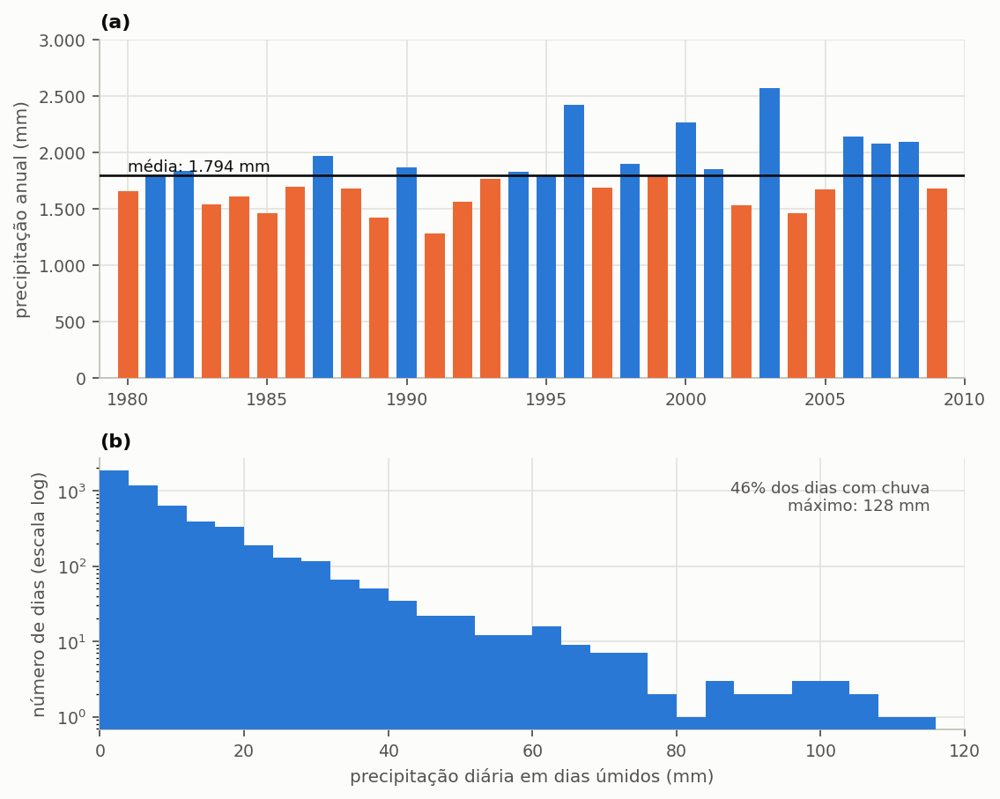
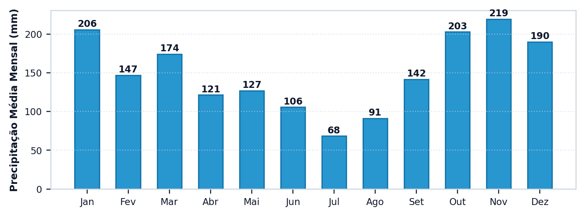

# O projeto e a chuva

> Ao terminar esta seção você terá um projeto criado, uma série de precipitação
> carregada e a captação definida. E saberá por que cada um desses três números
> importa mais do que parece.

As dez seções deste capítulo constroem **um projeto só**, do começo ao fim. A cada seção o estudo ganha uma camada, e o resultado muda. Guarde o arquivo: ele é o
mesmo até a seção {{n:13}}.

## O projeto

Uma residência unifamiliar em Florianópolis. Quatro moradores, cobertura de
150 m² em telha cerâmica, cisterna enterrada no quintal. É o caso mais comum do
Brasil, e o mais estudado.

A escolha de Florianópolis não é sentimental. A série de precipitação disponível é
longa; a estrutura tarifária da CASAN, a concessionária de água e esgoto de Santa
Catarina, é pública e auditável; e o regime de chuva local é bem distribuído ao longo do
ano, o que — como a seção {{n:7}} demonstrará — altera profundamente a escolha do
volume.

> **Na International Edition (INT).** O tutorial usa dados brasileiros porque é o caso contra o qual
> os resultados do programa foram conferidos. Na International Edition, você pode segui-lo
> com a série de Florianópolis que acompanha o programa e digitar a tarifa da seção
> {{n:10}}; os resultados hidráulicos são os mesmos nas duas edições.

---

## A série de precipitação

Abra a etapa **1. Projeto e Chuva**. Há dois caminhos para a chuva.

**Arquivo próprio.** Um CSV com uma leitura diária por linha, em milímetros, em
coluna única. É o caminho de quem tem dados de uma estação específica, do INMET ou
da Agência Nacional de Águas; fora do Brasil, do serviço meteorológico nacional.

**Base nacional (Edição Brasil).** 652 cidades brasileiras, 19 modelos climáticos do CMIP6 e dois
cenários de emissão, com a simulação histórica de cada modelo. É o caminho de quem estuda outras cidades ou cenários futuros, e a seção {{n:15}} mostra como usá-la.

Para o nosso projeto, use a série de Florianópolis que acompanha o programa e recorte
os **30 primeiros anos**.

<!-- inclui: _tabelas/cap04_serie.md -->

Três números dessa tabela decidem o projeto, e vale olhar para eles antes de
qualquer simulação.

**1.795 mm por ano** é muita chuva. Florianópolis está entre as capitais mais
chuvosas do país, e isso significa que o fator limitante do sistema não será a
oferta de água, e sim a demanda e o tamanho do reservatório.

**Chove em 46% dos dias.** Chuva frequente e bem distribuída favorece
reservatórios pequenos: a cisterna se enche muitas vezes ao ano em vez de precisar
atravessar uma estiagem longa. Compare com Brasília, na seção {{n:14}}, onde a chuva se concentra de outubro a abril e o mesmo reservatório rende pouco mais da metade.

**Sete por cento dos dias têm chuva, mas abaixo de 2 mm.** Esses dias serão
descartados por inteiro, e o item sobre o descarte de primeiras águas, adiante, explica por quê.

> **Quantos anos de série usar.** Trinta é confortável. Abaixo de dez, o resultado
> começa a depender do trecho escolhido; abaixo de cinco, o viés do reservatório
> vazio no início da simulação passa a pesar de forma sensível. A seção {{n:33}} trata
> este engano em detalhe.

---

Vale a pena olhar uma série inteira antes de usá-la. Trinta anos de Florianópolis
não são trinta anos parecidos: o ano mais seco fica quase um terço abaixo do mais
chuvoso, e é essa variação entre anos que uma média anual apaga. A distribuição diária
diz o resto da história — a maior parte dos dias não tem chuva alguma, e o volume anual é entregue por um número pequeno de dias intensos ({{fig:fig15_serie}}).

*Figura 99 — Série de precipitação de Florianópolis usada em todo o tutorial: (a) precipitação total de cada ano, com a média dos trinta anos em linha contínua e os anos acima da média em azul e abaixo dela em laranja; (b) distribuição de frequência da precipitação diária nos dias úmidos, em escala logarítmica, que mostra como poucos dias respondem pelos maiores volumes.*

---

## A área de captação

O projeto do tutorial adota 150 m² de área de captação, e este é o primeiro campo em que
se erra com frequência.

A área de captação é a **projeção horizontal** da cobertura, e não a área inclinada do
telhado. Um telhado com 30% de inclinação sobre uma planta de 150 m² tem cerca de 157 m²
de superfície de telha, e ainda assim capta os mesmos 150 m² de chuva: a precipitação cai
na vertical, e o que ela encontra é a sombra da cobertura projetada no chão. A definição
é a do item 3.6 da ABNT NBR 15527:2019: área de captação é a «área projetada na
horizontal da superfície impermeável da cobertura onde a água é captada», e é essa a
área `A` da equação de disponibilidade do item 4.1.6.

> **Área de captação não é área de contribuição.** A ABNT NBR 10844:1989 usa outra
> área, com outro fim. Para dimensionar calhas e condutores pela vazão de pico, o item
> 5.2.1 manda somar à projeção os incrementos da inclinação da cobertura, `(a + h/2)·b`
> na Figura 2, e as paredes que interceptam chuva inclinada pelo vento. Essa área serve à
> vazão de projeto de uma chuva de cinco minutos (item 5.3.1), e superestima o volume
> que a cobertura capta ao longo do ano. No Triton, informe a projeção horizontal; a
> área de contribuição fica para o projeto das calhas, que o programa não faz.

> **Atenção.** Usar a área inclinada superestima a captação na razão
> `1/cos(inclinação)`. Num telhado de 30% dá 4,4% a mais de água que não existe. Em
> telhados de maior caimento o erro cresce depressa.

---

Carregada a série, o programa já mostra o regime que ela descreve. Vale conferir esse desenho antes de seguir: uma série trocada de cidade, ou com unidade errada, costuma aparecer no ciclo sazonal da {{fig:fig55_programa_sazonal}} antes de aparecer em qualquer resultado.

*Figura 99 — O ciclo sazonal médio da série, calculado e desenhado pelo programa assim que a precipitação é carregada. Em Florianópolis, julho recebe cerca de um terço do que recebe novembro, e é essa diferença que o reservatório tem de atravessar. Figura gerada pelo próprio programa.*

---
## O coeficiente de escoamento

O tutorial digita 0,85 no campo do coeficiente. O programa, por sua vez, abre com a telha
cerâmica selecionada e aplica 0,75, o valor que a lista de materiais atribui a ela, que é
também o valor que ele assume quando nenhum material é informado. ==Atenção ao reproduzir
o tutorial: para chegar aos números deste manual, escolha «Outro / Personalizado» e digite
0,85.==

A origem do 0,85 merece precisão, porque ele é citado com frequência como coeficiente de
escoamento e não é. A ABNT NBR 15527:2019, no item 4.1.6, escreve o volume disponível como
produto de quatro termos — precipitação, área, coeficiente de escoamento superficial C e
eficiência do sistema de captação η — e recomenda 0,85 **para η**, na falta de dados do
fabricante. Esse η já leva em conta o dispositivo de descarte de sólidos e o desvio do
escoamento inicial. O Triton tem um campo só para a fração da chuva que chega à cisterna e
modela o descarte à parte, em milímetros. Digitar ali o η da norma e aplicar também o
descarte de 2 mm conta a perda do escoamento inicial duas vezes, de modo que o tutorial é
conservador. Num estudo, declare o valor adotado no campo, a sua origem e o descarte, e não
atribua à norma um coeficiente de escoamento que ela não fixa.

> **Na International Edition (INT).** A EN 16941-1:2024 escreve o rendimento como o produto de
> um coeficiente de rendimento da superfície `e`, dado por tipo de cobertura na sua
> Tabela 2, e de uma eficiência do filtro `η`, 0,9 por padrão, sem lâmina de descarte. O
> Triton mantém a sua própria lista de coeficientes e o descarte inicial nas duas
> edições; para se aproximar da norma europeia, digite `e × η` como valor personalizado e
> zere a lâmina de descarte. O documento `docs/normas_nbr_x_en16941.md` do repositório
> lista as diferenças.

O coeficiente de escoamento superficial representa a fração da chuva incidente que
efetivamente chega à cisterna, e a diferença até a unidade corresponde ao que se perde no
caminho. As perdas têm quatro origens: a absorção pelo material da cobertura, a
evaporação sobre a superfície aquecida, o respingo para fora da calha e o molhamento inicial da telha a cada novo evento de chuva. A {{fig:fig35_escoamento}} traz o coeficiente que o programa atribui a cada material de cobertura.

*Figura 99 — O coeficiente de escoamento que o programa atribui a cada material da cobertura, com os valores do estudo de materiais publicado na revista MIX Sustentável (2020). A linha tracejada marca 0,85, o fator de captação da ABNT NBR 15527 adotado no tutorial. O telhado verde é o único que se afasta do grupo, porque retém parte da chuva no substrato.*

O programa aceita qualquer valor entre zero e um, e recusa valores fora desse intervalo
nomeando o campo — um coeficiente maior que a unidade significaria que a cobertura entrega
mais água do que a chuva lhe traz. A etapa **11. Documentação** traz a mesma tabela, com a
fonte dos valores. Para uma cobertura mista, o coeficiente a digitar é a média dos
coeficientes de cada material ponderada pelas respectivas áreas.

---

## O descarte de primeiras águas

O tutorial descarta 2,0 mm em todo evento de chuva.

A primeira água que lava a cobertura carrega poeira, folhas, fezes de aves e tudo o mais
que tenha se depositado desde a chuva anterior. Descartá-la, em vez de conduzi-la à
cisterna, é a medida de qualidade mais barata e mais eficaz de que um sistema pluvial
dispõe, e por isso é praticamente universal em projetos bem conduzidos. A ABNT NBR 15527
recomenda o descarte de 2 mm quando não houver dado local que justifique outro valor, e é
esse o valor adotado aqui.

O programa oferece três modos de aplicação do descarte, que correspondem a três tipos de
dispositivo de autolimpeza.

<!-- tabela: Os três modos de aplicação do descarte de primeiras águas -->
| Modo | Quando descarta | Quando usar |
| :--- | :--- | :--- |
| 1 | em todo evento de chuva | o padrão, e o mais conservador |
| 2 | só no primeiro evento após estiagem | dispositivo que não se esvazia sozinho entre chuvas próximas |
| 3 | a cada X dias | dispositivo com esvaziamento programado |

> **Atenção, e este é o ponto que mais surpreende.** Quando o descarte se aplica e a
> chuva do dia **não supera** a lâmina, perde-se o dia **inteiro**, e não a
> diferença. Um dia de 1,6 mm com descarte de 2,0 mm capta **zero**.
>
> Na série de Florianópolis, isso atinge 7% dos dias. Em climas de garoa frequente,
> como o litoral sul no inverno, pode passar de 20%.

A razão desse comportamento é física, e não convencional: o dispositivo de autolimpeza
precisa encher-se por completo antes que qualquer água siga para a cisterna. Quando a
chuva do dia não basta para enchê-lo, nada passa adiante, e o volume retido é perdido
para a drenagem junto com a sujeira que ele lavou.

> **A lâmina não é o dispositivo.** `d_f` é uma lâmina em milímetros. O volume
> hidráulico do reservatório de autolimpeza é `A × d_f`, que no nosso projeto dá
> 150 × 2 = **300 litros**. A etapa **3. Qualidade & ETAP** dimensiona e orça esse
> reservatório (seção {{n:27}}), e a seção {{n:10}} mostra o seu custo no investimento.

---

## O que temos até aqui

<!-- tabela: Estado do projeto do tutorial ao fim da definição da chuva e da captação -->
| Dado | Valor |
| :--- | ---: |
| série | Florianópolis, 30 anos |
| área de captação | 150 m² |
| coeficiente de escoamento | 0,85 |
| lâmina de descarte | 2,0 mm, todo evento |

Com isso o programa já sabe **quanta água entra**. Falta dizer quanta sai, que é a seção {{n:5}}.

Um cálculo de guardanapo, para calibrar a expectativa: 1.795 mm por ano sobre 150 m²
a 0,85 de coeficiente dão cerca de 229 m³ por ano de água bruta, antes do descarte.
A seção {{n:6}} mostra quanto desse volume se converte em economia efetiva — e a diferença entre os
dois números é a lição mais importante do tutorial.
