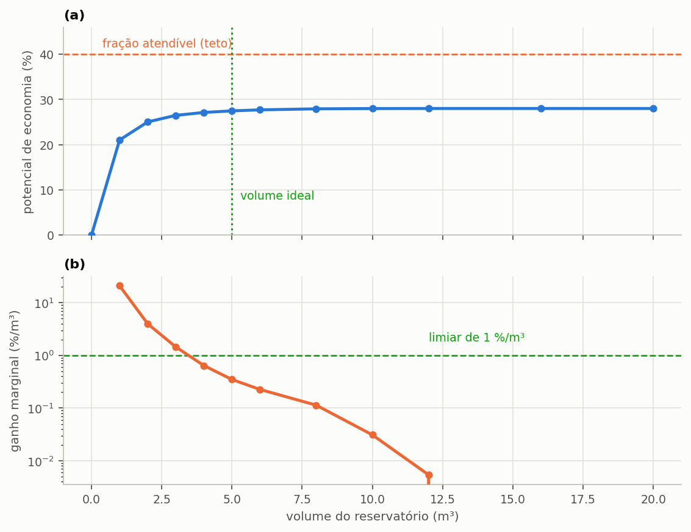
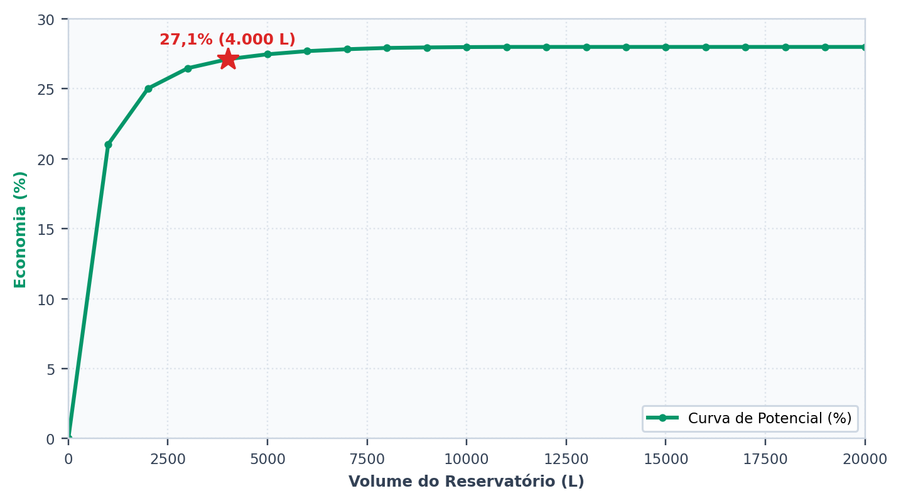
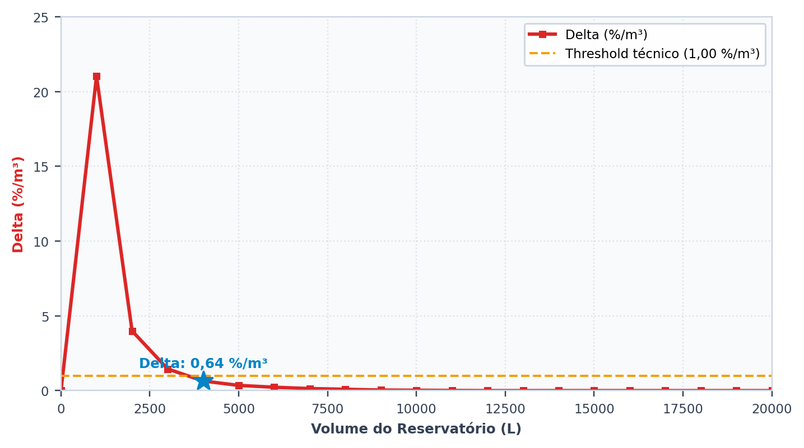
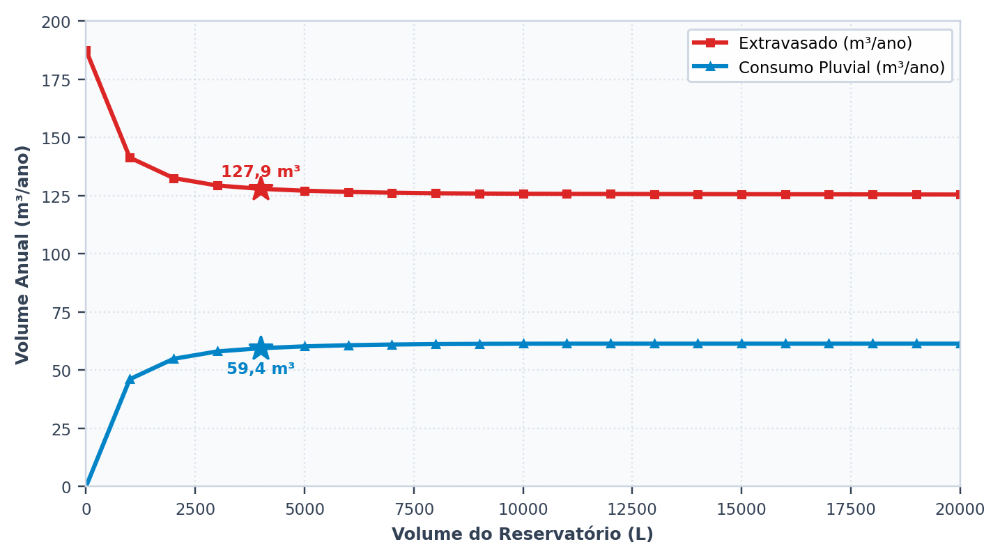
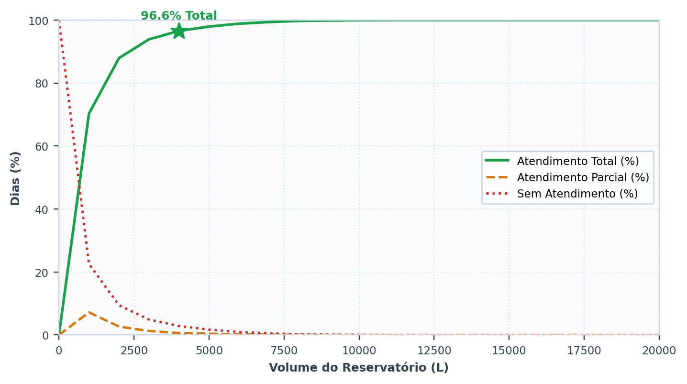
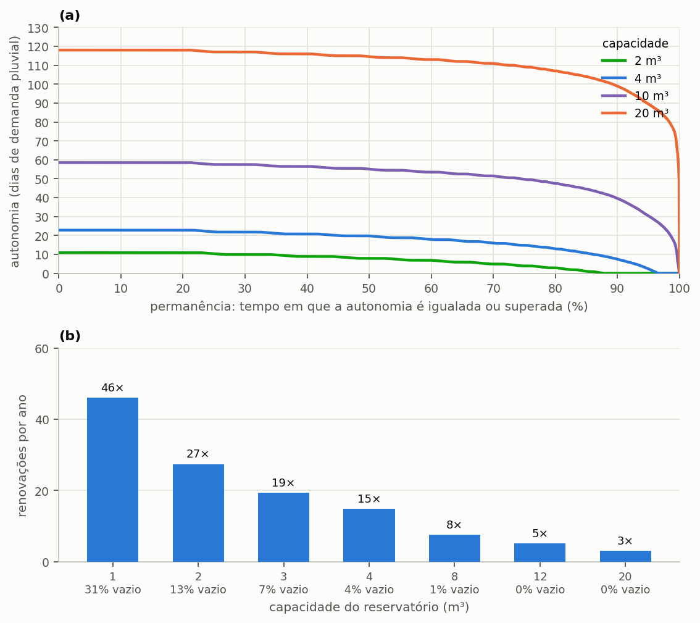

# Escolher o volume

> Ao terminar esta seção você terá a curva de retorno do reservatório, saberá
> onde ela deixa de compensar, e entenderá por que **não existe** um volume ótimo
> absoluto — existe um volume ótimo para um critério declarado.

A seção {{n:6}} adotou 3.000 L como primeiro palpite e encontrou 354 L/dia
extravasando, mais de dois terços de tudo o que a cobertura capta, e um atendimento já
perto do teto. As duas leituras puxam em sentidos opostos, e a pergunta que se impõe é
quanto reservatório vale a pena ter, e ela não se responde por tentativa isolada: responde-se simulando o mesmo
projeto para muitos volumes e observando como o resultado evolui. É o que o programa
chama de **varredura**.

---

## Rodar a varredura

Na etapa **4. Reservatório & Custos**, escolha o modo varredura e informe o
volume máximo e o passo. Para o nosso projeto:
máximo de 20.000 L, passo de 1.000 L.

Duas particularidades da montagem da grade convêm ser conhecidas antes de interpretar o
resultado. A primeira é que o passo informado é arredondado para cima até o múltiplo de
250 L, valor que corresponde ao quantum comercial de reservatórios — não se compra
cisterna de 1.300 L, e um ótimo apontado nesse volume seria inexequível. Quando o passo
pedido não é múltiplo de 250, o programa o ajusta e registra o ajuste, de modo que o
relatório possa declarar o passo efetivamente utilizado.

A segunda é que a grade se limita a quarenta volumes positivos. Uma varredura de 0 a
50.000 L com passo de 100 L exigiria quinhentas simulações de trinta anos cada, e o ganho
de informação não compensa o tempo de máquina, porque a curva é suave e quarenta pontos
já a descrevem com folga. O volume máximo informado é sempre preservado como último
ponto da grade, de modo que apenas o último intervalo pode ser menor que o passo efetivo.

O volume zero integra a grade como alternativa de referência: ele representa o cenário
sem sistema, contra o qual todos os demais se comparam.

---

## A curva

<!-- inclui: _tabelas/cap07_varredura.md -->

A {{fig:fig02_curva_de_retorno}} traça os resultados da tabela: o potencial de economia converge para a fração atendível, e o ganho marginal decresce em três ordens de grandeza ao longo da varredura.

*Figura 99 — (a) Potencial de economia em função do volume do reservatório, que se aproxima do teto de 28% sem cruzá-lo, com o volume ideal marcado; (b) ganho marginal, em escala logarítmica, com o limiar de 1 %/m³ adotado no tutorial.*

A coluna decisiva da tabela é a de **ganho por metro cúbico acrescentado**, que é a
derivada discreta da curva de potencial e expressa quanto cada metro cúbico adicional de
reservatório acrescenta de economia. A tabela abaixo destaca alguns intervalos, e o
padrão que ela revela é o argumento central desta seção.

<!-- tabela: Ganho marginal de economia a cada metro cúbico acrescentado ao reservatório -->
| De → para | Ganho por m³ |
| :--- | ---: |
| 0 → 1.000 L | 21,03 %/m³ |
| 1.000 → 2.000 L | 3,99 %/m³ |
| 2.000 → 3.000 L | 1,45 %/m³ |
| 3.000 → 4.000 L | 0,64 %/m³ |
| 4.000 → 5.000 L | 0,35 %/m³ |
| 10.000 → 12.000 L | 0,005 %/m³ |
| 16.000 → 20.000 L | 0 |

==O primeiro metro cúbico de reservatório entrega 21 pontos percentuais de economia; os
de 10 para 12 m³ entregam cinco milésimos de ponto cada um, e os de 12 para 20 m³, nada.==
A diferença é de quatro ordens de grandeza, e os metros cúbicos custam o mesmo concreto, a
mesma escavação e a mesma mão de obra. A partir de 12 m³ o sistema atende a todos os dias
da série, e nenhum volume a mais tem o que acrescentar.

Esse comportamento não é peculiaridade do regime de chuva de Florianópolis. É a forma
característica de toda curva de aproveitamento pluvial, e decorre de dois fatos que
atuam em conjunto. Os primeiros litros de armazenamento capturam os eventos pequenos e
frequentes, que constituem a maioria das chuvas em qualquer regime; e o teto imposto pela
fração atendível, de 28% neste projeto, puxa a curva para a horizontal à medida que o
sistema dele se aproxima, de modo que o espaço restante para ganho vai se esgotando.

---

### Os quatro gráficos que a tela mostra

A varredura não devolve apenas a curva de potencial. A aba de resultados traz quatro
gráficos que respondem a perguntas diferentes sobre o mesmo conjunto de simulações, reproduzidos a seguir com os dados deste tutorial: o potencial de economia ({{fig:fig10_programa_potencial}}), o ganho marginal ({{fig:fig11_programa_delta}}), os volumes extravasado e consumido ({{fig:fig12_programa_extravasamento}}) e a classificação dos dias ({{fig:fig13_programa_dias}}).

*Figura 28 — O primeiro gráfico da aba de resultados: o potencial de economia de água potável em função do volume do reservatório inferior. A estrela marca o volume selecionado. Figura gerada pelo próprio programa, com os dados do tutorial.*

*Figura 29 — O segundo gráfico: o ganho marginal, em pontos percentuais por metro cúbico acrescentado. É a derivada da curva anterior, e é sobre ela que o critério de volume ideal opera. Figura gerada pelo próprio programa.*

*Figura 30 — O terceiro gráfico: o volume extravasado e o volume pluvial consumido, ambos anuais, na mesma escala. As duas curvas explicam uma à outra, porque toda água que deixa de extravasar passa a ser consumida. Figura gerada pelo próprio programa.*

*Figura 31 — O quarto gráfico: a repartição dos dias do período em atendidos por inteiro, atendidos em parte e não atendidos. É a leitura temporal da mesma varredura, e a única que responde com que frequência se pode contar com o sistema. Figura gerada pelo próprio programa.*

---

## O volume ideal

Diante de uma curva cujo rendimento decai dessa forma, a pergunta «qual o volume ideal?»
só admite resposta depois que se estabeleça o que significa deixar de compensar. O
Triton adota para isso o critério do ganho marginal: o volume ideal é o menor volume cujo
ganho por metro cúbico acrescentado já tenha caído abaixo de um limiar declarado pelo
usuário, conforme a formulação da seção {{n:24}}.

O programa abre com limiar de 5 %/m³, e o tutorial adota um mais exigente, de 1 %/m³.
A diferença não é detalhe: com o padrão, o volume ideal deste projeto seria de 2.000 L;
com o limiar do tutorial, o primeiro volume a cair abaixo dele é o de 4.000 L, com
ganho marginal de 0,64 %/m³. Quem refizer o tutorial precisa, portanto, alterar o limiar
no programa antes de rodar a varredura.

<!-- tabela: Indicadores do volume ideal obtido com o limiar de 1 %/m³ adotado no tutorial -->
| Indicador | Valor |
| :--- | ---: |
| volume ideal, limiar de 1 %/m³ | 4.000 L |
| potencial nesse volume | 27,12% |
| de um teto de | 28% |
| dias de atendimento pleno | 96,6% |

O limiar, contudo, é uma escolha do analista, e ela decide o resultado tanto quanto os
dados de entrada. A tabela abaixo mostra o volume ideal que cada limiar plausível
produziria para este mesmo projeto.

<!-- inclui: _tabelas/cap07_limiar_e_custo.md -->

O programa não emite opinião sobre qual limiar seria o correto, e não poderia fazê-lo:
a escolha depende do custo do reservatório, do valor da água no município e da
disponibilidade de espaço no terreno, nenhum dos quais é dado hidrológico. O que o
programa faz é aplicar fielmente o limiar declarado e registrá-lo no relatório.

> **Num estudo publicado, declare o limiar.** Dois artigos com «volume ideal» de
> limiares diferentes não são comparáveis. Entre os limiares da tabela, a diferença
> é de 2.000 L, e o volume de 5.000 L custa um terço a mais que o de 3.000 L para
> entregar um ponto percentual.

---

## Por que o critério do ganho marginal não basta

O critério do ganho marginal é puramente hidráulico: ele observa a curva de
aproveitamento e nada mais. Desconhece quanto custa o reservatório, quanto vale o metro
cúbico de água no município em questão e quanto carbono o material escolhido carrega
consigo. Três consequências decorrem dessa cegueira, e cada uma delas pode deslocar a
recomendação em sentido diferente.

- Se a água for muito cara, o ganho de 0,35 %/m³ do quinto metro cúbico pode se pagar
  bem, e o volume econômico será **maior** que o hidráulico.
- Se a cisterna for cara ou o espaço for escasso, o inverso.
- Uma cisterna de concreto de 20 m³ pesa vinte e quatro toneladas e carrega, com o
  resto do sistema, cerca de **3,5 toneladas de CO₂e** incorporado, contra menos de
  uma tonelada na de 4 m³. O último metro cúbico não acrescenta economia alguma, e não
  tem como compensar a diferença.

São três critérios e três respostas distintas para a mesma pergunta, e nenhuma delas é
mais legítima que as outras em abstrato. É por essa razão que o tutorial não se encerra
aqui: as seções {{n:10}} e {{n:11}} acrescentam respectivamente o dinheiro e o carbono à
análise, e a seção {{n:12}} põe as três dimensões na mesma mesa, com pesos declarados,
para chegar a um volume de compromisso que se possa defender.

> **O engano mais comum, e está na seção {{n:33}}.** Publicar o volume de maior economia
> de água como se fosse o volume recomendado. Pela tabela, 20.000 L dão o maior
> potencial, 28,00%, o mesmo que 12.000 L já davam. Também custam **3,9 vezes mais**
> que os 4.000 L, e carregam **4,1 vezes mais carbono incorporado**, para entregar
> 0,88 ponto percentual a mais.

---

A varredura traz ainda uma leitura que a tabela não mostra: quanto da capacidade o consumo de fato utiliza. Medir o reservatório pelo nível engana, porque a cisterna grande parece sempre cheia justamente por guardar água que a demanda não chega a retirar. A {{fig:fig47_permanencia}} mede a capacidade pelo consumo, de duas maneiras. A primeira é a **autonomia armazenada**, o volume ao fim de cada dia dividido pela demanda pluvial diária de 168 L, apresentada como curva de permanência. A segunda é o número de **renovações por ano**, a razão entre o consumo pluvial anual e a capacidade, que diz quantas vezes o volume da cisterna é efetivamente consumido e reposto.

A cisterna de 2 m³ renova o seu volume 27 vezes por ano e termina o dia vazia em 13% dos dias: a capacidade é inteiramente utilizada, e falta água. A de 4 m³ renova 15 vezes e esvazia em 4% dos dias. A de 20 m³ renova apenas 3 vezes por ano e nunca esvazia, mas guarda em metade dos dias mais de 110 dias de demanda, muito além da estiagem que a série registra. Essa reserva que o consumo não chega a mobilizar é o que o investimento adicional compra, e é a leitura física do retorno decrescente da curva de potencial.

*Figura 99 — Uso da capacidade do reservatório inferior no projeto do tutorial, com demanda pluvial de 168 L/dia: (a) curvas de permanência da autonomia armazenada ao fim de cada dia, em dias de demanda pluvial, para 2, 4, 10 e 20 m³; (b) renovações anuais do volume, dadas pela razão entre o consumo pluvial anual e a capacidade, com a fração de dias em que o reservatório termina vazio (até 5% da capacidade) indicada sob cada volume.*

---
## Duas leituras a mais da tabela

**O extravasamento nunca chega a zero.** Ele parte de 513 L/dia na ausência de
reservatório, cai para 343 L/dia com vinte metros cúbicos e estaciona nesse patamar. Dois
terços da água que a cobertura capta continuarão indo para a drenagem, por uma
razão que nenhum aumento de reservatório resolve: a demanda simplesmente não a consome.
Sistemas de aproveitamento pluvial não retêm água por retê-la, e quem busca amortecimento
de cheia precisa de reservatório de detenção, que é outro projeto, com outro critério de
dimensionamento.

**A confiabilidade cresce mais depressa que o potencial.** Ao passar de 3.000 para
4.000 L, o potencial de economia ganha 0,64 ponto percentual, ao passo que os dias de
atendimento pleno sobem de 93,9% para 96,6%, e os dias de falta caem quase pela metade. Quando o critério de projeto é o conforto
de uso — não faltar água pluvial nos pontos que a utilizam — e não a economia na fatura,
a leitura da mesma tabela conduz a outra escolha.

---

## O que temos até aqui

O tutorial adota 4.000 L e segue. Trata-se do volume ideal pelo critério hidráulico com
o limiar de 1 %/m³, e é o valor que o projeto carrega até a seção {{n:12}}, onde será
questionado outra vez, então com o dinheiro e o carbono incorporados à análise.

<!-- tabela: Estado do projeto do tutorial após a escolha do volume -->
| Projeto até aqui | |
| :--- | ---: |
| série | Florianópolis, 30 anos |
| área de captação | 150 m² |
| demanda total | 600 L/dia |
| fração atendível | 28% |
| **volume do reservatório** | **4.000 L** |
| potencial de economia | 27,12% |
| dias de atendimento pleno | 96,6% |

Resta uma decisão hidráulica antes que se possa falar de dinheiro: essa água precisa
subir para uma caixa elevada, ou pode ser pressurizada diretamente da cisterna? É o
assunto da seção {{n:8}}.
