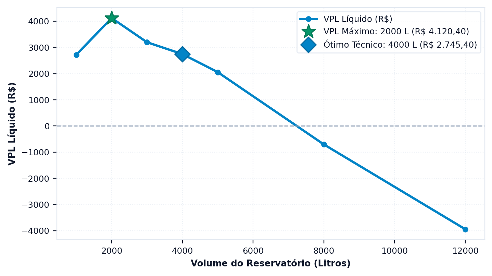

# Quanto custa e em quanto se paga

> Ao terminar esta seção você terá o fluxo de caixa de vinte anos, e saberá por
> que o **regime tarifário do seu município** decide a viabilidade mais do que
> qualquer parâmetro do projeto.

> **Na International Edition (INT).** O tutorial é orçado em reais, com a tarifa da CASAN de
> Florianópolis. Na International Edition, os custos começam em zero e a tarifa é
> digitada, na moeda do projeto; o cálculo que se segue é o mesmo, e também a lição sobre
> estruturas tarifárias.

---

## A economia é a diferença entre duas faturas

O erro mais comum na análise econômica de sistemas pluviais consiste em multiplicar o
volume poupado por uma tarifa média. O resultado quase nunca é correto, e a razão está na
estrutura das tarifas brasileiras, que são progressivas por faixa de consumo, conforme a
seção {{n:16}} detalha: ==o metro cúbico que se deixa de consumir é o último da fatura,
que é o mais caro, e não o médio.==

O Triton evita o problema calculando duas faturas completas — a que a edificação pagaria
sem o sistema e a que ela paga com ele — e tomando a diferença entre as duas.

<!-- inclui: _tabelas/cap10_economico.md -->

O resultado merece atenção. O sistema poupa 4,99 m³ por mês e a fatura cai R$ 142,69, o
que equivale a R$ 28,60 por metro cúbico economizado — valor bem acima dos R$ 14,31 da
faixa em que o consumo se situava. A diferença tem duas origens que atuam juntas: a
progressividade, que faz o metro cúbico economizado valer o preço da faixa mais alta, e o
esgoto, que em Florianópolis é cobrado a 100% do valor da água e portanto dobra o valor
de cada metro cúbico poupado.

> **O esgoto é percentual da parcela de água, não da fatura total.** Cem por cento da água
> significa que a parcela de esgoto iguala a de água, e portanto o esgoto é metade
> da fatura. Economizar água economiza as duas parcelas, e é por isso que o valor
> efetivo do metro cúbico poupado quase dobra.

---

## O regime tarifário da CASAN

Florianópolis pratica o regime de disponibilidade, no qual a concessionária cobra uma
taxa fixa mensal de R$ 46,34 que se soma ao consumo medido, e tarifa as faixas
progressivas a partir do primeiro metro cúbico consumido.

Para um projeto de aproveitamento pluvial, essa é a configuração mais favorável que
existe: cada metro cúbico economizado gera desconto desde o primeiro, porque a taxa fixa
é cobrada por disponibilizar a rede, e não por um volume incluído. Ela continua sendo
paga, e não impede a economia sobre o consumo.

Nem todo município adota esse regime, e a diferença entre eles decide a viabilidade de
projetos inteiros. O programa distingue seis.

<!-- tabela: Os seis regimes tarifários e o efeito de cada um sobre a economia -->
| Regime | O que acontece ao economizar | Municípios na base |
| :--- | :--- | ---: |
| disponibilidade | cada m³ economizado desconta | 122 |
| fórmula exponencial | cada m³ economizado desconta, pelo preço-base elevado ao expoente | 36 |
| sem mínimo | idem | 100 |
| franquia no mínimo | economizar abaixo da franquia **não desconta nada** | 371 |
| franquia retroativa | passando da franquia, tarifa-se tudo desde zero | 23 |
| piso de pagamento | a fatura não fica abaixo do piso | 0 |

> **Atenção, e é o ponto que mais derruba estudo.** Em município com **franquia no
> mínimo** — a maioria da base, 371 dos 652 — a concessionária cobra um valor fixo
> que já inclui, digamos, 10 m³. Uma residência que consome 12 m³ e economiza 3
> desce para 9, entra na franquia, e **a fatura para de cair**. O sistema economiza
> água e não economiza dinheiro.
>
> Rodar esse caso com a tarifa de Florianópolis produziria um payback que não existe.
> A seção {{n:16}} ensina a montar a estrutura do seu município corretamente.

---

## O investimento

R$ 14.061,19, assim distribuídos:

<!-- tabela: Composição do investimento inicial do projeto do tutorial -->
| Rubrica | Valor |
| :--- | ---: |
| cisterna de concreto de 4.000 L | R$ 5.304 |
| caixa superior de 1.000 L em polietileno | R$ 460 |
| duas motobombas de meio CV, principal e reserva | R$ 600 |
| mão de obra e escavação | R$ 3.500 |
| tubulação | R$ 1.200 |
| acessórios | R$ 1.800 |
| linha de tratamento, incremento | R$ 580 |
| descarte inicial: reservatório de 300 L e separador de folhas | R$ 617 |

Os preços de reservatório vêm da base do programa, que traz valores por volume e por
material, com procedência declarada. Para volumes fora da tabela, o programa
interpola; para extrapolar além dela, só o faz se a regressão tiver R² acima de
0,90, e avisa quando não tem.

**O reservatório de descarte inicial.** O descarte de primeiras águas não é só a lâmina subtraída da chuva: é um componente físico, com custo. A etapa **3. Qualidade & ETAP** o dimensiona por padrão, e no tutorial a lâmina de 2 mm sobre 150 m² exige reservatório de 300 L, que com o separador de folhas custa R$ 616,90 de investimento e R$ 40 por ano de custeio. Sem ele, o investimento seria de R$ 13.444,29, o valor presente líquido de R$ 4.032 e o payback descontado de 14,8 anos: omitir o descarte adianta o retorno em um ano e meio, e é por isso que um estudo que o omite parece mais viável do que o sistema que se constrói. A seção {{n:27}} detalha o dimensionamento.

---

## Como o CAPEX é calculado automaticamente

Num projeto novo da Edição Brasil, o investimento não começa em branco. O programa o preenche com três fontes: a base de custos `triton/data/costs_database.json`, as peças do arranjo 3D e a linha de tratamento que a etapa **3. Qualidade & ETAP** dimensiona. Os valores do tutorial, digitados na etapa econômica, são uma escolha didática. Esta seção diz o que o programa colocaria sozinho, de onde vem cada número e o que você deve conferir antes de confiar nele.

### A cadeia de cálculo

<!-- inclui: _tabelas/cap10_capex_cadeia.md -->

Lê-se a tabela de cima para baixo, e a soma das rubricas é o investimento da seção {{n:29}}. Um valor digitado na etapa **4. Reservatório & Custos**, botão *1. Investimento Inicial (CAPEX)*, prevalece sobre o automático: ao confirmar, o programa deixa de refazer a tubulação e os acessórios a cada cálculo, e o mesmo vale para a mão de obra. O preço da cisterna é a exceção: o diálogo não tem campo para digitá-lo, e o programa o recalcula da tabela de preços ao confirmar. Para usar a sua cotação, edite a tabela `lower_tank_pead_prices` pelo botão *Base de Custos (JSON)*, salve o arquivo e reabra o diálogo.

**Cisterna e caixa superior.** O preço sai de uma tabela de polietileno por volume. Entre dois volumes tabelados o programa interpola linearmente; acima do maior, extrapola pela reta ajustada à tabela inteira quando o R² passa de 0,90, e nunca devolve menos que o maior preço tabelado. Fibra, concreto e aço não têm tabela própria: são o preço do polietileno vezes um fator único, uma premissa do programa e não uma cotação.

<!-- inclui: _tabelas/cap10_capex_reservatorios.md -->

**Motobombas.** O projeto novo parte de duas unidades, principal e reserva, ao preço do campo *Custo Unitário da Motobomba*. Há duas outras fontes de preço, que divergem. O assistente de dimensionamento grava o preço do modelo que você escolhe; a fórmula do estimador, usada quando o campo está zerado, dá valores bem menores acima de meio cavalo. Vale o último que entrou no campo.

<!-- inclui: _tabelas/cap10_capex_bombas.md -->

**Tubulação e acessórios.** Com o orçamento do arranjo ligado, que é o padrão do projeto novo, o programa lê o arranjo da Planta 3D. Se você não organizou nenhum, monta o arranjo usual a partir do estudo: volume da cisterna e da caixa, área do telhado, número de motobombas e tipo de abastecimento. Converte o arranjo em quantitativo, com os metros de tubo por diâmetro, as curvas, as conexões, os tês, as peças e os cabos de comando, e orça cada linha. Na varredura de volumes, cada volume tem a sua cisterna e o seu arranjo; um arranjo organizado à mão vale para todos.

<!-- inclui: _tabelas/cap10_capex_tubos.md -->

<!-- inclui: _tabelas/cap10_capex_pecas.md -->

Os preços das peças são, nas palavras do próprio código, um cenário de referência interno de varejo de 2026: servem para que nada fique de fora e para que a ordem de grandeza esteja certa, e devem ser trocados pelo orçamento da obra. Se você digita outro valor ou altera os comprimentos de tubo no diálogo, o orçamento do arranjo se desliga para essas rubricas e o valor digitado passa a ser o do projeto.

**Mão de obra.** É a fração indicada na tabela da soma de cisterna, caixa, motobombas, tubulação e acessórios, com um piso. Por depender dos materiais, cresce com o volume do reservatório, e a varredura a refaz a cada volume.

**Linha de tratamento e descarte.** O programa dimensiona o filtro de entrada pela área do telhado, o dosador de cloração e, se você os escolhe, o reator ultravioleta, o ozonizador e o filtro de polimento. O reservatório de descarte e o separador de folhas entram quando o descarte físico está habilitado. Com os acessórios digitados, a linha substitui a verba genérica de filtragem que eles já trazem, e só a diferença é investimento novo; com os acessórios do arranjo, o filtro e o descarte já estão fora deles, e a linha entra inteira.

<!-- inclui: _tabelas/cap10_capex_etap.md -->

O descarte de 100 m² custa mais que o de 150 m², e a razão é a regra de dimensionamento, não um erro de arredondamento: até 250 L o reservatório é uma coluna de PVC orçada por litro, e acima disso passa a ser um tanque de polietileno da tabela de preços. A descontinuidade é conhecida e está na lista de pendências.

### A calibração em tipologias e o fator regional

A base traz cinco tipologias residenciais, da casa térrea ao bloco de 128 moradores, cada uma com os subsistemas calibrados. Existe uma função que orça uma tipologia inteira, mas **nem a interface nem a linha de comando a chamam**: o projeto novo é orçado pelo arranjo, e da tipologia só a verba de filtragem da casa térrea entra, no desconto da linha de tratamento.

<!-- inclui: _tabelas/cap10_capex_tipologias.md -->

O fator regional segue a mesma sorte. A tabela traz um fator por unidade da federação, e o diálogo do CAPEX mostra o da UF da tarifa, mas ele multiplica apenas o total do estimador preliminar, que nenhuma tela usa. No investimento do projeto ele **não tem efeito**, e um teste confere isso.

<!-- inclui: _tabelas/cap10_capex_regional.md -->

### De onde vêm os números, e de quando

A base registra a origem de uma parte pequena dos seus números.

<!-- inclui: _tabelas/cap10_capex_procedencia.md -->

Só a tabela de preços do polietileno tem procedência completa: fabricante, varejista, data de coleta e critério. O registro tem ainda uma incoerência: a base diz ter sido atualizada em 08/2026, antes da coleta de 09/09/2026 que a alimenta. As demais rubricas têm a origem nos comentários do código (os códigos SINAPI dos tubos, o cenário de referência das peças) e nenhuma data. Parte delas são constantes soltas no código, fora do registro de fontes:

<!-- inclui: _tabelas/cap10_capex_constantes.md -->

Os dois primeiros valores da tabela pertencem ao orçamento calibrado por tipologia, que a interface não usa; o custeio do projeto vem de outro caminho, descrito na próxima seção. Estão aqui porque quem lê o código os encontra, e porque um teste os congela.

### Limites de validade

- **Volume.** A tabela do polietileno cobre de 310 L a 15.000 L; a da caixa, de 310 L a 2.000 L. Fora delas o preço é extrapolado.
- **Material.** O concreto, a fibra e o aço são o polietileno vezes um fator: servem para comparar materiais, não para orçar uma obra.
- **Data.** Os preços são nominais, de setembro de 2026, e o programa não os corrige pela inflação.
- **Obra.** O custo de escavação, de laje e de reaterro de uma cisterna enterrada não é calculado por tipo de solo; está dentro da mão de obra percentual.
- **Uso.** A base é calibrada para residências e blocos residenciais. Para escola, hospital ou indústria, trate o resultado como ordem de grandeza.

### O que você deve conferir

1. O preço da cisterna contra uma cotação do seu fornecedor, pela tabela da base.
2. O arranjo da Planta 3D: o orçamento é do arranjo, e um arranjo que não é o seu dá um orçamento que não é o seu.
3. A mão de obra, que é um percentual e não um orçamento.
4. O preço da motobomba, que depende de quem o gravou por último.
5. Se há linha de tratamento além da cloração, e se o descarte está habilitado.

### O mesmo projeto, digitado e calculado

<!-- inclui: _tabelas/cap10_capex_exemplo.md -->

O programa, sozinho, chega a R$ 16.131,96 para o projeto do tutorial, contra os R$ 14.061,19 da tabela digitada. A cisterna, a caixa e as motobombas coincidem; a diferença vem da tubulação, dos acessórios e do descarte, que o arranjo 3D orça peça a peça e o tutorial tinha como verba. O arranjo é a conta mais completa e a mais cara, e o resultado do projeto muda com ela.

---

## O resultado

<!-- tabela: Indicadores econômicos do projeto do tutorial em vinte anos -->
| Indicador | Valor |
| :--- | ---: |
| valor presente líquido | R$ 2.745 |
| taxa interna de retorno | 7,54% ao ano |
| payback descontado | 16,3 anos |

O projeto se paga, mas por pouco. Rende 7,5% ao ano contra uma taxa mínima de 6,2%, e
devolve o investimento no décimo sétimo ano de vinte. O que o sustenta é a tarifa de
Florianópolis, que é alta, e o esgoto a 100%; o que o aperta é a fração de 28%, que
limita a economia a menos de cinco metros cúbicos por mês, e a cisterna de concreto,
que é a mais cara por litro depois do aço inoxidável. A seção {{n:11}} mostra que a troca
do material muda a conta.

**O custeio é pequeno:** R$ 48,82 por ano, dos quais R$ 3,45 de pastilha de cloro, R$ 40 de manutenção do descarte e R$ 5,36 de energia do recalque, os 7,7 kWh por ano da seção {{n:8}}. A energia vem da mesma função que alimenta a avaliação ambiental, conforme o arranjo declarado na etapa **4. Reservatório & Custos**: recalque, pressurização direta ou gravidade. Esse número não inclui as três rotinas de manutenção de partida, que somam R$ 740,00 por ano e entram no fluxo de caixa à parte; a seção seguinte mostra o peso delas.

---

O resultado de um volume isolado diz pouco sem os vizinhos. A aba econômica repete a conta para todos os volumes da varredura e traça a curva, e é nela que se vê se o ótimo técnico e o ótimo econômico caem no mesmo lugar ({{fig:fig49_programa_vpl}}).

*Figura 99 — O gráfico da aba econômica: o valor presente líquido de cada volume da varredura, com cisterna de concreto, com o máximo econômico e o ótimo técnico marcados. Quando os dois coincidem, o programa os marca com um único símbolo. Figura gerada pelo próprio programa.*

---

## O que entra automaticamente no OPEX

Num projeto novo, o custeio também vem preenchido. O programa soma, mês a mês, a energia da motobomba, a cloração, a linha de tratamento, as rotinas de manutenção e, quando habilitado, o benefício do IPTU Verde. Cada item abaixo tem valor de partida, e todos podem ser alterados ou desligados.

<!-- inclui: _tabelas/cap10_opex_itens.md -->

**As rotinas de manutenção pesam mais que o resto.** São três, com R$ 740,00 por ano no total, cobradas ao fim de cada período de 12 meses e corrigidas pela inflação. O campo de custeio anual que o resumo da análise mostra soma só a energia, o cloro e a linha de tratamento, e por isso os R$ 48,82 do tutorial não incluem as rotinas, que entram no fluxo de caixa à parte. No tutorial elas decidem o resultado:

<!-- inclui: _tabelas/cap10_opex_peso.md -->

**A energia.** A tarifa vem da base de municípios, que traz a tarifa B1 residencial da ANEEL para cada um. Ela **não inclui** ICMS, PIS/Pasep, Cofins, COSIP nem bandeira, e o campo de imposto sobre a conta de energia começa em zero. Quem quer a tarifa que o medidor cobra deve informar o imposto e escolher a bandeira. A energia da motobomba é reajustada pelo reajuste de energia, e não pela inflação.

<!-- inclui: _tabelas/cap10_opex_energia.md -->

**As premissas da projeção.** O projeto novo carrega valores de partida para a taxa mínima de atratividade, a inflação e os reajustes. A etapa 4 oferece perfis de referência, que preenchem os campos sem fixá-los.

<!-- inclui: _tabelas/cap10_opex_premissas.md -->

A taxa mínima de atratividade de partida, de 2% ao mês, é muito maior que a do tutorial e que os perfis de referência. Defina a sua antes de ler o valor presente líquido.

**O que não entra.** O fluxo de caixa não traz reposição de equipamentos ao longo dos 20 anos, valor residual, análises laboratoriais da água nem seguro. Se a bomba ou o filtro serão trocados no período, acrescente a troca como uma rotina em *3. Outros Custos Operacionais*.

**Como desligar ou alterar.** As rotinas se editam, excluem ou acrescentam no botão *3. Outros Custos Operacionais*, que também restaura as três de referência. A dose do cloro e o descarte físico se escolhem na etapa **3. Qualidade & ETAP**; o preço do quilograma de cloro não tem campo na interface e só muda no arquivo do projeto, no bloco `water_quality_and_etap`. A tarifa e os impostos da energia ficam em *2. Motobomba e Custo de Energia*, e a bandeira na etapa econômica.

---
## O que a projeção assume

Vinte anos são muito tempo, e a projeção depende de premissas que convém declarar:

<!-- tabela: Premissas da projeção econômica e o peso de cada uma no resultado -->
| Premissa | Valor adotado | Onde ela pesa |
| :--- | ---: | :--- |
| taxa mínima de atratividade | 0,5% ao mês | desconta o fluxo; quanto maior, pior o VPL |
| inflação dos custos | 0,35% ao mês | incide só sobre o custeio |
| reajuste da tarifa de água | 5% ao ano | incide sobre a economia |
| reajuste da tarifa de esgoto | 5% ao ano | idem, e é indexado à parte |
| intervalo de reajuste | 12 meses | em degraus, não continuamente |
| período de análise | 20 anos | vida útil de projeto mínima do sistema hidrossanitário, Tabela 25 da ABNT NBR 15575-1:2025 |

> **Os reajustes de água e de esgoto são separados**, e não um índice único sobre a
> fatura agregada. As duas parcelas são reajustadas por atos diferentes da
> concessionária, e tratá-las juntas indexa metade da conta pelo índice errado.

O reajuste tarifário é a premissa mais frágil da lista. Cinco por cento ao ano por
vinte anos multiplica a tarifa por 2,65. Se a tarifa real subir mais que isso, o
projeto rende mais; se subir menos, rende menos. Um estudo sério declara o valor
adotado e mostra a sensibilidade — a seção {{n:20}} ensina como.

---

## O que temos até aqui

<!-- tabela: Estado do projeto do tutorial após a análise econômica -->
| Projeto até aqui | |
| :--- | ---: |
| volume | 4.000 L, concreto |
| arranjo | recalque para caixa superior de 1.000 L |
| investimento | R$ 14.061 |
| economia anual | R$ 1.712 |
| VPL em 20 anos | R$ 2.745 |
| payback | 16,3 anos |

O dinheiro diz sim, sem folga.

Falta ouvir o carbono. E ele vai discordar.
