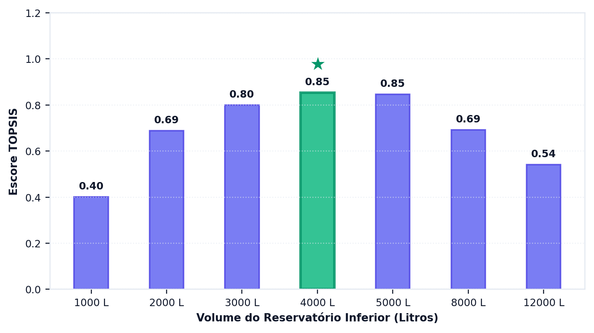
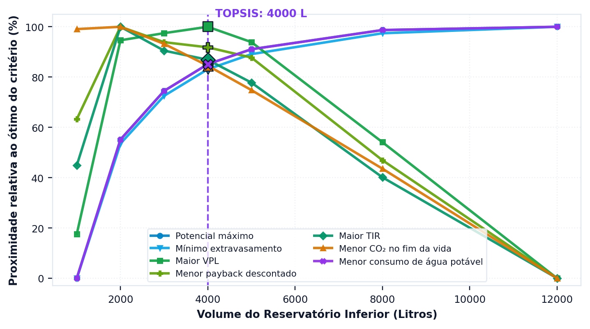

# Qual volume escolher, afinal

> Ao terminar esta seção você terá uma faixa de volumes recomendada, e saberá que
> ela depende de pesos que **você** declarou — não de uma verdade que o programa
> descobriu.

---

## Três perguntas, muitas respostas

As seções anteriores deste tutorial formularam três perguntas distintas ao mesmo projeto
— quanta água ele entrega, quanto dinheiro ele rende e quanto carbono ele evita — e
receberam respostas que não coincidem. Essa discordância não é defeito da análise nem
inconsistência dos dados: os critérios medem coisas diferentes e se comportam de modo
diferente em relação ao volume do reservatório. O multicritério do programa acrescenta uma
quarta pergunta, a do peso do sistema, e avalia cada volume em oito critérios.

<!-- inclui: _tabelas/cap12_multicriterio.md -->

A primeira tabela é o retrato do problema. Repare em como as colunas discordam:

- A **confiabilidade volumétrica** cresce sempre com o volume, de 83,2% a 100,0% da demanda
  de água de chuva. Máximo em 12.000 L.
- A **eficiência de armazenamento** faz o caminho inverso: a cisterna de 1.000 L entrega por
  dia 13,98% do seu volume; a de 12.000 L, 1,40%. Volume que guarda água que ninguém usa é
  volume ocioso, e é este critério que o cobra.
- O **VPL** sobe, achata e começa a cair: máximo em 4.000 L, praticamente empatado com 2.000
  e 3.000 L, e caindo desde 5.000 L, porque o investimento adicional deixa de se pagar.
- O **custo nivelado da água** (LCOW) desenha um U, com mínimo em 2.000 L, R$ 34,84 por m³.
  O **payback** também é menor em 2.000 L.
- O **CO₂e** líquido é mais negativo, isto é, mais carbono evitado, em 2.000 L, praticamente
  empatado com 1.000 L. A partir de 8.000 L, o polietileno incorporado supera o crédito e o
  sistema termina a vida emitindo.
- A **massa a seco** cresce com o volume. O **extravasamento** cai, mas pouco, de 136,3 para
  125,7 m³/ano: a cobertura capta muito mais do que a casa consome.

==Não existe volume que vença em todos os critérios.== Cada um tem ótimo em posição
distinta da curva, e a escolha entre eles não é uma questão técnica que admita resposta
única: é uma questão de prioridade, que precisa ser declarada por quem decide e não pode
ser descoberta pelo programa. É exatamente essa a lacuna que os métodos multicritério vêm
preencher.

---

## Como o TOPSIS resolve

O programa usa TOPSIS sobre **oito critérios em quatro eixos**:

<!-- tabela: Os oito critérios do multicritério, o eixo e a direção de preferência de cada um -->
| Eixo | Critério | Direção |
| :--- | :--- | :--- |
| técnico | confiabilidade volumétrica | maximizar |
| técnico | eficiência de armazenamento | maximizar |
| econômico | economia financeira líquida (VPL) | maximizar |
| econômico | custo nivelado da água (LCOW) | minimizar |
| econômico | payback descontado | minimizar |
| ambiental | CO₂e de ciclo de vida | minimizar |
| estrutural | massa a seco do sistema | minimizar |
| estrutural | extravasamento anual | minimizar |

O método opera em quatro etapas encadeadas. Primeiro normaliza a matriz de decisão, de
modo que critérios medidos em unidades incomparáveis — pontos percentuais, reais,
quilogramas e anos — passem a ocupar a mesma escala. Em seguida aplica os pesos
declarados. Calcula então, para cada alternativa de volume, a distância euclidiana até a
solução ideal, composta pelos melhores valores de cada critério, e até a solução
anti-ideal, composta pelos piores. Ordena, por fim, as alternativas pela proximidade
relativa ao ideal, conforme a formulação apresentada na seção {{n:32}}.

**Os pesos têm dois níveis.** Cada eixo recebe um peso, 25% no padrão, e esse peso se
reparte entre os critérios do eixo pelas *partes no eixo*, iguais no padrão: a confiabilidade
e a eficiência valem 12,5% cada; VPL, LCOW e payback, um terço de 25% cada; o CO₂e, 25%; a
massa e o extravasamento, 12,5% cada. Na interface, a aba de decisão tem um cartão por eixo,
com o peso do eixo em cima e as partes dos seus critérios embaixo, e os botões «Partes iguais»
e «Recalcular»; na linha de comando, os pesos ficam nas opções `--weights` e
`--criterion-shares`; no arquivo de projeto, em `analysis.topsis_weights` e
`analysis.topsis_criterion_shares`; no estudo declarativo, em `analise.pesos` e
`analise.partes_no_eixo`. Também é possível informar oito pesos diretos, um por critério, ou
pedir os pesos objetivos do CRITIC, que o programa calcula dos próprios resultados (seção
{{n:32}}).

Aplicado ao projeto do tutorial com 25% em cada eixo e partes iguais, o método aponta uma
**faixa de 2.000 a 3.000 L**. O maior escore é o de 2.000 L; o de 3.000 L fica dezenove
milésimos abaixo, dentro da tolerância de 5% da amplitude dos escores. Os 4.000 L do tutorial
ficam em terceiro, fora da faixa.

**Uma faixa, e não um volume.** Quando dois volumes pontuam quase igual, chamar um deles de
«o melhor» atribui ao método uma precisão que os dados de entrada não têm. Por isso o programa
relata a *faixa de escolha*: os volumes cujo escore fica a até 5% da amplitude dos escores,
contados a partir do maior. A aba de decisão mostra a faixa e, ao lado, o volume de maior
escore; a linha de comando escreve «volumes de … a … L com escores semelhantes». A faixa
depende da grade de volumes avaliada e da tolerância, e a seção {{n:32}} diz como mudá-la.

> **Três declarações que um estudo publicado precisa fazer.**
>
> A normalização do programa é uma **variante** de Hwang e Yoon: ela translada por
> `x − min(x)` antes da normalização vetorial, para admitir VPL negativo. É uma
> escolha deliberada, e apresentá-la como TOPSIS canônico seria incorreto.
>
> O SMAA-VIKOR, disponível ao lado, sorteia pesos, com 25% esperado em cada eixo, e
> devolve a probabilidade de cada volume ocupar cada posição. É a resposta certa quando
> não há consenso sobre os pesos.
>
> As condições C1 e C2 de Opricovic, de vantagem aceitável e de estabilidade, **não
> estão implementadas**. A seção {{n:32}} detalha.

---

A aba de decisão apresenta o escore de cada volume candidato ({{fig:fig51_programa_topsis}}).

*Figura 99 — O gráfico da aba de decisão: o escore de proximidade ao ideal de cada volume candidato, com 25% de peso em cada eixo e o volume de maior escore destacado. Escores próximos entre si significam alternativas tecnicamente equivalentes: é o que a faixa de escolha reúne, e nesse caso a escolha passa a depender do peso declarado. Figura gerada pelo próprio programa.*

---
## O peso muda a resposta

A tabela a seguir desloca o peso: 70% num eixo e 10% em cada um dos outros três, como os
perfis «Priorizar …» da aba de decisão. A última linha troca os pesos declarados pelos do
CRITIC.

<!-- inclui: _tabelas/cap12_pesos.md -->

O peso técnico dominante leva ao **menor** volume, 1.000 L, embora a confiabilidade cresça
com o volume. A razão está no outro critério do eixo. A confiabilidade já passa de 92% em
2.000 L e quase não ganha depois; a eficiência de armazenamento cai à metade de 1.000 para
2.000 L e continua caindo. Com os dois em partes iguais, a perda de eficiência pesa mais que
o ganho de confiabilidade. São, portanto, três respostas «técnicas» diferentes, e nenhuma
está errada: o critério isolado da confiabilidade aponta 12.000 L; o critério hidráulico da
seção {{n:7}}, com limiar de 1 %/m³, 4.000 L; o eixo técnico do multicritério, 1.000 L.

Com os pesos econômico e ambiental dominantes, o maior escore fica em 2.000 L, o volume de
menor LCOW, menor payback e maior carbono evitado. As faixas se alargam, até 4.000 L no
econômico e até 1.000 L no ambiental, porque o VPL quase empata de 2.000 a 4.000 L e o carbono
evitado, entre 1.000 e 2.000 L. O peso estrutural dominante é o único que dá aos 4.000 L o
maior escore, numa faixa de 3.000 a 4.000 L: o eixo junta a massa, que cresce com o volume, e
o extravasamento, que cai, e com partes iguais o equilíbrio fica nesse volume.

A última linha não declara peso nenhum. O CRITIC (seção {{n:32}}) tira os pesos dos próprios
resultados: pesa mais o critério que discorda dos outros. No tutorial, dá 34,4% ao eixo
técnico, 29,0% ao estrutural, 26,6% ao econômico e 10,0% ao ambiental, e a faixa sobe para
3.000 a 4.000 L, com o maior escore em 3.000 L e os 4.000 L do tutorial em segundo. Depois de
normalizados de 0 a 1, os oito critérios têm contraste parecido, e o que separa os pesos é o
conflito: a confiabilidade, a eficiência e o extravasamento discordam dos demais e ganham peso;
VPL, LCOW e payback andam quase juntos, e cada um leva menos. O ambiental fica com pouco porque
tem um critério só: o CRITIC pesa critérios, e não eixos.

==O CRITIC mede contraste e conflito nos resultados, e não importância.== O extravasamento
quase não muda entre os volumes, de 136,3 para 125,7 m³/ano, mas, normalizado como os outros,
recebe um dos dois maiores pesos dos oito. Use o CRITIC quando não há consenso sobre os pesos
e não se quer impor uma preferência, declare os pesos que ele calculou, e lembre que eles
mudam com o conjunto de volumes avaliado.

> **Declare os pesos, as partes e a tolerância.** «Volume ótimo pelo TOPSIS» sem os quatro
> pesos de eixo e as partes no eixo é uma afirmação impossível de reproduzir. Relate a faixa
> de escolha, com a tolerância, e não um volume só. Dois artigos com pesos diferentes chegam a
> faixas diferentes e ambos estão certos.

---

Uma solução de compromisso cede em alguma coisa, e convém saber em quê. O programa desdobra o escore único em oito, um por critério, e mostra a distância que separa cada volume do melhor valor alcançado em cada um deles ({{fig:fig52_programa_proximidade}}).

*Figura 99 — O segundo gráfico da aba de decisão: quanto cada volume se aproxima do melhor valor possível em cada um dos oito critérios, com o volume de maior escore do TOPSIS marcado. Lida na vertical de outro volume, a figura mostra o que ele cede, e em qual eixo. Figura gerada pelo próprio programa.*

---
## A recomendação do tutorial

O tutorial mantém o reservatório de **4.000 L em polietileno**, o volume do critério
hidráulico da seção {{n:7}}, com limiar de ganho marginal de 1 %/m³. Não está na faixa que o
multicritério aponta com pesos iguais. Neste projeto, as duas rotas discordam: com 25% em cada
eixo, o TOPSIS reúne 2.000 e 3.000 L na faixa de escolha e põe os 4.000 L em terceiro. Os
4.000 L só entram na faixa com o peso econômico ou o estrutural dominante, ou com os pesos do
CRITIC, e só têm o maior escore com o estrutural.

Na vertical de 4.000 L da figura de proximidade, e na primeira tabela, lê-se o que a escolha
cede em relação a 2.000 L. Os 4.000 L entregam mais água, com confiabilidade de 97,5% contra
92,5%, e um VPL pouco maior, R$ 5.524 contra R$ 5.374. Em troca, a eficiência de
armazenamento cai quase à metade, de 7,77% para 4,09% ao dia; o LCOW sobe de R$ 34,84 para
R$ 35,04 por m³, e o payback, de 12,4 para 12,8 anos; o carbono evitado em 20 anos cai de
124 para 74 kg; e a massa a seco cresce 44 kg.

A margem entre os três primeiros é pequena, e o SMAA-VIKOR da seção {{n:32}} a mede:
2.000 L vencem em 44% dos sorteios de pesos, 3.000 L em 25% e 4.000 L em 18%.

==Os 4.000 L são defensáveis quando a prioridade declarada é a água:== quem decide valoriza
o atendimento da demanda e o VPL acima da eficiência do volume construído, e aceita pagar
por isso algum carbono e alguma massa. Quando a prioridade é o menor custo por metro cúbico,
o retorno mais rápido ou o carbono evitado, ==os 2.000 L são a escolha defensável==, e o
estudo deve adotá-los. Sem prioridade declarada, a resposta é a faixa de 2.000 a 3.000 L, e é
ela que o estudo relata.

O tutorial segue com 4.000 L porque as seções {{n:8}} a {{n:11}} foram construídas sobre esse
volume, e porque a lição desta seção é justamente a discordância: o volume do critério
hidráulico e a faixa do multicritério não precisam coincidir. O estudo publicado precisa dizer
o que adotou, com que pesos e com que tolerância, e o que a escolha cede.

---

## O projeto, fechado

<!-- tabela: Resumo do projeto do tutorial, com todos os parâmetros e resultados -->
| Triton · residência unifamiliar em Florianópolis | |
| :--- | ---: |
| série de precipitação | Florianópolis, 30 anos, 1.795 mm/ano |
| área de captação | 150 m² |
| coeficiente de escoamento | 0,85 |
| descarte de primeiras águas | 2,0 mm, todo evento |
| moradores | 4 |
| demanda total | 600 L/dia |
| fração atendível por chuva | 28% |
| reservatório inferior | 4.000 L, polietileno |
| arranjo de abastecimento | recalque para caixa superior |
| reservatório superior | 1.000 L, limiar de acionamento de 100 L |
| classe de qualidade | 1, cloração por pastilhas |
| descarte inicial | reservatório de 300 L |
| **potencial de economia de água potável** | **27,30%** |
| dias de atendimento pleno | 97,3% |
| água poupada | 59,8 m³/ano |
| energia do recalque | 7,7 kWh/ano |
| investimento | R$ 11.283 |
| **valor presente líquido em 20 anos** | **R$ 5.524** |
| payback descontado | 12,8 anos |
| **emissões líquidas em 20 anos** | **−74 kg CO₂e** |
| payback de carbono | 16,3 anos |

Resta uma etapa, que é a de comunicar o resultado: um estudo que não é relatado de modo
verificável não se distingue, para quem o lê, de um palpite bem apresentado. É o assunto
da seção seguinte.
