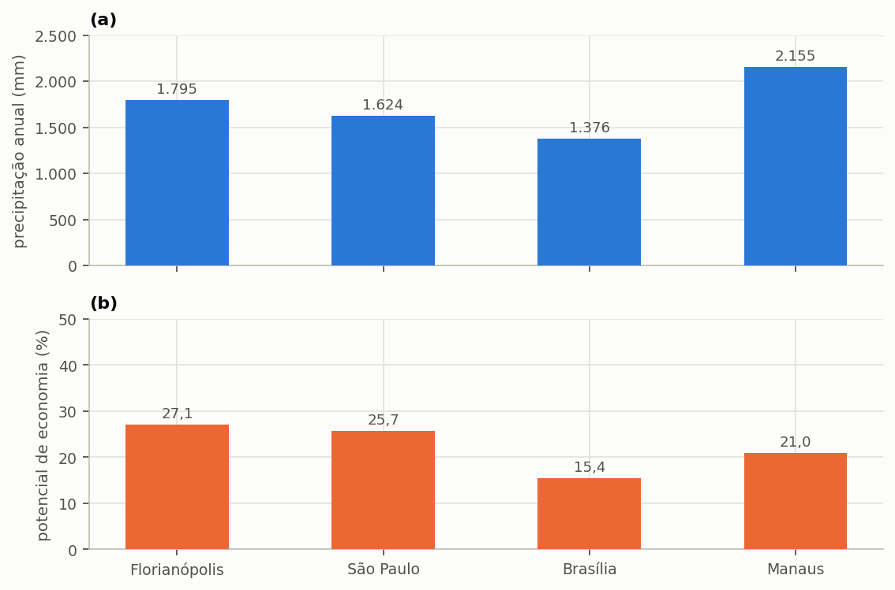

# Comparar cidades

> **Pergunta que este guia responde:** o mesmo projeto renderia o mesmo em outra cidade?

Não renderia, e a diferença não segue a direção que a intuição sugere. A expectativa
corrente é a de que mais chuva implique mais aproveitamento, e essa expectativa está
errada com frequência suficiente para merecer uma seção inteira.

> **Só na Edição Brasil (BRL).** As cidades brasileiras deste guia vêm da base climática
> nacional da Edição Brasil. Na International Edition, a mesma comparação se faz com
> arquivos de chuva próprios, um por cidade; todo o resto do guia vale como está escrito.

---

## Como fazer a comparação

O procedimento é simples e consiste em manter todos os parâmetros do projeto e trocar
apenas a série de precipitação. Na etapa **1. Projeto e Chuva**, escolha outra cidade da
base climática nacional ou carregue um arquivo próprio, e execute novamente a simulação.
Para comparar várias cidades sem refazer o projeto a cada uma, salve um arquivo por
cidade, conforme a seção {{n:19}} recomenda.

---

## O resultado

O projeto do tutorial — 150 m² de captação, 600 L/dia de demanda, 28% de fração
atendível e cisterna de 4.000 L — levado a quatro capitais brasileiras produz a tabela
abaixo.

<!-- inclui: _tabelas/cap14_cidades.md -->

A {{fig:fig03_cidades}} separa as duas grandezas, cada uma na sua escala.

*Figura 99 — (a) Precipitação média anual e (b) potencial de economia de água potável do projeto do tutorial, com 150 m² de captação, 600 L/dia de demanda, fração atendível de 28% e cisterna de 4.000 L, em quatro capitais. Manaus tem a maior precipitação anual e não tem o maior potencial de economia.*

---

## O regime manda mais que a lâmina

Lidas lado a lado, as colunas de chuva anual e de potencial de economia não andam
juntas, e os dois casos extremos da tabela mostram por quê. Manaus recebe 20% mais chuva
que Florianópolis — 2.155 mm anuais contra 1.795 mm — e ainda assim rende 23% menos:
20,96% contra 27,12% de potencial. Brasília, no extremo oposto, recebe 23% menos chuva
que Florianópolis e rende pouco mais da metade, com 15,45%.

A explicação está na razão entre o mês mais chuvoso e o mês menos chuvoso de cada
cidade, que mede o quanto a chuva se concentra ao longo do ano.

<!-- tabela: Razão entre o mês mais chuvoso e o menos chuvoso nas quatro capitais -->
| Cidade | Razão | O que significa |
| :--- | ---: | :--- |
| Florianópolis | 3,2× | chove o ano inteiro, com estação mais úmida |
| São Paulo | 4,0× | idem, um pouco mais marcado |
| Manaus | 17,3× | seca amazônica curta mas real |
| Brasília | 1.192× | **o mês mais seco é seco de verdade** |

Em Brasília, os meses de junho, julho e agosto praticamente não registram chuva. Um
reservatório dimensionado para atravessar noventa dias de estiagem precisaria armazenar
noventa dias de demanda pluvial, o que neste projeto corresponderia a 15.120 litros —
volume que nenhuma cisterna residencial comporta. A consequência é que o sistema
permanece ocioso durante um trimestre inteiro por ano, e o potencial anual reflete essa
ociosidade.

> **A conclusão prática.** ==O aproveitamento pluvial rende mais onde a chuva é
> frequente do que onde ela é abundante.== Cidades de clima subtropical úmido com chuva
> bem distribuída constituem o melhor caso brasileiro; cidades de clima tropical com
> estação seca marcada constituem o pior, por mais intensa que seja a chuva da estação
> úmida.

---

A {{fig:fig18_capitais}} apresenta o regime mensal das quatro capitais na mesma escala.

*Figura 99 — Precipitação média mensal em (a) Florianópolis, (b) São Paulo, (c) Brasília e (d) Manaus, na mesma escala; a linha tracejada é a média mensal de cada série. Florianópolis e São Paulo distribuem a chuva ao longo de todo o ano; Manaus tem estação seca curta, de julho a outubro; e Brasília praticamente não recebe chuva de maio a setembro. É essa distribuição, e não o total anual, que decide o desempenho do reservatório.*

---

## O que a literatura já tinha encontrado

O resultado das quatro capitais não é peculiaridade deste tutorial. Ghisi e Souza (2012)
simularam casas em treze cidades de países diferentes, com o próprio Triton, e chegaram à
mesma conclusão por outro caminho: o maior potencial de economia aparece onde a chuva é
constante, o que nem sempre coincide com a maior lâmina anual, e as cidades com
estiagem bem definida exigem reservatórios maiores para o mesmo desempenho.

No Brasil, dois levantamentos mostram a amplitude da variação dentro de um só estado ou
de uma só cidade. Ghisi, Lopes e Rupp (2016) fizeram 2.700 simulações para casas em 60
cidades de Santa Catarina, com séries diárias longas, e obtiveram reservatórios ideais de
1.000 a 16.000 L e economias médias de 75 a 461 litros por dia por casa. Ghisi e Custódio
(2019), com 33.720 cenários para o setor residencial de Joinville, encontraram potencial
médio de 18,5% com água de chuva só nas bacias sanitárias, e de 40,8% quando a máquina de
lavar roupa também a recebe — a mesma escolha de uso que a seção {{n:5}} discute.

A lição para quem compara cidades é a mesma dos dois estudos: a série local decide, e um
volume ou um potencial trazido de outra cidade, mesmo vizinha, não substitui a simulação.

### Muitas cidades de uma vez

Para comparar mais de três ou quatro cidades, trocar a série à mão deixa de ser prático.
A base climática nacional traz séries para 652 municípios, e a planilha de cenários da
seção {{n:19}} roda o mesmo projeto contra várias delas numa única execução, gravando um
resultado por linha. Mantenha na planilha os mesmos parâmetros de edificação e de
reservatório em todas as linhas, e varie só a cidade: é o que isola o efeito do clima.

---

## O que mais muda entre cidades

A precipitação não é a única grandeza que varia entre municípios, e as outras duas podem
inverter a conclusão econômica de um estudo comparativo.

A primeira é a **tarifa**. O preço do metro cúbico varia consideravelmente pelo país, e o
regime de mínimo varia ainda mais. Um potencial de 15% em município de tarifa elevada e
regime de disponibilidade pode render mais dinheiro que um potencial de 27% em município
que pratique franquia sobre o consumo mínimo, e a seção {{n:16}} trata dessa mecânica em
detalhe.

A segunda é o **fator de emissão da rede elétrica**, que altera simultaneamente a
emissão evitada por metro cúbico de água substituída e o custo ambiental do bombeamento.
A Edição Brasil traz o fator discriminado por região; na International Edition, ele é
informado em cada projeto.

> **Ao comparar cidades num estudo, deixe claro o que variou.** Comparar apenas a
> precipitação, mantendo tarifa e fator de emissão fixos, isola o efeito climático e
> constitui comparação legítima, desde que declarada como tal. Variar todas as grandezas
> simultaneamente produz um número que não se consegue explicar, porque nele se somam
> efeitos de sinais possivelmente opostos.

---

## O volume ideal também muda, mas pouco

A última coluna da tabela reserva uma surpresa: o volume ideal varia de 4.000 a 5.000 L
entre as quatro capitais, uma amplitude modesta diante da diferença de regime que as
separa.

A explicação está na natureza do critério. O volume ideal pelo ganho marginal localiza o
joelho da curva de aproveitamento, e a posição desse joelho é governada pelo **tamanho
típico dos eventos de chuva**, que é razoavelmente parecido entre as quatro cidades. O
que varia fortemente é o **patamar** que a curva atinge depois do joelho, e não o ponto
em que ela dobra.

Dito de outro modo: em Brasília acerta-se o mesmo volume que em Florianópolis e colhe-se
consideravelmente menos água com ele.
