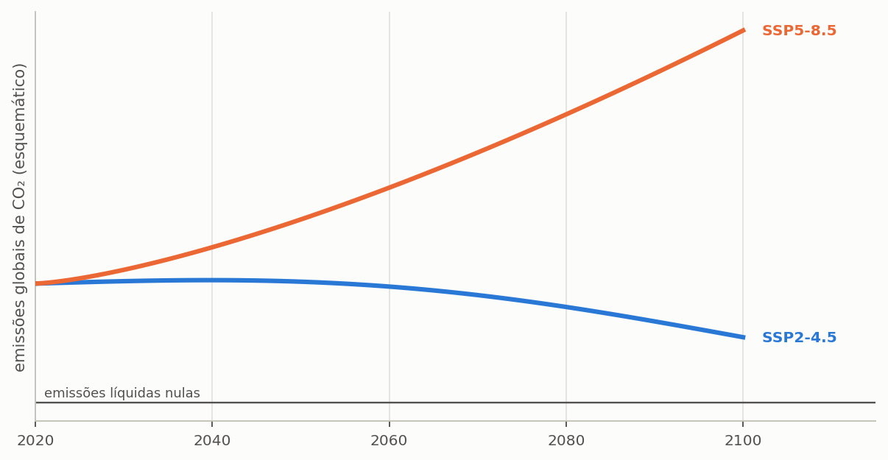

# Usar cenário climático futuro

> **Pergunta que este guia responde:** o sistema que dimensiono hoje ainda serve em
> 2060?

> **Só na Edição Brasil (BRL).** A base de projeções climáticas descrita aqui só acompanha a
> Edição Brasil. Na International Edition, o método deste guia vale como está para séries
> projetadas próprias — por exemplo, séries com correção de viés de um serviço climático
> nacional —, carregadas como arquivos de chuva.

Um reservatório de água pluvial dura trinta anos ou mais, e a chuva que cairá sobre a
edificação ao longo desse período não será a mesma que caiu no passado recente. Dimensionar
um sistema de vida longa exclusivamente sobre a série histórica supõe, implicitamente, um
clima estacionário — suposição que as projeções disponíveis não sustentam. O Triton traz
uma base de projeções climáticas justamente para que o dimensionamento possa incorporar
essa questão de forma explícita.

---

## O que a base tem

<!-- tabela: Conteúdo da base climática nacional distribuída com o programa -->
| O que a base traz | Quantidade |
| :--- | ---: |
| cidades brasileiras | 652 |
| modelos climáticos do CMIP6 | 19 |
| cenários de emissão | 2, SSP2-4.5 e SSP5-8.5 |
| simulação histórica | 1980 a 2013 |
| simulação futura | 2015 a 2100 |

O CMIP6 é a sexta fase do *Coupled Model Intercomparison Project*, o exercício
coordenado internacionalmente que alimenta os relatórios do IPCC. Cada modelo é um
modelo climático global de um centro de pesquisa diferente.

## De onde vêm as séries

*Figura — Logotipo oficial do CLIMbra (Climate Change Dataset for Brazil), desenvolvido para estudos hidroclimáticos e impactos das mudanças climáticas no Brasil.*

A base do programa é extraída do **CLIMBra** (*Climate Change Dataset for Brazil*), conjunto de dados de referência publicado por Ballarin et al. (2023) na revista [*Scientific Data* (Nature)](https://www.nature.com/articles/s41597-023-01956-z) ([doi:10.1038/s41597-023-01956-z](https://doi.org/10.1038/s41597-023-01956-z)), com dados públicos disponibilizados no [*Science Data Bank*](https://doi.org/10.57760/sciencedb.02316) ([doi:10.57760/sciencedb.02316](https://doi.org/10.57760/sciencedb.02316)) sob licença aberta CC0. Três características definem o que as séries representam, e convém conhecê-las antes de usá-las:

**São projeções corrigidas de viés.** Modelos globais têm resolução de dezenas a
centenas de quilômetros e reproduzem mal a chuva local: costumam errar a frequência de
dias chuvosos, a intensidade e os extremos. O CLIMBra corrigiu as séries diárias dos 19
modelos pelo método *Quantile Delta Mapping* (QDM), que ajusta a distribuição simulada à
observada e, ao mesmo tempo, preserva as variações relativas dos quantis entre o período
histórico e o futuro. A referência observada foi a grade diária de Xavier, King e
Scanlon (2016), construída com milhares de pluviômetros e estações do Brasil, com
resolução de 0,25°, isto é, cerca de 28 km.

**São células de grade, e não estações.** A série de uma cidade é a da célula de 0,25°
que a contém. Ela representa a chuva média de uma área da ordem de 700 km², e não a de
um pluviômetro. Em relevo acidentado ou no litoral, a diferença entre a chuva da célula e
a do lote pode ser grande.

**O histórico da base é simulado.** A série de 1980 a 2013 não é a chuva observada, e sim
a simulação de cada modelo para aquele período, corrigida para ter a mesma **estatística**
da observação. A cronologia não coincide: um dia chuvoso na série do modelo não
corresponde a um dia chuvoso real. Por isso, a comparação correta de um cenário futuro é
com o **histórico do mesmo modelo**, e não com a série observada que acompanha o
programa. Misturar as duas atribuiria ao clima futuro a diferença entre observação e
modelo.

Maraun (2016), numa revisão crítica sobre correção de viés, alerta para o limite do
procedimento: ele pressupõe que o modelo representa de forma plausível os processos e a
mudança do clima, e não consegue corrigir uma tendência implausível. A correção melhora a
estatística; não transforma um modelo ruim num modelo bom.

> **Base compactada e embarcada no programa:** os 37.164 arquivos de texto do CLIMBra
> (que originalmente ocupam cerca de 6,5 GB em formato CSV descompactado) foram consolidados
> e comprimidos pelo Triton em um banco de dados SQLite binário de alta performance
> (`climbra.db`). Esse banco fica integrado ao executável e ao instalador, permitindo consultas
> instantâneas (< 1 ms por série) e execução imediata para qualquer uma das 652 cidades
> sem a necessidade de downloads externos volumosos. Os CSV originais não são distribuídos
> nem precisam ser instalados.

---

## Escolher modelo, cenário e janela

O **cenário** representa a trajetória futura de emissões de gases de efeito estufa, e os
dois disponíveis seguem as *Shared Socioeconomic Pathways* adotadas pelo IPCC. Eles não
são previsões, e sim hipóteses coerentes sobre o comportamento socioeconômico global ao
longo do século ({{fig:fig44_cenarios}}). O nome combina a trajetória socioeconômica, de 1
a 5, com o forçamento radiativo aproximado em 2100, em watts por metro quadrado: o
SSP2-4.5 é o caminho intermediário, com forçamento de 4,5 W/m², e o SSP5-8.5 é o de
desenvolvimento intensivo em combustíveis fósseis, com 8,5 W/m². Os cenários de mitigação
forte, como o SSP1-2.6, não fazem parte do CLIMBra.

*Figura 99 — A forma das duas trajetórias de emissão disponíveis na base. O SSP2-4.5 é a trajetória intermediária, com emissões que se estabilizam e depois caem; o SSP5-8.5 supõe emissões altas e crescentes, sem mitigação efetiva. A figura mostra o formato de cada uma, e não valores projetados.*

A **janela temporal** é o recorte da série futura, de 2015 a 2100, sobre o qual o estudo
é feito. O programa permite recortar qualquer período, nas datas inicial e final da
etapa **1. Projeto e Chuva**. A convenção mais usada é tomar janelas de trinta anos, a
mesma duração das normais climatológicas, e o campo **Atalho de recorte** preenche as
datas com três delas: 2021–2050, 2041–2070 e 2071–2100, além da série completa. O atalho
só preenche as datas, que continuam editáveis, e a etapa avisa quando o recorte tem menos
de dez anos. A escolha da janela deve guardar relação com a vida útil
pretendida do sistema: avaliar um reservatório de vinte anos, instalado agora, contra o
fim do século avalia um período em que ele já terá sido substituído.

A escolha do **modelo climático** é a decisão mais delicada das três, e a ela se dedica
uma subseção própria adiante.

---

## Como conduzir o estudo

O procedimento correto consiste em executar o mesmo projeto em cada combinação de
interesse e comparar os resultados entre si, em vez de dimensionar diretamente sobre a
série projetada. Quatro passos o resumem.

1. Feche o dimensionamento com a série **histórica**. É a referência.
2. Rode o mesmo projeto na série **histórica simulada** de cada modelo que for usar, de
   1980 a 2013. É contra ela, e não contra a observada, que o futuro se compara.
3. Mantenha todos os demais parâmetros e troque só a série, para cada cenário e janela.
4. Compare **potencial de economia** e **dias de atendimento pleno**, sempre como
   diferença entre o futuro e o histórico do mesmo modelo. O segundo costuma se degradar
   mais que o primeiro, porque o que muda primeiro é a distribuição, não o total.

> **Um exemplo de leitura.** Suponha que, com um modelo, o potencial seja de 36% no
> histórico simulado e de 33% no SSP5-8.5 de 2041 a 2070, e que a série observada dê 37%.
> A mudança atribuível ao clima é de três pontos, e não de quatro: o ponto restante é a
> diferença entre o modelo e a observação, que existe também no passado.

> **O que não fazer.** Dimensionar direto na série futura e apresentar o resultado
> como projeto. A série futura é uma projeção com incerteza grande; ela serve para
> testar a **robustez** de um dimensionamento feito no histórico, não para substituí-lo.

---

## A escolha do modelo, e por que ela importa tanto

Dezenove modelos climáticos projetam dezenove futuros distintos para a mesma cidade sob
o mesmo cenário de emissões, e essa dispersão não é ruído a ser eliminado: ela é a
expressão honesta da incerteza física do problema. ==Para a chuva, a dispersão entre
modelos costuma superar a diferença entre cenários de emissão,== o que significa que a
escolha do modelo pesa mais sobre o resultado do que a escolha do futuro socioeconômico.

Hawkins e Sutton (2011) decompuseram a incerteza das projeções de precipitação para
regiões da ordem de 2.500 km, com os modelos da fase anterior do exercício, o CMIP3, em
três fontes: a variabilidade interna do clima, a diferença entre modelos e a diferença
entre cenários. Para a precipitação, ao contrário da temperatura, a variabilidade interna
responde por 50% a 90% da incerteza na primeira década e continua dominante, em muitas
regiões, até a terceira; a incerteza entre modelos passa a dominar nos horizontes mais
longos; e a incerteza de cenário é pequena ou desprezível em todas as regiões e
horizontes, salvo perto dos polos no fim do século. Os autores mostram ainda que a razão
entre o sinal da mudança e o ruído é menor que um em quase todo o planeta, e concluem que
as decisões de adaptação terão de ser tomadas com incerteza alta sobre a chuva regional. A
consequência para o projeto é direta: rodar os dois cenários com um só modelo informa
menos do que rodar um cenário com vários modelos.

Três condutas são defensáveis diante dessa dispersão, apresentadas aqui em ordem
decrescente de rigor.

**Ensemble.** Rode todos os modelos disponíveis e reporte a faixa de resultados, com
mediana. É o mais rigoroso e o mais caro em tempo de máquina. A seção {{n:19}} mostra como
fazer em lote.

**Subconjunto justificado.** Escolha três a cinco modelos com bom desempenho
documentado para a América do Sul, e declare o critério de escolha e a fonte.

**Modelo único, declarado como tal.** Aceitável para uma análise exploratória, desde
que o texto não apresente o resultado como projeção robusta.

> **O que jamais fazer:** rodar vários modelos, escolher o que dá o resultado mais
> conveniente, e reportar só ele.

---

## O que a literatura mostra sobre o reservatório no clima futuro

Os estudos que simulam sistemas de aproveitamento pluvial sob projeções climáticas
convergem num ponto: a mudança no total anual de chuva importa menos que a mudança na
**distribuição**. Kisakye et al. (2018), com seis modelos para um distrito de Uganda,
encontraram projeções conflitantes entre modelos, mas concordância quanto à estação: a
economia e a segurança hídrica cairiam nas estações que já eram secas e subiriam nas
chuvosas, com redução de mais de 50% numa das estações no fim do século. Lash et al.
(2014), ao dimensionar um reservatório para um edifício universitário no Reino Unido com
3.000 séries de chuva equiprováveis das projeções climáticas britânicas, concluíram que,
para ser provável atender em 2080 a mesma demanda de hoje, o reservatório precisaria ser
112% maior, e 225% maior para que isso fosse muito provável.

Os dois estudos ilustram o que a seção {{n:14}} mostrou para cidades brasileiras de hoje:
cidades com estação seca marcada exigem reservatórios muito maiores para o mesmo
desempenho. Um clima futuro com estiagens mais longas se comporta, para o reservatório,
como uma mudança de cidade.

---

## O que declarar

Um estudo com cenário climático precisa trazer, no método:

- **modelo ou modelos**, pelo nome, e o critério de seleção;
- **cenário** SSP;
- **janela temporal**, com os anos;
- a **série histórica** usada como referência;
- se houve *downscaling* ou correção de viés, e qual; na base do programa, a do CLIMBra,
  por *Quantile Delta Mapping* contra a grade de Xavier et al. (2016);
- a **procedência da base**, com versão: Ballarin et al. (2023);
- que o futuro foi comparado com o **histórico simulado do mesmo modelo**.

Sem isso, o resultado não é reproduzível. O apêndice {{n:E}} traz a procedência da base do
programa.

---

## Uma ressalva de método

Projeções climáticas carregam duas incertezas empilhadas, de naturezas distintas: a do
cenário, que é socioeconômica e diz respeito a escolhas humanas futuras, e a do modelo,
que é física e diz respeito à representação do sistema climático. Nenhuma das duas se
reduz executando mais simulações com o mesmo material, porque não se trata de incerteza
amostral.

Um estudo conduzido com honestidade apresenta o resultado como faixa, e não como número
único, e evita conclusões que dependam da terceira casa decimal de uma projeção para
2060.
