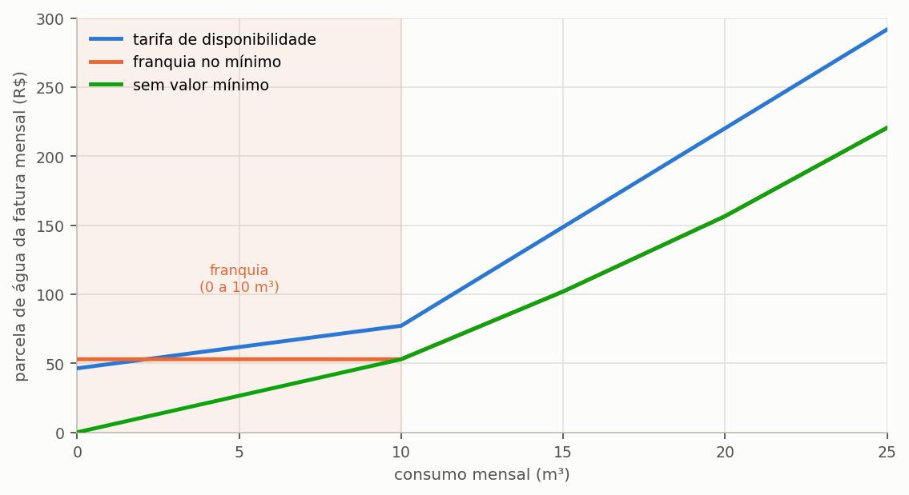

# Ajustar a tarifa do seu município

> **Pergunta que este guia responde:** a tarifa do meu município está na base, e está
> certa?

> **Só na Edição Brasil (BRL).** O catálogo de 652 municípios e a etapa
> **12. Gestor de Tarifas** só acompanham a Edição Brasil. Na International Edition, a tarifa é digitada, na
> etapa econômica, com a mesma tabela de faixas, os mesmos códigos e os mesmos seis regimes
> descritos aqui — por isso este guia é também a referência para lançar qualquer estrutura
> tarifária.

Este é o guia que mais altera resultados. A estrutura tarifária decide a viabilidade
econômica de um sistema pluvial mais do que qualquer parâmetro de projeto, e é também o
dado que mais frequentemente aparece errado nos estudos publicados sobre o tema.

---

## Como é composta a fatura de água e esgoto no Brasil

Antes de conferir a tarifa do município, convém entender o que se está conferindo. A
fatura de água no Brasil não é o produto do consumo por um preço único, e cinco
características a distinguem da fatura de energia elétrica, que é a referência mais familiar para
a maioria dos leitores.

**A prestação é local, e o preço também.** Cada município é atendido por uma companhia
estadual, por uma autarquia municipal ou por uma concessionária privada, e cada prestador
tem tabela própria, homologada por uma agência reguladora — estadual, municipal ou
intermunicipal. Não existe tarifa nacional de água, e a diferença entre dois municípios
vizinhos pode ultrapassar o dobro.

**A tarifa é progressiva por faixas de consumo.** O metro cúbico não custa o mesmo em
qualquer quantidade: o consumo é dividido em faixas, e cada faixa tem preço próprio,
crescente. Na tabela da CASAN vigente em Florianópolis, os primeiros dez metros cúbicos
custam R$ 3,08 cada e os quinze seguintes custam R$ 14,31 cada. ==A progressividade é o
que torna a economia de água mais valiosa do que parece:== o metro cúbico que se deixa de
consumir é sempre o da faixa mais alta da fatura, que é o mais caro.

**Existe uma parcela que independe do consumo.** Quase toda concessionária cobra algo
mesmo de quem não consome nada, e o nome e a natureza dessa parcela variam de um lugar
para outro. É o assunto da subseção sobre os seis regimes, adiante, e é o ponto que mais
decide se um sistema pluvial se paga.

**O esgoto é cobrado como percentual da água.** A maior parte dos prestadores fatura o
esgoto aplicando um percentual sobre a parcela de água, comumente de 80% ou 100%, sob o
argumento de que o volume esgotado é proporcional ao consumido. Quando esse percentual é
de 100%, a parcela de esgoto iguala a de água, e o esgoto responde por metade da fatura —
o que significa que cada metro cúbico economizado vale o dobro do preço da água.

**Há categorias distintas de consumidor.** Toda concessionária publica tabelas separadas
para as categorias residencial, comercial, industrial e pública, com preços que
frequentemente são o dobro ou mais da residencial. Na tabela da CASAN, a primeira faixa
custa R$ 3,08/m³ no residencial e R$ 6,81/m³ no comercial.

> **O que o programa traz, e o que você precisa lançar.** O catálogo de 652 municípios do
> programa registra a **categoria residencial** de cada um deles, e o diálogo de tarifas
> diz de onde ela veio: o documento oficial guardado, a tabela usada e a vigência, ou o
> aviso de que o valor ainda não tem documento. As categorias comercial, pública e
> industrial entram município a município, transcritas da tabela oficial do prestador, e
> só aparecem para escolha onde foram coletadas — em cerca de 390 municípios em outubro de
> 2026; nunca são estimadas a partir da residencial. As demais categorias
> existem, são públicas e estão nas resoluções das agências reguladoras — o que não há é
> um catálogo nacional delas, que seria um levantamento de porte próprio. Para estudar
> uma escola, um comércio ou uma indústria, lance a estrutura da categoria correta no
> modo personalizado desta mesma tela: o programa aceita qualquer tabela de faixas, com
> qualquer regime de mínimo, e a seção {{n:18}} mostra o procedimento.

---

## Comece conferindo o que já está na base

O programa acompanha um catálogo de 652 municípios brasileiros, e cada registro traz a
estrutura tarifária completa, o percentual de esgoto praticado, o regime de mínimo
adotado, a data de vigência da tabela e a fonte documental de onde o dado foi extraído.
O catálogo cobre a categoria residencial, conforme a subseção anterior esclarece.

Na etapa **12. Gestor de Tarifas**, escolha o estado e o município. Além da estrutura, o
programa exibe o **grau de confiança** atribuído ao registro, que sintetiza a qualidade da
fonte e a data do levantamento. Três itens merecem conferência contra a resolução vigente
da sua concessionária, e a ordem importa porque o primeiro invalida os demais.

1. **a data de vigência** — tarifas são reajustadas anualmente;
2. **os valores das faixas**;
3. **o regime de mínimo**, que é o item {{n:16.4}}.

Havendo divergência em qualquer dos três, edite o registro. A edição vale para o seu
projeto, não altera o catálogo dos demais usuários, e fica gravada dentro do arquivo
`.triton` — o que significa que quem receber o seu projeto reproduzirá a mesma conta, com
a mesma tabela.

---

## Como a tabela é montada

Cada linha da estrutura tarifária é representada no programa por uma quádrupla de
valores: o volume mínimo da faixa, o volume máximo, um valor monetário e um código. O
código é o elemento decisivo, porque é ele que informa o que aquele valor significa — e
estruturas visualmente parecidas cobram de maneiras muito diferentes conforme o código de
cada linha.

<!-- tabela: Os seis códigos de faixa tarifária e o efeito de cada um na fatura -->
| Código | O que é | Como entra na fatura |
| ---: | :--- | :--- |
| 1 ou 0 | faixa de consumo | é cobrado o preço por volume que está alocado **dentro** de cada faixa de consumo |
| −1 | tarifa de disponibilidade | valor fixo **somado** à parcela de consumo |
| −2 | franquia retroativa | até o volume da franquia, paga-se o fixo; passando dele, tarifa-se **tudo desde zero** |
| −3 | piso de pagamento | a fatura **não fica** abaixo deste valor |
| 2 | preço-base exponencial | `PB` da fórmula `PB × Cⁿ`, válida até o máximo da linha |
| 3 | expoente da tabela exponencial | o `n` aplicado ao consumo **do mês inteiro** que cai na linha |

A estrutura de Florianópolis, tomada como exemplo, tem cinco linhas: uma de
disponibilidade e quatro faixas progressivas.

```
(0,00 ; 0,00 ; 46,34 ; -1)     disponibilidade, soma sempre
(0,00 ; 10,00 ;  3,08 ;  1)    primeira faixa
(10,00 ; 25,00 ; 14,31 ; 1)    segunda faixa
(25,00 ; 50,00 ; 19,14 ; 1)    terceira
(50,00 ; 999999 ; 24,08 ; 1)   última
```

---

## Os seis regimes, e por que isso decide projetos

O «consumo mínimo» aparece na conta de quase todo município brasileiro, e significa
coisas **diferentes** em cada um. O programa distingue seis regimes:

<!-- tabela: Os seis regimes tarifários e o que acontece ao economizar em cada um -->
| Regime | O que acontece ao economizar | Municípios na base |
| :--- | :--- | ---: |
| **sem mínimo** | cada m³ economizado desconta | 100 |
| **disponibilidade** | idem; a taxa fixa continua, mas não impede a economia | 122 |
| **fórmula exponencial** | idem; o m³ poupado vale pelo preço-base elevado ao expoente | 36 |
| **franquia no mínimo** | abaixo da franquia, economizar **não desconta nada** | 371 |
| **franquia retroativa** | passando da franquia, tarifa-se tudo desde zero | 23 |
| **piso de pagamento** | a fatura não fica abaixo do piso | 0 |

**O caso que derruba estudo.** Compare duas estruturas reais da base, lado a lado,
para o mesmo consumo:

<!-- tabela: Efeito da economia de água na fatura em dois regimes tarifários opostos -->
| Consumo | Floriano (PI), franquia no mínimo | Florianópolis (SC), disponibilidade |
| ---: | ---: | ---: |
| 14 m³ | R$ 92,15 | R$ 134,38 |
| 12 m³ | R$ 72,52 | R$ 105,76 |
| 10 m³ | R$ 52,89 | R$ 77,14 |
| 8 m³ | **R$ 52,89** | R$ 70,98 |
| 5 m³ | **R$ 52,89** | R$ 61,74 |

Em Floriano, a fatura **para de cair em 10 m³**. Uma residência que consome 12 m³ e
instala um sistema que poupa 4 desce para 8, e economiza R$ 19,63 — e não os R$ 24,17 que a tarifa média de R$ 6,04/m³ sugeriria. Se poupasse 7, desceria para 5 e economizaria os
**mesmos** R$ 19,63: os três metros cúbicos adicionais não valem nada.

Em Florianópolis, cada metro cúbico economizado reduz a fatura, até o primeiro.

> Rodar o caso de Floriano com a estrutura de Florianópolis produz um payback que
> não existe. Trezentos e vinte e nove dos 652 municípios da base estão no regime de
> franquia. É a maioria, e é o cenário mais comum do país.

A {{fig:fig05_regimes}} mostra as três respostas lado a lado. O que distingue os regimes não é
o preço praticado, e sim o formato da curva: ==onde a curva é horizontal, economizar água
não reduz a fatura em nada.==



*Figura 99 — Parcela de água da fatura mensal em função do consumo, em três regimes de valor mínimo. O esgoto não entra no gráfico porque é cobrado como percentual desta parcela e apenas multiplica a curva, sem mudar-lhe o formato. Na tarifa de disponibilidade e sem valor mínimo, cada metro cúbico economizado reduz a fatura desde o primeiro; na franquia no mínimo, o trecho horizontal marca a faixa de consumo em que a economia de água não reduz a fatura.*

---

## A fórmula exponencial da CORSAN

Os 34 municípios gaúchos da base atendidos pela CORSAN não cobram a água por faixas.
A parcela de água da fatura é dada por uma fórmula:

```
Água = PB × Cⁿ + SB
```

em que `PB` é o preço-base do município, em R$/m³; `C` é o consumo do mês, em m³; `n` é
o expoente que a **Tabela de Exponenciais** da concessionária atribui àquele consumo; e
`SB` é o serviço básico, cobrado mesmo sem consumo. Na categoria residencial, `n` vale
1,00 até 20 m³ e sobe a cada metro cúbico a partir daí:

<!-- tabela: Expoente n da Tabela de Exponenciais da CORSAN, categoria residencial -->
| Consumo do mês | `n` | Consumo do mês | `n` |
| :--- | ---: | :--- | ---: |
| até 20 m³ | 1,00 | 36 a 45 m³ | 1,10 |
| 21 m³ | 1,01 | 46 a 100 m³ | 1,11 |
| 22 a 27 m³ | 1,02 a 1,07 | 101 a 150 m³ | 1,13 |
| 28 e 29 m³ | 1,08 | 151 a 1.000 m³ | 1,1287 a 1,12 |
| 30 a 35 m³ | 1,09 | acima de 1.000 m³ | 1,11 a 1,0858 |

A tabela segue além de 1.000 m³: só a categoria industrial tem teto nesse volume, acima
do qual o excedente é cobrado por preços próprios. O **esgoto** não entra na fórmula: é
cobrado por metro cúbico consumido, sem o serviço básico e sem o expoente — R$ 6,40/m³
tratado nos municípios do ANEXO-5, 70% do preço-base truncado no centavo.

Duas diferenças em relação às faixas decidem o cálculo:

- **O expoente vale para o consumo inteiro.** Nas faixas, cada metro cúbico é cobrado
  pelo preço da faixa em que cai; na fórmula, o `n` da linha em que o consumo total cai
  se aplica a todo o volume. Passar de 20 para 21 m³ custa R$ 15,09 de água, e não os
  R$ 9,15 do preço-base, porque os 21 m³ inteiros passam a ser elevados a 1,01.
- **Não há degrau de preço, há curva.** O preço médio do metro cúbico de água é
  `PB × Cⁿ⁻¹`: constante até 20 m³ e crescente depois.

<!-- tabela: Fatura mensal em Alegrete (RS) pela fórmula exponencial, vigência 01/07/2026 -->
| Consumo | `n` | Água | Água e esgoto | Preço médio da água |
| ---: | ---: | ---: | ---: | ---: |
| 10 m³ | 1,00 | R$ 134,89 | R$ 198,89 | R$ 13,49/m³ |
| 20 m³ | 1,00 | R$ 226,39 | R$ 354,39 | R$ 11,32/m³ |
| 25 m³ | 1,05 | R$ 312,08 | R$ 472,08 | R$ 12,48/m³ |
| 30 m³ | 1,09 | R$ 416,20 | R$ 608,20 | R$ 13,87/m³ |

Os R$ 134,89 de 10 m³ são exatamente a «tarifa mínima sem hidrômetro» da tabela da
CORSAN, 43,39 + 9,15 × 10, o que confere a transcrição. Para o aproveitamento pluvial,
a consequência é que **toda economia desconta desde o primeiro metro cúbico**, e desconta
mais onde o expoente é maior: uma residência que desce de 30 para 20 m³ economiza
R$ 253,81 por mês. A reta usada até a 1.0.0, com esgoto de 70% sobre a conta inteira,
dava R$ 155,55 para a mesma redução.

No programa, a fórmula entra na mesma tabela de quádruplas, com dois códigos próprios. A
estrutura de Alegrete começa assim:

```
(0,00 ; 0,00   ; 43,39 ; -1)   serviço básico, soma sempre
(0,00 ; 999999 ;  9,15 ;  2)   preço-base PB
(0,00 ; 20,00  ;  1,00 ;  3)   n para o consumo em (0, 20]
(20,00 ; 21,00 ;  1,01 ;  3)   n para o consumo em (20, 21]
...                            uma linha por intervalo da Tabela de Exponenciais
```

No **Gestor de Tarifas**, a estrutura aparece com o rótulo «Fórmula exponencial», as
linhas «Expoente n» podem ser editadas, o simulador mostra o cálculo `PB × Cⁿ` do consumo
escolhido, e o gráfico de cima traz o preço médio `PB × Cⁿ⁻¹` em vez dos degraus. O campo
do esgoto passa a ser «Esgoto (R$/m³ consumido)», e a etapa econômica oferece o mesmo
modo, «Por m³ consumido», ao lado do valor fixo e do percentual da água.

---

## Quando o mínimo é diluído na tarifa

Um erro frequente nas bases públicas: a concessionária informa «tarifa mínima de
R$ 52,89 para 10 m³», e quem cadastra grava isso como R$ 5,289 por m³ até 10 m³.

A diferença é enorme. Na primeira leitura, quem consome 4 m³ paga R$ 52,89; na
segunda, paga R$ 21,16. E, pior para um estudo pluvial, na segunda leitura
economizar abaixo de 10 m³ **desconta**, quando na realidade não desconta.

O programa audita a base atrás desse padrão e recodifica os casos encontrados, com o
registro da correção. Se você cadastrar um município novo, **verifique isso**.

---

## O esgoto

O percentual de esgoto incide sobre a **parcela de água** da fatura, e não sobre a fatura total.

Cem por cento, como em Florianópolis, significa que a parcela de esgoto iguala a de
água — e portanto o esgoto é **metade da fatura**. Economizar água economiza as duas
parcelas, e é por isso que o valor efetivo do metro cúbico poupado quase dobra.

Alguns municípios cobram esgoto por faixas próprias, e não por percentual único.
Nesses casos o percentual único é uma aproximação, e o programa registra a
limitação.

---

## Vigência, reajuste e tabelas alternativas

A tabela de um município vale desde a data da resolução de onde saiu, e nem sempre há
uma mais recente: a de alguns prestadores é de 2024. O diálogo da tarifa mostra essa data
em **Tabela vigente desde**, ao lado da **Data-base do estudo**, gravada no projeto. Entre
as duas, o programa aplica os reajustes que já caíram, com a taxa de reajuste
configurada, e os seguintes vêm nos aniversários da vigência, não doze meses depois do
início do estudo. Uma tabela de dezembro de 2024, num estudo de outubro de 2026, entra
com um reajuste e recebe o próximo em dezembro. É uma estimativa, porque o reajuste que
de fato houve pode ter sido outro; com a tabela atual em mãos, digite-a com a vigência
dela. Projeto antigo, sem as datas, fica como era.

Alguns municípios têm mais de uma tabela residencial. No Rio de Janeiro, a tarifa muda
por bairro (Área A ou B, Região 1 ou 4, outra concessionária na Barra). Nesses casos a
base guarda uma **tabela representativa** e as demais como alternativas: a procedência
diz por que ela representa o município e qual é a conta de água e esgoto de 10 e de
20 m³ entre a mais barata e a mais cara, e o seletor **Tabela tarifária**, no diálogo,
carrega a que corresponder ao imóvel. Quem tiver a fatura do próprio imóvel pode, como
sempre, digitar a tabela.

## Onde encontrar o dado

Em ordem de confiabilidade:

1. **Resolução tarifária** da agência reguladora estadual ou municipal. É o documento
   oficial, e traz a data de vigência.
2. **Tabela publicada pela concessionária**, geralmente em «tarifas» no sítio.
3. **Simulador de fatura** da concessionária, quando existir. Bom para conferir:
   simule dois consumos e veja se a sua tabela reproduz os dois valores.
4. **Fatura de água e esgoto real**, do próprio imóvel. É a melhor evidência, e permite
   conferir a estrutura inteira.

> **Sempre registre a data de vigência e a fonte.** Um estudo que não diz de quando
> é a tarifa não pode ser reproduzido daqui a dois anos.

---

## Confira antes de confiar

Depois de montar a tabela, faça o teste que o item {{n:16.7}} sugere: simule dois
consumos, um dentro e um fora da faixa mínima, e compare com a fatura real ou com o
simulador da concessionária.

Se os dois baterem, a estrutura está certa. Se só um bater, o regime de mínimo está
errado — e é exatamente esse o erro que mais compromete estudo pluvial.
