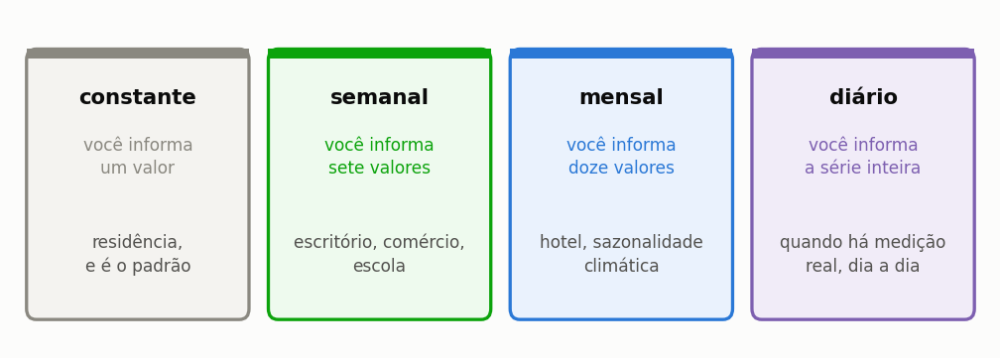
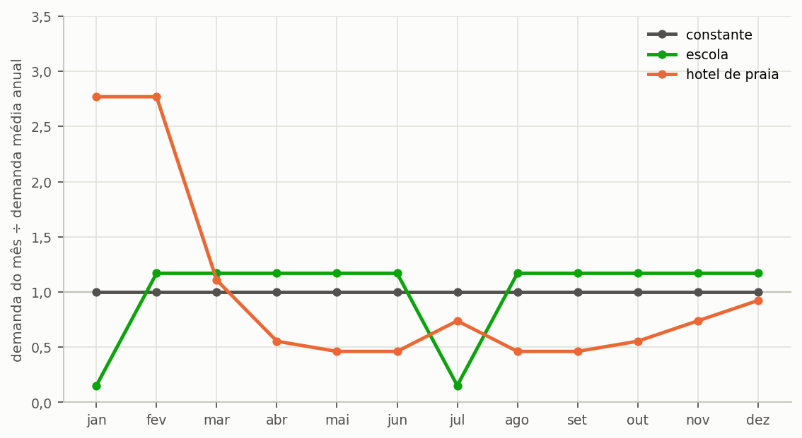
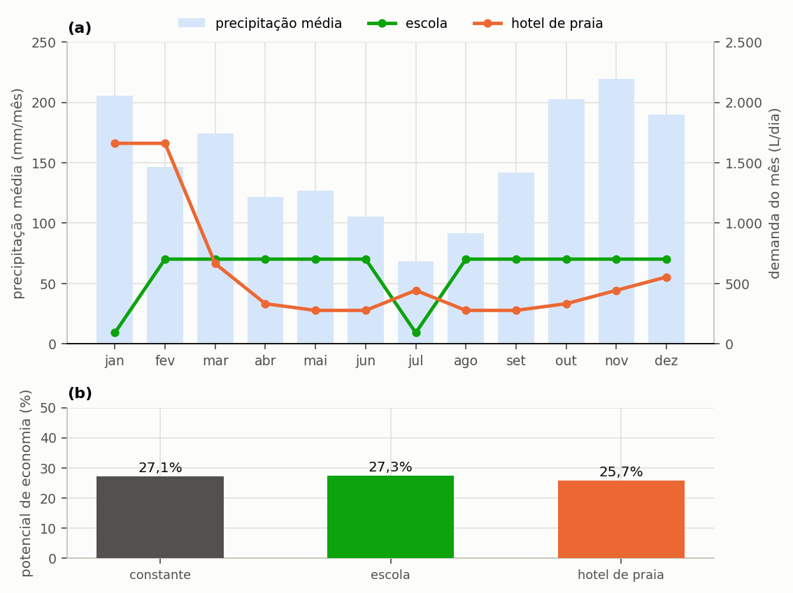

# Modular a demanda por calendário

> **Pergunta que este guia responde:** e quando o consumo não é o mesmo todo dia?

Escolas fecham em janeiro e julho, hotéis de praia enchem no verão e escritórios esvaziam
nos fins de semana. Tratar qualquer uma dessas edificações como se tivesse consumo
uniforme erra nos dois sentidos simultaneamente: superestima a demanda nos períodos
vazios e a subestima nos períodos de pico. ==O erro não se compensa ao longo do ano,
porque o que importa ao sistema pluvial não é o total consumido e sim o encontro entre o
consumo e a chuva disponível naquele dia.==

---

## Os quatro modos

O programa oferece quatro modos de modulação da demanda, que diferem no número de valores que o usuário informa e na situação em que cada um se justifica ({{fig:fig40_modos}}).

*Figura 99 — Os quatro modos de modulação, o que cada um pede ao usuário e a situação em que cada um se justifica. O modo diário só faz sentido quando existe medição real, porque inventar uma série diária acrescenta precisão aparente sem acrescentar informação.*

Em qualquer um deles você pode modular três coisas de forma independente: a
**demanda per capita**, o **número de ocupantes** e a **fração atendível por água
pluvial**.

Modular a ocupação costuma ser mais fiel que modular a demanda: numa escola em
férias não é o aluno que bebe menos água, é que não há aluno.

---

## Como preencher

Na etapa **2. Edificação e Consumo**, escolha o modo. Abre-se a tabela do período.

- Célula vazia ou zerada **cai para o valor constante**. Isso é deliberado: permite
  modular só os meses que interessam e deixar o resto no padrão.
- Os valores podem ser digitados ou carregados de CSV.
- No modo diário, o primeiro dia da série de demanda alinha com o primeiro dia da
  **série de chuva**. Se as duas tiverem tamanhos diferentes, a de demanda é
  reciclada ciclicamente.

---

## Por que isso muda o resultado

Modular a demanda não altera apenas o total anual consumido; altera o casamento temporal
entre oferta e demanda, que é precisamente o problema que o reservatório existe para
resolver. Dois casos opostos ilustram o alcance desse efeito, e ambos são comuns no
Brasil.

**A favor.** Uma escola que fecha em julho, no sul do país, fecha justamente quando
chove menos. A cisterna atravessa a estiagem sem ser solicitada e chega cheia em
agosto. O sistema rende **mais** do que a média anual sugeriria.

**Contra.** Um hotel de praia enche em janeiro e fevereiro, quando chove mais no
litoral sul. Parece bom, mas a demanda concentrada esvazia a cisterna em dias, e o
resto do ano ela fica ociosa. O sistema rende **menos**.

Os dois casos parecem opostos e não o são, e convém enunciar a regra com cuidado,
porque a formulação intuitiva — «demanda em fase com a chuva rende mais» — não
sobrevive ao segundo exemplo. O hotel tem demanda **em fase** com a chuva, já que
ambas culminam no verão, e ainda assim rende menos. O que separa os dois casos não é a
fase, é a **concentração**.

==Uma demanda distribuída ao longo do ano aproveita melhor um mesmo reservatório;
uma demanda concentrada em poucos meses o esvazia em dias e o deixa ocioso no resto do
ano, ainda que esses meses sejam os mais chuvosos.== A escola se beneficia porque o seu
período ocioso coincide com a estiagem, e não porque esteja em fase com a chuva.

Rodadas com a série de Florianópolis, o mesmo consumo anual e o mesmo reservatório de
4.000 L, as três hipóteses se separam: demanda constante rende 27,1%, o perfil escolar
rende 27,3% e o perfil de hotel de praia rende 25,7%. A diferença de quase um ponto e
meio percentual, num teto de 28%, é grande para uma mudança que não altera um único litro do consumo anual, e
é inteiramente invisível a qualquer cálculo feito sobre médias — que é justamente por que o Triton simula dia a dia. Os três perfis estão na {{fig:fig19_modulacao}}, e o rendimento de cada um, na {{fig:fig20_tipologias}}.

*Figura 36 — Os três perfis de demanda usados na comparação, expressos como a razão entre a demanda do mês e a demanda média. Os três têm exatamente o mesmo consumo anual; o que muda é a distribuição dele ao longo dos doze meses.*

*Figura 99 — (a) Perfis mensais de demanda da escola e do hotel de praia sobre a precipitação média mensal de Florianópolis; (b) potencial de economia de cada perfil com o mesmo reservatório de 4.000 L. O perfil de hotel concentra em dois meses quase um terço do consumo anual, e é essa concentração, e não a fase, que lhe custa quase um ponto e meio percentual.*

---

## A fração atendível também pode variar

Menos óbvio e às vezes mais importante. Numa escola, o percentual de uso não potável
muda entre período letivo e férias: em férias permanecem a lavagem de piso e a rega de
jardim, que são usos **integralmente** atendíveis por chuva.

Modular a fração captura isso. Manter fração constante subestima o aproveitamento no
período de baixa ocupação.

Na tabela, a coluna «Não-Potável Interno (%)» é percentual, como todo campo digitado:
28 significa 28%. No arquivo de projeto, a mesma coluna é gravada como fração, 0,28,
e a seção {{n:5}} explica por quê. Uma célula com valor entre 0 e 1 fica laranja.

---

## Cuidados

**Não module o que você não mediu.** Uma modulação inventada acrescenta precisão
aparente sem acrescentar informação alguma, e transfere ao leitor a impressão de um rigor
que o dado não tem. Na dúvida, demanda constante explicitamente declarada é mais honesta
que um perfil mensal arbitrado.

**Declare a origem do perfil.** Ele pode vir de medição própria, de doze faturas de água e esgoto
mensais, de referência bibliográfica ou de estimativa, e essas quatro origens não têm o
mesmo peso probatório num estudo publicado.

**Confira o total anual depois de modular.** O programa exibe a demanda média diária
resultante da modulação, e a divergência entre esse valor e o que se esperava é o
indicador mais rápido de erro de preenchimento da tabela.

---

## O caminho mais simples, quando existe

Se você tem **doze faturas de água e esgoto** da edificação, tem o perfil mensal medido,
que é a melhor fonte possível. Divida o consumo de cada mês pelo número de dias e
pelo número de ocupantes, e use o modo mensal.

Doze faturas valem mais que qualquer referência de literatura.
