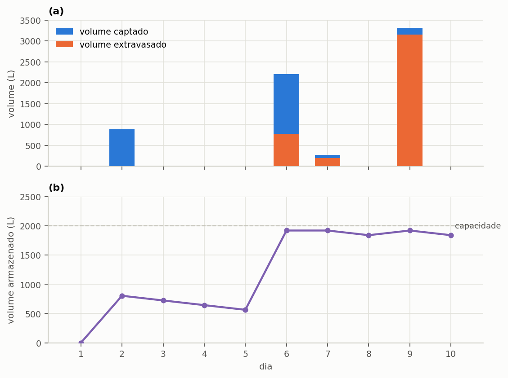
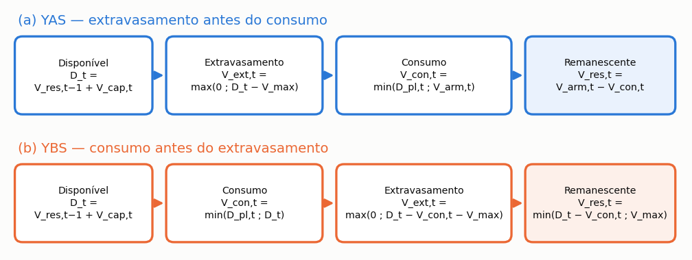

# O balanço hídrico diário

> Ao terminar esta seção você saberá refazer, numa planilha, exatamente o que o
> Triton faz em cada dia da série, e saberá dizer por que o programa chegou ao
> número que chegou.

> **Antes de começar.** O capítulo {{c:4}} é a camada técnica do manual: ela mostra as contas
> por dentro. Você não precisa dela para usar o programa — o capítulo {{c:2}} basta — mas
> precisa dela para **defender** um resultado, seja numa banca, numa revisão ou
> diante de um cliente que perguntou de onde saiu o número.

Esta é a seção da qual todas as outras dependem. O potencial de economia, o fluxo
de caixa, a emissão evitada e a ordenação multicritério saem, todos, dos números que
o balanço diário produz. Quem entende esta seção entende o programa.

O Triton usa um **modelo comportamental de base diária**: para cada dia da série de
precipitação, o programa resolve o que entra no reservatório, o que sai, o que
extravasa e o que permanece armazenado. Não há distribuição de probabilidade nem valor médio
anual. Há a série, dia após dia, e a mesma conta repetida.

---

## A ordem das operações

O programa executa, para cada dia `t`, sempre nesta ordem:

1. **decide se descarta** a primeira chuva, conforme o modo escolhido;
2. **converte a lâmina em volume** captado, com a área e o coeficiente;
3. **soma ao que sobrou de ontem** e verifica o extravasamento;
4. **atende a demanda pluvial** com o que está armazenado;
5. **reparte** o atendimento entre uso interno e irrigação;
6. **completa com água da rede** o que a chuva não atendeu;
7. **classifica** o dia como de atendimento pleno, parcial ou nulo.

A ordem não é arbitrária, e trocar dois passos muda o resultado. O item {{n:23.4}} volta a
isso.

---

## O caso resolvido

Dez dias, uma residência, sem reservatório superior. Os números foram escolhidos
para caber numa planilha.

<!-- inclui: _tabelas/cap23_entrada.md -->

Sem demanda externa, a demanda pluvial diária é a demanda interna vezes a fração não
potável interna, que aqui coincide com a fração atendível total: 200 × 0,40 = **80 L/dia**. É esse o volume que o sistema tenta entregar todo dia.

### A tabela, dia a dia

<!-- inclui: _tabelas/cap23_dez_dias.md -->

---

## Lendo a tabela

Cinco coisas acontecem nesses dez dias, e cada uma ensina uma regra do programa.

### O dia 1: reservatório vazio

A simulação começa com o reservatório **vazio**. Não há chuva no dia 1, não há nada
armazenado, e a demanda pluvial de 80 L não é atendida por gota nenhuma: o dia é de
atendimento **nulo**, e os 200 L do dia inteiro vêm da rede.

Isso não é um defeito da série escolhida. É a condição inicial do modelo, e ela
importa: em séries curtas, os primeiros dias penalizam o resultado. Com dez anos de
série o efeito desaparece; com dez dias, ele responde por todo o desvio entre o
potencial obtido, 36,0%, e a fração atendível de 40%.

### O dia 3: a chuva que se perde inteira

Choveu 1,6 mm. A lâmina de descarte é 2,0 mm. O programa não desconta 1,6 e capta
zero: ele **descarta o dia inteiro**.

> **Atenção.** Quando a regra de descarte se aplica e a chuva do dia não supera a
> lâmina, perde-se o dia **inteiro**, e não a diferença. A conta é
> `P_ef = P − d_f` quando `P > d_f`, e **zero** caso contrário.

A razão é física: o dispositivo de descarte precisa encher antes de a água chegar à
cisterna. Se a chuva não enche o dispositivo, nada passa. Em climas de chuva fraca e
frequente, isso pesa muito mais do que a intuição sugere, e é por isso que o modo de
descarte merece atenção na seção {{n:4}}.

> **Diferença em relação ao Netuno 4.** O Netuno 4 trata `d_f` como **limiar do
> evento**: abaixo dele nada é captado, acima dele capta-se a chuva **inteira**, sem
> subtrair. O Triton subtrai a lâmina. A diferença é deliberada e está quantificada
> na seção {{n:35}}: o Triton estima, em média, de 2,3 a 2,7 pontos percentuais menos
> economia sobre 4.050 casos de referência, e **metade** dessa diferença vem daqui.
> Estudos que comparem as duas versões precisam declarar isso.

### O dia 6: o extravasamento vem antes do consumo

Choveu 28 mm. Descontados os 2 mm de descarte, restam 26 mm efetivos, que sobre
100 m² a 0,85 de coeficiente dão 2.210 L captados.

O reservatório tinha 564 L. Somados, 2.774 L. O reservatório guarda 2.000 L, então
**774 L extravasam**. Só depois disso o programa retira os 80 L da demanda, deixando
1.920 L para o dia seguinte.

> **Atenção.** Esta ordem define o modelo. O extravasamento é calculado **antes** da
> retirada da demanda, como na regra **YAS** (*yield after spillage*), mas a chuva do
> próprio dia já pode atender a demanda do dia, como na regra **YBS**. O Triton fica,
> portanto, entre as duas, e a subseção «YAS, YBS e a ordem do Triton», adiante, mostra
> por quê.
>
> Se o consumo viesse antes do extravasamento, o reservatório aceitaria água que fisicamente já teria
> extravasado, e o programa superestimaria o aproveitamento. A diferença aparece
> justamente nos dias de chuva forte, que são os que mais pesam no total anual.

### O dia 9: o reservatório pequeno demais para o evento

Choveu 41 mm, e o sistema captou 3.315 L. O reservatório estava com 1.840 L e guarda
2.000. **Extravasaram 3.155 L** — mais do que o reservatório inteiro comporta.

Num único dia, o sistema jogou fora o equivalente a trinta e nove dias de demanda
pluvial.
É o retrato do descasamento entre a chuva, que chega concentrada, e a demanda, que é
constante. Aumentar o reservatório recupera parte disso, e é exatamente essa a pergunta que a varredura de volumes da seção {{n:24}} responde. A {{fig:fig01_dez_dias}} resume os dez dias.



*Figura 1 — Os dez dias do caso resolvido: (a) volume captado, em azul, e volume extravasado, em laranja, por dia — no dia 9 o volume extravasado quase iguala o captado; (b) volume armazenado no reservatório inferior ao fim de cada dia, após o consumo, com a capacidade de 2.000 L em tracejado; nos dias 6, 7 e 9 o reservatório atinge a capacidade, extravasa e termina o dia com 1.920 L.*

### A soma: o balanço fecha

A última linha da tabela e o quadro de verificação mostram o fechamento:

```equacao:fechamento
V_cap = V_ext + V_con + V_res
```

| Símbolo | Significado | Unidade |
| :--- | :--- | :--- |
| `V_cap` | volume total captado no período | L |
| `V_ext` | volume total extravasado no período | L |
| `V_con` | volume total de água pluvial consumido no período | L |
| `V_res` | volume remanescente no reservatório ao fim do período | L |

Nos dez dias do caso resolvido, a Equação {{eq:fechamento}} se verifica com os valores
6.681 L de captação, 4.121 L de extravasamento, 720 L de consumo e 1.840 L
remanescentes.

Resíduo zero. O programa não cria nem perde água, e essa verificação é feita
automaticamente pela suíte de testes a cada alteração do código, sobre séries de dez
anos, com resíduo da ordem de 10⁻¹⁴ por cento do captado.

---

## As equações

O balanço diário se escreve em cinco equações encadeadas, que o programa resolve
nesta ordem para cada dia da série. A notação segue a da seção {{n:4}} para a parcela
de captação, e o índice `t` designa sempre o dia corrente da simulação, de modo que
`t−1` é o dia imediatamente anterior.

### O volume captado

A conversão da lâmina precipitada em volume é a primeira operação do dia, e a mais
simples de todas: multiplica-se a chuva efetiva pela área de captação e pelo
coeficiente de escoamento superficial.

```equacao:volume_captado
V_cap,t = P_ef,t × A × C
```

| Símbolo | Significado | Unidade |
| :--- | :--- | :--- |
| `V_cap,t` | volume captado no dia `t` | L |
| `P_ef,t` | chuva efetiva no dia `t`, já descontada a lâmina de descarte | mm |
| `A` | área de captação, em projeção horizontal | m² |
| `C` | coeficiente de escoamento superficial da cobertura | adimensional |

O resultado da Equação {{eq:volume_captado}} sai diretamente em litros, sem fator de
conversão, porque um milímetro de lâmina sobre um metro quadrado de superfície
corresponde exatamente a um litro de água. É a única simplificação dimensional do
modelo, e ela é exata.

### O extravasamento e o armazenamento

O volume disponível antes de qualquer consumo é a soma do que sobrou no reservatório
no fim do dia anterior com o que foi captado hoje, conforme a Equação
{{eq:disponivel}}. Dessa soma decorrem duas parcelas, calculadas nesta ordem: o
excedente que não cabe no reservatório e por isso extravasa, e o volume que fica
efetivamente armazenado.

```equacao:disponivel
D_t = V_res,t−1 + V_cap,t
```

```equacao:extravasado
V_ext,t = max(0 ; D_t − V_max)
```

```equacao:armazenado
V_arm,t = min(D_t ; V_max)
```

| Símbolo | Significado | Unidade |
| :--- | :--- | :--- |
| `D_t` | volume disponível no dia `t`, antes do consumo | L |
| `V_res,t−1` | volume que sobrou no reservatório ao fim do dia anterior | L |
| `V_cap,t` | volume captado no dia `t`, da Equação {{eq:volume_captado}} | L |
| `V_ext,t` | volume extravasado no dia `t` | L |
| `V_arm,t` | volume armazenado no dia `t`, antes do consumo | L |
| `V_max` | capacidade útil do reservatório inferior | L |

==A ordem em que as Equações {{eq:extravasado}} e {{eq:armazenado}} aparecem define o
modelo.== O extravasamento é calculado **antes** da retirada do consumo do dia, e é por isso que
o programa costuma ser descrito pela regra YAS, do inglês *yield after spillage*, isto
é, rendimento posterior ao extravasamento. A descrição é aproximada, e a subseção
seguinte diz em que ela falha. Inverter a ordem faria o reservatório
aceitar, na forma de consumo, água que fisicamente já teria extravasado, e
superestimaria o aproveitamento justamente nos dias de chuva intensa, que são os que
mais pesam no total anual.

A diferença entre as duas ordens é invisível na maior parte dos dias e decisiva
nos poucos que importam. Enquanto o reservatório não enche, extravasar antes ou depois
de consumir dá exatamente o mesmo resultado, porque não há extravasamento algum; nos
dias de chuva intensa, em que o reservatório atinge a capacidade, a ordem determina se
uma parcela de água é contabilizada como consumida ou como perdida. São justamente
esses dias os que mais pesam no total anual, e por isso uma escolha que parece formalidade desloca o resultado inteiro. A {{fig:fig00f_yas}} compara as duas sequências na notação das equações desta seção.



*Figura 99 — Sequência de operações do balanço diário: (a) a ordem adotada pelo programa, com o extravasamento calculado antes do consumo; (b) ordem invertida (YBS), com o consumo retirado antes do extravasamento. As duas sequências só divergem nos dias em que o reservatório atinge a capacidade, e a YBS supõe um consumo anterior à chuva do dia, o que superestima o aproveitamento.*

### YAS, YBS e a ordem do Triton

Na literatura, YAS e YBS têm definição precisa (Fewkes e Butler, 2000). Com `Y_t` o
volume retirado no dia, `Q_t` o volume captado, `S_t` o volume armazenado no fim do dia
e `V_max` a capacidade:

<!-- tabela: Retirada do dia e volume armazenado no fim do dia nas regras YAS e YBS estritas e no Triton -->
| Regra | Retirada do dia | Armazenado no fim do dia |
| :--- | :--- | :--- |
| YAS estrita | `Y_t = min(D_pl,t ; S_t−1)` | `S_t = min(S_t−1 + Q_t − Y_t ; V_max − Y_t)` |
| YBS estrita | `Y_t = min(D_pl,t ; S_t−1 + Q_t)` | `S_t = min(S_t−1 + Q_t − Y_t ; V_max)` |
| Triton | `Y_t = min(D_pl,t ; min(S_t−1 + Q_t ; V_max))` | `S_t = min(S_t−1 + Q_t ; V_max) − Y_t` |

Na YAS estrita, a retirada do dia sai só do que estava guardado na véspera: a chuva de
hoje só serve amanhã. Na YBS estrita, a chuva de hoje atende a demanda antes de o
reservatório extravasar. O Triton faz o extravasamento primeiro, como a YAS, e depois
deixa a chuva do dia, até o limite da capacidade, atender a demanda do dia.

Disso decorre uma desigualdade que vale em qualquer série: o volume consumido pelo
Triton nunca é menor que o da YAS estrita nem maior que o da YBS estrita. O resultado
fica **entre as duas**, mais perto da YAS nos reservatórios grandes, em que a véspera
quase sempre basta, e mais longe dela nos pequenos, em que a chuva do dia pesa. Quem
compara o Triton com um programa ou com uma norma que use a YAS estrita, como o método
detalhado da EN 16941-1:2024 (Anexo A), deve esperar do Triton um potencial de economia
um pouco maior para o mesmo volume.

O programa mantém essa ordem por decisão: ela reproduz o Netuno 4 e os estudos do grupo
de pesquisa que o usaram, e uma mudança aqui deslocaria todos os resultados publicados.

### O atendimento da demanda

Estabelecido quanto há no reservatório, o programa retira dele o menor valor entre a
demanda pluvial do dia e o volume disponível, e devolve ao dia seguinte o que restar.

```equacao:consumido
V_con,t = min(D_pl,t ; V_arm,t)
```

```equacao:sobra
V_res,t = V_arm,t − V_con,t
```

| Símbolo | Significado | Unidade |
| :--- | :--- | :--- |
| `V_con,t` | volume de água pluvial consumido no dia `t` | L |
| `D_pl,t` | demanda pluvial do dia `t`, montada conforme a seção {{n:5}} | L |
| `V_arm,t` | volume armazenado no dia `t`, da Equação {{eq:armazenado}} | L |
| `V_res,t` | volume remanescente, transferido ao dia seguinte | L |

A Equação {{eq:sobra}} é o que torna a simulação diária necessária e insubstituível:
ela liga cada dia ao seguinte e faz do reservatório uma memória do que aconteceu antes.
Nenhum cálculo baseado em médias mensais ou anuais consegue representar esse
encadeamento, e é dele que decorre todo o descasamento entre a oferta concentrada e a
demanda distribuída.

### O complemento da rede pública

O que a chuva não atendeu é comprado da concessionária, e essa parcela reúne três
origens distintas.

```equacao:potavel
V_pot,t = D_pot,t + ΔD_int,t + ΔD_irr,t
```

| Símbolo | Significado | Unidade |
| :--- | :--- | :--- |
| `V_pot,t` | volume de água potável consumido da rede no dia `t` | L |
| `D_pot,t` | demanda que exige água potável por natureza do uso | L |
| `ΔD_int,t` | déficit do uso interno não potável, não atendido pela chuva | L |
| `ΔD_irr,t` | déficit da irrigação, **somente** se o suprimento de reserva estiver ligado | L |

A terceira parcela da Equação {{eq:potavel}} merece atenção porque depende de uma
escolha do usuário. Com o suprimento de reserva ligado, a rede socorre a irrigação nos
dias em que a cisterna seca, e o déficit é suprido com água potável; com ele desligado, o
jardim simplesmente não é regado, a edificação não compra essa água, e o volume
correspondente é contabilizado como **demanda não atendida**, que é a terceira parcela
do balanço de demanda tratada adiante nesta seção.

### A classificação do dia

Por fim, cada dia recebe uma classificação segundo o grau de atendimento alcançado, e é
a partir dessa classificação que se calculam os percentuais de dias de atendimento
pleno, parcial e nulo relatados na seção {{n:25}}.

```equacao:classificacao
pleno: V_con,t = D_pl,t ; parcial: 0 < V_con,t < D_pl,t ; nulo: V_con,t = 0
```

| Símbolo | Significado | Unidade |
| :--- | :--- | :--- |
| `V_con,t` | volume de água pluvial consumido no dia `t` | L |
| `D_pl,t` | demanda pluvial do dia `t` | L |

A comparação da Equação {{eq:classificacao}} é feita com tolerância de 10⁻⁵ L, e não
por igualdade exata. A razão é aritmética e não conceitual: o balanço trabalha com
números de ponto flutuante, e uma diferença da ordem do erro de arredondamento
classificaria como parcial um dia que foi plenamente atendido.

## O balanço de demanda tem três parcelas

A demanda total de um dia se reparte em três, e não em duas:

```equacao:demanda_tres
D_t = V_con,t + V_pot,t + V_nao,t
```

| Símbolo | Significado | Unidade |
| :--- | :--- | :--- |
| `D_t` | demanda total da edificação no dia `t` | L |
| `V_con,t` | parcela atendida com água pluvial | L |
| `V_pot,t` | parcela comprada da rede pública | L |
| `V_nao,t` | parcela que ninguém forneceu, isto é, demanda não atendida | L |

As três parcelas são o consumo de água pluvial, o consumo da rede pública e a **demanda não atendida**. A terceira é zero na
configuração padrão, em que a rede socorre a irrigação nos dias secos. Ela deixa de
ser zero quando o usuário desliga esse socorro, e aí o programa precisa mostrá-la:
sem ela, o balanço fecharia por construção, escondendo a água que ninguém forneceu.

---

## Com reservatório superior

Quando o projeto tem caixa d'água superior, o passo 4 muda. Em vez de consumir
direto do reservatório inferior, o programa:

1. consome da caixa superior o que estiver **acima do limiar de acionamento**;
2. se ainda falta e há água embaixo, **aciona a motobomba**: transfere o menor valor
   entre o que há no inferior e o espaço livre em cima, e conta **um ciclo**;
3. consome de novo do que acabou de chegar;
4. repete até atender a demanda ou acabar a água.

O limiar de acionamento é o volume de reserva que não se consome, e serve para a
bomba não ligar a cada litro. Ele é limitado ao volume da caixa superior: informar um
limiar maior que a caixa não faz o programa recusar, faz ele adotar a caixa cheia.

> **O reservatório superior não aumenta a economia de água.** Ele muda **quando** a
> água é entregue, não **quanta**. O que ele acrescenta é custo: o investimento na
> caixa e na bomba, a energia do recalque e a emissão associada. A seção {{n:8}}
> mostra isso com números.

O número de ciclos e o volume recalcado saem daqui e alimentam o cálculo de energia
da seção {{n:28}}.

---

## O que o modelo não representa

- **Não há sub-passo horário.** Uma chuva de 40 mm concentrada em duas horas e a
  mesma lâmina distribuída em vinte e quatro horas produzem o mesmo resultado. Para
  reservatórios muito pequenos em relação à área de captação, isso subestima o
  extravasamento.
- **Não há perda por evaporação ou vazamento** no reservatório.
- **A condição inicial é reservatório vazio.** Em séries de menos de um ano, isso
  penaliza o resultado de forma sensível.
- **O coeficiente de escoamento é único e constante.** Não varia com a intensidade da
  chuva nem com o tempo desde o último evento.
- **No balanço, o descarte é uma lâmina, e não um dispositivo com dinâmica própria.** O reservatório de descarte é dimensionado e orçado pelo volume `A × d_f` (seção {{n:27}}), mas o seu esvaziamento entre eventos não é simulado: a lâmina é aplicada conforme o modo de descarte escolhido.

A seção {{n:36}} reúne estas e as demais limitações conhecidas.

---

## Para conferir

O caso resolvido desta seção está no arquivo `03_dez_dias.triton`, na pasta de
casos que acompanha o programa. Abra, rode, e compare com a tabela impressa.

Se algum número divergir, é o manual que está desatualizado em relação ao programa. E
nesse caso a verificação automática já terá avisado, porque cada número desta tabela
tem uma asserção correspondente na suíte de testes descrita na seção {{n:34}}.
