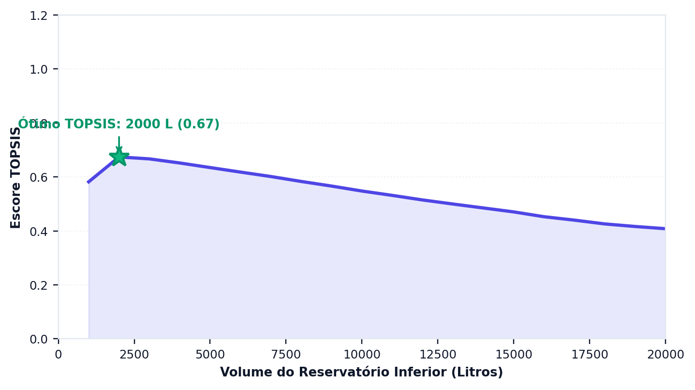
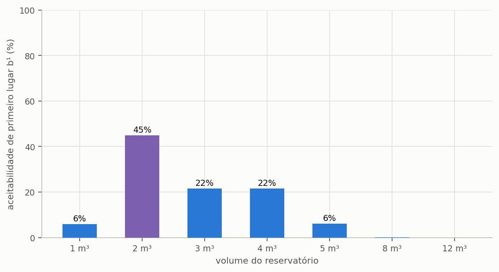

# Decisão multicritério

> Esta seção formaliza os dois métodos de ordenação que o programa oferece e declara
> três desvios em relação à formulação canônica que um estudo publicado precisa citar.

Análise multicritério é o ramo da pesquisa operacional que trata de escolher entre
alternativas quando os critérios de avaliação discordam entre si e não podem ser
reduzidos a um único número sem que alguém declare o que vale mais. É exatamente a
situação de um projeto de aproveitamento pluvial: o volume que entrega mais água não é o
que rende mais dinheiro, e nenhum dos dois costuma ser o de menor impacto de carbono.

O que os métodos desta seção fazem não é descobrir a resposta certa. ==Eles tornam
explícita a ponderação que, de outro modo, ficaria implícita na escolha de quem
decide.== Essa é toda a diferença entre um estudo que declara os seus valores e um que
os esconde atrás de um resultado aparentemente objetivo.

---

## Os oito critérios

O programa avalia cada volume da varredura segundo oito critérios, agrupados em quatro
eixos: técnico, econômico, ambiental e estrutural. Cada critério tem uma direção de
preferência: nos de benefício, mais é melhor; nos de custo, menos.

<!-- tabela: Os oito critérios de decisão, o eixo, a direção de preferência e a definição de cada um no programa -->
| # | Eixo | Critério | Direção | Definição no programa |
| :-- | :--- | :--- | :--- | :--- |
| 1 | técnico | confiabilidade volumétrica | maximizar | água de chuva consumida ÷ demanda de água de chuva (uso não potável mais irrigação), em % (seção {{n:25}}) |
| 2 | técnico | eficiência de armazenamento | maximizar | água de chuva entregue por dia ÷ volume da cisterna inferior, em %: a renovação diária do volume, ou o giro anual ÷ 365 |
| 3 | econômico | economia financeira líquida | maximizar | o VPL do sistema contra a linha de base sem cisterna: a conta de água evitada menos o investimento e o custeio, descontados (seção {{n:29}}) |
| 4 | econômico | custo nivelado da água (LCOW) | minimizar | Equação {{eq:lcow}}, na moeda do projeto por m³ |
| 5 | econômico | payback descontado | minimizar | o tempo para o fluxo de caixa descontado se pagar; quem não se paga recebe o pior payback observado mais 10%, com ao menos um ano a mais e ao menos 20 anos |
| 6 | ambiental | CO₂e de ciclo de vida | minimizar | o CO₂e líquido no fim da vida útil; negativo é carbono evitado (seção {{n:30}}) |
| 7 | estrutural | massa a seco do sistema | minimizar | a massa a seco de cisternas, tubos, motobomba e acessórios, da calculadora de peso descrita adiante |
| 8 | estrutural | extravasamento anual | minimizar | o volume extravasado por ano, em m³ |

Dois eixos puxam em sentidos opostos por dentro, e é de propósito. No técnico, a
confiabilidade sobe com o volume e a eficiência de armazenamento cai: a cisterna grande
atende mais dias, mas guarda água que ninguém usa. A eficiência não é a ocupação média da
cisterna, que em clima úmido sobe com o volume justamente porque a cisterna grande fica
cheia de água parada. No estrutural, a massa sobe com o volume e o extravasamento cai.

==O modelo de sete critérios, até a versão 0.1.0, contava três vezes a mesma água
economizada==: o potencial de economia, o extravasamento e o consumo de água potável
melhoravam todos com o volume, e empurravam a escolha para tanques grandes. O modelo de oito
critérios reduz essa colinearidade e leva o peso do sistema à decisão.

O custo nivelado da água divide tudo o que o sistema custa por toda a água que ele entrega,
os dois descontados à mesma taxa e no mesmo horizonte do projeto:

```equacao:lcow
LCOW = ( I + Σ C_t × FD_t ) ÷ ( Σ V_t × FD_t )
```

| Símbolo | Significado | Unidade |
| :--- | :--- | :--- |
| `LCOW` | custo nivelado da água de chuva | R$/m³ |
| `I` | investimento inicial | R$ |
| `C_t` | custeio do período `t`: energia, operação e manutenção, cloro e linha de tratamento | R$ |
| `V_t` | água de chuva entregue no período `t` | m³ |
| `FD_t` | fator de desconto do período `t`, à taxa mínima de atratividade | adimensional |

O LCOW desenha um U ao longo do volume. Na cisterna pequena, pouca água divide o custo
fixo da instalação; na grande, o volume acrescentado custa mais do que a água a mais que
entrega. A alternativa sem cisterna não entrega água e não tem LCOW: recebe o pior valor
observado mais 10%.

As alternativas submetidas à ordenação são os volumes simulados na varredura, e cada uma
delas comparece com os oito valores acima, calculados nas seções {{n:23}}, {{n:25}},
{{n:29}} e {{n:30}} e pela calculadora de peso. Não há critério inventado nesta etapa: o
método apenas ordena o que as dimensões anteriores já produziram.

---

## TOPSIS

O TOPSIS — *Technique for Order of Preference by Similarity to Ideal Solution*, proposto
por Hwang e Yoon em 1981 — parte de uma ideia geométrica simples. Se cada alternativa é
um ponto num espaço de oito dimensões, uma por critério, então existem dois pontos de
referência: a **solução ideal**, composta pelo melhor valor de cada critério, e a
**solução anti-ideal**, composta pelos piores. Nenhuma alternativa real ocupa qualquer
um dos dois, porque nenhuma vence em tudo nem perde em tudo, e a melhor alternativa é a
que está simultaneamente mais perto do ideal e mais longe do pior caso.

O método executa cinco passos. Monta a matriz de decisão, com as alternativas nas linhas
e os critérios nas colunas; normaliza essa matriz, para que critérios medidos em reais,
em pontos percentuais e em quilogramas passem a ocupar escalas comparáveis; aplica os
pesos declarados; identifica as soluções ideal e anti-ideal; e ordena as alternativas
pela proximidade relativa ao ideal.

```equacao:topsis
C_i = d_i⁻ ÷ ( d_i⁺ + d_i⁻ )
```

| Símbolo | Significado | Unidade |
| :--- | :--- | :--- |
| `C_i` | coeficiente de proximidade da alternativa `i`, entre 0 e 1 | adimensional |
| `d_i⁺` | distância euclidiana da alternativa `i` à solução ideal | adimensional |
| `d_i⁻` | distância euclidiana da alternativa `i` à solução anti-ideal | adimensional |

O coeficiente da Equação {{eq:topsis}} valeria 1 para uma alternativa que coincidisse com
a solução ideal em todos os critérios, e 0 para uma que coincidisse com a anti-ideal.
Como nenhuma alternativa real ocupa esses extremos, o que interessa não é o valor
absoluto do coeficiente, e sim a ordenação que ele produz.

---

Aplicado à varredura completa do projeto do tutorial, de 1 a 20 m³ com passo de 1 m³ e 25% de peso em cada eixo, o escore sobe até 2 m³ e cai daí em diante: além desse volume, o que se perde em eficiência de armazenamento, custo, carbono e massa pesa mais que o ganho de confiabilidade ({{fig:fig22_topsis}}). O máximo, em 2 m³, coincide com o dos sete candidatos da seção {{n:12}}, mas a coincidência não é garantida. O ideal e o anti-ideal são construídos a partir do conjunto avaliado: acrescentar ou retirar alternativas desloca os pontos de referência e pode alterar a ordenação, fenômeno conhecido como inversão de ordem (*rank reversal*). Na varredura, a margem entre 2 e 3 m³ cai a sete milésimos de escore.



*Figura 99 — Escore TOPSIS de cada volume da varredura do projeto do tutorial, de 1 a 20 m³, com cisterna de polietileno, 25% de peso em cada um dos quatro eixos e partes iguais dentro de cada eixo; a estrela marca o volume de maior escore. Figura gerada pelo próprio programa.*

---

## Três desvios a declarar

A implementação do programa se afasta da formulação canônica em três pontos, todos
deliberados, e um estudo publicado precisa declará-los para não atribuir aos métodos
originais um comportamento que é do programa.

**A normalização é uma variante.** A formulação canônica de Hwang e Yoon emprega
normalização vetorial, que pressupõe valores não negativos em todos os critérios. O valor
presente líquido, porém, é negativo com frequência nos volumes pequenos, em que o
investimento não se paga. O programa contorna a restrição transladando cada critério por
`x − min(x)` antes de normalizar. A escolha é necessária e deliberada, mas apresentar o
resultado como TOPSIS canônico seria incorreto: declare a variante.

**As condições de Opricovic não estão implementadas.** O método VIKOR, na formulação de
Opricovic, exige duas verificações sobre a solução de compromisso encontrada — a de
vantagem aceitável e a de estabilidade aceitável — e, quando qualquer uma delas falha,
devolve um **conjunto** de soluções equivalentes em vez de um único vencedor. O programa
devolve sempre a melhor alternativa, sem realizar o teste. Na prática, isso significa que
a solução de compromisso do VIKOR deve ser lida ao lado da análise de sensibilidade de
pesos, e nunca sozinha.

**A atribuição do código.** A implementação do VIKOR e do SMAA-VIKOR foi escrita de forma
independente e verificada contra a biblioteca `crispyn`, de Aleksandra Bączkiewicz. O
TOPSIS foi verificado contra a formulação original de Hwang e Yoon num caso de valores
todos positivos, em que a translação descrita acima é inócua e as duas formulações
precisam coincidir.

---

## SMAA-VIKOR

O SMAA — *Stochastic Multicriteria Acceptability Analysis* — existe para responder à
pergunta que o TOPSIS não responde: e se os pesos fossem outros? Em vez de exigir um
conjunto de pesos definido de antemão, o método sorteia milhares de combinações de pesos
e devolve, para cada alternativa, a probabilidade de ela ocupar cada posição do ranking.

A leitura do resultado é direta e informativa. Um volume que vence em 80% dos sorteios é
uma recomendação robusta, que não depende de uma ponderação específica para se sustentar.
Um volume que vence em 30% é uma recomendação frágil, e o texto do estudo precisa dizê-lo
em vez de apresentar o vencedor como se fosse consensual.

> É a ferramenta certa quando não há consenso sobre os pesos — que é o caso normal em
> projetos reais, nos quais o cliente, o projetista e o órgão ambiental costumam
> valorizar dimensões diferentes.

---

A leitura mais útil da análise estocástica não é o vencedor, e sim a margem com que
ele vence. Um volume que fica em primeiro lugar em três quartos dos sorteios de pesos é
uma escolha estável, que sobrevive a uma mudança de prioridade do decisor; dois volumes
tecnicamente empatados indicam o contrário, e nesse caso declarar o peso adotado deixa
de ser formalidade e passa a ser a única informação que sustenta a recomendação ({{fig:fig23_smaa}}).



*Figura 99 — Aceitabilidade de primeiro lugar (b¹) de cada volume candidato, obtida com cinco mil vetores de pesos sorteados no simplex. O volume destacado é o que mais vezes fica em primeiro lugar, e os demais repartem o restante.*

### O tutorial, pelos dois métodos

A tabela põe lado a lado o escore TOPSIS, com 25% de peso em cada um dos quatro eixos, e
a aceitabilidade de primeiro lugar do SMAA-VIKOR, com cinco mil vetores de oito pesos
sorteados, para os sete volumes do tutorial em polietileno com caixa superior.

<!-- inclui: _tabelas/cap32_decisao.md -->

Os dois métodos concordam no vencedor, 2.000 L, e discordam na margem. O TOPSIS separa o
primeiro do segundo colocado por dezenove milésimos de escore, diferença que nenhum dado de
entrada sustenta. O SMAA mede essa fragilidade: 2.000 L vencem em 45% dos sorteios, e
3.000 e 4.000 L em 22% cada. Pela régua da seção {{n:20}}, a recomendação é razoável, e o
estudo deve declarar a segunda opção, que aqui são duas, quase empatadas. Os 12.000 L não
vencem em sorteio nenhum, e os 8.000 L quase nunca: nenhuma ponderação plausível os
recomenda, e isso também é resultado.

---

## Os pesos

O programa aceita quatro pesos de eixo — técnico, econômico, ambiental e estrutural — ou
oito pesos de critério. O peso de cada eixo se reparte entre os critérios do eixo pelas
*partes no eixo*: o critério recebe o peso do eixo vezes a sua parte, dividida pela soma das
partes do eixo. Só a proporção dentro do eixo importa, e parte zero tira o critério da conta.
No padrão, cada eixo vale 25% e as partes são iguais: a confiabilidade e a eficiência valem
12,5% cada; o VPL, o LCOW e o payback, 8,33% cada; o CO₂e, 25%; a massa e o extravasamento,
12,5% cada. Oito pesos diretos valem como estão, normalizados pela soma.

Três pesos, de projetos e estudos feitos até a 0.1.0, são lidos como técnico, econômico e
ambiental, e o eixo estrutural recebe a média dos três: pesos iguais continuam iguais. Sete
valores, de pesos ou de partes do modelo anterior, são recusados com a mensagem da seção
{{n:37}}, porque não correspondem a nenhum dos oito critérios. TOPSIS, VIKOR e PROMETHEE II
usam a mesma regra; o SMAA-VIKOR sorteia oito pesos no simplex e informa, para cada volume,
os pesos centrais agregados nos quatro eixos.

<!-- tabela: Onde se declaram os pesos de eixo e as partes no eixo -->
| Onde | Pesos de eixo | Partes no eixo |
| :--- | :--- | :--- |
| aba de decisão | quatro controles (Técnico, Econômico, Ambiental, Estrutural; 25% cada) e os perfis «Equilibrado» e «Priorizar …», 70% no eixo e 10% em cada outro | a linha «Partes no eixo», com oito controles e o botão «Partes iguais» |
| linha de comando | `--weights t,e,a,s`, ou oito valores; três ainda valem | `--criterion-shares`, oito valores; padrão 1,1,1,1,1,1,1,1 |
| arquivo de projeto | `analysis.topsis_weights`, com quatro ou oito valores | `analysis.topsis_criterion_shares`, com oito valores |
| estudo declarativo | `analise.pesos`, com quatro ou oito valores; três ainda valem | `analise.partes_no_eixo`, com oito valores |

As partes seguem a ordem da tabela de critérios: confiabilidade, eficiência, economia
líquida, LCOW, payback, CO₂e, massa e extravasamento. A escolha dos pesos, contudo, não é
técnica: é uma declaração de valor, e por isso precisa aparecer no texto do estudo, com os
quatro pesos e as partes. ==A afirmação «volume ótimo pelo TOPSIS», sem os
pesos, é impossível de reproduzir,== e dois estudos com pesos diferentes chegam a volumes
diferentes sem que nenhum dos dois esteja errado.

Três condutas são defensáveis, e a escolha entre elas depende de quanto se sabe sobre as
prioridades de quem decide. Pesos iguais, declarados explicitamente como ausência de
preferência, constituem a posição neutra. Pesos justificados, com a razão de cada um,
são preferíveis quando as prioridades são conhecidas. E o SMAA, reportando a faixa de
resultados em vez de um vencedor único, é a conduta mais completa quando não há consenso.

---

## Os melhores por critério isolado

Além da ordenação ponderada, o programa identifica o vencedor isolado de três eixos e
reporta os três separadamente: o técnico, que é o volume ideal pelo limiar de ganho marginal
da varredura ou, quando os candidatos não trazem esse limiar, como nas tabelas da seção
{{n:12}}, o de maior confiabilidade volumétrica; o financeiro, de menor payback descontado,
com desempate pelo VPL; e o ambiental, de menor CO₂e de ciclo de vida. O eixo estrutural não
tem vencedor isolado, porque os seus dois critérios puxam em sentidos opostos. São números
que valem ser publicados em conjunto, porque cada um responde a uma pergunta legítima e
diferente.

Quando os três coincidem, a recomendação é forte e a decisão dispensa ponderação. Quando
divergem, que é o caso comum e é o do tutorial, ==a divergência **é** o resultado:==
escondê-la atrás de um único número ponderado empobrece o estudo e transfere ao leitor
uma conclusão que ele não tem como avaliar.

---

## O peso do sistema

A massa a seco do eixo estrutural sai da calculadora de peso do programa, que soma a
cisterna inferior, o reservatório superior, a motobomba, o quadro e as válvulas do recalque,
o descarte inicial, os tubos e os acessórios. Ela informa também a carga de água e a carga em
operação, em kg e em kN, separadas em três posições: subsolo ou nível inferior, cobertura ou
nível superior, e prumadas e rede.

Na linha de comando, `triton analyze` com `--analysis system_weight` (ou `all`) traz esse
bloco no texto do terminal, no HTML e no XLSX: a aba `system_weight` guarda o resumo do volume
escolhido, e os valores de cada volume ficam na aba `alternatives`. No multicritério da aba de
decisão e da linha de comando, a massa sai da configuração do projeto; nas tabelas deste
manual, da configuração padrão da calculadora. A diferença entre as duas é uma parcela que
não muda com o volume, e o TOPSIS, que desloca cada critério pelo mínimo da coluna, chega à
mesma ordem.

Quatro alertas pedem confirmação com o projeto estrutural ou de fundações: mais de 500 kg na
cobertura com o reservatório cheio, reservatório superior acima de 1.500 L, cisterna acima de
3.000 kg a seco e cisterna de concreto. ==São limiares de atenção do programa, e não de
norma==: o alerta não aprova nem reprova a estrutura, só diz quando vale perguntar a quem a
calcula.

---

## O que o método não faz

Convém encerrar pelos limites, porque métodos multicritério são frequentemente
apresentados com uma autoridade que não têm.

**Não escolhem os pesos.** A ponderação é do analista, e é uma decisão de valor, não de
técnica. Nenhum procedimento estatístico a substitui.

**Não validam os critérios.** Se o valor presente líquido estiver errado porque o regime
tarifário do município foi mal informado, o TOPSIS ordenará o erro com precisão
impecável. O método ordena o que recebe.

**Não incorporam restrições.** Espaço disponível no terreno, orçamento máximo, exigência
normativa: tudo isso é filtro anterior à ordenação, aplicado pelo projetista ao decidir
quais volumes sequer entram na comparação.
